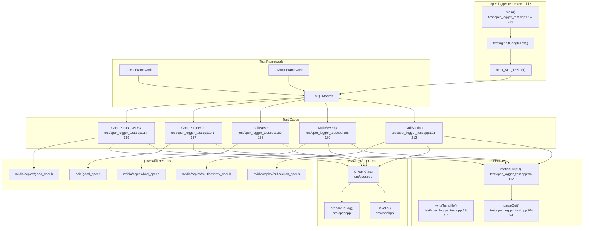
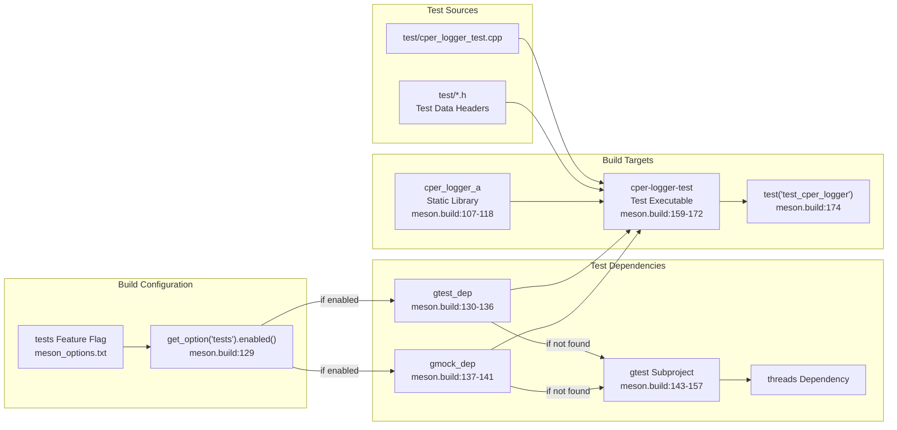
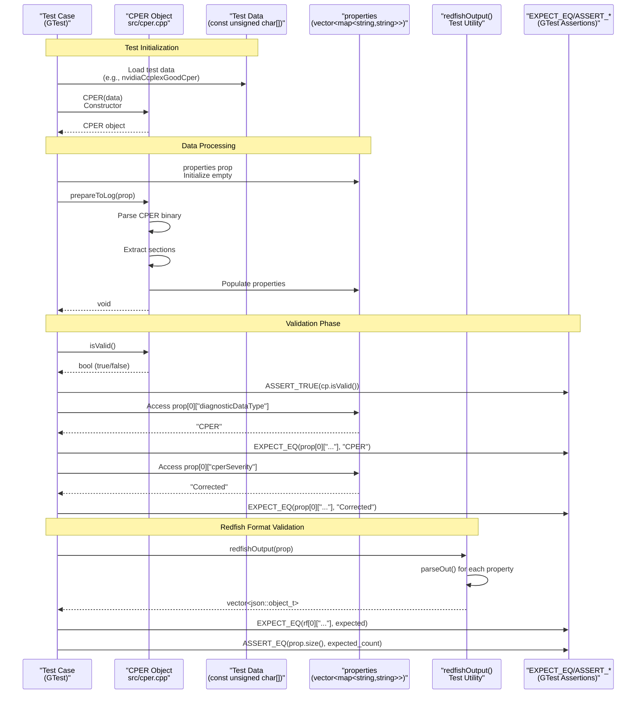

<!-- source: DeepWiki mcp.deepwiki.com · repo NVIDIA/cper-logger · page 4 Testing · fetched 2026-10-26 -->

# Testing

<details>
<summary>Relevant source files</summary>

The following files were used as context for generating this wiki page:

- [meson.build](meson.build)
- [test/cper_logger_test.cpp](test/cper_logger_test.cpp)

</details>


The cper-logger testing infrastructure validates CPER parsing, formatting, and logging functionality through a comprehensive GTest-based test suite. This page provides an overview of the test architecture, build configuration, and execution model. For detailed information on the test framework implementation, see [Test Framework](#4.1). For documentation of the test data samples used for validation, see [Test Data Samples](#4.2). For practical instructions on building and running tests, see [Running Tests](#5.2).

## Overview

The test system validates the CPER processing library ([CPER Processing Library](#2.1)) through unit tests that exercise parsing, validation, and formatting operations. Tests are optional and controlled by the `tests` Meson feature flag. The test suite uses real CPER binary data samples representing various error types and validation scenarios.

The testing approach focuses on:
- **Parsing validation**: Verifying that CPER binary data is correctly parsed into structured JSON
- **Property extraction**: Ensuring that `prepareToLog()` produces correct property maps for logging
- **Error handling**: Validating behavior with malformed or invalid CPER data
- **Multi-section support**: Testing CPER records with multiple error sections
- **Redfish format**: Verifying that output conforms to expected Redfish structure

**Sources**: [test/cper_logger_test.cpp:1-219](), [meson.build:129-175]()

## Test Architecture



The test architecture consists of five core test cases that exercise different aspects of CPER processing. Each test case instantiates a `CPER` object with binary test data, invokes `prepareToLog()` to extract properties, and validates the output using GTest assertions. Test utilities provide helper functions for Redfish format validation and temporary file management.

**Sources**: [test/cper_logger_test.cpp:1-219]()

## Test Build Configuration



Tests are conditionally compiled based on the `tests` feature flag in [meson.build:129-175](). The build system attempts to find GTest and GMock as system dependencies, falling back to a CMake subproject if not found. The test executable links against the same `cper_logger_a` static library used by the main service, ensuring consistent behavior between production and test code.

| Configuration Item | Value | Location |
|-------------------|-------|----------|
| **Feature Flag** | `tests` | `meson_options.txt` |
| **Test Executable** | `cper-logger-test` | [meson.build:159]() |
| **Test Source** | `test/cper_logger_test.cpp` | [meson.build:161]() |
| **Test Registration** | `test('test_cper_logger', cper_logger_test)` | [meson.build:174]() |
| **Include Directories** | `inc + [include_directories('test')]` | [meson.build:170]() |
| **Link Library** | `cper_logger_a` | [meson.build:171]() |

**Sources**: [meson.build:129-175]()

## Test Execution Flow



Each test follows a consistent pattern: load test data, construct a `CPER` object, invoke `prepareToLog()` to extract properties, and validate the output. The `properties` type is defined as `std::vector<std::map<std::string, std::string>>` where each vector element represents one CPER section. Tests validate both basic properties (severity, type) and Redfish-formatted output through the `redfishOutput()` utility function.

**Sources**: [test/cper_logger_test.cpp:114-212]()

## Test Coverage

The test suite provides coverage for the following scenarios:

| Test Case | Purpose | Test Data | Expected Outcome |
|-----------|---------|-----------|------------------|
| **GoodParseCCPLEX** | Valid NVIDIA CCPLEX CPER with multiple sections | `nvidiaCcplexGoodCper` | `isValid()` returns true, 5 sections extracted, severity "Corrected" |
| **GoodParsePCIe** | Valid PCIe CPER with single section | `pcieGoodCper` | `isValid()` returns true, 1 section extracted, severity "Corrected" |
| **FailParse** | Malformed CPER data | `nvidiaCcplexBadCper` | `isValid()` returns false, 0 sections extracted |
| **MultiSeverity** | CPER with sections of different severities | `nvidiaCcplexMultiseverityCper` | `isValid()` returns true, 5 sections extracted |
| **NullSection** | CPER with null/empty sections | `nvidiaCcplexNullsectionCper` | `isValid()` returns true, 4 sections extracted |

### Validation Assertions

Tests use the following GTest assertion patterns:

- **`ASSERT_TRUE(cp.isValid())`**: Validates successful parsing (lines 120, 146, 173, 196)
- **`ASSERT_FALSE(cp.isValid())`**: Validates parse failure detection (line 164)
- **`EXPECT_EQ(prop[0]["key"], value)`**: Validates property extraction (lines 122, 148, 178, 198)
- **`ASSERT_EQ(prop.size(), count)`**: Validates section count (lines 129, 151, 176, 204)
- **`EXPECT_EQ(rf[i]["path"], value)`**: Validates Redfish format structure (lines 133-138, 153-156, 181-187, 206-211)

**Sources**: [test/cper_logger_test.cpp:114-212]()

## Test Utilities

The test suite includes utility functions for test data management and output validation:

### writeTempfile()

```
std::string writeTempfile(const unsigned char* data, 
                          unsigned int size,
                          const std::string& basename)
```

Creates a temporary file with CPER binary data. Located at [test/cper_logger_test.cpp:31-57](). Currently unused in the test suite but available for future file-based test scenarios.

### parseOut()

```
void parseOut(const std::map<std::string, std::string>& m,
              const std::span<Keypair>& array, 
              nlohmann::json::object_t& jFlat)
```

Transforms property maps into flattened JSON objects according to a key mapping configuration. Located at [test/cper_logger_test.cpp:66-94](). Handles both direct string values and nested JSON parsing.

### redfishOutput()

```
std::vector<nlohmann::json::object_t> redfishOutput(const properties& m)
```

Converts CPER properties into Redfish-compliant JSON structure. Located at [test/cper_logger_test.cpp:96-112](). Uses a predefined mapping configuration that includes:

| Source Key | Redfish Path | JSON Nested |
|------------|--------------|-------------|
| `REDFISH_MESSAGE_ID` | `/MessageId` | No |
| `diagnosticData` | `/DiagnosticData` | No |
| `diagnosticDataType` | `/DiagnosticDataType` | No |
| `notificationType` | `/CPER/NotificationType` | No |
| `sectionType` | `/CPER/SectionType` | No |
| `jsonDiagnosticData` | `/CPER/Oem/Nvidia` | Yes |

**Sources**: [test/cper_logger_test.cpp:31-112]()

## Running Tests

Tests are executed through the Meson test framework. The test executable is registered as `test_cper_logger` in [meson.build:174](). For detailed instructions on building and running the test suite, see [Running Tests](#5.2).

Basic test execution:
- **Build with tests enabled**: Configure with `-Dtests=enabled`
- **Run all tests**: Execute `meson test` in the build directory
- **Run specific test**: Execute `./cper-logger-test` directly

**Sources**: [meson.build:174]()

---

