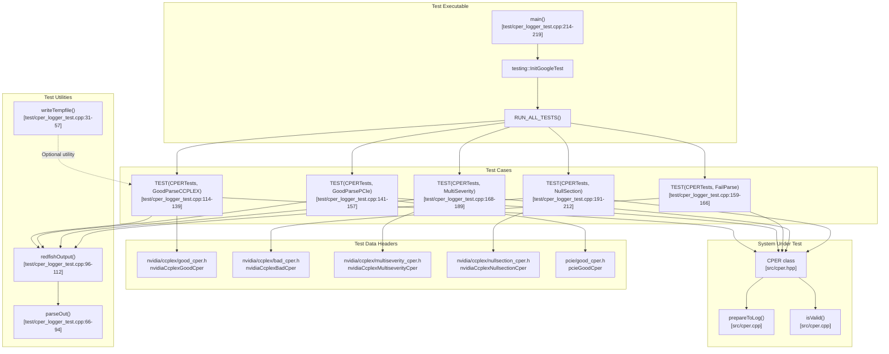
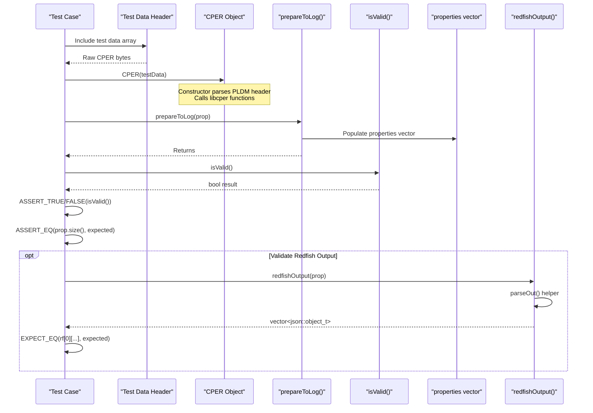

<!-- source: DeepWiki mcp.deepwiki.com · repo NVIDIA/cper-logger · page 4.1 Test Framework · fetched 2026-10-26 -->

# Test Framework

<details>
<summary>Relevant source files</summary>

The following files were used as context for generating this wiki page:

- [test/cper_logger_test.cpp](test/cper_logger_test.cpp)

</details>


## Purpose and Scope

This document describes the GTest-based test framework used to validate CPER processing functionality in the cper-logger system. It covers test infrastructure, test data management, existing test cases, and guidelines for writing new tests.

For information about the test data samples used by this framework, see [Test Data Samples](#4.2). For instructions on building and running tests, see [Running Tests](#5.2).

**Sources:** [test/cper_logger_test.cpp:1-219]()

---

## Test Infrastructure

The cper-logger test suite uses the Google Test (GTest) framework to validate CPER parsing, validation, and logging preparation logic. Tests are controlled by the `tests` feature flag in the Meson build system (see [Build Configuration](#3.1)).

### Test Executable Structure

The test suite compiles to a standalone executable (`cper-logger-test`) that links against:
- The static library `libcper_logger_a.a` containing the `CPER` class
- GTest/GMock framework libraries
- All dependencies required by the CPER processing logic (sdbusplus, libcper, nlohmann_json, etc.)

The main test file is located at [test/cper_logger_test.cpp](), which includes:
- Test data header files containing raw CPER byte arrays
- The `cper.hpp` header to access the `CPER` class interface
- GTest framework headers
- Utility functions for test data manipulation

**Sources:** [test/cper_logger_test.cpp:1-30]()

---

## Test Suite Architecture



**Sources:** [test/cper_logger_test.cpp:1-219]()

---

## Test Data Management

### Test Data Header Files

Test data is embedded as constant byte arrays in header files, organized by CPER type and scenario:

| Header File | Variable Name | Purpose |
|-------------|---------------|---------|
| `nvidia/ccplex/good_cper.h` | `nvidiaCcplexGoodCper` | Valid NVIDIA CCPLEX CPER with multiple sections |
| `nvidia/ccplex/bad_cper.h` | `nvidiaCcplexBadCper` | Invalid/malformed CPER data for error handling tests |
| `nvidia/ccplex/multiseverity_cper.h` | `nvidiaCcplexMultiseverityCper` | CPER with sections of different severity levels |
| `nvidia/ccplex/nullsection_cper.h` | `nvidiaCcplexNullsectionCper` | CPER containing null sections |
| `pcie/good_cper.h` | `pcieGoodCper` | Valid PCIe error CPER |

These arrays are included directly in the test file at [test/cper_logger_test.cpp:18-22]() and passed to the `CPER` class constructor.

### Test Data Utilities

#### writeTempfile Function

[test/cper_logger_test.cpp:31-57]()

```cpp
std::string writeTempfile(const unsigned char* data, unsigned int size,
                          const std::string& basename)
```

Creates temporary files from CPER byte arrays. This utility:
- Generates unique filenames using `mkstemp()` in `/tmp/`
- Writes raw CPER data to the file
- Returns the file path for use in tests
- Handles exceptions during file operations

**Current Usage:** Not actively used in existing tests, but available for tests that require file-based CPER input.

**Sources:** [test/cper_logger_test.cpp:31-57]()

---

## Test Execution Flow



**Sources:** [test/cper_logger_test.cpp:114-212]()

---

## Core Test Cases

### GoodParseCCPLEX

**Location:** [test/cper_logger_test.cpp:114-139]()

**Purpose:** Validates successful parsing of a well-formed NVIDIA CCPLEX CPER with multiple sections.

**Test Steps:**
1. Instantiates `CPER` object with `nvidiaCcplexGoodCper` test data
2. Calls `prepareToLog(prop)` to populate properties
3. Verifies `isValid()` returns `true`
4. Asserts 5 sections are extracted: `ASSERT_EQ(prop.size(), 5)`
5. Validates diagnostic data type: `EXPECT_EQ(prop[0]["diagnosticDataType"], "CPER")`
6. Validates severity mapping: `EXPECT_EQ(prop[0]["cperSeverity"], "Corrected")`
7. Converts to Redfish format and validates:
   - Section type: `"NVIDIA"`
   - Signature: `"CCPLEXSCF"`
   - Notification type GUID: `"09a9d5ac-5204-4214-96e5-94992e752bcd"`

### GoodParsePCIe

**Location:** [test/cper_logger_test.cpp:141-157]()

**Purpose:** Validates parsing of a PCIe error CPER.

**Test Steps:**
1. Uses `pcieGoodCper` test data
2. Validates single section: `ASSERT_EQ(prop.size(), 1)`
3. Verifies PCIe section type in Redfish output
4. Validates same notification type GUID as CCPLEX tests

### FailParse

**Location:** [test/cper_logger_test.cpp:159-166]()

**Purpose:** Validates error handling for malformed CPER data.

**Test Steps:**
1. Uses `nvidiaCcplexBadCper` test data
2. Verifies `isValid()` returns `false`
3. Asserts no properties are generated: `ASSERT_EQ(prop.size(), 0)`

### MultiSeverity

**Location:** [test/cper_logger_test.cpp:168-189]()

**Purpose:** Validates CPER records containing sections with different severity levels.

**Test Steps:**
1. Uses `nvidiaCcplexMultiseverityCper` test data
2. Validates 5 sections are extracted
3. Verifies first section has "Corrected" severity
4. Validates NVIDIA section type and CCPLEX signature

**Note:** Comments indicate additional assertions for indices 1-4 are needed.

### NullSection

**Location:** [test/cper_logger_test.cpp:191-212]()

**Purpose:** Validates handling of CPER records with null sections.

**Test Steps:**
1. Uses `nvidiaCcplexNullsectionCper` test data
2. Validates 4 sections are extracted
3. Verifies parsing succeeds despite null sections
4. Comment notes the "Corrected" severity is a bug in the test CPER itself

**Sources:** [test/cper_logger_test.cpp:114-212]()

---

## Test Utilities

### Keypair Structure

**Location:** [test/cper_logger_test.cpp:59-64]()

Defines property-to-Redfish field mapping:

```cpp
struct Keypair
{
    std::string_view from;  // Property key name
    std::string_view to;    // Redfish JSON path
    bool json = false;      // Whether to parse value as JSON
};
```

### parseOut Function

**Location:** [test/cper_logger_test.cpp:66-94]()

```cpp
void parseOut(const std::map<std::string, std::string>& m,
              const std::span<Keypair>& array, 
              nlohmann::json::object_t& jFlat)
```

Transforms property maps into flattened JSON objects:
- Iterates through `Keypair` array
- Looks up each `from` key in the property map
- If `json == false`, copies value directly to `to` path
- If `json == true`, parses value as JSON and flattens it with the `to` prefix

### redfishOutput Function

**Location:** [test/cper_logger_test.cpp:96-112]()

```cpp
std::vector<nlohmann::json::object_t> redfishOutput(const properties& m)
```

Converts the `properties` vector into Redfish-compliant JSON objects using predefined mappings:

| Property Key | Redfish Path | JSON Parsed |
|--------------|--------------|-------------|
| `REDFISH_MESSAGE_ID` | `/MessageId` | No |
| `diagnosticData` | `/DiagnosticData` | No |
| `diagnosticDataType` | `/DiagnosticDataType` | No |
| `notificationType` | `/CPER/NotificationType` | No |
| `sectionType` | `/CPER/SectionType` | No |
| `jsonDiagnosticData` | `/CPER/Oem/Nvidia` | Yes |

The function processes each section in the properties vector, returning a vector of JSON objects suitable for Redfish validation.

**Sources:** [test/cper_logger_test.cpp:59-112]()

---

## Writing New Tests

### Adding Test Data

1. **Create Test Data Header:**
   - Place in appropriate subdirectory (`nvidia/ccplex/`, `pcie/`, etc.)
   - Define as `const unsigned char` array
   - Include size constant or use C++ array size deduction
   - Document the CPER type and scenario in comments

2. **Include in Test File:**
   ```cpp
   #include "path/to/new_test_data.h"
   ```

3. **Reference by Variable Name:**
   ```cpp
   CPER cp(newTestDataArray);
   ```

### Test Structure Template

```cpp
TEST(CPERTests, TestCaseName)
{
    properties prop;
    
    // Step 1: Construct CPER object with test data
    CPER cp(testDataArray);
    
    // Step 2: Process CPER
    cp.prepareToLog(prop);
    
    // Step 3: Validate parsing success/failure
    ASSERT_TRUE(cp.isValid());  // or ASSERT_FALSE for negative tests
    
    // Step 4: Validate property count
    ASSERT_EQ(prop.size(), expectedSectionCount);
    
    // Step 5: Validate property contents
    EXPECT_EQ(prop[0]["diagnosticDataType"], "CPER");
    EXPECT_EQ(prop[0]["cperSeverity"], "expectedSeverity");
    
    // Step 6: (Optional) Validate Redfish conversion
    std::vector<nlohmann::json::object_t> rf = redfishOutput(prop);
    EXPECT_EQ(rf[0]["/CPER/NotificationType"], "expected-guid");
}
```

### Test Categories

| Category | Purpose | Example |
|----------|---------|---------|
| **Positive Tests** | Validate successful parsing of well-formed CPER | `GoodParseCCPLEX`, `GoodParsePCIe` |
| **Negative Tests** | Validate error handling for malformed data | `FailParse` |
| **Edge Cases** | Validate handling of unusual but valid scenarios | `NullSection` |
| **Feature Tests** | Validate specific CPER features | `MultiSeverity` |

### Validation Best Practices

1. **Always validate `isValid()`** before checking properties
2. **Use `ASSERT_*`** for critical conditions (parsing success, property count)
3. **Use `EXPECT_*`** for individual field validations
4. **Validate Redfish output** for tests that exercise new CPER section types
5. **Document known issues** with `TODO` or `Note` comments (see lines 128, 131, 175, 199, 203)
6. **Test both full CPER and single-section formats** when applicable

**Sources:** [test/cper_logger_test.cpp:114-212]()

---

## Integration with Build System

The test framework is controlled by the `tests` feature option in Meson:

- **Enable tests:** `meson configure -Dtests=enabled build/`
- **Disable tests:** `meson configure -Dtests=disabled build/`
- **Default:** Tests are enabled by default

When enabled, the build system:
1. Locates or builds GTest/GMock dependencies
2. Compiles test data headers and test source file
3. Links test executable against `libcper_logger_a.a` and all dependencies
4. Registers test executable with Meson's test runner

For detailed build instructions, see [Building the Project](#5.1) and [Running Tests](#5.2).

**Sources:** [test/cper_logger_test.cpp:1-219]()

---

