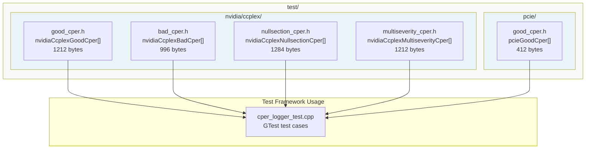
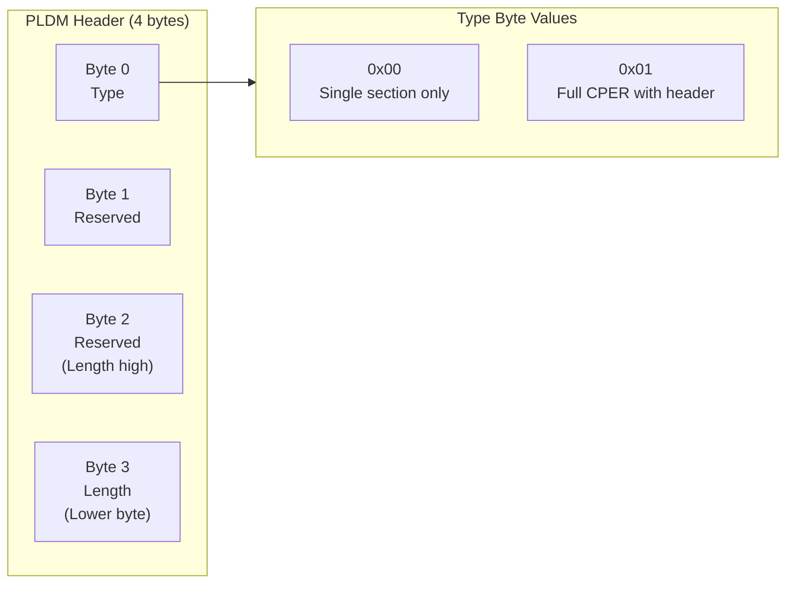
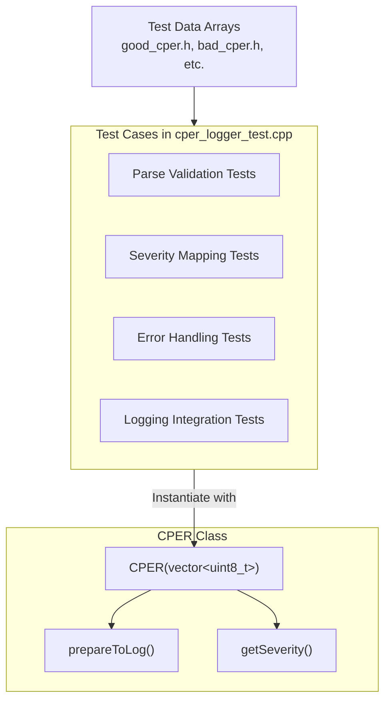

<!-- source: DeepWiki mcp.deepwiki.com · repo NVIDIA/cper-logger · page 4.2 Test Data Samples · fetched 2026-10-26 -->

# Test Data Samples

<details>
<summary>Relevant source files</summary>

The following files were used as context for generating this wiki page:

- [test/nvidia/ccplex/bad_cper.h](test/nvidia/ccplex/bad_cper.h)
- [test/nvidia/ccplex/good_cper.h](test/nvidia/ccplex/good_cper.h)
- [test/nvidia/ccplex/multiseverity_cper.h](test/nvidia/ccplex/multiseverity_cper.h)
- [test/nvidia/ccplex/nullsection_cper.h](test/nvidia/ccplex/nullsection_cper.h)
- [test/pcie/good_cper.h](test/pcie/good_cper.h)

</details>


## Purpose and Scope

This document describes the pre-defined CPER (Common Platform Error Record) binary test data samples included in the repository. These samples provide realistic and edge-case CPER payloads used for validation testing of the CPER processing library. For information about the test framework that uses these samples, see [Test Framework](#4.1). For details on how to run tests, see [Running Tests](#5.2).

The test data samples are stored as C header files containing byte arrays that represent complete CPER records or individual CPER sections. Each sample is designed to exercise specific parsing scenarios, error conditions, or data structure variations.

---

## Test Data Organization



**Test Data Organization**

**Sources:** [test/nvidia/ccplex/good_cper.h](), [test/nvidia/ccplex/bad_cper.h](), [test/nvidia/ccplex/nullsection_cper.h](), [test/nvidia/ccplex/multiseverity_cper.h](), [test/pcie/good_cper.h]()

---

## NVIDIA CCPLEX Test Samples

The NVIDIA CCPLEX test samples are located in [test/nvidia/ccplex/]() and represent error records from NVIDIA's CPU Complex (CCPLEX) subsystem. These samples test the parsing of vendor-specific CPER sections with NVIDIA's proprietary error data format.

### Good CPER Sample

**File:** [test/nvidia/ccplex/good_cper.h]()  
**Array:** `nvidiaCcplexGoodCper`  
**Size:** 1212 bytes

This sample contains a valid, well-formed CPER record with multiple NVIDIA CCPLEX sections. It represents the standard success case for CPER processing.

**Structure Overview:**

| Component | Byte Offset | Description |
|-----------|-------------|-------------|
| PLDM Header | 0-3 | 4-byte header: `0x01 0x00 0xb8 0x04` |
| CPER Signature | 4-7 | ASCII "CPER" signature |
| Record Header | 8-127 | Standard UEFI CPER header (128 bytes) |
| Section Descriptors | 128-567 | 5 section descriptor entries (88 bytes each) |
| Section Data | 568-1211 | NVIDIA CCPLEX error section payloads |

**Key Characteristics:**
- PLDM type byte: `0x01` (indicates full CPER with header)
- Record length: `0x04b8` (1208 bytes, excluding PLDM header)
- Section count: 5 sections
- All sections use NVIDIA CCPLEX section type GUID
- Severity: `0x02` (Corrected error)

**Sources:** [test/nvidia/ccplex/good_cper.h:1-121]()

---

### Bad CPER Sample

**File:** [test/nvidia/ccplex/bad_cper.h]()  
**Array:** `nvidiaCcplexBadCper`  
**Size:** 996 bytes

This sample contains malformed CPER data designed to test error handling and validation logic. The record is intentionally corrupted to trigger parsing failures.

**Corruption Characteristics:**
- Incomplete section data (only 3 complete sections despite header indicating more)
- Truncated record length
- Missing section payloads

**Expected Behavior:**
Tests using this sample should verify that the CPER parser correctly detects and reports validation errors rather than attempting to process invalid data.

**Sources:** [test/nvidia/ccplex/bad_cper.h:1-103]()

---

### Null Section CPER Sample

**File:** [test/nvidia/ccplex/nullsection_cper.h]()  
**Array:** `nvidiaCcplexNullsectionCper`  
**Size:** 1284 bytes

This sample contains CPER sections with null or empty data fields. It tests the parser's ability to handle valid but empty sections.

**Key Characteristics:**
- Contains sections with zero-filled data regions
- All structural metadata is valid
- Tests boundary condition where sections exist but contain no meaningful error data

**Data Pattern:**
Multiple sections contain extended regions of `0x00` bytes [test/nvidia/ccplex/nullsection_cper.h:60-65](), representing null or cleared error state.

**Sources:** [test/nvidia/ccplex/nullsection_cper.h:1-127]()

---

### Multi-Severity CPER Sample

**File:** [test/nvidia/ccplex/multiseverity_cper.h]()  
**Array:** `nvidiaCcplexMultiseverityCper`  
**Size:** 1212 bytes

This sample contains a CPER record with sections at different severity levels. It tests the severity extraction and mapping logic.

**Severity Distribution:**

| Section Index | Severity Byte | D-Bus Severity |
|---------------|---------------|----------------|
| 0-3 | `0x01` | Informational |
| 4 | `0x02` | Corrected |

**Section Severity Bytes:**
- Sections 0-3: `0x01` at byte offset 34 in each section descriptor [test/nvidia/ccplex/multiseverity_cper.h:34]()
- Section 4: `0x02` at corresponding offset [test/nvidia/ccplex/multiseverity_cper.h:58]()

**Test Purpose:**
Validates that the CPER class correctly identifies and processes multiple severity levels within a single record, ensuring each section is logged with its appropriate severity to the phosphor-logging service.

**Sources:** [test/nvidia/ccplex/multiseverity_cper.h:1-121]()

---

## PCIe Test Samples

### PCIe Good CPER Sample

**File:** [test/pcie/good_cper.h]()  
**Array:** `pcieGoodCper`  
**Size:** 412 bytes

This sample contains a valid PCIe error record, representing a standard PCIe Advanced Error Reporting (AER) event.

**Structure:**

| Component | Byte Offset | Size | Description |
|-----------|-------------|------|-------------|
| PLDM Header | 0-3 | 4 bytes | Type `0x01` + length |
| CPER Header | 4-127 | 124 bytes | Record metadata |
| Section Descriptor | 128-215 | 88 bytes | PCIe section descriptor |
| PCIe Data | 216-411 | 196 bytes | PCIe error registers |

**PCIe Section Type:**
Uses the standard UEFI PCIe error section GUID: `d995e954-bbc1-430f-ad91-b44dcb3c6f35` [test/pcie/good_cper.h:32]()

**PCIe Error Data Fields:**
- Port type: `0x04` (Root Port)
- Version: `0xed` (version 2.37)
- Device/Vendor ID data [test/pcie/good_cper.h:38-39]()
- AER capability structure [test/pcie/good_cper.h:40-52]()

**Sources:** [test/pcie/good_cper.h:1-55]()

---

## CPER Binary Format Structure

```mermaid
graph LR
    subgraph PLDM["PLDM Wrapper"]
        TypeByte["Byte 0: Type<br/>0x00 = section only<br/>0x01 = full CPER"]
        Reserved["Bytes 1-2: Reserved"]
        Length["Byte 3: Length"]
    end
    
    subgraph CPERHeader["CPER Record Header (128 bytes)"]
        Signature["Signature: 'CPER'"]
        Revision["Revision"]
        SectionCount["Section Count"]
        Severity["Error Severity"]
        RecordID["Record ID"]
        Timestamp["Timestamp"]
        PlatformID["Platform ID"]
        PartitionID["Partition ID"]
        CreatorID["Creator ID"]
        NotificationType["Notification Type"]
        RecordLength["Record Length"]
    end
    
    subgraph Sections["Section Descriptors (88 bytes each)"]
        SectionOffset["Section Offset"]
        SectionLength["Section Length"]
        SectionRev["Revision"]
        ValidationBits["Validation Bits"]
        SectionFlags["Flags"]
        SectionType["Section Type GUID"]
        SectionSeverity["Section Severity"]
        FRUId["FRU ID"]
        FRUText["FRU Text"]
    end
    
    subgraph Payloads["Section Payloads"]
        NvidiaCCPLEX["NVIDIA CCPLEX<br/>Vendor-specific"]
        PCIeAER["PCIe AER<br/>Standard UEFI"]
        Other["Other Section Types"]
    end
    
    PLDM --> CPERHeader
    CPERHeader --> Sections
    Sections --> Payloads
```



**CPER Binary Format Decomposition**

**Sources:** [test/nvidia/ccplex/good_cper.h:19-21](), [test/pcie/good_cper.h:19-21]()

---

## Test Data Array Declarations

All test data samples follow a consistent declaration pattern:

```cpp
// Example from good_cper.h
unsigned char nvidiaCcplexGoodCper[] = {
    0x01, 0x00, 0xb8, 0x04, ...  // Binary CPER data
};
unsigned int nvidiaCcplexGoodCperLen = 1212;
```

**Naming Convention:**

| Component | Pattern | Example |
|-----------|---------|---------|
| Array name | `{vendor}{type}{qualifier}Cper` | `nvidiaCcplexGoodCper` |
| Length variable | `{arrayName}Len` | `nvidiaCcplexGoodCperLen` |

**Array Access Pattern:**
```cpp
// Typical usage in tests
std::vector<uint8_t> cperData(nvidiaCcplexGoodCper, 
                               nvidiaCcplexGoodCper + nvidiaCcplexGoodCperLen);
```

**Sources:** [test/nvidia/ccplex/good_cper.h:18-120](), [test/pcie/good_cper.h:18-54]()

---

## PLDM Header Format

The first 4 bytes of each test sample represent the PLDM message header that encapsulates CPER data:



**PLDM Type Interpretation**

**Type Byte Mapping:**

| Type Value | Interpretation | CPER Content |
|------------|----------------|--------------|
| `0x00` | Single section | Section data only, no CPER header |
| `0x01` | Full CPER | Complete CPER record with header |

**Examples from Test Data:**
- `nvidiaCcplexGoodCper[0]` = `0x01` → Full CPER [test/nvidia/ccplex/good_cper.h:19]()
- `pcieGoodCper[0]` = `0x01` → Full CPER [test/pcie/good_cper.h:19]()

**Length Encoding:**
Bytes 2-3 encode the length as a 16-bit little-endian value:
```cpp
uint16_t length = (data[3] << 8) | data[2];
// Example: 0x04b8 = 1208 bytes
```

**Sources:** [test/nvidia/ccplex/good_cper.h:19](), [test/pcie/good_cper.h:19]()

---

## Test Sample Summary Table

| File | Array Name | Size (bytes) | Type | Purpose |
|------|------------|--------------|------|---------|
| [test/nvidia/ccplex/good_cper.h]() | `nvidiaCcplexGoodCper` | 1212 | NVIDIA CCPLEX | Valid multi-section CPER |
| [test/nvidia/ccplex/bad_cper.h]() | `nvidiaCcplexBadCper` | 996 | NVIDIA CCPLEX | Malformed/corrupted CPER |
| [test/nvidia/ccplex/nullsection_cper.h]() | `nvidiaCcplexNullsectionCper` | 1284 | NVIDIA CCPLEX | Null/empty section data |
| [test/nvidia/ccplex/multiseverity_cper.h]() | `nvidiaCcplexMultiseverityCper` | 1212 | NVIDIA CCPLEX | Mixed severity levels |
| [test/pcie/good_cper.h]() | `pcieGoodCper` | 412 | PCIe AER | Standard PCIe error |

**Sources:** All test data files in [test/]() directory

---

## Usage in Test Framework



**Test Data Flow to Code Entities**

The test data arrays are included in test cases and passed to the `CPER` class constructor as `std::vector<uint8_t>` instances. The test framework validates parsing, severity extraction, and logging behavior using these predefined samples.

**Sources:** Test data files in [test/nvidia/ccplex/]() and [test/pcie/]()

---

