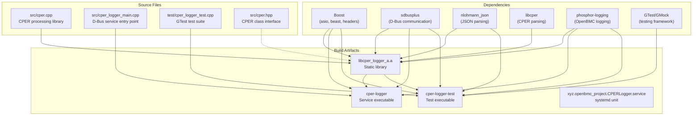
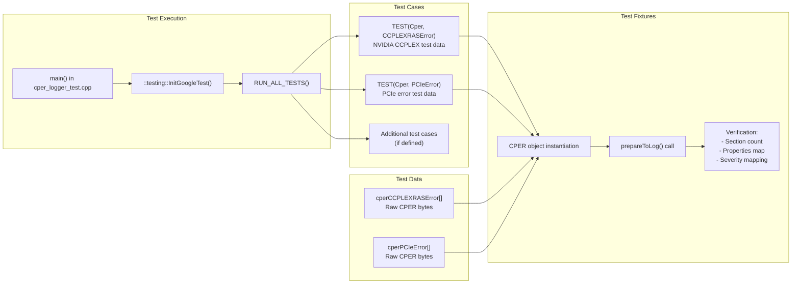
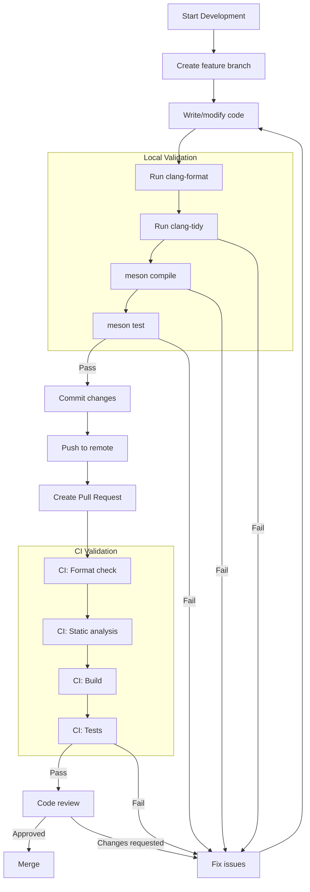

<!-- source: DeepWiki mcp.deepwiki.com · repo NVIDIA/cper-logger · page 5 Developer Guide · fetched 2026-10-26 -->

# Developer Guide

<details>
<summary>Relevant source files</summary>

The following files were used as context for generating this wiki page:

- [.clang-format](.clang-format)
- [.clang-tidy](.clang-tidy)
- [meson.build](meson.build)

</details>


## Purpose and Scope

This guide provides practical information for developers who want to build, test, and contribute to the cper-logger project. It covers development environment setup, build procedures, testing workflows, and code quality standards.

For detailed information about the build system configuration, see [Build System](#3). For comprehensive testing documentation, see [Testing](#4). For code organization and architecture details, see [Core Components](#2).

---

## Prerequisites

### Required Tools

The following tools must be installed in your development environment:

| Tool | Minimum Version | Purpose |
|------|----------------|---------|
| Meson | 1.3.0 | Build system |
| C++ Compiler | C++23 support | Code compilation |
| Python | 3.x | Schema generation tools |
| Git | Any recent version | Source control |

### System Dependencies

The project requires several system libraries. The build system will automatically attempt to find these on your system or build them as subprojects:

| Dependency | Version | Resolution Strategy |
|------------|---------|---------------------|
| Boost | ≥1.84.0 | System package or CMake subproject |
| sdbusplus | Latest | System package or Meson subproject |
| phosphor-logging | Latest | System package or Meson subproject |
| nlohmann_json | ≥3.11.2 | System package or Meson subproject |
| libcper | Latest | Meson subproject |
| systemd | Latest | System package only |
| GTest/GMock | Latest | System package or CMake subproject (tests only) |

**Sources**: [meson.build:23-175]()

---

## Development Environment Setup

### Repository Clone

```bash
git clone https://github.com/NVIDIA/cper-logger.git
cd cper-logger
```

### Dependency Resolution

The Meson build system uses a dual-resolution strategy:

1. **System packages** (preferred for production builds)
2. **Subprojects** (automatic fallback for development)

Dependencies are defined in `subprojects/*.wrap` files and will be automatically fetched if not found on the system.

**Sources**: [meson.build:23-105]()

---

## Build Process Overview

The following diagram shows how source files are compiled into build artifacts:



**Sources**: [meson.build:107-175]()

---

## Building the Project

### Standard Build

```bash
meson setup builddir
meson compile -C builddir
```

This creates the following artifacts in `builddir/`:
- `cper-logger` - Main service executable
- `libcper_logger_a.a` - Static library containing CPER processing logic

### Build with Tests

```bash
meson setup builddir -Dtests=enabled
meson compile -C builddir
```

This additionally creates:
- `cper-logger-test` - Test executable

### Build Options

The project defines the following Meson options:

| Option | Type | Default | Description |
|--------|------|---------|-------------|
| `tests` | feature | auto | Enable/disable test suite compilation |

Configure options during setup:
```bash
meson setup builddir -Dtests=enabled
```

Or reconfigure an existing build:
```bash
meson configure builddir -Dtests=enabled
```

**Sources**: [meson.build:1-16](), [meson.build:129-175]()

---

## Compiler Configuration

The build enforces strict compilation standards defined in [meson.build:5-13]():

### C++ Standard

The project requires **C++23**. The build will fail if a different standard is specified:

```cpp
if get_option('cpp_std') != 'c++23'
    error('This project requires c++23 support')
endif
```

### Compiler Flags

| Flag | Value | Rationale |
|------|-------|-----------|
| `warning_level` | 3 | Maximum warnings |
| `werror` | true | Treat warnings as errors |
| `cpp_std` | c++23 | Modern C++ features |
| `cpp_rtti` | false | Binary size reduction |
| `b_lto` | true | Link-time optimization |

### Preprocessor Definitions

The following macros are defined project-wide:

| Macro | Purpose |
|-------|---------|
| `BOOST_ASIO_DISABLE_THREADS` | Single-threaded async I/O |
| `BOOST_NO_RTTI` | Disable Boost RTTI usage |
| `BOOST_NO_TYPEID` | Disable Boost typeid usage |
| `SDBUSPLUS_DISABLE_BOOST_COROUTINES` | Disable coroutine support |

**Sources**: [meson.build:5-21](), [meson.build:53-67]()

---

## Installation

### Install to System

```bash
meson install -C builddir
```

This installs:
- `/usr/bin/cper-logger` (or configured prefix)
- `/lib/systemd/system/xyz.openbmc_project.CPERLogger.service`

### Custom Install Prefix

```bash
meson setup builddir --prefix=/opt/cper-logger
meson install -C builddir
```

**Sources**: [meson.build:83-96](), [meson.build:120-127]()

---

## Testing Workflow

The following diagram illustrates the test execution flow:



**Sources**: [test/cper_logger_test.cpp](), [meson.build:129-175]()

### Running Tests

Execute the test suite:
```bash
meson test -C builddir
```

Run tests with verbose output:
```bash
meson test -C builddir --verbose
```

Run specific test:
```bash
./builddir/cper-logger-test --gtest_filter=Cper.CCPLEXRASError
```

### Test Output

The test runner provides:
- Pass/fail status for each test case
- Detailed assertion failures with expected vs. actual values
- Summary statistics

For more details on the test framework and test data, see [Testing](#4).

**Sources**: [meson.build:174]()

---

## Code Quality Tools

### Code Formatting with clang-format

The project uses a custom `.clang-format` configuration based on LLVM style with OpenBMC-specific modifications.

#### Key Formatting Rules

| Setting | Value | Description |
|---------|-------|-------------|
| `ColumnLimit` | 80 | Maximum line length |
| `IndentWidth` | 4 | Indentation spaces |
| `PointerAlignment` | Left | `int* ptr` style |
| `BreakBeforeBraces` | Custom | Detailed brace placement |
| `Standard` | Latest | Use latest C++ standard features |

#### Format Code

Format all source files:
```bash
find src test -name '*.cpp' -o -name '*.hpp' | xargs clang-format -i
```

Check formatting without modifying:
```bash
find src test -name '*.cpp' -o -name '*.hpp' | xargs clang-format --dry-run -Werror
```

#### Include Order

The configuration enforces specific include ordering via `IncludeCategories`:

1. Priority -1: `config.h`
2. Priority 1: Project `.h` files (`"*.h"`)
3. Priority 2: Project `.hpp` files (`"*.hpp"`)
4. Priority 3: System `.h` headers (`<*.h>`)
5. Priority 4: System `.hpp` headers (`<*.hpp>`)
6. Priority 5: Other system headers
7. Priority 7: GTest/GMock headers

**Sources**: [.clang-format:1-115]()

---

### Static Analysis with clang-tidy

The project enforces strict static analysis rules via `.clang-tidy` configuration.

#### Enabled Check Categories

| Category | Purpose |
|----------|---------|
| `clang-analyzer-*` | Clang Static Analyzer checks |
| `cert-*` | CERT C/C++ coding standards |
| `modernize-*` | Modern C++ idiom enforcement |
| `bugprone-*` | Bug detection |
| `misc-*` | Miscellaneous checks |
| `performance-*` | Performance optimizations |
| `readability-*` | Code readability |

#### Naming Conventions

The configuration enforces these naming rules:

| Entity Type | Convention | Example |
|-------------|------------|---------|
| Class | CamelCase | `CPERLogger` |
| Variable | camelBack | `severityLevel` |
| Function | camelBack | `prepareToLog()` |
| Parameter | camelBack | `cperData` |
| Namespace | lower_case | `cper_logger` |
| Struct | CamelCase | `LogEntry` |

#### Run Static Analysis

Analyze all source files:
```bash
clang-tidy src/*.cpp test/*.cpp -- -Isrc -std=c++23
```

The configuration sets `WarningsAsErrors: '*'`, meaning all violations are treated as errors.

**Sources**: [.clang-tidy:1-262]()

---

## Development Workflow

The following diagram shows the recommended development cycle:



### Pre-commit Checklist

Before committing code, ensure:

1. **Formatting**: Code passes `clang-format` checks
2. **Static Analysis**: Code passes `clang-tidy` checks
3. **Compilation**: Project builds without warnings
4. **Tests**: All tests pass
5. **Coverage**: New code has corresponding tests

### Adding New Features

When adding new CPER section handlers:

1. Update `src/cper.cpp` with new section processing logic
2. Add corresponding test data to `test/cper_logger_test.cpp`
3. Update schema generation if new fields are exposed
4. Document new section types in wiki

**Sources**: [meson.build](), [.clang-format](), [.clang-tidy]()

---

## Build System Internals

### Static Library (`libcper_logger_a.a`)

Built from [src/cper.cpp]() and linked into both the main executable and test executable. This ensures consistent CPER processing logic across all build targets.

Dependencies at [meson.build:110-116]():
- Boost (headers, asio, beast)
- libcper (parsing)
- nlohmann_json (JSON handling)
- phosphor-logging (logging API)
- sdbusplus (D-Bus communication)

### Service Executable (`cper-logger`)

Built from [src/cper_logger_main.cpp]() and linked with `libcper_logger_a.a`.

Dependencies at [meson.build:123]():
- Boost (async I/O)
- sdbusplus (D-Bus service)
- phosphor-logging (logging integration)

### systemd Service Unit

The service file is generated from `xyz.openbmc_project.CPERLogger.service` template with `@INSTALL_PREFIX@` substitution at [meson.build:87-96]().

**Sources**: [meson.build:107-127]()

---

## Troubleshooting

### Build Failures

**Issue**: `error('This project requires c++23 support')`

**Solution**: Ensure your compiler supports C++23. Do not override `cpp_std` in Meson options.

---

**Issue**: Missing dependency headers

**Solution**: Meson will automatically fetch subprojects. Ensure you have internet connectivity or pre-populate `subprojects/` directory.

---

**Issue**: `undefined reference to boost::...`

**Solution**: The build may be mixing system Boost with subproject Boost. Clean build directory:
```bash
rm -rf builddir
meson setup builddir
```

---

### Test Failures

**Issue**: Test executable not built

**Solution**: Enable tests during configuration:
```bash
meson configure builddir -Dtests=enabled
meson compile -C builddir
```

---

**Issue**: Tests fail with D-Bus errors

**Solution**: Tests may require D-Bus session bus. Run with:
```bash
dbus-run-session -- meson test -C builddir
```

**Sources**: [meson.build]()

---

## Related Documentation

- For detailed build configuration reference, see [Build Configuration](#3.1)
- For dependency management details, see [Dependencies](#3.2)
- For test framework documentation, see [Test Framework](#4.1)
- For code style details beyond tooling, see [Code Style and Quality](#5.3)

---

