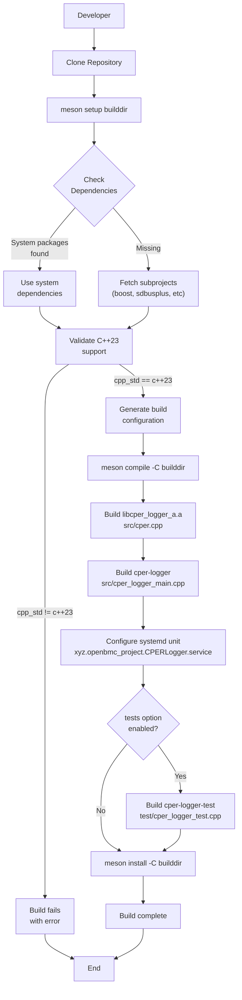
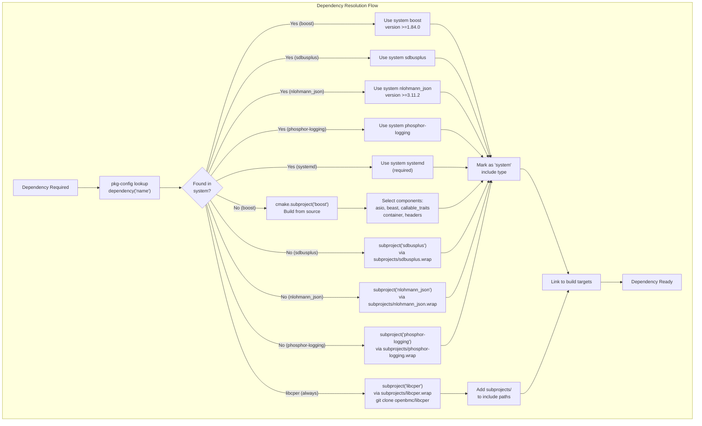
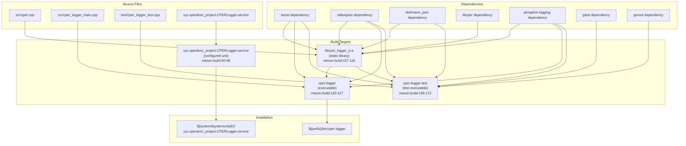

<!-- source: DeepWiki mcp.deepwiki.com · repo NVIDIA/cper-logger · page 5.1 Building the Project · fetched 2026-10-26 -->

# Building the Project

<details>
<summary>Relevant source files</summary>

The following files were used as context for generating this wiki page:

- [meson.build](meson.build)
- [subprojects/libcper.wrap](subprojects/libcper.wrap)
- [subprojects/nlohmann_json.wrap](subprojects/nlohmann_json.wrap)
- [subprojects/phosphor-logging.wrap](subprojects/phosphor-logging.wrap)

</details>


## Purpose and Scope

This page provides step-by-step instructions for building the cper-logger project from source using the Meson build system. It covers prerequisite installation, build configuration, compilation, and installation of the service executable and systemd unit files.

For information about running the test suite after building, see [Running Tests](#5.2). For details about the build system architecture and dependency management strategy, see [Build Configuration](#3.1) and [Dependencies](#3.2).

## Prerequisites

### System Requirements

The cper-logger project enforces strict compiler and language requirements defined in [meson.build:5-13]():

| Requirement | Value | Enforced By |
|-------------|-------|-------------|
| C++ Standard | C++23 | [meson.build:8,19-21]() |
| Meson Version | >=1.3.0 | [meson.build:4]() |
| Compiler Warnings | Level 3, errors on warnings | [meson.build:6-7]() |
| RTTI | Disabled | [meson.build:11]() |
| Link-Time Optimization | Enabled | [meson.build:12]() |

**C++23 Validation**: The build system explicitly validates C++23 support at configuration time:

```cpp
// meson.build:18-21
if get_option('cpp_std') != 'c++23'
    error('This project requires c++23 support')
endif
```

### Required Dependencies

The following dependencies must be available either as system packages or will be automatically fetched as subprojects:

| Dependency | Minimum Version | Purpose | Resolution Strategy |
|------------|----------------|---------|---------------------|
| `boost` | >=1.84.0 | Asio, Beast, headers | System → CMake subproject |
| `sdbusplus` | (latest) | D-Bus communication | System → Meson subproject |
| `phosphor-logging` | (latest) | OpenBMC logging | System → Meson subproject |
| `nlohmann_json` | >=3.11.2 | JSON parsing | System → Meson subproject |
| `libcper` | (latest) | CPER data parsing | Meson subproject only |
| `systemd` | (latest) | Service management | System only |

**Note**: GTest/GMock are additional dependencies required only when building with tests enabled (see [Build Options](#build-options) below).

**Sources**: [meson.build:23-105]()

## Build Process Overview



**Diagram: Build Process Flow**

This diagram maps the complete build workflow from repository cloning through installation, showing the relationship between Meson configuration, dependency resolution, and build target generation.

**Sources**: [meson.build:1-176]()

## Step-by-Step Build Instructions

### 1. Clone the Repository

```bash
git clone https://github.com/NVIDIA/cper-logger.git
cd cper-logger
```

### 2. Configure the Build

Run Meson to configure the build directory:

```bash
meson setup builddir
```

This command performs the following operations:
- Validates C++23 compiler support [meson.build:18-21]()
- Resolves dependencies via pkg-config or subprojects [meson.build:23-105]()
- Generates build configuration files
- Creates the `builddir/` directory with all build metadata

**Alternative Configuration with Options**:

```bash
# Enable tests
meson setup builddir -Dtests=enabled

# Use a specific installation prefix
meson setup builddir --prefix=/usr/local
```

### 3. Compile the Project

```bash
meson compile -C builddir
```

This compiles all build targets in the following order:

1. **Static library**: `libcper_logger_a.a` from [src/cper.cpp:1-end]()
2. **Service executable**: `cper-logger` from [src/cper_logger_main.cpp:1-end]()
3. **Systemd unit**: `xyz.openbmc_project.CPERLogger.service` (configured, not compiled)
4. **Test executable** (if enabled): `cper-logger-test` from [test/cper_logger_test.cpp:1-end]()

### 4. Install the Binaries

```bash
sudo meson install -C builddir
```

This installs:
- `cper-logger` executable to `${prefix}/bin/`
- `xyz.openbmc_project.CPERLogger.service` to the systemd unit directory

**Sources**: [meson.build:90-96,120-127]()

## Build Options

The following Meson options can be specified during configuration:

| Option | Type | Default | Description |
|--------|------|---------|-------------|
| `tests` | feature | `auto` | Enable/disable test suite compilation |
| `cpp_std` | combo | `c++23` | C++ standard version (must be c++23) |
| `prefix` | string | `/usr/local` | Installation prefix |
| `warning_level` | combo | `3` | Compiler warning level |
| `werror` | boolean | `true` | Treat warnings as errors |
| `cpp_rtti` | boolean | `false` | Enable C++ RTTI |
| `b_lto` | boolean | `true` | Enable link-time optimization |

**Example Usage**:

```bash
# Build with tests enabled
meson setup builddir -Dtests=enabled

# Build with custom prefix and LTO disabled
meson setup builddir --prefix=/opt/cper-logger -Db_lto=false

# Reconfigure existing build directory
meson configure builddir -Dtests=enabled
```

**Sources**: [meson.build:5-13](), meson_options.txt (referenced in build system)

## Dependency Resolution Strategy



**Diagram: Dependency Resolution Strategy**

This diagram illustrates the dual-mode dependency resolution implemented in [meson.build:23-105](). The build system attempts to find dependencies via pkg-config first, falling back to Meson wrap files that automatically clone and build dependencies as subprojects.

### Dependency-Specific Details

#### Boost (Special Handling)

Boost uses a CMake-based subproject when not found in the system [meson.build:29-52]():

```python
# Boost CMake configuration with specific components
cmake = import('cmake')
opt = cmake.subproject_options()
opt.add_cmake_defines({
    'BOOST_INCLUDE_LIBRARIES': 'asio;beast;callable_traits;container;headers',
    'BUILD_SHARED_LIBS': 'OFF',
})
boost = cmake.subproject('boost', required: true, options: opt)
```

Additional Boost-specific compile flags are added [meson.build:53-58]():
- `BOOST_ASIO_DISABLE_THREADS`
- `BOOST_NO_RTTI`
- `BOOST_NO_TYPEID`

#### libcper (Always Subproject)

Unlike other dependencies, `libcper` is always built from source and never resolved from the system [meson.build:98-105]():

```python
libcper_parse_dep = dependency('libcper', required: false)
if not libcper_parse_dep.found()
    libcper = subproject('libcper')
    libcper_parse_dep = libcper.get_variable('libcper_parse_dep')
    inc += [include_directories('subprojects')]
endif
```

The subproject is configured in [subprojects/libcper.wrap:1-6]():
- **Repository**: `https://github.com/openbmc/libcper.git`
- **Revision**: `HEAD` (latest)

**Sources**: [meson.build:23-105](), [subprojects/nlohmann_json.wrap:1-11](), [subprojects/libcper.wrap:1-6](), [subprojects/phosphor-logging.wrap:1-6]()

## Build Artifacts and Linkage



**Diagram: Build Artifacts and Dependencies**

This diagram maps source files to build targets and shows the complete dependency graph. Note that `libcper_logger_a.a` is a shared intermediate artifact linked by both the main executable and test executable.

### Build Target Details

| Target | Type | Source | Dependencies | Installation |
|--------|------|--------|--------------|--------------|
| `libcper_logger_a` | Static library | [src/cper.cpp]() | boost, sdbusplus, nlohmann_json, libcper, phosphor-logging | Not installed (intermediate) |
| `cper-logger` | Executable | [src/cper_logger_main.cpp]() | libcper_logger_a, boost, sdbusplus, phosphor-logging | `${prefix}/bin/` |
| `cper-logger-test` | Test executable | [test/cper_logger_test.cpp]() | libcper_logger_a, boost, sdbusplus, nlohmann_json, phosphor-logging, gtest, gmock | Not installed |
| `xyz.openbmc_project.CPERLogger.service` | Systemd unit | [xyz.openbmc_project.CPERLogger.service]() | systemd | `${systemdsystemunitdir}/` |

**Sources**: [meson.build:107-127,159-175]()

## Compiler Flags and Optimizations

The build system enforces specific compiler settings to optimize binary size and runtime performance:

### Project-Wide Compiler Flags

Defined in [meson.build:5-13]():

```python
default_options: [
    'warning_level=3',      # Maximum warnings
    'werror=true',          # Warnings are errors
    'cpp_std=c++23',        # C++23 standard
    'cpp_rtti=false',       # Disable RTTI for size reduction
    'b_lto=true',           # Link-time optimization
]
```

### Library-Specific Flags

**Boost configuration** [meson.build:53-58]():
```cpp
add_project_arguments(
    '-DBOOST_ASIO_DISABLE_THREADS',
    '-DBOOST_NO_RTTI',
    '-DBOOST_NO_TYPEID',
    language: 'cpp',
)
```

**sdbusplus configuration** [meson.build:67]():
```cpp
add_project_arguments('-DSDBUSPLUS_DISABLE_BOOST_COROUTINES', language: 'cpp')
```

### Binary Size Implications

| Flag | Purpose | Effect |
|------|---------|--------|
| `cpp_rtti=false` | Disable RTTI | Reduces binary size by removing type information |
| `BOOST_NO_RTTI` | Disable Boost RTTI | Aligns Boost with project RTTI settings |
| `BOOST_NO_TYPEID` | Disable typeid operator | Further reduces type metadata |
| `b_lto=true` | Link-time optimization | Enables cross-module optimization, reduces size |
| `BOOST_ASIO_DISABLE_THREADS` | Remove threading support | Reduces Asio code size for single-threaded use |
| `SDBUSPLUS_DISABLE_BOOST_COROUTINES` | Disable coroutines | Reduces sdbusplus binary size |

**Sources**: [meson.build:5-13,53-58,67]()

## Systemd Unit Configuration

The systemd service file is generated during the build process with installation-specific paths substituted.

### Configuration Variables

[meson.build:87-88]() defines the configuration data:

```python
systemd_unit_configuration = configuration_data()
systemd_unit_configuration.set('INSTALL_PREFIX', get_option('prefix'))
```

### Template Processing

[meson.build:90-96]() configures the template:

```python
configure_file(
    input: 'xyz.openbmc_project.CPERLogger.service',
    output: 'xyz.openbmc_project.CPERLogger.service',
    configuration: systemd_unit_configuration,
    install_dir: systemd_system_unit_dir,
    install: true,
)
```

The `@INSTALL_PREFIX@` placeholder in the input file is replaced with the actual installation prefix during configuration.

**Sources**: [meson.build:87-96]()

## Reconfiguring an Existing Build

To modify build options without starting from scratch:

```bash
# View current configuration
meson configure builddir

# Enable tests on existing build
meson configure builddir -Dtests=enabled

# Change installation prefix
meson configure builddir --prefix=/usr

# Rebuild with new configuration
meson compile -C builddir
```

## Troubleshooting Common Build Issues

### Issue: C++23 Not Supported

**Symptom**: Build fails with error `This project requires c++23 support`

**Cause**: Compiler does not support C++23 or `cpp_std` option is incorrectly set

**Solution**: 
1. Verify compiler version: GCC >=11 or Clang >=12
2. Ensure `cpp_std` is not overridden: `meson configure builddir | grep cpp_std`
3. Update compiler or use a newer toolchain

### Issue: Missing System Dependencies

**Symptom**: `Dependency "X" not found, tried pkgconfig`

**Cause**: System package for dependency is not installed, and subproject fallback may have failed

**Solution**:
1. Install system package (e.g., `libboost-dev`, `systemd`)
2. Allow subproject fallback (default behavior)
3. Check network connectivity for subproject downloads

### Issue: Subproject Clone Failures

**Symptom**: `Downloading subproject from https://github.com/... failed`

**Cause**: Network issues or git not installed

**Solution**:
1. Verify internet connectivity
2. Install git: `sudo apt-get install git`
3. Check corporate proxy settings

### Issue: RTTI-Related Link Errors

**Symptom**: Undefined references to type information

**Cause**: Mixing RTTI-enabled and RTTI-disabled code

**Solution**:
- Do not override `cpp_rtti=false` - this is required by design [meson.build:11]()
- Ensure all dependencies are configured with `BOOST_NO_RTTI` and `BOOST_NO_TYPEID`

### Issue: Test Build Disabled

**Symptom**: `cper-logger-test` not built despite `-Dtests=enabled`

**Cause**: GTest/GMock not found and subproject unavailable

**Solution**:
1. Install system packages: `sudo apt-get install libgtest-dev libgmock-dev`
2. Ensure internet access for CMake subproject download
3. Check [meson.build:129-158]() for test dependency resolution logic

**Sources**: [meson.build:18-21,129-158]()

## Clean Build

To perform a completely clean build:

```bash
# Remove existing build directory
rm -rf builddir

# Reconfigure from scratch
meson setup builddir

# Rebuild
meson compile -C builddir
```

This is recommended when:
- Switching between different compilers
- Updating major versions of dependencies
- Debugging configuration issues
- Changing fundamental build options (e.g., `cpp_rtti`)

**Sources**: [meson.build:1-176]()

---

