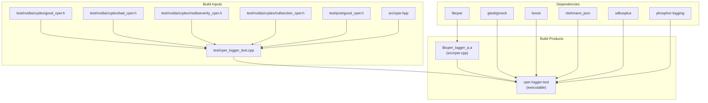
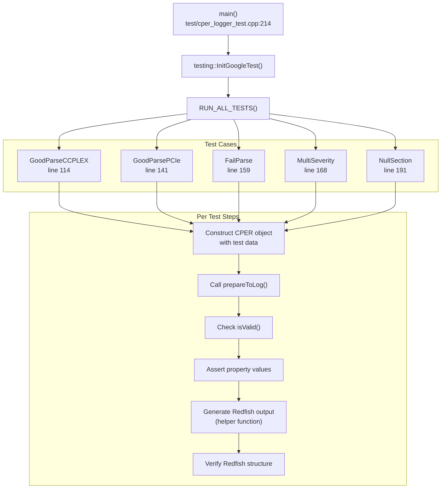

<!-- source: DeepWiki mcp.deepwiki.com · repo NVIDIA/cper-logger · page 5.2 Running Tests · fetched 2026-10-26 -->

# Running Tests

<details>
<summary>Relevant source files</summary>

The following files were used as context for generating this wiki page:

- [meson.build](meson.build)
- [meson_options.txt](meson_options.txt)
- [test/cper_logger_test.cpp](test/cper_logger_test.cpp)

</details>


This page provides instructions for running the cper-logger test suite and interpreting test results. It focuses on the practical aspects of test execution during development and validation. For details about the test framework architecture, see [Test Framework](#4.1). For documentation of the pre-defined test data, see [Test Data Samples](#4.2). For build instructions, see [Building the Project](#5.1).

## Prerequisites

Before running tests, ensure the following dependencies are available:

| Dependency | Purpose | Resolution Method |
|------------|---------|-------------------|
| `gtest` | Google Test framework | System package or subproject |
| `gmock` | Google Mock framework | System package or subproject |
| `boost` | Asio, Beast, and header libraries | System package or subproject |
| `nlohmann_json` | JSON parsing | System package or subproject |
| `sdbusplus` | D-Bus communication (mocked in tests) | System package or subproject |
| `phosphor-logging` | OpenBMC logging (mocked in tests) | System package or subproject |

The build system automatically resolves these dependencies via system packages or Meson subprojects as defined in [meson.build:130-158]().

**Sources**: [meson.build:129-175](), [test/cper_logger_test.cpp:1-29]()

---

## Enabling Tests

Tests are controlled by the `tests` Meson feature option, which is **enabled by default**. The option is defined in [meson_options.txt:1]().

### Enable Tests (Default)

```bash
meson setup builddir
```

### Explicitly Enable Tests

```bash
meson setup builddir -Dtests=enabled
```

### Disable Tests

```bash
meson setup builddir -Dtests=disabled
```

When tests are enabled, the build system creates the `cper-logger-test` executable and registers it with Meson's test runner at [meson.build:174]().

**Sources**: [meson.build:129-175](), [meson_options.txt:1]()

---

## Building Tests

After configuring the build with tests enabled, compile the test executable:

```bash
meson compile -C builddir
```

This produces the `cper-logger-test` executable in the build directory. The test executable links against the `cper_logger_a` static library (the same library used by the main service) and all required test dependencies as defined in [meson.build:159-172]().

### Test Build Artifacts



**Test Build Flow**

**Sources**: [meson.build:107-118](), [meson.build:159-172](), [test/cper_logger_test.cpp:18-24]()

---

## Running Tests

### Run All Tests via Meson

The recommended method is using Meson's test runner:

```bash
meson test -C builddir
```

This executes the test registered at [meson.build:174]() and provides standardized output formatting.

### Run Test Executable Directly

Alternatively, run the test binary directly for more detailed output:

```bash
./builddir/cper-logger-test
```

### Run Specific Test Cases

Use GTest's filter syntax to run specific tests:

```bash
./builddir/cper-logger-test --gtest_filter=CPERTests.GoodParseCCPLEX
```

Run multiple tests matching a pattern:

```bash
./builddir/cper-logger-test --gtest_filter=CPERTests.GoodParse*
```

### Verbose Test Output

Enable verbose output to see detailed test information:

```bash
meson test -C builddir -v
```

Or with the test executable:

```bash
./builddir/cper-logger-test --gtest_print_time=1
```

**Sources**: [meson.build:174](), [test/cper_logger_test.cpp:214-219]()

---

## Test Suite Structure

The test suite validates CPER parsing, validation, and property extraction functionality. All test cases are defined in the `CPERTests` test fixture.

### Test Execution Flow



**Test Execution Pipeline**

**Sources**: [test/cper_logger_test.cpp:114-212](), [test/cper_logger_test.cpp:214-219]()

### Test Case Inventory

| Test Name | Purpose | Test Data | Expected Result |
|-----------|---------|-----------|-----------------|
| `GoodParseCCPLEX` | Validate NVIDIA CCPLEX CPER parsing | `nvidiaCcplexGoodCper` | Valid CPER, 5 sections, "Corrected" severity |
| `GoodParsePCIe` | Validate PCIe CPER parsing | `pcieGoodCper` | Valid CPER, 1 section, "Corrected" severity |
| `FailParse` | Verify error handling for invalid CPER | `nvidiaCcplexBadCper` | Invalid CPER, 0 properties extracted |
| `MultiSeverity` | Validate multi-section CPER with varied severities | `nvidiaCcplexMultiseverityCper` | Valid CPER, 5 sections |
| `NullSection` | Handle CPER with null sections | `nvidiaCcplexNullsectionCper` | Valid CPER, 4 sections (null skipped) |

Each test case follows the pattern defined in [test/cper_logger_test.cpp:114-212](), constructing a `CPER` object with test data, calling `prepareToLog()`, and validating the resulting properties.

**Sources**: [test/cper_logger_test.cpp:114-212]()

---

## Interpreting Test Results

### Successful Test Run

A successful test run produces output similar to:

```
[==========] Running 5 tests from 1 test suite.
[----------] Global test environment set-up.
[----------] 5 tests from CPERTests
[ RUN      ] CPERTests.GoodParseCCPLEX
[       OK ] CPERTests.GoodParseCCPLEX (X ms)
[ RUN      ] CPERTests.GoodParsePCIe
[       OK ] CPERTests.GoodParsePCIe (X ms)
[ RUN      ] CPERTests.FailParse
[       OK ] CPERTests.FailParse (X ms)
[ RUN      ] CPERTests.MultiSeverity
[       OK ] CPERTests.MultiSeverity (X ms)
[ RUN      ] CPERTests.NullSection
[       OK ] CPERTests.NullSection (X ms)
[----------] 5 tests from CPERTests (X ms total)

[----------] Global test environment tear-down
[==========] 5 tests from 1 test suite ran. (X ms total)
[  PASSED  ] 5 tests.
```

Meson test output for success:

```
1/1 test_cper_logger  OK  0.XXs
```

### Test Failure

Test failures produce detailed assertion information:

```
[ RUN      ] CPERTests.GoodParseCCPLEX
test/cper_logger_test.cpp:122: Failure
Expected equality of these values:
  prop[0]["diagnosticDataType"]
    Which is: "INVALID"
  "CPER"
[  FAILED  ] CPERTests.GoodParseCCPLEX (X ms)
```

### Key Validation Points

Tests validate the following aspects of CPER processing:

1. **Validity Check**: `ASSERT_TRUE(cp.isValid())` or `ASSERT_FALSE(cp.isValid())`
2. **Property Count**: `ASSERT_EQ(prop.size(), N)` - Verifies correct number of sections extracted
3. **Diagnostic Data Type**: `EXPECT_EQ(prop[0]["diagnosticDataType"], "CPER")`
4. **Severity Mapping**: `EXPECT_EQ(prop[0]["cperSeverity"], "Corrected")`
5. **Redfish Structure**: Validates notification type, section type, and OEM data structure
6. **Section Content**: Verifies specific fields within parsed sections (e.g., signature, GUIDs)

Examples at [test/cper_logger_test.cpp:120-138]() for CCPLEX validation and [test/cper_logger_test.cpp:148-156]() for PCIe validation.

**Sources**: [test/cper_logger_test.cpp:114-212]()

---

## Test Helper Functions

The test suite includes several helper functions for data manipulation and validation:

### Code Entity Mapping

```mermaid
graph LR
    subgraph "Helper Functions"
        WRITE_TEMP["writeTempfile()<br/>line 31-57"]
        PARSE_OUT["parseOut()<br/>line 66-94"]
        REDFISH_OUT["redfishOutput()<br/>line 96-112"]
    end
    
    subgraph "Data Structures"
        KEYPAIR["Keypair struct<br/>line 59-64"]
        PROPERTIES["properties type<br/>(vector of maps)"]
        JSON_FLAT["nlohmann::json::object_t"]
    end
    
    subgraph "Test Data"
        RAW_CPER["unsigned char arrays<br/>(test/*.h files)"]
    end
    
    subgraph "Test Cases"
        TEST_CASE["TEST() blocks"]
    end
    
    RAW_CPER -->|Used by| TEST_CASE
    RAW_CPER -->|Optional| WRITE_TEMP
    
    TEST_CASE -->|Calls prepareToLog()| PROPERTIES
    PROPERTIES -->|Transformed by| REDFISH_OUT
    
    KEYPAIR -->|Configures| PARSE_OUT
    PARSE_OUT -->|Extracts| JSON_FLAT
    REDFISH_OUT -->|Uses| PARSE_OUT
    JSON_FLAT -->|Returned by| REDFISH_OUT
```

**Test Helper Function Architecture**

### writeTempfile()

Defined at [test/cper_logger_test.cpp:31-57](), this function creates temporary files from binary test data. Currently unused in the test suite but available for future file-based testing.

**Parameters**:
- `data`: Raw CPER byte array
- `size`: Data size in bytes
- `basename`: Base name for temporary file

**Returns**: Full path to created temporary file

### parseOut()

Defined at [test/cper_logger_test.cpp:66-94](), this function extracts and transforms key-value pairs from a properties map into a flattened JSON object according to a Keypair configuration.

**Parameters**:
- `m`: Properties map (from `prepareToLog()`)
- `array`: Configuration array of Keypair structures
- `jFlat`: Output JSON object (modified in-place)

### redfishOutput()

Defined at [test/cper_logger_test.cpp:96-112](), this function transforms the `properties` structure into a Redfish-compatible JSON structure for validation.

**Configuration** (line 98-104):
- `REDFISH_MESSAGE_ID` → `/MessageId`
- `diagnosticData` → `/DiagnosticData`
- `diagnosticDataType` → `/DiagnosticDataType`
- `notificationType` → `/CPER/NotificationType`
- `sectionType` → `/CPER/SectionType`
- `jsonDiagnosticData` → `/CPER/Oem/Nvidia` (JSON expansion)

**Sources**: [test/cper_logger_test.cpp:31-112]()

---

## Troubleshooting

### Tests Not Building

**Symptom**: `cper-logger-test` executable not created

**Solutions**:
1. Verify tests are enabled: `meson configure builddir | grep tests`
2. Check GTest/GMock availability: System packages or subproject required
3. Reconfigure with tests explicitly enabled: `meson configure builddir -Dtests=enabled`

### GTest Dependency Not Found

**Symptom**: Error message "Googletest is required if tests are enabled"

**Solution**: Install GTest/GMock system packages or let Meson fetch the subproject:

```bash
# On Debian/Ubuntu
sudo apt-get install libgtest-dev libgmock-dev

# Let Meson handle it (automatic fallback)
meson setup --wipe builddir
```

The build system attempts system packages first, then falls back to CMake subproject at [meson.build:143-152]().

### Test Failures Due to Missing Dependencies

**Symptom**: Undefined symbols or linking errors

**Solution**: Ensure all dependencies are available. The test executable requires the same dependencies as the static library plus GTest/GMock. Check [meson.build:162-169]() for the complete dependency list.

### Assertion Failures

**Symptom**: Tests compile but fail with assertion errors

**Diagnosis Steps**:
1. Run specific failing test with verbose output: `./builddir/cper-logger-test --gtest_filter=TestName -v`
2. Review expected vs actual values in assertion output
3. Uncomment debug output at [test/cper_logger_test.cpp:126]() or [test/cper_logger_test.cpp:188]() to inspect JSON structure
4. Verify test data matches expected format (see [Test Data Samples](#4.2))

### Running Tests Without Full Build

If you only need to rebuild tests after source changes:

```bash
meson compile -C builddir cper-logger-test
meson test -C builddir
```

This avoids rebuilding the entire project.

**Sources**: [meson.build:129-175](), [test/cper_logger_test.cpp:214-219]()

---

## Test Output Examples

### Example: Successful GoodParseCCPLEX Test

The `GoodParseCCPLEX` test validates a well-formed NVIDIA CCPLEX CPER. Key assertions at [test/cper_logger_test.cpp:122-138]():

- Properties vector contains 5 elements (sections)
- First section has `diagnosticDataType = "CPER"`
- Severity is mapped to `"Corrected"`
- Notification type GUID is `"09a9d5ac-5204-4214-96e5-94992e752bcd"`
- Section signature is `"CCPLEXSCF"`

### Example: FailParse Test

The `FailParse` test at [test/cper_logger_test.cpp:159-166]() verifies error handling:

- `isValid()` returns `false`
- Properties vector is empty (size = 0)
- No logging operations should occur for invalid CPER data

This validates the CPER class's input validation logic.

**Sources**: [test/cper_logger_test.cpp:114-166]()

---

