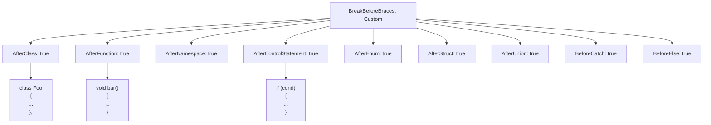
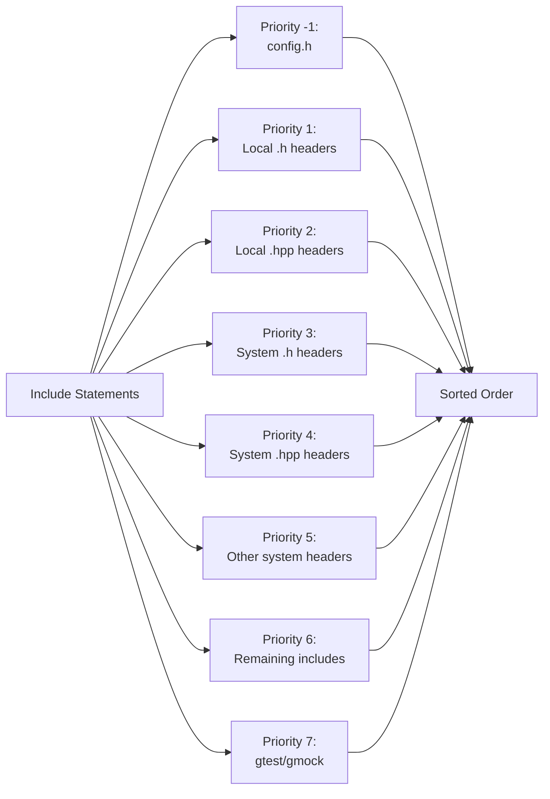
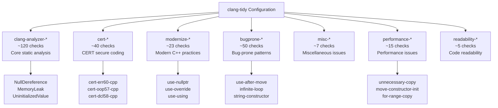
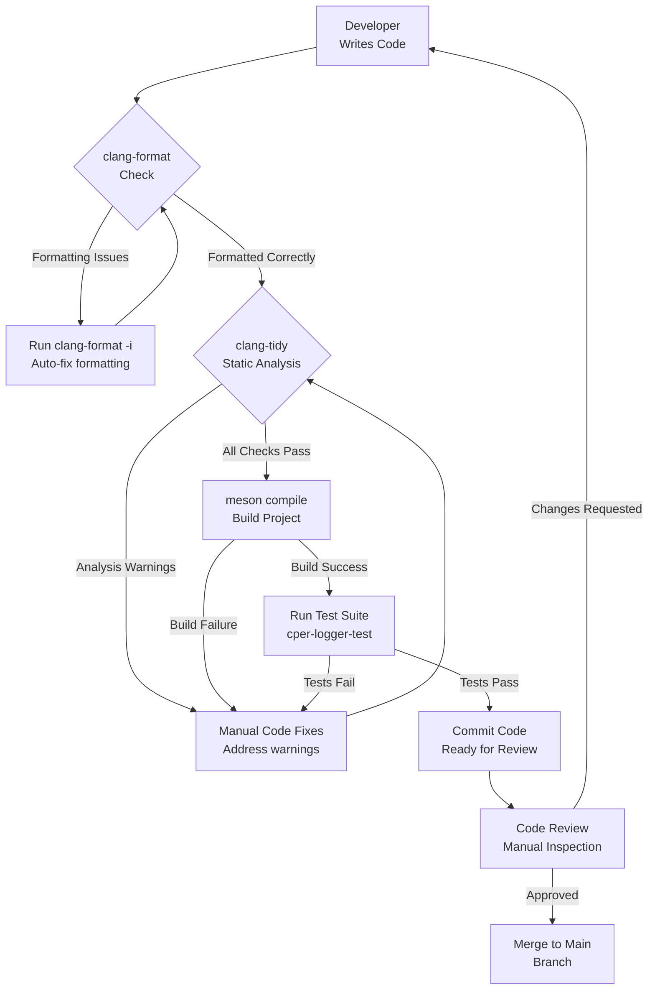
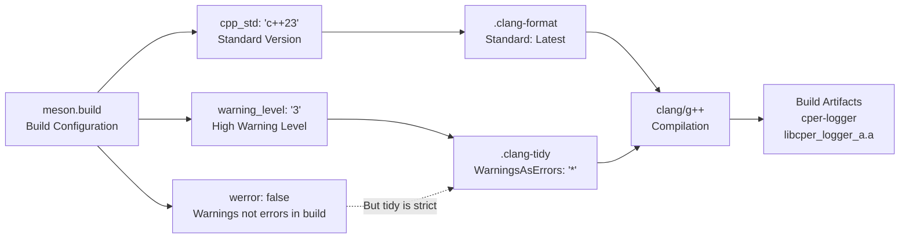

<!-- source: DeepWiki mcp.deepwiki.com · repo NVIDIA/cper-logger · page 5.3 Code Style and Quality · fetched 2026-10-26 -->

# Code Style and Quality

<details>
<summary>Relevant source files</summary>

The following files were used as context for generating this wiki page:

- [.clang-format](.clang-format)
- [.clang-tidy](.clang-tidy)

</details>


This page documents the code formatting standards and static analysis requirements for the cper-logger project. The project enforces strict code quality through automated tooling, specifically `clang-format` for code formatting and `clang-tidy` for static analysis. All code must pass both tools without warnings or errors before being accepted.

For information on building the project, see [Building the Project](#5.1). For information on running tests, see [Running Tests](#5.2).

---

## Code Formatting with clang-format

The project uses `clang-format` to enforce consistent code style across the codebase. The configuration is based on LLVM style with OpenBMC-specific customizations defined in [.clang-format:1-116]().

### Key Formatting Rules

| Setting | Value | Description |
|---------|-------|-------------|
| `ColumnLimit` | 80 | Maximum line length before wrapping |
| `IndentWidth` | 4 | Spaces per indentation level |
| `TabWidth` | 4 | Tab character width (tabs never used) |
| `UseTab` | Never | Always use spaces, never tabs |
| `PointerAlignment` | Left | Pointers align left: `int* ptr` |
| `Standard` | Latest | Use latest C++ standard features |
| `BreakBeforeBraces` | Custom | Comprehensive brace wrapping rules |

**Sources:** [.clang-format:1-116]()

### Brace Wrapping Configuration

The project uses custom brace wrapping with braces on new lines for most constructs:



**Sources:** [.clang-format:22-38]()

### Include Ordering and Grouping

The configuration enforces strict include ordering with automatic regrouping ([.clang-format:58-75]()):



| Priority | Regex Pattern | Description | Example |
|----------|---------------|-------------|---------|
| -1 | `^"config.h"` | Configuration header (first) | `#include "config.h"` |
| 1 | `^".*\.h"` | Local C-style headers | `#include "cper.h"` |
| 2 | `^".*\.hpp"` | Local C++ headers | `#include "cper.hpp"` |
| 3 | `^<.*\.h>` | System C-style headers | `#include <stdio.h>` |
| 4 | `^<.*\.hpp>` | System C++ headers | `#include <boost/asio.hpp>` |
| 5 | `^<.*` | Other system headers | `#include <string>` |
| 6 | `.*` | Everything else | — |
| 7 | `^[<"](gtest\|gmock)` | Test framework headers (last) | `#include <gtest/gtest.h>` |

**Sources:** [.clang-format:59-75]()

### Function and Parameter Formatting

Key rules for function declarations and definitions:

- **AllowShortFunctionsOnASingleLine:** None - All functions must have braces on separate lines ([.clang-format:14]())
- **AllowAllParametersOfDeclarationOnNextLine:** true - Long parameter lists can wrap ([.clang-format:11]())
- **IndentWrappedFunctionNames:** true - Wrapped function names are indented ([.clang-format:78]())
- **BreakConstructorInitializers:** AfterColon - Break after colon in constructor initializers ([.clang-format:42]())

**Sources:** [.clang-format:11-78]()

### Applying Code Formatting

To format all C++ files in the project:

```bash
find src test -name '*.cpp' -o -name '*.hpp' | xargs clang-format -i
```

The build system integrates with clang-format, so formatting can also be verified as part of the build process.

**Sources:** [.clang-format:1-116]()

---

## Static Analysis with clang-tidy

The project uses `clang-tidy` for comprehensive static analysis with all warnings treated as errors ([.clang-tidy:253]()). The configuration enables over 200 individual checks across multiple categories.

### Enabled Checker Categories



**Sources:** [.clang-tidy:1-251]()

### Checker Category Details

| Category | Check Count | Purpose | Key Checks |
|----------|-------------|---------|------------|
| `clang-analyzer-*` | ~120 | Core static analysis from Clang Static Analyzer | `NullDereference`, `MemoryLeak`, `UninitializedValue` |
| `cert-*` | ~40 | CERT C/C++ Secure Coding Standards compliance | `err60-cpp`, `oop57-cpp`, `dcl58-cpp` |
| `modernize-*` | ~23 | Modern C++ idioms and best practices | `use-nullptr`, `use-override`, `use-using` |
| `bugprone-*` | ~50 | Common bug patterns and anti-patterns | `use-after-move`, `infinite-loop`, `dangling-handle` |
| `misc-*` | ~7 | Miscellaneous code quality issues | `no-recursion`, `throw-by-value-catch-by-reference` |
| `performance-*` | ~15 | Performance optimization opportunities | `unnecessary-copy-initialization`, `move-const-arg` |
| `readability-*` | ~5 | Code readability and maintainability | `identifier-naming`, `braces-around-statements` |

**Sources:** [.clang-tidy:1-251]()

### Naming Conventions

The project enforces strict naming conventions via the `readability-identifier-naming` checker ([.clang-tidy:256-261]()):

| Entity Type | Case Style | Example | Configuration Key |
|-------------|------------|---------|-------------------|
| **Class** | CamelCase | `CPER`, `JsonToXml` | `ClassCase` |
| **Struct** | CamelCase | `LogEntry`, `SectionData` | `StructCase` |
| **Variable** | camelBack | `cperData`, `sectionCount` | `VariableCase` |
| **Function** | camelBack | `cperCreateLog`, `prepareToLog` | `FunctionCase` |
| **Parameter** | camelBack | `rawData`, `severity` | `ParameterCase` |
| **Namespace** | lower_case | `cper_logger`, `utils` | `NamespaceCase` |

**Examples from the codebase:**
- Class: `CPER` ([src/cper.hpp]())
- Function: `cperCreateLog` ([src/cper_logger_main.cpp]())
- Variable: `cperData` ([src/cper.cpp]())
- Namespace: Not explicitly used in this small codebase

**Sources:** [.clang-tidy:255-261]()

### Error Enforcement

All clang-tidy warnings are treated as errors ([.clang-tidy:253]()):

```
WarningsAsErrors: '*'
```

This means any code that triggers a clang-tidy check will fail the build. The configuration also filters headers to exclude Linux kernel headers from analysis:

```
HeaderFilterRegex: '^((?!linux).)*$'
```

**Sources:** [.clang-tidy:253-254]()

### Running Static Analysis

To run clang-tidy on the codebase:

```bash
# Run on all source files
clang-tidy src/*.cpp src/*.hpp test/*.cpp --

# Run with compilation database (recommended)
clang-tidy -p build src/*.cpp src/*.hpp test/*.cpp
```

The build system integration ensures clang-tidy runs automatically during builds when configured.

**Sources:** [.clang-tidy:1-262]()

---

## Quality Enforcement Workflow

The following diagram illustrates how code quality is enforced in the development workflow:



**Sources:** [.clang-format:1-116](), [.clang-tidy:1-262]()

---

## Tool Integration with Build System

The quality tools integrate with the Meson build system:



**Key Integration Points:**

1. **C++ Standard:** The build requires C++23 ([meson.build]()), matching clang-format's `Standard: Latest` setting
2. **Warning Level:** Build uses warning level 3, but clang-tidy is stricter with all warnings as errors
3. **RTTI Disabled:** Build disables RTTI, which impacts some C++ features and style choices
4. **LTO Enabled:** Link-time optimization is enabled, requiring clean code that survives aggressive optimization

**Sources:** [meson.build](), [.clang-format:111](), [.clang-tidy:253]()

---

## Common Formatting Patterns

### Control Flow Statements

All control flow statements must have braces on separate lines:

```cpp
// Correct - braces on new lines
if (condition)
{
    doSomething();
}
else
{
    doSomethingElse();
}

// Incorrect - would be reformatted
if (condition) {
    doSomething();
} else {
    doSomethingElse();
}
```

**Configuration:** [.clang-format:25-34]()

### Class Definitions

Classes follow CamelCase naming with braces on new lines:

```cpp
// Correct
class CperLogger
{
  public:
    void createLog();
    
  private:
    int logCount;
};

// Note: Access modifiers indented -2 from class body
```

**Configuration:** [.clang-format:4]() (AccessModifierOffset: -2), [.clang-tidy:256]() (ClassCase)

### Function Definitions

Functions use camelBack naming, never single-line:

```cpp
// Correct
void processData()
{
    // Implementation
}

// Incorrect - would be reformatted even if short
void processData() { /* simple */ }
```

**Configuration:** [.clang-format:14]() (AllowShortFunctionsOnASingleLine: None), [.clang-tidy:258]() (FunctionCase)

**Sources:** [.clang-format:4-38](), [.clang-tidy:256-261]()

---

## Summary

The cper-logger project maintains code quality through:

1. **Automated Formatting:** clang-format with 80-column limit, custom brace wrapping, and strict include ordering
2. **Static Analysis:** clang-tidy with 200+ checks across 7 categories, all warnings as errors
3. **Naming Conventions:** CamelCase for types, camelBack for functions/variables, lower_case for namespaces
4. **Build Integration:** Quality tools integrated with Meson build system and C++23 requirements
5. **Zero Tolerance:** All formatting and analysis issues must be resolved before code acceptance

**Sources:** [.clang-format:1-116](), [.clang-tidy:1-262]()

---

