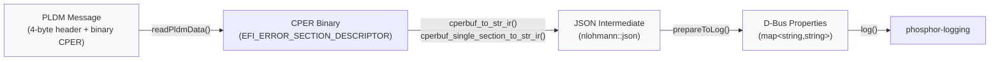
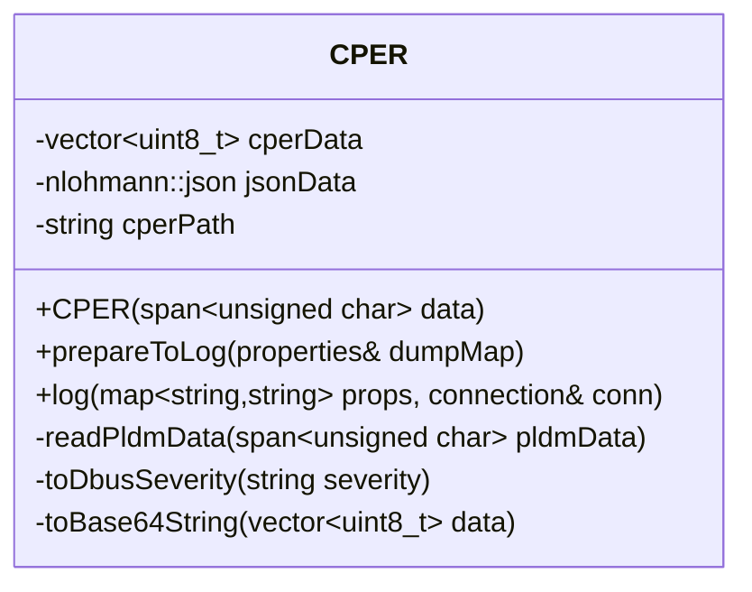
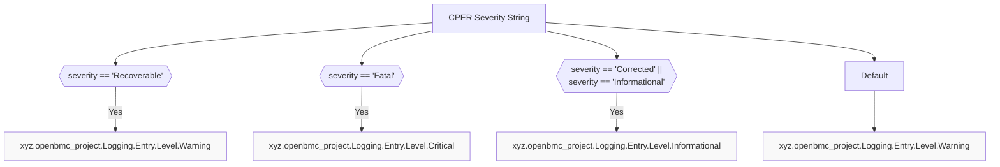
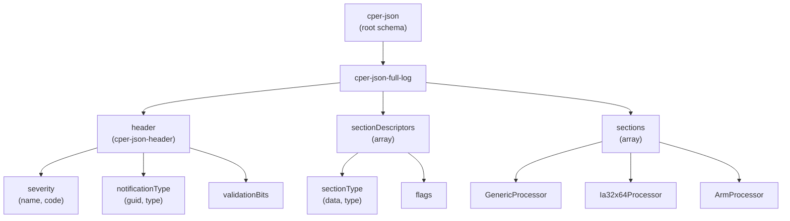

<!-- source: DeepWiki mcp.deepwiki.com · repo NVIDIA/cper-logger · page 6 Reference · fetched 2026-10-26 -->

# Reference

<details>
<summary>Relevant source files</summary>

The following files were used as context for generating this wiki page:

- [schema-gen/master-schema.json](schema-gen/master-schema.json)
- [src/cper.cpp](src/cper.cpp)

</details>


This section provides technical reference materials for the cper-logger system, documenting data formats, schemas, and APIs used for CPER processing and logging.

**Scope**: This page covers the technical specifications and data structures used throughout the cper-logger system. For implementation details of the CPER processing library, see [CPER Processing Library](#2.1). For build and runtime configuration, see [Build System](#3).

The reference materials are organized into three subsections:
- **[CPER Data Format](#6.1)**: Binary structure, PLDM header format, and section types
- **[Redfish Schema](#6.2)**: XML schema definitions for CPER data representation
- **[D-Bus API Reference](#6.3)**: Interface specifications and method signatures

## Overview

The cper-logger system processes Common Platform Error Records through multiple data format transformations. Understanding these formats is essential for integrating with the system or extending its functionality.

### Data Format Transformation Pipeline



**Sources**: [src/cper.cpp:329-371](), [src/cper.cpp:160-267]()

### PLDM Header Structure

The incoming data contains a 4-byte PLDM header followed by CPER binary data. The header determines how the binary payload is interpreted.

| Byte Offset | Field | Description |
|-------------|-------|-------------|
| 0 | Reserved | PLDM protocol byte |
| 1 | Type | `0x00` = Full CPER (header + sections)<br/>`0x01` = Single section (no header) |
| 2-3 | Reserved | Additional PLDM protocol bytes |

**Sources**: [src/cper.cpp:329-348]()

### Code Entity: CPER Class

The `CPER` class manages the complete data transformation lifecycle:



**Sources**: [src/cper.hpp](), [src/cper.cpp:55-66]()

### Property Keys Used in Logging

The system uses standardized property keys when logging CPER data to D-Bus. These keys are defined throughout the codebase:

| Property Key | Type | Description | Source Line |
|-------------|------|-------------|-------------|
| `diagnosticData` | string | Base64-encoded CPER binary | [src/cper.cpp:70]() |
| `diagnosticDataType` | string | Either `"CPER"` or `"CPERSection"` | [src/cper.cpp:74](), [src/cper.cpp:215-220]() |
| `jsonDiagnosticData` | string | JSON representation of CPER section | [src/cper.cpp:249]() |
| `REDFISH_MESSAGE_ID` | string | Always `"Platform.1.0.PlatformError"` | [src/cper.cpp:71]() |
| `cperSeverity` | string | Human-readable severity name | [src/cper.cpp:222]() |
| `cperSeverityCode` | string | Numeric severity code | [src/cper.cpp:223]() |
| `notificationType` | string | GUID identifying error type | [src/cper.cpp:224]() |
| `timestamp` | string | ISO 8601 timestamp | [src/cper.cpp:227]() |
| `sectionType` | string | GUID identifying section type | [src/cper.cpp:261]() |
| `CPER_PATH` | string | File path for CPER storage | [src/cper.cpp:291]() |
| `CPER_TYPE` | string | Diagnostic data type value | [src/cper.cpp:292]() |

**Sources**: [src/cper.cpp:68-76](), [src/cper.cpp:209-267](), [src/cper.cpp:280-309]()

### Severity Mapping

CPER severity values are mapped to D-Bus logging levels using the `toDbusSeverity()` function:



**Sources**: [src/cper.cpp:375-390]()

### JSON Schema Structure

The master JSON schema defines the complete CPER data format. At the top level, it supports two variants:

| Schema ID | Required Fields | Description |
|-----------|----------------|-------------|
| `cper-json-full-log` | `header`, `sectionDescriptors`, `sections` | Complete CPER with header and multiple sections |
| `cper-json-section-descriptor` | Section metadata only | Individual section descriptor |

**Key Schema Components:**



**Sources**: [schema-gen/master-schema.json:1-10](), [schema-gen/master-schema.json:14-133](), [schema-gen/master-schema.json:134-255](), [schema-gen/master-schema.json:256-258]()

### Common Schema Patterns

The schema uses a reusable `cper-json-namevaluepair` pattern throughout:

| Field | Type | Description |
|-------|------|-------------|
| `name` | string | Human-readable name |
| `value` | integer | Numeric code value |

This pattern appears in:
- `processorType` ([schema-gen/master-schema.json:345-358]())
- `processorISA` ([schema-gen/master-schema.json:359-372]())
- `errorType` ([schema-gen/master-schema.json:373-386]())
- `operation` ([schema-gen/master-schema.json:387-400]())
- `transactionType` (multiple locations)

**Sources**: [schema-gen/master-schema.json:116-128](), [schema-gen/master-schema.json:346-358]()

### Function Reference: Key Processing Functions

The following functions implement the core data transformation logic:

#### constructDiagnosticData()

```
int constructDiagnosticData(nlohmann::json& out, 
                           const nlohmann::json& secdIt,
                           const nlohmann::json& secIt)
```

Constructs a JSON object containing a single section descriptor and section pair. Used when logging individual CPER sections.

**Parameters:**
- `out`: Output JSON object to populate
- `secdIt`: Section descriptor JSON
- `secIt`: Section data JSON

**Returns:** `0` on success

**Sources**: [src/cper.cpp:41-53]()

#### readPldmData()

```
void CPER::readPldmData(std::span<const unsigned char> pldmData)
```

Parses PLDM message format, extracts CPER binary data, and converts to JSON using libcper. Validates PLDM header and dispatches to either `cperbuf_to_str_ir()` or `cperbuf_single_section_to_str_ir()` based on type byte.

**Validation:**
- Minimum size: 4 bytes (header) + `sizeof(EFI_ERROR_SECTION_DESCRIPTOR)`
- Type byte must be `0` or `1`

**Sources**: [src/cper.cpp:329-371]()

#### prepareToLog()

```
void CPER::prepareToLog(properties& dumpMap) const
```

Transforms JSON intermediate representation into a vector of property maps suitable for D-Bus logging. Creates one map entry per CPER section.

**Output Structure:**
- Iterates through `sectionDescriptors` and `sections` arrays
- Extracts common properties from `header` (if present)
- Generates Base64-encoded diagnostic data
- Constructs `jsonDiagnosticData` field per section

**Sources**: [src/cper.cpp:160-267]()

#### log()

```
void CPER::log(const std::map<std::string, std::string>& props,
               sdbusplus::asio::connection& conn) const
```

Sends a single section's properties to phosphor-logging via D-Bus. Calls `xyz.openbmc_project.Logging.Create.Create` method with severity mapping applied.

**D-Bus Method:**
- Service: `xyz.openbmc_project.Logging`
- Object: `/xyz/openbmc_project/logging`
- Interface: `xyz.openbmc_project.Logging.Create`
- Method: `Create`
- Signature: `ssa{ss}` (string, string, array of string pairs)

**Sources**: [src/cper.cpp:280-309]()

### Header Validation Bits

The CPER header includes validation bits indicating which optional fields are present:

| Bit Name | JSON Path | Description |
|----------|-----------|-------------|
| `platformIDValid` | `header.validationBits.platformIDValid` | Platform ID field is valid |
| `timestampValid` | `header.validationBits.timestampValid` | Timestamp field is valid |
| `partitionIDValid` | `header.validationBits.partitionIDValid` | Partition ID field is valid |

**Sources**: [schema-gen/master-schema.json:61-79]()

### Section Descriptor Flags

Each section descriptor contains flag bits indicating error characteristics:

| Flag | Description |
|------|-------------|
| `primary` | This is the primary error section |
| `containmentWarning` | Error containment warning |
| `reset` | Reset signaled |
| `errorThresholdExceeded` | Error threshold exceeded |
| `resourceNotAccessible` | Resource not accessible |
| `latentError` | Latent error detected |
| `propagated` | Error propagated |
| `overflow` | Information overflow |

**Sources**: [schema-gen/master-schema.json:182-220]()

### Base64 Encoding Implementation

CPER binary data is encoded to Base64 using Boost.Beast:

```
std::string CPER::toBase64String(const std::vector<uint8_t>& data) const
```

- Uses `boost::beast::detail::base64::encode()`
- Calculates buffer size with `boost::beast::detail::base64::encoded_size()`
- Null-terminates output string

**Sources**: [src/cper.cpp:393-404]()

## Type Aliases

The codebase uses a type alias for logging properties:

```cpp
using properties = std::vector<std::map<std::string, std::string>>;
```

This type represents a collection of property maps, one per CPER section to be logged.

**Sources**: [src/cper.hpp]()

## Constants

### PLDM Header Size

```cpp
const size_t pldmHeaderSize = 4;
```

**Sources**: [src/cper.cpp:331]()

### Section Descriptor Size

```cpp
const size_t sectionDescriptorSize = sizeof(EFI_ERROR_SECTION_DESCRIPTOR);
```

**Sources**: [src/cper.cpp:332]()

### Default Message String

When logging to phosphor-logging, the message string is always:

```cpp
"A CPER was logged"
```

**Sources**: [src/cper.cpp:308]()

---

