<!-- source: DeepWiki mcp.deepwiki.com · repo NVIDIA/cper-logger · page 6.1 CPER Data Format · fetched 2026-10-26 -->

# CPER Data Format

<details>
<summary>Relevant source files</summary>

The following files were used as context for generating this wiki page:

- [schema-gen/master-schema.json](schema-gen/master-schema.json)
- [src/cper.cpp](src/cper.cpp)

</details>


This page provides a detailed specification of the Common Platform Error Record (CPER) data format as processed by the cper-logger system. It documents the binary structure, JSON intermediate representation, and the transformation pipeline from raw PLDM messages to structured error logs.

For information about how CPER data is processed at runtime, see [CPER Processing Library](#2.1). For details on the Redfish schema representation, see [Redfish Schema](#6.2).

---

## Overview

CPER (Common Platform Error Record) is a standardized binary format defined by the UEFI specification for platform error reporting. The cper-logger system receives CPER data encapsulated in PLDM messages, parses it using the external `libcper` library, and converts it to JSON for structured logging.

The system handles two distinct CPER formats:
- **Full CPER (Type 0)**: Complete error record with header, section descriptors, and one or more error sections
- **Single Section (Type 1)**: Individual error section without a CPER header

**Sources:** [src/cper.cpp:329-371]()

---

## PLDM Encapsulation

CPER data arrives through PLDM messages with a 4-byte header that precedes the actual CPER payload. The header format determines how the CPER data is interpreted:

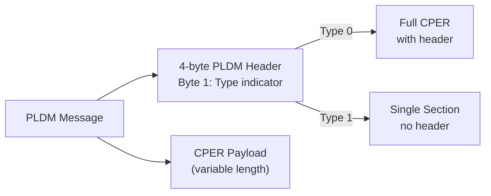

### PLDM Header Structure

| Byte Position | Field | Description |
|---------------|-------|-------------|
| 0 | Reserved | PLDM protocol byte |
| 1 | Type | `0x00` = Full CPER, `0x01` = Single Section |
| 2-3 | Reserved | PLDM protocol bytes |

The type byte at position 1 determines which libcper parsing function is used:
- Type 0: `cperbuf_to_str_ir()` - parses full CPER with header
- Type 1: `cperbuf_single_section_to_str_ir()` - parses single section

**Sources:** [src/cper.cpp:329-371](), [src/cper.cpp:342-348](), [src/cper.cpp:355-363]()

---

## Full CPER Structure (Type 0)

A Full CPER record consists of three major components in sequence:

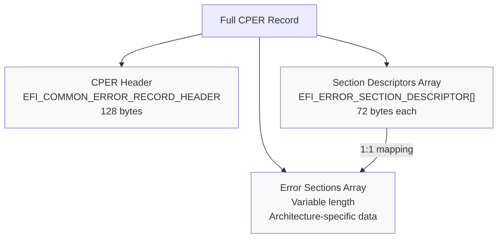

### CPER Header

The CPER header provides global metadata about the error record. After parsing by libcper, it appears in JSON with the following structure:

| Field | Type | Description | Code Reference |
|-------|------|-------------|----------------|
| `revision` | object | Major/minor version (e.g., `{"major": 1, "minor": 0}`) | [schema-gen/master-schema.json:30-42]() |
| `sectionCount` | integer | Number of error sections in this record | [schema-gen/master-schema.json:44-46]() |
| `severity` | object | Error severity with `name` and `code` | [schema-gen/master-schema.json:48-59]() |
| `validationBits` | object | Flags indicating which optional fields are valid | [schema-gen/master-schema.json:61-78]() |
| `recordLength` | integer | Total byte length of CPER record | [schema-gen/master-schema.json:80-82]() |
| `timestamp` | string | ISO 8601 timestamp (if valid) | [schema-gen/master-schema.json:84-85]() |
| `platformID` | string | GUID identifying the platform | [schema-gen/master-schema.json:90-91]() |
| `partitionID` | string | GUID identifying the partition | [schema-gen/master-schema.json:93-94]() |
| `creatorID` | string | GUID identifying the creator | [schema-gen/master-schema.json:96-98]() |
| `notificationType` | object | GUID and type name for notification | [schema-gen/master-schema.json:99-110]() |
| `recordID` | integer | Unique record identifier | [schema-gen/master-schema.json:112-113]() |
| `flags` | object | Record-level flags | [schema-gen/master-schema.json:115-128]() |
| `persistenceInfo` | integer | Persistence information | [schema-gen/master-schema.json:129-131]() |

The `CPER::prepareToLog()` function extracts header fields for logging:

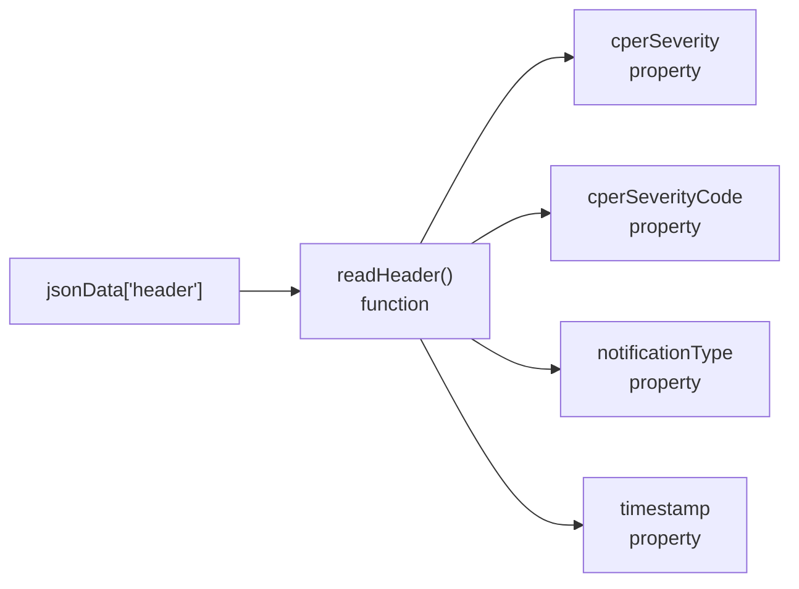

**Sources:** [src/cper.cpp:106-150](), [src/cper.cpp:207-229](), [schema-gen/master-schema.json:13-133]()

### Section Descriptors

Each error section has a corresponding section descriptor that provides metadata:

| Field | Type | Description |
|-------|------|-------------|
| `sectionOffset` | integer | Byte offset from start of CPER to section data |
| `sectionLength` | integer | Length of section data in bytes |
| `revision` | object | Section descriptor version |
| `validationBits` | object | Flags for FRU ID and FRU string validity |
| `flags` | object | Section flags (primary, containment, reset, etc.) |
| `sectionType` | object | GUID identifying section type with human-readable name |
| `fruID` | string | Field Replaceable Unit identifier (if valid) |
| `severity` | object | Section-specific severity (name and code) |
| `fruText` | string | Human-readable FRU description (if valid) |

The `sectionType` field is particularly important as it determines how the corresponding section is parsed:

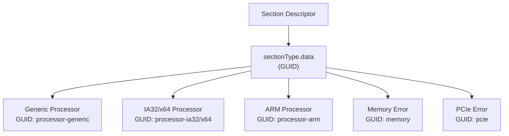

**Sources:** [schema-gen/master-schema.json:134-254](), [src/cper.cpp:253-262]()

### Error Sections

Error sections contain architecture-specific error information. The cper-logger system treats sections as opaque data after libcper parsing, extracting them for individual logging.

**Sources:** [src/cper.cpp:231-266]()

---

## Single Section Format (Type 1)

When the PLDM type byte is `0x01`, the payload contains only a section descriptor followed by section data, with no CPER header:

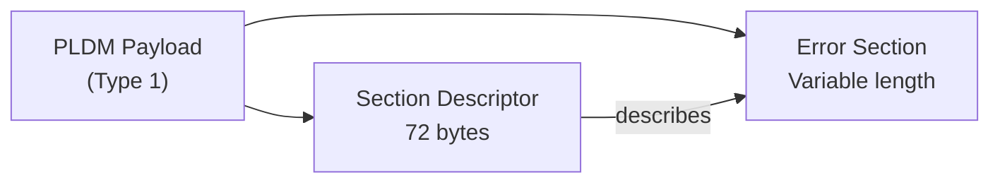

This format is handled differently in the processing pipeline:

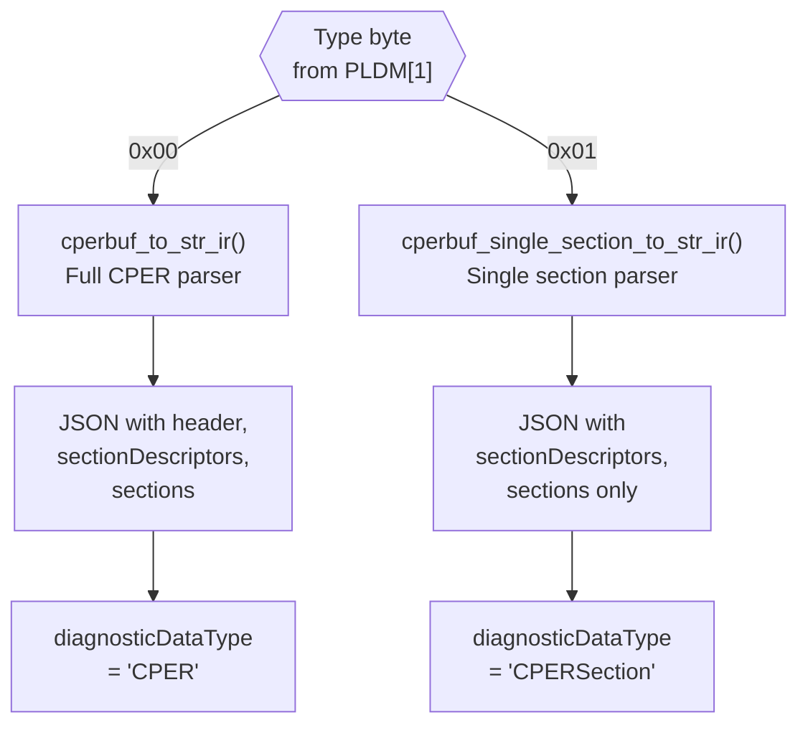

**Sources:** [src/cper.cpp:342-363](), [src/cper.cpp:211-228]()

---

## Section Types

The JSON schema defines multiple section types, each with architecture-specific fields. The most common types are:

### Generic Processor Section

Contains processor-agnostic error information:

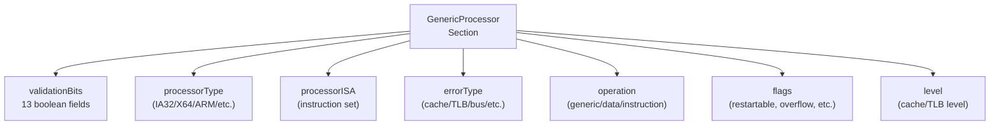

**Sources:** [schema-gen/master-schema.json:262-450]()

### IA32/x64 Processor Section

Contains x86-specific processor error information:

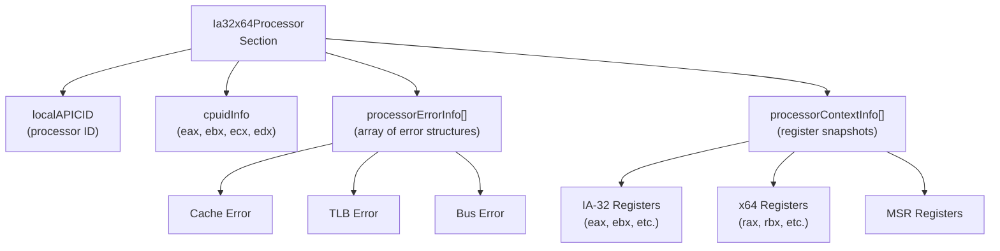

**Sources:** [schema-gen/master-schema.json:453-1262]()

### ARM Processor Section

Contains ARM-specific processor error information:

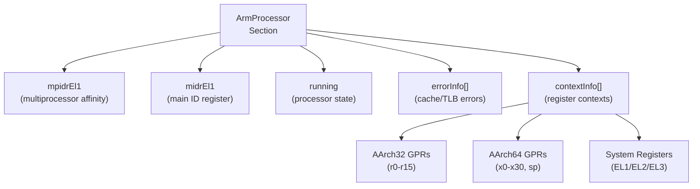

**Sources:** [schema-gen/master-schema.json:1265-2854]()

---

## Severity Levels

CPER defines four severity levels for errors, encoded as both integer codes and string names:

| Code | Name | D-Bus Mapping | Description |
|------|------|---------------|-------------|
| 0 | Recoverable | `Logging.Entry.Level.Warning` | Error was recovered, system continues |
| 1 | Fatal | `Logging.Entry.Level.Critical` | Unrecoverable error, system failure imminent |
| 2 | Corrected | `Logging.Entry.Level.Informational` | Error corrected by hardware/firmware |
| 3 | Informational | `Logging.Entry.Level.Informational` | Informational event, not an error |

The severity appears in both the CPER header (global severity) and in each section descriptor (per-section severity). The `CPER::toDbusSeverity()` function maps CPER severity strings to D-Bus severity levels:

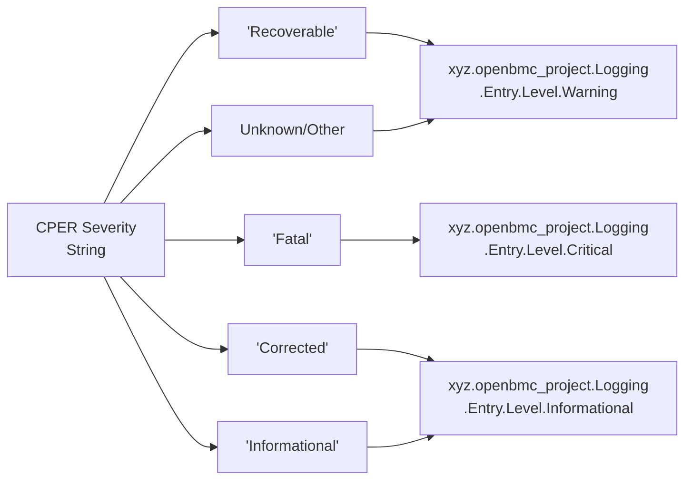

**Sources:** [src/cper.cpp:375-390](), [schema-gen/master-schema.json:48-59]()

---

## Validation Bits

CPER uses validation bit structures extensively to indicate which fields contain valid data. This allows for sparse error records where only relevant fields are populated.

### Header Validation Bits

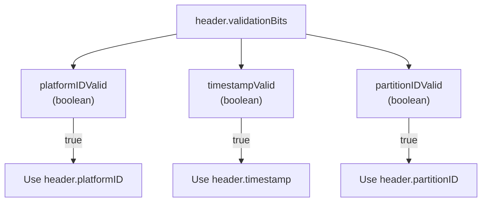

### Section Descriptor Validation Bits

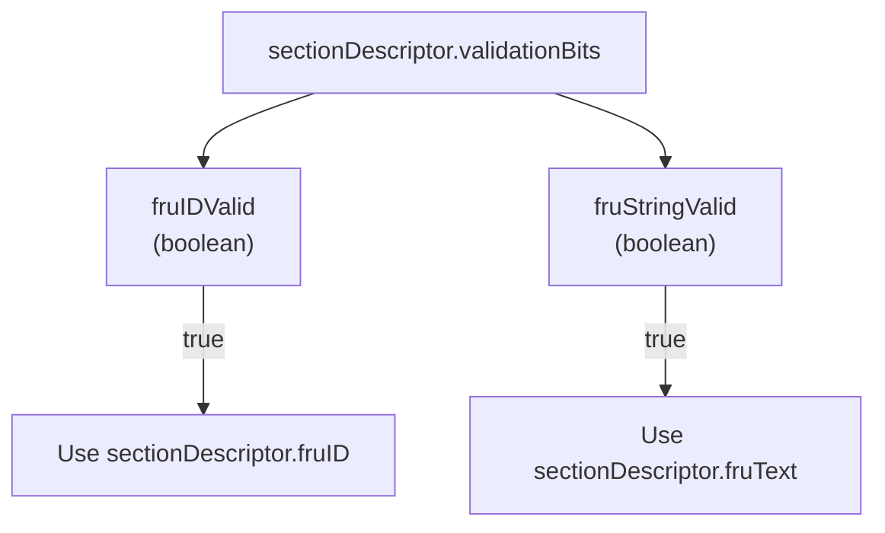

### Processor Section Validation Bits

Each processor section type has its own validation bit structure. For example, Generic Processor sections have 13 validation flags:

- `processorTypeValid`
- `processorISAValid`
- `processorErrorTypeValid`
- `operationValid`
- `flagsValid`
- `levelValid`
- `cpuVersionValid`
- `cpuBrandInfoValid`
- `cpuIDValid`
- `targetAddressValid`
- `requestorIDValid`
- `responderIDValid`
- `instructionIPValid`

**Sources:** [schema-gen/master-schema.json:61-78](), [schema-gen/master-schema.json:170-180](), [schema-gen/master-schema.json:286-343]()

---

## Binary to JSON Conversion Flow

The complete transformation from binary CPER to structured log entries follows this pipeline:

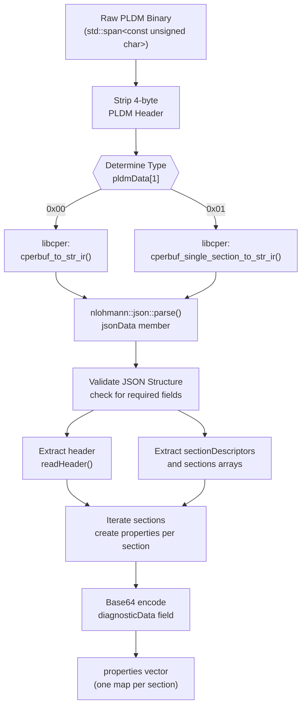

### Key Processing Functions

| Function | File | Purpose |
|----------|------|---------|
| `CPER::readPldmData()` | [src/cper.cpp:329-371]() | Strips PLDM header, determines type, invokes libcper parser |
| `readHeader()` | [src/cper.cpp:115-150]() | Extracts severity, notification type, timestamp from header JSON |
| `CPER::prepareToLog()` | [src/cper.cpp:160-267]() | Validates JSON structure, iterates sections, builds properties |
| `constructDiagnosticData()` | [src/cper.cpp:41-53]() | Constructs JSON object with section descriptor and section |
| `CPER::toBase64String()` | [src/cper.cpp:393-404]() | Base64-encodes binary CPER data for `diagnosticData` field |

**Sources:** [src/cper.cpp:55-404]()

---

## JSON Intermediate Representation

The libcper library produces JSON conforming to the CPER-JSON schema. This intermediate representation is stored in `CPER::jsonData` and has one of two top-level structures:

### Full CPER JSON

```json
{
  "header": {
    "revision": {"major": 1, "minor": 0},
    "sectionCount": 2,
    "severity": {"name": "Fatal", "code": 1},
    "validationBits": {...},
    "recordLength": 4096,
    "timestamp": "2024-01-15T10:30:00Z",
    "notificationType": {
      "guid": "2dce8bb1-bdd7-450e-b9ad-9cf4ebd4f890",
      "type": "Boot Error Record"
    },
    ...
  },
  "sectionDescriptors": [
    {
      "sectionOffset": 128,
      "sectionLength": 192,
      "sectionType": {
        "data": "9876ccad-47b4-4bdb-b65e-16f193c4f3db",
        "type": "Processor Generic"
      },
      "severity": {"name": "Fatal", "code": 1},
      ...
    }
  ],
  "sections": [
    {
      "GenericProcessor": {...}
    }
  ]
}
```

### Single Section JSON

```json
{
  "sectionDescriptors": [
    {
      "sectionType": {...},
      "severity": {...},
      ...
    }
  ],
  "sections": [
    {
      "GenericProcessor": {...}
    }
  ]
}
```

The presence or absence of the `header` field determines the `diagnosticDataType` property: `"CPER"` for full records, `"CPERSection"` for single sections.

**Sources:** [src/cper.cpp:207-229](), [schema-gen/master-schema.json:1-10]()

---

## Data Preservation

Throughout the processing pipeline, the original binary CPER data is preserved in the `CPER::cperData` member variable. This raw data is:

1. Extracted from PLDM payload (after stripping 4-byte header): [src/cper.cpp:350-352]()
2. Base64-encoded for the `diagnosticData` field: [src/cper.cpp:242](), [src/cper.cpp:393-404]()
3. Logged to phosphor-logging for archival and analysis

This ensures that even if the JSON parsing or transformation has issues, the complete binary record is available for offline analysis.

**Sources:** [src/cper.cpp:350-352](), [src/cper.cpp:242](), [src/cper.cpp:68-76]()

---

