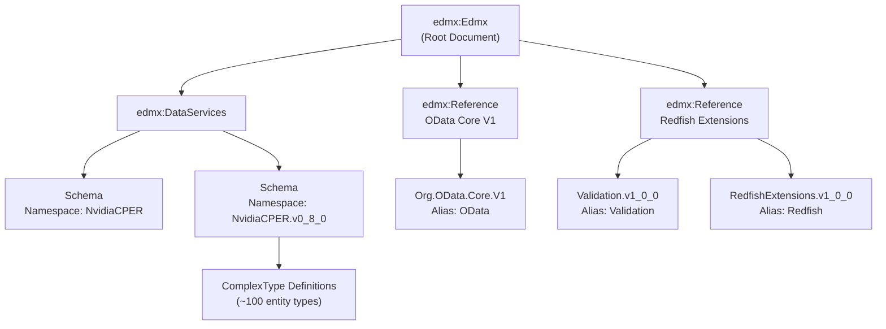
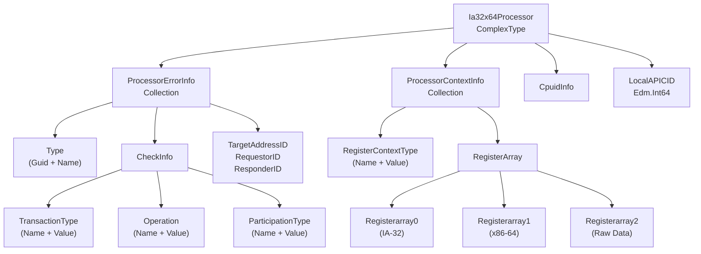
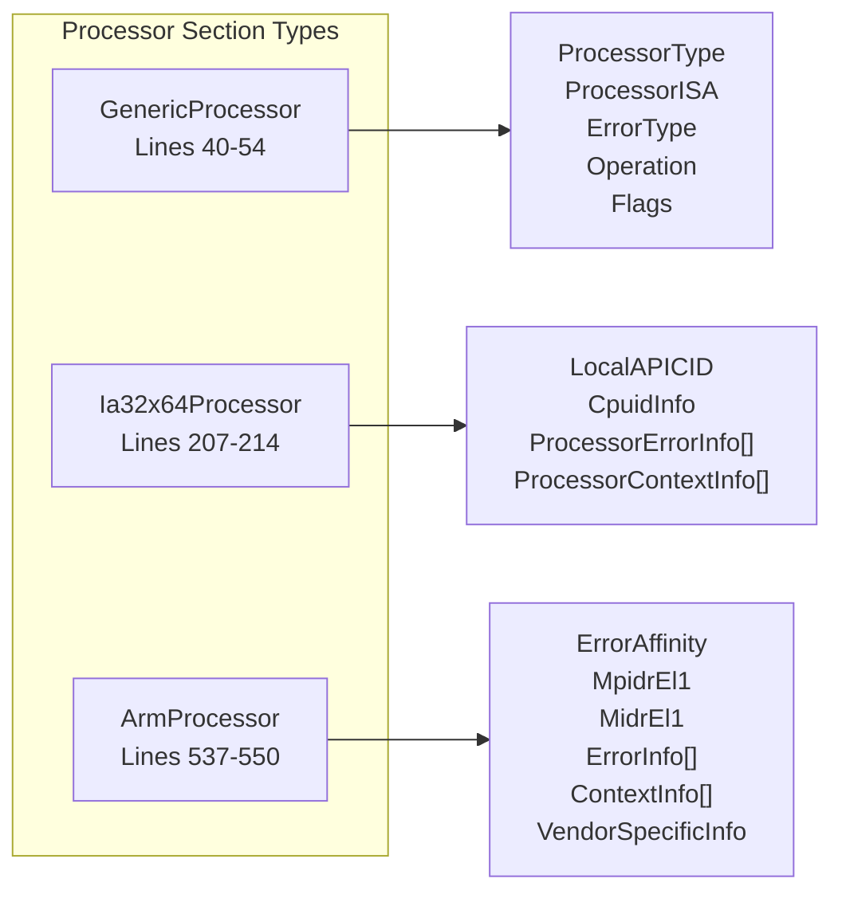
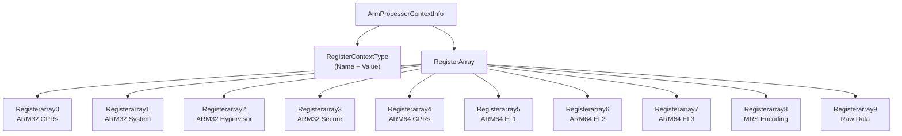
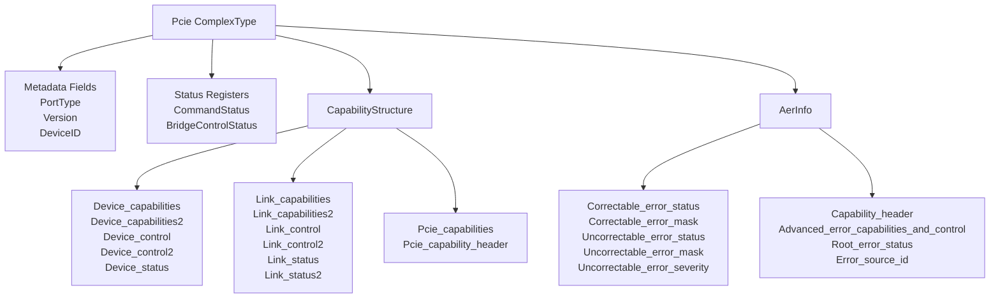
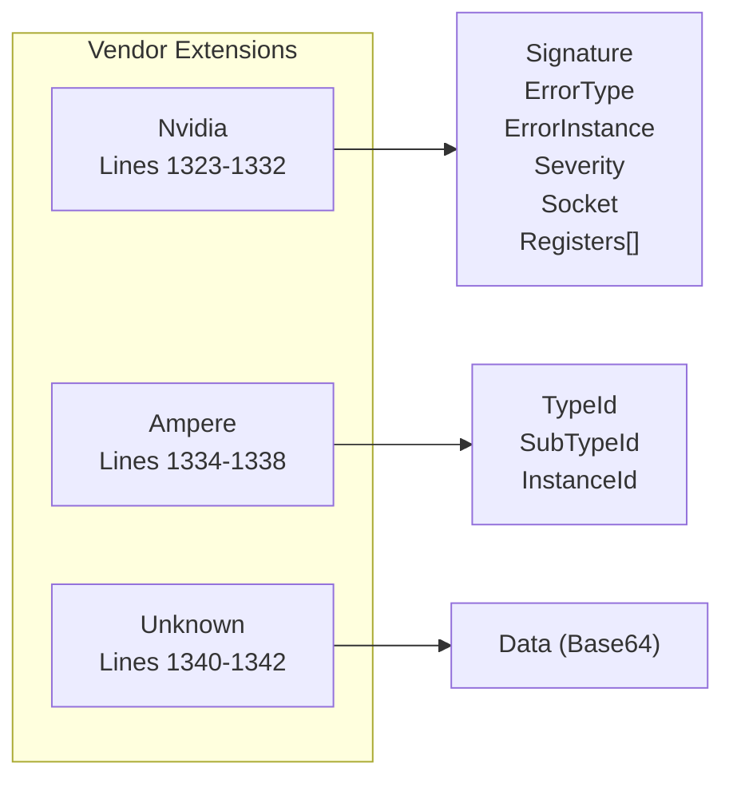
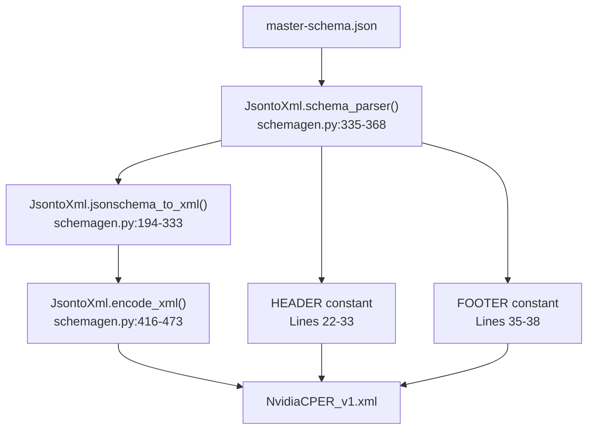

<!-- source: DeepWiki mcp.deepwiki.com · repo NVIDIA/cper-logger · page 6.2 Redfish Schema · fetched 2026-10-26 -->

# Redfish Schema

<details>
<summary>Relevant source files</summary>

The following files were used as context for generating this wiki page:

- [schema-gen/NvidiaCPER_v1.xml](schema-gen/NvidiaCPER_v1.xml)
- [schema-gen/master-schema.json](schema-gen/master-schema.json)
- [schema-gen/schemagen.py](schema-gen/schemagen.py)

</details>


## Purpose and Scope

This document describes the Redfish-compliant XML schema generated for CPER (Common Platform Error Record) data. The schema defines a structured representation of CPER error records in OData Entity Data Model (EDM) format, enabling standardized consumption of CPER data by Redfish-compatible systems.

For information about the underlying CPER data format that this schema describes, see [CPER Data Format](#6.1). For details on the schema generation tooling, see [Schema Generation Tools](#2.3).

## Schema Overview

The Redfish schema for CPER data is defined in [schema-gen/NvidiaCPER_v1.xml](). This XML file provides a machine-readable definition of all CPER section types and their properties using the OData EDM vocabulary.

### Namespace Structure



**Sources:** [schema-gen/NvidiaCPER_v1.xml:1-12]()

The schema document follows the OData EDMX structure with:
- **Root namespace**: `edmx:Edmx` with OData version 4.0
- **External references**: Standard OData Core vocabulary and Redfish extensions
- **Dual schema approach**: Unversioned base schema (`NvidiaCPER`) and versioned implementation schema (`NvidiaCPER.v0_8_0`)

The version identifier `v0_8_0` is defined in [schema-gen/schemagen.py:20]() and embedded throughout the schema.

## Entity Type Hierarchy

### Root Entity

The schema defines a root `NvidiaCPER` ComplexType that contains all possible CPER section types as optional properties:

```mermaid
graph TB
    ROOT["NvidiaCPER<br/>(Root ComplexType)"]
    
    ROOT --> GENPROC["GenericProcessor"]
    ROOT --> IA32PROC["Ia32x64Processor"]
    ROOT --> ARMPROC["ArmProcessor"]
    ROOT --> MEM["Memory"]
    ROOT --> MEM2["Memory2"]
    ROOT --> PCIE["Pcie"]
    ROOT --> PCIBUS["PciBus"]
    ROOT --> PCICOMP["PciComponent"]
    ROOT --> FW["Firmware"]
    ROOT --> GENDMAR["GenericDmar"]
    ROOT --> VTDDMAR["VtdDmar"]
    ROOT --> IOMMUDMAR["IommuDmar"]
    ROOT --> CCIX["CcixPer"]
    ROOT --> CXLPROTO["CxlProtocol"]
    ROOT --> CXLCOMP["CxlComponent"]
    ROOT --> NVIDIA["Nvidia"]
    ROOT --> AMPERE["Ampere"]
    ROOT --> UNKNOWN["Unknown"]
```



**Sources:** [schema-gen/NvidiaCPER_v1.xml:1344-1363]()

Each property in the root type corresponds to a CPER section type. Only one section type is populated per CPER section instance.

### Common Pattern: Nested ComplexTypes

CPER sections follow a hierarchical structure where top-level entities contain nested ComplexTypes for sub-structures. For example, the `Ia32x64Processor` section:



**Sources:** [schema-gen/NvidiaCPER_v1.xml:207-214](), [schema-gen/NvidiaCPER_v1.xml:108-115](), [schema-gen/NvidiaCPER_v1.xml:199-205](), [schema-gen/NvidiaCPER_v1.xml:193-197]()

### Name-Value Pair Pattern

Many enumerated properties use a consistent `Name` + `Value` pattern, represented as ComplexTypes:

| Property | Type | Description |
|----------|------|-------------|
| `Name` | `Edm.String` | Human-readable name of the enumeration value |
| `Value` | `Edm.Int64` | Numeric enumeration code |

Examples include:
- `GenericProcessorProcessorType` ([schema-gen/NvidiaCPER_v1.xml:13-16]())
- `TransactionType` ([schema-gen/NvidiaCPER_v1.xml:68-71]())
- `ErrorType` ([schema-gen/NvidiaCPER_v1.xml:88-91]())
- `MemoryMemoryErrorType` ([schema-gen/NvidiaCPER_v1.xml:583-586]())

This pattern allows both machine processing (using `Value`) and human readability (using `Name`).

## Type System and Mappings

### EDM Primitive Types

The schema uses a limited set of OData EDM primitive types, mapped from JSON schema types:

| JSON Schema Type | EDM Type | Usage |
|-----------------|----------|-------|
| `integer` | `Edm.Int64` | All integer values (fields, counters, addresses) |
| `uint64` | `Edm.Int64` | Unsigned 64-bit integers |
| `string` | `Edm.String` | Text fields, GUIDs, hex representations |
| `boolean` | `Edm.Boolean` | Flags and validation bits |
| `object` | ComplexType reference | Nested structures |
| `array` | `Collection(ComplexType)` | Repeated elements |

**Sources:** [schema-gen/schemagen.py:153-158]()

All numeric types use `Edm.Int64` regardless of their actual bit width in the CPER specification. This simplifies schema processing at the cost of precision in type representation.

### Collection Types

Arrays in the CPER data model are represented using OData Collection syntax:

```xml
<Property Name="ProcessorErrorInfo" Type="Collection(NvidiaCPER.v0_8_0.ProcessorErrorInfo)"></Property>
```

**Sources:** [schema-gen/NvidiaCPER_v1.xml:212]()

Collections are generated when the JSON schema indicates an `array` type ([schema-gen/schemagen.py:445-454]()).

## Major Section Types

### Processor Sections

The schema defines three processor error section types:



**Sources:** [schema-gen/NvidiaCPER_v1.xml:40-54](), [schema-gen/NvidiaCPER_v1.xml:207-214](), [schema-gen/NvidiaCPER_v1.xml:537-550]()

#### ARM Processor Error Information

ARM processor sections have the most complex nested structure, with multiple register array variants:



**Sources:** [schema-gen/NvidiaCPER_v1.xml:526-531](), [schema-gen/NvidiaCPER_v1.xml:340-524]()

### Memory Sections

Two memory section variants exist:

| Type | Schema Lines | Key Differences |
|------|--------------|-----------------|
| `Memory` | [594-615]() | Original memory error format; includes `Extended` field |
| `Memory2` | [652-674]() | Enhanced format; includes `Status` and `ChipID` fields |

Both share common structures:
- `ErrorStatus` ComplexType with error signal flags
- `Bank` union type (simple value or address+group)
- `MemoryErrorType` enumeration
- Physical address fields with both integer and hex string representations

**Sources:** [schema-gen/NvidiaCPER_v1.xml:594-615](), [schema-gen/NvidiaCPER_v1.xml:652-674]()

### PCIe Section

The `Pcie` section is one of the most detailed, reflecting the complexity of PCIe error reporting:



**Sources:** [schema-gen/NvidiaCPER_v1.xml:1069-1078](), [schema-gen/NvidiaCPER_v1.xml:916-935](), [schema-gen/NvidiaCPER_v1.xml:1056-1067]()

The PCIe section includes 60+ nested ComplexTypes to represent the full PCIe capability structure and Advanced Error Reporting (AER) registers.

### Vendor-Specific Sections



**Sources:** [schema-gen/NvidiaCPER_v1.xml:1323-1332](), [schema-gen/NvidiaCPER_v1.xml:1334-1338](), [schema-gen/NvidiaCPER_v1.xml:1340-1342]()

The `Unknown` section serves as a catch-all for unrecognized CPER section types, storing raw data as a base64-encoded string.

## Schema Generation Process

The Redfish XML schema is generated from JSON schemas using the tooling documented in [Schema Generation Tools](#2.3). The generation process involves:

### Step 1: Reference Resolution

The `SchemaGenerator` class consolidates distributed JSON schemas by resolving `$ref` directives:


**Sources:** [schema-gen/schemagen.py:77-98](), [schema-gen/schemagen.py:41-69]()

### Step 2: XML Transformation

The `JsontoXml` class converts the consolidated JSON schema to OData EDM XML:



**Sources:** [schema-gen/schemagen.py:335-368](), [schema-gen/schemagen.py:194-333](), [schema-gen/schemagen.py:416-473](), [schema-gen/schemagen.py:22-38]()

Key transformation logic:
- **Type mapping**: [schema-gen/schemagen.py:153-158]()
- **ComplexType generation**: [schema-gen/schemagen.py:434-438]()
- **Property encoding**: [schema-gen/schemagen.py:455-471]()
- **Collection handling**: [schema-gen/schemagen.py:445-454]()

### Property Naming Convention

Property names are transformed during generation using the `format_propname()` method:

1. Split by hyphens: `cper-json-error-status` → `["cper", "json", "error", "status"]`
2. Drop first two elements and "section": `["error", "status"]`
3. Title case each element: `["Error", "Status"]`
4. Concatenate: `ErrorStatus`

Special cases handle naming conflicts like `CacheError`, `TlbError`, and `BusError`.

**Sources:** [schema-gen/schemagen.py:375-400]()

## Schema Usage

The generated schema serves multiple purposes:

1. **Type Definition**: Provides formal type definitions for CPER data consumed via Redfish APIs
2. **Validation**: Enables validation of CPER JSON data against the schema structure
3. **Documentation**: Acts as machine-readable documentation of CPER section formats
4. **Code Generation**: Can drive automatic generation of parser/serializer code in various languages

The schema is not directly used at runtime by the cper-logger service. Instead, it documents the structure of CPER data that the service processes using the libcper library. For runtime data processing, see [CPER Processing Library](#2.1).

**Sources:** [schema-gen/schemagen.py:1-11](), [schema-gen/NvidiaCPER_v1.xml:1-1368]()

---

