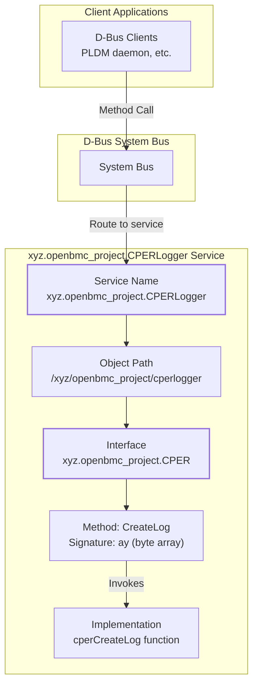
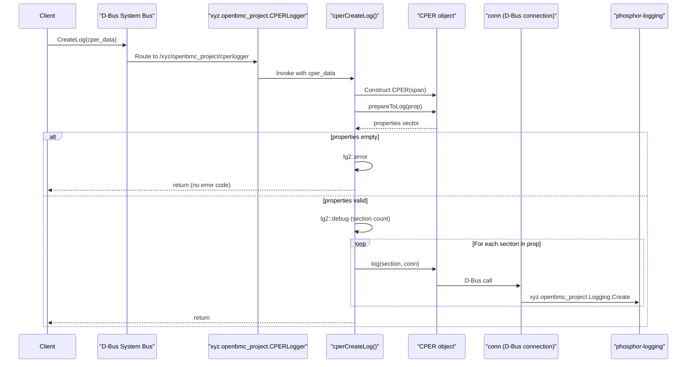

<!-- source: DeepWiki mcp.deepwiki.com · repo NVIDIA/cper-logger · page 6.3 D-Bus API Reference · fetched 2026-10-26 -->

# D-Bus API Reference

<details>
<summary>Relevant source files</summary>

The following files were used as context for generating this wiki page:

- [src/cper_logger_main.cpp](src/cper_logger_main.cpp)
- [xyz.openbmc_project.CPERLogger.service](xyz.openbmc_project.CPERLogger.service)

</details>


## Purpose and Scope

This document provides a complete technical reference for the D-Bus API exposed by the cper-logger service. It specifies the service name, object paths, interface definitions, method signatures, and behavioral semantics required to interact with the CPER logging system via D-Bus.

For information about the internal CPER processing implementation, see [CPER Processing Library](#2.1). For details on the service lifecycle and systemd integration, see [CPER Logger Service](#2.2).

---

## Service Overview

The cper-logger service exposes a single D-Bus interface for submitting CPER (Common Platform Error Record) data to the OpenBMC logging system.

### Service Identity

| Attribute | Value |
|-----------|-------|
| **Service Name** | `xyz.openbmc_project.CPERLogger` |
| **Object Path** | `/xyz/openbmc_project/cperlogger` |
| **Interface Name** | `xyz.openbmc_project.CPER` |
| **Bus Type** | System Bus |

**Sources:** [src/cper_logger_main.cpp:55-61](), [xyz.openbmc_project.CPERLogger.service:16]()

### D-Bus Interface Structure



**Diagram: D-Bus Service Architecture**

This diagram maps the D-Bus namespace hierarchy to the actual code entities in [src/cper_logger_main.cpp]().

**Sources:** [src/cper_logger_main.cpp:50-67]()

---

## Methods

### CreateLog

The `CreateLog` method accepts raw CPER data and processes it through the CPER parsing and logging pipeline.

#### Signature

```
CreateLog(in ay cper_data)
```

#### Parameters

| Name | Type | Direction | Description |
|------|------|-----------|-------------|
| `cper_data` | `ay` (byte array) | in | Raw CPER binary data, including the 4-byte PLDM header followed by the CPER payload |

The parameter is mapped to `std::vector<unsigned char>` in the C++ implementation.

**Sources:** [src/cper_logger_main.cpp:30]()

#### Return Value

This method has no return value (void). Success or failure is indicated through logging output only.

#### Behavior

The `CreateLog` method performs the following operations:

1. **Instantiate CPER Parser**: Creates a `CPER` object from the input byte array ([src/cper_logger_main.cpp:33]())
2. **Parse and Prepare**: Calls `prepareToLog()` to parse the CPER data and extract sections ([src/cper_logger_main.cpp:35]())
3. **Validate**: Checks if any valid sections were found ([src/cper_logger_main.cpp:36-40]())
4. **Log Sections**: Iterates through each section and logs it individually to phosphor-logging ([src/cper_logger_main.cpp:43-47]())



**Diagram: CreateLog Method Call Flow**

This sequence diagram shows the execution path through the code entities when a client invokes `CreateLog`.

**Sources:** [src/cper_logger_main.cpp:30-48]()

---

## Error Handling

The `CreateLog` method does not throw exceptions or return error codes via D-Bus. Instead, error conditions are handled as follows:

### Parsing Failures

If the CPER data cannot be parsed or contains no valid sections:
- An error message is logged via `lg2::error("Error creating log")` ([src/cper_logger_main.cpp:38]())
- The method returns without logging any sections
- The client receives a normal return (no D-Bus error)

This design means clients cannot programmatically determine success or failure from the method return. They must monitor phosphor-logging for the presence of expected log entries.

### Service Failures

The service is configured with automatic restart on failure:
- **Restart Policy**: Always restart ([xyz.openbmc_project.CPERLogger.service:6]())
- **Restart Delay**: 5 seconds ([xyz.openbmc_project.CPERLogger.service:7]())

If the service crashes during `CreateLog` processing, the client will receive a D-Bus error indicating the service is unavailable.

**Sources:** [src/cper_logger_main.cpp:36-40](), [xyz.openbmc_project.CPERLogger.service:6-7]()

---

## Service Lifecycle

### Initialization

The service initialization sequence ([src/cper_logger_main.cpp:50-67]()):

1. **Create I/O Context**: `boost::asio::io_context io`
2. **Establish D-Bus Connection**: `conn = std::make_shared<sdbusplus::asio::connection>(io)`
3. **Request Service Name**: `conn->request_name("xyz.openbmc_project.CPERLogger")`
4. **Create Object Server**: `sdbusplus::asio::object_server(conn)`
5. **Add Interface**: `server.add_interface("/xyz/openbmc_project/cperlogger", "xyz.openbmc_project.CPER")`
6. **Register Method**: `iface->register_method("CreateLog", cperCreateLog)`
7. **Initialize Interface**: `iface->initialize()`
8. **Run Event Loop**: `io.run()`

### Service Type

The service is declared as `Type=dbus` in the systemd unit ([xyz.openbmc_project.CPERLogger.service:15]()), which means systemd monitors the D-Bus name `xyz.openbmc_project.CPERLogger` ([xyz.openbmc_project.CPERLogger.service:16]()) and considers the service started when the name is acquired.

### Pre-Start Cleanup

The service executes a cleanup step before starting ([xyz.openbmc_project.CPERLogger.service:11]()):

```
ExecStartPre=rm -rf /var/cper
```

This removes legacy file-based storage from older versions of cper-logger.

**Sources:** [src/cper_logger_main.cpp:50-67](), [xyz.openbmc_project.CPERLogger.service:1-19]()

---

## Usage Examples

### Command-Line Invocation (busctl)

To invoke the `CreateLog` method with raw CPER data from the command line:

```bash
# Prepare CPER data (example with hex data)
CPER_DATA="0x00 0x01 0x02 ..."

# Call CreateLog method
busctl call xyz.openbmc_project.CPERLogger \
    /xyz/openbmc_project/cperlogger \
    xyz.openbmc_project.CPER \
    CreateLog ay <byte_count> <byte1> <byte2> ...
```

### Programmatic Invocation (sdbusplus)

Example C++ code using sdbusplus to invoke the service:

```cpp
#include <sdbusplus/bus.hpp>
#include <vector>

void submitCPER(const std::vector<unsigned char>& cperData) {
    auto bus = sdbusplus::bus::new_default();
    
    auto method = bus.new_method_call(
        "xyz.openbmc_project.CPERLogger",
        "/xyz/openbmc_project/cperlogger",
        "xyz.openbmc_project.CPER",
        "CreateLog"
    );
    
    method.append(cperData);
    bus.call_noreply(method);
}
```

Note: The method has no return value, so `call_noreply()` is appropriate. However, clients can use `call()` if they want to detect service availability errors.

### Python Example (dbus-python)

```python
import dbus

def submit_cper(cper_bytes):
    bus = dbus.SystemBus()
    proxy = bus.get_object(
        'xyz.openbmc_project.CPERLogger',
        '/xyz/openbmc_project/cperlogger'
    )
    iface = dbus.Interface(proxy, 'xyz.openbmc_project.CPER')
    iface.CreateLog(cper_bytes)
```

**Sources:** [src/cper_logger_main.cpp:30-48]()

---

## D-Bus Introspection

The service supports standard D-Bus introspection. To view the interface definition:

```bash
busctl introspect xyz.openbmc_project.CPERLogger \
    /xyz/openbmc_project/cperlogger
```

Expected output:

```
NAME                                TYPE      SIGNATURE RESULT/VALUE FLAGS
xyz.openbmc_project.CPER            interface -         -            -
.CreateLog                          method    ay        -            -
```

**Sources:** [src/cper_logger_main.cpp:59-65]()

---

## Connection Management

### Shared Connection Object

The service maintains a single shared D-Bus connection stored in the global variable `conn` ([src/cper_logger_main.cpp:27]()):

```cpp
std::shared_ptr<sdbusplus::asio::connection> conn = nullptr;
```

This connection is used by the `CPER::log()` method to communicate with phosphor-logging ([src/cper_logger_main.cpp:46]()). The shared pointer ensures the connection remains valid throughout the service lifetime and is accessible to all CPER processing operations.

### Asynchronous I/O

The service uses Boost.Asio for event-driven operation:
- The `boost::asio::io_context` manages all asynchronous operations ([src/cper_logger_main.cpp:52]())
- The sdbusplus connection is created with asio support ([src/cper_logger_main.cpp:53]())
- The `io.run()` call blocks indefinitely, processing D-Bus events ([src/cper_logger_main.cpp:66]())

This design allows the service to handle multiple concurrent `CreateLog` invocations efficiently.

**Sources:** [src/cper_logger_main.cpp:27](), [src/cper_logger_main.cpp:46](), [src/cper_logger_main.cpp:52-66]()