# Page: Overview

# Overview

<details>
<summary>Relevant source files</summary>

The following files were used as context for generating this wiki page:

- [meson.build](meson.build)
- [schema-gen/NvidiaCPER_v1.xml](schema-gen/NvidiaCPER_v1.xml)
- [schema-gen/schemagen.py](schema-gen/schemagen.py)
- [src/cper.cpp](src/cper.cpp)
- [src/cper_logger_main.cpp](src/cper_logger_main.cpp)

</details>


## Purpose and Scope

The `cper-logger` repository implements a D-Bus service for OpenBMC that processes and logs Common Platform Error Records (CPER). CPER is a standardized error reporting format defined in the UEFI specification for platform hardware errors. This service receives raw CPER data (typically from PLDM messages), parses it using the `libcper` library, and forwards structured error information to the phosphor-logging subsystem for storage and retrieval.

This document provides a high-level overview of the system architecture and components. For detailed information about specific subsystems, see:
- CPER processing internals: [CPER Processing Library](#2.1)
- D-Bus service implementation: [CPER Logger Service](#2.2)
- Redfish schema generation: [Schema Generation Tools](#2.3)
- Build configuration: [Build System](#3)
- Testing: [Testing](#4)

**Sources:** [src/cper_logger_main.cpp:1-68](), [src/cper.cpp:1-405](), [README.md]()

---

## System Architecture

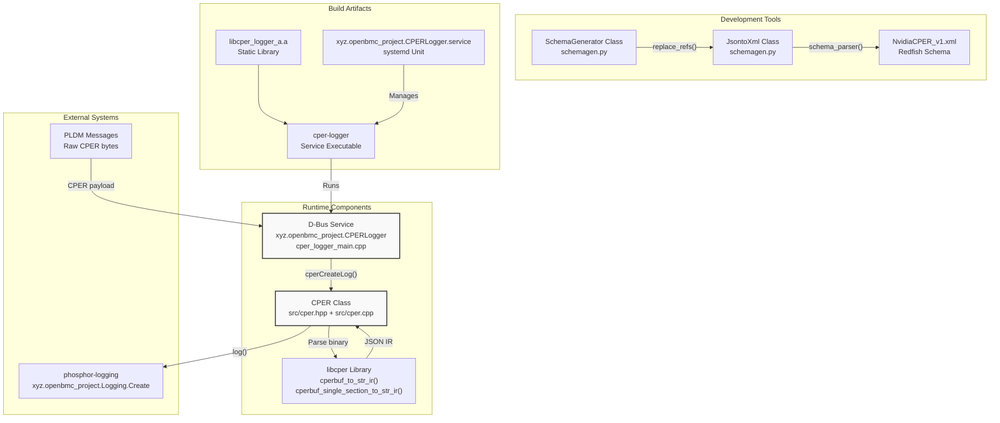

**System Architecture**: This diagram shows the three independent subsystems in the repository. The runtime components handle CPER data processing at runtime, development tools generate Redfish schemas from JSON specifications, and build artifacts package the service for deployment. The runtime path flows from PLDM input through parsing and logging, while the schema tooling operates offline to generate documentation.

**Sources:** [src/cper_logger_main.cpp:27-68](), [src/cper.cpp:55-66](), [schema-gen/schemagen.py:41-128](), [meson.build:107-127]()

---

## CPER Processing Data Flow

```mermaid
flowchart LR
    subgraph "Input Layer"
        PLDM_IN["PLDM Message<br/>std::vector&lt;unsigned char&gt;"]
        PLDM_HEADER["4-byte header<br/>type byte at [1]"]
    end
    
    subgraph "CPER Class Processing"
        CTOR["CPER::CPER()<br/>Constructor"]
        READ_PLDM["readPldmData()<br/>Extract type & data"]
        TYPE_CHECK{"type == 0?<br/>Full CPER vs Section"}
        FULL_PARSE["cperbuf_to_str_ir()<br/>libcper function"]
        SECTION_PARSE["cperbuf_single_section_to_str_ir()<br/>libcper function"]
        JSON_DATA["jsonData<br/>nlohmann::json member"]
        PREPARE["prepareToLog()<br/>properties& output"]
        PROPS_VEC["properties<br/>std::vector&lt;std::map&lt;...&gt;&gt;"]
    end
    
    subgraph "Output Layer"
        LOG_METHOD["log()<br/>D-Bus call per section"]
        BASE64["toBase64String()<br/>Encode diagnosticData"]
        SEVERITY["toDbusSeverity()<br/>Map CPER to D-Bus severity"]
        PHOSPHOR_CREATE["xyz.openbmc_project.Logging.Create<br/>async_method_call"]
    end
    
    PLDM_IN --> CTOR
    CTOR --> READ_PLDM
    READ_PLDM --> PLDM_HEADER
    PLDM_HEADER --> TYPE_CHECK
    TYPE_CHECK -->|"Type 0"| FULL_PARSE
    TYPE_CHECK -->|"Type 1"| SECTION_PARSE
    FULL_PARSE --> JSON_DATA
    SECTION_PARSE --> JSON_DATA
    JSON_DATA --> PREPARE
    PREPARE --> PROPS_VEC
    PROPS_VEC --> LOG_METHOD
    LOG_METHOD --> BASE64
    LOG_METHOD --> SEVERITY
    BASE64 --> PHOSPHOR_CREATE
    SEVERITY --> PHOSPHOR_CREATE
    
    style JSON_DATA fill:#f9f9f9,stroke:#333,stroke-width:2px
    style PROPS_VEC fill:#f9f9f9,stroke:#333,stroke-width:2px
```

**CPER Processing Data Flow**: This diagram traces the complete data transformation pipeline using actual function and class names from the codebase. The flow starts with raw PLDM bytes, parses them based on format type, converts to JSON intermediate representation, structures for logging, and finally encodes for D-Bus transmission to phosphor-logging.

**Sources:** [src/cper.cpp:55-66](), [src/cper.cpp:329-371](), [src/cper.cpp:160-267](), [src/cper.cpp:280-309](), [src/cper.cpp:375-404]()

---

## Key Components

| Component | Primary Files | Purpose | Key Interfaces |
|-----------|--------------|---------|----------------|
| **D-Bus Service** | [src/cper_logger_main.cpp]() | Exposes CPER logging interface on system bus | `cperCreateLog(const std::vector<unsigned char>&)` |
| **CPER Parser** | [src/cper.cpp](), [src/cper.hpp]() | Parses binary CPER into structured format | `CPER::prepareToLog(properties&)`, `CPER::log(...)` |
| **Schema Generator** | [schema-gen/schemagen.py]() | Converts JSON schemas to Redfish XML | `SchemaGenerator.replace_refs()`, `JsontoXml.schema_parser()` |
| **Static Library** | [libcper_logger_a.a]() | Reusable CPER processing logic | Linked by main executable and tests |
| **systemd Unit** | [xyz.openbmc_project.CPERLogger.service]() | Service lifecycle management | Auto-restart, pre-start cleanup |

**Sources:** [src/cper_logger_main.cpp:50-67](), [src/cper.hpp](), [schema-gen/schemagen.py:41-128](), [meson.build:107-127]()

---

## D-Bus Interface Specification

The service exposes a single D-Bus interface with the following characteristics:

```
Service Name:     xyz.openbmc_project.CPERLogger
Object Path:      /xyz/openbmc_project/cperlogger
Interface Name:   xyz.openbmc_project.CPER
Method:           CreateLog(ay) -> void
```

The `CreateLog` method accepts an array of bytes (`ay` in D-Bus signature) containing the PLDM-wrapped CPER data. The method signature is implemented by the `cperCreateLog` function at [src/cper_logger_main.cpp:30-48]().

**Processing Steps:**

1. **Instantiate CPER Object**: Construct a `CPER` instance with the input byte array wrapped in `std::span<const unsigned char>`
2. **Parse and Prepare**: Call `CPER::prepareToLog(properties&)` to parse the binary data into a vector of property maps
3. **Log Sections**: Iterate through each section's properties and invoke `CPER::log()` to forward to phosphor-logging
4. **Error Handling**: Empty properties vector indicates parsing failure; error logged via `lg2::error()`

**Sources:** [src/cper_logger_main.cpp:30-48](), [src/cper_logger_main.cpp:50-67]()

---

## CPER Data Format Support

The service supports two CPER format types, distinguished by a type byte in the PLDM header:

| Type | Format | libcper Function | Use Case |
|------|--------|-----------------|----------|
| **0** | Full CPER | `cperbuf_to_str_ir()` | Complete error record with header and multiple sections |
| **1** | Single Section | `cperbuf_single_section_to_str_ir()` | Individual error section without CPER header |

Both formats are parsed into JSON intermediate representation (IR) by the libcper library. The JSON structure includes:
- **header**: CPER header fields (type 0 only) - severity, notification type, timestamp
- **sectionDescriptors**: Array of section metadata
- **sections**: Array of parsed section data

The `CPER::prepareToLog()` method extracts these components and generates one log entry per section, allowing fine-grained error tracking.

**Sources:** [src/cper.cpp:329-371](), [src/cper.cpp:160-267]()

---

## Logging Output Format

Each CPER section generates a phosphor-logging entry with the following property structure:

```cpp
std::map<std::string, std::string> {
    // Required fields
    {"diagnosticData", "<base64-encoded CPER binary>"},
    {"diagnosticDataType", "CPER" | "CPERSection"},
    {"REDFISH_MESSAGE_ID", "Platform.1.0.PlatformError"},
    
    // Optional CPER metadata (type 0 only)
    {"cperSeverity", "Fatal" | "Recoverable" | "Corrected" | "Informational"},
    {"cperSeverityCode", "<numeric severity code>"},
    {"notificationType", "<GUID string>"},
    {"timestamp", "<ISO timestamp>"},
    
    // Section-specific
    {"sectionType", "<section type GUID>"},
    {"jsonDiagnosticData", "<JSON formatted section data>"}
}
```

The `diagnosticData` field contains the complete original CPER binary encoded in Base64, while `jsonDiagnosticData` provides a structured JSON representation of the specific section for easier parsing by consumers.

**Sources:** [src/cper.cpp:68-76](), [src/cper.cpp:206-267](), [src/cper.cpp:393-404]()

---

## Repository Structure

```
cper-logger/
├── src/
│   ├── cper_logger_main.cpp    # D-Bus service entry point
│   ├── cper.cpp                # CPER parsing implementation
│   └── cper.hpp                # CPER class interface
├── schema-gen/
│   ├── schemagen.py            # Schema generation tool
│   ├── NvidiaCPER_v1.xml       # Generated Redfish schema
│   └── README.md               # Schema tool documentation
├── test/
│   └── cper_logger_test.cpp    # GTest unit tests
├── subprojects/
│   ├── libcper.wrap            # CPER parsing library
│   ├── nlohmann_json.wrap      # JSON parser
│   └── *.wrap                  # Other dependency wraps
├── meson.build                 # Build configuration
├── meson_options.txt           # Build options (tests flag)
└── xyz.openbmc_project.CPERLogger.service  # systemd unit file
```

The repository separates runtime code (`src/`), development tooling (`schema-gen/`), and testing infrastructure (`test/`) into distinct directories. The `subprojects/` directory contains Meson wrap files for dependency management, enabling both system-wide and local dependency resolution.

**Sources:** [meson.build:1-176](), [schema-gen/README.md]()

---

## Build System Overview

The project uses Meson as its build system with the following characteristics:

| Configuration | Value | Rationale |
|--------------|-------|-----------|
| **C++ Standard** | C++23 | Required; enforced at [meson.build:18-21]() |
| **RTTI** | Disabled | Binary size optimization |
| **LTO** | Enabled | Link-time optimization for performance |
| **Warning Level** | 3 (high) | Strict code quality enforcement |
| **Errors as Warnings** | Yes | Zero-tolerance for warnings |

**Build Products:**

1. **libcper_logger_a.a**: Static library containing `CPER` class implementation
2. **cper-logger**: Main executable linking the static library with D-Bus glue code
3. **cper-logger-test**: Test executable (optional, controlled by `tests` feature flag)
4. **xyz.openbmc_project.CPERLogger.service**: systemd unit with configured install prefix

The build system supports both system-installed dependencies and local Meson subprojects, attempting system resolution first before falling back to local builds. This dual-mode approach enables development flexibility and production reliability.

**Sources:** [meson.build:1-21](), [meson.build:107-127](), [meson.build:23-67]()

---

## Schema Generation Tooling

The `schema-gen/schemagen.py` tool operates independently of the runtime system to generate Redfish-compliant XML schemas from JSON schema definitions. The tool supports three operational modes:

| Mode | Description | Output |
|------|-------------|--------|
| **convert** | One-step JSON→XML transformation | `NvidiaCPER_v1.xml` |
| **json_master** | Consolidate distributed JSON schemas via `$ref` resolution | `master-schema.json` |
| **json_to_xml** | Convert consolidated JSON to XML | `master-schema.xml` |

**Key Classes:**

- **SchemaGenerator** ([schema-gen/schemagen.py:41-128]()): Resolves `$ref` directives across multiple JSON files to produce a single consolidated schema
- **JsontoXml** ([schema-gen/schemagen.py:130-489]()): Transforms JSON schema structure into OData/Redfish XML format with proper namespace handling

The generated XML schema documents the CPER data format for Redfish consumers but is not used by the runtime service. This tooling serves a documentation and specification role rather than runtime functionality.

**Sources:** [schema-gen/schemagen.py:41-128](), [schema-gen/schemagen.py:130-489](), [schema-gen/schemagen.py:491-723]()

---

## Dependencies

| Dependency | Purpose | Resolution Strategy |
|-----------|---------|-------------------|
| **libcper** | CPER binary parsing to JSON | Subproject ([subprojects/libcper.wrap]()) |
| **sdbusplus** | D-Bus communication | System or subproject |
| **phosphor-logging** | OpenBMC logging backend | System or subproject |
| **nlohmann_json** | JSON parsing and manipulation | System ([subprojects/nlohmann_json.wrap]()) if not found |
| **Boost** | ASIO (async I/O), Beast (utilities), headers | System or CMake subproject |
| **systemd** | Service management | System only |
| **GTest/GMock** | Testing framework | System or CMake subproject (tests only) |

All dependencies are configured with `include_type: 'system'` to prevent header pollution. The build system attempts to locate dependencies system-wide first, falling back to Meson subprojects for local builds when system packages are unavailable.

**Sources:** [meson.build:23-79](), [meson.build:98-105](), [meson.build:129-158]()

---

# Page: Core Components

# Core Components

<details>
<summary>Relevant source files</summary>

The following files were used as context for generating this wiki page:

- [src/cper.cpp](src/cper.cpp)
- [src/cper.hpp](src/cper.hpp)
- [src/cper_logger_main.cpp](src/cper_logger_main.cpp)

</details>


The cper-logger system consists of three primary components: the CPER Processing Library, the CPER Logger Service, and the Schema Generation Tools. This page provides an overview of these components and their interactions. For detailed information about the build system, see [Build System](#3). For testing infrastructure, see [Testing](#4).

## Component Architecture

The following diagram illustrates the three core components and their relationships:

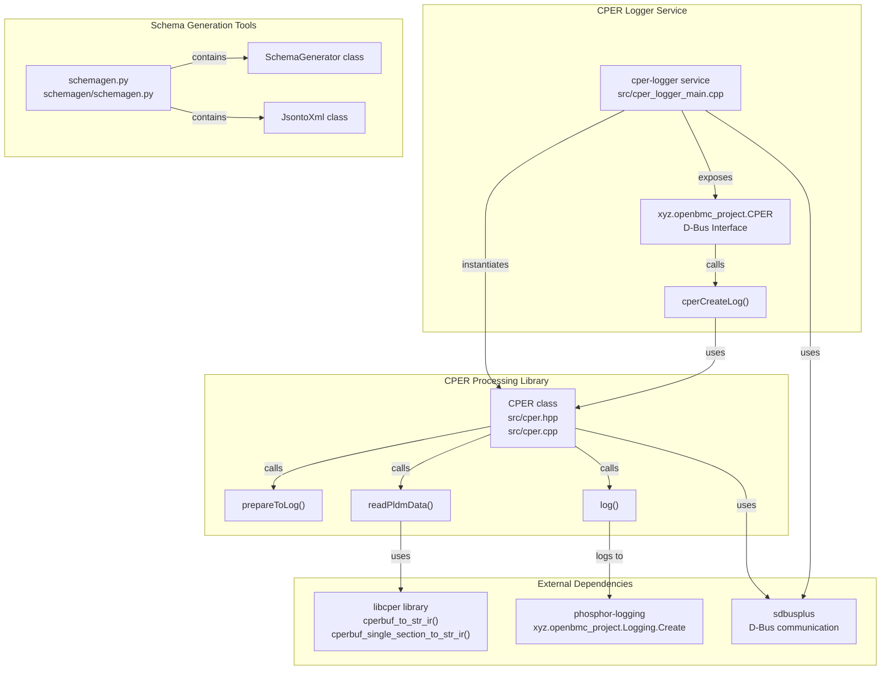

**Sources:** [src/cper.hpp:1-79](), [src/cper.cpp:1-405](), [src/cper_logger_main.cpp:1-68]()

## Component Overview

### CPER Processing Library

The CPER Processing Library is implemented in the `CPER` class and provides the core functionality for parsing, validating, and formatting CPER (Common Platform Error Record) data. Located in [src/cper.hpp]() and [src/cper.cpp](), this library handles the transformation of binary CPER data into structured formats suitable for logging.

**Key responsibilities:**
- Parse PLDM-encapsulated CPER data
- Convert binary CPER to JSON using libcper
- Extract individual sections and metadata
- Format data for D-Bus logging
- Encode binary data as Base64

For detailed documentation, see [CPER Processing Library](#2.1).

**Sources:** [src/cper.hpp:31-78](), [src/cper.cpp:55-404]()

### CPER Logger Service

The CPER Logger Service is a D-Bus service that exposes the `xyz.openbmc_project.CPER` interface for receiving and logging CPER data. Implemented in [src/cper_logger_main.cpp](), this service acts as the entry point for external systems to submit CPER records.

**Key responsibilities:**
- Expose D-Bus interface `xyz.openbmc_project.CPER`
- Implement `CreateLog` method for receiving CPER data
- Coordinate CPER object lifecycle
- Manage D-Bus connection pooling

For detailed documentation, see [CPER Logger Service](#2.2).

**Sources:** [src/cper_logger_main.cpp:1-68]()

### Schema Generation Tools

The Schema Generation Tools consist of Python utilities that convert JSON schemas from the libcper project into Redfish-compliant XML schema definitions. This tooling operates independently of the runtime components and serves a development/documentation role.

**Key responsibilities:**
- Parse libcper JSON schemas
- Resolve `$ref` directives across multiple files
- Generate Redfish OData XML schemas
- Provide schema validation capabilities

For detailed documentation, see [Schema Generation Tools](#2.3).

**Note:** This component is development-time infrastructure and is not part of the runtime system.

## CPER Class Structure

The following diagram maps the `CPER` class methods to their roles in the processing pipeline:

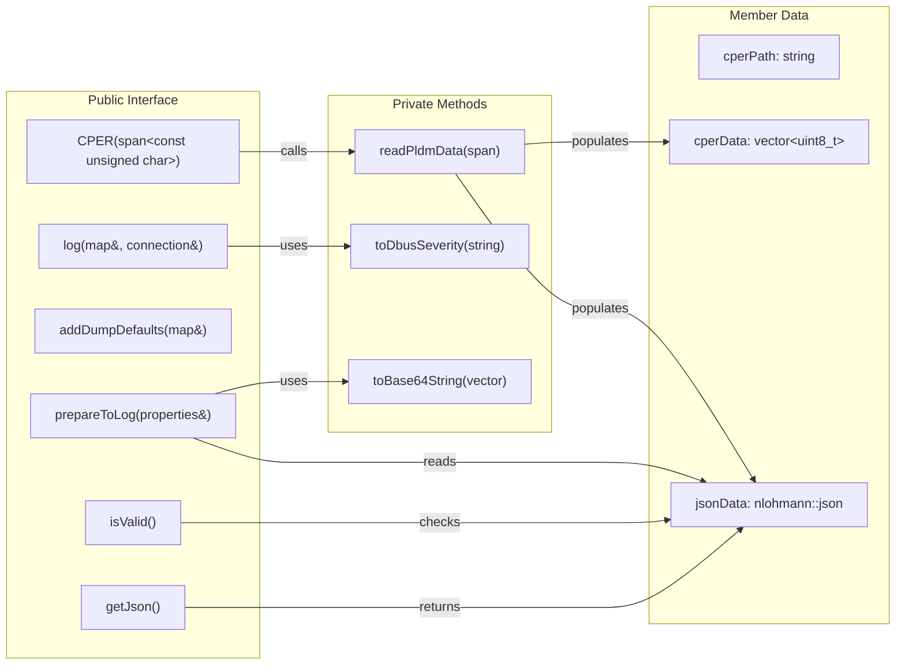

**Sources:** [src/cper.hpp:31-78](), [src/cper.cpp:55-404]()

## Data Flow Through Components

The following diagram shows how CPER data flows through the system with actual function and interface names:

```mermaid
sequenceDiagram
    participant Client as "D-Bus Client"
    participant Service as "cper-logger<br/>main()"
    participant Interface as "xyz.openbmc_project.CPER"
    participant CreateLog as "cperCreateLog()"
    participant CPER as "CPER class"
    participant libcper as "libcper<br/>cperbuf_to_str_ir()"
    participant PhosphorLog as "xyz.openbmc_project.Logging"
    
    Client->>Interface: "CreateLog(vector&lt;uchar&gt;)"
    Interface->>CreateLog: "invoke"
    CreateLog->>CPER: "CPER(span)"
    CPER->>CPER: "readPldmData()"
    CPER->>libcper: "cperbuf_to_str_ir() or<br/>cperbuf_single_section_to_str_ir()"
    libcper-->>CPER: "char* JSON string"
    CPER-->>CreateLog: "CPER object"
    
    CreateLog->>CPER: "prepareToLog(prop)"
    CPER->>CPER: "readHeader()"
    CPER->>CPER: "constructDiagnosticData()"
    CPER->>CPER: "toBase64String()"
    CPER-->>CreateLog: "properties vector"
    
    loop "for each section"
        CreateLog->>CPER: "log(section, conn)"
        CPER->>CPER: "toDbusSeverity()"
        CPER->>PhosphorLog: "Create(message, severity, props)"
    end
    
    PhosphorLog-->>Client: "log entries created"
```

**Sources:** [src/cper_logger_main.cpp:30-48](), [src/cper.cpp:55-309]()

## Component Interaction Details

### PLDM Data Format

The CPER Processing Library expects PLDM-encapsulated data with a specific format defined in [src/cper.cpp:329-372]():

| Byte Offset | Size | Field | Description |
|-------------|------|-------|-------------|
| 0-3 | 4 bytes | PLDM Header | Protocol header (removed before processing) |
| 4 | 1 byte | Type | `0` = Full CPER, `1` = Single section |
| 5+ | Variable | CPER Data | Raw CPER binary payload |

The type byte at offset 4 determines which libcper function is invoked:
- Type `0`: Calls `cperbuf_to_str_ir()` for full CPER with header and sections
- Type `1`: Calls `cperbuf_single_section_to_str_ir()` for single section without header

**Sources:** [src/cper.cpp:329-372]()

### D-Bus Interface Specification

The service exposes a single method on the D-Bus system bus:

| Property | Value |
|----------|-------|
| Service Name | `xyz.openbmc_project.CPERLogger` |
| Object Path | `/xyz/openbmc_project/cperlogger` |
| Interface | `xyz.openbmc_project.CPER` |
| Method | `CreateLog` |
| Signature | `ay` (array of bytes) → void |

The `CreateLog` method is implemented by the `cperCreateLog()` function in [src/cper_logger_main.cpp:30-48]().

**Sources:** [src/cper_logger_main.cpp:50-67]()

### Logging Properties Format

The `CPER::prepareToLog()` method generates a properties vector where each element represents one CPER section. Each property map contains:

| Key | Description | Source |
|-----|-------------|--------|
| `diagnosticDataType` | `"CPER"` or `"CPERSection"` | Header presence |
| `diagnosticData` | Base64-encoded binary CPER | [src/cper.cpp:242]() |
| `jsonDiagnosticData` | JSON representation of section | [src/cper.cpp:249]() |
| `REDFISH_MESSAGE_ID` | `"Platform.1.0.PlatformError"` | [src/cper.cpp:243]() |
| `cperSeverity` | `"Fatal"`, `"Recoverable"`, etc. | Header severity field |
| `cperSeverityCode` | Numeric severity code | Header severity code |
| `notificationType` | GUID of notification type | Header notification type |
| `timestamp` | ISO 8601 timestamp | Header timestamp (if present) |
| `sectionType` | Section type GUID | Section descriptor |

**Sources:** [src/cper.cpp:160-267](), [src/cper.cpp:68-76]()

## Severity Mapping

The `CPER::toDbusSeverity()` method maps CPER severity strings to D-Bus logging levels:

| CPER Severity | D-Bus Level |
|---------------|-------------|
| `"Recoverable"` | `xyz.openbmc_project.Logging.Entry.Level.Warning` |
| `"Fatal"` | `xyz.openbmc_project.Logging.Entry.Level.Critical` |
| `"Corrected"` | `xyz.openbmc_project.Logging.Entry.Level.Informational` |
| `"Informational"` | `xyz.openbmc_project.Logging.Entry.Level.Informational` |
| Other/Unknown | `xyz.openbmc_project.Logging.Entry.Level.Warning` (default) |

**Sources:** [src/cper.cpp:375-390]()

## Error Handling

The CPER Processing Library performs validation at multiple stages:

1. **PLDM Format Validation** ([src/cper.cpp:336-348]()):
   - Minimum size check (header + section descriptor)
   - Type field validation (must be 0 or 1)

2. **JSON Structure Validation** ([src/cper.cpp:162-205]()):
   - Presence of `sectionDescriptors` array
   - Presence of `sections` array
   - Array size matching between descriptors and sections

3. **libcper Parse Validation** ([src/cper.cpp:364-368]()):
   - NULL pointer check from libcper functions
   - JSON parse validation

Invalid CPER data results in an empty properties vector, which is detected by `cperCreateLog()` and logged as an error without creating log entries.

**Sources:** [src/cper.cpp:162-205](), [src/cper.cpp:329-372](), [src/cper_logger_main.cpp:36-40]()

---

# Page: CPER Processing Library

# CPER Processing Library

<details>
<summary>Relevant source files</summary>

The following files were used as context for generating this wiki page:

- [src/cper.cpp](src/cper.cpp)
- [src/cper.hpp](src/cper.hpp)

</details>


## Purpose and Scope

The CPER Processing Library provides the core functionality for parsing, validating, and formatting Common Platform Error Record (CPER) data within the cper-logger system. This library is implemented as the `CPER` class in [src/cper.cpp]() and [src/cper.hpp](), and serves as the primary interface between raw CPER binary data and the OpenBMC logging infrastructure.

This page documents the internal workings of the CPER class and its associated utility functions. For information about the D-Bus service that invokes this library, see [CPER Logger Service](#2.2). For details on the overall data format specifications, see [CPER Data Format](#6.1).

**Sources:** [src/cper.hpp:1-79](), [src/cper.cpp:1-405]()

---

## CPER Class Structure

The `CPER` class encapsulates all processing logic for CPER data. It provides a stateless, single-use interface where each instance processes one CPER record from construction through logging.

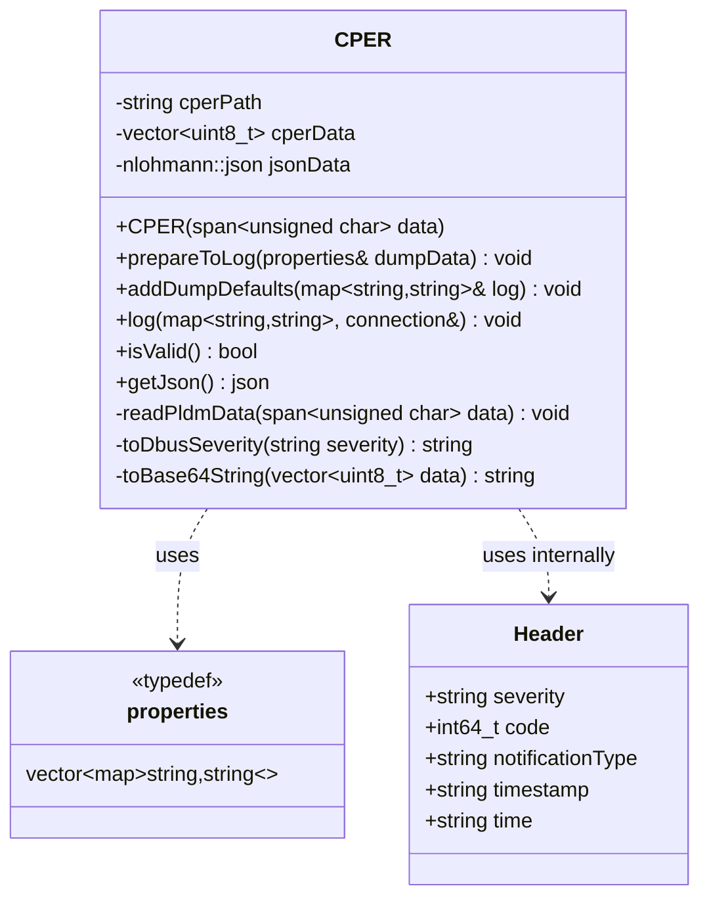

**Class Responsibilities:**

| Component | Responsibility | Key Methods |
|-----------|---------------|-------------|
| Constructor | Parse PLDM-wrapped CPER data into JSON | `CPER(span<unsigned char>)` [src/cper.cpp:55-66]() |
| Data Validation | Verify JSON structure and completeness | `isValid()` [src/cper.hpp:47-50]() |
| Property Preparation | Transform JSON to logging properties | `prepareToLog()` [src/cper.cpp:160-267]() |
| Logging | Send formatted data to phosphor-logging | `log()` [src/cper.cpp:280-309]() |
| Conversion Utilities | Format data for D-Bus transmission | `toDbusSeverity()`, `toBase64String()` |

**Sources:** [src/cper.hpp:31-78](), [src/cper.cpp:55-404]()

---

## Data Flow Architecture

The following diagram illustrates how data flows through the CPER class from raw binary input to structured D-Bus logging calls.

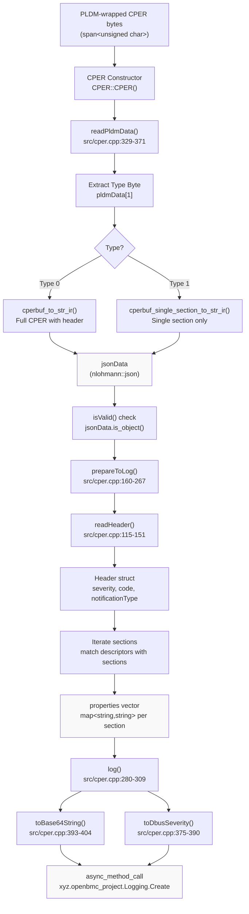

**Sources:** [src/cper.cpp:55-66](), [src/cper.cpp:160-267](), [src/cper.cpp:280-309](), [src/cper.cpp:329-371]()

---

## PLDM Data Parsing

The `readPldmData()` method handles the initial parsing of PLDM-wrapped CPER data. PLDM messages contain a 4-byte header followed by raw CPER data.

### PLDM Header Structure

The PLDM header format is parsed in [src/cper.cpp:329-371]():

| Byte Offset | Field | Description |
|-------------|-------|-------------|
| 0 | Reserved | PLDM header byte 0 |
| 1 | Type | 0 = Full CPER (header + sections)<br/>1 = Single section (no header) |
| 2-3 | Reserved | PLDM header bytes 2-3 |
| 4+ | CPER Data | Raw CPER binary data |

### Parsing Flow

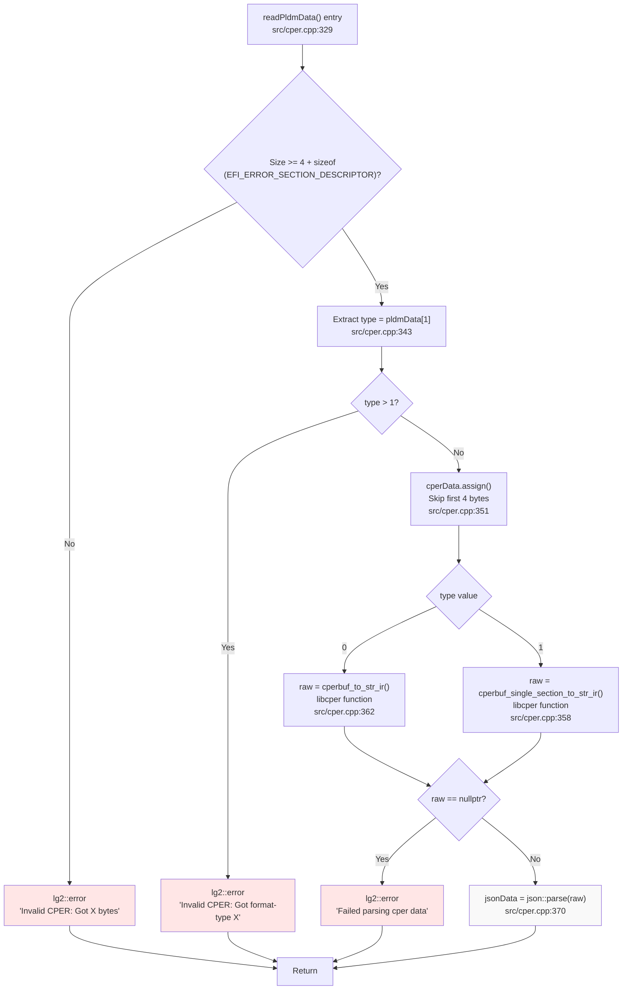

**Key Implementation Details:**

- **Size Validation:** Minimum size is `pldmHeaderSize (4) + sizeof(EFI_ERROR_SECTION_DESCRIPTOR)` [src/cper.cpp:336-340]()
- **Type Extraction:** Type byte at offset 1 determines parsing mode [src/cper.cpp:343]()
- **CPER Data Storage:** Raw binary stored in `cperData` member for later Base64 encoding [src/cper.cpp:351]()
- **libcper Integration:** Calls either `cperbuf_to_str_ir()` or `cperbuf_single_section_to_str_ir()` from libcper [src/cper.cpp:356-363]()
- **JSON Parsing:** Uses nlohmann::json to parse the libcper string output [src/cper.cpp:370]()

**Sources:** [src/cper.cpp:329-371]()

---

## Property Preparation

The `prepareToLog()` method transforms the JSON representation into a vector of property maps suitable for D-Bus logging. Each CPER section generates one property map.

### Property Map Structure

Each property map in the output contains the following fields:

| Property Key | Source | Description |
|--------------|--------|-------------|
| `diagnosticDataType` | Derived from CPER type | "CPER" or "CPERSection" |
| `diagnosticData` | Raw CPER data | Base64-encoded binary CPER |
| `REDFISH_MESSAGE_ID` | Static | "Platform.1.0.PlatformError" |
| `cperSeverity` | Header | "Fatal", "Recoverable", "Corrected", "Informational" |
| `cperSeverityCode` | Header | Numeric severity code |
| `notificationType` | Header | GUID string |
| `timestamp` | Header | Timestamp string (if present) |
| `sectionType` | Section descriptor | GUID data for section type |
| `jsonDiagnosticData` | Constructed | JSON string with section data |

### Preparation Algorithm

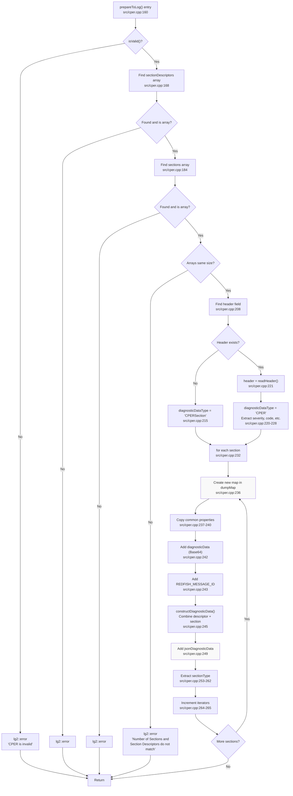

**Header Parsing Details:**

The `readHeader()` function [src/cper.cpp:115-151]() extracts:
- `severity.name` and `severity.code` from the severity object
- `notificationType.guid` from the notification type object
- `timestamp` field if present

**Section Iteration:**

Each iteration [src/cper.cpp:232-266]():
1. Creates a new property map
2. Copies common properties (severity, notification type, timestamp)
3. Adds Base64-encoded `diagnosticData`
4. Constructs `jsonDiagnosticData` by combining the section descriptor and section data
5. Extracts `sectionType` from the descriptor's `/sectionType/data` JSON pointer

**Sources:** [src/cper.cpp:160-267](), [src/cper.cpp:115-151](), [src/cper.cpp:41-53]()

---

## Logging Interface

The `log()` method sends formatted CPER data to the phosphor-logging service via D-Bus asynchronous method calls.

### D-Bus Communication Flow

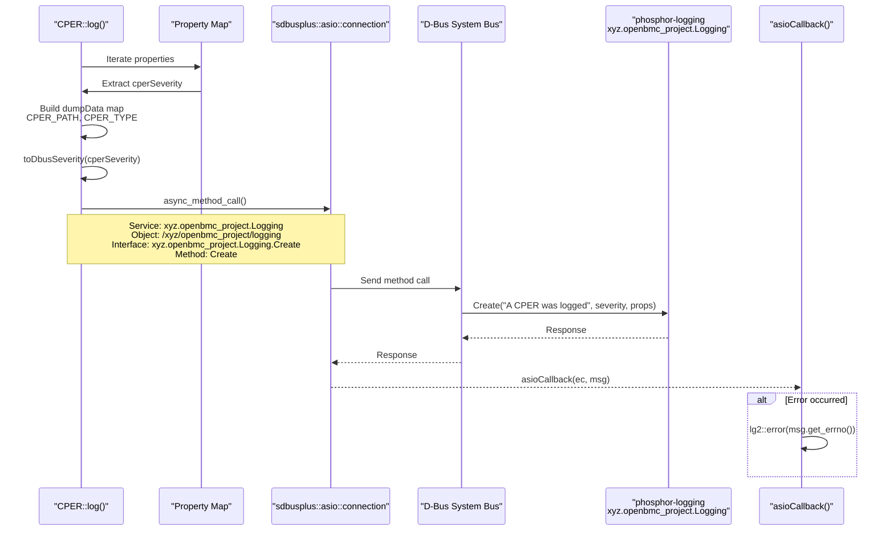

**Method Implementation:**

The `log()` method [src/cper.cpp:280-309]() performs these steps:

1. **Extract Severity:** Iterates through properties to find `cperSeverity` [src/cper.cpp:286-298]()
2. **Build Additional Data:** Creates `dumpData` map with `CPER_PATH` and `CPER_TYPE` [src/cper.cpp:289-293]()
3. **Convert Severity:** Calls `toDbusSeverity()` to map CPER severity strings to D-Bus severity levels [src/cper.cpp:308]()
4. **Async Call:** Invokes `async_method_call()` with:
   - Callback: `asioCallback` function [src/cper.cpp:270-277]()
   - Service: `xyz.openbmc_project.Logging`
   - Object path: `/xyz/openbmc_project/logging`
   - Interface: `xyz.openbmc_project.Logging.Create`
   - Method: `Create`
   - Arguments: message string, severity, and properties map

**Sources:** [src/cper.cpp:280-309](), [src/cper.cpp:270-277]()

---

## Conversion Utilities

The CPER class provides two key conversion utilities for formatting data appropriately for D-Bus transmission.

### Severity Conversion

The `toDbusSeverity()` method [src/cper.cpp:375-390]() maps CPER severity strings to D-Bus logging levels:

| CPER Severity | D-Bus Level | Return Value |
|---------------|-------------|--------------|
| `"Recoverable"` | Warning | `"xyz.openbmc_project.Logging.Entry.Level.Warning"` |
| `"Fatal"` | Critical | `"xyz.openbmc_project.Logging.Entry.Level.Critical"` |
| `"Corrected"` | Informational | `"xyz.openbmc_project.Logging.Entry.Level.Informational"` |
| `"Informational"` | Informational | `"xyz.openbmc_project.Logging.Entry.Level.Informational"` |
| Other/Unknown | Warning | `"xyz.openbmc_project.Logging.Entry.Level.Warning"` (default) |

### Base64 Encoding

The `toBase64String()` method [src/cper.cpp:393-404]() encodes raw CPER binary data for transmission:

**Implementation:**
1. Calculates encoded size using `boost::beast::detail::base64::encoded_size()` [src/cper.cpp:396]()
2. Allocates string buffer with extra byte for null terminator [src/cper.cpp:397]()
3. Performs encoding using `boost::beast::detail::base64::encode()` [src/cper.cpp:399-400]()
4. Resizes string to actual written bytes [src/cper.cpp:401]()

This ensures the binary CPER data is safely encoded as ASCII for inclusion in the `diagnosticData` property field.

**Sources:** [src/cper.cpp:375-404]()

---

## Helper Functions and Data Structures

### Header Structure

The internal `Header` struct [src/cper.cpp:106-113]() captures header metadata:

```cpp
struct Header {
    std::string severity;
    int64_t code = std::numeric_limits<int64_t>::max();
    std::string notificationType;
    std::string timestamp;
    std::string time;
};
```

### Key Reading Functions

The library provides utility functions for safely extracting typed values from JSON:

- **`readIntKey()`** [src/cper.cpp:78-90]() - Extracts int64_t values from JSON objects
- **`readStrKey()`** [src/cper.cpp:92-104]() - Extracts string values from JSON objects

These functions perform null checks and type validation before assignment.

### Diagnostic Data Construction

The `constructDiagnosticData()` function [src/cper.cpp:41-53]() is a public utility that combines a section descriptor and section into a JSON object:

```cpp
int constructDiagnosticData(nlohmann::json& out, 
                           const nlohmann::json& secdIt,
                           const nlohmann::json& secIt)
```

This function:
1. Creates a `sectionDescriptors` array containing the descriptor
2. Creates a `sections` array containing the section data
3. Populates the output JSON object with both arrays

**Sources:** [src/cper.cpp:41-53](), [src/cper.cpp:78-113]()

---

## Type Definitions

The library defines a key type alias used throughout the system:

```cpp
using properties = std::vector<std::map<std::string, std::string>>;
```

This type represents a vector of property maps, where each map corresponds to one CPER section to be logged. The type is defined in [src/cper.hpp:29]() and used extensively in:

- `CPER::prepareToLog(properties& dumpMap)` - Output parameter for prepared log data
- Service layer interfaces that consume CPER-processed data

**Sources:** [src/cper.hpp:29]()

---

## Dependencies

The CPER Processing Library relies on the following external libraries:

| Dependency | Purpose | Include Files |
|------------|---------|---------------|
| **libcper** | CPER binary parsing | `<libcper/cper-parse-str.h>`, `<libcper/Cper.h>` |
| **nlohmann_json** | JSON manipulation | `<nlohmann/json.hpp>` |
| **boost** | Base64 encoding, ASIO | `<boost/beast/core/detail/base64.hpp>` |
| **sdbusplus** | D-Bus communication | `<sdbusplus/asio/connection.hpp>` |
| **phosphor-logging** | Logging macros | `<phosphor-logging/lg2.hpp>` |

The library acts as a bridge between libcper's C-based parsing functions and the C++/D-Bus infrastructure of OpenBMC.

**Sources:** [src/cper.cpp:18-38](), [src/cper.hpp:18-25]()

---

# Page: CPER Logger Service

# CPER Logger Service

<details>
<summary>Relevant source files</summary>

The following files were used as context for generating this wiki page:

- [src/cper_logger_main.cpp](src/cper_logger_main.cpp)
- [xyz.openbmc_project.CPERLogger.service](xyz.openbmc_project.CPERLogger.service)

</details>


## Purpose and Scope

This document describes the CPER Logger Service, the primary D-Bus service component that provides the runtime interface for receiving and processing CPER (Common Platform Error Record) data in the OpenBMC environment. The service acts as the entry point for CPER data submitted by external components (such as PLDM handlers) and coordinates the parsing and logging operations.

For details on the underlying CPER parsing and formatting logic, see [CPER Processing Library](#2.1). For information on schema generation tools, see [Schema Generation Tools](#2.3). For build configuration details, see [Build System](#3).

**Sources**: [src/cper_logger_main.cpp:1-68]()

---

## Service Architecture

The CPER Logger Service is implemented as a minimal D-Bus service daemon that bridges external CPER data sources with the OpenBMC logging infrastructure. The service maintains a single shared D-Bus connection and processes incoming CPER records in a stateless manner.

### Component Overview

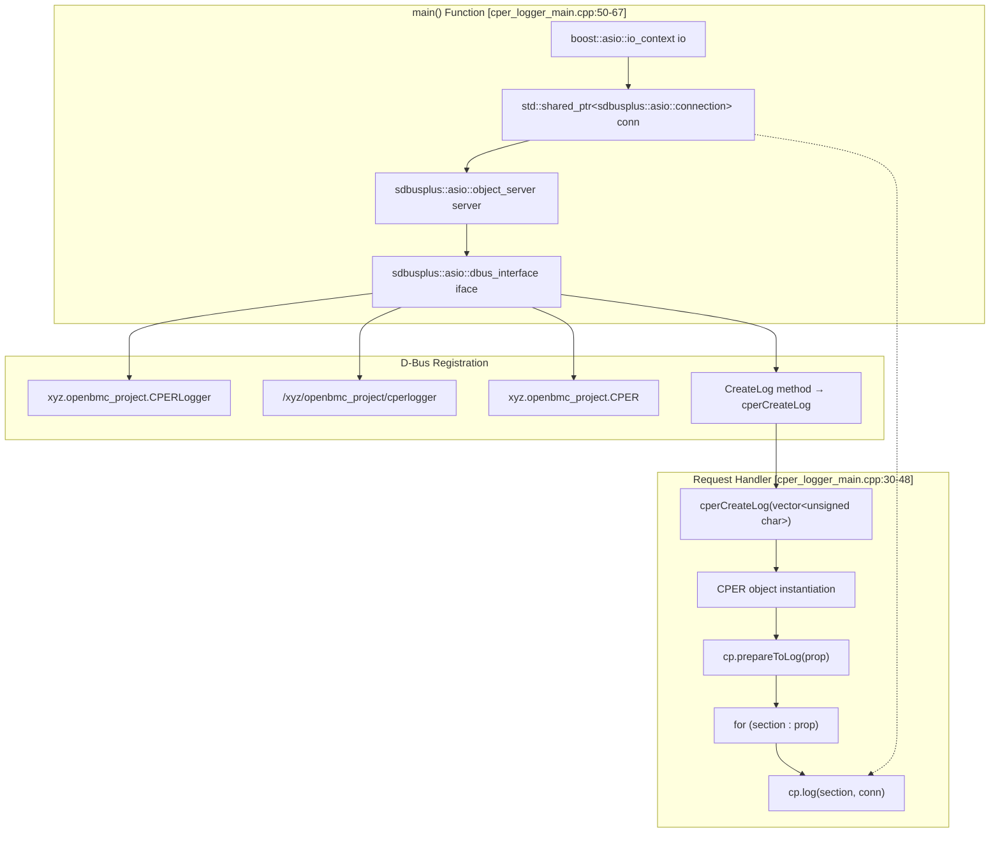

**Sources**: [src/cper_logger_main.cpp:27-67]()

---

## D-Bus Interface Specification

The service exposes a single D-Bus interface with one method for creating log entries from CPER data.

| Property | Value |
|----------|-------|
| **Bus Name** | `xyz.openbmc_project.CPERLogger` |
| **Object Path** | `/xyz/openbmc_project/cperlogger` |
| **Interface Name** | `xyz.openbmc_project.CPER` |
| **Service Type** | Type=dbus (systemd D-Bus activation) |

### CreateLog Method

The `CreateLog` method is the sole entry point for CPER data submission.

| Attribute | Details |
|-----------|---------|
| **Method Name** | `CreateLog` |
| **Implementation** | `cperCreateLog` function |
| **Input Parameter** | `std::vector<unsigned char>` (raw CPER bytes) |
| **Return Type** | `void` |
| **D-Bus Signature** | `"ay"` (byte array) |

**Implementation Location**: [src/cper_logger_main.cpp:30-48]()

The method accepts a byte vector containing either:
- A complete CPER record (type 0: header + multiple sections)
- A single CPER section (type 1: single section without header)

The type distinction is handled by the CPER Processing Library (see [CPER Processing Library](#2.1)).

**Sources**: [src/cper_logger_main.cpp:59-63]()

---

## Request Processing Flow

The following diagram illustrates the complete lifecycle of a CPER logging request, mapping each step to specific code entities.

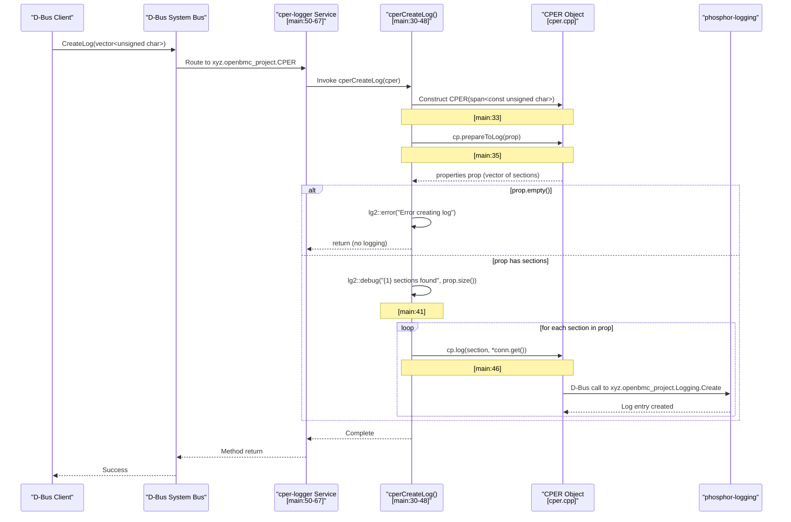

### Processing Steps

1. **Connection Establishment** [src/cper_logger_main.cpp:52-53]()
   - Creates `boost::asio::io_context` for async I/O
   - Instantiates shared D-Bus connection: `conn = std::make_shared<sdbusplus::asio::connection>(io)`

2. **Service Registration** [src/cper_logger_main.cpp:55-65]()
   - Requests bus name: `conn->request_name("xyz.openbmc_project.CPERLogger")`
   - Creates object server
   - Adds interface at `/xyz/openbmc_project/cperlogger`
   - Registers `CreateLog` method bound to `cperCreateLog` function

3. **Request Handling** [src/cper_logger_main.cpp:30-48]()
   - Receives raw CPER byte vector
   - Constructs `CPER` object with `std::span` wrapper for zero-copy access
   - Invokes `prepareToLog(prop)` to parse and structure data
   - Validates that parsing succeeded (`prop.empty()` check)
   - Logs number of sections found via `lg2::debug`

4. **Section Iteration** [src/cper_logger_main.cpp:43-47]()
   - Iterates through each section in the properties vector
   - Calls `cp.log(section, *conn.get())` for each section
   - Each section is logged individually to phosphor-logging

**Sources**: [src/cper_logger_main.cpp:30-67]()

---

## Global State Management

The service maintains minimal global state for operational efficiency.

### Shared D-Bus Connection

```cpp
std::shared_ptr<sdbusplus::asio::connection> conn = nullptr;
```

**Location**: [src/cper_logger_main.cpp:27]()

This global shared pointer serves several purposes:
- **Efficiency**: Reuses a single D-Bus connection across all logging operations
- **Thread Safety**: The `shared_ptr` ensures proper lifetime management
- **Access Pattern**: Dereferenced in the logging loop via `*conn.get()`

The connection is initialized once in `main()` and shared with all invocations of `cperCreateLog()`. This design avoids the overhead of creating a new D-Bus connection for each CPER section logged.

**Stateless Request Processing**: Despite the shared connection, request processing remains stateless. Each invocation of `cperCreateLog()` creates a new `CPER` object, processes it independently, and destroys it upon completion. No state is preserved between requests.

**Sources**: [src/cper_logger_main.cpp:27](), [src/cper_logger_main.cpp:46]()

---

## Systemd Service Integration

The CPER Logger Service is managed by systemd and configured for automatic lifecycle management.

### Service Unit Configuration

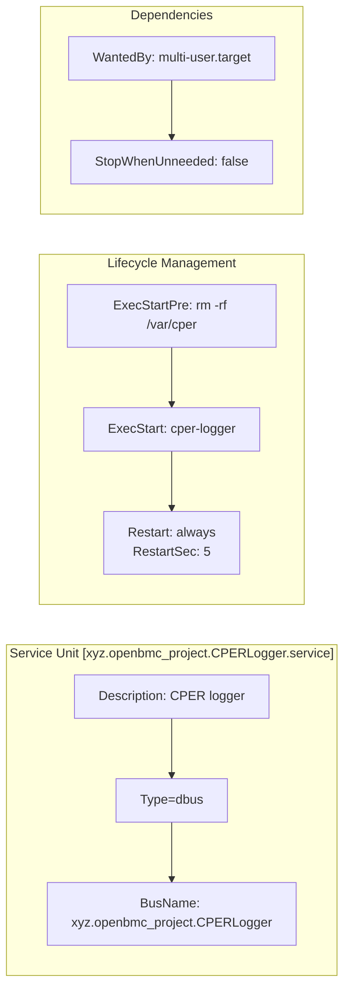

### Key Configuration Properties

| Directive | Value | Purpose |
|-----------|-------|---------|
| `Type` | `dbus` | Signals systemd that this is a D-Bus service |
| `BusName` | `xyz.openbmc_project.CPERLogger` | The D-Bus name to acquire |
| `Restart` | `always` | Automatically restart on failure |
| `RestartSec` | `5` | Wait 5 seconds before restart attempt |
| `StopWhenUnneeded` | `false` | Keep service running even when idle |
| `ExecStartPre` | `rm -rf /var/cper` | Clean up legacy file storage |
| `WantedBy` | `multi-user.target` | Start during normal multi-user boot |

**Sources**: [xyz.openbmc_project.CPERLogger.service:1-20]()

### Pre-Start Cleanup

The service includes a pre-start cleanup step:

```ini
ExecStartPre=rm -rf /var/cper
```

**Location**: [xyz.openbmc_project.CPERLogger.service:11]()

**Rationale**: Historical versions of the CPER logger wrote CPER data to disk in `/var/cper`. The current implementation logs exclusively via D-Bus to phosphor-logging. This cleanup step removes obsolete files on service start. According to the inline comment, this can be removed for non-GB200 platforms that never used the file-based approach.

**Sources**: [xyz.openbmc_project.CPERLogger.service:9-11]()

### Restart Behavior

The service is configured for aggressive automatic recovery:

```ini
Restart=always
RestartSec=5
```

**Location**: [xyz.openbmc_project.CPERLogger.service:6-7]()

This configuration ensures:
- The service restarts regardless of exit status (success, failure, crash)
- A 5-second delay prevents restart storms if the service fails immediately
- CPER logging functionality is always available to the system

**Sources**: [xyz.openbmc_project.CPERLogger.service:6-7]()

---

## Error Handling

The service implements minimal error handling, delegating most error conditions to the CPER Processing Library.

### Empty Properties Vector

```cpp
if (prop.empty())
{
    lg2::error("Error creating log");
    return;
}
```

**Location**: [src/cper_logger_main.cpp:36-40]()

This is the only explicit error check in the request handler. If `prepareToLog()` returns an empty properties vector, it indicates a parsing failure. The service:
1. Logs an error message via structured logging (`lg2::error`)
2. Returns early without attempting to log
3. Does not propagate an exception or error code to the D-Bus caller

This design prioritizes service availability—a malformed CPER record will not crash the service or block subsequent valid requests.

**Sources**: [src/cper_logger_main.cpp:36-40]()

### Dependency on CPER Library

The service assumes the CPER Processing Library handles:
- CPER format validation
- Section parsing and extraction
- Conversion to logging properties
- Actual D-Bus communication with phosphor-logging

All error conditions within CPER processing (invalid formats, missing sections, logging failures) are handled by the library. See [CPER Processing Library](#2.1) for details on library-level error handling.

**Sources**: [src/cper_logger_main.cpp:33-47]()

---

## Service Lifecycle

The following diagram illustrates the complete service lifecycle from systemd activation through shutdown.

```mermaid
stateDiagram-v2
    [*] --> Systemd_Start: systemd starts service
    
    Systemd_Start --> Pre_Cleanup: ExecStartPre
    Pre_Cleanup --> Main_Initialization: rm -rf /var/cper
    
    Main_Initialization --> IO_Context_Created: boost::asio::io_context io
    IO_Context_Created --> Connection_Created: conn = make_shared<connection>(io)
    Connection_Created --> Bus_Name_Requested: conn->request_name()
    Bus_Name_Requested --> Object_Server_Created: object_server(conn)
    Object_Server_Created --> Interface_Added: add_interface()
    Interface_Added --> Method_Registered: register_method("CreateLog", cperCreateLog)
    Method_Registered --> Interface_Initialized: iface->initialize()
    Interface_Initialized --> Running: io.run()
    
    Running --> Processing_Request: D-Bus CreateLog() call
    Processing_Request --> Running: Request complete
    
    Running --> [*]: SIGTERM/SIGINT
    
    note right of Processing_Request
        Per-request processing:
        1. CPER object construction
        2. prepareToLog()
        3. Section iteration
        4. cp.log() per section
    end note
    
    Running --> Crashed: Unhandled exception/error
    Crashed --> Systemd_Restart: RestartSec=5
    Systemd_Restart --> Pre_Cleanup: Restart=always
```

### Initialization Sequence

1. **Systemd Pre-Start**: Executes cleanup command to remove legacy file storage
2. **I/O Context**: Creates `boost::asio::io_context` for async event processing
3. **D-Bus Connection**: Establishes shared connection to system bus
4. **Bus Name Acquisition**: Claims `xyz.openbmc_project.CPERLogger`
5. **Object Server Setup**: Creates infrastructure for hosting D-Bus objects
6. **Interface Registration**: Adds CPER interface at designated path
7. **Method Binding**: Registers `CreateLog` method handler
8. **Interface Activation**: Finalizes interface, making it available to clients
9. **Event Loop**: Enters `io.run()` to process asynchronous events

**Sources**: [src/cper_logger_main.cpp:50-66]()

### Shutdown Sequence

The service does not implement explicit shutdown logic. Termination occurs via:
- **Signal Handling**: The `io.run()` event loop exits when interrupted (SIGTERM/SIGINT)
- **Destructor Chain**: Automatic cleanup of RAII objects (connection, server, interface)
- **Systemd Management**: systemd handles process termination and restart if configured

**Sources**: [src/cper_logger_main.cpp:66]()

---

## Integration Points

The CPER Logger Service integrates with multiple external systems:

| System | Interface Type | Purpose | Reference |
|--------|----------------|---------|-----------|
| **PLDM Handlers** | D-Bus client | Submit CPER data via `CreateLog()` | External to this repo |
| **phosphor-logging** | D-Bus service | Target for log entry creation | [src/cper_logger_main.cpp:46]() |
| **systemd** | Process manager | Service lifecycle and restart management | [xyz.openbmc_project.CPERLogger.service]() |
| **D-Bus System Bus** | IPC transport | All inter-service communication | [src/cper_logger_main.cpp:53]() |
| **CPER Library** | In-process library | CPER parsing and formatting | See [CPER Processing Library](#2.1) |

**Sources**: [src/cper_logger_main.cpp:1-68](), [xyz.openbmc_project.CPERLogger.service:1-20]()

---

# Page: Schema Generation Tools

# Schema Generation Tools

<details>
<summary>Relevant source files</summary>

The following files were used as context for generating this wiki page:

- [schema-gen/NvidiaCPER_v1.xml](schema-gen/NvidiaCPER_v1.xml)
- [schema-gen/README.md](schema-gen/README.md)
- [schema-gen/master-schema.json](schema-gen/master-schema.json)
- [schema-gen/schemagen.py](schema-gen/schemagen.py)

</details>


## Purpose and Scope

This page documents the Python-based schema generation tooling that converts JSON schemas from the libcper library into Redfish-compliant XML schemas. This tooling operates independently of the cper-logger runtime service and serves a development-time role in generating schema definitions that document CPER data formats.

For information about how CPER data is processed at runtime, see [CPER Processing Library](#2.1). For details on the generated Redfish schema structure, see [Redfish Schema](#6.2).

**Sources:** [schema-gen/README.md:1-42](), [schema-gen/schemagen.py:1-12]()

## System Position

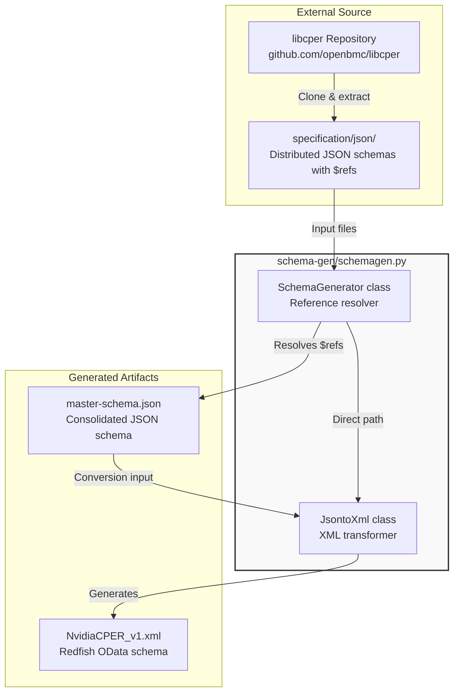

**Diagram: Schema Generation Tool Position**

The schema generation tool is a standalone Python utility located in the `schema-gen/` directory. It does not participate in the runtime CPER processing flow but instead generates documentation artifacts that describe the CPER data format in Redfish-compatible XML.

**Sources:** [schema-gen/schemagen.py:41-128](), [schema-gen/README.md:1-42]()

## Operational Modes

The `schemagen.py` tool provides three command-line modes:

| Mode | Purpose | Input | Output |
|------|---------|-------|--------|
| `convert` | One-step JSON→XML transformation | Root JSON schema with `$ref` directives | `NvidiaCPER_v1.xml` |
| `json_master` | Consolidate distributed schemas | Root JSON schema + schema directory | `master-schema.json` |
| `json_to_xml` | Convert consolidated schema to XML | `master-schema.json` (no `$ref`) | `master-schema.xml` |

**Sources:** [schema-gen/schemagen.py:491-717](), [schema-gen/README.md:11-26]()

### Mode Selection Flow

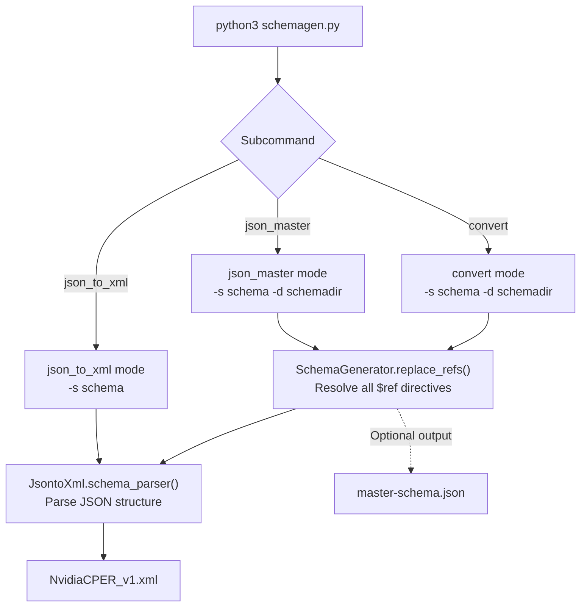

**Diagram: Operational Mode Selection**

**Sources:** [schema-gen/schemagen.py:607-717]()

## Core Components

### SchemaGenerator Class

The `SchemaGenerator` class handles JSON schema consolidation by resolving `$ref` directives.

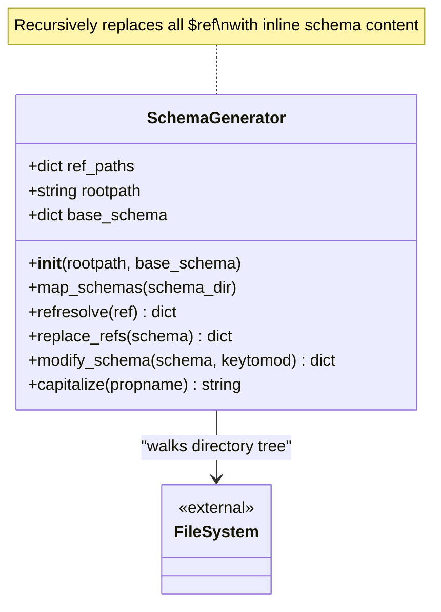

**Diagram: SchemaGenerator Class Structure**

**Key Methods:**

- **`map_schemas(schema_dir)`** [schema-gen/schemagen.py:58-68](): Walks the directory tree and builds `ref_paths` dictionary mapping JSON filenames to absolute paths
- **`refresolve(ref)`** [schema-gen/schemagen.py:70-75](): Loads a JSON schema file given a reference filename
- **`replace_refs(schema)`** [schema-gen/schemagen.py:77-98](): Recursively traverses the schema structure, replacing all `$ref` keys with the actual schema content from the referenced file

**Sources:** [schema-gen/schemagen.py:41-128]()

### JsontoXml Class

The `JsontoXml` class transforms JSON schemas into Redfish OData XML format.

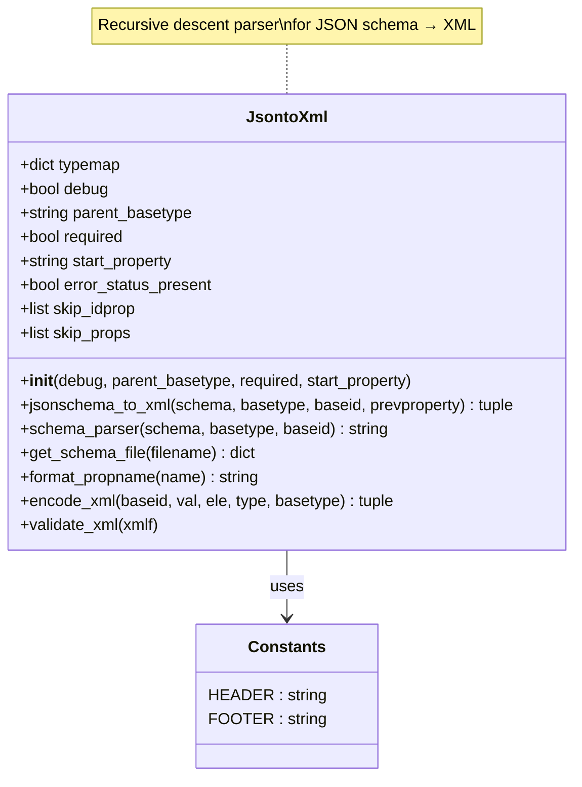

**Diagram: JsontoXml Class Structure**

**Key Attributes:**

- **`typemap`** [schema-gen/schemagen.py:153-158](): Maps JSON data types (`integer`, `string`, `boolean`) to OData EDM types (`Edm.Int64`, `Edm.String`, `Edm.Boolean`)
- **`skip_idprop`** [schema-gen/schemagen.py:168-190](): List of schema `$id` values that should be flattened instead of creating separate XML ComplexTypes
- **`start_property`** [schema-gen/schemagen.py:165](): Entry point in JSON schema (default: `"sections"`) to begin XML generation

**Key Methods:**

- **`jsonschema_to_xml(schema, basetype, baseid, prevproperty)`** [schema-gen/schemagen.py:194-333](): Recursive core that traverses JSON schema structure and generates XML ComplexTypes
- **`encode_xml(baseid, val, ele, type, basetype)`** [schema-gen/schemagen.py:416-473](): Formats individual XML elements (ComplexType or Property tags)
- **`format_propname(name)`** [schema-gen/schemagen.py:375-400](): Converts CPER schema naming convention (`cper-json-error-status`) to XML naming (`ErrorStatus`)

**Sources:** [schema-gen/schemagen.py:130-489]()

## Reference Resolution Process

The schema consolidation process resolves all `$ref` directives by inlining referenced schema content.

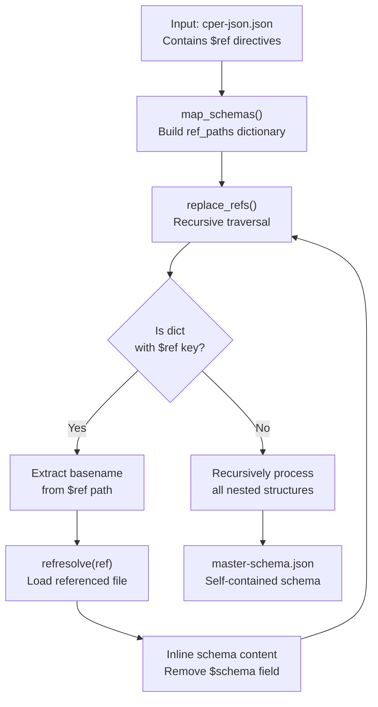

**Diagram: Reference Resolution Algorithm**

The `replace_refs()` method performs a depth-first traversal:

1. **Dictionary with `$ref`**: Extract the referenced filename from the `$ref` value (using `os.path.basename()`)
2. **Load referenced schema**: Use `refresolve()` to load the JSON file
3. **Inline content**: Replace the entire `{"$ref": "..."}` object with the loaded schema content
4. **Remove metadata**: Pop the `$schema` field from the inlined content
5. **Recurse**: Continue processing the inlined structure for nested `$ref` directives

**Sources:** [schema-gen/schemagen.py:77-98]()

## XML Transformation Process

The XML generation process converts JSON schema structures into Redfish OData ComplexTypes and Properties.

### Type Mapping

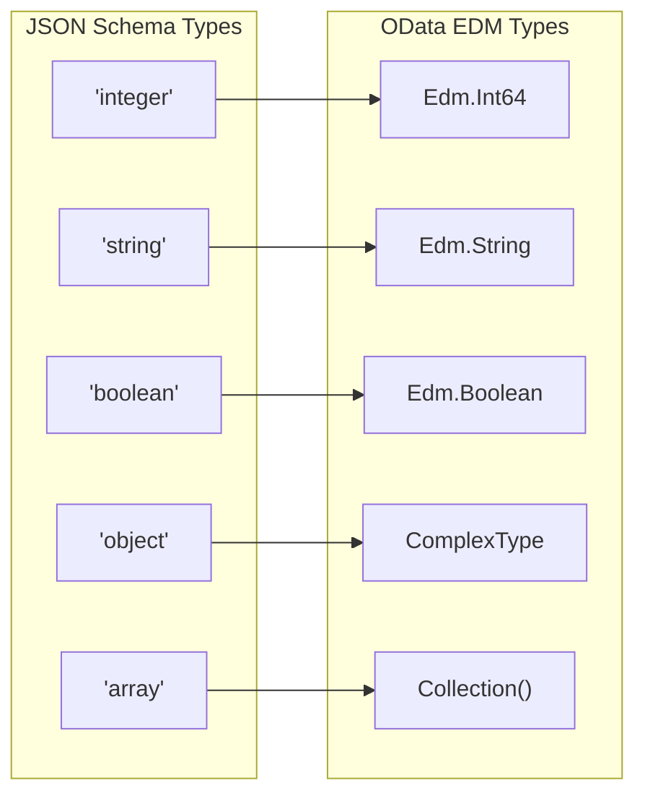

**Diagram: JSON to XML Type Mapping**

**Sources:** [schema-gen/schemagen.py:153-158](), [schema-gen/schemagen.py:439-471]()

### XML Structure Generation

The `jsonschema_to_xml()` method generates nested XML structures based on JSON schema fields:

**For objects with `required` field:**
1. Check for `$id` field to determine ComplexType name (via `format_propname()`)
2. Generate opening `<ComplexType Name="...">` tag
3. Iterate through `properties` dictionary
4. For each property, generate `<Property Name="..." Type="...">` tag
5. Recursively process nested structures
6. Generate closing `</ComplexType>` tag

**For arrays:**
- Properties with `"type": "array"` generate `Type="Collection(BaseName.PropertyName)"`

**For oneOf constructs:**
- Create a parent ComplexType containing Properties for each alternative

**Sources:** [schema-gen/schemagen.py:194-333]()

### Namespace Handling

```mermaid
flowchart TD
    BASEID["baseid parameter<br/>(tracks namespace hierarchy)"]
    
    CHECK_ID{Has $id<br/>field?}
    
    FORMAT["format_propname()<br/>Extract type name"]
    UPDATE["baseid = formatted name"]
    
    VALIDATION{Property name<br/>is 'validationBits'?}
    
    APPEND["baseid += prevproperty"]
    
    ENCODE["encode_xml()<br/>Use baseid as namespace prefix"]
    
    BASEID --> CHECK_ID
    CHECK_ID -->|Yes| FORMAT
    FORMAT --> UPDATE
    UPDATE --> VALIDATION
    CHECK_ID -->|No| VALIDATION
    VALIDATION -->|Yes| APPEND
    VALIDATION -->|No| ENCODE
    APPEND --> ENCODE
```

**Diagram: Namespace ID Tracking**

The `baseid` parameter accumulates namespace prefixes as the recursion descends through nested object structures. This ensures unique XML ComplexType names like `MemoryErrorStatus`, `Memory2ErrorStatus`, etc.

**Sources:** [schema-gen/schemagen.py:246-265]()

## Usage Examples

### Convert Mode (Recommended)

```bash
python3 schemagen.py convert \
    -s cper-json.json \
    -d ../libcper/specification/json/ \
    -a sections
```

**Outputs:** `NvidiaCPER_v1.xml`

**Sources:** [schema-gen/README.md:11-12]()

### Two-Step Process

**Step 1: Generate master schema**
```bash
python3 schemagen.py json_master \
    -s cper-json.json \
    -d ../libcper/specification/json/
```

**Outputs:** `master-schema.json`

**Step 2: Convert to XML**
```bash
python3 schemagen.py json_to_xml \
    -s master-schema.json \
    -a sections
```

**Outputs:** `master-schema.xml`

**Sources:** [schema-gen/README.md:16-25]()

### Command-Line Options

| Option | Modes | Description |
|--------|-------|-------------|
| `-s, --schema` | All | Input JSON schema file path |
| `-d, --schemadir` | `convert`, `json_master` | Root directory containing all JSON schemas |
| `-a, --argstart` | `convert`, `json_to_xml` | Property name to start parsing from (default: `"sections"`) |
| `-p, --parent-basetype` | `convert`, `json_to_xml` | Base XML namespace (default: `"NvidiaCPER.v0_8_0"`) |
| `-r, --required` | `convert`, `json_to_xml` | Only include required fields in XML |
| `-v, --verbose` | All | Enable debug output |
| `-z, --validate` | `convert`, `json_to_xml` | Validate generated XML for duplicate ComplexTypes |

**Sources:** [schema-gen/schemagen.py:514-603]()

## Generated Output Structure

### XML Header and Namespace Declarations

The generated XML follows Redfish OData v4 structure with namespace declarations:

```xml
<?xml version="1.0" encoding="UTF-8"?>
<edmx:Edmx xmlns:edmx="http://docs.oasis-open.org/odata/ns/edmx" Version="4.0">
  <edmx:Reference Uri="http://docs.oasis-open.org/odata/odata/v4.0/errata03/csd01/complete/vocabularies/Org.OData.Core.V1.xml">
    <edmx:Include Namespace="Org.OData.Core.V1" Alias="OData"/>
  </edmx:Reference>
  <edmx:Reference Uri="http://redfish.dmtf.org/schemas/v1/RedfishExtensions_v1.xml">
    <edmx:Include Namespace="Validation.v1_0_0" Alias="Validation"/>
    <edmx:Include Namespace="RedfishExtensions.v1_0_0" Alias="Redfish"/>
  </edmx:Reference>
  <edmx:DataServices>
    <Schema xmlns="http://docs.oasis-open.org/odata/ns/edm" Namespace="NvidiaCPER"> </Schema>
    <Schema xmlns="http://docs.oasis-open.org/odata/ns/edm" Namespace="NvidiaCPER.v0_8_0">
      <!-- ComplexTypes generated here -->
    </Schema>
  </edmx:DataServices>
</edmx:Edmx>
```

**Sources:** [schema-gen/schemagen.py:22-38](), [schema-gen/NvidiaCPER_v1.xml:1-12]()

### ComplexType Example

A typical generated ComplexType structure for a memory error section:

```xml
<ComplexType Name="MemoryErrorStatus">
    <Property Name="ErrorType" Type="NvidiaCPER.v0_8_0.ErrorStatusErrorType"></Property>
    <Property Name="AddressSignal" Type="Edm.Boolean"></Property>
    <Property Name="ControlSignal" Type="Edm.Boolean"></Property>
    <Property Name="DataSignal" Type="Edm.Boolean"></Property>
    <Property Name="DetectedByResponder" Type="Edm.Boolean"></Property>
    <Property Name="DetectedByRequester" Type="Edm.Boolean"></Property>
    <Property Name="FirstError" Type="Edm.Boolean"></Property>
    <Property Name="OverflowDroppedLogs" Type="Edm.Boolean"></Property>
</ComplexType>
```

**Sources:** [schema-gen/NvidiaCPER_v1.xml:558-567]()

## Validation and Debugging

### Duplicate Detection

The `validate_xml()` method checks for duplicate ComplexType names:

```python
def validate_xml(self, xmlf):
    entity_names = []
    with open(xmlf, "r") as f:
        for line in f:
            if "ComplexType Name" in line:
                name = line.strip().split("=")[1]
                if name in entity_names:
                    print("Duplicate: ", name)
                else:
                    entity_names.append(name)
```

**Invoke with:** `python3 schemagen.py convert -s schema.json -d dir/ -z`

**Sources:** [schema-gen/schemagen.py:478-488]()

### Debug Mode

Enable verbose output with `-v` flag to print JSON schema structures at each recursion level:

```bash
python3 schemagen.py convert -s cper-json.json -d ../libcper/specification/json/ -v
```

**Sources:** [schema-gen/schemagen.py:204-207](), [schema-gen/schemagen.py:261-262](), [schema-gen/schemagen.py:283-284]()

## Special Case Handling

### Skip ID Properties

Certain schema `$id` values in `skip_idprop` list are flattened instead of creating separate ComplexTypes:

```python
self.skip_idprop = [
    "GenericProcessor",
    "Ia32X64Processor",
    "ArmProcessor",
    "Memory",
    "Memory2",
    "Pcie",
    # ... etc
]
```

When encountered, the method returns the first property's XML directly instead of wrapping it in a ComplexType.

**Sources:** [schema-gen/schemagen.py:168-190](), [schema-gen/schemagen.py:229-239]()

### Error Status Deduplication

The `error_status_present` flag prevents duplicate ErrorStatus ComplexType generation across multiple section types:

```python
if (baseid + basetype).lower() == "errorstatuserrortype":
    if not self.error_status_present:
        self.error_status_present = True
    else:
        return ("", "")
```

**Sources:** [schema-gen/schemagen.py:166](), [schema-gen/schemagen.py:211-215]()

### Validation Bits Namespace

Properties named `validationBits` append their parent type to the `baseid` to ensure unique namespaces:

```python
if "validationbits" in basetype.lower():
    baseid += prevproperty
```

**Sources:** [schema-gen/schemagen.py:252-253]()

---

# Page: Build System

# Build System

<details>
<summary>Relevant source files</summary>

The following files were used as context for generating this wiki page:

- [meson.build](meson.build)
- [meson_options.txt](meson_options.txt)

</details>


## Purpose and Scope

This document provides an overview of the cper-logger build system, which uses Meson as its build configuration tool. The build system manages compilation of the CPER processing library and service, dependency resolution, and generation of test executables. 

For detailed information about compiler flags and build targets, see [Build Configuration](#3.1). For information about specific external dependencies and subproject wraps, see [Dependencies](#3.2). For instructions on actually building the project, see [Building the Project](#5.1).

## Build Tool

The cper-logger project uses **Meson** (minimum version 1.3.0) as its build system. Meson is configured through the root `meson.build` file and generates native build files for the target platform.

**Sources:** [meson.build:1-16]()

## Build Artifacts

The build system produces three primary artifacts:

| Artifact | Type | Source | Purpose |
|----------|------|--------|---------|
| `libcper_logger_a.a` | Static Library | `src/cper.cpp` | Core CPER processing logic, reusable across executables |
| `cper-logger` | Executable | `src/cper_logger_main.cpp` | D-Bus service that receives and processes CPER data |
| `cper-logger-test` | Executable | `test/cper_logger_test.cpp` | Test suite (only built when tests are enabled) |
| `xyz.openbmc_project.CPERLogger.service` | systemd Unit | `xyz.openbmc_project.CPERLogger.service` | Service configuration for systemd |

**Sources:** [meson.build:107-127](), [meson.build:159-175]()

### Build Artifact Dependency Graph

```mermaid
graph TB
    subgraph "Source Files"
        CPER_CPP["src/cper.cpp"]
        MAIN_CPP["src/cper_logger_main.cpp"]
        TEST_CPP["test/cper_logger_test.cpp"]
        SERVICE_IN["xyz.openbmc_project.CPERLogger.service"]
    end
    
    subgraph "Build Targets"
        LIB["libcper_logger_a<br/>(static_library)"]
        EXE["cper-logger<br/>(executable)"]
        TEST_EXE["cper-logger-test<br/>(executable)"]
        SERVICE_OUT["xyz.openbmc_project.CPERLogger.service<br/>(configured unit file)"]
    end
    
    subgraph "External Dependencies"
        BOOST["boost"]
        SDBUSPLUS["sdbusplus"]
        NLOHMANN["nlohmann_json"]
        LIBCPER["libcper"]
        PHOSPHOR["phosphor-logging"]
        GTEST["gtest/gmock"]
    end
    
    CPER_CPP --> LIB
    BOOST --> LIB
    SDBUSPLUS --> LIB
    NLOHMANN --> LIB
    LIBCPER --> LIB
    PHOSPHOR --> LIB
    
    LIB --> EXE
    MAIN_CPP --> EXE
    BOOST --> EXE
    SDBUSPLUS --> EXE
    PHOSPHOR --> EXE
    
    LIB --> TEST_EXE
    TEST_CPP --> TEST_EXE
    BOOST --> TEST_EXE
    SDBUSPLUS --> TEST_EXE
    NLOHMANN --> TEST_EXE
    PHOSPHOR --> TEST_EXE
    GTEST --> TEST_EXE
    
    SERVICE_IN --> SERVICE_OUT
```

**Sources:** [meson.build:107-127](), [meson.build:159-175](), [meson.build:90-96]()

## Dependency Resolution Strategy

The build system employs a **dual-mode dependency resolution strategy** that attempts to use system-installed packages first, falling back to Meson subprojects when necessary. This approach supports both development environments (where all dependencies are built locally) and production deployments (where system packages are preferred).

### Dependency Resolution Flow

```mermaid
flowchart TD
    START["Meson Dependency Declaration"]
    SEARCH["dependency()<br/>required=false"]
    FOUND{"Dependency<br/>Found?"}
    SYSTEM["Use System Package"]
    SUBPROJECT["subproject()<br/>Build from Source"]
    GET_VAR["get_variable()<br/>Extract Dependency"]
    COMPLETE["Dependency Available"]
    
    START --> SEARCH
    SEARCH --> FOUND
    FOUND -->|Yes| SYSTEM
    FOUND -->|No| SUBPROJECT
    SYSTEM --> COMPLETE
    SUBPROJECT --> GET_VAR
    GET_VAR --> COMPLETE
```

**Sources:** [meson.build:23-79]()

### Dependency Resolution Examples

The following table shows how each major dependency is resolved:

| Dependency | System Search | Subproject Fallback | Special Handling |
|------------|---------------|---------------------|------------------|
| `boost` | `dependency('boost', version: '>=1.84.0')` | `cmake.subproject('boost')` | Uses CMake subproject with custom defines |
| `sdbusplus` | `dependency('sdbusplus')` | `subproject('sdbusplus')` | None |
| `nlohmann_json` | `dependency('nlohmann_json', version: '>=3.11.2')` | `subproject('nlohmann_json')` | None |
| `libcper` | `dependency('libcper')` | `subproject('libcper')` | Adds `subprojects/` to include directories |
| `phosphor-logging` | `dependency('phosphor-logging')` | None | Required from system (no fallback) |
| `systemd` | `dependency('systemd')` | None | Required from system (no fallback) |
| `gtest/gmock` | `dependency('gtest')`, `dependency('gmock')` | `cmake.subproject('gtest')` | Only when tests are enabled |

**Sources:** [meson.build:23-105](), [meson.build:130-158]()

## Build Options

The build system exposes configurable options through `meson_options.txt`:

| Option | Type | Default | Description |
|--------|------|---------|-------------|
| `tests` | feature | `enabled` | Controls whether test executables are built |

The `tests` option can be set to `enabled`, `disabled`, or `auto`. When enabled, the build system will build `cper-logger-test` and attempt to resolve GTest/GMock dependencies.

**Sources:** [meson_options.txt:1]()

## Compiler and Build Settings

The build system enforces strict compilation standards:

### C++ Standard
- **Required:** C++23 (`cpp_std=c++23`)
- The build fails if C++23 is not available

### Optimization and Binary Size
- **Link-Time Optimization (LTO):** Enabled (`b_lto=true`)
- **RTTI:** Disabled (`cpp_rtti=false`) for smaller binary size
- **Warning Level:** 3 (`warning_level=3`)
- **Warnings as Errors:** Enabled (`werror=true`)

### Preprocessor Definitions

```mermaid
graph LR
    subgraph "Boost Configuration"
        BOOST_ASIO["BOOST_ASIO_DISABLE_THREADS"]
        BOOST_RTTI["BOOST_NO_RTTI"]
        BOOST_TYPEID["BOOST_NO_TYPEID"]
    end
    
    subgraph "sdbusplus Configuration"
        SDBUSPLUS_CORO["SDBUSPLUS_DISABLE_BOOST_COROUTINES"]
    end
    
    BUILD["meson.build"] --> BOOST_ASIO
    BUILD --> BOOST_RTTI
    BUILD --> BOOST_TYPEID
    BUILD --> SDBUSPLUS_CORO
```

The following preprocessor macros are defined globally:
- `BOOST_ASIO_DISABLE_THREADS` - Disables threading in Boost.Asio
- `BOOST_NO_RTTI` - Disables RTTI in Boost
- `BOOST_NO_TYPEID` - Disables typeid in Boost
- `SDBUSPLUS_DISABLE_BOOST_COROUTINES` - Disables Boost coroutines in sdbusplus

**Sources:** [meson.build:5-21](), [meson.build:53-58](), [meson.build:67]()

## systemd Integration

The build system generates and installs a systemd service unit file:

### Configuration Data Substitution

```mermaid
graph LR
    INPUT["xyz.openbmc_project.CPERLogger.service<br/>(template)"]
    CONFIG["configuration_data()<br/>INSTALL_PREFIX = prefix"]
    OUTPUT["xyz.openbmc_project.CPERLogger.service<br/>(installed)"]
    INSTALL["systemdsystemunitdir"]
    
    INPUT --> CONFIG
    CONFIG --> OUTPUT
    OUTPUT --> INSTALL
```

The `configure_file()` function substitutes `@INSTALL_PREFIX@` in the service unit template with the actual installation prefix (typically `/usr` or `/usr/local`).

**Sources:** [meson.build:83-96]()

## Include Directories

The build system configures include directories to locate headers:

| Directory | Purpose | Configured By |
|-----------|---------|---------------|
| `src/` | Main source headers | `include_directories('src')` |
| `subprojects/` | libcper headers when built as subproject | Conditional based on libcper source |
| `test/` | Test-specific headers | Only for test executable |

**Sources:** [meson.build:97-105](), [meson.build:170]()

## Build Workflow Overview

```mermaid
graph TB
    START["meson setup builddir"]
    VALIDATE["Validate C++23 Support"]
    RESOLVE_DEPS["Resolve Dependencies<br/>(system or subproject)"]
    CONFIGURE_SERVICE["Configure systemd Unit"]
    BUILD_LIB["Build libcper_logger_a"]
    BUILD_EXE["Build cper-logger"]
    CHECK_TESTS{"tests<br/>enabled?"}
    BUILD_TESTS["Build cper-logger-test"]
    INSTALL["meson install"]
    
    START --> VALIDATE
    VALIDATE --> RESOLVE_DEPS
    RESOLVE_DEPS --> CONFIGURE_SERVICE
    CONFIGURE_SERVICE --> BUILD_LIB
    BUILD_LIB --> BUILD_EXE
    BUILD_EXE --> CHECK_TESTS
    CHECK_TESTS -->|Yes| BUILD_TESTS
    CHECK_TESTS -->|No| INSTALL
    BUILD_TESTS --> INSTALL
```

**Sources:** [meson.build:1-175]()

## Version and Licensing

- **Project Version:** 0.1
- **License:** Apache-2.0
- **Meson Version Requirement:** >= 1.3.0

**Sources:** [meson.build:1-16]()

---

# Page: Build Configuration

# Build Configuration

<details>
<summary>Relevant source files</summary>

The following files were used as context for generating this wiki page:

- [meson.build](meson.build)
- [meson_options.txt](meson_options.txt)

</details>


This page documents the Meson build configuration for the cper-logger project, including compiler requirements, build options, optimization flags, and build targets. For information on external dependencies and how they are resolved, see [Dependencies](#3.2). For practical instructions on building the project, see [Building the Project](#5.1).

## Project Configuration

The cper-logger project is configured through [meson.build:1-16](), which defines fundamental build parameters and requirements.

### Basic Project Setup

```
Project Name: cper-logger
Language: C++
Minimum Meson Version: >=1.3.0
License: Apache-2.0
Version: 0.1
```

The project enforces C++23 standard compliance with strict validation at [meson.build:18-21]():

| Setting | Value | Purpose |
|---------|-------|---------|
| `cpp_std` | `c++23` | C++23 standard required |
| Validation | Enforced | Build fails if standard not met |

### Default Build Options

The build system applies aggressive optimization and strict warning settings by default [meson.build:5-13]():

| Option | Value | Rationale |
|--------|-------|-----------|
| `warning_level` | `3` | Maximum compiler warnings |
| `werror` | `true` | Treat warnings as errors |
| `cpp_std` | `c++23` | Modern C++ features required |
| `cpp_rtti` | `false` | Disable RTTI for binary size reduction |
| `b_lto` | `true` | Enable Link-Time Optimization |

**RTTI Disabled**: The project explicitly disables C++ Run-Time Type Information [meson.build:11](). This reduces binary size at the cost of `dynamic_cast` and `typeid` functionality, which are not required by the application.

**Sources**: [meson.build:1-21]()

## Build Targets

The build system produces three primary artifacts: a static library, the main service executable, and an optional test executable.

### Build Target Architecture

```mermaid
graph TB
    subgraph "Source Files"
        CPER_CPP["src/cper.cpp<br/>CPER processing logic"]
        MAIN_CPP["src/cper_logger_main.cpp<br/>Service entry point"]
        TEST_CPP["test/cper_logger_test.cpp<br/>Test suite"]
    end
    
    subgraph "Build Artifacts"
        STATIC_LIB["cper_logger_a<br/>static_library<br/>Line 107-118"]
        EXECUTABLE["cper-logger<br/>executable<br/>Line 120-127"]
        TEST_EXE["cper-logger-test<br/>executable<br/>Line 159-172"]
    end
    
    subgraph "Installation Targets"
        BIN_INSTALL["bin/cper-logger<br/>Installed to prefix"]
        SERVICE_UNIT["xyz.openbmc_project.CPERLogger.service<br/>systemdsystemunitdir"]
    end
    
    CPER_CPP --> STATIC_LIB
    MAIN_CPP --> EXECUTABLE
    TEST_CPP --> TEST_EXE
    
    STATIC_LIB --> EXECUTABLE
    STATIC_LIB --> TEST_EXE
    
    EXECUTABLE --> BIN_INSTALL
    SERVICE_UNIT --> BIN_INSTALL
    
    style STATIC_LIB fill:#f9f9f9,stroke:#333,stroke-width:2px
    style EXECUTABLE fill:#f9f9f9,stroke:#333,stroke-width:2px
    style TEST_EXE fill:#f9f9f9,stroke:#333,stroke-width:2px
```

**Sources**: [meson.build:107-127](), [meson.build:159-172]()

### Static Library: `cper_logger_a`

The core CPER processing logic is compiled into a static library [meson.build:107-118]():

| Property | Value |
|----------|-------|
| Target Name | `cper_logger_a` |
| Type | `static_library` |
| Source Files | `src/cper.cpp` |
| Include Directories | `src/`, `subprojects/` (conditional) |
| Dependencies | boost, libcper_parse_dep, nlohmann_json_dep, phosphor_logging, sdbusplus |

The static library approach allows code sharing between the main executable and test executable while ensuring consistent compilation settings.

**Include Directory Handling**: The include directories are configured at [meson.build:97-105](). When libcper is built as a subproject, an additional include path for `subprojects/` is added to work around libcper's directory structure differences.

### Main Executable: `cper-logger`

The service executable is built at [meson.build:120-127]():

| Property | Value |
|----------|-------|
| Target Name | `cper-logger` |
| Type | `executable` |
| Source Files | `src/cper_logger_main.cpp` |
| Dependencies | boost, sdbusplus, phosphor_logging |
| Links With | `cper_logger_a` |
| Installation | Enabled (`install: true`) |

The executable depends on the static library via `link_with` and includes only the dependencies needed for D-Bus service initialization, as the CPER processing logic is encapsulated in the library.

### Test Executable: `cper-logger-test`

The test executable is conditionally built based on the `tests` feature option [meson.build:129-175]():

| Property | Value |
|----------|-------|
| Target Name | `cper-logger-test` |
| Type | `executable` |
| Source Files | `test/cper_logger_test.cpp` |
| Build Condition | `get_option('tests').enabled()` |
| Dependencies | boost, gmock_dep, gtest_dep, nlohmann_json_dep, sdbusplus, phosphor_logging |
| Links With | `cper_logger_a` |
| Test Registration | `test('test_cper_logger', cper_logger_test)` |

The test build is controlled by [meson_options.txt:1](), which enables tests by default.

**Sources**: [meson.build:107-127](), [meson.build:129-175](), [meson_options.txt:1]()

### Systemd Service Unit

The systemd service file is generated from a template and installed [meson.build:87-96]():

```mermaid
flowchart LR
    INPUT["xyz.openbmc_project.CPERLogger.service<br/>Template file"]
    CONFIG["systemd_unit_configuration<br/>Configuration data"]
    OUTPUT["xyz.openbmc_project.CPERLogger.service<br/>Configured output"]
    INSTALL["systemdsystemunitdir<br/>Installation directory"]
    
    INPUT --> OUTPUT
    CONFIG --> OUTPUT
    OUTPUT --> INSTALL
    
    CONFIG_VAR["INSTALL_PREFIX<br/>from get_option('prefix')"]
    CONFIG_VAR -.-> CONFIG
```

The configuration process substitutes `@INSTALL_PREFIX@` placeholders in the template with the actual installation prefix [meson.build:88](). The output is installed to the systemd unit directory obtained from pkg-config [meson.build:83]().

**Sources**: [meson.build:83-96]()

## Build Options and Feature Flags

The build system exposes a single user-configurable option defined in [meson_options.txt:1]():

| Option | Type | Default Value | Description |
|--------|------|---------------|-------------|
| `tests` | `feature` | `enabled` | Build tests |

This option controls whether the test executable and its dependencies (GTest/GMock) are built. The `feature` type allows three states:
- `enabled`: Tests are built (default)
- `disabled`: Tests are not built
- `auto`: Tests are built if dependencies are available

**Sources**: [meson_options.txt:1](), [meson.build:129-175]()

## Compiler Flags and Optimizations

### Optimization Settings

The build applies several optimization techniques [meson.build:12]():

| Optimization | Setting | Effect |
|--------------|---------|--------|
| Link-Time Optimization | `b_lto=true` | Cross-module optimization, improved binary size and performance |
| RTTI Elimination | `cpp_rtti=false` | Removes type information from binary, reduces size |

### Warning Configuration

Strict warning settings enforce code quality [meson.build:6-7]():

| Setting | Value | Effect |
|---------|-------|--------|
| `warning_level` | `3` | Maximum compiler warnings enabled |
| `werror` | `true` | All warnings treated as compilation errors |

This configuration prevents warnings from accumulating in the codebase by failing the build when any warning is detected.

**Sources**: [meson.build:5-13]()

## Preprocessor Definitions

The build system adds several preprocessor definitions to configure library behavior at compile time.

### Boost Configuration

Three Boost-specific macros are defined [meson.build:53-58]():

```
BOOST_ASIO_DISABLE_THREADS
BOOST_NO_RTTI
BOOST_NO_TYPEID
```

| Macro | Purpose |
|-------|---------|
| `BOOST_ASIO_DISABLE_THREADS` | Disable threading support in Boost.Asio, reducing dependencies |
| `BOOST_NO_RTTI` | Inform Boost that RTTI is disabled |
| `BOOST_NO_TYPEID` | Inform Boost that `typeid` is unavailable |

These definitions align Boost's configuration with the project's RTTI-disabled build settings.

### sdbusplus Configuration

The sdbusplus library is configured with [meson.build:67]():

```
SDBUSPLUS_DISABLE_BOOST_COROUTINES
```

This macro disables Boost coroutine support in sdbusplus, simplifying the asynchronous I/O model to use only Boost.Asio's native facilities.

**Sources**: [meson.build:53-58](), [meson.build:67]()

## Build Flow Diagram

The following diagram illustrates the complete build process from source to installed artifacts:

```mermaid
flowchart TB
    subgraph "Configuration Phase"
        MESON_BUILD["meson.build<br/>Project configuration"]
        MESON_OPTIONS["meson_options.txt<br/>User options"]
        VALIDATION["C++23 Standard Check<br/>Line 18-21"]
    end
    
    subgraph "Dependency Resolution"
        DEP_CHECK["Dependency Detection<br/>System vs. Subproject"]
        BOOST_DEP["Boost Dependencies"]
        SYSTEM_DEP["sdbusplus, phosphor-logging,<br/>nlohmann_json, libcper"]
        TEST_DEP["GTest/GMock<br/>if tests enabled"]
    end
    
    subgraph "Compilation Phase"
        COMPILE_LIB["Compile src/cper.cpp<br/>to cper_logger_a"]
        COMPILE_MAIN["Compile src/cper_logger_main.cpp"]
        COMPILE_TEST["Compile test/cper_logger_test.cpp<br/>if tests enabled"]
    end
    
    subgraph "Linking Phase"
        LINK_MAIN["Link cper-logger executable<br/>Line 120-127"]
        LINK_TEST["Link cper-logger-test executable<br/>Line 159-172"]
    end
    
    subgraph "Installation Phase"
        INSTALL_BIN["Install bin/cper-logger"]
        INSTALL_SERVICE["Install systemd service unit<br/>Line 90-95"]
    end
    
    MESON_BUILD --> VALIDATION
    MESON_OPTIONS --> VALIDATION
    VALIDATION --> DEP_CHECK
    
    DEP_CHECK --> BOOST_DEP
    DEP_CHECK --> SYSTEM_DEP
    DEP_CHECK --> TEST_DEP
    
    BOOST_DEP --> COMPILE_LIB
    SYSTEM_DEP --> COMPILE_LIB
    SYSTEM_DEP --> COMPILE_MAIN
    SYSTEM_DEP --> COMPILE_TEST
    TEST_DEP --> COMPILE_TEST
    
    COMPILE_LIB --> LINK_MAIN
    COMPILE_MAIN --> LINK_MAIN
    COMPILE_LIB --> LINK_TEST
    COMPILE_TEST --> LINK_TEST
    
    LINK_MAIN --> INSTALL_BIN
    MESON_BUILD --> INSTALL_SERVICE
```

**Sources**: [meson.build:1-175](), [meson_options.txt:1]()

## Configuration Variables

The build system queries systemd for installation directories [meson.build:83-85]():

| Variable | Source | Purpose |
|----------|--------|---------|
| `systemd_system_unit_dir` | `systemd.get_variable(pkgconfig: 'systemdsystemunitdir')` | Systemd unit installation directory |
| `system_conf_dir` | `systemd.get_variable(pkgconfig: 'sysconfdir')` | System configuration directory |

These variables ensure the service unit is installed to the correct location for the target system's systemd configuration.

**Sources**: [meson.build:83-85]()

---

# Page: Dependencies

# Dependencies

<details>
<summary>Relevant source files</summary>

The following files were used as context for generating this wiki page:

- [meson.build](meson.build)
- [subprojects/libcper.wrap](subprojects/libcper.wrap)
- [subprojects/nlohmann_json.wrap](subprojects/nlohmann_json.wrap)
- [subprojects/phosphor-logging.wrap](subprojects/phosphor-logging.wrap)

</details>


## Purpose and Scope

This page documents the external dependencies required by cper-logger and how they are managed through the Meson build system. It covers dependency resolution strategies, version requirements, subproject fallback mechanisms, and dependency-specific compiler flags.

For information about how these dependencies are used in the build process, see [Build Configuration](#3.1). For details on testing-specific dependencies, see [Test Framework](#4.1).

---

## Dependency Resolution Strategy

The cper-logger build system employs a dual-mode dependency resolution strategy. Meson first attempts to locate dependencies in the host system using `pkg-config`. If a system-wide installation is not found, Meson automatically falls back to building the dependency from source using the subproject mechanism.

```mermaid
flowchart TD
    START["Dependency Request"]
    FIND_SYS["dependency() call<br/>required: false"]
    CHECK{Found in<br/>system?}
    USE_SYS["Use System Package<br/>Mark as 'system'"]
    FALLBACK["subproject() call<br/>Build from source"]
    GET_VAR["get_variable()<br/>Extract dependency"]
    LINK["Link to Build Target"]
    
    START --> FIND_SYS
    FIND_SYS --> CHECK
    CHECK -->|Yes| USE_SYS
    CHECK -->|No| FALLBACK
    FALLBACK --> GET_VAR
    USE_SYS --> LINK
    GET_VAR --> LINK
```

**Sources:** [meson.build:23-105]()

---

## Required Dependencies

The following table lists all mandatory dependencies for building the cper-logger service:

| Dependency | Minimum Version | Purpose | Resolution Method |
|------------|----------------|---------|-------------------|
| **boost** | 1.84.0 | ASIO event loop, BEAST HTTP components, type traits | System or CMake subproject |
| **sdbusplus** | (unspecified) | D-Bus communication and message handling | System or Meson subproject |
| **phosphor-logging** | (unspecified) | OpenBMC logging service interface | System or Meson subproject |
| **nlohmann_json** | 3.11.2 | JSON parsing and manipulation | System or Meson subproject |
| **libcper** | (unspecified) | CPER binary format parsing | Meson subproject (git) |
| **systemd** | (unspecified) | Service lifecycle management | System only |

**Sources:** [meson.build:23-105]()

---

### Boost Libraries

Boost is resolved using either the system package manager or CMake subproject. The build only requires specific Boost components rather than the full distribution:

```mermaid
graph TB
    BOOST_DEP["boost dependency<br/>version >= 1.84.0"]
    CMAKE_SUB["cmake.subproject('boost')"]
    
    subgraph "Required Components"
        ASIO["boost_asio<br/>Async I/O"]
        BEAST["boost_beast<br/>HTTP/WebSocket"]
        CALLABLE["boost_callable_traits<br/>Type introspection"]
        CONTAINER["boost_container<br/>Optimized containers"]
        HEADERS["boost_headers<br/>Header-only utilities"]
    end
    
    BOOST_DEP -->|Not found| CMAKE_SUB
    CMAKE_SUB --> ASIO
    CMAKE_SUB --> BEAST
    CMAKE_SUB --> CALLABLE
    CMAKE_SUB --> CONTAINER
    CMAKE_SUB --> HEADERS
```

**Boost Configuration:**

The build applies the following preprocessor definitions when using Boost:

- `BOOST_ASIO_DISABLE_THREADS` - Disables thread support in ASIO
- `BOOST_NO_RTTI` - Disables runtime type information
- `BOOST_NO_TYPEID` - Disables typeid operator support

These flags align with the project's C++ configuration that disables RTTI globally ([meson.build:11]()).

**Sources:** [meson.build:23-58]()

---

### sdbusplus

The `sdbusplus` library provides C++ bindings for D-Bus communication. It is used for both the service's D-Bus interface and communication with the phosphor-logging service.

**Resolution Logic:**
```
dependency('sdbusplus', required: false, include_type: 'system')
  ↓ (if not found)
subproject('sdbusplus', required: true)
  ↓
get_variable('sdbusplus_dep').as_system('system')
```

**Configuration:**

The build defines `SDBUSPLUS_DISABLE_BOOST_COROUTINES` to prevent sdbusplus from using Boost coroutines, ensuring compatibility with the asynchronous execution model.

**Sources:** [meson.build:61-67]()

---

### phosphor-logging

This dependency provides the interface to OpenBMC's logging infrastructure. Unlike most other dependencies, `phosphor-logging` is resolved via `dependency()` without an explicit fallback in the main build file. The subproject wrap file [subprojects/phosphor-logging.wrap]() provides automatic fallback.

**Wrap Configuration:**
```
url: https://github.com/openbmc/phosphor-logging.git
revision: HEAD
provides: phosphor_logging_dep
```

**Sources:** [meson.build:69](), [subprojects/phosphor-logging.wrap:1-7]()

---

### nlohmann_json

The JSON library is used for parsing CPER data into intermediate JSON representation before formatting for logging.

**Version Requirement:** `>= 3.11.2`

**Resolution Strategy:**
```
dependency('nlohmann_json', required: false, version: '>=3.11.2')
  ↓ (if not found)
subproject('nlohmann_json', required: true)
  ↓
get_variable('nlohmann_json_dep')
```

**Subproject Source:**
The wrap file downloads a pre-built header-only distribution:
- Version: 3.11.3
- Source: GitHub releases (include-only zip)
- SHA256: `a22461d13119ac5c78f205d3df1db13403e58ce1bb1794edc9313677313f4a9d`

**Sources:** [meson.build:70-79](), [subprojects/nlohmann_json.wrap:1-12]()

---

### libcper

The `libcper` library provides low-level CPER binary format parsing capabilities. This is the only dependency that is exclusively resolved via git subproject.

**Resolution:**
```
dependency('libcper', required: false)
  ↓ (if not found)
subproject('libcper')
  ↓
get_variable('libcper_parse_dep')
```

**Subproject Configuration:**
```
url: https://github.com/openbmc/libcper.git
revision: HEAD
provides: libcper_parse_dep
```

**Include Path Handling:**

The build includes a workaround for libcper's directory structure discrepancy:
```cpp
inc += [include_directories('subprojects')]
```
This adds the subprojects directory to the include path because libcper's install directory differs from its subproject directory ([meson.build:102-104]()).

**Sources:** [meson.build:98-105](), [subprojects/libcper.wrap:1-7]()

---

### systemd

The `systemd` dependency is only used to determine installation paths for the service unit file. It is resolved exclusively from the system and has no subproject fallback.

**Usage:**
- `systemdsystemunitdir` - Determines where to install `.service` files
- `sysconfdir` - System configuration directory path

**Sources:** [meson.build:60](), [meson.build:83-86]()

---

## Optional Dependencies

### Testing Framework (GTest/GMock)

Testing dependencies are only resolved when the `tests` feature is enabled via `meson_options.txt`.

```mermaid
flowchart TD
    FEATURE{"get_option('tests')<br/>enabled?"}
    FIND_GTEST["dependency('gtest')<br/>required: false"]
    FIND_GMOCK["dependency('gmock')<br/>required: false"]
    CHECK{Found in<br/>system?}
    USE_SYS["Use System Package"]
    CMAKE_SUB["cmake.subproject('gtest')"]
    EXTRACT_DEPS["Extract gtest_dep<br/>and gmock_dep"]
    BUILD_TEST["Build cper-logger-test"]
    SKIP["Skip Test Build"]
    
    FEATURE -->|Yes| FIND_GTEST
    FEATURE -->|No| SKIP
    FIND_GTEST --> FIND_GMOCK
    FIND_GMOCK --> CHECK
    CHECK -->|Yes| USE_SYS
    CHECK -->|No| CMAKE_SUB
    CMAKE_SUB --> EXTRACT_DEPS
    USE_SYS --> BUILD_TEST
    EXTRACT_DEPS --> BUILD_TEST
```

**Resolution Logic:**

The test framework follows a three-tier fallback:
1. System `gtest` and `gmock` packages
2. CMake subproject build
3. Assertion failure if tests are explicitly enabled but not found

**Sources:** [meson.build:129-175]()

---

## Dependency Graph

The following diagram shows how dependencies are linked to build targets:

```mermaid
graph TB
    subgraph "Dependencies"
        BOOST["boost"]
        SDBUSPLUS["sdbusplus"]
        PHOSPHOR["phosphor-logging"]
        JSON["nlohmann_json_dep"]
        LIBCPER["libcper_parse_dep"]
        SYSTEMD["systemd"]
        GTEST["gtest_dep"]
        GMOCK["gmock_dep"]
    end
    
    subgraph "Build Targets"
        LIB["cper_logger_a<br/>static_library"]
        EXE["cper-logger<br/>executable"]
        TEST["cper-logger-test<br/>test executable"]
        SERVICE["CPERLogger.service<br/>systemd unit"]
    end
    
    BOOST --> LIB
    SDBUSPLUS --> LIB
    PHOSPHOR --> LIB
    JSON --> LIB
    LIBCPER --> LIB
    
    LIB --> EXE
    LIB --> TEST
    
    BOOST --> EXE
    SDBUSPLUS --> EXE
    PHOSPHOR --> EXE
    
    BOOST --> TEST
    JSON --> TEST
    SDBUSPLUS --> TEST
    PHOSPHOR --> TEST
    GTEST --> TEST
    GMOCK --> TEST
    
    SYSTEMD -.->|install path| SERVICE
```

**Target Details:**

- **`cper_logger_a`** - Static library containing CPER processing logic ([meson.build:107-118]())
- **`cper-logger`** - Main service executable ([meson.build:120-127]())
- **`cper-logger-test`** - Test executable ([meson.build:159-172]())
- **Service unit** - Systemd service file ([meson.build:90-96]())

**Sources:** [meson.build:107-175]()

---

## Subproject Wrap Files

Meson uses `.wrap` files in the `subprojects/` directory to define how to fetch and build dependencies. These files support both archive downloads and git repositories.

### Archive-Based Wraps

**nlohmann_json** uses a pre-built archive:

| Field | Value |
|-------|-------|
| Format | ZIP archive (header-only) |
| Version | 3.11.3 |
| Source URL | `https://github.com/nlohmann/json/releases/download/v3.11.3/include.zip` |
| Fallback URL | WrapDB mirror |
| Hash Verification | SHA256 checksum |

**Sources:** [subprojects/nlohmann_json.wrap:1-12]()

### Git-Based Wraps

Both **libcper** and **phosphor-logging** use git subprojects:

| Dependency | Repository | Revision |
|------------|------------|----------|
| libcper | `https://github.com/openbmc/libcper.git` | HEAD |
| phosphor-logging | `https://github.com/openbmc/phosphor-logging.git` | HEAD |

These dependencies always track the latest version of their respective repositories.

**Sources:** [subprojects/libcper.wrap:1-7](), [subprojects/phosphor-logging.wrap:1-7]()

---

## Dependency-Specific Compiler Flags

Several dependencies require specific preprocessor definitions to configure their behavior:

| Flag | Dependency | Purpose |
|------|------------|---------|
| `BOOST_ASIO_DISABLE_THREADS` | Boost.Asio | Disable thread support for single-threaded event loop |
| `BOOST_NO_RTTI` | Boost | Align with project's RTTI-disabled configuration |
| `BOOST_NO_TYPEID` | Boost | Disable typeid operator (requires RTTI) |
| `SDBUSPLUS_DISABLE_BOOST_COROUTINES` | sdbusplus | Prevent Boost coroutine usage |

These flags are applied project-wide using `add_project_arguments()`:

```
add_project_arguments('-DBOOST_ASIO_DISABLE_THREADS', language: 'cpp')
add_project_arguments('-DBOOST_NO_RTTI', language: 'cpp')
add_project_arguments('-DBOOST_NO_TYPEID', language: 'cpp')
add_project_arguments('-DSDBUSPLUS_DISABLE_BOOST_COROUTINES', language: 'cpp')
```

**Sources:** [meson.build:53-58](), [meson.build:67]()

---

## Build Requirements

The dependency resolution strategy requires:

1. **Meson** >= 1.3.0 ([meson.build:4]())
2. **C++ Compiler** with C++23 support ([meson.build:8](), [meson.build:18-21]())
3. **pkg-config** for system dependency detection
4. **Git** for git-based subprojects
5. **CMake** (optional) for Boost and GTest subprojects when system packages are unavailable

**Sources:** [meson.build:1-21]()

---

# Page: Testing

# Testing

<details>
<summary>Relevant source files</summary>

The following files were used as context for generating this wiki page:

- [meson.build](meson.build)
- [test/cper_logger_test.cpp](test/cper_logger_test.cpp)

</details>


The cper-logger testing infrastructure validates CPER parsing, formatting, and logging functionality through a comprehensive GTest-based test suite. This page provides an overview of the test architecture, build configuration, and execution model. For detailed information on the test framework implementation, see [Test Framework](#4.1). For documentation of the test data samples used for validation, see [Test Data Samples](#4.2). For practical instructions on building and running tests, see [Running Tests](#5.2).

## Overview

The test system validates the CPER processing library ([CPER Processing Library](#2.1)) through unit tests that exercise parsing, validation, and formatting operations. Tests are optional and controlled by the `tests` Meson feature flag. The test suite uses real CPER binary data samples representing various error types and validation scenarios.

The testing approach focuses on:
- **Parsing validation**: Verifying that CPER binary data is correctly parsed into structured JSON
- **Property extraction**: Ensuring that `prepareToLog()` produces correct property maps for logging
- **Error handling**: Validating behavior with malformed or invalid CPER data
- **Multi-section support**: Testing CPER records with multiple error sections
- **Redfish format**: Verifying that output conforms to expected Redfish structure

**Sources**: [test/cper_logger_test.cpp:1-219](), [meson.build:129-175]()

## Test Architecture

```mermaid
graph TB
    subgraph TestExecutable["cper-logger-test Executable"]
        MAIN["main()<br/>test/cper_logger_test.cpp:214-219"]
        GTEST_INIT["testing::InitGoogleTest()"]
        RUN_TESTS["RUN_ALL_TESTS()"]
    end
    
    subgraph TestFramework["Test Framework"]
        GTEST["GTest Framework"]
        GMOCK["GMock Framework"]
        TEST_MACROS["TEST() Macros"]
    end
    
    subgraph TestCases["Test Cases"]
        TC1["GoodParseCCPLEX<br/>test/cper_logger_test.cpp:114-139"]
        TC2["GoodParsePCIe<br/>test/cper_logger_test.cpp:141-157"]
        TC3["FailParse<br/>test/cper_logger_test.cpp:159-166"]
        TC4["MultiSeverity<br/>test/cper_logger_test.cpp:168-189"]
        TC5["NullSection<br/>test/cper_logger_test.cpp:191-212"]
    end
    
    subgraph TestData["Test Data Headers"]
        CCPLEX_GOOD["nvidia/ccplex/good_cper.h"]
        CCPLEX_BAD["nvidia/ccplex/bad_cper.h"]
        CCPLEX_MULTI["nvidia/ccplex/multiseverity_cper.h"]
        CCPLEX_NULL["nvidia/ccplex/nullsection_cper.h"]
        PCIE_GOOD["pcie/good_cper.h"]
    end
    
    subgraph SystemUnderTest["System Under Test"]
        CPER_CLASS["CPER Class<br/>src/cper.cpp"]
        PREPARE["prepareToLog()<br/>src/cper.cpp"]
        IS_VALID["isValid()<br/>src/cper.hpp"]
    end
    
    subgraph TestUtilities["Test Utilities"]
        WRITE_TEMP["writeTempfile()<br/>test/cper_logger_test.cpp:31-57"]
        PARSE_OUT["parseOut()<br/>test/cper_logger_test.cpp:66-94"]
        REDFISH_OUT["redfishOutput()<br/>test/cper_logger_test.cpp:96-112"]
    end
    
    MAIN --> GTEST_INIT
    GTEST_INIT --> RUN_TESTS
    RUN_TESTS --> TEST_MACROS
    
    TEST_MACROS --> TC1
    TEST_MACROS --> TC2
    TEST_MACROS --> TC3
    TEST_MACROS --> TC4
    TEST_MACROS --> TC5
    
    TC1 --> CCPLEX_GOOD
    TC2 --> PCIE_GOOD
    TC3 --> CCPLEX_BAD
    TC4 --> CCPLEX_MULTI
    TC5 --> CCPLEX_NULL
    
    TC1 --> CPER_CLASS
    TC2 --> CPER_CLASS
    TC3 --> CPER_CLASS
    TC4 --> CPER_CLASS
    TC5 --> CPER_CLASS
    
    CPER_CLASS --> PREPARE
    CPER_CLASS --> IS_VALID
    
    TC1 --> REDFISH_OUT
    TC2 --> REDFISH_OUT
    TC4 --> REDFISH_OUT
    TC5 --> REDFISH_OUT
    
    REDFISH_OUT --> PARSE_OUT
    
    GTEST --> TEST_MACROS
    GMOCK --> TEST_MACROS
```

The test architecture consists of five core test cases that exercise different aspects of CPER processing. Each test case instantiates a `CPER` object with binary test data, invokes `prepareToLog()` to extract properties, and validates the output using GTest assertions. Test utilities provide helper functions for Redfish format validation and temporary file management.

**Sources**: [test/cper_logger_test.cpp:1-219]()

## Test Build Configuration

```mermaid
graph LR
    subgraph BuildConfig["Build Configuration"]
        FEATURE["tests Feature Flag<br/>meson_options.txt"]
        ENABLE_CHECK["get_option('tests').enabled()<br/>meson.build:129"]
    end
    
    subgraph Dependencies["Test Dependencies"]
        GTEST["gtest_dep<br/>meson.build:130-136"]
        GMOCK["gmock_dep<br/>meson.build:137-141"]
        GTEST_SUB["gtest Subproject<br/>meson.build:143-157"]
        THREADS["threads Dependency"]
    end
    
    subgraph BuildTargets["Build Targets"]
        LIB["cper_logger_a<br/>Static Library<br/>meson.build:107-118"]
        TEST_EXE["cper-logger-test<br/>Test Executable<br/>meson.build:159-172"]
        TEST_REG["test('test_cper_logger')<br/>meson.build:174"]
    end
    
    subgraph TestSources["Test Sources"]
        TEST_CPP["test/cper_logger_test.cpp"]
        TEST_HEADERS["test/*.h<br/>Test Data Headers"]
    end
    
    FEATURE --> ENABLE_CHECK
    ENABLE_CHECK -->|"if enabled"| GTEST
    ENABLE_CHECK -->|"if enabled"| GMOCK
    
    GTEST -->|"if not found"| GTEST_SUB
    GMOCK -->|"if not found"| GTEST_SUB
    GTEST_SUB --> THREADS
    
    TEST_CPP --> TEST_EXE
    TEST_HEADERS --> TEST_EXE
    LIB --> TEST_EXE
    GTEST --> TEST_EXE
    GMOCK --> TEST_EXE
    
    TEST_EXE --> TEST_REG
```

Tests are conditionally compiled based on the `tests` feature flag in [meson.build:129-175](). The build system attempts to find GTest and GMock as system dependencies, falling back to a CMake subproject if not found. The test executable links against the same `cper_logger_a` static library used by the main service, ensuring consistent behavior between production and test code.

| Configuration Item | Value | Location |
|-------------------|-------|----------|
| **Feature Flag** | `tests` | `meson_options.txt` |
| **Test Executable** | `cper-logger-test` | [meson.build:159]() |
| **Test Source** | `test/cper_logger_test.cpp` | [meson.build:161]() |
| **Test Registration** | `test('test_cper_logger', cper_logger_test)` | [meson.build:174]() |
| **Include Directories** | `inc + [include_directories('test')]` | [meson.build:170]() |
| **Link Library** | `cper_logger_a` | [meson.build:171]() |

**Sources**: [meson.build:129-175]()

## Test Execution Flow

```mermaid
sequenceDiagram
    participant Test as "Test Case<br/>(GTest)"
    participant CPER as "CPER Object<br/>src/cper.cpp"
    participant Data as "Test Data<br/>(const unsigned char[])"
    participant Prop as "properties<br/>(vector<map<string,string>>)"
    participant Util as "redfishOutput()<br/>Test Utility"
    participant Assert as "EXPECT_EQ/ASSERT_*<br/>(GTest Assertions)"
    
    Note over Test,Data: Test Initialization
    Test->>Data: Load test data<br/>(e.g., nvidiaCcplexGoodCper)
    Test->>CPER: CPER(data)<br/>Constructor
    CPER-->>Test: CPER object
    
    Note over Test,Prop: Data Processing
    Test->>Prop: properties prop<br/>Initialize empty
    Test->>CPER: prepareToLog(prop)
    CPER->>CPER: Parse CPER binary
    CPER->>CPER: Extract sections
    CPER->>Prop: Populate properties
    CPER-->>Test: void
    
    Note over Test,Assert: Validation Phase
    Test->>CPER: isValid()
    CPER-->>Test: bool (true/false)
    Test->>Assert: ASSERT_TRUE(cp.isValid())
    
    Test->>Prop: Access prop[0]["diagnosticDataType"]
    Prop-->>Test: "CPER"
    Test->>Assert: EXPECT_EQ(prop[0]["..."], "CPER")
    
    Test->>Prop: Access prop[0]["cperSeverity"]
    Prop-->>Test: "Corrected"
    Test->>Assert: EXPECT_EQ(prop[0]["..."], "Corrected")
    
    Note over Test,Util: Redfish Format Validation
    Test->>Util: redfishOutput(prop)
    Util->>Util: parseOut() for each property
    Util-->>Test: vector<json::object_t>
    
    Test->>Assert: EXPECT_EQ(rf[0]["..."], expected)
    Test->>Assert: ASSERT_EQ(prop.size(), expected_count)
```

Each test follows a consistent pattern: load test data, construct a `CPER` object, invoke `prepareToLog()` to extract properties, and validate the output. The `properties` type is defined as `std::vector<std::map<std::string, std::string>>` where each vector element represents one CPER section. Tests validate both basic properties (severity, type) and Redfish-formatted output through the `redfishOutput()` utility function.

**Sources**: [test/cper_logger_test.cpp:114-212]()

## Test Coverage

The test suite provides coverage for the following scenarios:

| Test Case | Purpose | Test Data | Expected Outcome |
|-----------|---------|-----------|------------------|
| **GoodParseCCPLEX** | Valid NVIDIA CCPLEX CPER with multiple sections | `nvidiaCcplexGoodCper` | `isValid()` returns true, 5 sections extracted, severity "Corrected" |
| **GoodParsePCIe** | Valid PCIe CPER with single section | `pcieGoodCper` | `isValid()` returns true, 1 section extracted, severity "Corrected" |
| **FailParse** | Malformed CPER data | `nvidiaCcplexBadCper` | `isValid()` returns false, 0 sections extracted |
| **MultiSeverity** | CPER with sections of different severities | `nvidiaCcplexMultiseverityCper` | `isValid()` returns true, 5 sections extracted |
| **NullSection** | CPER with null/empty sections | `nvidiaCcplexNullsectionCper` | `isValid()` returns true, 4 sections extracted |

### Validation Assertions

Tests use the following GTest assertion patterns:

- **`ASSERT_TRUE(cp.isValid())`**: Validates successful parsing (lines 120, 146, 173, 196)
- **`ASSERT_FALSE(cp.isValid())`**: Validates parse failure detection (line 164)
- **`EXPECT_EQ(prop[0]["key"], value)`**: Validates property extraction (lines 122, 148, 178, 198)
- **`ASSERT_EQ(prop.size(), count)`**: Validates section count (lines 129, 151, 176, 204)
- **`EXPECT_EQ(rf[i]["path"], value)`**: Validates Redfish format structure (lines 133-138, 153-156, 181-187, 206-211)

**Sources**: [test/cper_logger_test.cpp:114-212]()

## Test Utilities

The test suite includes utility functions for test data management and output validation:

### writeTempfile()

```
std::string writeTempfile(const unsigned char* data, 
                          unsigned int size,
                          const std::string& basename)
```

Creates a temporary file with CPER binary data. Located at [test/cper_logger_test.cpp:31-57](). Currently unused in the test suite but available for future file-based test scenarios.

### parseOut()

```
void parseOut(const std::map<std::string, std::string>& m,
              const std::span<Keypair>& array, 
              nlohmann::json::object_t& jFlat)
```

Transforms property maps into flattened JSON objects according to a key mapping configuration. Located at [test/cper_logger_test.cpp:66-94](). Handles both direct string values and nested JSON parsing.

### redfishOutput()

```
std::vector<nlohmann::json::object_t> redfishOutput(const properties& m)
```

Converts CPER properties into Redfish-compliant JSON structure. Located at [test/cper_logger_test.cpp:96-112](). Uses a predefined mapping configuration that includes:

| Source Key | Redfish Path | JSON Nested |
|------------|--------------|-------------|
| `REDFISH_MESSAGE_ID` | `/MessageId` | No |
| `diagnosticData` | `/DiagnosticData` | No |
| `diagnosticDataType` | `/DiagnosticDataType` | No |
| `notificationType` | `/CPER/NotificationType` | No |
| `sectionType` | `/CPER/SectionType` | No |
| `jsonDiagnosticData` | `/CPER/Oem/Nvidia` | Yes |

**Sources**: [test/cper_logger_test.cpp:31-112]()

## Running Tests

Tests are executed through the Meson test framework. The test executable is registered as `test_cper_logger` in [meson.build:174](). For detailed instructions on building and running the test suite, see [Running Tests](#5.2).

Basic test execution:
- **Build with tests enabled**: Configure with `-Dtests=enabled`
- **Run all tests**: Execute `meson test` in the build directory
- **Run specific test**: Execute `./cper-logger-test` directly

**Sources**: [meson.build:174]()

---

# Page: Test Framework

# Test Framework

<details>
<summary>Relevant source files</summary>

The following files were used as context for generating this wiki page:

- [test/cper_logger_test.cpp](test/cper_logger_test.cpp)

</details>


## Purpose and Scope

This document describes the GTest-based test framework used to validate CPER processing functionality in the cper-logger system. It covers test infrastructure, test data management, existing test cases, and guidelines for writing new tests.

For information about the test data samples used by this framework, see [Test Data Samples](#4.2). For instructions on building and running tests, see [Running Tests](#5.2).

**Sources:** [test/cper_logger_test.cpp:1-219]()

---

## Test Infrastructure

The cper-logger test suite uses the Google Test (GTest) framework to validate CPER parsing, validation, and logging preparation logic. Tests are controlled by the `tests` feature flag in the Meson build system (see [Build Configuration](#3.1)).

### Test Executable Structure

The test suite compiles to a standalone executable (`cper-logger-test`) that links against:
- The static library `libcper_logger_a.a` containing the `CPER` class
- GTest/GMock framework libraries
- All dependencies required by the CPER processing logic (sdbusplus, libcper, nlohmann_json, etc.)

The main test file is located at [test/cper_logger_test.cpp](), which includes:
- Test data header files containing raw CPER byte arrays
- The `cper.hpp` header to access the `CPER` class interface
- GTest framework headers
- Utility functions for test data manipulation

**Sources:** [test/cper_logger_test.cpp:1-30]()

---

## Test Suite Architecture

```mermaid
graph TB
    subgraph "Test Executable"
        MAIN["main()<br/>[test/cper_logger_test.cpp:214-219]"]
        GTEST_INIT["testing::InitGoogleTest"]
        RUN_TESTS["RUN_ALL_TESTS()"]
    end
    
    subgraph "Test Cases"
        TC1["TEST(CPERTests, GoodParseCCPLEX)<br/>[test/cper_logger_test.cpp:114-139]"]
        TC2["TEST(CPERTests, GoodParsePCIe)<br/>[test/cper_logger_test.cpp:141-157]"]
        TC3["TEST(CPERTests, FailParse)<br/>[test/cper_logger_test.cpp:159-166]"]
        TC4["TEST(CPERTests, MultiSeverity)<br/>[test/cper_logger_test.cpp:168-189]"]
        TC5["TEST(CPERTests, NullSection)<br/>[test/cper_logger_test.cpp:191-212]"]
    end
    
    subgraph "Test Utilities"
        TEMP["writeTempfile()<br/>[test/cper_logger_test.cpp:31-57]"]
        PARSE["parseOut()<br/>[test/cper_logger_test.cpp:66-94]"]
        REDFISH["redfishOutput()<br/>[test/cper_logger_test.cpp:96-112]"]
    end
    
    subgraph "Test Data Headers"
        GOOD_CCPLEX["nvidia/ccplex/good_cper.h<br/>nvidiaCcplexGoodCper"]
        BAD_CCPLEX["nvidia/ccplex/bad_cper.h<br/>nvidiaCcplexBadCper"]
        MULTI["nvidia/ccplex/multiseverity_cper.h<br/>nvidiaCcplexMultiseverityCper"]
        NULL_SEC["nvidia/ccplex/nullsection_cper.h<br/>nvidiaCcplexNullsectionCper"]
        PCIE["pcie/good_cper.h<br/>pcieGoodCper"]
    end
    
    subgraph "System Under Test"
        CPER_CLASS["CPER class<br/>[src/cper.hpp]"]
        PREPARE["prepareToLog()<br/>[src/cper.cpp]"]
        VALID["isValid()<br/>[src/cper.cpp]"]
    end
    
    MAIN --> GTEST_INIT
    GTEST_INIT --> RUN_TESTS
    
    RUN_TESTS --> TC1
    RUN_TESTS --> TC2
    RUN_TESTS --> TC3
    RUN_TESTS --> TC4
    RUN_TESTS --> TC5
    
    TC1 --> GOOD_CCPLEX
    TC2 --> PCIE
    TC3 --> BAD_CCPLEX
    TC4 --> MULTI
    TC5 --> NULL_SEC
    
    TC1 --> CPER_CLASS
    TC2 --> CPER_CLASS
    TC3 --> CPER_CLASS
    TC4 --> CPER_CLASS
    TC5 --> CPER_CLASS
    
    CPER_CLASS --> PREPARE
    CPER_CLASS --> VALID
    
    TC1 --> REDFISH
    TC2 --> REDFISH
    TC4 --> REDFISH
    TC5 --> REDFISH
    
    REDFISH --> PARSE
    TEMP -.->|"Optional utility"| TC1
```

**Sources:** [test/cper_logger_test.cpp:1-219]()

---

## Test Data Management

### Test Data Header Files

Test data is embedded as constant byte arrays in header files, organized by CPER type and scenario:

| Header File | Variable Name | Purpose |
|-------------|---------------|---------|
| `nvidia/ccplex/good_cper.h` | `nvidiaCcplexGoodCper` | Valid NVIDIA CCPLEX CPER with multiple sections |
| `nvidia/ccplex/bad_cper.h` | `nvidiaCcplexBadCper` | Invalid/malformed CPER data for error handling tests |
| `nvidia/ccplex/multiseverity_cper.h` | `nvidiaCcplexMultiseverityCper` | CPER with sections of different severity levels |
| `nvidia/ccplex/nullsection_cper.h` | `nvidiaCcplexNullsectionCper` | CPER containing null sections |
| `pcie/good_cper.h` | `pcieGoodCper` | Valid PCIe error CPER |

These arrays are included directly in the test file at [test/cper_logger_test.cpp:18-22]() and passed to the `CPER` class constructor.

### Test Data Utilities

#### writeTempfile Function

[test/cper_logger_test.cpp:31-57]()

```cpp
std::string writeTempfile(const unsigned char* data, unsigned int size,
                          const std::string& basename)
```

Creates temporary files from CPER byte arrays. This utility:
- Generates unique filenames using `mkstemp()` in `/tmp/`
- Writes raw CPER data to the file
- Returns the file path for use in tests
- Handles exceptions during file operations

**Current Usage:** Not actively used in existing tests, but available for tests that require file-based CPER input.

**Sources:** [test/cper_logger_test.cpp:31-57]()

---

## Test Execution Flow

```mermaid
sequenceDiagram
    participant Test as "Test Case"
    participant Data as "Test Data Header"
    participant CPER as "CPER Object"
    participant Prep as "prepareToLog()"
    participant Valid as "isValid()"
    participant Props as "properties vector"
    participant Utils as "redfishOutput()"
    
    Test->>Data: Include test data array
    Data-->>Test: Raw CPER bytes
    
    Test->>CPER: CPER(testData)
    Note over CPER: Constructor parses PLDM header<br/>Calls libcper functions
    
    Test->>Prep: prepareToLog(prop)
    Prep->>Props: Populate properties vector
    Prep-->>Test: Returns
    
    Test->>Valid: isValid()
    Valid-->>Test: bool result
    
    Test->>Test: ASSERT_TRUE/FALSE(isValid())
    Test->>Test: ASSERT_EQ(prop.size(), expected)
    
    opt Validate Redfish Output
        Test->>Utils: redfishOutput(prop)
        Utils->>Utils: parseOut() helper
        Utils-->>Test: vector<json::object_t>
        Test->>Test: EXPECT_EQ(rf[0][...], expected)
    end
```

**Sources:** [test/cper_logger_test.cpp:114-212]()

---

## Core Test Cases

### GoodParseCCPLEX

**Location:** [test/cper_logger_test.cpp:114-139]()

**Purpose:** Validates successful parsing of a well-formed NVIDIA CCPLEX CPER with multiple sections.

**Test Steps:**
1. Instantiates `CPER` object with `nvidiaCcplexGoodCper` test data
2. Calls `prepareToLog(prop)` to populate properties
3. Verifies `isValid()` returns `true`
4. Asserts 5 sections are extracted: `ASSERT_EQ(prop.size(), 5)`
5. Validates diagnostic data type: `EXPECT_EQ(prop[0]["diagnosticDataType"], "CPER")`
6. Validates severity mapping: `EXPECT_EQ(prop[0]["cperSeverity"], "Corrected")`
7. Converts to Redfish format and validates:
   - Section type: `"NVIDIA"`
   - Signature: `"CCPLEXSCF"`
   - Notification type GUID: `"09a9d5ac-5204-4214-96e5-94992e752bcd"`

### GoodParsePCIe

**Location:** [test/cper_logger_test.cpp:141-157]()

**Purpose:** Validates parsing of a PCIe error CPER.

**Test Steps:**
1. Uses `pcieGoodCper` test data
2. Validates single section: `ASSERT_EQ(prop.size(), 1)`
3. Verifies PCIe section type in Redfish output
4. Validates same notification type GUID as CCPLEX tests

### FailParse

**Location:** [test/cper_logger_test.cpp:159-166]()

**Purpose:** Validates error handling for malformed CPER data.

**Test Steps:**
1. Uses `nvidiaCcplexBadCper` test data
2. Verifies `isValid()` returns `false`
3. Asserts no properties are generated: `ASSERT_EQ(prop.size(), 0)`

### MultiSeverity

**Location:** [test/cper_logger_test.cpp:168-189]()

**Purpose:** Validates CPER records containing sections with different severity levels.

**Test Steps:**
1. Uses `nvidiaCcplexMultiseverityCper` test data
2. Validates 5 sections are extracted
3. Verifies first section has "Corrected" severity
4. Validates NVIDIA section type and CCPLEX signature

**Note:** Comments indicate additional assertions for indices 1-4 are needed.

### NullSection

**Location:** [test/cper_logger_test.cpp:191-212]()

**Purpose:** Validates handling of CPER records with null sections.

**Test Steps:**
1. Uses `nvidiaCcplexNullsectionCper` test data
2. Validates 4 sections are extracted
3. Verifies parsing succeeds despite null sections
4. Comment notes the "Corrected" severity is a bug in the test CPER itself

**Sources:** [test/cper_logger_test.cpp:114-212]()

---

## Test Utilities

### Keypair Structure

**Location:** [test/cper_logger_test.cpp:59-64]()

Defines property-to-Redfish field mapping:

```cpp
struct Keypair
{
    std::string_view from;  // Property key name
    std::string_view to;    // Redfish JSON path
    bool json = false;      // Whether to parse value as JSON
};
```

### parseOut Function

**Location:** [test/cper_logger_test.cpp:66-94]()

```cpp
void parseOut(const std::map<std::string, std::string>& m,
              const std::span<Keypair>& array, 
              nlohmann::json::object_t& jFlat)
```

Transforms property maps into flattened JSON objects:
- Iterates through `Keypair` array
- Looks up each `from` key in the property map
- If `json == false`, copies value directly to `to` path
- If `json == true`, parses value as JSON and flattens it with the `to` prefix

### redfishOutput Function

**Location:** [test/cper_logger_test.cpp:96-112]()

```cpp
std::vector<nlohmann::json::object_t> redfishOutput(const properties& m)
```

Converts the `properties` vector into Redfish-compliant JSON objects using predefined mappings:

| Property Key | Redfish Path | JSON Parsed |
|--------------|--------------|-------------|
| `REDFISH_MESSAGE_ID` | `/MessageId` | No |
| `diagnosticData` | `/DiagnosticData` | No |
| `diagnosticDataType` | `/DiagnosticDataType` | No |
| `notificationType` | `/CPER/NotificationType` | No |
| `sectionType` | `/CPER/SectionType` | No |
| `jsonDiagnosticData` | `/CPER/Oem/Nvidia` | Yes |

The function processes each section in the properties vector, returning a vector of JSON objects suitable for Redfish validation.

**Sources:** [test/cper_logger_test.cpp:59-112]()

---

## Writing New Tests

### Adding Test Data

1. **Create Test Data Header:**
   - Place in appropriate subdirectory (`nvidia/ccplex/`, `pcie/`, etc.)
   - Define as `const unsigned char` array
   - Include size constant or use C++ array size deduction
   - Document the CPER type and scenario in comments

2. **Include in Test File:**
   ```cpp
   #include "path/to/new_test_data.h"
   ```

3. **Reference by Variable Name:**
   ```cpp
   CPER cp(newTestDataArray);
   ```

### Test Structure Template

```cpp
TEST(CPERTests, TestCaseName)
{
    properties prop;
    
    // Step 1: Construct CPER object with test data
    CPER cp(testDataArray);
    
    // Step 2: Process CPER
    cp.prepareToLog(prop);
    
    // Step 3: Validate parsing success/failure
    ASSERT_TRUE(cp.isValid());  // or ASSERT_FALSE for negative tests
    
    // Step 4: Validate property count
    ASSERT_EQ(prop.size(), expectedSectionCount);
    
    // Step 5: Validate property contents
    EXPECT_EQ(prop[0]["diagnosticDataType"], "CPER");
    EXPECT_EQ(prop[0]["cperSeverity"], "expectedSeverity");
    
    // Step 6: (Optional) Validate Redfish conversion
    std::vector<nlohmann::json::object_t> rf = redfishOutput(prop);
    EXPECT_EQ(rf[0]["/CPER/NotificationType"], "expected-guid");
}
```

### Test Categories

| Category | Purpose | Example |
|----------|---------|---------|
| **Positive Tests** | Validate successful parsing of well-formed CPER | `GoodParseCCPLEX`, `GoodParsePCIe` |
| **Negative Tests** | Validate error handling for malformed data | `FailParse` |
| **Edge Cases** | Validate handling of unusual but valid scenarios | `NullSection` |
| **Feature Tests** | Validate specific CPER features | `MultiSeverity` |

### Validation Best Practices

1. **Always validate `isValid()`** before checking properties
2. **Use `ASSERT_*`** for critical conditions (parsing success, property count)
3. **Use `EXPECT_*`** for individual field validations
4. **Validate Redfish output** for tests that exercise new CPER section types
5. **Document known issues** with `TODO` or `Note` comments (see lines 128, 131, 175, 199, 203)
6. **Test both full CPER and single-section formats** when applicable

**Sources:** [test/cper_logger_test.cpp:114-212]()

---

## Integration with Build System

The test framework is controlled by the `tests` feature option in Meson:

- **Enable tests:** `meson configure -Dtests=enabled build/`
- **Disable tests:** `meson configure -Dtests=disabled build/`
- **Default:** Tests are enabled by default

When enabled, the build system:
1. Locates or builds GTest/GMock dependencies
2. Compiles test data headers and test source file
3. Links test executable against `libcper_logger_a.a` and all dependencies
4. Registers test executable with Meson's test runner

For detailed build instructions, see [Building the Project](#5.1) and [Running Tests](#5.2).

**Sources:** [test/cper_logger_test.cpp:1-219]()

---

# Page: Test Data Samples

# Test Data Samples

<details>
<summary>Relevant source files</summary>

The following files were used as context for generating this wiki page:

- [test/nvidia/ccplex/bad_cper.h](test/nvidia/ccplex/bad_cper.h)
- [test/nvidia/ccplex/good_cper.h](test/nvidia/ccplex/good_cper.h)
- [test/nvidia/ccplex/multiseverity_cper.h](test/nvidia/ccplex/multiseverity_cper.h)
- [test/nvidia/ccplex/nullsection_cper.h](test/nvidia/ccplex/nullsection_cper.h)
- [test/pcie/good_cper.h](test/pcie/good_cper.h)

</details>


## Purpose and Scope

This document describes the pre-defined CPER (Common Platform Error Record) binary test data samples included in the repository. These samples provide realistic and edge-case CPER payloads used for validation testing of the CPER processing library. For information about the test framework that uses these samples, see [Test Framework](#4.1). For details on how to run tests, see [Running Tests](#5.2).

The test data samples are stored as C header files containing byte arrays that represent complete CPER records or individual CPER sections. Each sample is designed to exercise specific parsing scenarios, error conditions, or data structure variations.

---

## Test Data Organization

```mermaid
graph TB
    subgraph TestDataRoot["test/"]
        subgraph NvidiaCcplex["nvidia/ccplex/"]
            GoodCper["good_cper.h<br/>nvidiaCcplexGoodCper[]<br/>1212 bytes"]
            BadCper["bad_cper.h<br/>nvidiaCcplexBadCper[]<br/>996 bytes"]
            NullSection["nullsection_cper.h<br/>nvidiaCcplexNullsectionCper[]<br/>1284 bytes"]
            MultiSeverity["multiseverity_cper.h<br/>nvidiaCcplexMultiseverityCper[]<br/>1212 bytes"]
        end
        
        subgraph PcieDir["pcie/"]
            PcieGood["good_cper.h<br/>pcieGoodCper[]<br/>412 bytes"]
        end
    end
    
    subgraph TestUsage["Test Framework Usage"]
        TestSuite["cper_logger_test.cpp<br/>GTest test cases"]
    end
    
    GoodCper --> TestSuite
    BadCper --> TestSuite
    NullSection --> TestSuite
    MultiSeverity --> TestSuite
    PcieGood --> TestSuite
    
    style TestDataRoot fill:#f9f9f9
    style NvidiaCcplex fill:#e8f4f8
    style PcieDir fill:#e8f4f8
```

**Test Data Organization**

**Sources:** [test/nvidia/ccplex/good_cper.h](), [test/nvidia/ccplex/bad_cper.h](), [test/nvidia/ccplex/nullsection_cper.h](), [test/nvidia/ccplex/multiseverity_cper.h](), [test/pcie/good_cper.h]()

---

## NVIDIA CCPLEX Test Samples

The NVIDIA CCPLEX test samples are located in [test/nvidia/ccplex/]() and represent error records from NVIDIA's CPU Complex (CCPLEX) subsystem. These samples test the parsing of vendor-specific CPER sections with NVIDIA's proprietary error data format.

### Good CPER Sample

**File:** [test/nvidia/ccplex/good_cper.h]()  
**Array:** `nvidiaCcplexGoodCper`  
**Size:** 1212 bytes

This sample contains a valid, well-formed CPER record with multiple NVIDIA CCPLEX sections. It represents the standard success case for CPER processing.

**Structure Overview:**

| Component | Byte Offset | Description |
|-----------|-------------|-------------|
| PLDM Header | 0-3 | 4-byte header: `0x01 0x00 0xb8 0x04` |
| CPER Signature | 4-7 | ASCII "CPER" signature |
| Record Header | 8-127 | Standard UEFI CPER header (128 bytes) |
| Section Descriptors | 128-567 | 5 section descriptor entries (88 bytes each) |
| Section Data | 568-1211 | NVIDIA CCPLEX error section payloads |

**Key Characteristics:**
- PLDM type byte: `0x01` (indicates full CPER with header)
- Record length: `0x04b8` (1208 bytes, excluding PLDM header)
- Section count: 5 sections
- All sections use NVIDIA CCPLEX section type GUID
- Severity: `0x02` (Corrected error)

**Sources:** [test/nvidia/ccplex/good_cper.h:1-121]()

---

### Bad CPER Sample

**File:** [test/nvidia/ccplex/bad_cper.h]()  
**Array:** `nvidiaCcplexBadCper`  
**Size:** 996 bytes

This sample contains malformed CPER data designed to test error handling and validation logic. The record is intentionally corrupted to trigger parsing failures.

**Corruption Characteristics:**
- Incomplete section data (only 3 complete sections despite header indicating more)
- Truncated record length
- Missing section payloads

**Expected Behavior:**
Tests using this sample should verify that the CPER parser correctly detects and reports validation errors rather than attempting to process invalid data.

**Sources:** [test/nvidia/ccplex/bad_cper.h:1-103]()

---

### Null Section CPER Sample

**File:** [test/nvidia/ccplex/nullsection_cper.h]()  
**Array:** `nvidiaCcplexNullsectionCper`  
**Size:** 1284 bytes

This sample contains CPER sections with null or empty data fields. It tests the parser's ability to handle valid but empty sections.

**Key Characteristics:**
- Contains sections with zero-filled data regions
- All structural metadata is valid
- Tests boundary condition where sections exist but contain no meaningful error data

**Data Pattern:**
Multiple sections contain extended regions of `0x00` bytes [test/nvidia/ccplex/nullsection_cper.h:60-65](), representing null or cleared error state.

**Sources:** [test/nvidia/ccplex/nullsection_cper.h:1-127]()

---

### Multi-Severity CPER Sample

**File:** [test/nvidia/ccplex/multiseverity_cper.h]()  
**Array:** `nvidiaCcplexMultiseverityCper`  
**Size:** 1212 bytes

This sample contains a CPER record with sections at different severity levels. It tests the severity extraction and mapping logic.

**Severity Distribution:**

| Section Index | Severity Byte | D-Bus Severity |
|---------------|---------------|----------------|
| 0-3 | `0x01` | Informational |
| 4 | `0x02` | Corrected |

**Section Severity Bytes:**
- Sections 0-3: `0x01` at byte offset 34 in each section descriptor [test/nvidia/ccplex/multiseverity_cper.h:34]()
- Section 4: `0x02` at corresponding offset [test/nvidia/ccplex/multiseverity_cper.h:58]()

**Test Purpose:**
Validates that the CPER class correctly identifies and processes multiple severity levels within a single record, ensuring each section is logged with its appropriate severity to the phosphor-logging service.

**Sources:** [test/nvidia/ccplex/multiseverity_cper.h:1-121]()

---

## PCIe Test Samples

### PCIe Good CPER Sample

**File:** [test/pcie/good_cper.h]()  
**Array:** `pcieGoodCper`  
**Size:** 412 bytes

This sample contains a valid PCIe error record, representing a standard PCIe Advanced Error Reporting (AER) event.

**Structure:**

| Component | Byte Offset | Size | Description |
|-----------|-------------|------|-------------|
| PLDM Header | 0-3 | 4 bytes | Type `0x01` + length |
| CPER Header | 4-127 | 124 bytes | Record metadata |
| Section Descriptor | 128-215 | 88 bytes | PCIe section descriptor |
| PCIe Data | 216-411 | 196 bytes | PCIe error registers |

**PCIe Section Type:**
Uses the standard UEFI PCIe error section GUID: `d995e954-bbc1-430f-ad91-b44dcb3c6f35` [test/pcie/good_cper.h:32]()

**PCIe Error Data Fields:**
- Port type: `0x04` (Root Port)
- Version: `0xed` (version 2.37)
- Device/Vendor ID data [test/pcie/good_cper.h:38-39]()
- AER capability structure [test/pcie/good_cper.h:40-52]()

**Sources:** [test/pcie/good_cper.h:1-55]()

---

## CPER Binary Format Structure

```mermaid
graph LR
    subgraph PLDM["PLDM Wrapper"]
        TypeByte["Byte 0: Type<br/>0x00 = section only<br/>0x01 = full CPER"]
        Reserved["Bytes 1-2: Reserved"]
        Length["Byte 3: Length"]
    end
    
    subgraph CPERHeader["CPER Record Header (128 bytes)"]
        Signature["Signature: 'CPER'"]
        Revision["Revision"]
        SectionCount["Section Count"]
        Severity["Error Severity"]
        RecordID["Record ID"]
        Timestamp["Timestamp"]
        PlatformID["Platform ID"]
        PartitionID["Partition ID"]
        CreatorID["Creator ID"]
        NotificationType["Notification Type"]
        RecordLength["Record Length"]
    end
    
    subgraph Sections["Section Descriptors (88 bytes each)"]
        SectionOffset["Section Offset"]
        SectionLength["Section Length"]
        SectionRev["Revision"]
        ValidationBits["Validation Bits"]
        SectionFlags["Flags"]
        SectionType["Section Type GUID"]
        SectionSeverity["Section Severity"]
        FRUId["FRU ID"]
        FRUText["FRU Text"]
    end
    
    subgraph Payloads["Section Payloads"]
        NvidiaCCPLEX["NVIDIA CCPLEX<br/>Vendor-specific"]
        PCIeAER["PCIe AER<br/>Standard UEFI"]
        Other["Other Section Types"]
    end
    
    PLDM --> CPERHeader
    CPERHeader --> Sections
    Sections --> Payloads
```

**CPER Binary Format Decomposition**

**Sources:** [test/nvidia/ccplex/good_cper.h:19-21](), [test/pcie/good_cper.h:19-21]()

---

## Test Data Array Declarations

All test data samples follow a consistent declaration pattern:

```cpp
// Example from good_cper.h
unsigned char nvidiaCcplexGoodCper[] = {
    0x01, 0x00, 0xb8, 0x04, ...  // Binary CPER data
};
unsigned int nvidiaCcplexGoodCperLen = 1212;
```

**Naming Convention:**

| Component | Pattern | Example |
|-----------|---------|---------|
| Array name | `{vendor}{type}{qualifier}Cper` | `nvidiaCcplexGoodCper` |
| Length variable | `{arrayName}Len` | `nvidiaCcplexGoodCperLen` |

**Array Access Pattern:**
```cpp
// Typical usage in tests
std::vector<uint8_t> cperData(nvidiaCcplexGoodCper, 
                               nvidiaCcplexGoodCper + nvidiaCcplexGoodCperLen);
```

**Sources:** [test/nvidia/ccplex/good_cper.h:18-120](), [test/pcie/good_cper.h:18-54]()

---

## PLDM Header Format

The first 4 bytes of each test sample represent the PLDM message header that encapsulates CPER data:

```mermaid
graph LR
    subgraph PLDMHeader["PLDM Header (4 bytes)"]
        B0["Byte 0<br/>Type"]
        B1["Byte 1<br/>Reserved"]
        B2["Byte 2<br/>Reserved<br/>(Length high)"]
        B3["Byte 3<br/>Length<br/>(Lower byte)"]
    end
    
    subgraph TypeValues["Type Byte Values"]
        T0["0x00<br/>Single section only"]
        T1["0x01<br/>Full CPER with header"]
    end
    
    B0 --> TypeValues
```

**PLDM Type Interpretation**

**Type Byte Mapping:**

| Type Value | Interpretation | CPER Content |
|------------|----------------|--------------|
| `0x00` | Single section | Section data only, no CPER header |
| `0x01` | Full CPER | Complete CPER record with header |

**Examples from Test Data:**
- `nvidiaCcplexGoodCper[0]` = `0x01` → Full CPER [test/nvidia/ccplex/good_cper.h:19]()
- `pcieGoodCper[0]` = `0x01` → Full CPER [test/pcie/good_cper.h:19]()

**Length Encoding:**
Bytes 2-3 encode the length as a 16-bit little-endian value:
```cpp
uint16_t length = (data[3] << 8) | data[2];
// Example: 0x04b8 = 1208 bytes
```

**Sources:** [test/nvidia/ccplex/good_cper.h:19](), [test/pcie/good_cper.h:19]()

---

## Test Sample Summary Table

| File | Array Name | Size (bytes) | Type | Purpose |
|------|------------|--------------|------|---------|
| [test/nvidia/ccplex/good_cper.h]() | `nvidiaCcplexGoodCper` | 1212 | NVIDIA CCPLEX | Valid multi-section CPER |
| [test/nvidia/ccplex/bad_cper.h]() | `nvidiaCcplexBadCper` | 996 | NVIDIA CCPLEX | Malformed/corrupted CPER |
| [test/nvidia/ccplex/nullsection_cper.h]() | `nvidiaCcplexNullsectionCper` | 1284 | NVIDIA CCPLEX | Null/empty section data |
| [test/nvidia/ccplex/multiseverity_cper.h]() | `nvidiaCcplexMultiseverityCper` | 1212 | NVIDIA CCPLEX | Mixed severity levels |
| [test/pcie/good_cper.h]() | `pcieGoodCper` | 412 | PCIe AER | Standard PCIe error |

**Sources:** All test data files in [test/]() directory

---

## Usage in Test Framework

```mermaid
graph TB
    TestData["Test Data Arrays<br/>good_cper.h, bad_cper.h, etc."]
    
    subgraph TestCases["Test Cases in cper_logger_test.cpp"]
        ParseTest["Parse Validation Tests"]
        SeverityTest["Severity Mapping Tests"]
        ErrorTest["Error Handling Tests"]
        LoggingTest["Logging Integration Tests"]
    end
    
    subgraph CPERClass["CPER Class"]
        Constructor["CPER(vector&lt;uint8_t&gt;)"]
        PrepareToLog["prepareToLog()"]
        GetSeverity["getSeverity()"]
    end
    
    TestData --> TestCases
    TestCases -->|"Instantiate with"| Constructor
    Constructor --> PrepareToLog
    Constructor --> GetSeverity
```

**Test Data Flow to Code Entities**

The test data arrays are included in test cases and passed to the `CPER` class constructor as `std::vector<uint8_t>` instances. The test framework validates parsing, severity extraction, and logging behavior using these predefined samples.

**Sources:** Test data files in [test/nvidia/ccplex/]() and [test/pcie/]()

---

# Page: Developer Guide

# Developer Guide

<details>
<summary>Relevant source files</summary>

The following files were used as context for generating this wiki page:

- [.clang-format](.clang-format)
- [.clang-tidy](.clang-tidy)
- [meson.build](meson.build)

</details>


## Purpose and Scope

This guide provides practical information for developers who want to build, test, and contribute to the cper-logger project. It covers development environment setup, build procedures, testing workflows, and code quality standards.

For detailed information about the build system configuration, see [Build System](#3). For comprehensive testing documentation, see [Testing](#4). For code organization and architecture details, see [Core Components](#2).

---

## Prerequisites

### Required Tools

The following tools must be installed in your development environment:

| Tool | Minimum Version | Purpose |
|------|----------------|---------|
| Meson | 1.3.0 | Build system |
| C++ Compiler | C++23 support | Code compilation |
| Python | 3.x | Schema generation tools |
| Git | Any recent version | Source control |

### System Dependencies

The project requires several system libraries. The build system will automatically attempt to find these on your system or build them as subprojects:

| Dependency | Version | Resolution Strategy |
|------------|---------|---------------------|
| Boost | ≥1.84.0 | System package or CMake subproject |
| sdbusplus | Latest | System package or Meson subproject |
| phosphor-logging | Latest | System package or Meson subproject |
| nlohmann_json | ≥3.11.2 | System package or Meson subproject |
| libcper | Latest | Meson subproject |
| systemd | Latest | System package only |
| GTest/GMock | Latest | System package or CMake subproject (tests only) |

**Sources**: [meson.build:23-175]()

---

## Development Environment Setup

### Repository Clone

```bash
git clone https://github.com/NVIDIA/cper-logger.git
cd cper-logger
```

### Dependency Resolution

The Meson build system uses a dual-resolution strategy:

1. **System packages** (preferred for production builds)
2. **Subprojects** (automatic fallback for development)

Dependencies are defined in `subprojects/*.wrap` files and will be automatically fetched if not found on the system.

**Sources**: [meson.build:23-105]()

---

## Build Process Overview

The following diagram shows how source files are compiled into build artifacts:

```mermaid
flowchart TB
    subgraph "Source Files"
        SRC_CPER["src/cper.cpp<br/>CPER processing library"]
        SRC_MAIN["src/cper_logger_main.cpp<br/>D-Bus service entry point"]
        SRC_TEST["test/cper_logger_test.cpp<br/>GTest test suite"]
        HDR_CPER["src/cper.hpp<br/>CPER class interface"]
    end
    
    subgraph "Dependencies"
        BOOST["Boost<br/>(asio, beast, headers)"]
        SDBUSPLUS["sdbusplus<br/>(D-Bus communication)"]
        NLOHMANN["nlohmann_json<br/>(JSON parsing)"]
        LIBCPER["libcper<br/>(CPER parsing)"]
        PHOSPHOR["phosphor-logging<br/>(OpenBMC logging)"]
        GTEST["GTest/GMock<br/>(testing framework)"]
    end
    
    subgraph "Build Artifacts"
        LIB["libcper_logger_a.a<br/>Static library"]
        EXE["cper-logger<br/>Service executable"]
        TEST_EXE["cper-logger-test<br/>Test executable"]
        SERVICE["xyz.openbmc_project.CPERLogger.service<br/>systemd unit"]
    end
    
    SRC_CPER --> LIB
    HDR_CPER -.-> LIB
    BOOST --> LIB
    SDBUSPLUS --> LIB
    NLOHMANN --> LIB
    LIBCPER --> LIB
    PHOSPHOR --> LIB
    
    SRC_MAIN --> EXE
    LIB --> EXE
    BOOST --> EXE
    SDBUSPLUS --> EXE
    PHOSPHOR --> EXE
    
    SRC_TEST --> TEST_EXE
    LIB --> TEST_EXE
    BOOST --> TEST_EXE
    SDBUSPLUS --> TEST_EXE
    NLOHMANN --> TEST_EXE
    PHOSPHOR --> TEST_EXE
    GTEST --> TEST_EXE
```

**Sources**: [meson.build:107-175]()

---

## Building the Project

### Standard Build

```bash
meson setup builddir
meson compile -C builddir
```

This creates the following artifacts in `builddir/`:
- `cper-logger` - Main service executable
- `libcper_logger_a.a` - Static library containing CPER processing logic

### Build with Tests

```bash
meson setup builddir -Dtests=enabled
meson compile -C builddir
```

This additionally creates:
- `cper-logger-test` - Test executable

### Build Options

The project defines the following Meson options:

| Option | Type | Default | Description |
|--------|------|---------|-------------|
| `tests` | feature | auto | Enable/disable test suite compilation |

Configure options during setup:
```bash
meson setup builddir -Dtests=enabled
```

Or reconfigure an existing build:
```bash
meson configure builddir -Dtests=enabled
```

**Sources**: [meson.build:1-16](), [meson.build:129-175]()

---

## Compiler Configuration

The build enforces strict compilation standards defined in [meson.build:5-13]():

### C++ Standard

The project requires **C++23**. The build will fail if a different standard is specified:

```cpp
if get_option('cpp_std') != 'c++23'
    error('This project requires c++23 support')
endif
```

### Compiler Flags

| Flag | Value | Rationale |
|------|-------|-----------|
| `warning_level` | 3 | Maximum warnings |
| `werror` | true | Treat warnings as errors |
| `cpp_std` | c++23 | Modern C++ features |
| `cpp_rtti` | false | Binary size reduction |
| `b_lto` | true | Link-time optimization |

### Preprocessor Definitions

The following macros are defined project-wide:

| Macro | Purpose |
|-------|---------|
| `BOOST_ASIO_DISABLE_THREADS` | Single-threaded async I/O |
| `BOOST_NO_RTTI` | Disable Boost RTTI usage |
| `BOOST_NO_TYPEID` | Disable Boost typeid usage |
| `SDBUSPLUS_DISABLE_BOOST_COROUTINES` | Disable coroutine support |

**Sources**: [meson.build:5-21](), [meson.build:53-67]()

---

## Installation

### Install to System

```bash
meson install -C builddir
```

This installs:
- `/usr/bin/cper-logger` (or configured prefix)
- `/lib/systemd/system/xyz.openbmc_project.CPERLogger.service`

### Custom Install Prefix

```bash
meson setup builddir --prefix=/opt/cper-logger
meson install -C builddir
```

**Sources**: [meson.build:83-96](), [meson.build:120-127]()

---

## Testing Workflow

The following diagram illustrates the test execution flow:

```mermaid
flowchart LR
    subgraph "Test Execution"
        TEST_MAIN["main() in cper_logger_test.cpp"]
        GTEST_INIT["::testing::InitGoogleTest()"]
        RUN_TESTS["RUN_ALL_TESTS()"]
    end
    
    subgraph "Test Cases"
        TEST_CCPLEX["TEST(Cper, CCPLEXRASError)<br/>NVIDIA CCPLEX test data"]
        TEST_PCIE["TEST(Cper, PCIeError)<br/>PCIe error test data"]
        TEST_OTHERS["Additional test cases<br/>(if defined)"]
    end
    
    subgraph "Test Fixtures"
        CPER_OBJ["CPER object instantiation"]
        PREPARE_LOG["prepareToLog() call"]
        VERIFY["Verification:<br/>- Section count<br/>- Properties map<br/>- Severity mapping"]
    end
    
    subgraph "Test Data"
        CCPLEX_DATA["cperCCPLEXRASError[]<br/>Raw CPER bytes"]
        PCIE_DATA["cperPCIeError[]<br/>Raw CPER bytes"]
    end
    
    TEST_MAIN --> GTEST_INIT
    GTEST_INIT --> RUN_TESTS
    RUN_TESTS --> TEST_CCPLEX
    RUN_TESTS --> TEST_PCIE
    RUN_TESTS --> TEST_OTHERS
    
    TEST_CCPLEX --> CPER_OBJ
    TEST_PCIE --> CPER_OBJ
    
    CCPLEX_DATA --> CPER_OBJ
    PCIE_DATA --> CPER_OBJ
    
    CPER_OBJ --> PREPARE_LOG
    PREPARE_LOG --> VERIFY
```

**Sources**: [test/cper_logger_test.cpp](), [meson.build:129-175]()

### Running Tests

Execute the test suite:
```bash
meson test -C builddir
```

Run tests with verbose output:
```bash
meson test -C builddir --verbose
```

Run specific test:
```bash
./builddir/cper-logger-test --gtest_filter=Cper.CCPLEXRASError
```

### Test Output

The test runner provides:
- Pass/fail status for each test case
- Detailed assertion failures with expected vs. actual values
- Summary statistics

For more details on the test framework and test data, see [Testing](#4).

**Sources**: [meson.build:174]()

---

## Code Quality Tools

### Code Formatting with clang-format

The project uses a custom `.clang-format` configuration based on LLVM style with OpenBMC-specific modifications.

#### Key Formatting Rules

| Setting | Value | Description |
|---------|-------|-------------|
| `ColumnLimit` | 80 | Maximum line length |
| `IndentWidth` | 4 | Indentation spaces |
| `PointerAlignment` | Left | `int* ptr` style |
| `BreakBeforeBraces` | Custom | Detailed brace placement |
| `Standard` | Latest | Use latest C++ standard features |

#### Format Code

Format all source files:
```bash
find src test -name '*.cpp' -o -name '*.hpp' | xargs clang-format -i
```

Check formatting without modifying:
```bash
find src test -name '*.cpp' -o -name '*.hpp' | xargs clang-format --dry-run -Werror
```

#### Include Order

The configuration enforces specific include ordering via `IncludeCategories`:

1. Priority -1: `config.h`
2. Priority 1: Project `.h` files (`"*.h"`)
3. Priority 2: Project `.hpp` files (`"*.hpp"`)
4. Priority 3: System `.h` headers (`<*.h>`)
5. Priority 4: System `.hpp` headers (`<*.hpp>`)
6. Priority 5: Other system headers
7. Priority 7: GTest/GMock headers

**Sources**: [.clang-format:1-115]()

---

### Static Analysis with clang-tidy

The project enforces strict static analysis rules via `.clang-tidy` configuration.

#### Enabled Check Categories

| Category | Purpose |
|----------|---------|
| `clang-analyzer-*` | Clang Static Analyzer checks |
| `cert-*` | CERT C/C++ coding standards |
| `modernize-*` | Modern C++ idiom enforcement |
| `bugprone-*` | Bug detection |
| `misc-*` | Miscellaneous checks |
| `performance-*` | Performance optimizations |
| `readability-*` | Code readability |

#### Naming Conventions

The configuration enforces these naming rules:

| Entity Type | Convention | Example |
|-------------|------------|---------|
| Class | CamelCase | `CPERLogger` |
| Variable | camelBack | `severityLevel` |
| Function | camelBack | `prepareToLog()` |
| Parameter | camelBack | `cperData` |
| Namespace | lower_case | `cper_logger` |
| Struct | CamelCase | `LogEntry` |

#### Run Static Analysis

Analyze all source files:
```bash
clang-tidy src/*.cpp test/*.cpp -- -Isrc -std=c++23
```

The configuration sets `WarningsAsErrors: '*'`, meaning all violations are treated as errors.

**Sources**: [.clang-tidy:1-262]()

---

## Development Workflow

The following diagram shows the recommended development cycle:

```mermaid
flowchart TB
    START["Start Development"]
    BRANCH["Create feature branch"]
    CODE["Write/modify code"]
    
    subgraph "Local Validation"
        FORMAT["Run clang-format"]
        TIDY["Run clang-tidy"]
        BUILD["meson compile"]
        TEST["meson test"]
    end
    
    FIX["Fix issues"]
    COMMIT["Commit changes"]
    PUSH["Push to remote"]
    PR["Create Pull Request"]
    
    subgraph "CI Validation"
        CI_FORMAT["CI: Format check"]
        CI_TIDY["CI: Static analysis"]
        CI_BUILD["CI: Build"]
        CI_TEST["CI: Tests"]
    end
    
    REVIEW["Code review"]
    MERGE["Merge"]
    
    START --> BRANCH
    BRANCH --> CODE
    CODE --> FORMAT
    FORMAT --> TIDY
    TIDY --> BUILD
    BUILD --> TEST
    
    TEST -->|Pass| COMMIT
    TEST -->|Fail| FIX
    TIDY -->|Fail| FIX
    BUILD -->|Fail| FIX
    FIX --> CODE
    
    COMMIT --> PUSH
    PUSH --> PR
    PR --> CI_FORMAT
    CI_FORMAT --> CI_TIDY
    CI_TIDY --> CI_BUILD
    CI_BUILD --> CI_TEST
    
    CI_TEST -->|Pass| REVIEW
    CI_TEST -->|Fail| FIX
    
    REVIEW -->|Approved| MERGE
    REVIEW -->|Changes requested| FIX
```

### Pre-commit Checklist

Before committing code, ensure:

1. **Formatting**: Code passes `clang-format` checks
2. **Static Analysis**: Code passes `clang-tidy` checks
3. **Compilation**: Project builds without warnings
4. **Tests**: All tests pass
5. **Coverage**: New code has corresponding tests

### Adding New Features

When adding new CPER section handlers:

1. Update `src/cper.cpp` with new section processing logic
2. Add corresponding test data to `test/cper_logger_test.cpp`
3. Update schema generation if new fields are exposed
4. Document new section types in wiki

**Sources**: [meson.build](), [.clang-format](), [.clang-tidy]()

---

## Build System Internals

### Static Library (`libcper_logger_a.a`)

Built from [src/cper.cpp]() and linked into both the main executable and test executable. This ensures consistent CPER processing logic across all build targets.

Dependencies at [meson.build:110-116]():
- Boost (headers, asio, beast)
- libcper (parsing)
- nlohmann_json (JSON handling)
- phosphor-logging (logging API)
- sdbusplus (D-Bus communication)

### Service Executable (`cper-logger`)

Built from [src/cper_logger_main.cpp]() and linked with `libcper_logger_a.a`.

Dependencies at [meson.build:123]():
- Boost (async I/O)
- sdbusplus (D-Bus service)
- phosphor-logging (logging integration)

### systemd Service Unit

The service file is generated from `xyz.openbmc_project.CPERLogger.service` template with `@INSTALL_PREFIX@` substitution at [meson.build:87-96]().

**Sources**: [meson.build:107-127]()

---

## Troubleshooting

### Build Failures

**Issue**: `error('This project requires c++23 support')`

**Solution**: Ensure your compiler supports C++23. Do not override `cpp_std` in Meson options.

---

**Issue**: Missing dependency headers

**Solution**: Meson will automatically fetch subprojects. Ensure you have internet connectivity or pre-populate `subprojects/` directory.

---

**Issue**: `undefined reference to boost::...`

**Solution**: The build may be mixing system Boost with subproject Boost. Clean build directory:
```bash
rm -rf builddir
meson setup builddir
```

---

### Test Failures

**Issue**: Test executable not built

**Solution**: Enable tests during configuration:
```bash
meson configure builddir -Dtests=enabled
meson compile -C builddir
```

---

**Issue**: Tests fail with D-Bus errors

**Solution**: Tests may require D-Bus session bus. Run with:
```bash
dbus-run-session -- meson test -C builddir
```

**Sources**: [meson.build]()

---

## Related Documentation

- For detailed build configuration reference, see [Build Configuration](#3.1)
- For dependency management details, see [Dependencies](#3.2)
- For test framework documentation, see [Test Framework](#4.1)
- For code style details beyond tooling, see [Code Style and Quality](#5.3)

---

# Page: Building the Project

# Building the Project

<details>
<summary>Relevant source files</summary>

The following files were used as context for generating this wiki page:

- [meson.build](meson.build)
- [subprojects/libcper.wrap](subprojects/libcper.wrap)
- [subprojects/nlohmann_json.wrap](subprojects/nlohmann_json.wrap)
- [subprojects/phosphor-logging.wrap](subprojects/phosphor-logging.wrap)

</details>


## Purpose and Scope

This page provides step-by-step instructions for building the cper-logger project from source using the Meson build system. It covers prerequisite installation, build configuration, compilation, and installation of the service executable and systemd unit files.

For information about running the test suite after building, see [Running Tests](#5.2). For details about the build system architecture and dependency management strategy, see [Build Configuration](#3.1) and [Dependencies](#3.2).

## Prerequisites

### System Requirements

The cper-logger project enforces strict compiler and language requirements defined in [meson.build:5-13]():

| Requirement | Value | Enforced By |
|-------------|-------|-------------|
| C++ Standard | C++23 | [meson.build:8,19-21]() |
| Meson Version | >=1.3.0 | [meson.build:4]() |
| Compiler Warnings | Level 3, errors on warnings | [meson.build:6-7]() |
| RTTI | Disabled | [meson.build:11]() |
| Link-Time Optimization | Enabled | [meson.build:12]() |

**C++23 Validation**: The build system explicitly validates C++23 support at configuration time:

```cpp
// meson.build:18-21
if get_option('cpp_std') != 'c++23'
    error('This project requires c++23 support')
endif
```

### Required Dependencies

The following dependencies must be available either as system packages or will be automatically fetched as subprojects:

| Dependency | Minimum Version | Purpose | Resolution Strategy |
|------------|----------------|---------|---------------------|
| `boost` | >=1.84.0 | Asio, Beast, headers | System → CMake subproject |
| `sdbusplus` | (latest) | D-Bus communication | System → Meson subproject |
| `phosphor-logging` | (latest) | OpenBMC logging | System → Meson subproject |
| `nlohmann_json` | >=3.11.2 | JSON parsing | System → Meson subproject |
| `libcper` | (latest) | CPER data parsing | Meson subproject only |
| `systemd` | (latest) | Service management | System only |

**Note**: GTest/GMock are additional dependencies required only when building with tests enabled (see [Build Options](#build-options) below).

**Sources**: [meson.build:23-105]()

## Build Process Overview

```mermaid
flowchart TD
    START["Developer"] --> CLONE["Clone Repository"]
    CLONE --> SETUP["meson setup builddir"]
    
    SETUP --> DEP_CHECK{"Check<br/>Dependencies"}
    
    DEP_CHECK -->|"System packages<br/>found"| SYS_DEP["Use system<br/>dependencies"]
    DEP_CHECK -->|"Missing"| SUB_DEP["Fetch subprojects<br/>(boost, sdbusplus, etc)"]
    
    SYS_DEP --> VALIDATE["Validate C++23<br/>support"]
    SUB_DEP --> VALIDATE
    
    VALIDATE -->|"cpp_std != c++23"| ERROR["Build fails<br/>with error"]
    VALIDATE -->|"cpp_std == c++23"| CONFIG["Generate build<br/>configuration"]
    
    CONFIG --> COMPILE["meson compile -C builddir"]
    
    COMPILE --> BUILD_LIB["Build libcper_logger_a.a<br/>src/cper.cpp"]
    BUILD_LIB --> BUILD_EXE["Build cper-logger<br/>src/cper_logger_main.cpp"]
    BUILD_EXE --> BUILD_UNIT["Configure systemd unit<br/>xyz.openbmc_project.CPERLogger.service"]
    
    BUILD_UNIT --> TEST_OPTION{"tests option<br/>enabled?"}
    TEST_OPTION -->|"Yes"| BUILD_TEST["Build cper-logger-test<br/>test/cper_logger_test.cpp"]
    TEST_OPTION -->|"No"| INSTALL["meson install -C builddir"]
    BUILD_TEST --> INSTALL
    
    INSTALL --> COMPLETE["Build complete"]
    
    ERROR --> END["End"]
    COMPLETE --> END
```

**Diagram: Build Process Flow**

This diagram maps the complete build workflow from repository cloning through installation, showing the relationship between Meson configuration, dependency resolution, and build target generation.

**Sources**: [meson.build:1-176]()

## Step-by-Step Build Instructions

### 1. Clone the Repository

```bash
git clone https://github.com/NVIDIA/cper-logger.git
cd cper-logger
```

### 2. Configure the Build

Run Meson to configure the build directory:

```bash
meson setup builddir
```

This command performs the following operations:
- Validates C++23 compiler support [meson.build:18-21]()
- Resolves dependencies via pkg-config or subprojects [meson.build:23-105]()
- Generates build configuration files
- Creates the `builddir/` directory with all build metadata

**Alternative Configuration with Options**:

```bash
# Enable tests
meson setup builddir -Dtests=enabled

# Use a specific installation prefix
meson setup builddir --prefix=/usr/local
```

### 3. Compile the Project

```bash
meson compile -C builddir
```

This compiles all build targets in the following order:

1. **Static library**: `libcper_logger_a.a` from [src/cper.cpp:1-end]()
2. **Service executable**: `cper-logger` from [src/cper_logger_main.cpp:1-end]()
3. **Systemd unit**: `xyz.openbmc_project.CPERLogger.service` (configured, not compiled)
4. **Test executable** (if enabled): `cper-logger-test` from [test/cper_logger_test.cpp:1-end]()

### 4. Install the Binaries

```bash
sudo meson install -C builddir
```

This installs:
- `cper-logger` executable to `${prefix}/bin/`
- `xyz.openbmc_project.CPERLogger.service` to the systemd unit directory

**Sources**: [meson.build:90-96,120-127]()

## Build Options

The following Meson options can be specified during configuration:

| Option | Type | Default | Description |
|--------|------|---------|-------------|
| `tests` | feature | `auto` | Enable/disable test suite compilation |
| `cpp_std` | combo | `c++23` | C++ standard version (must be c++23) |
| `prefix` | string | `/usr/local` | Installation prefix |
| `warning_level` | combo | `3` | Compiler warning level |
| `werror` | boolean | `true` | Treat warnings as errors |
| `cpp_rtti` | boolean | `false` | Enable C++ RTTI |
| `b_lto` | boolean | `true` | Enable link-time optimization |

**Example Usage**:

```bash
# Build with tests enabled
meson setup builddir -Dtests=enabled

# Build with custom prefix and LTO disabled
meson setup builddir --prefix=/opt/cper-logger -Db_lto=false

# Reconfigure existing build directory
meson configure builddir -Dtests=enabled
```

**Sources**: [meson.build:5-13](), meson_options.txt (referenced in build system)

## Dependency Resolution Strategy

```mermaid
flowchart TB
    subgraph "Dependency Resolution Flow"
        START["Dependency Required"]
        
        START --> PKGCONFIG["pkg-config lookup<br/>dependency('name')"]
        
        PKGCONFIG --> FOUND{"Found in<br/>system?"}
        
        FOUND -->|"Yes (boost)"| SYS_BOOST["Use system boost<br/>version >=1.84.0"]
        FOUND -->|"Yes (sdbusplus)"| SYS_SDBUS["Use system sdbusplus"]
        FOUND -->|"Yes (nlohmann_json)"| SYS_JSON["Use system nlohmann_json<br/>version >=3.11.2"]
        FOUND -->|"Yes (systemd)"| SYS_SYSTEMD["Use system systemd<br/>(required)"]
        FOUND -->|"Yes (phosphor-logging)"| SYS_PHOS["Use system phosphor-logging"]
        
        FOUND -->|"No (boost)"| CMAKE_BOOST["cmake.subproject('boost')<br/>Build from source"]
        FOUND -->|"No (sdbusplus)"| SUB_SDBUS["subproject('sdbusplus')<br/>via subprojects/sdbusplus.wrap"]
        FOUND -->|"No (nlohmann_json)"| SUB_JSON["subproject('nlohmann_json')<br/>via subprojects/nlohmann_json.wrap"]
        FOUND -->|"No (phosphor-logging)"| SUB_PHOS["subproject('phosphor-logging')<br/>via subprojects/phosphor-logging.wrap"]
        FOUND -->|"libcper (always)"| SUB_LIBCPER["subproject('libcper')<br/>via subprojects/libcper.wrap<br/>git clone openbmc/libcper"]
        
        SYS_BOOST --> AS_SYSTEM["Mark as 'system'<br/>include type"]
        SYS_SDBUS --> AS_SYSTEM
        SYS_JSON --> AS_SYSTEM
        SYS_PHOS --> AS_SYSTEM
        SYS_SYSTEMD --> AS_SYSTEM
        
        CMAKE_BOOST --> BOOST_COMPONENTS["Select components:<br/>asio, beast, callable_traits<br/>container, headers"]
        BOOST_COMPONENTS --> AS_SYSTEM
        
        SUB_SDBUS --> AS_SYSTEM
        SUB_JSON --> AS_SYSTEM
        SUB_PHOS --> AS_SYSTEM
        SUB_LIBCPER --> ADD_INC["Add subprojects/<br/>to include paths"]
        
        AS_SYSTEM --> LINK["Link to build targets"]
        ADD_INC --> LINK
        
        LINK --> END["Dependency Ready"]
    end
```

**Diagram: Dependency Resolution Strategy**

This diagram illustrates the dual-mode dependency resolution implemented in [meson.build:23-105](). The build system attempts to find dependencies via pkg-config first, falling back to Meson wrap files that automatically clone and build dependencies as subprojects.

### Dependency-Specific Details

#### Boost (Special Handling)

Boost uses a CMake-based subproject when not found in the system [meson.build:29-52]():

```python
# Boost CMake configuration with specific components
cmake = import('cmake')
opt = cmake.subproject_options()
opt.add_cmake_defines({
    'BOOST_INCLUDE_LIBRARIES': 'asio;beast;callable_traits;container;headers',
    'BUILD_SHARED_LIBS': 'OFF',
})
boost = cmake.subproject('boost', required: true, options: opt)
```

Additional Boost-specific compile flags are added [meson.build:53-58]():
- `BOOST_ASIO_DISABLE_THREADS`
- `BOOST_NO_RTTI`
- `BOOST_NO_TYPEID`

#### libcper (Always Subproject)

Unlike other dependencies, `libcper` is always built from source and never resolved from the system [meson.build:98-105]():

```python
libcper_parse_dep = dependency('libcper', required: false)
if not libcper_parse_dep.found()
    libcper = subproject('libcper')
    libcper_parse_dep = libcper.get_variable('libcper_parse_dep')
    inc += [include_directories('subprojects')]
endif
```

The subproject is configured in [subprojects/libcper.wrap:1-6]():
- **Repository**: `https://github.com/openbmc/libcper.git`
- **Revision**: `HEAD` (latest)

**Sources**: [meson.build:23-105](), [subprojects/nlohmann_json.wrap:1-11](), [subprojects/libcper.wrap:1-6](), [subprojects/phosphor-logging.wrap:1-6]()

## Build Artifacts and Linkage

```mermaid
graph TB
    subgraph "Source Files"
        CPER_CPP["src/cper.cpp"]
        MAIN_CPP["src/cper_logger_main.cpp"]
        TEST_CPP["test/cper_logger_test.cpp"]
        SERVICE_IN["xyz.openbmc_project.CPERLogger.service"]
    end
    
    subgraph "Dependencies"
        BOOST_DEP["boost dependency"]
        SDBUS_DEP["sdbusplus dependency"]
        JSON_DEP["nlohmann_json dependency"]
        LIBCPER_DEP["libcper dependency"]
        PHOS_DEP["phosphor-logging dependency"]
        GTEST_DEP["gtest dependency"]
        GMOCK_DEP["gmock dependency"]
    end
    
    subgraph "Build Targets"
        STATIC_LIB["libcper_logger_a.a<br/>(static library)<br/>meson.build:107-118"]
        EXE["cper-logger<br/>(executable)<br/>meson.build:120-127"]
        TEST_EXE["cper-logger-test<br/>(test executable)<br/>meson.build:159-172"]
        SERVICE_OUT["xyz.openbmc_project.CPERLogger.service<br/>(configured unit)<br/>meson.build:90-96"]
    end
    
    subgraph "Installation"
        BIN_INSTALL["${prefix}/bin/cper-logger"]
        UNIT_INSTALL["${systemdsystemunitdir}/<br/>xyz.openbmc_project.CPERLogger.service"]
    end
    
    CPER_CPP --> STATIC_LIB
    BOOST_DEP --> STATIC_LIB
    SDBUS_DEP --> STATIC_LIB
    JSON_DEP --> STATIC_LIB
    LIBCPER_DEP --> STATIC_LIB
    PHOS_DEP --> STATIC_LIB
    
    MAIN_CPP --> EXE
    STATIC_LIB --> EXE
    BOOST_DEP --> EXE
    SDBUS_DEP --> EXE
    PHOS_DEP --> EXE
    
    TEST_CPP --> TEST_EXE
    STATIC_LIB --> TEST_EXE
    BOOST_DEP --> TEST_EXE
    SDBUS_DEP --> TEST_EXE
    JSON_DEP --> TEST_EXE
    PHOS_DEP --> TEST_EXE
    GTEST_DEP --> TEST_EXE
    GMOCK_DEP --> TEST_EXE
    
    SERVICE_IN --> SERVICE_OUT
    
    EXE --> BIN_INSTALL
    SERVICE_OUT --> UNIT_INSTALL
```

**Diagram: Build Artifacts and Dependencies**

This diagram maps source files to build targets and shows the complete dependency graph. Note that `libcper_logger_a.a` is a shared intermediate artifact linked by both the main executable and test executable.

### Build Target Details

| Target | Type | Source | Dependencies | Installation |
|--------|------|--------|--------------|--------------|
| `libcper_logger_a` | Static library | [src/cper.cpp]() | boost, sdbusplus, nlohmann_json, libcper, phosphor-logging | Not installed (intermediate) |
| `cper-logger` | Executable | [src/cper_logger_main.cpp]() | libcper_logger_a, boost, sdbusplus, phosphor-logging | `${prefix}/bin/` |
| `cper-logger-test` | Test executable | [test/cper_logger_test.cpp]() | libcper_logger_a, boost, sdbusplus, nlohmann_json, phosphor-logging, gtest, gmock | Not installed |
| `xyz.openbmc_project.CPERLogger.service` | Systemd unit | [xyz.openbmc_project.CPERLogger.service]() | systemd | `${systemdsystemunitdir}/` |

**Sources**: [meson.build:107-127,159-175]()

## Compiler Flags and Optimizations

The build system enforces specific compiler settings to optimize binary size and runtime performance:

### Project-Wide Compiler Flags

Defined in [meson.build:5-13]():

```python
default_options: [
    'warning_level=3',      # Maximum warnings
    'werror=true',          # Warnings are errors
    'cpp_std=c++23',        # C++23 standard
    'cpp_rtti=false',       # Disable RTTI for size reduction
    'b_lto=true',           # Link-time optimization
]
```

### Library-Specific Flags

**Boost configuration** [meson.build:53-58]():
```cpp
add_project_arguments(
    '-DBOOST_ASIO_DISABLE_THREADS',
    '-DBOOST_NO_RTTI',
    '-DBOOST_NO_TYPEID',
    language: 'cpp',
)
```

**sdbusplus configuration** [meson.build:67]():
```cpp
add_project_arguments('-DSDBUSPLUS_DISABLE_BOOST_COROUTINES', language: 'cpp')
```

### Binary Size Implications

| Flag | Purpose | Effect |
|------|---------|--------|
| `cpp_rtti=false` | Disable RTTI | Reduces binary size by removing type information |
| `BOOST_NO_RTTI` | Disable Boost RTTI | Aligns Boost with project RTTI settings |
| `BOOST_NO_TYPEID` | Disable typeid operator | Further reduces type metadata |
| `b_lto=true` | Link-time optimization | Enables cross-module optimization, reduces size |
| `BOOST_ASIO_DISABLE_THREADS` | Remove threading support | Reduces Asio code size for single-threaded use |
| `SDBUSPLUS_DISABLE_BOOST_COROUTINES` | Disable coroutines | Reduces sdbusplus binary size |

**Sources**: [meson.build:5-13,53-58,67]()

## Systemd Unit Configuration

The systemd service file is generated during the build process with installation-specific paths substituted.

### Configuration Variables

[meson.build:87-88]() defines the configuration data:

```python
systemd_unit_configuration = configuration_data()
systemd_unit_configuration.set('INSTALL_PREFIX', get_option('prefix'))
```

### Template Processing

[meson.build:90-96]() configures the template:

```python
configure_file(
    input: 'xyz.openbmc_project.CPERLogger.service',
    output: 'xyz.openbmc_project.CPERLogger.service',
    configuration: systemd_unit_configuration,
    install_dir: systemd_system_unit_dir,
    install: true,
)
```

The `@INSTALL_PREFIX@` placeholder in the input file is replaced with the actual installation prefix during configuration.

**Sources**: [meson.build:87-96]()

## Reconfiguring an Existing Build

To modify build options without starting from scratch:

```bash
# View current configuration
meson configure builddir

# Enable tests on existing build
meson configure builddir -Dtests=enabled

# Change installation prefix
meson configure builddir --prefix=/usr

# Rebuild with new configuration
meson compile -C builddir
```

## Troubleshooting Common Build Issues

### Issue: C++23 Not Supported

**Symptom**: Build fails with error `This project requires c++23 support`

**Cause**: Compiler does not support C++23 or `cpp_std` option is incorrectly set

**Solution**: 
1. Verify compiler version: GCC >=11 or Clang >=12
2. Ensure `cpp_std` is not overridden: `meson configure builddir | grep cpp_std`
3. Update compiler or use a newer toolchain

### Issue: Missing System Dependencies

**Symptom**: `Dependency "X" not found, tried pkgconfig`

**Cause**: System package for dependency is not installed, and subproject fallback may have failed

**Solution**:
1. Install system package (e.g., `libboost-dev`, `systemd`)
2. Allow subproject fallback (default behavior)
3. Check network connectivity for subproject downloads

### Issue: Subproject Clone Failures

**Symptom**: `Downloading subproject from https://github.com/... failed`

**Cause**: Network issues or git not installed

**Solution**:
1. Verify internet connectivity
2. Install git: `sudo apt-get install git`
3. Check corporate proxy settings

### Issue: RTTI-Related Link Errors

**Symptom**: Undefined references to type information

**Cause**: Mixing RTTI-enabled and RTTI-disabled code

**Solution**:
- Do not override `cpp_rtti=false` - this is required by design [meson.build:11]()
- Ensure all dependencies are configured with `BOOST_NO_RTTI` and `BOOST_NO_TYPEID`

### Issue: Test Build Disabled

**Symptom**: `cper-logger-test` not built despite `-Dtests=enabled`

**Cause**: GTest/GMock not found and subproject unavailable

**Solution**:
1. Install system packages: `sudo apt-get install libgtest-dev libgmock-dev`
2. Ensure internet access for CMake subproject download
3. Check [meson.build:129-158]() for test dependency resolution logic

**Sources**: [meson.build:18-21,129-158]()

## Clean Build

To perform a completely clean build:

```bash
# Remove existing build directory
rm -rf builddir

# Reconfigure from scratch
meson setup builddir

# Rebuild
meson compile -C builddir
```

This is recommended when:
- Switching between different compilers
- Updating major versions of dependencies
- Debugging configuration issues
- Changing fundamental build options (e.g., `cpp_rtti`)

**Sources**: [meson.build:1-176]()

---

# Page: Running Tests

# Running Tests

<details>
<summary>Relevant source files</summary>

The following files were used as context for generating this wiki page:

- [meson.build](meson.build)
- [meson_options.txt](meson_options.txt)
- [test/cper_logger_test.cpp](test/cper_logger_test.cpp)

</details>


This page provides instructions for running the cper-logger test suite and interpreting test results. It focuses on the practical aspects of test execution during development and validation. For details about the test framework architecture, see [Test Framework](#4.1). For documentation of the pre-defined test data, see [Test Data Samples](#4.2). For build instructions, see [Building the Project](#5.1).

## Prerequisites

Before running tests, ensure the following dependencies are available:

| Dependency | Purpose | Resolution Method |
|------------|---------|-------------------|
| `gtest` | Google Test framework | System package or subproject |
| `gmock` | Google Mock framework | System package or subproject |
| `boost` | Asio, Beast, and header libraries | System package or subproject |
| `nlohmann_json` | JSON parsing | System package or subproject |
| `sdbusplus` | D-Bus communication (mocked in tests) | System package or subproject |
| `phosphor-logging` | OpenBMC logging (mocked in tests) | System package or subproject |

The build system automatically resolves these dependencies via system packages or Meson subprojects as defined in [meson.build:130-158]().

**Sources**: [meson.build:129-175](), [test/cper_logger_test.cpp:1-29]()

---

## Enabling Tests

Tests are controlled by the `tests` Meson feature option, which is **enabled by default**. The option is defined in [meson_options.txt:1]().

### Enable Tests (Default)

```bash
meson setup builddir
```

### Explicitly Enable Tests

```bash
meson setup builddir -Dtests=enabled
```

### Disable Tests

```bash
meson setup builddir -Dtests=disabled
```

When tests are enabled, the build system creates the `cper-logger-test` executable and registers it with Meson's test runner at [meson.build:174]().

**Sources**: [meson.build:129-175](), [meson_options.txt:1]()

---

## Building Tests

After configuring the build with tests enabled, compile the test executable:

```bash
meson compile -C builddir
```

This produces the `cper-logger-test` executable in the build directory. The test executable links against the `cper_logger_a` static library (the same library used by the main service) and all required test dependencies as defined in [meson.build:159-172]().

### Test Build Artifacts

```mermaid
graph TB
    subgraph "Build Inputs"
        TEST_SRC["test/cper_logger_test.cpp"]
        TEST_DATA_GOOD_CCPLEX["test/nvidia/ccplex/good_cper.h"]
        TEST_DATA_BAD_CCPLEX["test/nvidia/ccplex/bad_cper.h"]
        TEST_DATA_MULTI["test/nvidia/ccplex/multiseverity_cper.h"]
        TEST_DATA_NULL["test/nvidia/ccplex/nullsection_cper.h"]
        TEST_DATA_PCIE["test/pcie/good_cper.h"]
        CPER_HEADER["src/cper.hpp"]
    end
    
    subgraph "Build Products"
        STATIC_LIB["libcper_logger_a.a<br/>(src/cper.cpp)"]
        TEST_EXE["cper-logger-test<br/>(executable)"]
    end
    
    subgraph "Dependencies"
        GTEST["gtest/gmock"]
        BOOST["boost"]
        NLOHMANN["nlohmann_json"]
        SDBUSPLUS["sdbusplus"]
        PHOSPHOR["phosphor-logging"]
        LIBCPER["libcper"]
    end
    
    TEST_SRC --> TEST_EXE
    TEST_DATA_GOOD_CCPLEX --> TEST_SRC
    TEST_DATA_BAD_CCPLEX --> TEST_SRC
    TEST_DATA_MULTI --> TEST_SRC
    TEST_DATA_NULL --> TEST_SRC
    TEST_DATA_PCIE --> TEST_SRC
    CPER_HEADER --> TEST_SRC
    
    STATIC_LIB --> TEST_EXE
    GTEST --> TEST_EXE
    BOOST --> TEST_EXE
    NLOHMANN --> TEST_EXE
    SDBUSPLUS --> TEST_EXE
    PHOSPHOR --> TEST_EXE
    
    LIBCPER --> STATIC_LIB
```

**Test Build Flow**

**Sources**: [meson.build:107-118](), [meson.build:159-172](), [test/cper_logger_test.cpp:18-24]()

---

## Running Tests

### Run All Tests via Meson

The recommended method is using Meson's test runner:

```bash
meson test -C builddir
```

This executes the test registered at [meson.build:174]() and provides standardized output formatting.

### Run Test Executable Directly

Alternatively, run the test binary directly for more detailed output:

```bash
./builddir/cper-logger-test
```

### Run Specific Test Cases

Use GTest's filter syntax to run specific tests:

```bash
./builddir/cper-logger-test --gtest_filter=CPERTests.GoodParseCCPLEX
```

Run multiple tests matching a pattern:

```bash
./builddir/cper-logger-test --gtest_filter=CPERTests.GoodParse*
```

### Verbose Test Output

Enable verbose output to see detailed test information:

```bash
meson test -C builddir -v
```

Or with the test executable:

```bash
./builddir/cper-logger-test --gtest_print_time=1
```

**Sources**: [meson.build:174](), [test/cper_logger_test.cpp:214-219]()

---

## Test Suite Structure

The test suite validates CPER parsing, validation, and property extraction functionality. All test cases are defined in the `CPERTests` test fixture.

### Test Execution Flow

```mermaid
flowchart TD
    START["main()<br/>test/cper_logger_test.cpp:214"]
    INIT["testing::InitGoogleTest()"]
    RUN["RUN_ALL_TESTS()"]
    
    subgraph "Test Cases"
        GOOD_CCPLEX["GoodParseCCPLEX<br/>line 114"]
        GOOD_PCIE["GoodParsePCIe<br/>line 141"]
        FAIL["FailParse<br/>line 159"]
        MULTI["MultiSeverity<br/>line 168"]
        NULL["NullSection<br/>line 191"]
    end
    
    subgraph "Per Test Steps"
        CONSTRUCT["Construct CPER object<br/>with test data"]
        PREPARE["Call prepareToLog()"]
        VALIDATE["Check isValid()"]
        ASSERT["Assert property values"]
        REDFISH["Generate Redfish output<br/>(helper function)"]
        VERIFY["Verify Redfish structure"]
    end
    
    START --> INIT
    INIT --> RUN
    RUN --> GOOD_CCPLEX
    RUN --> GOOD_PCIE
    RUN --> FAIL
    RUN --> MULTI
    RUN --> NULL
    
    GOOD_CCPLEX --> CONSTRUCT
    GOOD_PCIE --> CONSTRUCT
    FAIL --> CONSTRUCT
    MULTI --> CONSTRUCT
    NULL --> CONSTRUCT
    
    CONSTRUCT --> PREPARE
    PREPARE --> VALIDATE
    VALIDATE --> ASSERT
    ASSERT --> REDFISH
    REDFISH --> VERIFY
```

**Test Execution Pipeline**

**Sources**: [test/cper_logger_test.cpp:114-212](), [test/cper_logger_test.cpp:214-219]()

### Test Case Inventory

| Test Name | Purpose | Test Data | Expected Result |
|-----------|---------|-----------|-----------------|
| `GoodParseCCPLEX` | Validate NVIDIA CCPLEX CPER parsing | `nvidiaCcplexGoodCper` | Valid CPER, 5 sections, "Corrected" severity |
| `GoodParsePCIe` | Validate PCIe CPER parsing | `pcieGoodCper` | Valid CPER, 1 section, "Corrected" severity |
| `FailParse` | Verify error handling for invalid CPER | `nvidiaCcplexBadCper` | Invalid CPER, 0 properties extracted |
| `MultiSeverity` | Validate multi-section CPER with varied severities | `nvidiaCcplexMultiseverityCper` | Valid CPER, 5 sections |
| `NullSection` | Handle CPER with null sections | `nvidiaCcplexNullsectionCper` | Valid CPER, 4 sections (null skipped) |

Each test case follows the pattern defined in [test/cper_logger_test.cpp:114-212](), constructing a `CPER` object with test data, calling `prepareToLog()`, and validating the resulting properties.

**Sources**: [test/cper_logger_test.cpp:114-212]()

---

## Interpreting Test Results

### Successful Test Run

A successful test run produces output similar to:

```
[==========] Running 5 tests from 1 test suite.
[----------] Global test environment set-up.
[----------] 5 tests from CPERTests
[ RUN      ] CPERTests.GoodParseCCPLEX
[       OK ] CPERTests.GoodParseCCPLEX (X ms)
[ RUN      ] CPERTests.GoodParsePCIe
[       OK ] CPERTests.GoodParsePCIe (X ms)
[ RUN      ] CPERTests.FailParse
[       OK ] CPERTests.FailParse (X ms)
[ RUN      ] CPERTests.MultiSeverity
[       OK ] CPERTests.MultiSeverity (X ms)
[ RUN      ] CPERTests.NullSection
[       OK ] CPERTests.NullSection (X ms)
[----------] 5 tests from CPERTests (X ms total)

[----------] Global test environment tear-down
[==========] 5 tests from 1 test suite ran. (X ms total)
[  PASSED  ] 5 tests.
```

Meson test output for success:

```
1/1 test_cper_logger  OK  0.XXs
```

### Test Failure

Test failures produce detailed assertion information:

```
[ RUN      ] CPERTests.GoodParseCCPLEX
test/cper_logger_test.cpp:122: Failure
Expected equality of these values:
  prop[0]["diagnosticDataType"]
    Which is: "INVALID"
  "CPER"
[  FAILED  ] CPERTests.GoodParseCCPLEX (X ms)
```

### Key Validation Points

Tests validate the following aspects of CPER processing:

1. **Validity Check**: `ASSERT_TRUE(cp.isValid())` or `ASSERT_FALSE(cp.isValid())`
2. **Property Count**: `ASSERT_EQ(prop.size(), N)` - Verifies correct number of sections extracted
3. **Diagnostic Data Type**: `EXPECT_EQ(prop[0]["diagnosticDataType"], "CPER")`
4. **Severity Mapping**: `EXPECT_EQ(prop[0]["cperSeverity"], "Corrected")`
5. **Redfish Structure**: Validates notification type, section type, and OEM data structure
6. **Section Content**: Verifies specific fields within parsed sections (e.g., signature, GUIDs)

Examples at [test/cper_logger_test.cpp:120-138]() for CCPLEX validation and [test/cper_logger_test.cpp:148-156]() for PCIe validation.

**Sources**: [test/cper_logger_test.cpp:114-212]()

---

## Test Helper Functions

The test suite includes several helper functions for data manipulation and validation:

### Code Entity Mapping

```mermaid
graph LR
    subgraph "Helper Functions"
        WRITE_TEMP["writeTempfile()<br/>line 31-57"]
        PARSE_OUT["parseOut()<br/>line 66-94"]
        REDFISH_OUT["redfishOutput()<br/>line 96-112"]
    end
    
    subgraph "Data Structures"
        KEYPAIR["Keypair struct<br/>line 59-64"]
        PROPERTIES["properties type<br/>(vector of maps)"]
        JSON_FLAT["nlohmann::json::object_t"]
    end
    
    subgraph "Test Data"
        RAW_CPER["unsigned char arrays<br/>(test/*.h files)"]
    end
    
    subgraph "Test Cases"
        TEST_CASE["TEST() blocks"]
    end
    
    RAW_CPER -->|Used by| TEST_CASE
    RAW_CPER -->|Optional| WRITE_TEMP
    
    TEST_CASE -->|Calls prepareToLog()| PROPERTIES
    PROPERTIES -->|Transformed by| REDFISH_OUT
    
    KEYPAIR -->|Configures| PARSE_OUT
    PARSE_OUT -->|Extracts| JSON_FLAT
    REDFISH_OUT -->|Uses| PARSE_OUT
    JSON_FLAT -->|Returned by| REDFISH_OUT
```

**Test Helper Function Architecture**

### writeTempfile()

Defined at [test/cper_logger_test.cpp:31-57](), this function creates temporary files from binary test data. Currently unused in the test suite but available for future file-based testing.

**Parameters**:
- `data`: Raw CPER byte array
- `size`: Data size in bytes
- `basename`: Base name for temporary file

**Returns**: Full path to created temporary file

### parseOut()

Defined at [test/cper_logger_test.cpp:66-94](), this function extracts and transforms key-value pairs from a properties map into a flattened JSON object according to a Keypair configuration.

**Parameters**:
- `m`: Properties map (from `prepareToLog()`)
- `array`: Configuration array of Keypair structures
- `jFlat`: Output JSON object (modified in-place)

### redfishOutput()

Defined at [test/cper_logger_test.cpp:96-112](), this function transforms the `properties` structure into a Redfish-compatible JSON structure for validation.

**Configuration** (line 98-104):
- `REDFISH_MESSAGE_ID` → `/MessageId`
- `diagnosticData` → `/DiagnosticData`
- `diagnosticDataType` → `/DiagnosticDataType`
- `notificationType` → `/CPER/NotificationType`
- `sectionType` → `/CPER/SectionType`
- `jsonDiagnosticData` → `/CPER/Oem/Nvidia` (JSON expansion)

**Sources**: [test/cper_logger_test.cpp:31-112]()

---

## Troubleshooting

### Tests Not Building

**Symptom**: `cper-logger-test` executable not created

**Solutions**:
1. Verify tests are enabled: `meson configure builddir | grep tests`
2. Check GTest/GMock availability: System packages or subproject required
3. Reconfigure with tests explicitly enabled: `meson configure builddir -Dtests=enabled`

### GTest Dependency Not Found

**Symptom**: Error message "Googletest is required if tests are enabled"

**Solution**: Install GTest/GMock system packages or let Meson fetch the subproject:

```bash
# On Debian/Ubuntu
sudo apt-get install libgtest-dev libgmock-dev

# Let Meson handle it (automatic fallback)
meson setup --wipe builddir
```

The build system attempts system packages first, then falls back to CMake subproject at [meson.build:143-152]().

### Test Failures Due to Missing Dependencies

**Symptom**: Undefined symbols or linking errors

**Solution**: Ensure all dependencies are available. The test executable requires the same dependencies as the static library plus GTest/GMock. Check [meson.build:162-169]() for the complete dependency list.

### Assertion Failures

**Symptom**: Tests compile but fail with assertion errors

**Diagnosis Steps**:
1. Run specific failing test with verbose output: `./builddir/cper-logger-test --gtest_filter=TestName -v`
2. Review expected vs actual values in assertion output
3. Uncomment debug output at [test/cper_logger_test.cpp:126]() or [test/cper_logger_test.cpp:188]() to inspect JSON structure
4. Verify test data matches expected format (see [Test Data Samples](#4.2))

### Running Tests Without Full Build

If you only need to rebuild tests after source changes:

```bash
meson compile -C builddir cper-logger-test
meson test -C builddir
```

This avoids rebuilding the entire project.

**Sources**: [meson.build:129-175](), [test/cper_logger_test.cpp:214-219]()

---

## Test Output Examples

### Example: Successful GoodParseCCPLEX Test

The `GoodParseCCPLEX` test validates a well-formed NVIDIA CCPLEX CPER. Key assertions at [test/cper_logger_test.cpp:122-138]():

- Properties vector contains 5 elements (sections)
- First section has `diagnosticDataType = "CPER"`
- Severity is mapped to `"Corrected"`
- Notification type GUID is `"09a9d5ac-5204-4214-96e5-94992e752bcd"`
- Section signature is `"CCPLEXSCF"`

### Example: FailParse Test

The `FailParse` test at [test/cper_logger_test.cpp:159-166]() verifies error handling:

- `isValid()` returns `false`
- Properties vector is empty (size = 0)
- No logging operations should occur for invalid CPER data

This validates the CPER class's input validation logic.

**Sources**: [test/cper_logger_test.cpp:114-166]()

---

# Page: Code Style and Quality

# Code Style and Quality

<details>
<summary>Relevant source files</summary>

The following files were used as context for generating this wiki page:

- [.clang-format](.clang-format)
- [.clang-tidy](.clang-tidy)

</details>


This page documents the code formatting standards and static analysis requirements for the cper-logger project. The project enforces strict code quality through automated tooling, specifically `clang-format` for code formatting and `clang-tidy` for static analysis. All code must pass both tools without warnings or errors before being accepted.

For information on building the project, see [Building the Project](#5.1). For information on running tests, see [Running Tests](#5.2).

---

## Code Formatting with clang-format

The project uses `clang-format` to enforce consistent code style across the codebase. The configuration is based on LLVM style with OpenBMC-specific customizations defined in [.clang-format:1-116]().

### Key Formatting Rules

| Setting | Value | Description |
|---------|-------|-------------|
| `ColumnLimit` | 80 | Maximum line length before wrapping |
| `IndentWidth` | 4 | Spaces per indentation level |
| `TabWidth` | 4 | Tab character width (tabs never used) |
| `UseTab` | Never | Always use spaces, never tabs |
| `PointerAlignment` | Left | Pointers align left: `int* ptr` |
| `Standard` | Latest | Use latest C++ standard features |
| `BreakBeforeBraces` | Custom | Comprehensive brace wrapping rules |

**Sources:** [.clang-format:1-116]()

### Brace Wrapping Configuration

The project uses custom brace wrapping with braces on new lines for most constructs:

```mermaid
graph TD
    CUSTOM["BreakBeforeBraces: Custom"]
    
    CUSTOM --> CLASS["AfterClass: true"]
    CUSTOM --> FUNC["AfterFunction: true"]
    CUSTOM --> NAMESPACE["AfterNamespace: true"]
    CUSTOM --> CONTROL["AfterControlStatement: true"]
    CUSTOM --> ENUM["AfterEnum: true"]
    CUSTOM --> STRUCT["AfterStruct: true"]
    CUSTOM --> UNION["AfterUnion: true"]
    CUSTOM --> CATCH["BeforeCatch: true"]
    CUSTOM --> ELSE["BeforeElse: true"]
    
    CLASS --> EXAMPLE1["class Foo<br/>{<br/>    ...<br/>};"]
    FUNC --> EXAMPLE2["void bar()<br/>{<br/>    ...<br/>}"]
    CONTROL --> EXAMPLE3["if (cond)<br/>{<br/>    ...<br/>}"]
```

**Sources:** [.clang-format:22-38]()

### Include Ordering and Grouping

The configuration enforces strict include ordering with automatic regrouping ([.clang-format:58-75]()):

```mermaid
graph LR
    INCLUDES["Include Statements"]
    
    INCLUDES --> P1["Priority -1:<br/>config.h"]
    INCLUDES --> P2["Priority 1:<br/>Local .h headers"]
    INCLUDES --> P3["Priority 2:<br/>Local .hpp headers"]
    INCLUDES --> P4["Priority 3:<br/>System .h headers"]
    INCLUDES --> P5["Priority 4:<br/>System .hpp headers"]
    INCLUDES --> P6["Priority 5:<br/>Other system headers"]
    INCLUDES --> P7["Priority 6:<br/>Remaining includes"]
    INCLUDES --> P8["Priority 7:<br/>gtest/gmock"]
    
    P1 --> ORDER["Sorted Order"]
    P2 --> ORDER
    P3 --> ORDER
    P4 --> ORDER
    P5 --> ORDER
    P6 --> ORDER
    P7 --> ORDER
    P8 --> ORDER
```

| Priority | Regex Pattern | Description | Example |
|----------|---------------|-------------|---------|
| -1 | `^"config.h"` | Configuration header (first) | `#include "config.h"` |
| 1 | `^".*\.h"` | Local C-style headers | `#include "cper.h"` |
| 2 | `^".*\.hpp"` | Local C++ headers | `#include "cper.hpp"` |
| 3 | `^<.*\.h>` | System C-style headers | `#include <stdio.h>` |
| 4 | `^<.*\.hpp>` | System C++ headers | `#include <boost/asio.hpp>` |
| 5 | `^<.*` | Other system headers | `#include <string>` |
| 6 | `.*` | Everything else | — |
| 7 | `^[<"](gtest\|gmock)` | Test framework headers (last) | `#include <gtest/gtest.h>` |

**Sources:** [.clang-format:59-75]()

### Function and Parameter Formatting

Key rules for function declarations and definitions:

- **AllowShortFunctionsOnASingleLine:** None - All functions must have braces on separate lines ([.clang-format:14]())
- **AllowAllParametersOfDeclarationOnNextLine:** true - Long parameter lists can wrap ([.clang-format:11]())
- **IndentWrappedFunctionNames:** true - Wrapped function names are indented ([.clang-format:78]())
- **BreakConstructorInitializers:** AfterColon - Break after colon in constructor initializers ([.clang-format:42]())

**Sources:** [.clang-format:11-78]()

### Applying Code Formatting

To format all C++ files in the project:

```bash
find src test -name '*.cpp' -o -name '*.hpp' | xargs clang-format -i
```

The build system integrates with clang-format, so formatting can also be verified as part of the build process.

**Sources:** [.clang-format:1-116]()

---

## Static Analysis with clang-tidy

The project uses `clang-tidy` for comprehensive static analysis with all warnings treated as errors ([.clang-tidy:253]()). The configuration enables over 200 individual checks across multiple categories.

### Enabled Checker Categories

```mermaid
graph TB
    TIDY["clang-tidy Configuration"]
    
    TIDY --> ANALYZER["clang-analyzer-*<br/>~120 checks<br/>Core static analysis"]
    TIDY --> CERT["cert-*<br/>~40 checks<br/>CERT secure coding"]
    TIDY --> MODERNIZE["modernize-*<br/>~23 checks<br/>Modern C++ practices"]
    TIDY --> BUGPRONE["bugprone-*<br/>~50 checks<br/>Bug-prone patterns"]
    TIDY --> MISC["misc-*<br/>~7 checks<br/>Miscellaneous issues"]
    TIDY --> PERF["performance-*<br/>~15 checks<br/>Performance issues"]
    TIDY --> READ["readability-*<br/>~5 checks<br/>Code readability"]
    
    ANALYZER --> EXAMPLES1["NullDereference<br/>MemoryLeak<br/>UninitializedValue"]
    CERT --> EXAMPLES2["cert-err60-cpp<br/>cert-oop57-cpp<br/>cert-dcl58-cpp"]
    MODERNIZE --> EXAMPLES3["use-nullptr<br/>use-override<br/>use-using"]
    BUGPRONE --> EXAMPLES4["use-after-move<br/>infinite-loop<br/>string-constructor"]
    PERF --> EXAMPLES5["unnecessary-copy<br/>move-constructor-init<br/>for-range-copy"]
```

**Sources:** [.clang-tidy:1-251]()

### Checker Category Details

| Category | Check Count | Purpose | Key Checks |
|----------|-------------|---------|------------|
| `clang-analyzer-*` | ~120 | Core static analysis from Clang Static Analyzer | `NullDereference`, `MemoryLeak`, `UninitializedValue` |
| `cert-*` | ~40 | CERT C/C++ Secure Coding Standards compliance | `err60-cpp`, `oop57-cpp`, `dcl58-cpp` |
| `modernize-*` | ~23 | Modern C++ idioms and best practices | `use-nullptr`, `use-override`, `use-using` |
| `bugprone-*` | ~50 | Common bug patterns and anti-patterns | `use-after-move`, `infinite-loop`, `dangling-handle` |
| `misc-*` | ~7 | Miscellaneous code quality issues | `no-recursion`, `throw-by-value-catch-by-reference` |
| `performance-*` | ~15 | Performance optimization opportunities | `unnecessary-copy-initialization`, `move-const-arg` |
| `readability-*` | ~5 | Code readability and maintainability | `identifier-naming`, `braces-around-statements` |

**Sources:** [.clang-tidy:1-251]()

### Naming Conventions

The project enforces strict naming conventions via the `readability-identifier-naming` checker ([.clang-tidy:256-261]()):

| Entity Type | Case Style | Example | Configuration Key |
|-------------|------------|---------|-------------------|
| **Class** | CamelCase | `CPER`, `JsonToXml` | `ClassCase` |
| **Struct** | CamelCase | `LogEntry`, `SectionData` | `StructCase` |
| **Variable** | camelBack | `cperData`, `sectionCount` | `VariableCase` |
| **Function** | camelBack | `cperCreateLog`, `prepareToLog` | `FunctionCase` |
| **Parameter** | camelBack | `rawData`, `severity` | `ParameterCase` |
| **Namespace** | lower_case | `cper_logger`, `utils` | `NamespaceCase` |

**Examples from the codebase:**
- Class: `CPER` ([src/cper.hpp]())
- Function: `cperCreateLog` ([src/cper_logger_main.cpp]())
- Variable: `cperData` ([src/cper.cpp]())
- Namespace: Not explicitly used in this small codebase

**Sources:** [.clang-tidy:255-261]()

### Error Enforcement

All clang-tidy warnings are treated as errors ([.clang-tidy:253]()):

```
WarningsAsErrors: '*'
```

This means any code that triggers a clang-tidy check will fail the build. The configuration also filters headers to exclude Linux kernel headers from analysis:

```
HeaderFilterRegex: '^((?!linux).)*$'
```

**Sources:** [.clang-tidy:253-254]()

### Running Static Analysis

To run clang-tidy on the codebase:

```bash
# Run on all source files
clang-tidy src/*.cpp src/*.hpp test/*.cpp --

# Run with compilation database (recommended)
clang-tidy -p build src/*.cpp src/*.hpp test/*.cpp
```

The build system integration ensures clang-tidy runs automatically during builds when configured.

**Sources:** [.clang-tidy:1-262]()

---

## Quality Enforcement Workflow

The following diagram illustrates how code quality is enforced in the development workflow:

```mermaid
flowchart TB
    DEV["Developer<br/>Writes Code"]
    
    DEV --> FORMAT_CHECK{"clang-format<br/>Check"}
    FORMAT_CHECK -->|"Formatting Issues"| FORMAT_FIX["Run clang-format -i<br/>Auto-fix formatting"]
    FORMAT_FIX --> FORMAT_CHECK
    
    FORMAT_CHECK -->|"Formatted Correctly"| TIDY_CHECK{"clang-tidy<br/>Static Analysis"}
    
    TIDY_CHECK -->|"Analysis Warnings"| MANUAL_FIX["Manual Code Fixes<br/>Address warnings"]
    MANUAL_FIX --> TIDY_CHECK
    
    TIDY_CHECK -->|"All Checks Pass"| BUILD["meson compile<br/>Build Project"]
    
    BUILD -->|"Build Success"| TESTS["Run Test Suite<br/>cper-logger-test"]
    BUILD -->|"Build Failure"| MANUAL_FIX
    
    TESTS -->|"Tests Pass"| COMMIT["Commit Code<br/>Ready for Review"]
    TESTS -->|"Tests Fail"| MANUAL_FIX
    
    COMMIT --> REVIEW["Code Review<br/>Manual Inspection"]
    REVIEW -->|"Approved"| MERGE["Merge to Main<br/>Branch"]
    REVIEW -->|"Changes Requested"| DEV
```

**Sources:** [.clang-format:1-116](), [.clang-tidy:1-262]()

---

## Tool Integration with Build System

The quality tools integrate with the Meson build system:

```mermaid
graph LR
    MESON["meson.build<br/>Build Configuration"]
    
    MESON --> CPP23["cpp_std: 'c++23'<br/>Standard Version"]
    MESON --> WARNING["warning_level: '3'<br/>High Warning Level"]
    MESON --> WERROR["werror: false<br/>Warnings not errors in build"]
    
    CPP23 --> CLANG_FORMAT[".clang-format<br/>Standard: Latest"]
    WARNING --> CLANG_TIDY[".clang-tidy<br/>WarningsAsErrors: '*'"]
    WERROR -.->|"But tidy is strict"| CLANG_TIDY
    
    CLANG_FORMAT --> COMPILE["clang/g++<br/>Compilation"]
    CLANG_TIDY --> COMPILE
    
    COMPILE --> ARTIFACTS["Build Artifacts<br/>cper-logger<br/>libcper_logger_a.a"]
```

**Key Integration Points:**

1. **C++ Standard:** The build requires C++23 ([meson.build]()), matching clang-format's `Standard: Latest` setting
2. **Warning Level:** Build uses warning level 3, but clang-tidy is stricter with all warnings as errors
3. **RTTI Disabled:** Build disables RTTI, which impacts some C++ features and style choices
4. **LTO Enabled:** Link-time optimization is enabled, requiring clean code that survives aggressive optimization

**Sources:** [meson.build](), [.clang-format:111](), [.clang-tidy:253]()

---

## Common Formatting Patterns

### Control Flow Statements

All control flow statements must have braces on separate lines:

```cpp
// Correct - braces on new lines
if (condition)
{
    doSomething();
}
else
{
    doSomethingElse();
}

// Incorrect - would be reformatted
if (condition) {
    doSomething();
} else {
    doSomethingElse();
}
```

**Configuration:** [.clang-format:25-34]()

### Class Definitions

Classes follow CamelCase naming with braces on new lines:

```cpp
// Correct
class CperLogger
{
  public:
    void createLog();
    
  private:
    int logCount;
};

// Note: Access modifiers indented -2 from class body
```

**Configuration:** [.clang-format:4]() (AccessModifierOffset: -2), [.clang-tidy:256]() (ClassCase)

### Function Definitions

Functions use camelBack naming, never single-line:

```cpp
// Correct
void processData()
{
    // Implementation
}

// Incorrect - would be reformatted even if short
void processData() { /* simple */ }
```

**Configuration:** [.clang-format:14]() (AllowShortFunctionsOnASingleLine: None), [.clang-tidy:258]() (FunctionCase)

**Sources:** [.clang-format:4-38](), [.clang-tidy:256-261]()

---

## Summary

The cper-logger project maintains code quality through:

1. **Automated Formatting:** clang-format with 80-column limit, custom brace wrapping, and strict include ordering
2. **Static Analysis:** clang-tidy with 200+ checks across 7 categories, all warnings as errors
3. **Naming Conventions:** CamelCase for types, camelBack for functions/variables, lower_case for namespaces
4. **Build Integration:** Quality tools integrated with Meson build system and C++23 requirements
5. **Zero Tolerance:** All formatting and analysis issues must be resolved before code acceptance

**Sources:** [.clang-format:1-116](), [.clang-tidy:1-262]()

---

# Page: Reference

# Reference

<details>
<summary>Relevant source files</summary>

The following files were used as context for generating this wiki page:

- [schema-gen/master-schema.json](schema-gen/master-schema.json)
- [src/cper.cpp](src/cper.cpp)

</details>


This section provides technical reference materials for the cper-logger system, documenting data formats, schemas, and APIs used for CPER processing and logging.

**Scope**: This page covers the technical specifications and data structures used throughout the cper-logger system. For implementation details of the CPER processing library, see [CPER Processing Library](#2.1). For build and runtime configuration, see [Build System](#3).

The reference materials are organized into three subsections:
- **[CPER Data Format](#6.1)**: Binary structure, PLDM header format, and section types
- **[Redfish Schema](#6.2)**: XML schema definitions for CPER data representation
- **[D-Bus API Reference](#6.3)**: Interface specifications and method signatures

## Overview

The cper-logger system processes Common Platform Error Records through multiple data format transformations. Understanding these formats is essential for integrating with the system or extending its functionality.

### Data Format Transformation Pipeline

```mermaid
flowchart LR
    PLDM["PLDM Message<br/>(4-byte header + binary CPER)"]
    BINARY["CPER Binary<br/>(EFI_ERROR_SECTION_DESCRIPTOR)"]
    JSON["JSON Intermediate<br/>(nlohmann::json)"]
    PROPS["D-Bus Properties<br/>(map&lt;string,string&gt;)"]
    
    PLDM -->|"readPldmData()"| BINARY
    BINARY -->|"cperbuf_to_str_ir()<br/>cperbuf_single_section_to_str_ir()"| JSON
    JSON -->|"prepareToLog()"| PROPS
    PROPS -->|"log()"| DBUS["phosphor-logging"]
    
    style PLDM fill:#f9f9f9
    style JSON fill:#f9f9f9
    style PROPS fill:#f9f9f9
```

**Sources**: [src/cper.cpp:329-371](), [src/cper.cpp:160-267]()

### PLDM Header Structure

The incoming data contains a 4-byte PLDM header followed by CPER binary data. The header determines how the binary payload is interpreted.

| Byte Offset | Field | Description |
|-------------|-------|-------------|
| 0 | Reserved | PLDM protocol byte |
| 1 | Type | `0x00` = Full CPER (header + sections)<br/>`0x01` = Single section (no header) |
| 2-3 | Reserved | Additional PLDM protocol bytes |

**Sources**: [src/cper.cpp:329-348]()

### Code Entity: CPER Class

The `CPER` class manages the complete data transformation lifecycle:

```mermaid
classDiagram
    class CPER {
        -vector~uint8_t~ cperData
        -nlohmann::json jsonData
        -string cperPath
        +CPER(span~unsigned char~ data)
        +prepareToLog(properties& dumpMap)
        +log(map~string,string~ props, connection& conn)
        -readPldmData(span~unsigned char~ pldmData)
        -toDbusSeverity(string severity)
        -toBase64String(vector~uint8_t~ data)
    }
```

**Sources**: [src/cper.hpp](), [src/cper.cpp:55-66]()

### Property Keys Used in Logging

The system uses standardized property keys when logging CPER data to D-Bus. These keys are defined throughout the codebase:

| Property Key | Type | Description | Source Line |
|-------------|------|-------------|-------------|
| `diagnosticData` | string | Base64-encoded CPER binary | [src/cper.cpp:70]() |
| `diagnosticDataType` | string | Either `"CPER"` or `"CPERSection"` | [src/cper.cpp:74](), [src/cper.cpp:215-220]() |
| `jsonDiagnosticData` | string | JSON representation of CPER section | [src/cper.cpp:249]() |
| `REDFISH_MESSAGE_ID` | string | Always `"Platform.1.0.PlatformError"` | [src/cper.cpp:71]() |
| `cperSeverity` | string | Human-readable severity name | [src/cper.cpp:222]() |
| `cperSeverityCode` | string | Numeric severity code | [src/cper.cpp:223]() |
| `notificationType` | string | GUID identifying error type | [src/cper.cpp:224]() |
| `timestamp` | string | ISO 8601 timestamp | [src/cper.cpp:227]() |
| `sectionType` | string | GUID identifying section type | [src/cper.cpp:261]() |
| `CPER_PATH` | string | File path for CPER storage | [src/cper.cpp:291]() |
| `CPER_TYPE` | string | Diagnostic data type value | [src/cper.cpp:292]() |

**Sources**: [src/cper.cpp:68-76](), [src/cper.cpp:209-267](), [src/cper.cpp:280-309]()

### Severity Mapping

CPER severity values are mapped to D-Bus logging levels using the `toDbusSeverity()` function:

```mermaid
flowchart TD
    INPUT["CPER Severity String"]
    
    INPUT --> R{{"severity == 'Recoverable'"}}
    INPUT --> F{{"severity == 'Fatal'"}}
    INPUT --> C{{"severity == 'Corrected' ||<br/>severity == 'Informational'"}}
    INPUT --> DEFAULT["Default"]
    
    R -->|Yes| WARNING1["xyz.openbmc_project.Logging.Entry.Level.Warning"]
    F -->|Yes| CRITICAL["xyz.openbmc_project.Logging.Entry.Level.Critical"]
    C -->|Yes| INFO["xyz.openbmc_project.Logging.Entry.Level.Informational"]
    DEFAULT --> WARNING2["xyz.openbmc_project.Logging.Entry.Level.Warning"]
    
    style WARNING1 fill:#f9f9f9
    style CRITICAL fill:#f9f9f9
    style INFO fill:#f9f9f9
    style WARNING2 fill:#f9f9f9
```

**Sources**: [src/cper.cpp:375-390]()

### JSON Schema Structure

The master JSON schema defines the complete CPER data format. At the top level, it supports two variants:

| Schema ID | Required Fields | Description |
|-----------|----------------|-------------|
| `cper-json-full-log` | `header`, `sectionDescriptors`, `sections` | Complete CPER with header and multiple sections |
| `cper-json-section-descriptor` | Section metadata only | Individual section descriptor |

**Key Schema Components:**

```mermaid
graph TB
    ROOT["cper-json<br/>(root schema)"]
    FULL["cper-json-full-log"]
    
    HEADER["header<br/>(cper-json-header)"]
    SECDESC["sectionDescriptors<br/>(array)"]
    SECTIONS["sections<br/>(array)"]
    
    SEVERITY["severity<br/>(name, code)"]
    NOTIF["notificationType<br/>(guid, type)"]
    VALIDATION["validationBits"]
    
    SECTYPE["sectionType<br/>(data, type)"]
    FLAGS["flags"]
    
    GENPROC["GenericProcessor"]
    IA32["Ia32x64Processor"]
    ARM["ArmProcessor"]
    
    ROOT --> FULL
    FULL --> HEADER
    FULL --> SECDESC
    FULL --> SECTIONS
    
    HEADER --> SEVERITY
    HEADER --> NOTIF
    HEADER --> VALIDATION
    
    SECDESC --> SECTYPE
    SECDESC --> FLAGS
    
    SECTIONS --> GENPROC
    SECTIONS --> IA32
    SECTIONS --> ARM
```

**Sources**: [schema-gen/master-schema.json:1-10](), [schema-gen/master-schema.json:14-133](), [schema-gen/master-schema.json:134-255](), [schema-gen/master-schema.json:256-258]()

### Common Schema Patterns

The schema uses a reusable `cper-json-namevaluepair` pattern throughout:

| Field | Type | Description |
|-------|------|-------------|
| `name` | string | Human-readable name |
| `value` | integer | Numeric code value |

This pattern appears in:
- `processorType` ([schema-gen/master-schema.json:345-358]())
- `processorISA` ([schema-gen/master-schema.json:359-372]())
- `errorType` ([schema-gen/master-schema.json:373-386]())
- `operation` ([schema-gen/master-schema.json:387-400]())
- `transactionType` (multiple locations)

**Sources**: [schema-gen/master-schema.json:116-128](), [schema-gen/master-schema.json:346-358]()

### Function Reference: Key Processing Functions

The following functions implement the core data transformation logic:

#### constructDiagnosticData()

```
int constructDiagnosticData(nlohmann::json& out, 
                           const nlohmann::json& secdIt,
                           const nlohmann::json& secIt)
```

Constructs a JSON object containing a single section descriptor and section pair. Used when logging individual CPER sections.

**Parameters:**
- `out`: Output JSON object to populate
- `secdIt`: Section descriptor JSON
- `secIt`: Section data JSON

**Returns:** `0` on success

**Sources**: [src/cper.cpp:41-53]()

#### readPldmData()

```
void CPER::readPldmData(std::span<const unsigned char> pldmData)
```

Parses PLDM message format, extracts CPER binary data, and converts to JSON using libcper. Validates PLDM header and dispatches to either `cperbuf_to_str_ir()` or `cperbuf_single_section_to_str_ir()` based on type byte.

**Validation:**
- Minimum size: 4 bytes (header) + `sizeof(EFI_ERROR_SECTION_DESCRIPTOR)`
- Type byte must be `0` or `1`

**Sources**: [src/cper.cpp:329-371]()

#### prepareToLog()

```
void CPER::prepareToLog(properties& dumpMap) const
```

Transforms JSON intermediate representation into a vector of property maps suitable for D-Bus logging. Creates one map entry per CPER section.

**Output Structure:**
- Iterates through `sectionDescriptors` and `sections` arrays
- Extracts common properties from `header` (if present)
- Generates Base64-encoded diagnostic data
- Constructs `jsonDiagnosticData` field per section

**Sources**: [src/cper.cpp:160-267]()

#### log()

```
void CPER::log(const std::map<std::string, std::string>& props,
               sdbusplus::asio::connection& conn) const
```

Sends a single section's properties to phosphor-logging via D-Bus. Calls `xyz.openbmc_project.Logging.Create.Create` method with severity mapping applied.

**D-Bus Method:**
- Service: `xyz.openbmc_project.Logging`
- Object: `/xyz/openbmc_project/logging`
- Interface: `xyz.openbmc_project.Logging.Create`
- Method: `Create`
- Signature: `ssa{ss}` (string, string, array of string pairs)

**Sources**: [src/cper.cpp:280-309]()

### Header Validation Bits

The CPER header includes validation bits indicating which optional fields are present:

| Bit Name | JSON Path | Description |
|----------|-----------|-------------|
| `platformIDValid` | `header.validationBits.platformIDValid` | Platform ID field is valid |
| `timestampValid` | `header.validationBits.timestampValid` | Timestamp field is valid |
| `partitionIDValid` | `header.validationBits.partitionIDValid` | Partition ID field is valid |

**Sources**: [schema-gen/master-schema.json:61-79]()

### Section Descriptor Flags

Each section descriptor contains flag bits indicating error characteristics:

| Flag | Description |
|------|-------------|
| `primary` | This is the primary error section |
| `containmentWarning` | Error containment warning |
| `reset` | Reset signaled |
| `errorThresholdExceeded` | Error threshold exceeded |
| `resourceNotAccessible` | Resource not accessible |
| `latentError` | Latent error detected |
| `propagated` | Error propagated |
| `overflow` | Information overflow |

**Sources**: [schema-gen/master-schema.json:182-220]()

### Base64 Encoding Implementation

CPER binary data is encoded to Base64 using Boost.Beast:

```
std::string CPER::toBase64String(const std::vector<uint8_t>& data) const
```

- Uses `boost::beast::detail::base64::encode()`
- Calculates buffer size with `boost::beast::detail::base64::encoded_size()`
- Null-terminates output string

**Sources**: [src/cper.cpp:393-404]()

## Type Aliases

The codebase uses a type alias for logging properties:

```cpp
using properties = std::vector<std::map<std::string, std::string>>;
```

This type represents a collection of property maps, one per CPER section to be logged.

**Sources**: [src/cper.hpp]()

## Constants

### PLDM Header Size

```cpp
const size_t pldmHeaderSize = 4;
```

**Sources**: [src/cper.cpp:331]()

### Section Descriptor Size

```cpp
const size_t sectionDescriptorSize = sizeof(EFI_ERROR_SECTION_DESCRIPTOR);
```

**Sources**: [src/cper.cpp:332]()

### Default Message String

When logging to phosphor-logging, the message string is always:

```cpp
"A CPER was logged"
```

**Sources**: [src/cper.cpp:308]()

---

# Page: CPER Data Format

# CPER Data Format

<details>
<summary>Relevant source files</summary>

The following files were used as context for generating this wiki page:

- [schema-gen/master-schema.json](schema-gen/master-schema.json)
- [src/cper.cpp](src/cper.cpp)

</details>


This page provides a detailed specification of the Common Platform Error Record (CPER) data format as processed by the cper-logger system. It documents the binary structure, JSON intermediate representation, and the transformation pipeline from raw PLDM messages to structured error logs.

For information about how CPER data is processed at runtime, see [CPER Processing Library](#2.1). For details on the Redfish schema representation, see [Redfish Schema](#6.2).

---

## Overview

CPER (Common Platform Error Record) is a standardized binary format defined by the UEFI specification for platform error reporting. The cper-logger system receives CPER data encapsulated in PLDM messages, parses it using the external `libcper` library, and converts it to JSON for structured logging.

The system handles two distinct CPER formats:
- **Full CPER (Type 0)**: Complete error record with header, section descriptors, and one or more error sections
- **Single Section (Type 1)**: Individual error section without a CPER header

**Sources:** [src/cper.cpp:329-371]()

---

## PLDM Encapsulation

CPER data arrives through PLDM messages with a 4-byte header that precedes the actual CPER payload. The header format determines how the CPER data is interpreted:

```mermaid
graph LR
    PLDM["PLDM Message"]
    HEADER["4-byte PLDM Header<br/>Byte 1: Type indicator"]
    PAYLOAD["CPER Payload<br/>(variable length)"]
    
    PLDM --> HEADER
    PLDM --> PAYLOAD
    
    HEADER -->|"Type 0"| FULL["Full CPER<br/>with header"]
    HEADER -->|"Type 1"| SINGLE["Single Section<br/>no header"]
```

### PLDM Header Structure

| Byte Position | Field | Description |
|---------------|-------|-------------|
| 0 | Reserved | PLDM protocol byte |
| 1 | Type | `0x00` = Full CPER, `0x01` = Single Section |
| 2-3 | Reserved | PLDM protocol bytes |

The type byte at position 1 determines which libcper parsing function is used:
- Type 0: `cperbuf_to_str_ir()` - parses full CPER with header
- Type 1: `cperbuf_single_section_to_str_ir()` - parses single section

**Sources:** [src/cper.cpp:329-371](), [src/cper.cpp:342-348](), [src/cper.cpp:355-363]()

---

## Full CPER Structure (Type 0)

A Full CPER record consists of three major components in sequence:

```mermaid
graph TB
    CPER["Full CPER Record"]
    
    HEADER["CPER Header<br/>EFI_COMMON_ERROR_RECORD_HEADER<br/>128 bytes"]
    DESCRIPTORS["Section Descriptors Array<br/>EFI_ERROR_SECTION_DESCRIPTOR[]<br/>72 bytes each"]
    SECTIONS["Error Sections Array<br/>Variable length<br/>Architecture-specific data"]
    
    CPER --> HEADER
    CPER --> DESCRIPTORS
    CPER --> SECTIONS
    
    DESCRIPTORS -->|"1:1 mapping"| SECTIONS
    
    style HEADER fill:#f9f9f9
    style DESCRIPTORS fill:#f9f9f9
    style SECTIONS fill:#f9f9f9
```

### CPER Header

The CPER header provides global metadata about the error record. After parsing by libcper, it appears in JSON with the following structure:

| Field | Type | Description | Code Reference |
|-------|------|-------------|----------------|
| `revision` | object | Major/minor version (e.g., `{"major": 1, "minor": 0}`) | [schema-gen/master-schema.json:30-42]() |
| `sectionCount` | integer | Number of error sections in this record | [schema-gen/master-schema.json:44-46]() |
| `severity` | object | Error severity with `name` and `code` | [schema-gen/master-schema.json:48-59]() |
| `validationBits` | object | Flags indicating which optional fields are valid | [schema-gen/master-schema.json:61-78]() |
| `recordLength` | integer | Total byte length of CPER record | [schema-gen/master-schema.json:80-82]() |
| `timestamp` | string | ISO 8601 timestamp (if valid) | [schema-gen/master-schema.json:84-85]() |
| `platformID` | string | GUID identifying the platform | [schema-gen/master-schema.json:90-91]() |
| `partitionID` | string | GUID identifying the partition | [schema-gen/master-schema.json:93-94]() |
| `creatorID` | string | GUID identifying the creator | [schema-gen/master-schema.json:96-98]() |
| `notificationType` | object | GUID and type name for notification | [schema-gen/master-schema.json:99-110]() |
| `recordID` | integer | Unique record identifier | [schema-gen/master-schema.json:112-113]() |
| `flags` | object | Record-level flags | [schema-gen/master-schema.json:115-128]() |
| `persistenceInfo` | integer | Persistence information | [schema-gen/master-schema.json:129-131]() |

The `CPER::prepareToLog()` function extracts header fields for logging:

```mermaid
graph LR
    JSON["jsonData['header']"]
    EXTRACT["readHeader()<br/>function"]
    SEVERITY["cperSeverity<br/>property"]
    CODE["cperSeverityCode<br/>property"]
    NOTIF["notificationType<br/>property"]
    TIME["timestamp<br/>property"]
    
    JSON --> EXTRACT
    EXTRACT --> SEVERITY
    EXTRACT --> CODE
    EXTRACT --> NOTIF
    EXTRACT --> TIME
```

**Sources:** [src/cper.cpp:106-150](), [src/cper.cpp:207-229](), [schema-gen/master-schema.json:13-133]()

### Section Descriptors

Each error section has a corresponding section descriptor that provides metadata:

| Field | Type | Description |
|-------|------|-------------|
| `sectionOffset` | integer | Byte offset from start of CPER to section data |
| `sectionLength` | integer | Length of section data in bytes |
| `revision` | object | Section descriptor version |
| `validationBits` | object | Flags for FRU ID and FRU string validity |
| `flags` | object | Section flags (primary, containment, reset, etc.) |
| `sectionType` | object | GUID identifying section type with human-readable name |
| `fruID` | string | Field Replaceable Unit identifier (if valid) |
| `severity` | object | Section-specific severity (name and code) |
| `fruText` | string | Human-readable FRU description (if valid) |

The `sectionType` field is particularly important as it determines how the corresponding section is parsed:

```mermaid
graph TB
    DESCRIPTOR["Section Descriptor"]
    TYPE["sectionType.data<br/>(GUID)"]
    
    GENPROC["Generic Processor<br/>GUID: processor-generic"]
    IA32["IA32/x64 Processor<br/>GUID: processor-ia32/x64"]
    ARM["ARM Processor<br/>GUID: processor-arm"]
    MEMORY["Memory Error<br/>GUID: memory"]
    PCIE["PCIe Error<br/>GUID: pcie"]
    
    DESCRIPTOR --> TYPE
    TYPE --> GENPROC
    TYPE --> IA32
    TYPE --> ARM
    TYPE --> MEMORY
    TYPE --> PCIE
```

**Sources:** [schema-gen/master-schema.json:134-254](), [src/cper.cpp:253-262]()

### Error Sections

Error sections contain architecture-specific error information. The cper-logger system treats sections as opaque data after libcper parsing, extracting them for individual logging.

**Sources:** [src/cper.cpp:231-266]()

---

## Single Section Format (Type 1)

When the PLDM type byte is `0x01`, the payload contains only a section descriptor followed by section data, with no CPER header:

```mermaid
graph LR
    PAYLOAD["PLDM Payload<br/>(Type 1)"]
    SD["Section Descriptor<br/>72 bytes"]
    SECTION["Error Section<br/>Variable length"]
    
    PAYLOAD --> SD
    PAYLOAD --> SECTION
    
    SD -->|"describes"| SECTION
```

This format is handled differently in the processing pipeline:

```mermaid
graph TB
    TYPE{{"Type byte<br/>from PLDM[1]"}}
    
    FULL["cperbuf_to_str_ir()<br/>Full CPER parser"]
    SINGLE["cperbuf_single_section_to_str_ir()<br/>Single section parser"]
    
    FULLJSON["JSON with header,<br/>sectionDescriptors,<br/>sections"]
    SINGLEJSON["JSON with<br/>sectionDescriptors,<br/>sections only"]
    
    FULLTYPE["diagnosticDataType<br/>= 'CPER'"]
    SINGLETYPE["diagnosticDataType<br/>= 'CPERSection'"]
    
    TYPE -->|"0x00"| FULL
    TYPE -->|"0x01"| SINGLE
    
    FULL --> FULLJSON
    SINGLE --> SINGLEJSON
    
    FULLJSON --> FULLTYPE
    SINGLEJSON --> SINGLETYPE
```

**Sources:** [src/cper.cpp:342-363](), [src/cper.cpp:211-228]()

---

## Section Types

The JSON schema defines multiple section types, each with architecture-specific fields. The most common types are:

### Generic Processor Section

Contains processor-agnostic error information:

```mermaid
graph TB
    GENPROC["GenericProcessor<br/>Section"]
    
    VALID["validationBits<br/>13 boolean fields"]
    PROCTYPE["processorType<br/>(IA32/X64/ARM/etc.)"]
    ISA["processorISA<br/>(instruction set)"]
    ERRTYPE["errorType<br/>(cache/TLB/bus/etc.)"]
    OPERATION["operation<br/>(generic/data/instruction)"]
    FLAGS["flags<br/>(restartable, overflow, etc.)"]
    LEVEL["level<br/>(cache/TLB level)"]
    
    GENPROC --> VALID
    GENPROC --> PROCTYPE
    GENPROC --> ISA
    GENPROC --> ERRTYPE
    GENPROC --> OPERATION
    GENPROC --> FLAGS
    GENPROC --> LEVEL
```

**Sources:** [schema-gen/master-schema.json:262-450]()

### IA32/x64 Processor Section

Contains x86-specific processor error information:

```mermaid
graph TB
    IA32["Ia32x64Processor<br/>Section"]
    
    APIC["localAPICID<br/>(processor ID)"]
    CPUID["cpuidInfo<br/>(eax, ebx, ecx, edx)"]
    ERRINFO["processorErrorInfo[]<br/>(array of error structures)"]
    CTXINFO["processorContextInfo[]<br/>(register snapshots)"]
    
    IA32 --> APIC
    IA32 --> CPUID
    IA32 --> ERRINFO
    IA32 --> CTXINFO
    
    ERRINFO --> CACHE["Cache Error"]
    ERRINFO --> TLB["TLB Error"]
    ERRINFO --> BUS["Bus Error"]
    
    CTXINFO --> IA32REGS["IA-32 Registers<br/>(eax, ebx, etc.)"]
    CTXINFO --> X64REGS["x64 Registers<br/>(rax, rbx, etc.)"]
    CTXINFO --> MSR["MSR Registers"]
```

**Sources:** [schema-gen/master-schema.json:453-1262]()

### ARM Processor Section

Contains ARM-specific processor error information:

```mermaid
graph TB
    ARM["ArmProcessor<br/>Section"]
    
    MPIDR["mpidrEl1<br/>(multiprocessor affinity)"]
    MIDR["midrEl1<br/>(main ID register)"]
    RUNNING["running<br/>(processor state)"]
    ERRINFO["errorInfo[]<br/>(cache/TLB errors)"]
    CTXINFO["contextInfo[]<br/>(register contexts)"]
    
    ARM --> MPIDR
    ARM --> MIDR
    ARM --> RUNNING
    ARM --> ERRINFO
    ARM --> CTXINFO
    
    CTXINFO --> AARCH32["AArch32 GPRs<br/>(r0-r15)"]
    CTXINFO --> AARCH64["AArch64 GPRs<br/>(x0-x30, sp)"]
    CTXINFO --> SYSREGS["System Registers<br/>(EL1/EL2/EL3)"]
```

**Sources:** [schema-gen/master-schema.json:1265-2854]()

---

## Severity Levels

CPER defines four severity levels for errors, encoded as both integer codes and string names:

| Code | Name | D-Bus Mapping | Description |
|------|------|---------------|-------------|
| 0 | Recoverable | `Logging.Entry.Level.Warning` | Error was recovered, system continues |
| 1 | Fatal | `Logging.Entry.Level.Critical` | Unrecoverable error, system failure imminent |
| 2 | Corrected | `Logging.Entry.Level.Informational` | Error corrected by hardware/firmware |
| 3 | Informational | `Logging.Entry.Level.Informational` | Informational event, not an error |

The severity appears in both the CPER header (global severity) and in each section descriptor (per-section severity). The `CPER::toDbusSeverity()` function maps CPER severity strings to D-Bus severity levels:

```mermaid
graph LR
    CPER_SEV["CPER Severity<br/>String"]
    
    RECOVERABLE["'Recoverable'"]
    FATAL["'Fatal'"]
    CORRECTED["'Corrected'"]
    INFO["'Informational'"]
    UNKNOWN["Unknown/Other"]
    
    DBUS_WARN["xyz.openbmc_project.Logging<br/>.Entry.Level.Warning"]
    DBUS_CRIT["xyz.openbmc_project.Logging<br/>.Entry.Level.Critical"]
    DBUS_INFO["xyz.openbmc_project.Logging<br/>.Entry.Level.Informational"]
    
    CPER_SEV --> RECOVERABLE
    CPER_SEV --> FATAL
    CPER_SEV --> CORRECTED
    CPER_SEV --> INFO
    CPER_SEV --> UNKNOWN
    
    RECOVERABLE --> DBUS_WARN
    FATAL --> DBUS_CRIT
    CORRECTED --> DBUS_INFO
    INFO --> DBUS_INFO
    UNKNOWN --> DBUS_WARN
```

**Sources:** [src/cper.cpp:375-390](), [schema-gen/master-schema.json:48-59]()

---

## Validation Bits

CPER uses validation bit structures extensively to indicate which fields contain valid data. This allows for sparse error records where only relevant fields are populated.

### Header Validation Bits

```mermaid
graph TB
    HEADER_VALID["header.validationBits"]
    
    PLATFORM["platformIDValid<br/>(boolean)"]
    TIMESTAMP["timestampValid<br/>(boolean)"]
    PARTITION["partitionIDValid<br/>(boolean)"]
    
    HEADER_VALID --> PLATFORM
    HEADER_VALID --> TIMESTAMP
    HEADER_VALID --> PARTITION
    
    PLATFORM -->|"true"| USE_PLATFORM["Use header.platformID"]
    TIMESTAMP -->|"true"| USE_TIME["Use header.timestamp"]
    PARTITION -->|"true"| USE_PART["Use header.partitionID"]
```

### Section Descriptor Validation Bits

```mermaid
graph TB
    SEC_VALID["sectionDescriptor.validationBits"]
    
    FRU_ID["fruIDValid<br/>(boolean)"]
    FRU_STR["fruStringValid<br/>(boolean)"]
    
    SEC_VALID --> FRU_ID
    SEC_VALID --> FRU_STR
    
    FRU_ID -->|"true"| USE_FRU_ID["Use sectionDescriptor.fruID"]
    FRU_STR -->|"true"| USE_FRU_STR["Use sectionDescriptor.fruText"]
```

### Processor Section Validation Bits

Each processor section type has its own validation bit structure. For example, Generic Processor sections have 13 validation flags:

- `processorTypeValid`
- `processorISAValid`
- `processorErrorTypeValid`
- `operationValid`
- `flagsValid`
- `levelValid`
- `cpuVersionValid`
- `cpuBrandInfoValid`
- `cpuIDValid`
- `targetAddressValid`
- `requestorIDValid`
- `responderIDValid`
- `instructionIPValid`

**Sources:** [schema-gen/master-schema.json:61-78](), [schema-gen/master-schema.json:170-180](), [schema-gen/master-schema.json:286-343]()

---

## Binary to JSON Conversion Flow

The complete transformation from binary CPER to structured log entries follows this pipeline:

```mermaid
graph TB
    BINARY["Raw PLDM Binary<br/>(std::span&lt;const unsigned char&gt;)"]
    
    STRIP["Strip 4-byte<br/>PLDM Header"]
    TYPE{{"Determine Type<br/>pldmData[1]"}}
    
    LIBCPER_FULL["libcper:<br/>cperbuf_to_str_ir()"]
    LIBCPER_SINGLE["libcper:<br/>cperbuf_single_section_to_str_ir()"]
    
    JSON_PARSE["nlohmann::json::parse()<br/>jsonData member"]
    
    VALIDATE["Validate JSON Structure<br/>check for required fields"]
    
    EXTRACT_HEADER["Extract header<br/>readHeader()"]
    EXTRACT_SECTIONS["Extract sectionDescriptors<br/>and sections arrays"]
    
    ITERATE["Iterate sections<br/>create properties per section"]
    
    ENCODE["Base64 encode<br/>diagnosticData field"]
    
    PROPS["properties vector<br/>(one map per section)"]
    
    BINARY --> STRIP
    STRIP --> TYPE
    
    TYPE -->|"0x00"| LIBCPER_FULL
    TYPE -->|"0x01"| LIBCPER_SINGLE
    
    LIBCPER_FULL --> JSON_PARSE
    LIBCPER_SINGLE --> JSON_PARSE
    
    JSON_PARSE --> VALIDATE
    VALIDATE --> EXTRACT_HEADER
    VALIDATE --> EXTRACT_SECTIONS
    
    EXTRACT_HEADER --> ITERATE
    EXTRACT_SECTIONS --> ITERATE
    
    ITERATE --> ENCODE
    ENCODE --> PROPS
```

### Key Processing Functions

| Function | File | Purpose |
|----------|------|---------|
| `CPER::readPldmData()` | [src/cper.cpp:329-371]() | Strips PLDM header, determines type, invokes libcper parser |
| `readHeader()` | [src/cper.cpp:115-150]() | Extracts severity, notification type, timestamp from header JSON |
| `CPER::prepareToLog()` | [src/cper.cpp:160-267]() | Validates JSON structure, iterates sections, builds properties |
| `constructDiagnosticData()` | [src/cper.cpp:41-53]() | Constructs JSON object with section descriptor and section |
| `CPER::toBase64String()` | [src/cper.cpp:393-404]() | Base64-encodes binary CPER data for `diagnosticData` field |

**Sources:** [src/cper.cpp:55-404]()

---

## JSON Intermediate Representation

The libcper library produces JSON conforming to the CPER-JSON schema. This intermediate representation is stored in `CPER::jsonData` and has one of two top-level structures:

### Full CPER JSON

```json
{
  "header": {
    "revision": {"major": 1, "minor": 0},
    "sectionCount": 2,
    "severity": {"name": "Fatal", "code": 1},
    "validationBits": {...},
    "recordLength": 4096,
    "timestamp": "2024-01-15T10:30:00Z",
    "notificationType": {
      "guid": "2dce8bb1-bdd7-450e-b9ad-9cf4ebd4f890",
      "type": "Boot Error Record"
    },
    ...
  },
  "sectionDescriptors": [
    {
      "sectionOffset": 128,
      "sectionLength": 192,
      "sectionType": {
        "data": "9876ccad-47b4-4bdb-b65e-16f193c4f3db",
        "type": "Processor Generic"
      },
      "severity": {"name": "Fatal", "code": 1},
      ...
    }
  ],
  "sections": [
    {
      "GenericProcessor": {...}
    }
  ]
}
```

### Single Section JSON

```json
{
  "sectionDescriptors": [
    {
      "sectionType": {...},
      "severity": {...},
      ...
    }
  ],
  "sections": [
    {
      "GenericProcessor": {...}
    }
  ]
}
```

The presence or absence of the `header` field determines the `diagnosticDataType` property: `"CPER"` for full records, `"CPERSection"` for single sections.

**Sources:** [src/cper.cpp:207-229](), [schema-gen/master-schema.json:1-10]()

---

## Data Preservation

Throughout the processing pipeline, the original binary CPER data is preserved in the `CPER::cperData` member variable. This raw data is:

1. Extracted from PLDM payload (after stripping 4-byte header): [src/cper.cpp:350-352]()
2. Base64-encoded for the `diagnosticData` field: [src/cper.cpp:242](), [src/cper.cpp:393-404]()
3. Logged to phosphor-logging for archival and analysis

This ensures that even if the JSON parsing or transformation has issues, the complete binary record is available for offline analysis.

**Sources:** [src/cper.cpp:350-352](), [src/cper.cpp:242](), [src/cper.cpp:68-76]()

---

# Page: Redfish Schema

# Redfish Schema

<details>
<summary>Relevant source files</summary>

The following files were used as context for generating this wiki page:

- [schema-gen/NvidiaCPER_v1.xml](schema-gen/NvidiaCPER_v1.xml)
- [schema-gen/master-schema.json](schema-gen/master-schema.json)
- [schema-gen/schemagen.py](schema-gen/schemagen.py)

</details>


## Purpose and Scope

This document describes the Redfish-compliant XML schema generated for CPER (Common Platform Error Record) data. The schema defines a structured representation of CPER error records in OData Entity Data Model (EDM) format, enabling standardized consumption of CPER data by Redfish-compatible systems.

For information about the underlying CPER data format that this schema describes, see [CPER Data Format](#6.1). For details on the schema generation tooling, see [Schema Generation Tools](#2.3).

## Schema Overview

The Redfish schema for CPER data is defined in [schema-gen/NvidiaCPER_v1.xml](). This XML file provides a machine-readable definition of all CPER section types and their properties using the OData EDM vocabulary.

### Namespace Structure

```mermaid
graph TB
    EDMX["edmx:Edmx<br/>(Root Document)"]
    ODATA_REF["edmx:Reference<br/>OData Core V1"]
    REDFISH_REF["edmx:Reference<br/>Redfish Extensions"]
    DATASERVICES["edmx:DataServices"]
    
    BASE_SCHEMA["Schema<br/>Namespace: NvidiaCPER"]
    VERSIONED_SCHEMA["Schema<br/>Namespace: NvidiaCPER.v0_8_0"]
    
    EDMX --> ODATA_REF
    EDMX --> REDFISH_REF
    EDMX --> DATASERVICES
    
    DATASERVICES --> BASE_SCHEMA
    DATASERVICES --> VERSIONED_SCHEMA
    
    VERSIONED_SCHEMA --> COMPLEXTYPES["ComplexType Definitions<br/>(~100 entity types)"]
    
    ODATA_REF --> ODATA_NS["Org.OData.Core.V1<br/>Alias: OData"]
    REDFISH_REF --> VAL_NS["Validation.v1_0_0<br/>Alias: Validation"]
    REDFISH_REF --> RF_NS["RedfishExtensions.v1_0_0<br/>Alias: Redfish"]
```

**Sources:** [schema-gen/NvidiaCPER_v1.xml:1-12]()

The schema document follows the OData EDMX structure with:
- **Root namespace**: `edmx:Edmx` with OData version 4.0
- **External references**: Standard OData Core vocabulary and Redfish extensions
- **Dual schema approach**: Unversioned base schema (`NvidiaCPER`) and versioned implementation schema (`NvidiaCPER.v0_8_0`)

The version identifier `v0_8_0` is defined in [schema-gen/schemagen.py:20]() and embedded throughout the schema.

## Entity Type Hierarchy

### Root Entity

The schema defines a root `NvidiaCPER` ComplexType that contains all possible CPER section types as optional properties:

```mermaid
graph TB
    ROOT["NvidiaCPER<br/>(Root ComplexType)"]
    
    ROOT --> GENPROC["GenericProcessor"]
    ROOT --> IA32PROC["Ia32x64Processor"]
    ROOT --> ARMPROC["ArmProcessor"]
    ROOT --> MEM["Memory"]
    ROOT --> MEM2["Memory2"]
    ROOT --> PCIE["Pcie"]
    ROOT --> PCIBUS["PciBus"]
    ROOT --> PCICOMP["PciComponent"]
    ROOT --> FW["Firmware"]
    ROOT --> GENDMAR["GenericDmar"]
    ROOT --> VTDDMAR["VtdDmar"]
    ROOT --> IOMMUDMAR["IommuDmar"]
    ROOT --> CCIX["CcixPer"]
    ROOT --> CXLPROTO["CxlProtocol"]
    ROOT --> CXLCOMP["CxlComponent"]
    ROOT --> NVIDIA["Nvidia"]
    ROOT --> AMPERE["Ampere"]
    ROOT --> UNKNOWN["Unknown"]
```

**Sources:** [schema-gen/NvidiaCPER_v1.xml:1344-1363]()

Each property in the root type corresponds to a CPER section type. Only one section type is populated per CPER section instance.

### Common Pattern: Nested ComplexTypes

CPER sections follow a hierarchical structure where top-level entities contain nested ComplexTypes for sub-structures. For example, the `Ia32x64Processor` section:

```mermaid
graph TB
    IA32["Ia32x64Processor<br/>ComplexType"]
    
    IA32 --> ERRINFO["ProcessorErrorInfo<br/>Collection"]
    IA32 --> CTXINFO["ProcessorContextInfo<br/>Collection"]
    IA32 --> CPUID["CpuidInfo"]
    IA32 --> APICID["LocalAPICID<br/>Edm.Int64"]
    
    ERRINFO --> TYPE["Type<br/>(Guid + Name)"]
    ERRINFO --> CHECKINFO["CheckInfo"]
    ERRINFO --> ADDRS["TargetAddressID<br/>RequestorID<br/>ResponderID"]
    
    CHECKINFO --> TRANSTYPE["TransactionType<br/>(Name + Value)"]
    CHECKINFO --> OP["Operation<br/>(Name + Value)"]
    CHECKINFO --> PARTTYPE["ParticipationType<br/>(Name + Value)"]
    
    CTXINFO --> REGTYPE["RegisterContextType<br/>(Name + Value)"]
    CTXINFO --> REGARR["RegisterArray"]
    
    REGARR --> REG0["Registerarray0<br/>(IA-32)"]
    REGARR --> REG1["Registerarray1<br/>(x86-64)"]
    REGARR --> REG2["Registerarray2<br/>(Raw Data)"]
```

**Sources:** [schema-gen/NvidiaCPER_v1.xml:207-214](), [schema-gen/NvidiaCPER_v1.xml:108-115](), [schema-gen/NvidiaCPER_v1.xml:199-205](), [schema-gen/NvidiaCPER_v1.xml:193-197]()

### Name-Value Pair Pattern

Many enumerated properties use a consistent `Name` + `Value` pattern, represented as ComplexTypes:

| Property | Type | Description |
|----------|------|-------------|
| `Name` | `Edm.String` | Human-readable name of the enumeration value |
| `Value` | `Edm.Int64` | Numeric enumeration code |

Examples include:
- `GenericProcessorProcessorType` ([schema-gen/NvidiaCPER_v1.xml:13-16]())
- `TransactionType` ([schema-gen/NvidiaCPER_v1.xml:68-71]())
- `ErrorType` ([schema-gen/NvidiaCPER_v1.xml:88-91]())
- `MemoryMemoryErrorType` ([schema-gen/NvidiaCPER_v1.xml:583-586]())

This pattern allows both machine processing (using `Value`) and human readability (using `Name`).

## Type System and Mappings

### EDM Primitive Types

The schema uses a limited set of OData EDM primitive types, mapped from JSON schema types:

| JSON Schema Type | EDM Type | Usage |
|-----------------|----------|-------|
| `integer` | `Edm.Int64` | All integer values (fields, counters, addresses) |
| `uint64` | `Edm.Int64` | Unsigned 64-bit integers |
| `string` | `Edm.String` | Text fields, GUIDs, hex representations |
| `boolean` | `Edm.Boolean` | Flags and validation bits |
| `object` | ComplexType reference | Nested structures |
| `array` | `Collection(ComplexType)` | Repeated elements |

**Sources:** [schema-gen/schemagen.py:153-158]()

All numeric types use `Edm.Int64` regardless of their actual bit width in the CPER specification. This simplifies schema processing at the cost of precision in type representation.

### Collection Types

Arrays in the CPER data model are represented using OData Collection syntax:

```xml
<Property Name="ProcessorErrorInfo" Type="Collection(NvidiaCPER.v0_8_0.ProcessorErrorInfo)"></Property>
```

**Sources:** [schema-gen/NvidiaCPER_v1.xml:212]()

Collections are generated when the JSON schema indicates an `array` type ([schema-gen/schemagen.py:445-454]()).

## Major Section Types

### Processor Sections

The schema defines three processor error section types:

```mermaid
graph LR
    subgraph "Processor Section Types"
        GENERIC["GenericProcessor<br/>Lines 40-54"]
        IA32X64["Ia32x64Processor<br/>Lines 207-214"]
        ARM["ArmProcessor<br/>Lines 537-550"]
    end
    
    GENERIC --> GENFIELDS["ProcessorType<br/>ProcessorISA<br/>ErrorType<br/>Operation<br/>Flags"]
    
    IA32X64 --> IA32FIELDS["LocalAPICID<br/>CpuidInfo<br/>ProcessorErrorInfo[]<br/>ProcessorContextInfo[]"]
    
    ARM --> ARMFIELDS["ErrorAffinity<br/>MpidrEl1<br/>MidrEl1<br/>ErrorInfo[]<br/>ContextInfo[]<br/>VendorSpecificInfo"]
```

**Sources:** [schema-gen/NvidiaCPER_v1.xml:40-54](), [schema-gen/NvidiaCPER_v1.xml:207-214](), [schema-gen/NvidiaCPER_v1.xml:537-550]()

#### ARM Processor Error Information

ARM processor sections have the most complex nested structure, with multiple register array variants:

```mermaid
graph TB
    ARMCTX["ArmProcessorContextInfo"]
    
    ARMCTX --> REGTYPE["RegisterContextType<br/>(Name + Value)"]
    ARMCTX --> REGARR["RegisterArray"]
    
    REGARR --> R0["Registerarray0<br/>ARM32 GPRs"]
    REGARR --> R1["Registerarray1<br/>ARM32 System"]
    REGARR --> R2["Registerarray2<br/>ARM32 Hypervisor"]
    REGARR --> R3["Registerarray3<br/>ARM32 Secure"]
    REGARR --> R4["Registerarray4<br/>ARM64 GPRs"]
    REGARR --> R5["Registerarray5<br/>ARM64 EL1"]
    REGARR --> R6["Registerarray6<br/>ARM64 EL2"]
    REGARR --> R7["Registerarray7<br/>ARM64 EL3"]
    REGARR --> R8["Registerarray8<br/>MRS Encoding"]
    REGARR --> R9["Registerarray9<br/>Raw Data"]
```

**Sources:** [schema-gen/NvidiaCPER_v1.xml:526-531](), [schema-gen/NvidiaCPER_v1.xml:340-524]()

### Memory Sections

Two memory section variants exist:

| Type | Schema Lines | Key Differences |
|------|--------------|-----------------|
| `Memory` | [594-615]() | Original memory error format; includes `Extended` field |
| `Memory2` | [652-674]() | Enhanced format; includes `Status` and `ChipID` fields |

Both share common structures:
- `ErrorStatus` ComplexType with error signal flags
- `Bank` union type (simple value or address+group)
- `MemoryErrorType` enumeration
- Physical address fields with both integer and hex string representations

**Sources:** [schema-gen/NvidiaCPER_v1.xml:594-615](), [schema-gen/NvidiaCPER_v1.xml:652-674]()

### PCIe Section

The `Pcie` section is one of the most detailed, reflecting the complexity of PCIe error reporting:

```mermaid
graph TB
    PCIE["Pcie ComplexType"]
    
    PCIE --> META["Metadata Fields<br/>PortType<br/>Version<br/>DeviceID"]
    PCIE --> STATUS["Status Registers<br/>CommandStatus<br/>BridgeControlStatus"]
    PCIE --> CAP["CapabilityStructure"]
    PCIE --> AER["AerInfo"]
    
    CAP --> DEVCAP["Device_capabilities<br/>Device_capabilities2<br/>Device_control<br/>Device_control2<br/>Device_status"]
    
    CAP --> LINKCAP["Link_capabilities<br/>Link_capabilities2<br/>Link_control<br/>Link_control2<br/>Link_status<br/>Link_status2"]
    
    CAP --> PCIEHDR["Pcie_capabilities<br/>Pcie_capability_header"]
    
    AER --> ERRREG["Correctable_error_status<br/>Correctable_error_mask<br/>Uncorrectable_error_status<br/>Uncorrectable_error_mask<br/>Uncorrectable_error_severity"]
    
    AER --> AERMETA["Capability_header<br/>Advanced_error_capabilities_and_control<br/>Root_error_status<br/>Error_source_id"]
```

**Sources:** [schema-gen/NvidiaCPER_v1.xml:1069-1078](), [schema-gen/NvidiaCPER_v1.xml:916-935](), [schema-gen/NvidiaCPER_v1.xml:1056-1067]()

The PCIe section includes 60+ nested ComplexTypes to represent the full PCIe capability structure and Advanced Error Reporting (AER) registers.

### Vendor-Specific Sections

```mermaid
graph LR
    subgraph "Vendor Extensions"
        NV["Nvidia<br/>Lines 1323-1332"]
        AMP["Ampere<br/>Lines 1334-1338"]
        UNK["Unknown<br/>Lines 1340-1342"]
    end
    
    NV --> NVFIELDS["Signature<br/>ErrorType<br/>ErrorInstance<br/>Severity<br/>Socket<br/>Registers[]"]
    
    AMP --> AMPFIELDS["TypeId<br/>SubTypeId<br/>InstanceId"]
    
    UNK --> UNKFIELDS["Data (Base64)"]
```

**Sources:** [schema-gen/NvidiaCPER_v1.xml:1323-1332](), [schema-gen/NvidiaCPER_v1.xml:1334-1338](), [schema-gen/NvidiaCPER_v1.xml:1340-1342]()

The `Unknown` section serves as a catch-all for unrecognized CPER section types, storing raw data as a base64-encoded string.

## Schema Generation Process

The Redfish XML schema is generated from JSON schemas using the tooling documented in [Schema Generation Tools](#2.3). The generation process involves:

### Step 1: Reference Resolution

The `SchemaGenerator` class consolidates distributed JSON schemas by resolving `$ref` directives:

```mermaid
graph LR
    JSONFILES["JSON Schema Files<br/>(libcper)"]
    RESOLVER["SchemaGenerator.replace_refs()<br/>schemagen.py:77-98"]
    MASTER["master-schema.json<br/>(Consolidated)"]
    
    JSONFILES --> RESOLVER
    RESOLVER --> MASTER
```

**Sources:** [schema-gen/schemagen.py:77-98](), [schema-gen/schemagen.py:41-69]()

### Step 2: XML Transformation

The `JsontoXml` class converts the consolidated JSON schema to OData EDM XML:

```mermaid
graph TB
    MASTER["master-schema.json"]
    PARSER["JsontoXml.schema_parser()<br/>schemagen.py:335-368"]
    RECURSIVE["JsontoXml.jsonschema_to_xml()<br/>schemagen.py:194-333"]
    ENCODER["JsontoXml.encode_xml()<br/>schemagen.py:416-473"]
    OUTPUT["NvidiaCPER_v1.xml"]
    
    MASTER --> PARSER
    PARSER --> RECURSIVE
    RECURSIVE --> ENCODER
    ENCODER --> OUTPUT
    
    PARSER --> HEADER["HEADER constant<br/>Lines 22-33"]
    PARSER --> FOOTER["FOOTER constant<br/>Lines 35-38"]
    
    HEADER --> OUTPUT
    FOOTER --> OUTPUT
```

**Sources:** [schema-gen/schemagen.py:335-368](), [schema-gen/schemagen.py:194-333](), [schema-gen/schemagen.py:416-473](), [schema-gen/schemagen.py:22-38]()

Key transformation logic:
- **Type mapping**: [schema-gen/schemagen.py:153-158]()
- **ComplexType generation**: [schema-gen/schemagen.py:434-438]()
- **Property encoding**: [schema-gen/schemagen.py:455-471]()
- **Collection handling**: [schema-gen/schemagen.py:445-454]()

### Property Naming Convention

Property names are transformed during generation using the `format_propname()` method:

1. Split by hyphens: `cper-json-error-status` → `["cper", "json", "error", "status"]`
2. Drop first two elements and "section": `["error", "status"]`
3. Title case each element: `["Error", "Status"]`
4. Concatenate: `ErrorStatus`

Special cases handle naming conflicts like `CacheError`, `TlbError`, and `BusError`.

**Sources:** [schema-gen/schemagen.py:375-400]()

## Schema Usage

The generated schema serves multiple purposes:

1. **Type Definition**: Provides formal type definitions for CPER data consumed via Redfish APIs
2. **Validation**: Enables validation of CPER JSON data against the schema structure
3. **Documentation**: Acts as machine-readable documentation of CPER section formats
4. **Code Generation**: Can drive automatic generation of parser/serializer code in various languages

The schema is not directly used at runtime by the cper-logger service. Instead, it documents the structure of CPER data that the service processes using the libcper library. For runtime data processing, see [CPER Processing Library](#2.1).

**Sources:** [schema-gen/schemagen.py:1-11](), [schema-gen/NvidiaCPER_v1.xml:1-1368]()

---

# Page: D-Bus API Reference

# D-Bus API Reference

<details>
<summary>Relevant source files</summary>

The following files were used as context for generating this wiki page:

- [src/cper_logger_main.cpp](src/cper_logger_main.cpp)
- [xyz.openbmc_project.CPERLogger.service](xyz.openbmc_project.CPERLogger.service)

</details>


## Purpose and Scope

This document provides a complete technical reference for the D-Bus API exposed by the cper-logger service. It specifies the service name, object paths, interface definitions, method signatures, and behavioral semantics required to interact with the CPER logging system via D-Bus.

For information about the internal CPER processing implementation, see [CPER Processing Library](#2.1). For details on the service lifecycle and systemd integration, see [CPER Logger Service](#2.2).

---

## Service Overview

The cper-logger service exposes a single D-Bus interface for submitting CPER (Common Platform Error Record) data to the OpenBMC logging system.

### Service Identity

| Attribute | Value |
|-----------|-------|
| **Service Name** | `xyz.openbmc_project.CPERLogger` |
| **Object Path** | `/xyz/openbmc_project/cperlogger` |
| **Interface Name** | `xyz.openbmc_project.CPER` |
| **Bus Type** | System Bus |

**Sources:** [src/cper_logger_main.cpp:55-61](), [xyz.openbmc_project.CPERLogger.service:16]()

### D-Bus Interface Structure

```mermaid
graph TB
    subgraph "D-Bus System Bus"
        BUS["System Bus"]
    end
    
    subgraph "xyz.openbmc_project.CPERLogger Service"
        SERVICE["Service Name<br/>xyz.openbmc_project.CPERLogger"]
        OBJECT["Object Path<br/>/xyz/openbmc_project/cperlogger"]
        INTERFACE["Interface<br/>xyz.openbmc_project.CPER"]
        METHOD["Method: CreateLog<br/>Signature: ay (byte array)"]
        IMPL["Implementation<br/>cperCreateLog function"]
    end
    
    subgraph "Client Applications"
        CLIENT["D-Bus Clients<br/>PLDM daemon, etc."]
    end
    
    CLIENT -->|"Method Call"| BUS
    BUS -->|"Route to service"| SERVICE
    SERVICE --> OBJECT
    OBJECT --> INTERFACE
    INTERFACE --> METHOD
    METHOD -->|"Invokes"| IMPL
    
    style SERVICE stroke-width:2px
    style INTERFACE stroke-width:2px
```

**Diagram: D-Bus Service Architecture**

This diagram maps the D-Bus namespace hierarchy to the actual code entities in [src/cper_logger_main.cpp]().

**Sources:** [src/cper_logger_main.cpp:50-67]()

---

## Methods

### CreateLog

The `CreateLog` method accepts raw CPER data and processes it through the CPER parsing and logging pipeline.

#### Signature

```
CreateLog(in ay cper_data)
```

#### Parameters

| Name | Type | Direction | Description |
|------|------|-----------|-------------|
| `cper_data` | `ay` (byte array) | in | Raw CPER binary data, including the 4-byte PLDM header followed by the CPER payload |

The parameter is mapped to `std::vector<unsigned char>` in the C++ implementation.

**Sources:** [src/cper_logger_main.cpp:30]()

#### Return Value

This method has no return value (void). Success or failure is indicated through logging output only.

#### Behavior

The `CreateLog` method performs the following operations:

1. **Instantiate CPER Parser**: Creates a `CPER` object from the input byte array ([src/cper_logger_main.cpp:33]())
2. **Parse and Prepare**: Calls `prepareToLog()` to parse the CPER data and extract sections ([src/cper_logger_main.cpp:35]())
3. **Validate**: Checks if any valid sections were found ([src/cper_logger_main.cpp:36-40]())
4. **Log Sections**: Iterates through each section and logs it individually to phosphor-logging ([src/cper_logger_main.cpp:43-47]())

```mermaid
sequenceDiagram
    participant Client
    participant DBus as "D-Bus System Bus"
    participant Service as "xyz.openbmc_project.CPERLogger"
    participant cperCreateLog as "cperCreateLog()"
    participant CPER as "CPER object"
    participant conn as "conn (D-Bus connection)"
    participant PhosphorLog as "phosphor-logging"
    
    Client->>DBus: CreateLog(cper_data)
    DBus->>Service: Route to /xyz/openbmc_project/cperlogger
    Service->>cperCreateLog: Invoke with cper_data
    cperCreateLog->>CPER: Construct CPER(span)
    cperCreateLog->>CPER: prepareToLog(prop)
    CPER-->>cperCreateLog: properties vector
    
    alt properties empty
        cperCreateLog->>cperCreateLog: lg2::error
        cperCreateLog-->>Client: return (no error code)
    else properties valid
        cperCreateLog->>cperCreateLog: lg2::debug (section count)
        loop For each section in prop
            cperCreateLog->>CPER: log(section, conn)
            CPER->>conn: D-Bus call
            conn->>PhosphorLog: xyz.openbmc_project.Logging.Create
        end
        cperCreateLog-->>Client: return
    end
```

**Diagram: CreateLog Method Call Flow**

This sequence diagram shows the execution path through the code entities when a client invokes `CreateLog`.

**Sources:** [src/cper_logger_main.cpp:30-48]()

---

## Error Handling

The `CreateLog` method does not throw exceptions or return error codes via D-Bus. Instead, error conditions are handled as follows:

### Parsing Failures

If the CPER data cannot be parsed or contains no valid sections:
- An error message is logged via `lg2::error("Error creating log")` ([src/cper_logger_main.cpp:38]())
- The method returns without logging any sections
- The client receives a normal return (no D-Bus error)

This design means clients cannot programmatically determine success or failure from the method return. They must monitor phosphor-logging for the presence of expected log entries.

### Service Failures

The service is configured with automatic restart on failure:
- **Restart Policy**: Always restart ([xyz.openbmc_project.CPERLogger.service:6]())
- **Restart Delay**: 5 seconds ([xyz.openbmc_project.CPERLogger.service:7]())

If the service crashes during `CreateLog` processing, the client will receive a D-Bus error indicating the service is unavailable.

**Sources:** [src/cper_logger_main.cpp:36-40](), [xyz.openbmc_project.CPERLogger.service:6-7]()

---

## Service Lifecycle

### Initialization

The service initialization sequence ([src/cper_logger_main.cpp:50-67]()):

1. **Create I/O Context**: `boost::asio::io_context io`
2. **Establish D-Bus Connection**: `conn = std::make_shared<sdbusplus::asio::connection>(io)`
3. **Request Service Name**: `conn->request_name("xyz.openbmc_project.CPERLogger")`
4. **Create Object Server**: `sdbusplus::asio::object_server(conn)`
5. **Add Interface**: `server.add_interface("/xyz/openbmc_project/cperlogger", "xyz.openbmc_project.CPER")`
6. **Register Method**: `iface->register_method("CreateLog", cperCreateLog)`
7. **Initialize Interface**: `iface->initialize()`
8. **Run Event Loop**: `io.run()`

### Service Type

The service is declared as `Type=dbus` in the systemd unit ([xyz.openbmc_project.CPERLogger.service:15]()), which means systemd monitors the D-Bus name `xyz.openbmc_project.CPERLogger` ([xyz.openbmc_project.CPERLogger.service:16]()) and considers the service started when the name is acquired.

### Pre-Start Cleanup

The service executes a cleanup step before starting ([xyz.openbmc_project.CPERLogger.service:11]()):

```
ExecStartPre=rm -rf /var/cper
```

This removes legacy file-based storage from older versions of cper-logger.

**Sources:** [src/cper_logger_main.cpp:50-67](), [xyz.openbmc_project.CPERLogger.service:1-19]()

---

## Usage Examples

### Command-Line Invocation (busctl)

To invoke the `CreateLog` method with raw CPER data from the command line:

```bash
# Prepare CPER data (example with hex data)
CPER_DATA="0x00 0x01 0x02 ..."

# Call CreateLog method
busctl call xyz.openbmc_project.CPERLogger \
    /xyz/openbmc_project/cperlogger \
    xyz.openbmc_project.CPER \
    CreateLog ay <byte_count> <byte1> <byte2> ...
```

### Programmatic Invocation (sdbusplus)

Example C++ code using sdbusplus to invoke the service:

```cpp
#include <sdbusplus/bus.hpp>
#include <vector>

void submitCPER(const std::vector<unsigned char>& cperData) {
    auto bus = sdbusplus::bus::new_default();
    
    auto method = bus.new_method_call(
        "xyz.openbmc_project.CPERLogger",
        "/xyz/openbmc_project/cperlogger",
        "xyz.openbmc_project.CPER",
        "CreateLog"
    );
    
    method.append(cperData);
    bus.call_noreply(method);
}
```

Note: The method has no return value, so `call_noreply()` is appropriate. However, clients can use `call()` if they want to detect service availability errors.

### Python Example (dbus-python)

```python
import dbus

def submit_cper(cper_bytes):
    bus = dbus.SystemBus()
    proxy = bus.get_object(
        'xyz.openbmc_project.CPERLogger',
        '/xyz/openbmc_project/cperlogger'
    )
    iface = dbus.Interface(proxy, 'xyz.openbmc_project.CPER')
    iface.CreateLog(cper_bytes)
```

**Sources:** [src/cper_logger_main.cpp:30-48]()

---

## D-Bus Introspection

The service supports standard D-Bus introspection. To view the interface definition:

```bash
busctl introspect xyz.openbmc_project.CPERLogger \
    /xyz/openbmc_project/cperlogger
```

Expected output:

```
NAME                                TYPE      SIGNATURE RESULT/VALUE FLAGS
xyz.openbmc_project.CPER            interface -         -            -
.CreateLog                          method    ay        -            -
```

**Sources:** [src/cper_logger_main.cpp:59-65]()

---

## Connection Management

### Shared Connection Object

The service maintains a single shared D-Bus connection stored in the global variable `conn` ([src/cper_logger_main.cpp:27]()):

```cpp
std::shared_ptr<sdbusplus::asio::connection> conn = nullptr;
```

This connection is used by the `CPER::log()` method to communicate with phosphor-logging ([src/cper_logger_main.cpp:46]()). The shared pointer ensures the connection remains valid throughout the service lifetime and is accessible to all CPER processing operations.

### Asynchronous I/O

The service uses Boost.Asio for event-driven operation:
- The `boost::asio::io_context` manages all asynchronous operations ([src/cper_logger_main.cpp:52]())
- The sdbusplus connection is created with asio support ([src/cper_logger_main.cpp:53]())
- The `io.run()` call blocks indefinitely, processing D-Bus events ([src/cper_logger_main.cpp:66]())

This design allows the service to handle multiple concurrent `CreateLog` invocations efficiently.

**Sources:** [src/cper_logger_main.cpp:27](), [src/cper_logger_main.cpp:46](), [src/cper_logger_main.cpp:52-66]()