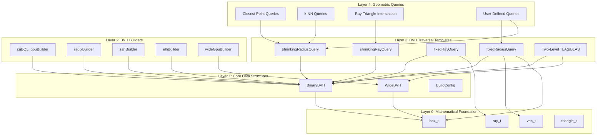
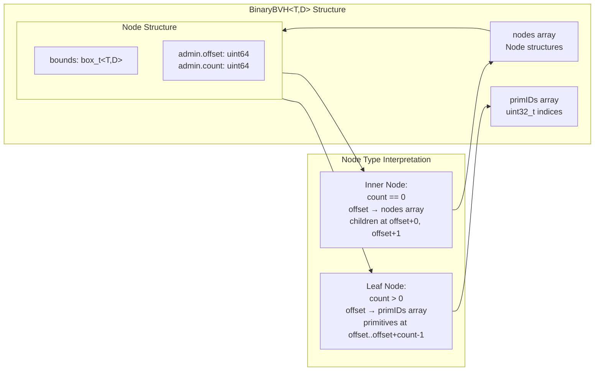
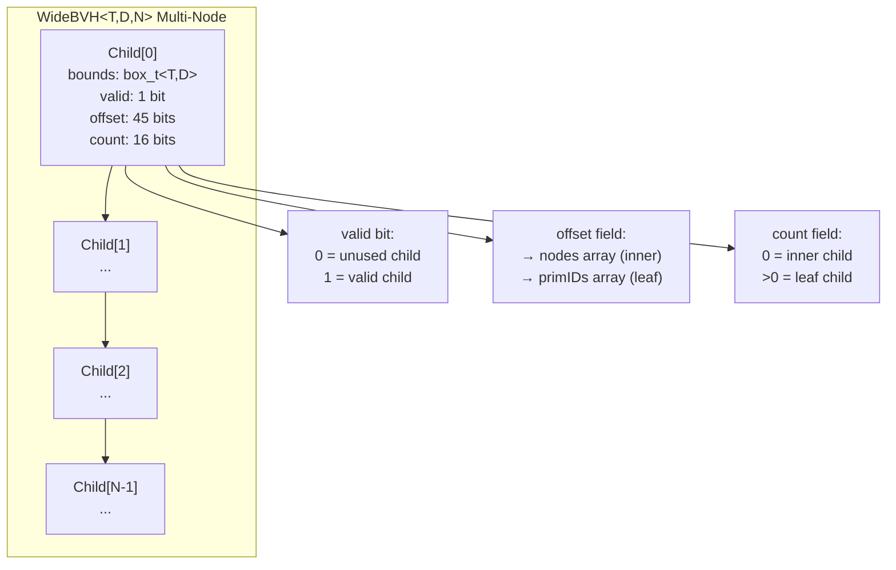
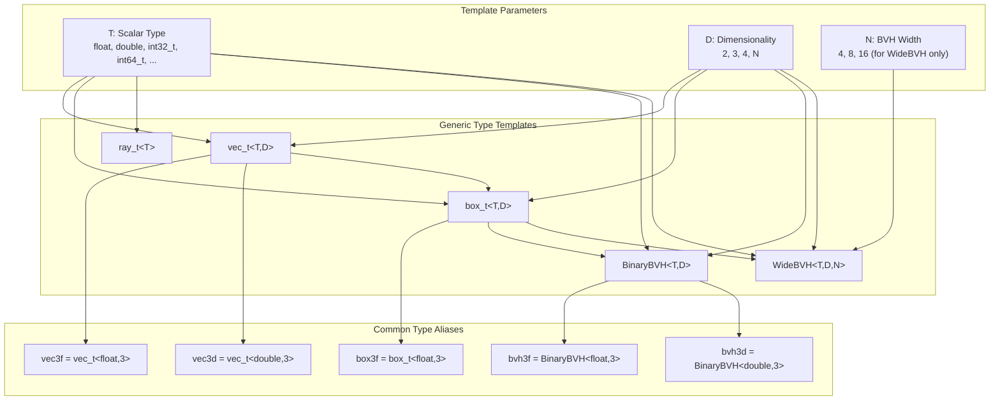
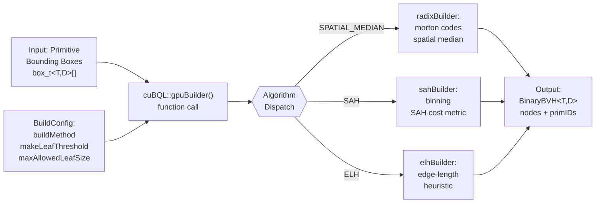
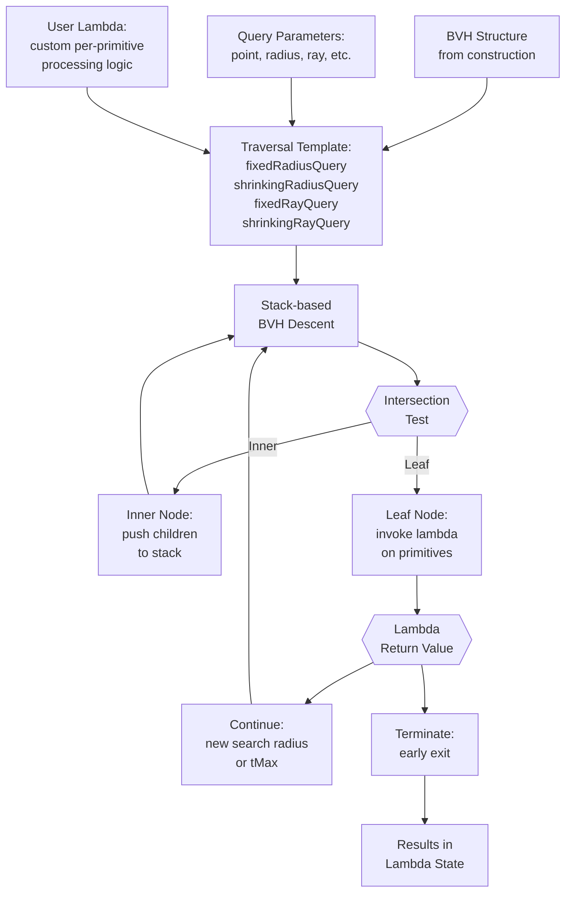
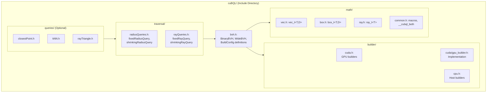

<!-- source: DeepWiki mcp.deepwiki.com · repo NVIDIA/cuBQL · page 1 Overview · fetched 2026-10-26 -->

# Overview

<details>
<summary>Relevant source files</summary>

The following files were used as context for generating this wiki page:

- [README.md](README.md)
- [cuBQL/bvh.h](cuBQL/bvh.h)

</details>


## Purpose and Scope

This page provides a high-level introduction to cuBQL, a CUDA/C++ library for GPU-accelerated construction and traversal of Bounding Volume Hierarchies (BVHs). The overview covers the library's purpose, architecture, core data structures, and basic usage patterns. For detailed installation and build instructions, see [Getting Started](#2). For in-depth architectural details, see [Architecture](#3).

**Sources:** [README.md:1-12]()

## What is cuBQL?

cuBQL (pronounced "cubicle") is a header-only CUDA/C++ library designed to enable efficient GPU-accelerated spatial queries over geometric primitives. The library provides tools for both constructing BVH data structures on the GPU and performing various spatial queries against them.

The library is inspired by the Standard Template Library (STL) and CUB, using templates and lambda functions to support different primitive types, coordinate types (float, double, int), dimensionalities (2D, 3D, 4D, N-D), and query patterns. This design enables a single codebase to handle diverse use cases: from `float3` ray tracing to `int2` spatial indexing.

**Key Design Goals:**
- **Robustness**: All builders work for all input types and handle numerically challenging data
- **Generality**: Template-based design supports arbitrary scalar types and dimensionalities
- **Ease of Use**: Simple API with sensible defaults and flexible customization
- **Performance**: GPU-accelerated construction (~13ms for 10M points) and traversal

**Sources:** [README.md:8-26]()

## Core Architecture: Four-Layer System

cuBQL organizes functionality into four distinct layers, each building on the layer below:



**Layer 0 (Mathematical Foundation)**: Template-based geometric primitives that work on both CPU and GPU. All types are parameterized by scalar type `T` and dimensionality `D`. See [Mathematical Foundation](#4) for details.

**Layer 1 (Core Data Structures)**: BVH storage formats defined in [cuBQL/bvh.h](). `BinaryBVH<T,D>` is the primary structure; `WideBVH<T,D,N>` provides N-ary trees for traversal optimization. See [Core Data Structures](#5).

**Layer 2 (BVH Builders)**: GPU-accelerated construction algorithms with different speed/quality tradeoffs. The `cuBQL::gpuBuilder` function dispatches to specialized builders based on `BuildConfig` settings. See [BVH Construction](#6).

**Layer 3 (Traversal Templates)**: Generic query patterns customizable via lambda callbacks. Users can implement custom queries without modifying core BVH code. See [BVH Traversal](#7).

**Layer 4 (Geometric Queries)**: Example implementations that demonstrate how to use the traversal templates. These serve as both usable queries and reference implementations. See [Geometric Queries](#8).

**Sources:** [README.md:30-60](), [cuBQL/bvh.h:1-161]()

## Core Data Structures

### BinaryBVH Structure

The primary BVH type is `BinaryBVH<T,D>`, a binary tree where each node contains a bounding box and administrative data:



**Key characteristics:**
- Node 0 is always the root
- Node 1 is unused (ensures child pairs start at even indices)
- Inner nodes: `count=0`, `offset` indexes into `nodes[]` array
- Leaf nodes: `count>0`, `offset` indexes into `primIDs[]` array
- Maximum leaf size: `(1<<16)-1` = 65535 primitives

The structure definition from [cuBQL/bvh.h:58-100]():

| Field | Type | Purpose |
|-------|------|---------|
| `nodes` | `Node*` | Array of BVH nodes (device or host memory) |
| `numNodes` | `uint32_t` | Total number of nodes in the tree |
| `primIDs` | `uint32_t*` | Array of primitive indices |
| `numPrims` | `uint32_t` | Total number of primitives indexed |

**Sources:** [cuBQL/bvh.h:53-100](), [README.md:64-91]()

### WideBVH Structure

`WideBVH<T,D,N>` provides N-ary trees with fixed branching factor. Each "node" is actually N child slots merged together:



Wide BVHs are typically created by collapsing binary BVHs, improving traversal efficiency through better cache utilization and SIMD opportunities.

**Sources:** [cuBQL/bvh.h:102-134]()

## Template Type System

cuBQL uses three primary template parameters to achieve flexibility:



**Type Aliases:** The library provides common aliases to reduce verbosity. For example, `bvh3f` is shorthand for `BinaryBVH<float,3>`, and `vec3f` is shorthand for `vec_t<float,3>`.

**CUDA Integration:** When `CUBQL_SUPPORT_CUDA_VECTOR_TYPES=1`, automatic conversions enable interoperation with CUDA built-in types like `float3`, `int4`, and `dim3`.

**Sources:** [cuBQL/bvh.h:58-149](), [README.md:99-104]()

## Build and Query Workflow

The typical cuBQL usage follows a two-phase pattern: construction followed by queries.

### Construction Phase



Example build invocation from [README.md:135-145]():

```cpp
box3f *d_boxes  = 0;
int    numBoxes = 0;
// User code generates boxes on GPU
userCodeForGeneratingPrims(&d_boxes, &numBoxes);

cuBQL::BinaryBVH<float,3> bvh;
cuBQL::BuildConfig buildParams;
cuBQL::gpuBuilder(bvh, d_boxes, numBoxes, buildParams);
```

The builder:
- Accepts bounding boxes in device or managed memory
- Does not modify input boxes
- Handles invalid boxes (where `lower.x > upper.x`) by excluding them
- Handles zero-volume boxes (where `lower == upper`) as valid
- Populates `bvh.nodes[]` and `bvh.primIDs[]` arrays

**Sources:** [README.md:106-169](), [cuBQL/bvh.h:18-51]()

### Query Phase



Example query from [README.md:254-266]():

```cpp
void findClosestPoint(...) {
   float closestDist = INFINITY;
   int   closestID   = -1;
   auto myQueryLambda = [&closestDist,&closestID,...](int primID) -> float {
      float dist = distance(queryPoint, myPrims[primID]);
      if (dist < closestDist) {
         closestDist = dist;
         closestID = primID;
      }
      return closestDist;  // New search radius
   };
   cuBQL::shrinkingRadiusQuery::forEachPrim(myQueryLambda, queryPoint, myBVH, ...);
}
```

The lambda-based design enables:
- **Custom per-primitive processing**: Lambda implements query-specific logic
- **Dynamic search space reduction**: Lambda returns new radius/tMax for shrinking queries
- **Early termination**: Lambda can signal traversal to stop
- **Flexible result accumulation**: Results stored in lambda-captured variables

**Sources:** [README.md:193-269]()

## Key File Organization



**Core Library (`cuBQL/`)**: Everything needed for BVH construction and traversal

**Math Foundation (`cuBQL/math/`)**: Template-based geometric primitives with CPU/GPU support

**Builders (`cuBQL/builder/`)**: Construction algorithms; can be used header-only or as pre-built targets

**Traversal (`cuBQL/traversal/`)**: Generic query patterns via lambda callbacks

**Queries (`cuBQL/queries/`)**: Example implementations demonstrating traversal template usage

**Sources:** [README.md:282-296]()

## Build Configuration Options

The `BuildConfig` structure controls builder behavior:

| Field | Type | Default | Purpose |
|-------|------|---------|---------|
| `buildMethod` | `BuildMethod` enum | `SPATIAL_MEDIAN` | Algorithm selection: `SPATIAL_MEDIAN`, `SAH`, or `ELH` |
| `makeLeafThreshold` | `int` | `0` | Threshold below which to create leaves (0 = let builder decide) |
| `maxAllowedLeafSize` | `int` | `1<<15` (32768) | Maximum primitives per leaf |

**Build Methods:**
- **SPATIAL_MEDIAN** (default): Fast construction using morton codes and spatial median splits
- **SAH**: Higher quality using Surface Area Heuristic, slower build but better query performance
- **ELH**: Edge-Length Heuristic, experimental balanced approach

Methods can be enabled via:
```cpp
BuildConfig config;
config.enableSAH();  // Use SAH builder
config.enableELH();  // Use ELH builder
```

**Sources:** [cuBQL/bvh.h:18-51]()

## Memory Management

cuBQL supports flexible memory allocation strategies:

**Default**: Device memory allocated via `cudaMalloc`/`cudaFree`

**Managed Memory**: Use `cuBQL::ManagedMemoryResource` for automatic CPU/GPU migration

**Async Device Memory**: Use `cuBQL::AsyncDeviceMemoryResource` for stream-ordered allocations

**Custom Resources**: Implement `cuBQL::GpuMemoryResource` interface for custom allocators

Memory resources can be passed to builders:
```cpp
cuBQL::ManagedMemoryResource mr;
cuBQL::gpuBuilder(bvh, d_boxes, numBoxes, buildParams, 0, mr);
```

See [Memory Management](#9.1) for detailed documentation.

**Sources:** [README.md:176-179]()

## Header-Only vs. Pre-Built Libraries

cuBQL supports two usage modes:

### Header-Only Mode

Define `CUBQL_GPU_BUILDER_IMPLEMENTATION=1` in exactly one translation unit to include implementation:

```cpp
#define CUBQL_GPU_BUILDER_IMPLEMENTATION 1
#include <cuBQL/bvh.h>
```

This allows compilation with custom flags and architectures.

### Pre-Built Library Mode

Link against type-specific targets in CMake:

```cmake
target_link_libraries(userExec cuBQL_cuda_float3)
```

Available targets include `cuBQL_cuda_float3`, `cuBQL_cuda_double3`, `cuBQL_host_int4`, etc.

See [Getting Started](#2) for build system integration details and [Template Instantiation](#9.3) for advanced customization.

**Sources:** [README.md:181-191](), [README.md:308-368]()

## Next Steps

- **Installation and Build**: See [Getting Started](#2) for CMake integration and build instructions
- **Architecture Details**: See [Architecture](#3) for in-depth layer descriptions
- **Mathematical Types**: See [Mathematical Foundation](#4) for `vec_t`, `box_t`, and related types
- **BVH Construction**: See [BVH Construction](#6) for builder algorithms and implementation details
- **BVH Traversal**: See [BVH Traversal](#7) for traversal templates and query patterns
- **Example Queries**: See [Geometric Queries](#8) for reference implementations

**Sources:** [README.md:1-369]()

---

