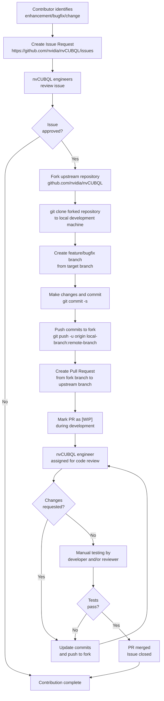
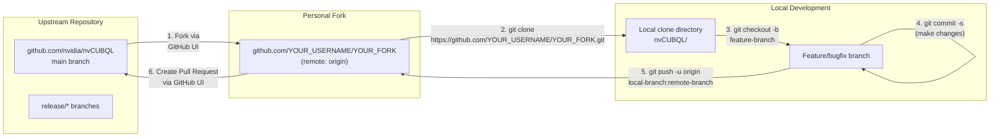
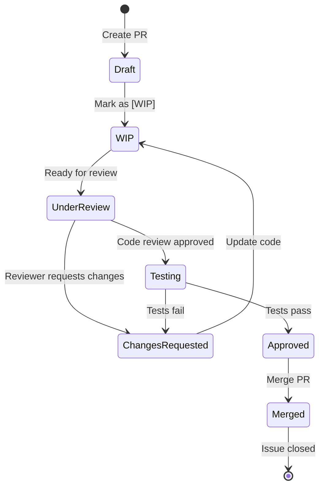
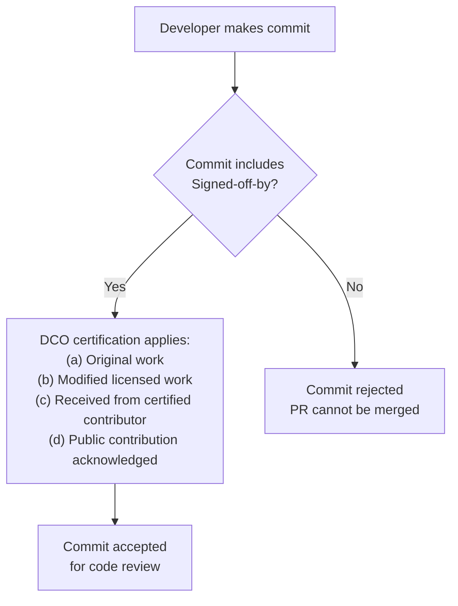

<!-- source: DeepWiki mcp.deepwiki.com · repo NVIDIA/cuBQL · page 10 Contributing · fetched 2026-10-26 -->

# Contributing

<details>
<summary>Relevant source files</summary>

The following files were used as context for generating this wiki page:

- [CONTRIBUTING.md](CONTRIBUTING.md)

</details>


This page documents the contribution process for cuBQL, including issue tracking requirements, pull request workflow, code review procedures, and commit signing obligations. All contributions to cuBQL must follow these guidelines to ensure quality control and proper licensing compliance.

For information about building cuBQL from source and setting up a development environment, see [Getting Started](#2). For details on code organization and internal architecture that may be helpful when implementing changes, see [Architecture](#3).

---

## Overview

cuBQL follows a standard open-source contribution model based on GitHub's fork-and-pull-request workflow. All contributions begin with issue creation, proceed through code review on a pull request, and conclude with manual testing before merge. The project requires Developer Certificate of Origin (DCO) sign-off on all commits to certify licensing compliance.

**Sources**: [CONTRIBUTING.md:1-75]()

---

## Contribution Workflow

The following diagram illustrates the complete contribution lifecycle from initial issue creation through final merge into the upstream repository.

### Contribution Process Overview



**Sources**: [CONTRIBUTING.md:3-31]()

---

## Issue Tracking

All contributions must begin with the creation of an issue in the upstream repository. This requirement ensures that proposed changes are reviewed and approved before implementation work begins.

### Issue Requirements

| Requirement | Description |
|-------------|-------------|
| **Mandatory Issue** | All enhancement, bugfix, or change requests require a GitHub issue |
| **Issue Location** | [https://github.com/nvidia/nvCUBQL/issues](https://github.com/nvidia/nvCUBQL/issues) |
| **Review Requirement** | Issues must be reviewed and approved by nvCUBQL engineers before code review begins |
| **Approval Gate** | Code review will not proceed without prior issue approval |

The issue serves as a record of the motivation for the change, design discussion, and approval decision. Contributors should provide clear descriptions of the problem being solved and the proposed approach.

**Sources**: [CONTRIBUTING.md:3-7]()

---

## Fork and Pull Request Workflow

cuBQL uses GitHub's standard fork-based contribution model. Contributors work in personal forks and submit changes via pull requests to the upstream repository.

### Git Workflow Commands

The following diagram maps the contribution workflow to specific Git commands and repository locations.



### Step-by-Step Workflow

1. **Fork the upstream repository**  
   Navigate to [https://github.com/nvidia/nvCUBQL](https://github.com/nvidia/nvCUBQL) and create a fork using GitHub's fork button.

2. **Clone the forked repository**  
   ```bash
   git clone https://github.com/YOUR_USERNAME/YOUR_FORK.git nvCUBQL
   ```

3. **Create a feature branch**  
   Check out the appropriate target branch (e.g., `main` or a `release/*` branch) and create a new branch for your changes.

4. **Commit changes with sign-off**  
   Make code changes and commit using the `-s` flag to add DCO sign-off:
   ```bash
   git commit -s -m "Add cool feature."
   ```

5. **Push to the fork**  
   ```bash
   git push -u origin <local-branch>:<remote-branch>
   ```

6. **Create a pull request**  
   Use GitHub's interface to create a PR from your fork's branch to the upstream repository's target branch.

**Sources**: [CONTRIBUTING.md:10-29]()

---

## Pull Request Process

Once code is pushed to a fork, the pull request mechanism initiates the code review process.

### PR Guidelines

| Aspect | Requirement |
|--------|-------------|
| **Branch Selection** | Exercise caution when selecting source and target branches |
| **Versioned Releases** | Releases are posted to `release/*` branches in the upstream repository |
| **Work-in-Progress** | Mark incomplete PRs with `[WIP]` prefix in the title |
| **Reviewer Assignment** | At least one nvCUBQL engineer will be assigned for review |
| **Testing Requirement** | Manual testing must be completed before PR acceptance |
| **CI/CD Status** | No automated CI/CD process exists; testing is manual |

### Pull Request State Machine



### Testing Requirements

cuBQL does not currently have an automated CI/CD pipeline. The PR will only be accepted and the corresponding issue closed after adequate testing has been completed manually by:
- The developer submitting the PR
- The nvCUBQL engineer reviewing the code
- Or both parties in collaboration

Contributors are responsible for ensuring their changes work correctly across relevant configurations before requesting final review.

**Sources**: [CONTRIBUTING.md:23-31]()

---

## Commit Sign-Off Requirements

All contributors must sign off on their commits using the Developer Certificate of Origin (DCO). This certifies that you have the right to submit the contribution under the project's license.

### DCO Sign-Off Mechanics

| Requirement | Details |
|-------------|---------|
| **Mandatory Sign-Off** | All commits must include DCO sign-off |
| **Rejection Policy** | Contributions with unsigned commits will not be accepted |
| **Sign-Off Command** | Use `git commit -s` or `git commit --signoff` |
| **Sign-Off Format** | Appends `Signed-off-by: Your Name <your@email.com>` to commit message |

### Sign-Off Process

When committing changes, use the `-s` or `--signoff` flag:

```bash
git commit -s -m "Add cool feature."
```

This automatically appends the following line to the commit message:

```
Signed-off-by: Your Name <your@email.com>
```

The sign-off uses the author name and email configured in your Git settings. Ensure these are set correctly before committing:

```bash
git config user.name "Your Name"
git config user.email "your@email.com"
```

**Sources**: [CONTRIBUTING.md:33-46]()

---

## Developer Certificate of Origin

The DCO is a legally binding statement that certifies your rights to contribute code. By signing off on a commit, you certify one or more of the following statements.

### DCO Version 1.1

**Copyright**: (C) 2004, 2006 The Linux Foundation and its contributors

**License**: Version 1.1 permits verbatim copying and distribution; modifications are not allowed.

### DCO Certification Statements

By making a contribution with a DCO sign-off, you certify that:

**(a)** The contribution was created in whole or in part by you and you have the right to submit it under the open source license indicated in the file; or

**(b)** The contribution is based upon previous work that, to the best of your knowledge, is covered under an appropriate open source license and you have the right under that license to submit that work with modifications, whether created in whole or in part by you, under the same open source license (unless permitted to submit under a different license), as indicated in the file; or

**(c)** The contribution was provided directly to you by some other person who certified (a), (b), or (c) and you have not modified it.

**(d)** You understand and agree that this project and the contribution are public and that a record of the contribution (including all personal information submitted with it, including the sign-off) is maintained indefinitely and may be redistributed consistent with this project or the open source license(s) involved.

### DCO Verification



**Sources**: [CONTRIBUTING.md:48-74]()

---

## Repository Structure

Understanding the repository's branch structure helps contributors target pull requests correctly.

### Branch Organization

| Branch Type | Purpose |
|-------------|---------|
| `main` | Primary development branch for ongoing work |
| `release/*` | Versioned release branches for stable releases |
| Feature branches | Short-lived branches in contributor forks |

Contributors should carefully select the appropriate target branch when creating pull requests. Changes intended for the next release should typically target `main`, while backports or patches to existing releases should target the appropriate `release/*` branch.

**Sources**: [CONTRIBUTING.md:24-25]()

---

## Summary

Contributing to cuBQL requires:
1. Creating and obtaining approval for a GitHub issue
2. Forking the repository and working in a personal branch
3. Signing all commits with DCO sign-off using `git commit -s`
4. Creating a pull request with careful branch selection
5. Completing code review with at least one nvCUBQL engineer
6. Performing adequate manual testing before merge

The mandatory issue approval, code review, and DCO sign-off requirements ensure code quality and licensing compliance. Contributors should familiarize themselves with the codebase architecture (see [Architecture](#3)) before beginning implementation work.

**Sources**: [CONTRIBUTING.md:1-75]()

---

