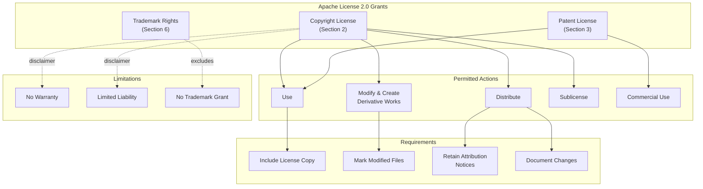
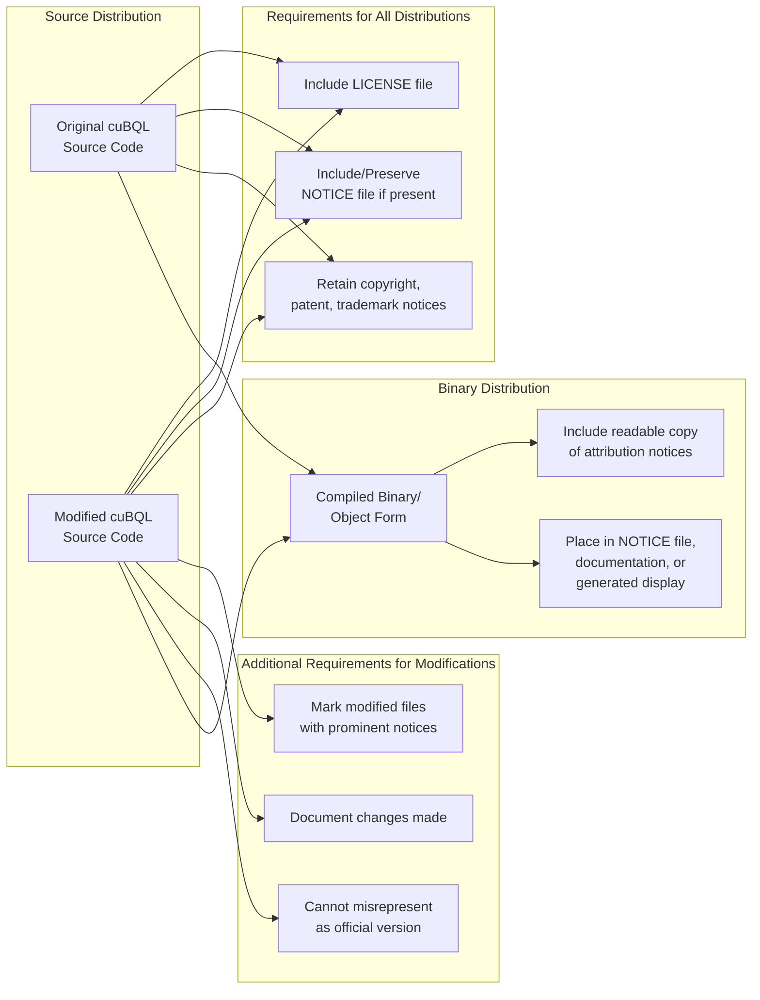
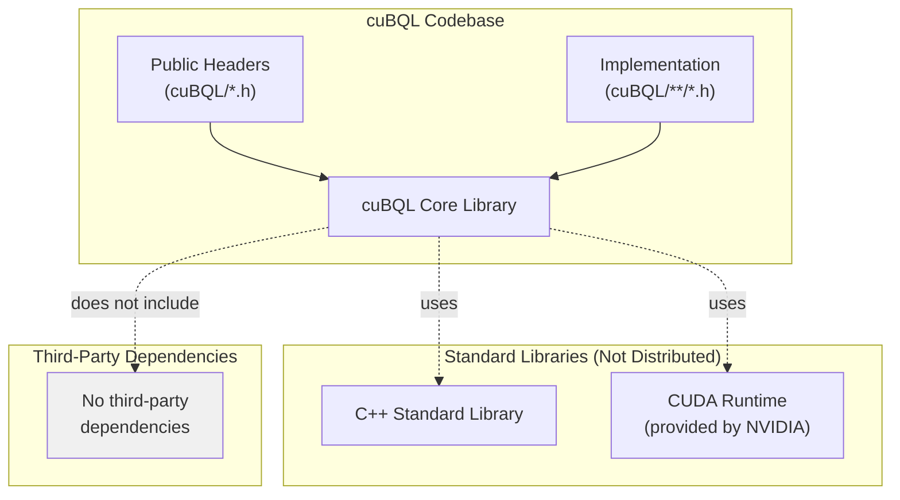
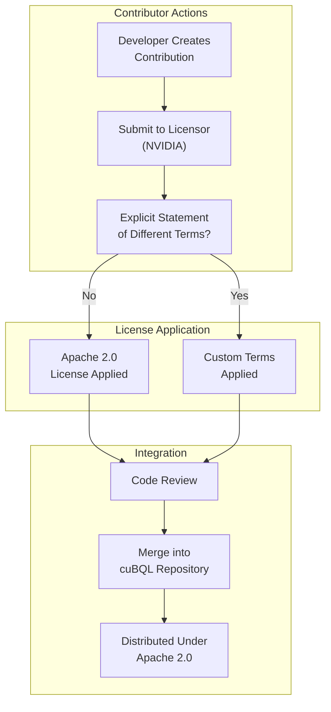

<!-- source: DeepWiki mcp.deepwiki.com · repo NVIDIA/cuBQL · page 11 License and Credits · fetched 2026-10-26 -->

# License and Credits

<details>
<summary>Relevant source files</summary>

The following files were used as context for generating this wiki page:

- [3rdParty.txt](3rdParty.txt)
- [LICENSE](LICENSE)

</details>


This document describes the licensing terms for cuBQL, copyright information, third-party dependencies, and contribution guidelines. This page covers legal and attribution requirements for using, modifying, and redistributing cuBQL.

For information about contributing code to the project, see [Contributing](#10).

---

## License Overview

cuBQL is licensed under the Apache License, Version 2.0, a permissive open-source license that allows commercial and non-commercial use, modification, and distribution.

### Copyright Holder

```
Copyright (c) 2025 NVIDIA CORPORATION & AFFILIATES. All rights reserved.
```

**Sources**: [LICENSE:189]()

### License Type

| Property | Value |
|----------|-------|
| License | Apache License, Version 2.0 |
| Version Date | January 2004 |
| Full Text URL | http://www.apache.org/licenses/ |
| SPDX Identifier | Apache-2.0 |
| OSI Approved | Yes |
| Commercial Use | Permitted |
| Modification | Permitted |
| Distribution | Permitted |
| Patent Grant | Included |
| Trademark Use | Not granted |

**Sources**: [LICENSE:1-3]()

---

## License Grant Structure



**License Grant Structure**: This diagram illustrates the three primary grants in the Apache 2.0 license (copyright, patent, trademark), the actions they permit, the requirements users must meet when redistributing, and the explicit limitations. The license provides broad permissions while requiring proper attribution and disclaiming warranties.

**Sources**: [LICENSE:66-87](), [LICENSE:89-128](), [LICENSE:138-141]()

---

## Key License Terms

### Copyright License (Section 2)

The Apache 2.0 copyright license grants users:

| Permission | Scope |
|------------|-------|
| Reproduce | Make copies of the source code |
| Prepare Derivative Works | Modify and create derived versions |
| Publicly Display | Show the work publicly |
| Publicly Perform | Execute the software publicly |
| Sublicense | Grant licenses to downstream users |
| Distribute | Share in Source or Object form |

All permissions are:
- **Perpetual**: No expiration date
- **Worldwide**: No geographic restrictions
- **Non-exclusive**: Others may also use the work
- **No-charge**: No licensing fees
- **Royalty-free**: No ongoing payments
- **Irrevocable**: Cannot be rescinded (except for patent termination clause)

**Sources**: [LICENSE:66-71]()

### Patent License (Section 3)

The patent license grants rights to:
- Make, use, and sell implementations
- Transfer and import the work
- Practice patent claims necessarily infringed by contributions

**Patent Termination Clause**: If a user initiates patent litigation alleging that cuBQL infringes their patents, all patent licenses granted to that user terminate automatically.

**Sources**: [LICENSE:73-87]()

### Trademark Rights (Section 6)

The license **does not grant permission** to use NVIDIA's trade names, trademarks, service marks, or product names, except for:
- Describing the origin of the work
- Reproducing content from the NOTICE file (if present)

**Sources**: [LICENSE:138-141]()

---

## Redistribution Requirements

### Distribution Diagram



**Redistribution Requirements Flow**: This diagram maps the different distribution scenarios (original source, modified source, compiled binaries) to their respective requirements under the Apache 2.0 license. Modified versions have additional obligations to mark changes and avoid misrepresentation.

**Sources**: [LICENSE:89-128]()

### Required Files

When redistributing cuBQL or derivative works, you must include:

| File | Location | Purpose |
|------|----------|---------|
| `LICENSE` | Root of distribution | Full Apache 2.0 license text |
| `NOTICE` | Root of distribution (if exists) | Attribution notices |
| Modified file notices | In modified source files | Disclosure of modifications |

**Sources**: [LICENSE:94-121]()

### Modification Disclosure

When distributing modified versions of cuBQL, you must:

1. **Mark Modified Files**: Add prominent notices to changed files stating that modifications were made
2. **Retain Original Notices**: Keep all copyright, patent, and trademark notices from the original source
3. **Separate License Terms**: You may apply different license terms to your modifications, but the original cuBQL code remains under Apache 2.0

**Sources**: [LICENSE:97-98](), [LICENSE:123-128]()

---

## Third-Party Dependencies

cuBQL currently has **no third-party open-source dependencies**. The library is self-contained and does not incorporate external projects.

### Dependency Structure



**Dependency Graph**: This diagram shows that cuBQL has no third-party open-source dependencies. The library relies only on standard C++ and CUDA runtime libraries, which are not distributed with cuBQL and have their own separate licenses from their respective providers.

**Sources**: [3rdParty.txt:1-6]()

### Future Dependencies

The [3rdParty.txt:4-5]() file contains a placeholder for future third-party dependencies:

```
<no 3rd-party projects used, yet; add here once any 3rd party OSS
projects get used by this library>
```

If third-party dependencies are added in future versions, they will be documented in `3rdParty.txt` with their respective licenses.

**Sources**: [3rdParty.txt:4-5]()

---

## Contribution License Agreement

### Contribution Terms

All contributions submitted to cuBQL are licensed under the same Apache 2.0 terms unless explicitly stated otherwise.

| Aspect | Requirement |
|--------|-------------|
| Default License | Apache 2.0 (same as project) |
| Additional Terms | None (unless separately agreed) |
| Submission Method | Pull requests, patches, emails |
| Explicit Override | Must be stated in writing if different |

**Sources**: [LICENSE:130-136]()

### Contribution Flow



**Contribution License Flow**: This diagram shows how contributions to cuBQL are licensed. By default, all submissions are under Apache 2.0 unless the contributor explicitly states otherwise in writing. Once merged, all code is distributed under the project's Apache 2.0 license.

**Sources**: [LICENSE:130-136]()

### Submission Definition

A "Contribution" is defined as:
- Original version of the Work
- Modifications or additions to the Work or Derivative Works
- Intentionally submitted for inclusion by the copyright owner or authorized representative

"Submitted" includes:
- Electronic communication (email, issue trackers)
- Verbal communication to representatives
- Written communication

Excludes communication marked "Not a Contribution" by the copyright owner.

**Sources**: [LICENSE:48-60]()

---

## Warranties and Liability

### Disclaimer of Warranty

cuBQL is provided **"AS IS"** with no warranties:

| Warranty Type | Status |
|---------------|--------|
| Express Warranties | **None** |
| Implied Warranties | **None** |
| MERCHANTABILITY | **Not Warranted** |
| FITNESS FOR A PARTICULAR PURPOSE | **Not Warranted** |
| TITLE | **Not Warranted** |
| NON-INFRINGEMENT | **Not Warranted** |

Users are solely responsible for determining the appropriateness of using or redistributing cuBQL and assume all risks.

**Sources**: [LICENSE:143-151]()

### Limitation of Liability

Contributors (including NVIDIA) are **not liable** for damages arising from cuBQL usage, including:
- Direct damages
- Indirect damages
- Special damages
- Incidental damages
- Consequential damages
- Loss of goodwill
- Work stoppage
- Computer failure
- Commercial damages

This limitation applies under any legal theory (tort, contract, or otherwise) unless required by applicable law.

**Sources**: [LICENSE:153-163]()

---

## Attribution Requirements

### Source Code Attribution

All source files in cuBQL contain standard Apache 2.0 license headers with NVIDIA copyright:

```
Copyright (c) 2025 NVIDIA CORPORATION & AFFILIATES. All rights reserved.

Licensed under the Apache License, Version 2.0 (the "License");
you may not use this file except in compliance with the License.
You may obtain a copy of the License at

    http://www.apache.org/licenses/LICENSE-2.0

Unless required by applicable law or agreed to in writing, software
distributed under the License is distributed on an "AS IS" BASIS,
WITHOUT WARRANTIES OR CONDITIONS OF ANY KIND, either express or implied.
See the License for the specific language governing permissions and
limitations under the License.
```

**Sources**: [LICENSE:189-201]()

### Required Attribution Elements

When using or redistributing cuBQL, preserve:

| Element | Location | Purpose |
|---------|----------|---------|
| Copyright notices | Source files, LICENSE | Identify copyright holder |
| Patent notices | Source files (if any) | Document patent claims |
| Trademark notices | Source files (if any) | Clarify trademark usage |
| Attribution from NOTICE | NOTICE file (if exists) | Additional attributions |

**Sources**: [LICENSE:100-104]()

---

## Using cuBQL in Your Project

### Attribution Checklist

- [ ] Include `LICENSE` file in your distribution
- [ ] Include `NOTICE` file if present
- [ ] Retain copyright notices in source files
- [ ] If modified: Add notices stating files were changed
- [ ] If binary distribution: Include attribution in documentation or display
- [ ] Do not use NVIDIA trademarks without permission

### License Compatibility

The Apache 2.0 license is compatible with:

| License Type | Compatible | Notes |
|--------------|------------|-------|
| GPL 3.0 | Yes | Apache 2.0 code can be included in GPL 3.0 projects |
| GPL 2.0 | Unclear | Consult legal advice due to patent clause differences |
| MIT | Yes | Both are permissive licenses |
| BSD | Yes | Both are permissive licenses |
| LGPL | Yes | Apache 2.0 code can be used with LGPL libraries |
| Proprietary | Yes | Commercial use is explicitly permitted |

**Sources**: [LICENSE:66-71]()

---

## Summary

| Aspect | Details |
|--------|---------|
| **License** | Apache License, Version 2.0 |
| **Copyright** | (c) 2025 NVIDIA CORPORATION & AFFILIATES |
| **Permissions** | Commercial use, modification, distribution, sublicensing |
| **Requirements** | Include license, mark modifications, retain notices |
| **Limitations** | No warranty, limited liability, no trademark grant |
| **Patent Grant** | Included (with termination clause for litigation) |
| **Third-Party Dependencies** | None |
| **Contribution Terms** | Apache 2.0 by default |

**Sources**: [LICENSE:1-201](), [3rdParty.txt:1-6]()