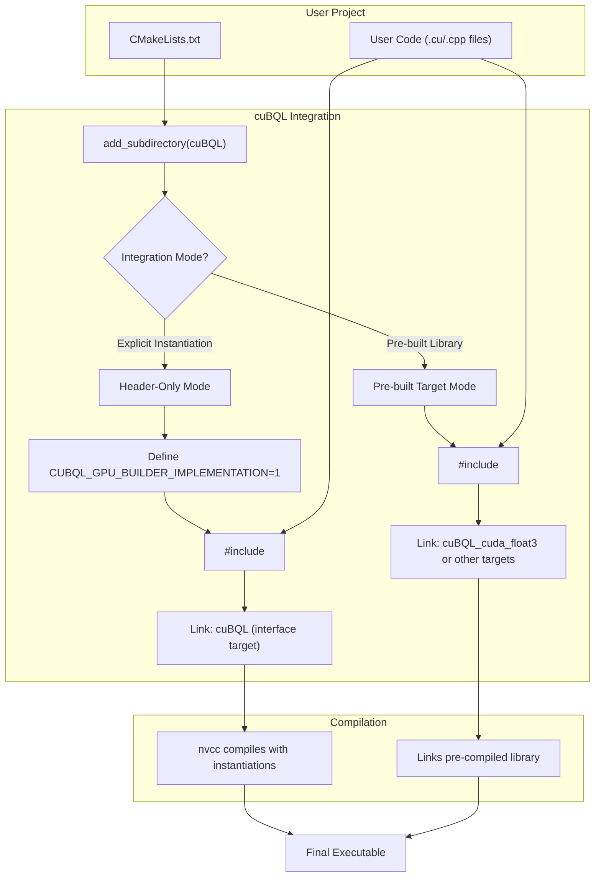
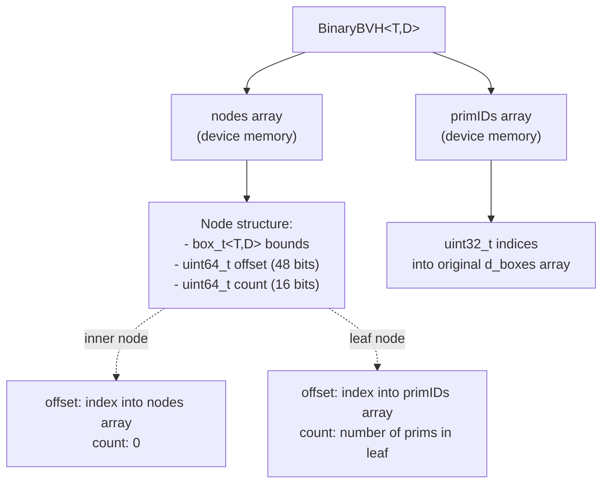
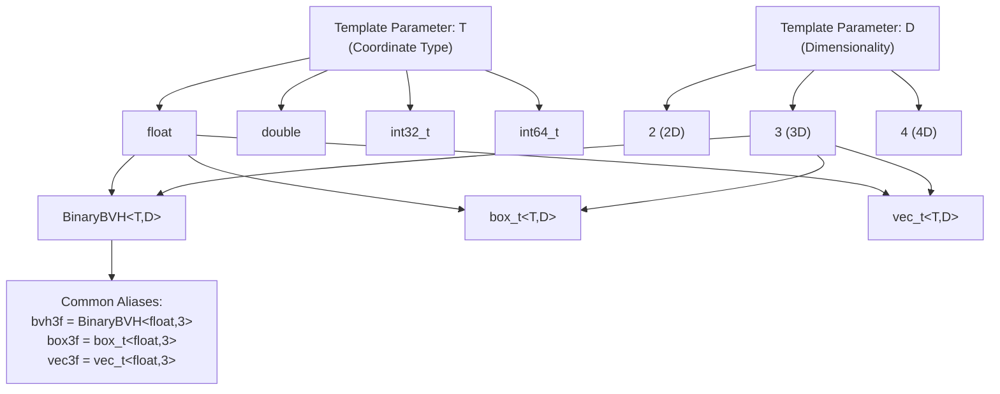

<!-- source: DeepWiki mcp.deepwiki.com · repo NVIDIA/cuBQL · page 2 Getting Started · fetched 2026-10-26 -->

# Getting Started

<details>
<summary>Relevant source files</summary>

The following files were used as context for generating this wiki page:

- [README.md](README.md)
- [cuBQL/builder/cuda/instantiate_builders.cu](cuBQL/builder/cuda/instantiate_builders.cu)

</details>


This page provides installation instructions, CMake integration guidance, and basic usage examples for cuBQL. It covers the prerequisites, integration methods, and a quick start guide for building your first BVH and performing queries.

For detailed information about cuBQL's architecture and design principles, see [Architecture](#3). For in-depth documentation of specific builders and traversal patterns, see [BVH Construction](#6) and [BVH Traversal](#7).

---

## Prerequisites

cuBQL requires the following dependencies:

| Dependency | Version | Notes |
|------------|---------|-------|
| CUDA Toolkit | 12.x or later | CUDA 11.x may work but 12.2+ is highly recommended |
| CMake | 3.18+ | Required for CMake-based integration |
| C++ Compiler | C++14 or later | Must support CUDA compilation |

The library is designed to work on both Linux and Windows platforms. Ensure your CUDA installation includes `nvcc` and that it is accessible in your system PATH.

**Sources:** [README.md:299-306]()

---

## Integration Methods

cuBQL can be integrated into your project in two primary ways: header-only mode with explicit instantiation, or by linking against pre-built library targets. The choice depends on your compilation preferences and whether you need custom type instantiations.

### Integration Workflow Diagram



**Sources:** [README.md:308-369]()

---

## CMake Integration (Recommended)

### Method 1: Header-Only with Explicit Instantiation

This approach compiles the builder implementations directly into your code. You control the compilation flags and can instantiate custom types.

**Step 1:** Add cuBQL as a subdirectory in your `CMakeLists.txt`:

```cmake
add_subdirectory(<pathTo>/cuBQL)

add_executable(myApp
    main.cu
    # ... other sources
)

target_link_libraries(myApp
    cuBQL  # Interface target - sets include paths only
)
```

**Step 2:** In your CUDA source file (e.g., `main.cu`):

```cpp
#define CUBQL_GPU_BUILDER_IMPLEMENTATION 1
#include <cuBQL/bvh.h>

// Your code here
```

The `CUBQL_GPU_BUILDER_IMPLEMENTATION` macro triggers inclusion of implementation code. This must be defined in exactly one compilation unit.

**Sources:** [README.md:319-345]()

### Method 2: Pre-built Library Targets

This approach links against pre-compiled builder implementations for common type combinations. It results in faster compilation for most use cases.

**Step 1:** Add cuBQL and link to a specific target in your `CMakeLists.txt`:

```cmake
add_subdirectory(<pathTo>/cuBQL)

add_executable(myApp
    main.cu
    # ... other sources
)

target_link_libraries(myApp
    cuBQL_cuda_float3  # Pre-built for BinaryBVH<float,3>
)
```

**Step 2:** In your CUDA source file (e.g., `main.cu`):

```cpp
// Do NOT define CUBQL_GPU_BUILDER_IMPLEMENTATION
#include <cuBQL/bvh.h>

// Your code here
```

**Sources:** [README.md:346-369]()

### Available Pre-built Targets

The following CMake targets are available for common type combinations:

| Target Name | Type Parameters | BVH Types |
|-------------|-----------------|-----------|
| `cuBQL_cuda_float3` | `<float, 3>` | `BinaryBVH<float,3>`, `WideBVH<float,3,N>` (N=4,8,16) |
| `cuBQL` | Interface only | Header-only, no pre-compiled code |

By default, cuBQL instantiates builders for `<float, 3>` which covers the common 3D floating-point use case. Custom type instantiations require header-only mode with custom `CUBQL_INSTANTIATE_T` and `CUBQL_INSTANTIATE_D` definitions.

**Sources:** [cuBQL/builder/cuda/instantiate_builders.cu:75-89]()

---

## Quick Start: Building Your First BVH

### Basic BVH Construction Example

The following workflow demonstrates the minimal steps to construct a BVH from bounding boxes:


**Step-by-step implementation:**

1. **Prepare input data** - Create an array of `box_t<T,D>` bounding boxes on the GPU:

```cpp
// Assuming you have primitives and need their bounding boxes
box3f *d_boxes = nullptr;  // box3f is an alias for box_t<float,3>
int numBoxes = 1000000;

// Allocate device memory
cudaMalloc(&d_boxes, numBoxes * sizeof(box3f));

// Populate boxes (via kernel, cudaMemcpy, or other means)
// Each box should have box.lower and box.upper set appropriately
```

2. **Instantiate BVH structure** - Create a `BinaryBVH` instance:

```cpp
cuBQL::BinaryBVH<float,3> bvh;  // or use alias: cuBQL::bvh3f
```

3. **Configure build parameters** - Create a `BuildConfig` object:

```cpp
cuBQL::BuildConfig buildConfig;
// Default settings use spatial median splits (fast)
// See BuildConfig documentation for SAH and other options
```

4. **Build the BVH** - Call `cuBQL::gpuBuilder`:

```cpp
cuBQL::gpuBuilder(bvh, d_boxes, numBoxes, buildConfig);
```

After this call, `bvh.nodes` and `bvh.primIDs` are populated on device memory and ready for traversal.

**Sources:** [README.md:123-169]()

### Understanding BVH Output Structure

After construction, the `BinaryBVH` structure contains:



- **Inner nodes**: `count == 0`, `offset` points to children in `nodes` array
- **Leaf nodes**: `count > 0`, `offset` points to primitive IDs in `primIDs` array
- The `primIDs` array contains indices into your original `d_boxes` array

**Sources:** [README.md:62-91]()

---

## Quick Start: Performing Queries

### Traversal Template Usage

cuBQL provides traversal templates that accept lambda functions for custom query logic. Here's the basic pattern for a shrinking radius query:

```cpp
// Device-side query kernel
__global__ void queryKernel(cuBQL::bvh3f bvh, 
                            vec3f *queryPoints,
                            float *results,
                            int numQueries) {
    int queryIdx = blockIdx.x * blockDim.x + threadIdx.x;
    if (queryIdx >= numQueries) return;
    
    vec3f queryPoint = queryPoints[queryIdx];
    float closestDist = INFINITY;
    
    // Define lambda for processing each candidate primitive
    auto processCandidate = [&](int primID) -> float {
        // Custom logic: compute distance to primitive
        float dist = computeDistance(queryPoint, primID);
        if (dist < closestDist) {
            closestDist = dist;
        }
        return closestDist;  // Return new search radius
    };
    
    // Invoke traversal template
    cuBQL::shrinkingRadiusQuery::forEachPrim(
        processCandidate,
        queryPoint,
        bvh,
        INFINITY  // initial search radius
    );
    
    results[queryIdx] = closestDist;
}
```

The lambda function receives a `primID` and returns the updated search radius. The traversal template handles the BVH descent, intersection tests, and invokes your lambda only for relevant primitives.

**Sources:** [README.md:193-266]()

---

## Common Build Configuration Options

The `BuildConfig` structure controls builder behavior:

| Configuration | Values | Description |
|---------------|--------|-------------|
| Build method | `BuildConfig::SAH` | Surface Area Heuristic - higher quality, slower build |
| | `BuildConfig::ELH` | Edge Length Heuristic - balanced quality/speed |
| | (default) | Spatial median splits - fastest build |
| Max leaf size | Integer (default varies) | Maximum primitives per leaf node |
| Memory resource | `GpuMemoryResource` | Custom device/managed memory allocator |
| Stream | `cudaStream_t` | CUDA stream for async execution |

Example with custom configuration:

```cpp
cuBQL::BuildConfig config;
config.buildMethod = cuBQL::BuildConfig::SAH;  // Use SAH for quality
config.maxLeafSize = 4;  // Smaller leaves (more nodes, faster traversal)

cuBQL::gpuBuilder(bvh, d_boxes, numBoxes, config, 
                  cudaStream, memoryResource);
```

**Sources:** [README.md:164-180]()

---

## Invalid and Empty Primitives

cuBQL automatically handles invalid input:

- **Invalid primitives**: Boxes where `lower.x > upper.x` are excluded from the BVH
- **Empty boxes**: Boxes where `lower == upper` (zero volume) are valid and included
- **NaNs and denorms**: Behavior is undefined - sanitize input data

This allows you to mark primitives for exclusion by setting invalid bounds without filtering the input array.

**Sources:** [README.md:153-163]()

---

## Type System Overview

cuBQL is fully templated over coordinate type `T` and dimensionality `D`:



Common type aliases are provided for convenience:
- `bvh3f`, `bvh3d` - Binary BVHs for float/double 3D
- `box3f`, `box3d` - Bounding boxes for float/double 3D
- `vec3f`, `vec3d` - Vectors for float/double 3D

**Sources:** [README.md:34-38, 147-149]()

---

## Memory Management

### GPU Memory Allocation

By default, `cuBQL::gpuBuilder` allocates device memory using standard CUDA allocators. You can customize this behavior:

```cpp
// Option 1: Default device memory (implicit)
cuBQL::gpuBuilder(bvh, d_boxes, numBoxes, buildConfig);

// Option 2: Custom memory resource
cuBQL::GpuMemoryResource customMemory = /* ... */;
cuBQL::gpuBuilder(bvh, d_boxes, numBoxes, buildConfig, 
                  0 /* stream */, customMemory);

// Option 3: Stream-ordered execution
cudaStream_t stream;
cudaStreamCreate(&stream);
cuBQL::gpuBuilder(bvh, d_boxes, numBoxes, buildConfig, stream);
```

The builder allocates:
- `nodes` array: `sizeof(Node) * numNodes` (determined during build)
- `primIDs` array: `sizeof(uint32_t) * numPrims`

Both arrays are allocated in the memory space specified by `GpuMemoryResource`, defaulting to device memory.

**Sources:** [README.md:172-180]()

### Cleanup

To free BVH memory:

```cpp
cuBQL::cuda::free(bvh, stream, memoryResource);
```

This deallocates both the `nodes` and `primIDs` arrays using the same memory resource and stream used during construction.

**Sources:** [cuBQL/builder/cuda/instantiate_builders.cu:53-56]()

---

## Next Steps

After completing this quick start, explore the following topics:

- **[Architecture](#3)** - Understand cuBQL's four-layer design and how components interact
- **[Mathematical Foundation](#4)** - Learn about `vec_t`, `box_t`, and other core types
- **[BVH Construction](#6)** - Deep dive into builder algorithms (radix, SAH, ELH)
- **[BVH Traversal](#7)** - Master traversal templates for custom queries
- **[Geometric Queries](#8)** - Use pre-built query implementations as examples

The samples directory contains complete working examples demonstrating various usage patterns.

**Sources:** [README.md:282-296]()

---

