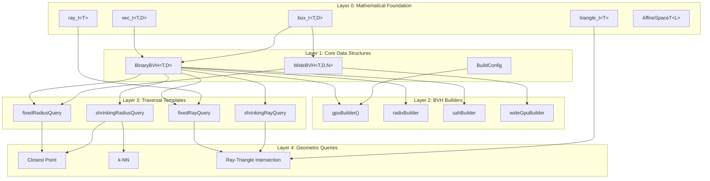
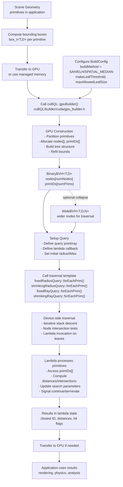

<!-- source: DeepWiki mcp.deepwiki.com · repo NVIDIA/cuBQL · page 3 Architecture · fetched 2026-10-26 -->

# Architecture

<details>
<summary>Relevant source files</summary>

The following files were used as context for generating this wiki page:

- [README.md](README.md)
- [cuBQL/bvh.h](cuBQL/bvh.h)

</details>


## Purpose and Scope

This document provides a high-level overview of cuBQL's architectural organization, explaining how the library's major components are structured and how they interact. It covers the four-layer design philosophy, the separation between construction and traversal pipelines, and the overall data flow through the system.

For detailed information about specific aspects of the architecture:
- Layer-by-layer component details: see [Four-Layer Design](#3.1)
- Template parameterization and type aliases: see [Type System and Templates](#3.2)
- CUDA-specific integration patterns: see [CUDA Integration](#3.3)

---

## Four-Layer Architecture Overview

cuBQL is organized into four distinct functional layers, each building upon the previous one. This separation enables modularity and allows users to work at the abstraction level appropriate for their needs.

### Layer Diagram



**Sources:** [README.md:30-61](), [cuBQL/bvh.h:1-161]()

### Layer Descriptions

| Layer | Purpose | Key Components | Location |
|-------|---------|----------------|----------|
| **Layer 0: Mathematical Foundation** | Provides template-based geometric primitives that work on both CPU and GPU | `vec_t<T,D>`, `box_t<T,D>`, `ray_t<T>`, `triangle_t<T>`, `LinearSpace<T,D>`, `AffineSpaceT<L>` | `cuBQL/math/` |
| **Layer 1: Core Data Structures** | Defines BVH storage formats and build configuration | `BinaryBVH<T,D>`, `WideBVH<T,D,N>`, `BuildConfig` | `cuBQL/bvh.h` |
| **Layer 2: BVH Builders** | Implements GPU-accelerated construction algorithms | `gpuBuilder()`, `radixBuilder`, `sahBuilder`, `rebinRadixBuilder`, `wideGpuBuilder` | `cuBQL/builder/cuda/` |
| **Layer 3: Traversal Templates** | Provides generic query patterns customizable via lambdas | `fixedRadiusQuery`, `shrinkingRadiusQuery`, `fixedRayQuery`, `shrinkingRayQuery` | `cuBQL/traversal/` |
| **Layer 4: Geometric Queries** | Concrete query implementations as usage examples | Closest point, k-NN, ray-triangle intersection | `cuBQL/queries/` |

**Sources:** [README.md:30-61](), [cuBQL/bvh.h:1-161]()

---

## Construction and Traversal Separation

cuBQL separates BVH construction from traversal, allowing BVHs to be built once and queried many times with different query types. This design improves performance for applications that perform multiple queries on static geometry.

### Construction and Traversal Pipeline Diagram

```mermaid
graph LR
    subgraph Construction["Construction Pipeline (GPU)"]
        direction TB
        InputBoxes["box_t&lt;T,D&gt;* boxes<br/>numPrims"]
        Config["BuildConfig<br/>buildMethod, makeLeafThreshold"]
        
        InputBoxes --> Dispatcher["gpuBuilder()<br/>cuBQL/builder/cuda/gpu_builder.h"]
        Config --> Dispatcher
        
        Dispatcher --> AlgoSelect{Algorithm<br/>Selection}
        
        AlgoSelect -->|"SAH"| SAH["sahBuilder<br/>SAH bins & splits"]
        AlgoSelect -->|"ELH"| ELH["elhBuilder<br/>edge-length heuristic"]
        AlgoSelect -->|"SPATIAL_MEDIAN"| Radix["radixBuilder<br/>morton codes"]
        
        SAH --> BVHOut["BinaryBVH&lt;T,D&gt;<br/>nodes[], primIDs[]"]
        ELH --> BVHOut
        Radix --> BVHOut
        
        BVHOut -.optional.-> Wide["collapse to<br/>WideBVH&lt;T,D,N&gt;"]
    end
    
    subgraph Traversal["Traversal Pipeline (Device)"]
        direction TB
        BVHInput["BinaryBVH or WideBVH"]
        QueryParams["Query parameters<br/>point/ray, radius/tMax"]
        UserLambda["User lambda<br/>custom per-primitive logic"]
        
        BVHInput --> Template["Traversal Template<br/>fixedRadiusQuery::forEachPrim()<br/>shrinkingRadiusQuery::forEachPrim()<br/>fixedRayQuery::forEachPrim()"]
        QueryParams --> Template
        UserLambda --> Template
        
        Template --> Stack["Stack-based<br/>iterative descent"]
        Stack --> Test["Intersection<br/>test"]
        Test -->|"Inner node"| Push["Push children"]
        Test -->|"Leaf"| Invoke["Invoke lambda<br/>on primIDs[]"]
        
        Push --> Stack
        Invoke --> Decision{Lambda<br/>returns}
        Decision -->|"continue"| Stack
        Decision -->|"terminate"| Results["Results in<br/>lambda state"]
    end
    
    BVHOut --> BVHInput
    Wide --> BVHInput
```



**Sources:** [cuBQL/bvh.h:15-51](), [README.md:106-169](), [README.md:193-248]()

### Construction Pipeline

The construction pipeline accepts an array of bounding boxes (one per primitive) and produces a `BinaryBVH` or `WideBVH` structure:

1. **Input**: Array of `box_t<T,D>` in device or managed memory [cuBQL/bvh.h:63]()
2. **Configuration**: `BuildConfig` specifies algorithm and parameters [cuBQL/bvh.h:18-51]()
3. **Dispatch**: `gpuBuilder()` selects appropriate builder based on `BuildConfig::buildMethod` [cuBQL/bvh.h:19-37]()
4. **Construction**: Specialized builders create BVH structure
5. **Output**: Populated `BinaryBVH::nodes[]` and `BinaryBVH::primIDs[]` arrays [cuBQL/bvh.h:96-99]()

**Sources:** [README.md:123-169](), [cuBQL/bvh.h:18-51]()

### Traversal Pipeline

The traversal pipeline operates on a constructed BVH using user-provided lambdas:

1. **Input**: Constructed BVH, query parameters (point/ray, radius/tMax), user lambda
2. **Template Selection**: Choose traversal pattern (fixed vs shrinking, radius vs ray)
3. **Iterative Descent**: Stack-based tree traversal with intersection tests
4. **Lambda Invocation**: User callback processes primitives at leaf nodes
5. **Early Termination**: Lambda can signal termination or continue searching
6. **Results**: Accumulated in lambda-captured state variables

**Sources:** [README.md:193-248]()

---

## Data Flow Through the System

The following diagram illustrates how data flows from input geometry through construction, optional optimization, querying, and result extraction.

### End-to-End Data Flow Diagram



**Sources:** [README.md:123-169](), [README.md:193-248](), [cuBQL/bvh.h:1-161]()

### Key Data Structures in Flow

| Stage | Data Structure | Memory Location | Description |
|-------|----------------|-----------------|-------------|
| Input | `box_t<T,D>*` | Device or Managed | Array of primitive bounding boxes [cuBQL/bvh.h:63]() |
| Build Config | `BuildConfig` | Host | Algorithm selection and parameters [cuBQL/bvh.h:18-51]() |
| Construction Output | `BinaryBVH<T,D>` | Device | Binary tree with `nodes[]` and `primIDs[]` [cuBQL/bvh.h:58-100]() |
| Optional Output | `WideBVH<T,D,N>` | Device | N-ary tree collapsed from binary [cuBQL/bvh.h:104-134]() |
| Query Input | `vec_t<T,D>` or `ray_t<T>` | Device | Query origin and parameters |
| Query Logic | User lambda | Device | Callback function processing primitives |
| Query Output | Lambda state | Device | Results captured by lambda |

**Sources:** [cuBQL/bvh.h:18-134]()

---

## Key Design Principles

### Separation of Concerns

cuBQL's architecture enforces clear boundaries between layers:

- **Mathematical types** are independent of BVH structures
- **BVH data structures** are independent of construction algorithms
- **Builders** produce standardized BVH formats without knowledge of query patterns
- **Traversal templates** operate on BVH structures without knowledge of specific geometric operations
- **Geometric queries** combine traversal templates with domain-specific logic

This separation allows users to:
- Mix and match builders with traversal patterns
- Create custom queries without modifying core library code
- Use the same BVH for multiple query types

**Sources:** [README.md:30-61](), [README.md:193-221]()

### Template-Based Genericity

The entire library is built on C++ templates parameterized by:

- **T (scalar type)**: `float`, `double`, `int32_t`, `int64_t`, etc.
- **D (dimensionality)**: 2, 3, 4, or higher dimensions
- **N (BVH width)**: 4, 8, 16 children per node (for `WideBVH`)

This enables:
- Single implementation supporting multiple precision levels
- Same code for 2D, 3D, and higher-dimensional spaces
- Compile-time optimization for specific instantiations

Common type aliases reduce verbosity: `bvh3f` = `BinaryBVH<float,3>`, `vec3f` = `vec_t<float,3>`, `box3f` = `box_t<float,3>`.

**Sources:** [cuBQL/bvh.h:58-144](), [README.md:69-83]()

### Lambda-Based Customization

Traversal templates accept user-provided lambdas that define per-primitive operations. This pattern enables:

- **Code reuse**: Same traversal logic for different geometric operations
- **Performance**: Lambdas inline during compilation, avoiding function call overhead
- **Flexibility**: Users can capture local state, implement custom logic, and control termination

Example pattern from `shrinkingRadiusQuery`:
```cpp
auto lambda = [&closestDist, &closestID](int primID) -> float {
    // Custom per-primitive logic
    // Return new search radius
};
cuBQL::shrinkingRadiusQuery::forEachPrim(lambda, queryPoint, bvh, ...);
```

**Sources:** [README.md:223-248]()

### CPU/GPU Code Sharing

The `__cubql_both` macro (defined as `__host__ __device__` when compiling with CUDA) enables single-source code that executes on both CPU and GPU. Mathematical types, BVH structures, and traversal templates use this pattern extensively.

**Sources:** [cuBQL/bvh.h:9-11]()

### Header-Only Option with Pre-Built Targets

cuBQL supports two usage patterns:

1. **Header-only mode**: Define `CUBQL_GPU_BUILDER_IMPLEMENTATION=1` in one translation unit
2. **Pre-built libraries**: Link against targets like `cuBQL_cuda_float3` for specific instantiations

This flexibility allows users to control compilation flags, CUDA architectures, and link-time optimization while maintaining ease of integration.

**Sources:** [README.md:182-192](), [README.md:319-367]()

---

