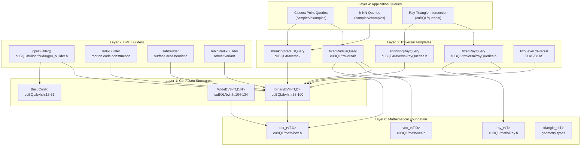
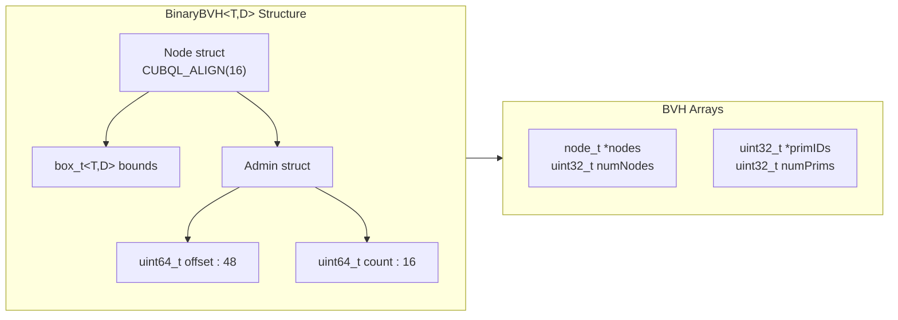
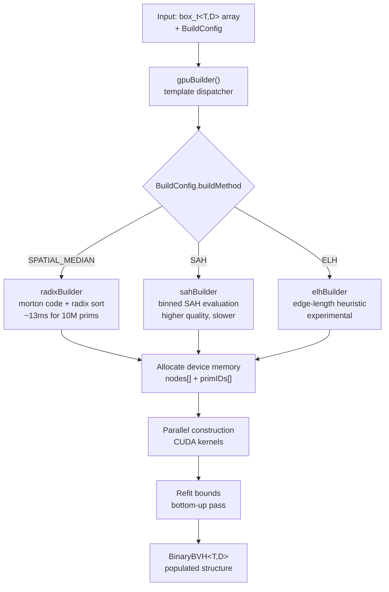
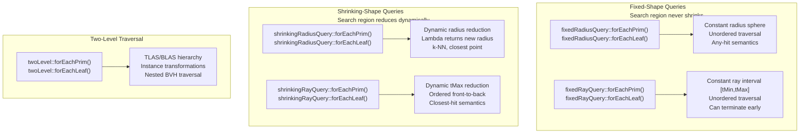
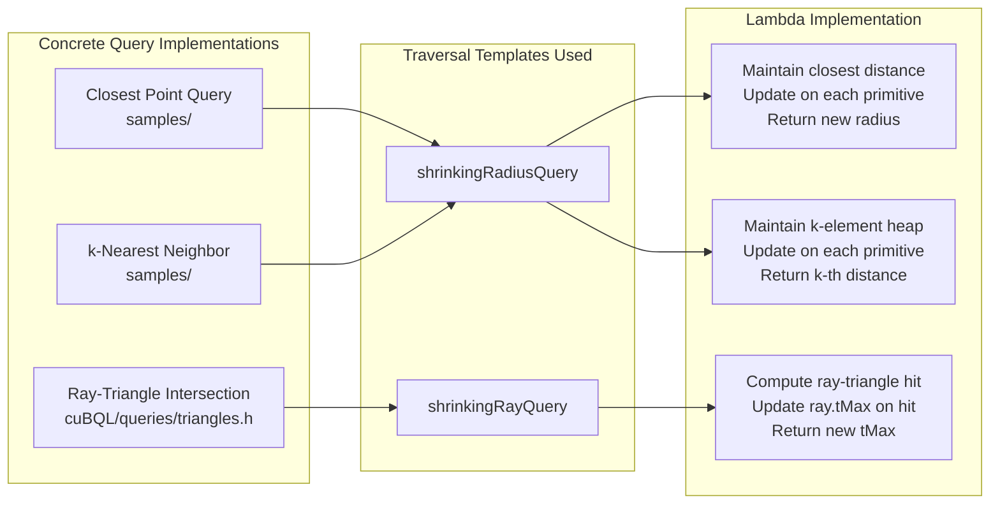
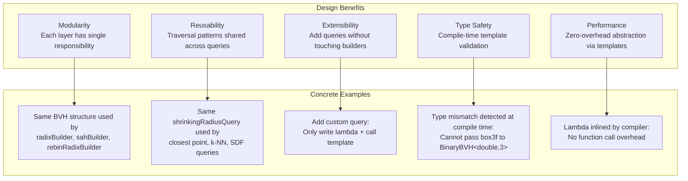
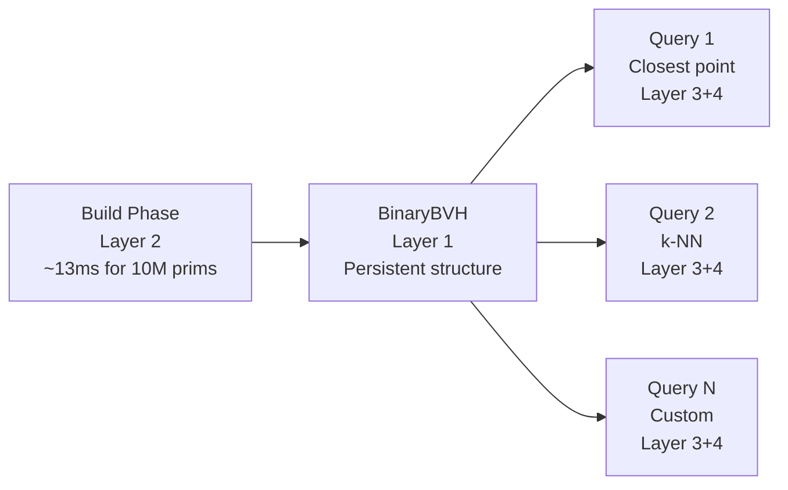

<!-- source: DeepWiki mcp.deepwiki.com · repo NVIDIA/cuBQL · page 3.1 Four-Layer Design · fetched 2026-10-26 -->

# Four-Layer Design

<details>
<summary>Relevant source files</summary>

The following files were used as context for generating this wiki page:

- [README.md](README.md)
- [cuBQL/bvh.h](cuBQL/bvh.h)
- [cuBQL/traversal/rayQueries.h](cuBQL/traversal/rayQueries.h)

</details>


## Purpose and Scope

This document explains cuBQL's architectural organization into four distinct layers, detailing the responsibilities, dependencies, and code entities within each layer. The design enables modularity through clear separation of concerns, allowing users to build custom queries without modifying lower-level components.

For information about specific template parameterization and type aliases, see [Type System and Templates](#3.2). For CUDA-specific execution model details, see [CUDA Integration](#3.3).

## Architecture Overview

cuBQL implements a hierarchical four-layer architecture (with a foundational Layer 0) where each layer builds upon the abstractions provided by lower layers. This separation enables:

- **Reusability**: Core data structures and traversal patterns work across different query types
- **Extensibility**: New queries can be added without modifying BVH construction code
- **Type flexibility**: Template-based design supports multiple scalar types and dimensionalities
- **Performance**: Compile-time specialization eliminates runtime overhead



**Sources**: README.md:30-60, cuBQL/bvh.h, cuBQL/traversal/rayQueries.h

## Layer 0: Mathematical Foundation

The mathematical foundation layer provides template-based geometric primitives that work uniformly on CPU and GPU via the `__cubql_both` macro. These types form the basis for all spatial operations in higher layers.

### Core Mathematical Types

| Type | Purpose | Template Parameters | Key File |
|------|---------|-------------------|----------|
| `vec_t<T,D>` | Generic vectors | T=scalar type, D=dimensions | cuBQL/math/vec.h |
| `box_t<T,D>` | Axis-aligned bounding boxes | T=scalar type, D=dimensions | cuBQL/math/box.h |
| `ray_t<T>` | Ray representation | T=scalar type (3D assumed) | cuBQL/math/Ray.h |
| `triangle_t<T>` | Triangle geometry | T=scalar type | cuBQL/queries/triangles.h |
| `AffineSpaceT<L>` | Affine transformations | L=LinearSpace type | cuBQL/math/AffineSpace.h |

### Type Aliases for Common Use Cases

The library provides concrete type aliases to reduce verbosity:

```cpp
// From cuBQL/bvh.h:142-143
using bvh3f = BinaryBVH<float,3>;
using bvh3d = BinaryBVH<double,3>;

// Common vector types: vec2f, vec3f, vec4f, vec2d, vec3d, vec4d
// Common box types: box3f, box3d
// Common ray types: ray3f, Ray (alias for ray_t<float>)
```

All mathematical types support standard operations (addition, scalar multiplication, dot/cross products for vectors, intersection tests for boxes, etc.) and are designed for efficient GPU execution.

**Sources**: cuBQL/math/vec.h, cuBQL/math/box.h, cuBQL/math/Ray.h, cuBQL/bvh.h:142-143

## Layer 1: Core Data Structures

Layer 1 defines BVH storage formats and configuration parameters. These structures are generic containers that make no assumptions about construction or traversal algorithms.

### BinaryBVH Structure

The primary BVH type is `BinaryBVH<T,D>`, defined in [cuBQL/bvh.h:58-100](). Each node contains:



**Node Admin Field Semantics** ([cuBQL/bvh.h:72-89]()):
- **Inner nodes**: `count == 0`, `offset` indexes into `nodes[]` array. Children at `nodes[offset+0]` and `nodes[offset+1]`.
- **Leaf nodes**: `count > 0`, `offset` indexes into `primIDs[]` array. Contains `primIDs[offset]` through `primIDs[offset+count-1]`.

The design uses a single `uint64_t` for both fields to enable atomic read/write operations during construction.

### WideBVH Structure

`WideBVH<T,D,N>` ([cuBQL/bvh.h:104-134]()) stores N-ary trees with fixed branching factor `N`:

```cpp
template<typename T, int D, int N>
struct WideBVH {
    struct Node {
        struct Child {
            box_t<T,D> bounds;
            uint64_t valid  :  1;  // Is this child slot used?
            uint64_t offset : 45;  // Index into nodes[] or primIDs[]
            uint64_t count  : 16;  // Prim count if leaf, 0 if inner
        } children[N];  // Fixed-size array
    };
    
    Node *nodes;        // Multi-node array
    uint32_t numNodes;  // Count of N-wide nodes
    uint32_t *primIDs;
    uint32_t numPrims;
};
```

Wide BVHs are typically created by collapsing binary BVHs, improving cache efficiency and SIMD utilization during traversal.

### BuildConfig

`BuildConfig` ([cuBQL/bvh.h:18-51]()) controls builder behavior:

| Field | Type | Purpose | Default |
|-------|------|---------|---------|
| `buildMethod` | enum | Algorithm selection: SPATIAL_MEDIAN, SAH, ELH | SPATIAL_MEDIAN |
| `maxAllowedLeafSize` | int | Maximum primitives per leaf | 32768 |
| `makeLeafThreshold` | int | Force leaf creation below this count (0=auto) | 0 |

**Sources**: cuBQL/bvh.h:18-134, README.md:64-98

## Layer 2: BVH Builders

The builder layer provides multiple construction algorithms with different speed/quality tradeoffs. All builders consume arrays of bounding boxes and produce populated BVH structures.

### Builder Dispatcher

The `gpuBuilder()` function ([cuBQL/builder/cuda/gpu_builder.h]()) acts as the primary interface:



### Builder Characteristics

| Builder | Algorithm | Build Speed | Query Quality | Use Case |
|---------|-----------|-------------|---------------|----------|
| `radixBuilder` | Morton code spatial median | Fast (~13ms/10M) | Good | General purpose |
| `sahBuilder` | Surface area heuristic | Slow | Excellent | Ray tracing |
| `rebinRadixBuilder` | Robust spatial median | Medium | Good | Numerically challenging data |
| `wideGpuBuilder` | N-ary construction | Medium | Good | Wide BVH output |

All builders properly handle invalid primitives (boxes where `lower.x > upper.x`) by excluding them from the BVH structure ([README.md:154-162]()).

### Memory Management

Builders accept an optional `GpuMemoryResource` parameter to control allocation strategy:
- Default: Standard `cudaMalloc`/`cudaFree`
- Managed memory: `cudaMallocManaged`
- Async allocation: Stream-ordered memory pools

**Sources**: cuBQL/builder/cuda/gpu_builder.h, README.md:106-169, cuBQL/bvh.h:18-51

## Layer 3: Traversal Templates

Traversal templates implement generic BVH descent algorithms that accept user-provided lambda functions to customize per-primitive processing. This enables a single traversal implementation to support multiple query types.

### Template Categories



### Traversal Stack-Based Implementation

All templates use iterative stack-based descent ([cuBQL/traversal/rayQueries.h:255-315]()):

```cpp
// Simplified structure from fixedRayQuery::forEachLeaf
typename node_t::Admin traversalStack[64], *stackPtr = traversalStack;
typename node_t::Admin node = bvh.nodes[0].admin;

while (true) {
    // Descend through inner nodes
    while (node.count == 0) {  // Inner node
        // Test both children, push to stack if needed
        if (intersects(child0)) {
            if (intersects(child1))
                *stackPtr++ = child1.admin;  // Push deferred child
            node = child0.admin;
        } else if (intersects(child1)) {
            node = child1.admin;
        } else {
            break;  // Dead end
        }
    }
    
    // Process leaf
    if (node.count != 0)
        lambdaResult = lambda(bvh.primIDs + node.offset, node.count);
    
    // Pop next node
    if (stackPtr == traversalStack) return;
    node = *--stackPtr;
}
```

### Lambda Function Contracts

| Template | Lambda Signature | Return Value | Purpose |
|----------|-----------------|--------------|---------|
| Fixed radius (prim) | `int operator()(uint32_t primID)` | `CUBQL_CONTINUE_TRAVERSAL` or `CUBQL_TERMINATE_TRAVERSAL` | Test single primitive |
| Fixed radius (leaf) | `int operator()(const uint32_t* prims, size_t count)` | Continue/terminate | Process leaf batch |
| Shrinking radius | `float operator()(uint32_t primID)` | New search radius | Update search distance |
| Shrinking ray | `float operator()(uint32_t primID)` | New `ray.tMax` | Update ray interval |

### Two-Level Traversal

Two-level queries ([cuBQL/traversal/rayQueries.h:97-147, 440-651]()) require three lambdas:

```cpp
shrinkingRayQuery::twoLevel::forEachPrim(
    enterBlas,    // Transform ray into instance space, return BLAS
    leaveBlas,    // Restore state after BLAS traversal
    intersectPrim, // Per-primitive intersection test
    tlas,         // Top-level BVH
    ray           // Ray reference (modified by enterBlas)
);
```

The traversal saves/restores ray state when transitioning between TLAS and BLAS levels, enabling correct handling of instance transformations.

**Sources**: cuBQL/traversal/rayQueries.h:18-651, README.md:193-247

## Layer 4: Application Queries

Application-level queries combine traversal templates with specific geometric operations. These serve primarily as examples and can be customized or replaced.

### Example Query Implementations



### Closest Point Query Pattern

```cpp
// Conceptual example from README.md:254-266
void findClosestPoint(bvh3f bvh, vec3f* points, vec3f queryPoint) {
    float closestDist = INFINITY;
    int   closestID   = -1;
    
    auto lambda = [&](uint32_t primID) -> float {
        float dist = distance(queryPoint, points[primID]);
        if (dist < closestDist) {
            closestDist = dist;
            closestID = primID;
        }
        return closestDist;  // New search radius
    };
    
    shrinkingRadiusQuery::forEachPrim(lambda, queryPoint, bvh, ...);
}
```

The same pattern works for:
- Point-to-triangle distance (different distance function)
- Different scalar types (`float`, `double`)
- Different dimensionalities (2D, 3D, 4D)

**Sources**: README.md:254-280, cuBQL/queries/triangles.h

## Separation of Concerns and Benefits

### Architectural Advantages



### Layer Independence

Each layer can evolve independently:

- **Layer 0**: Add new mathematical primitives (e.g., oriented bounding boxes) without affecting BVH structures
- **Layer 1**: Modify BVH node layout for better alignment without changing builders or traversal
- **Layer 2**: Implement new build algorithms (e.g., LBVH, HLBVH) without modifying traversal code
- **Layer 3**: Add specialized traversal patterns (e.g., frustum culling) without changing queries
- **Layer 4**: Create application-specific queries without touching library internals

### Build Once, Query Many Times

The separation between Layers 2 and 3 enables efficient workflows ([README.md:102-169]()):



A single BVH construction supports unlimited queries of any type, amortizing build costs across many operations.

**Sources**: README.md:30-60, 193-247, cuBQL/bvh.h, cuBQL/traversal/rayQueries.h

## Summary

cuBQL's four-layer architecture separates concerns across:

1. **Layer 0 (Math)**: Generic, dimension-agnostic geometric primitives
2. **Layer 1 (Data)**: Type-parameterized BVH storage formats
3. **Layer 2 (Build)**: Multiple construction algorithms with quality/speed tradeoffs
4. **Layer 3 (Traversal)**: Generic query patterns customizable via lambdas
5. **Layer 4 (Queries)**: Application-specific implementations as examples

This design enables users to leverage existing builders and traversal templates while implementing custom query logic, maintaining type safety and performance through C++ templates and compile-time specialization.

**Sources**: README.md:30-60, cuBQL/bvh.h, cuBQL/traversal/rayQueries.h, cuBQL/builder/cuda/gpu_builder.h

---

