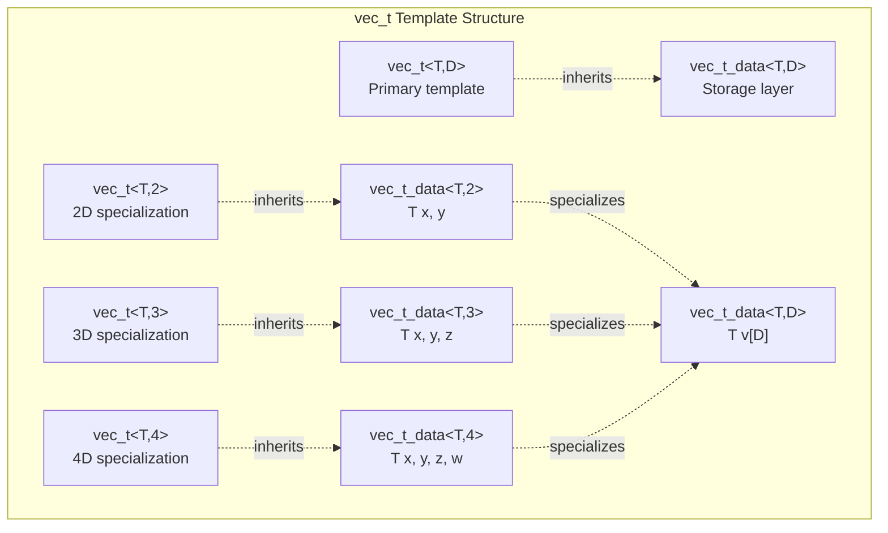
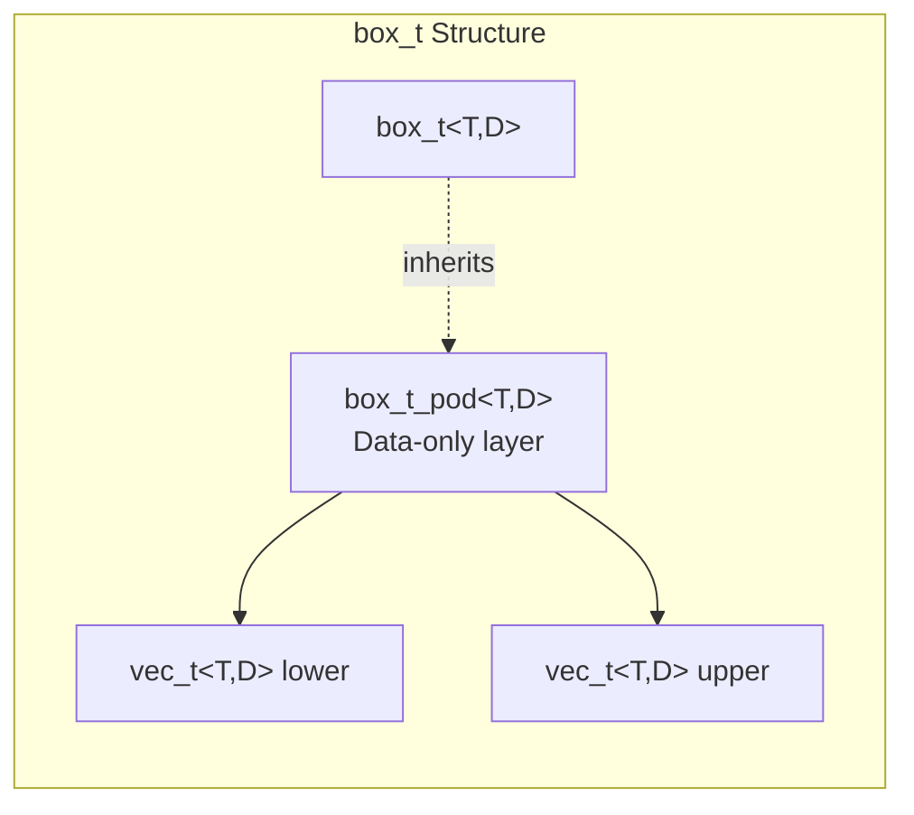
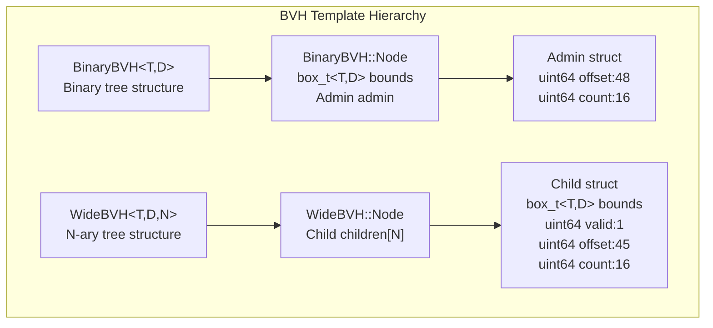
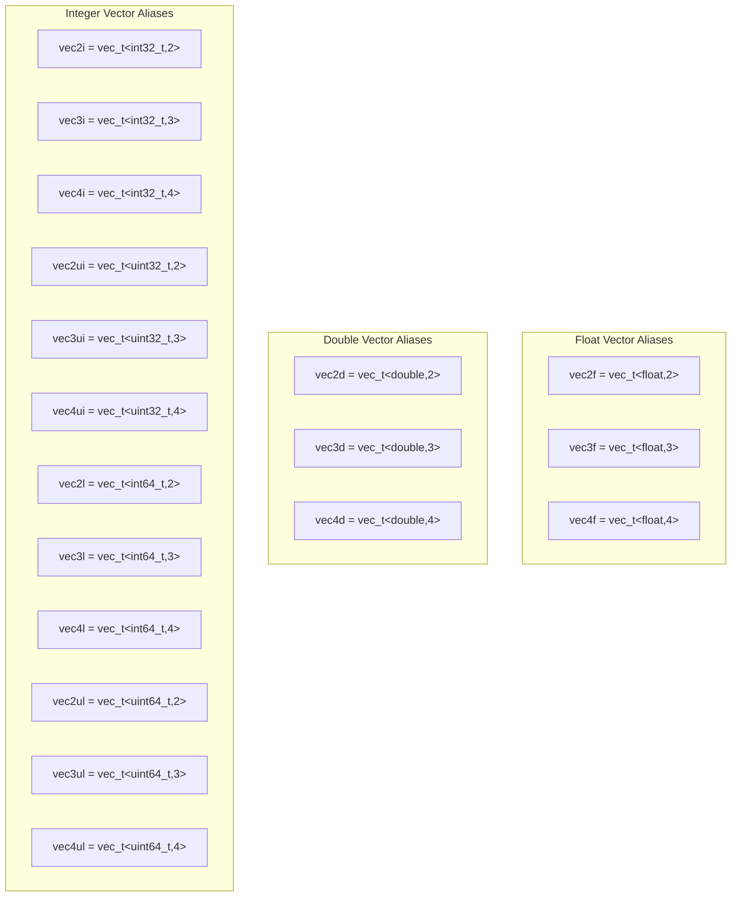
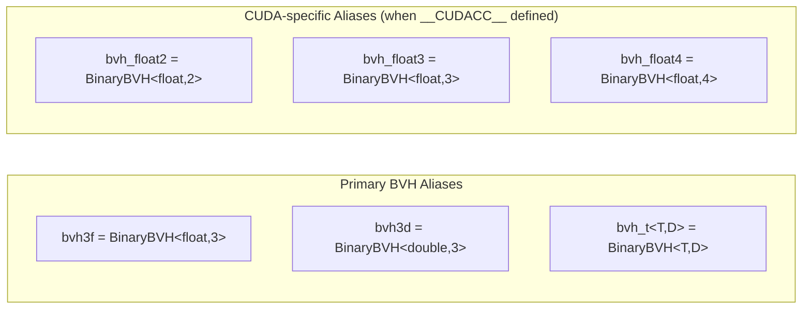
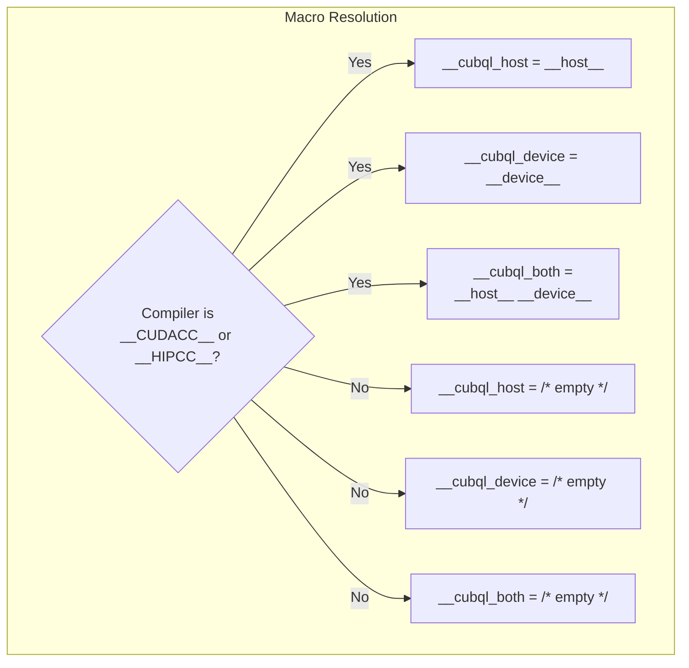
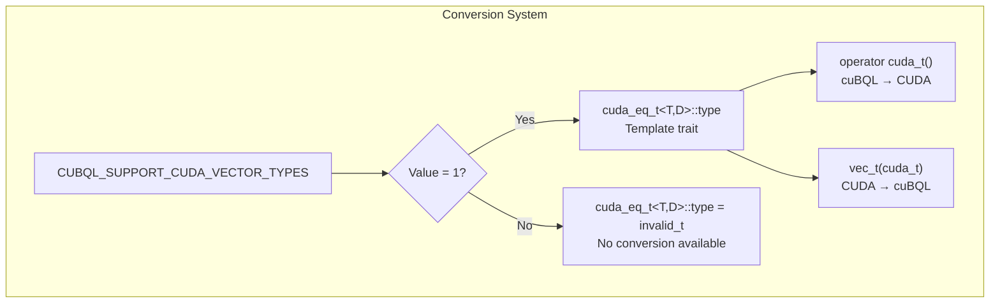
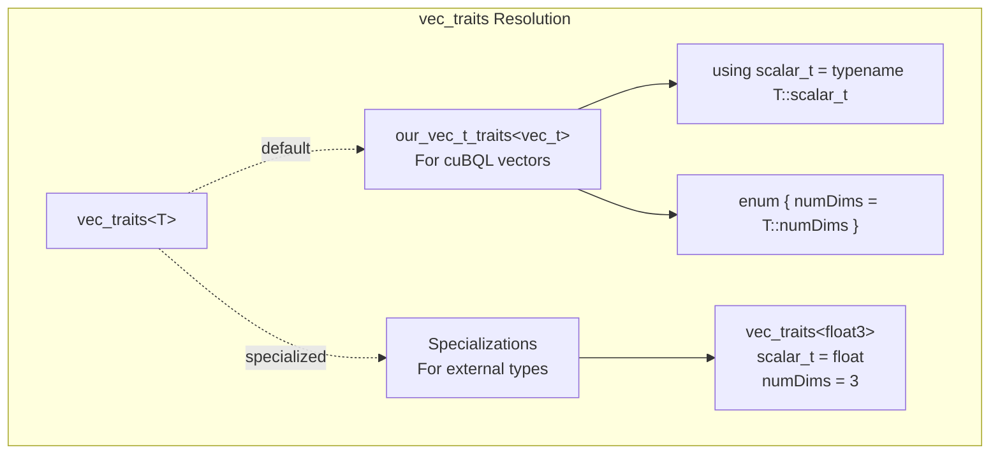

<!-- source: DeepWiki mcp.deepwiki.com · repo NVIDIA/cuBQL · page 3.2 Type System and Templates · fetched 2026-10-26 -->

# Type System and Templates

<details>
<summary>Relevant source files</summary>

The following files were used as context for generating this wiki page:

- [cuBQL/bvh.h](cuBQL/bvh.h)
- [cuBQL/math/box.h](cuBQL/math/box.h)
- [cuBQL/math/common.h](cuBQL/math/common.h)
- [cuBQL/math/vec.h](cuBQL/math/vec.h)

</details>


## Purpose and Scope

This page documents cuBQL's compile-time type system, which is built on C++ templates to provide flexible, type-safe spatial data structures that work across CPU and GPU. The system is parameterized by three primary axes: coordinate type (T), dimensionality (D), and BVH node width (N). This design enables users to instantiate BVH structures with different numeric precisions, spatial dimensions, and tree arities while maintaining a single codebase.

For details on how these types integrate with CUDA execution, see [CUDA Integration](#3.3). For the mathematical operations defined on these types, see [Mathematical Foundation](#4). For the BVH data structures built on this type system, see [Core Data Structures](#5).

---

## Template Parameterization Axes

cuBQL's type system is organized around three independent template parameters that control compile-time specialization:

| Parameter | Symbol | Common Values | Purpose |
|-----------|--------|---------------|---------|
| **Coordinate Type** | `T` | `float`, `double`, `int32_t`, `int64_t`, `uint32_t`, `uint64_t` | Determines numeric precision and range |
| **Dimensionality** | `D` | `2`, `3`, `4` (arbitrary positive integers supported) | Number of spatial dimensions |
| **BVH Width** | `N` | `4`, `8`, `16` | Number of children per node in wide BVHs |

### Coordinate Type (T)

The scalar type parameter controls both precision and performance characteristics:

- **Floating-point types** (`float`, `double`): Used for continuous spatial queries, ray tracing, and geometric operations requiring fractional coordinates
- **Integer types** (`int32_t`, `int64_t`): Used for grid-based structures, voxel representations, and exact arithmetic
- **Unsigned types** (`uint32_t`, `uint64_t`): Used for morton code computation and memory-efficient indexing

The type system handles type-specific behaviors through template specialization. For example, empty box initialization uses type-appropriate sentinel values: `+/-∞` for floating-point types, `INT_MAX/INT_MIN` for integers.

**Sources:** [cuBQL/math/vec.h:31-36](), [cuBQL/math/box.h:13-26]()

### Dimensionality (D)

The dimensionality parameter allows BVH construction in arbitrary dimensions:

- **2D** (`D=2`): Used for planar geometric queries, image processing, 2D collision detection
- **3D** (`D=3`): Most common case for 3D graphics, physics simulations, point clouds
- **4D and higher**: Supported for specialized applications (e.g., spacetime queries, high-dimensional embedding spaces)

Dimension-specific optimizations are provided through template specialization for `D=2,3,4` while maintaining generic implementations for arbitrary dimensions.

**Sources:** [cuBQL/math/vec.h:77-119](), [cuBQL/bvh.h:58-61]()

### BVH Width (N)

The node width parameter applies only to `WideBVH` structures and controls the branching factor:

- **Narrow trees** (`N=4`): Lower memory overhead, better cache locality for small working sets
- **Wide trees** (`N=8,16`): Better SIMD utilization, reduced tree depth, higher traversal throughput

Binary BVHs implicitly use `N=2` (represented by the `BinaryBVH` template, which does not expose N as a parameter).

**Sources:** [cuBQL/bvh.h:104-112]()

---

## Core Template Types

### Vector Type: `vec_t<T,D>`

The fundamental building block for spatial coordinates and directions.



**Key Design Elements:**

1. **Two-tier structure:** `vec_t_data<T,D>` provides storage, `vec_t<T,D>` adds operations and constructors
2. **Specialized storage for D=2,3,4:** Named fields (`x`, `y`, `z`, `w`) instead of array indexing for better code generation and debuggability
3. **Generic fallback:** Array-based storage `T v[D]` for arbitrary dimensions
4. **Component access:** Both array indexing `operator[]` and named accessors (`x`, `y`, `z`, `w`)

**Sources:** [cuBQL/math/vec.h:31-226]()

### Bounding Box Type: `box_t<T,D>`

Axis-aligned bounding boxes represented as pairs of corner vectors.



**Empty Box Semantics:**

Empty boxes are represented by having `lower > upper` in any dimension. Type-specific sentinel values are used:

- **Floating-point:** `lower = +∞`, `upper = -∞`
- **Integer:** `lower = TYPE_MAX`, `upper = TYPE_MIN`

This representation allows empty boxes to be detected with a single comparison and ensures that extending an empty box with any point produces the correct result.

**Sources:** [cuBQL/math/box.h:33-174]()

### BVH Types: `BinaryBVH<T,D>` and `WideBVH<T,D,N>`



**Key Characteristics:**

| Feature | BinaryBVH | WideBVH |
|---------|-----------|---------|
| Children per node | 2 (implicit) | N (template parameter) |
| Node alignment | 16 bytes | 16 bytes |
| Offset field width | 48 bits | 45 bits |
| Count field width | 16 bits | 16 bits |
| Max leaf size | 65,535 primitives | 65,535 primitives |

**Sources:** [cuBQL/bvh.h:58-134]()

---

## Type Aliases and Conventions

cuBQL provides convenient type aliases for common instantiations, reducing verbosity and standardizing usage patterns.

### Vector Type Aliases



**Naming Convention:** `vec{D}{type_suffix}` where:
- `D` = dimensionality (2, 3, or 4)
- `type_suffix` = `f` (float), `d` (double), `i` (int32), `ui` (uint32), `l` (int64), `ul` (uint64)

**Sources:** [cuBQL/math/vec.h:228-251]()

### Bounding Box Type Aliases

| Alias | Full Type | Description |
|-------|-----------|-------------|
| `box2f` | `box_t<float,2>` | 2D single-precision box |
| `box3f` | `box_t<float,3>` | 3D single-precision box |
| `box4f` | `box_t<float,4>` | 4D single-precision box |
| `box2d` | `box_t<double,2>` | 2D double-precision box |
| `box3d` | `box_t<double,3>` | 3D double-precision box |
| `box4d` | `box_t<double,4>` | 4D double-precision box |
| `box2i` | `box_t<int,2>` | 2D integer box |
| `box3i` | `box_t<int,3>` | 3D integer box |
| `box4i` | `box_t<int,4>` | 4D integer box |
| `box2l` | `box_t<long long,2>` | 2D 64-bit integer box |
| `box3l` | `box_t<long long,3>` | 3D 64-bit integer box |
| `box4l` | `box_t<long long,4>` | 4D 64-bit integer box |

**Sources:** [cuBQL/math/box.h:176-191]()

### BVH Type Aliases



**Most Common Alias:** `bvh3f` is the canonical type for 3D single-precision BVHs, used in the majority of examples and applications.

**Sources:** [cuBQL/bvh.h:137-149]()

---

## CUDA Integration and Cross-Compilation

### The `__cubql_both` Macro

cuBQL uses a unified macro system to enable single-source code that compiles for both CPU (host) and GPU (device):



**Usage Pattern:**

All fundamental operations (constructors, operators, mathematical functions) are declared with `__cubql_both`, enabling them to be called from:
- Host code (CPU-side)
- Device code (GPU kernels)
- Device-callable host code (when compiling with `nvcc`)

**Example from codebase:**

```cpp
inline __cubql_both vec_t(const T &t) { x = y = z = t; }
inline __cubql_both vec_t &grow(const vec_t &v) { /*...*/ }
inline __cubql_both bool overlaps(const box_t<T,D> &other) const { /*...*/ }
```

**Sources:** [cuBQL/math/common.h:84-95]()

### CUDA Vector Type Conversions

When `CUBQL_SUPPORT_CUDA_VECTOR_TYPES` is enabled (set to `1`), cuBQL provides automatic conversions between its vector types and CUDA's built-in vector types (`float2`, `float3`, `float4`, `int2`, etc.).



**Supported Conversions:**

| cuBQL Type | CUDA Type | Condition |
|------------|-----------|-----------|
| `vec_t<float,2>` | `float2` | Always when enabled |
| `vec_t<float,3>` | `float3` | Always when enabled |
| `vec_t<float,4>` | `float4` | Always when enabled |
| `vec_t<int,2>` | `int2` | Always when enabled |
| `vec_t<int,3>` | `int3` | Always when enabled |
| `vec_t<int,4>` | `int4` | Always when enabled |
| `vec_t<double,2>` | `double2` | Always when enabled |
| `vec_t<double,3>` | `double3` | Always when enabled |
| `vec_t<double,4>` | `double4` | Always when enabled |
| Other `vec_t<T,D>` | `invalid_t` | No conversion |

**Conversion Implementation:**

The conversion operators are implemented in the `vec_t_data` specializations for D=2,3,4:

```cpp
// Automatic conversion TO CUDA type
using cuda_t = typename cuda_eq_t<T,3>::type;
inline __cubql_both operator cuda_t() { 
    cuda_t t; 
    t.x = x; 
    t.y = y; 
    t.z = z; 
    return t; 
}

// Construction FROM CUDA type
inline __cubql_both vec_t(const cuda_t &o) 
{ this->x = (o.x); this->y = (o.y); this->z = (o.z); }
```

**dim3 Conversion:**

Vector types of dimensionality 2 and 3 can be automatically converted to CUDA's `dim3` type (used for kernel launch configurations):

```cpp
inline __cubql_both operator dim3() { 
    dim3 t; 
    t.x = x; 
    t.y = y; 
    t.z = z; 
    return t; 
}
```

This allows code like:
```cpp
vec3i blockDim(16, 16, 1);
myKernel<<<gridDim, blockDim>>>(...);  // Implicit conversion
```

**Sources:** [cuBQL/math/vec.h:27-29](), [cuBQL/math/vec.h:63-74](), [cuBQL/math/vec.h:82-105]()

### Host-Only CUDA Type Definitions

When compiling without CUDA (`__CUDACC__` not defined), cuBQL provides minimal stub definitions for CUDA vector types to maintain source compatibility:

```cpp
#ifndef __CUDACC__
struct float2 { float x, y; };
struct float3 { float x, y, z; };
struct CUBQL_ALIGN(16) float4 { float x, y, z, w; };
// ... similar for int2, int3, int4, double2, double3, double4
#endif
```

This enables code to be compiled and tested on CPU-only systems without CUDA toolkit installation.

**Sources:** [cuBQL/math/vec.h:49-61]()

---

## Type Traits and Metaprogramming

cuBQL uses C++ template metaprogramming to provide compile-time type introspection and selection.

### Vector Traits: `vec_traits<T>`

The `vec_traits` template provides compile-time information about vector-like types:



**Purpose:** Allows generic code to introspect vector properties without assuming the vector type is `vec_t<T,D>`.

**Example Usage:**
```cpp
template<typename VecType>
void processVector(VecType v) {
    using Scalar = typename vec_traits<VecType>::scalar_t;
    constexpr int Dims = vec_traits<VecType>::numDims;
    // ... generic code using Scalar and Dims
}
```

**Sources:** [cuBQL/math/vec.h:267-282]()

### Dot Product Result Type: `dot_result_t<T>`

To avoid integer overflow and maintain precision, the dot product operation uses a type promotion system:

| Input Scalar Type | Dot Product Result Type |
|-------------------|-------------------------|
| `float` | `float` |
| `double` | `double` |
| `int32_t` | `int64_t` |
| `long long int` | `int64_t` |

**Rationale:** Integer dot products can overflow when multiplying and summing components. Promoting to 64-bit integers prevents this for most practical cases.

**Implementation:**
```cpp
template<typename T> struct dot_result_t;
template<> struct dot_result_t<float> { using type = float; };
template<> struct dot_result_t<double> { using type = double; };
template<> struct dot_result_t<int32_t> { using type = int64_t; };
```

**Sources:** [cuBQL/math/vec.h:546-560]()

### Real Number Detection: `is_real<T>`

Used to enable or disable certain operations (like normalization, distance computation) that only make sense for floating-point types:

```cpp
template<typename T> struct is_real { enum { value = false }; };
template<> struct is_real<float> { enum { value = true }; };
template<> struct is_real<double> { enum { value = true }; };
```

**Sources:** [cuBQL/math/common.h:296-298]()

---

## Template Instantiation Strategy

cuBQL uses explicit template instantiation in some compilation units to reduce compile times while maintaining flexibility for custom types.

**Key Types Pre-Instantiated:**

The library pre-compiles common instantiations in object files to avoid recompiling template code in every translation unit:

- `BinaryBVH<float,2>`, `BinaryBVH<float,3>`, `BinaryBVH<float,4>`
- `BinaryBVH<double,2>`, `BinaryBVH<double,3>`, `BinaryBVH<double,4>`
- Builder algorithms for these types
- Traversal templates for these types

**User-Defined Types:**

Users can still instantiate templates with custom types by including the header-only implementations. The library structure allows both:
1. **Pre-compiled library:** Fast linking for common types
2. **Header-only mode:** Full flexibility for custom type instantiations

For more details on custom type support and instantiation patterns, see [Template Instantiation](#9.3).

**Sources:** [cuBQL/bvh.h:145-149]()

---

## Summary Table: Complete Type Hierarchy

| Category | Template | Common Aliases | Purpose |
|----------|----------|----------------|---------|
| **Vectors** | `vec_t<T,D>` | `vec2f`, `vec3f`, `vec4f`, `vec3d`, `vec3i` | Spatial coordinates, directions |
| **Boxes** | `box_t<T,D>` | `box2f`, `box3f`, `box4f`, `box3d`, `box3i` | Axis-aligned bounding volumes |
| **Binary BVH** | `BinaryBVH<T,D>` | `bvh3f`, `bvh3d`, `bvh_t<T,D>` | Binary tree acceleration structure |
| **Wide BVH** | `WideBVH<T,D,N>` | *(no standard aliases)* | N-ary tree for SIMD optimization |
| **Rays** | `ray_t<T>` | `ray3f`, `Ray` | Ray geometry for intersection tests |
| **Triangles** | `triangle_t<T>` | `Triangle` | Triangle primitives |
| **Transforms** | `AffineSpaceT<L>` | *(various)* | Affine transformations |

**Sources:** [cuBQL/math/vec.h](), [cuBQL/math/box.h](), [cuBQL/bvh.h]()

---

