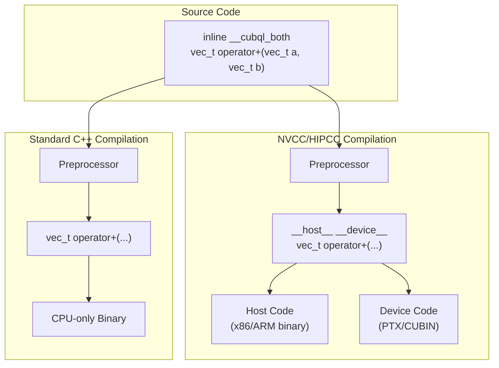
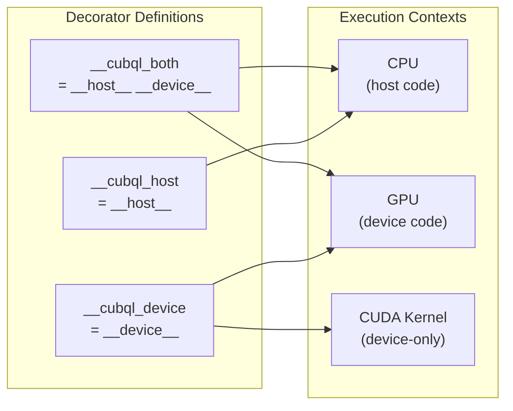
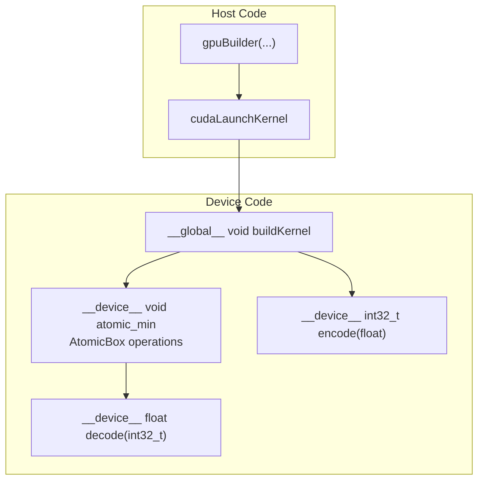
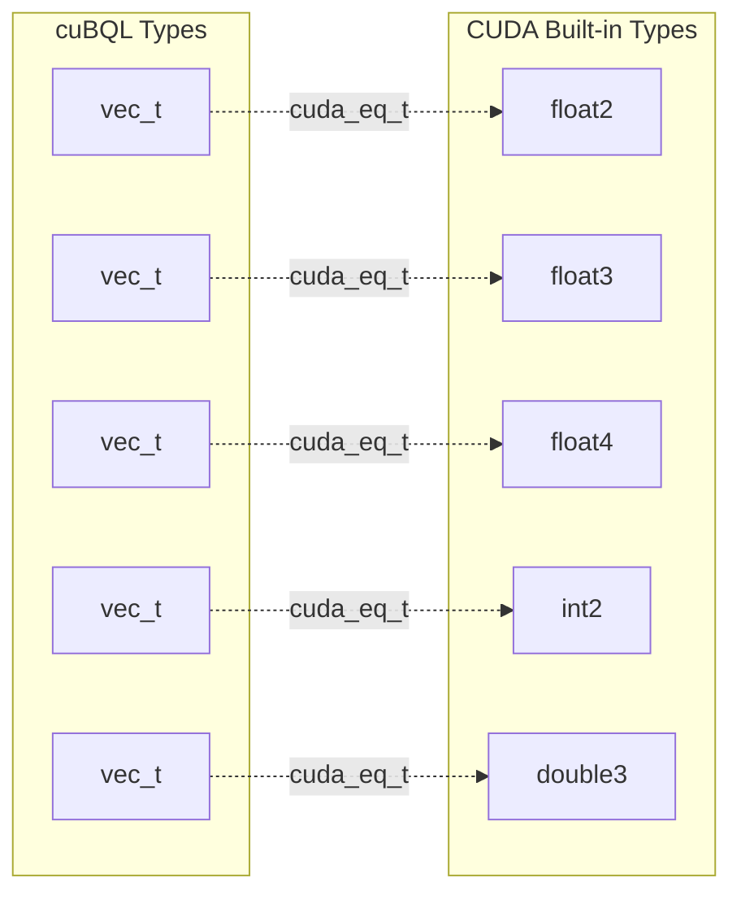
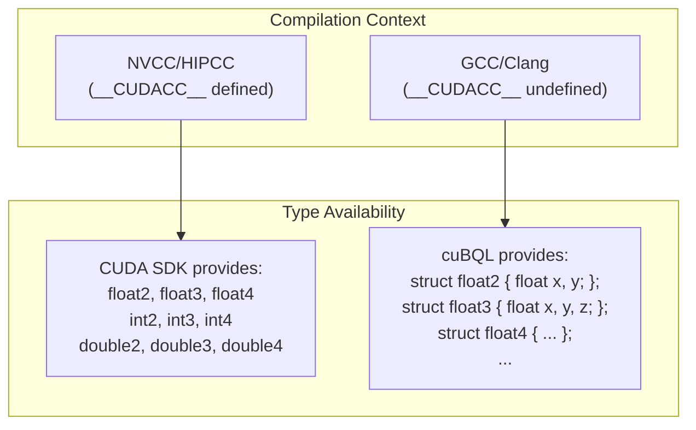
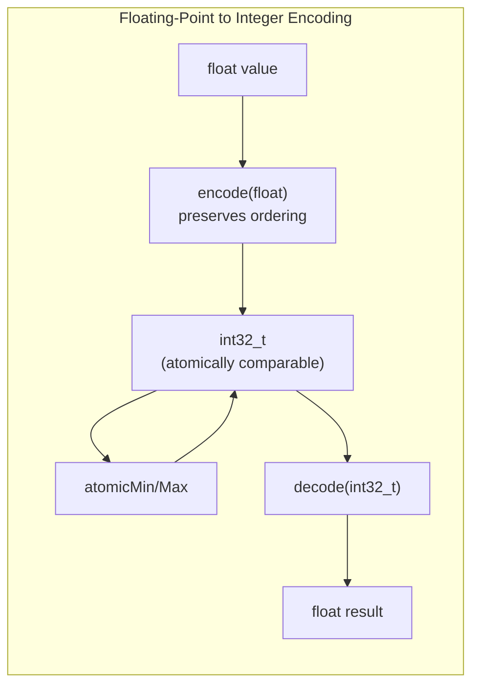
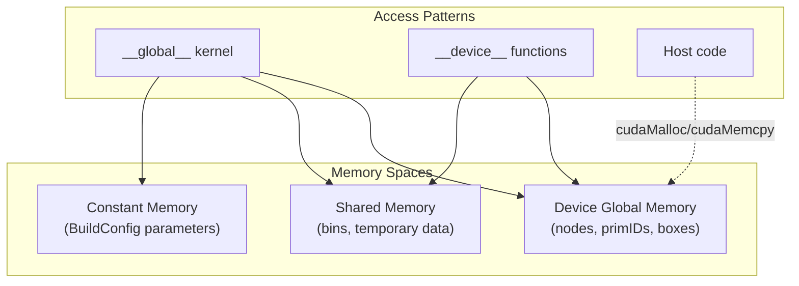
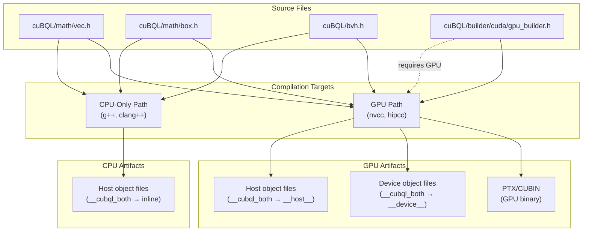

<!-- source: DeepWiki mcp.deepwiki.com · repo NVIDIA/cuBQL · page 3.3 CUDA Integration · fetched 2026-10-26 -->

# CUDA Integration

<details>
<summary>Relevant source files</summary>

The following files were used as context for generating this wiki page:

- [cuBQL/builder/cuda/builder_common.h](cuBQL/builder/cuda/builder_common.h)
- [cuBQL/math/box.h](cuBQL/math/box.h)
- [cuBQL/math/common.h](cuBQL/math/common.h)
- [cuBQL/math/vec.h](cuBQL/math/vec.h)

</details>


## Purpose and Scope

This document describes how cuBQL integrates with CUDA to enable single-source code that compiles for both CPU and GPU execution. It covers the `__cubql_both` macro for dual-target compilation, automatic conversions between cuBQL vector types and CUDA built-in types (float3, int4, etc.), and the execution model that allows the same mathematical primitives to run on host or device.

For information about the broader template-based type system, see [Type System and Templates](#3.2). For details on GPU memory management and builder kernels, see [GPU Builder Interface](#6.1).

---

## The `__cubql_both` Macro

The core of cuBQL's CUDA integration is the `__cubql_both` macro, which enables mathematical functions and data structures to compile for both CPU and GPU execution without code duplication.

### Macro Definition

The macro is conditionally defined based on the compiler:

```
__cubql_both = __host__ __device__   (when __CUDACC__ or __HIPCC__ defined)
__cubql_both = /* ignore */          (otherwise)
```

**Sources:** [cuBQL/math/common.h:84-95]()

### Single-Source Compilation Strategy

When compiling with `nvcc` or `hipcc`, the macro expands to `__host__ __device__`, instructing the compiler to generate code for both CPU and GPU targets. When compiling with a standard C++ compiler (e.g., g++, clang++), the macro expands to nothing, allowing the same source to compile as regular CPU code.



This strategy enables:
- Zero-overhead CPU execution for testing and non-GPU platforms
- GPU acceleration when CUDA/HIP is available
- No `#ifdef` clutter in mathematical code
- Compile-time verification that algorithms work on both targets

**Sources:** [cuBQL/math/common.h:84-95](), [cuBQL/math/vec.h:31-162]()

### Usage Patterns in the Codebase

The macro decorates:

| Code Category | Example | Location |
|--------------|---------|----------|
| Vector operations | `__cubql_both vec_t<T,D> operator+(vec_t<T,D> a, vec_t<T,D> b)` | [cuBQL/math/vec.h:355-391]() |
| Bounding box methods | `__cubql_both box_t &grow(const vec_t &v)` | [cuBQL/math/box.h:97-100]() |
| Geometric queries | `__cubql_both T reduce_max(vec_t<T,3> v)` | [cuBQL/math/vec.h:675-677]() |
| Utility functions | `__cubql_both int32_t divRoundUp(int32_t a, int32_t b)` | [cuBQL/math/common.h:197-200]() |

**Sources:** [cuBQL/math/vec.h:1-804](), [cuBQL/math/box.h:1-262](), [cuBQL/math/common.h:197-200]()

---

## Device and Host Execution Model

cuBQL distinguishes between three execution contexts through compiler-specific decorators:



### Decorator Semantics

| Decorator | CPU Callable | GPU Callable | Use Case |
|-----------|-------------|-------------|----------|
| `__cubql_both` | ✓ | ✓ | Math primitives, data structure methods |
| `__cubql_host` | ✓ | ✗ | Host-only APIs, file I/O, C++ standard library |
| `__cubql_device` | ✗ | ✓ | GPU-only operations, shared memory access |

**Sources:** [cuBQL/math/common.h:84-95]()

### Device-Only Code Patterns

Builder kernels and traversal operations use `__device__` (via `__cubql_device`) for GPU-exclusive code:



Examples of device-only functions:

| Function | Purpose | Location |
|----------|---------|----------|
| `atomic_min`, `atomic_max` | Lock-free bounding box updates | [cuBQL/builder/cuda/builder_common.h:20-36]() |
| `encode<T>`, `decode<T>` | Floating-point to integer conversion for atomics | [cuBQL/builder/cuda/builder_common.h:84-143]() |
| `atomic_grow` | Concurrent bounding box expansion | [cuBQL/builder/cuda/builder_common.h:248-294]() |

**Sources:** [cuBQL/builder/cuda/builder_common.h:20-143]()

---

## CUDA Vector Type Conversions

When `CUBQL_SUPPORT_CUDA_VECTOR_TYPES=1`, cuBQL vector types can automatically convert to and from CUDA's built-in vector types (`float2`, `float3`, `int4`, etc.).

### Conditional Compilation Flag

```cpp
#ifndef CUBQL_SUPPORT_CUDA_VECTOR_TYPES
#define CUBQL_SUPPORT_CUDA_VECTOR_TYPES 0
#endif
```

Default is disabled. Enable by defining this macro before including cuBQL headers or via compiler flags.

**Sources:** [cuBQL/math/vec.h:27-29]()

### Type Mapping System

The `cuda_eq_t` template maps cuBQL types to CUDA equivalents:



Implementation uses template specialization:

| cuBQL Type | CUDA Type | Specialization |
|------------|-----------|----------------|
| `vec_t<float,2>` | `float2` | [cuBQL/math/vec.h:65]() |
| `vec_t<float,3>` | `float3` | [cuBQL/math/vec.h:66]() |
| `vec_t<float,4>` | `float4` | [cuBQL/math/vec.h:67]() |
| `vec_t<int,2>` | `int2` | [cuBQL/math/vec.h:68]() |
| `vec_t<double,3>` | `double3` | [cuBQL/math/vec.h:72]() |

**Sources:** [cuBQL/math/vec.h:63-74]()

### Automatic Conversion Operators

cuBQL vectors provide implicit conversion operators when CUDA support is enabled:

#### vec_t to CUDA Type

Conversion operators embedded in `vec_t_data` specializations:

```cpp
// vec_t<T,3> can implicitly convert to float3/int3/double3
#if CUBQL_SUPPORT_CUDA_VECTOR_TYPES
using cuda_t = typename cuda_eq_t<T,3>::type;
inline __cubql_both operator cuda_t() { 
    cuda_t t; 
    t.x = x; 
    t.y = y; 
    t.z = z; 
    return t; 
}
#endif
```

**Sources:** [cuBQL/math/vec.h:102-105]()

#### CUDA Type to vec_t

Constructor accepting CUDA types:

```cpp
#if CUBQL_SUPPORT_CUDA_VECTOR_TYPES
inline __cubql_both vec_t(const cuda_t &o) 
{ this->x = o.x; this->y = o.y; this->z = o.z; }
#endif
```

**Sources:** [cuBQL/math/vec.h:182-183]()

#### Mixed Operations

Arithmetic operators support mixed cuBQL/CUDA types:

```cpp
// Enables: float3 + vec3f, vec3f * int3, etc.
template<typename T, int D>
inline __cubql_both
vec_t<T,D> operator+(typename cuda_eq_t<T,D>::type a, vec_t<T,D> b)
{
    vec_t<T,D> r;
    for (int i=0; i<D; i++) 
        r[i] = (&a.x)[i] + b[i];
    return r;
}
```

**Sources:** [cuBQL/math/vec.h:329-353]()

### dim3 Conversion for Kernel Launches

`vec_t<T,2>` and `vec_t<T,3>` can convert to CUDA's `dim3` type for kernel launch parameters:

```cpp
#ifdef __CUDACC__
inline __cubql_both operator dim3() { 
    dim3 t; 
    t.x = x; 
    t.y = y; 
    t.z = z; 
    return t; 
}
#endif
```

This enables idioms like:
```cpp
vec3i gridDim = computeGridDimensions();
myKernel<<<gridDim, blockDim>>>(args);  // vec3i implicitly converts to dim3
```

**Sources:** [cuBQL/math/vec.h:98-101]()

---

## Integration with CUDA Built-in Types

When not using `nvcc`/`hipcc`, cuBQL provides its own definitions of CUDA vector types to enable CPU compilation:



### Fallback Definitions

When `__CUDACC__` is not defined, cuBQL declares CUDA-compatible types:

| Type | Definition | Location |
|------|-----------|----------|
| `float2` | `struct float2 { float x, y; };` | [cuBQL/math/vec.h:50]() |
| `float3` | `struct float3 { float x, y, z; };` | [cuBQL/math/vec.h:51]() |
| `float4` | `struct CUBQL_ALIGN(16) float4 { float x, y, z, w; };` | [cuBQL/math/vec.h:52]() |
| `int2`, `int3`, `int4` | Similar patterns | [cuBQL/math/vec.h:54-56]() |
| `double2`, `double3`, `double4` | Similar patterns | [cuBQL/math/vec.h:58-60]() |

Alignment directives (`CUBQL_ALIGN(16)`) ensure memory layout matches CUDA's native types.

**Sources:** [cuBQL/math/vec.h:49-61]()

### Trait System for External Types

cuBQL provides `vec_traits<T>` to describe properties of external vector types:

```cpp
template<> struct vec_traits<float3> { 
    enum { numDims = 3 }; 
    using scalar_t = float; 
};
```

This allows CUDA's `float3` to participate in cuBQL's generic algorithms without modification.

**Sources:** [cuBQL/math/vec.h:280-282]()

---

## Atomic Operations for Concurrent GPU Updates

GPU builders use atomic operations for lock-free concurrent updates to bounding boxes. Since CUDA atomics only support integer types, cuBQL implements encoded arithmetic for floating-point values.

### Encoded Arithmetic Strategy



### Encoding Functions

Encoding preserves numeric ordering while converting to integers:

| Function | Purpose | Implementation Detail |
|----------|---------|----------------------|
| `encode<float>` | Float → int32_t | XOR sign bit if negative | [cuBQL/builder/cuda/builder_common.h:88-94]() |
| `encode<double>` | Double → int64_t | XOR sign bit if negative | [cuBQL/builder/cuda/builder_common.h:96-102]() |
| `decode<float>` | int32_t → Float | Reverse XOR operation | [cuBQL/builder/cuda/builder_common.h:124-129]() |
| `decode<double>` | int64_t → Double | Reverse XOR operation | [cuBQL/builder/cuda/builder_common.h:138-143]() |

**Sources:** [cuBQL/builder/cuda/builder_common.h:84-143]()

### AtomicBox Structure

The `AtomicBox<box_t>` structure stores bounding boxes in encoded form for atomic updates:

```cpp
template<typename box_t>
struct AtomicBox {
    typename int_type_of<scalar_t>::type lower[numDims];
    typename int_type_of<scalar_t>::type upper[numDims];
    
    inline __device__ void set_empty();
    inline __device__ box_t make_box() const;
};
```

Operations:
- `set_empty()`: Initialize to inverted bounds (encoded ±infinity)
- `make_box()`: Convert encoded integers back to `box_t`
- `get_lower(int)`, `get_upper(int)`: Decode individual bounds

**Sources:** [cuBQL/builder/cuda/builder_common.h:145-219]()

### Atomic Growth Operations

Multiple GPU threads can concurrently grow the same `AtomicBox`:

```cpp
template<typename box_t>
inline __device__ void atomic_grow(AtomicBox<box_t> &abox, const box_t &other)
{
    for (int d = 0; d < numDims; d++) {
        auto enc_lower = encode(other.get_lower(d));
        auto enc_upper = encode(other.get_upper(d));
        if (enc_lower < abox.lower[d]) atomic_min(&abox.lower[d], enc_lower);
        if (enc_upper > abox.upper[d]) atomic_max(&abox.upper[d], enc_upper);
    }
}
```

This pattern enables lock-free parallel bounding box computation during BVH construction.

**Sources:** [cuBQL/builder/cuda/builder_common.h:264-279]()

---

## Memory Space Decorators

cuBQL code accesses different GPU memory spaces depending on context:



### Global Memory

Primary storage for BVH data structures:
- Node arrays: `bvh.nodes`
- Primitive IDs: `bvh.primIDs`
- Input bounding boxes

Accessed from any kernel or device function via pointers.

### Shared Memory

Used for temporary per-block data in builder kernels:
- SAH binning histograms
- Local reduction results
- Cached frequently-accessed data

Declared with `__shared__` keyword within kernels.

### Device/Host Memory Management

The `GpuMemoryResource` abstraction (see [Memory Management](#9.1)) handles:
- `cudaMalloc` / `cudaFree` calls
- Stream-ordered allocations
- Managed memory support

**Sources:** [cuBQL/builder/cuda/builder_common.h:38-45]()

---

## Compilation Flow Summary



### Preprocessor Symbol Detection

cuBQL detects the compilation environment via:

| Symbol | Defined By | Indicates |
|--------|-----------|-----------|
| `__CUDACC__` | nvcc | NVIDIA CUDA compilation |
| `__HIPCC__` | hipcc | AMD HIP compilation |
| `__CUDA_ARCH__` | nvcc (device pass) | Device code generation |
| `CUBQL_SUPPORT_CUDA_VECTOR_TYPES` | User | Enable CUDA type conversions |

These control conditional compilation of CUDA-specific features.

**Sources:** [cuBQL/math/vec.h:10-29](), [cuBQL/math/common.h:27-33, 84-95]()

---

## Summary

cuBQL's CUDA integration provides:

1. **Single-source code**: `__cubql_both` macro enables mathematical operations on CPU and GPU from the same source
2. **Seamless type conversions**: Automatic conversion between cuBQL vectors and CUDA built-in types (`float3`, etc.)
3. **Device-optimized operations**: Atomic operations for lock-free concurrent updates during BVH construction
4. **Flexible compilation**: Same headers compile with standard C++ compilers or CUDA/HIP compilers

This architecture minimizes code duplication while enabling high-performance GPU execution when available.

**Sources:** [cuBQL/math/vec.h:1-804](), [cuBQL/math/common.h:1-420](), [cuBQL/builder/cuda/builder_common.h:1-303](), [cuBQL/math/box.h:1-262]()

---

