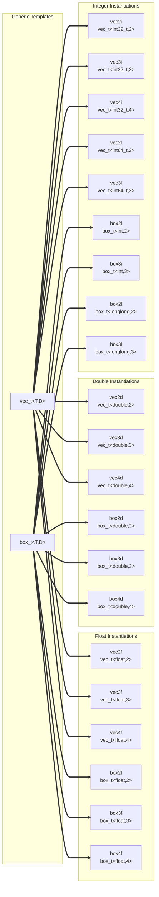
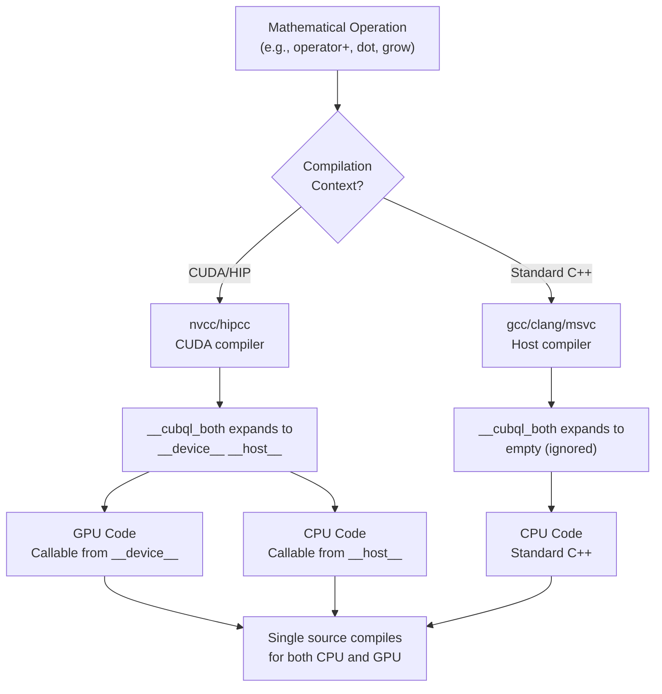
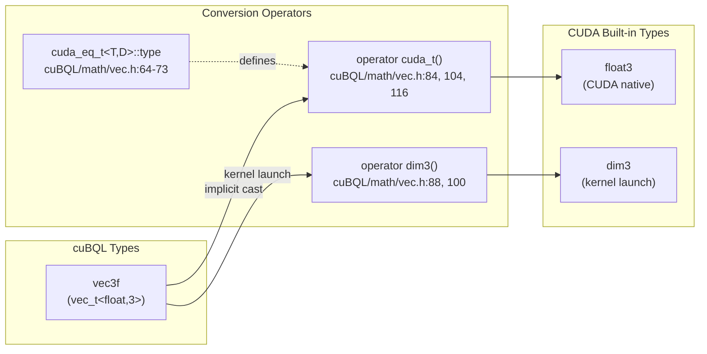
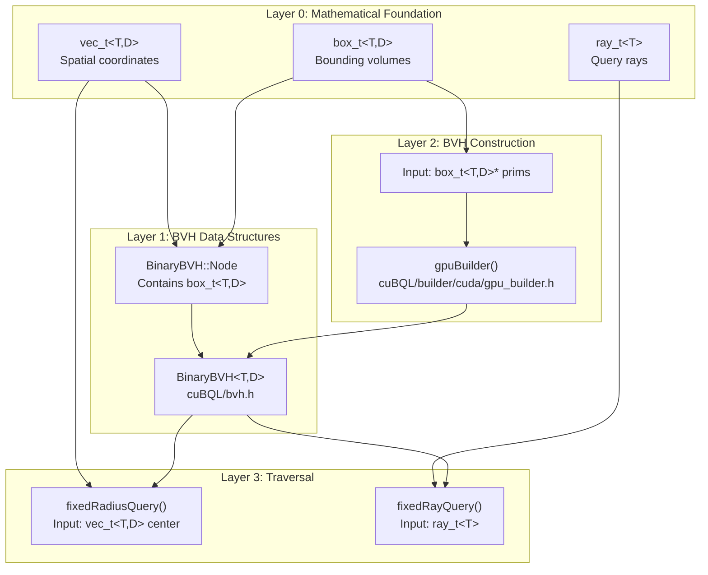
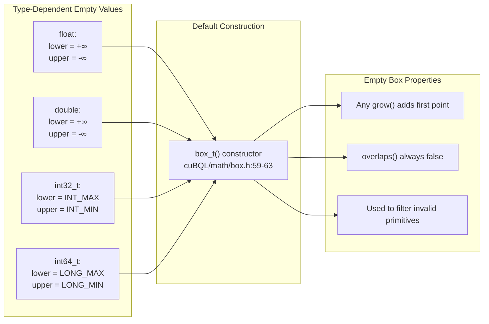

<!-- source: DeepWiki mcp.deepwiki.com · repo NVIDIA/cuBQL · page 4 Mathematical Foundation · fetched 2026-10-26 -->

# Mathematical Foundation

<details>
<summary>Relevant source files</summary>

The following files were used as context for generating this wiki page:

- [cuBQL/math/box.h](cuBQL/math/box.h)
- [cuBQL/math/common.h](cuBQL/math/common.h)
- [cuBQL/math/vec.h](cuBQL/math/vec.h)

</details>


## Purpose and Scope

The Mathematical Foundation layer (Layer 0) provides the fundamental mathematical primitives that underpin the entire cuBQL library. This page presents an overview of the template-based type system for vectors, bounding boxes, rays, and transformations that form the basis for all BVH operations.

For detailed documentation of specific types, see:
- Vector operations and arithmetic: [Vector Types (vec_t)](#4.1)
- Bounding box structures and operations: [Bounding Boxes (box_t)](#4.2)
- Ray structures and intersection utilities: [Rays (ray_t)](#4.3)
- Transformation matrices: [Linear and Affine Transformations](#4.4)

For how these types are used in BVH data structures, see [Core Data Structures](#5).

**Sources**: cuBQL/math/vec.h, cuBQL/math/box.h, cuBQL/math/common.h

---

## Core Mathematical Types

cuBQL's mathematical foundation consists of five primary template-based structures:

| Type | Template Signature | Purpose | Key Operations |
|------|-------------------|---------|----------------|
| `vec_t<T,D>` | Coordinate type T, dimension D | Generic N-dimensional vectors | Arithmetic, dot product, cross product, normalization |
| `box_t<T,D>` | Coordinate type T, dimension D | Axis-aligned bounding boxes | Grow, extend, overlap tests, surface area |
| `ray_t<T>` | Coordinate type T | Ray structures (3D only) | Ray-box intersection, ray-triangle intersection |
| `LinearSpace<T,D>` | Coordinate type T, dimension D | Matrix transformations | Matrix-vector multiplication, inversion |
| `AffineSpaceT<L>` | LinearSpace type L | Affine transformations | Point/vector transformation, composition |

All types are designed to execute on both CPU and GPU through the `__cubql_both` macro, enabling single-source compilation for CUDA/HIP kernels and host code.

**Sources**: cuBQL/math/vec.h:31-162, cuBQL/math/box.h:33-174, cuBQL/math/common.h:84-96

---

## Mathematical Type Dependency Graph

```mermaid
graph TB
    subgraph "Template Parameters"
        T["T: scalar_t<br/>(float, double, int32_t, int64_t)"]
        D["D: numDims<br/>(2, 3, 4, ...)"]
    end
    
    subgraph "Core Templates"
        vec["vec_t&lt;T,D&gt;<br/>cuBQL/math/vec.h:121-162"]
        vecdata["vec_t_data&lt;T,D&gt;<br/>Specialized for D=2,3,4<br/>cuBQL/math/vec.h:32-119"]
        box["box_t&lt;T,D&gt;<br/>cuBQL/math/box.h:48-174"]
        boxpod["box_t_pod&lt;T,D&gt;<br/>cuBQL/math/box.h:33-40"]
        ray["ray_t&lt;T&gt;<br/>Implicitly D=3"]
    end
    
    subgraph "Vector Operations"
        ops1["operator+,-,*,/<br/>cuBQL/math/vec.h:355-391"]
        ops2["dot, cross, length<br/>cuBQL/math/vec.h:552-616"]
        ops3["min, max, abs<br/>cuBQL/math/vec.h:517-519"]
    end
    
    subgraph "Box Operations"
        boxops1["grow, extend<br/>cuBQL/math/box.h:97-112"]
        boxops2["overlaps, sqrDistance<br/>cuBQL/math/box.h:203-214"]
        boxops3["center, size, span<br/>cuBQL/math/box.h:134-145"]
    end
    
    subgraph "Common Type Aliases"
        vec3f["vec3f = vec_t&lt;float,3&gt;<br/>cuBQL/math/vec.h:229"]
        vec3d["vec3d = vec_t&lt;double,3&gt;<br/>cuBQL/math/vec.h:233"]
        vec3i["vec3i = vec_t&lt;int32_t,3&gt;<br/>cuBQL/math/vec.h:237"]
        box3f["box3f = box_t&lt;float,3&gt;<br/>cuBQL/math/box.h:178"]
        box3d["box3d = box_t&lt;double,3&gt;<br/>cuBQL/math/box.h:190"]
    end
    
    T --> vec
    D --> vec
    T --> box
    D --> box
    
    vecdata --> vec
    boxpod --> box
    
    vec --> ops1
    vec --> ops2
    vec --> ops3
    
    vec --> box
    box --> boxops1
    box --> boxops2
    box --> boxops3
    
    vec --> vec3f
    vec --> vec3d
    vec --> vec3i
    box --> box3f
    box --> box3d
    
    vec --> ray
```



**Sources**: cuBQL/math/vec.h:31-252, cuBQL/math/box.h:33-192

---

## Template Parameterization System

cuBQL's mathematical types use two primary template parameters:

### Type Parameter `T` (scalar_t)

The coordinate type determines precision and numeric behavior:

| Type | Use Case | Range | Precision |
|------|----------|-------|-----------|
| `float` | General-purpose, GPU-optimized | ±3.4e38 | ~7 decimal digits |
| `double` | High-precision scientific computing | ±1.7e308 | ~16 decimal digits |
| `int32_t` | Integer coordinates, voxel grids | -2.1B to 2.1B | Exact |
| `int64_t` | Large integer domains | -9.2e18 to 9.2e18 | Exact |
| `uint32_t` | Unsigned coordinates, morton codes | 0 to 4.3B | Exact |
| `uint64_t` | Extended unsigned domains | 0 to 1.8e19 | Exact |

The library provides special handling for empty boxes based on type:

```cpp
// Empty box sentinels by type
empty_box_lower_value<float>()   // returns +INFINITY
empty_box_upper_value<float>()   // returns -INFINITY
empty_box_lower_value<int>()     // returns INT_MAX
empty_box_upper_value<int>()     // returns INT_MIN
```

**Sources**: cuBQL/math/vec.h:31, cuBQL/math/box.h:13-26

### Dimension Parameter `D` (numDims)

The dimension parameter enables N-dimensional spatial operations:

- **D=2**: 2D spatial structures (quadtrees, 2D collision detection)
- **D=3**: 3D spatial structures (octrees, typical BVH applications)
- **D=4**: 4D space-time structures, homogeneous coordinates
- **D>4**: Higher-dimensional nearest-neighbor search

Specialized implementations exist for common dimensions to optimize performance:

```cpp
// Generic D-dimensional implementation
template<typename T, int D>
struct vec_t_data { T v[D]; };

// Specialized for D=2 (named components)
template<typename T>
struct vec_t_data<T,2> { T x, y; };

// Specialized for D=3 (named components + dim3 conversion)
template<typename T>
struct vec_t_data<T,3> { T x, y, z; };

// Specialized for D=4 (named components)
template<typename T>
struct vec_t_data<T,4> { T x, y, z, w; };
```

**Sources**: cuBQL/math/vec.h:32-119

---

## Type Instantiation and Aliases



**Sources**: cuBQL/math/vec.h:228-251, cuBQL/math/box.h:176-191

---

## Device-Host Execution Model

### The `__cubql_both` Macro

All mathematical operations are annotated with the `__cubql_both` macro, which expands to `__device__ __host__` when compiling with CUDA/HIP, enabling execution on both CPU and GPU from the same source code:

```cpp
// Defined in cuBQL/math/common.h:84-95
#if defined(__CUDACC__)
# define __cubql_device   __device__
# define __cubql_host     __host__
#else
# define __cubql_device   /* ignore */
# define __cubql_host     /* ignore */
#endif

# define __cubql_both   __cubql_host __cubql_device
```

This design allows operations like vector addition to compile for both targets:

```cpp
template<typename T, int D>
inline __cubql_both
vec_t<T,D> operator+(vec_t<T,D> a, vec_t<T,D> b)
{
  vec_t<T,D> r;
  for (int i=0; i<D; i++) r[i] = a[i] + b[i];
  return r;
}
```

### Execution Context Decision Tree



**Sources**: cuBQL/math/common.h:84-96, cuBQL/math/vec.h:355-391

---

## CUDA Vector Type Integration

When `CUBQL_SUPPORT_CUDA_VECTOR_TYPES=1` is defined, cuBQL provides automatic conversions between its vector types and CUDA's built-in vector types (`float2`, `float3`, `float4`, `int2`, `int3`, `int4`, `double2`, `double3`, `double4`).

### Conversion Mechanism



### Type Mapping Table

| cuBQL Type | CUDA Equivalent | Conversion Support |
|------------|-----------------|-------------------|
| `vec_t<float,2>` | `float2` | ✓ Bidirectional |
| `vec_t<float,3>` | `float3` | ✓ Bidirectional |
| `vec_t<float,4>` | `float4` | ✓ Bidirectional |
| `vec_t<int,2>` | `int2` | ✓ Bidirectional |
| `vec_t<int,3>` | `int3` | ✓ Bidirectional |
| `vec_t<int,4>` | `int4` | ✓ Bidirectional |
| `vec_t<double,2>` | `double2` | ✓ Bidirectional |
| `vec_t<double,3>` | `double3` | ✓ Bidirectional |
| `vec_t<double,4>` | `double4` | ✓ Bidirectional |
| `vec_t<T,D>` (other) | `invalid_t` | ✗ No conversion |

### Example Usage

```cpp
// Construction from CUDA types
float3 cuda_point = make_float3(1.0f, 2.0f, 3.0f);
vec3f cubql_point(cuda_point);  // Implicit conversion

// Kernel launch with vec3i as grid dimensions
vec3i grid_dims(16, 16, 1);
myKernel<<<grid_dims, block_dims>>>();  // operator dim3() invoked

// Assignment from CUDA types
vec4f cubql_vec;
cubql_vec = make_float4(1, 2, 3, 4);  // operator= invoked
```

**Sources**: cuBQL/math/vec.h:63-74, cuBQL/math/vec.h:82-88, cuBQL/math/vec.h:138-151

---

## Mathematical Operations Overview

### Vector Operations

| Category | Operations | File Reference |
|----------|------------|----------------|
| **Arithmetic** | `+`, `-`, `*`, `/`, `+=`, `-=`, `*=` | [cuBQL/math/vec.h:355-415]() |
| **Component-wise** | `min()`, `max()`, `abs()`, `rcp()` | [cuBQL/math/vec.h:491-519]() |
| **Reduction** | `reduce_min()`, `reduce_max()`, `arg_max()` | [cuBQL/math/vec.h:666-766]() |
| **Dot products** | `dot()`, `sqrLength()`, `sqrDistance()` | [cuBQL/math/vec.h:552-587]() |
| **3D operations** | `cross()`, `normalize()` | [cuBQL/math/vec.h:260-265, 693-695]() |
| **Distance** | `length()`, `distance()` | [cuBQL/math/vec.h:610-787]() |
| **Comparison** | `==`, `!=`, `any_less_than()` | [cuBQL/math/vec.h:635-722]() |
| **Bitwise (int)** | `<<`, `>>` | [cuBQL/math/vec.h:417-473]() |

### Box Operations

| Category | Operations | File Reference |
|----------|------------|----------------|
| **Construction** | Empty box, point box, two-point box | [cuBQL/math/box.h:59-86]() |
| **Expansion** | `grow()`, `extend()`, `including()` | [cuBQL/math/box.h:90-112]() |
| **Queries** | `center()`, `size()`, `span()`, `empty()` | [cuBQL/math/box.h:120-145]() |
| **Spatial tests** | `overlaps()`, `sqrDistance()`, `project()` | [cuBQL/math/box.h:173, 203-242]() |
| **Interpolation** | `lerp()` | [cuBQL/math/box.h:164-172]() |
| **Comparison** | `==`, `!=` | [cuBQL/math/box.h:245-250]() |
| **Metrics** | `surfaceArea()` (3D only) | [cuBQL/math/box.h:193-200]() |

**Sources**: cuBQL/math/vec.h:254-803, cuBQL/math/box.h:48-259

---

## Integration with BVH Structures

The mathematical foundation provides the primitive types used throughout the BVH implementation:



### Type Flow Example

```
User provides primitives as box3f array
    ↓
box_t<float,3> used in BinaryBVH<float,3>::Node
    ↓
BVH constructed with vec_t<float,3> operations
    ↓
Query uses ray_t<float> or vec_t<float,3> + radius
    ↓
Results returned as primitive indices
```

**Sources**: cuBQL/math/vec.h, cuBQL/math/box.h, Layer architecture from high-level diagrams

---

## Empty Box Semantics

cuBQL uses a consistent convention for representing empty bounding boxes across all numeric types:

### Empty Box Definition

A box is considered empty if **any** component of `lower` is greater than the corresponding component of `upper`:

```cpp
template<typename T, int D>
inline __cubql_both bool box_t<T,D>::empty() const 
{ 
  return get_lower(0) > get_upper(0); 
}
```

This single-component check is sufficient because all valid boxes satisfy `lower[i] <= upper[i]` for all dimensions.

### Empty Box Initialization



### Empty Box Usage in BVH Construction

Empty boxes serve as markers for primitives to exclude from the BVH:

1. **Input filtering**: Primitives with `lower > upper` are automatically skipped during construction
2. **Incremental bounds**: Starting with empty box, call `grow()` to accumulate bounds
3. **Invalid geometry**: User can mark degenerate triangles/points as empty boxes

**Sources**: cuBQL/math/box.h:13-26, cuBQL/math/box.h:59-120

---

## Compile-Time Optimization

The template-based design enables several compile-time optimizations:

### Static Unrolling

Loop unrolling is controlled via the `CUBQL_PRAGMA_UNROLL` macro:

```cpp
// Defined in cuBQL/math/vec.h:14-18
#ifdef _MSC_VER
# define CUBQL_PRAGMA_UNROLL /* nothing */
#else
# define CUBQL_PRAGMA_UNROLL _Pragma("unroll")
#endif
```

Operations on vectors automatically unroll at compile time:

```cpp
template<typename T, int D>
inline __cubql_both vec_t<T,D> operator+(vec_t<T,D> a, vec_t<T,D> b)
{
  vec_t<T,D> r;
  CUBQL_PRAGMA_UNROLL
    for (int i=0; i<D; i++) r[i] = a[i] + b[i];
  return r;
}
// For vec3f, this becomes: r.x = a.x + b.x; r.y = a.y + b.y; r.z = a.z + b.z;
```

### Specialized Implementations

Critical operations have hand-optimized specializations for common dimensions:

| Operation | Generic | D=2 | D=3 | D=4 | Reference |
|-----------|---------|-----|-----|-----|-----------|
| `reduce_max()` | Loop | `max(x,y)` | `max(max(x,y),z)` | `max(max(x,y),max(z,w))` | [cuBQL/math/vec.h:668-690]() |
| `arg_max()` | Loop | Compare 2 | Compare 3 | Compare 4 | [cuBQL/math/vec.h:748-766]() |
| `any_less_than()` | Loop | `(x<b.x)\|(y<b.y)` | `(x<b.x)\|(y<b.y)\|(z<b.z)` | 4-way OR | [cuBQL/math/vec.h:709-722]() |
| `operator==` | Loop | `x==b.x && y==b.y` | `x==b.x && y==b.y && z==b.z` | 4-way AND | [cuBQL/math/vec.h:635-647]() |

**Sources**: cuBQL/math/vec.h:14-18, cuBQL/math/vec.h:668-722

---

## Debug Output Support

Both host and device code support formatted output through the `dbgout` stream abstraction:

### Host Output

Standard C++ streams with `operator<<` overloads:

```cpp
vec3f v(1.0f, 2.0f, 3.0f);
std::cout << v << std::endl;  // Output: (1,2,3)

box3f b({0,0,0}, {10,10,10});
std::cout << b << std::endl;  // Output: {(0,0,0),(10,10,10)}
```

### Device Output

GPU-compatible `printf`-based output via `dbgout`:

```cpp
__device__ void myKernel() {
  vec3f v(1.0f, 2.0f, 3.0f);
  cuBQL::dout << v << cuBQL::endl;  // GPU printf: (1,2,3)
}
```

The `dbgout` type provides overloaded `operator<<` for all mathematical types, translating to `printf` calls with appropriate format specifiers.

**Sources**: cuBQL/math/vec.h:620-630, cuBQL/math/vec.h:791-798, cuBQL/math/box.h:253-258, cuBQL/math/common.h:390-417

---

## Type Traits and Metaprogramming

cuBQL provides type trait structures for compile-time introspection:

### Vector Traits

```cpp
// Extract properties from vector types
template<typename vec_t>
struct our_vec_t_traits {
  enum { numDims = vec_t::numDims };
  using scalar_t = typename vec_t::scalar_t;
};

// Usage example:
vec_traits<vec3f>::numDims    // Returns 3
vec_traits<vec3f>::scalar_t   // Returns float
```

### Dot Product Result Types

Integer dot products promote to wider types to avoid overflow:

| Input Type | Dot Product Result Type |
|------------|------------------------|
| `float` | `float` |
| `double` | `double` |
| `int32_t` | `int64_t` (promotion) |
| `longlong` | `int64_t` |

```cpp
template<typename T> struct dot_result_t;
template<> struct dot_result_t<int32_t> { using type = int64_t; };
```

### Real Number Detection

```cpp
template<typename T> struct is_real { enum { value = false }; };
template<> struct is_real<float>  { enum { value = true }; };
template<> struct is_real<double> { enum { value = true }; };

// Usage in SFINAE or if constexpr
if constexpr (is_real<T>::value) {
  // Floating-point specific code
}
```

**Sources**: cuBQL/math/vec.h:267-280, cuBQL/math/vec.h:546-560, cuBQL/math/common.h:296-298

---

