<!-- source: DeepWiki mcp.deepwiki.com · repo NVIDIA/cuBQL · page 4.1 Vector Types (vec_t) · fetched 2026-10-26 -->

# Vector Types (vec_t)

<details>
<summary>Relevant source files</summary>

The following files were used as context for generating this wiki page:

- [cuBQL/math/box.h](cuBQL/math/box.h)
- [cuBQL/math/common.h](cuBQL/math/common.h)
- [cuBQL/math/vec.h](cuBQL/math/vec.h)

</details>


## Purpose and Scope

The `vec_t<T,D>` template provides cuBQL's foundational vector type for representing points, directions, and mathematical vectors in arbitrary dimensions. This type serves as the basis for all spatial operations throughout the library, including bounding box coordinates, ray origins/directions, and geometric computations. All vector operations are decorated with `__cubql_both` to enable execution on both CPU and GPU.

For bounding box types built on vectors, see [Bounding Boxes (box_t)](#4.2). For ray types that use vectors, see [Rays (ray_t)](#4.3).

**Sources:** [cuBQL/math/vec.h:1-805]()

---

## Template Structure

### Core Template Definition

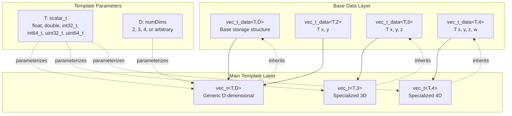

The `vec_t` template hierarchy consists of two layers:

| Layer | Template | Purpose | Storage |
|-------|----------|---------|---------|
| Data | `vec_t_data<T,D>` | POD-style storage with indexing | Generic: `T v[D]` array |
| Data | `vec_t_data<T,2>` | Specialized 2D storage | Named: `T x, y` |
| Data | `vec_t_data<T,3>` | Specialized 3D storage | Named: `T x, y, z` |
| Data | `vec_t_data<T,4>` | Specialized 4D storage | Named: `T x, y, z, w` |
| Logic | `vec_t<T,D>` | Generic operations and constructors | Inherits from `vec_t_data<T,D>` |
| Logic | `vec_t<T,3>` | Specialized 3D with optimized operations | Inherits from `vec_t_data<T,3>` |
| Logic | `vec_t<T,4>` | Specialized 4D with optimized operations | Inherits from `vec_t_data<T,4>` |

**Key members:**
- `numDims`: Compile-time constant indicating dimensionality
- `scalar_t`: Type alias for the scalar component type `T`
- `operator[]`: Array-style access for all dimensions
- Named accessors: `x`, `y`, `z`, `w` for dimensions 2-4

**Sources:** [cuBQL/math/vec.h:31-226]()

---

## Memory Layout and Alignment

### Dimension-Specific Specializations

The library provides specialized implementations for common dimensionalities (2, 3, 4) that use named member variables instead of arrays for improved readability and potential compiler optimizations.

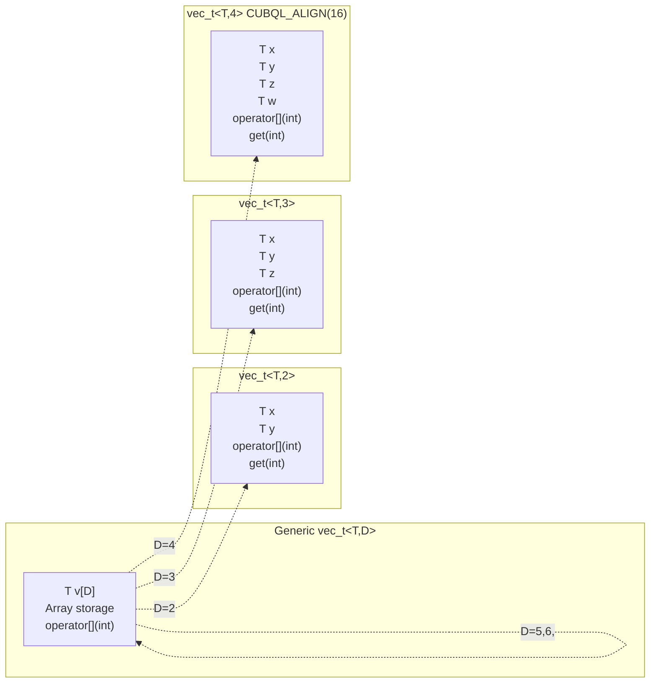

**Alignment requirements:**
- `vec_t<T,2>`: Natural alignment of `T`
- `vec_t<T,3>`: Natural alignment of `T`
- `vec_t<T,4>`: 16-byte aligned (via `CUBQL_ALIGN(16)`) for SIMD optimization
- Generic `vec_t<T,D>`: Natural alignment

The 4D specialization's 16-byte alignment ensures compatibility with SSE/AVX vector instructions and matches CUDA's float4/int4 alignment.

**Sources:** [cuBQL/math/vec.h:32-119](), [cuBQL/math/common.h:188-191]()

---

## CUDA Integration

### Cross-Platform Compilation

The `__cubql_both` macro (defined as `__host__ __device__` on CUDA, empty otherwise) enables all vector operations to compile for both CPU and GPU execution paths.

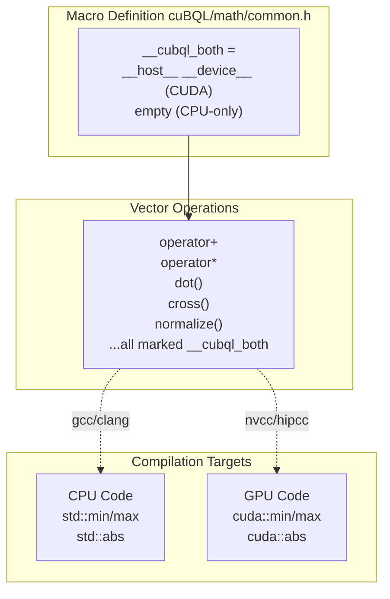

**Sources:** [cuBQL/math/common.h:84-95](), [cuBQL/math/vec.h:22-25]()

---

### CUDA Vector Type Conversions

When `CUBQL_SUPPORT_CUDA_VECTOR_TYPES=1` is defined, `vec_t` provides automatic conversions to/from CUDA's built-in vector types (`float2`, `float3`, `float4`, `int2`, `int3`, `int4`, `double2`, `double3`, `double4`).

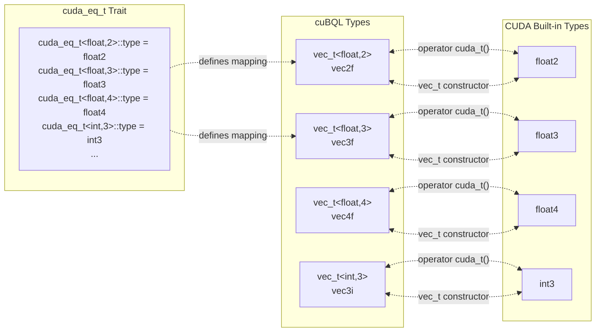

**Conversion operators:**
- **From CUDA types:** Constructor `vec_t(const cuda_t &o)` at [cuBQL/math/vec.h:140-144]()
- **To CUDA types:** Conversion operator `operator cuda_t()` at [cuBQL/math/vec.h:83-85](), [cuBQL/math/vec.h:103-105](), [cuBQL/math/vec.h:115-117]()
- **Type trait mapping:** `cuda_eq_t<T,D>` at [cuBQL/math/vec.h:64-74]()

Additionally, 2D and 3D vectors provide conversion to CUDA's `dim3` type for kernel launch parameters:
- `operator dim3()` for `vec_t<T,2>` at [cuBQL/math/vec.h:88]()
- `operator dim3()` for `vec_t<T,3>` at [cuBQL/math/vec.h:100]()

**Sources:** [cuBQL/math/vec.h:63-151](), [cuBQL/math/vec.h:180-186](), [cuBQL/math/vec.h:218-224]()

---

## Type Aliases

### Common Instantiations

cuBQL provides type aliases for frequently-used vector configurations to reduce verbosity:

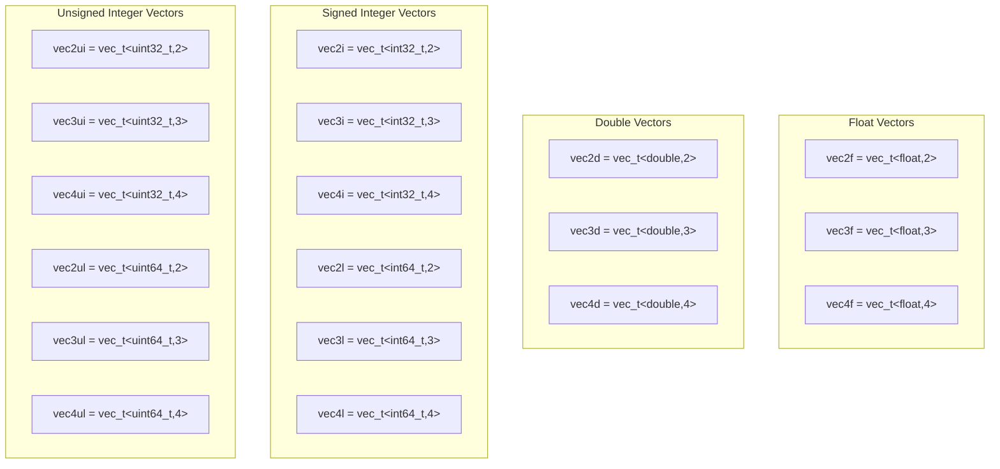

| Precision | 2D | 3D | 4D |
|-----------|----|----|-----|
| **Float (32-bit)** | `vec2f` | `vec3f` | `vec4f` |
| **Double (64-bit)** | `vec2d` | `vec3d` | `vec4d` |
| **Int32** | `vec2i` | `vec3i` | `vec4i` |
| **Int64** | `vec2l` | `vec3l` | `vec4l` |
| **UInt32** | `vec2ui` | `vec3ui` | `vec4ui` |
| **UInt64** | `vec2ul` | `vec3ul` | `vec4ul` |

**Sources:** [cuBQL/math/vec.h:228-252]()

---

## Constructors

The `vec_t` template provides multiple constructor overloads for flexible initialization:

| Constructor | Syntax | Description |
|-------------|--------|-------------|
| Default | `vec_t()` | Uninitialized (for generic `D`), default for specialized 3D |
| Scalar broadcast | `vec_t(T value)` | All components set to `value` |
| 2D explicit | `vec_t(T x, T y)` | Two-component initialization |
| 3D explicit | `vec_t(T x, T y, T z)` | Three-component initialization |
| 4D explicit | `vec_t(T x, T y, T z, T w)` | Four-component initialization |
| Copy from data | `vec_t(const vec_t_data<T,D>&)` | Copy from base data structure |
| Type conversion | `explicit vec_t(const vec_t_data<OT,D>&)` | Explicit scalar type conversion |
| From CUDA type | `vec_t(const cuda_t&)` | When `CUBQL_SUPPORT_CUDA_VECTOR_TYPES=1` |

**Sources:** [cuBQL/math/vec.h:126-158](), [cuBQL/math/vec.h:172-190](), [cuBQL/math/vec.h:204-216]()

---

## Operations and Functions

### Arithmetic Operations

All standard arithmetic operations are implemented for `vec_t`, supporting vector-vector, vector-scalar, and scalar-vector combinations:

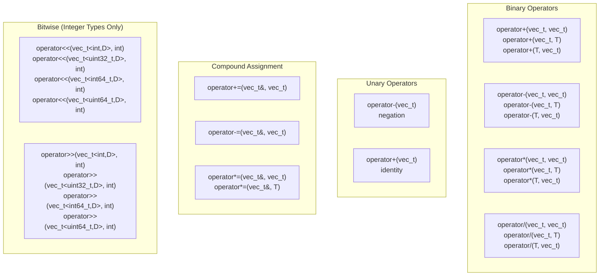

**Implementation details:**
- Component-wise operations use macro-generated templates at [cuBQL/math/vec.h:355-392]()
- Operations automatically work with CUDA vector types when enabled at [cuBQL/math/vec.h:329-353]()
- Bitwise shift operators specialized for integer types at [cuBQL/math/vec.h:417-474]()

**Sources:** [cuBQL/math/vec.h:308-474]()

---

### Comparison Operations

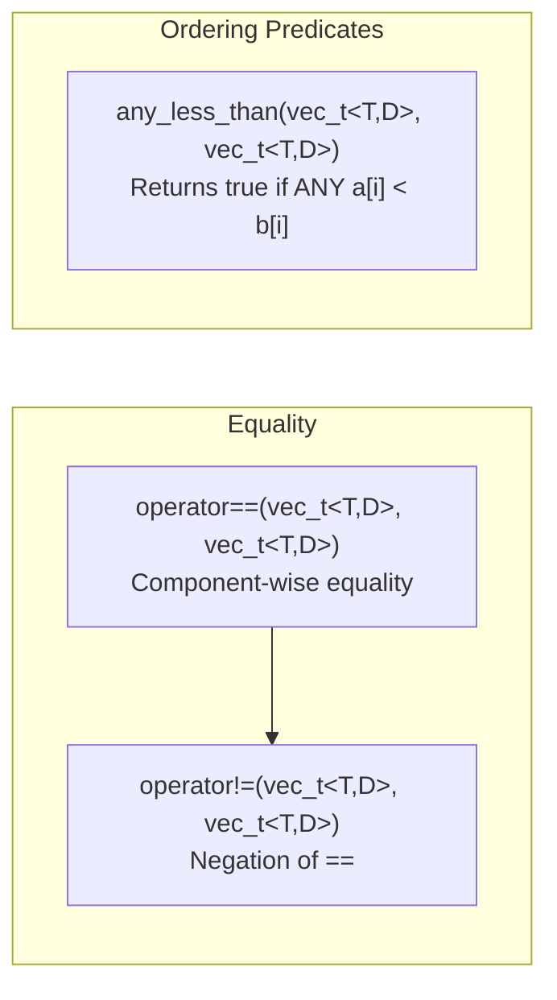

**Specializations:**
- Generic `operator==` at [cuBQL/math/vec.h:650-657]()
- Optimized 2D equality at [cuBQL/math/vec.h:635-637]()
- Optimized 3D equality at [cuBQL/math/vec.h:640-642]()
- Optimized 4D equality at [cuBQL/math/vec.h:645-647]()
- `any_less_than` predicate at [cuBQL/math/vec.h:701-723]()

**Sources:** [cuBQL/math/vec.h:634-663](), [cuBQL/math/vec.h:699-723]()

---

### Mathematical Functions

#### Vector-Specific Operations

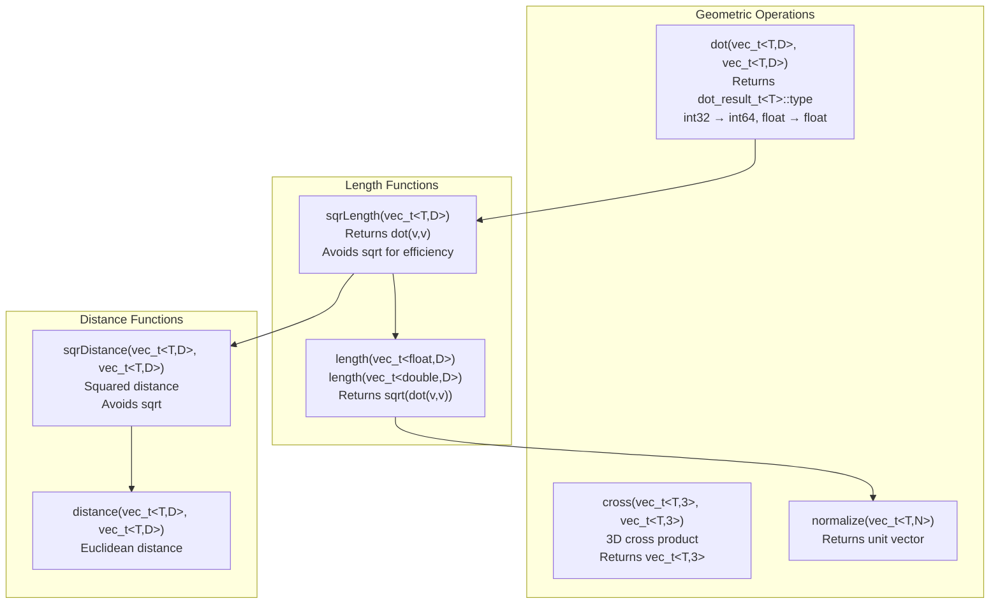

**Key type conversions:**
- `dot_result_t<int32_t>::type` = `int64_t` (prevents overflow)
- `dot_result_t<int64_t>::type` = `int64_t`
- `dot_result_t<float>::type` = `float`
- `dot_result_t<double>::type` = `double`

**Sources:** [cuBQL/math/vec.h:546-617](), [cuBQL/math/vec.h:260-265](), [cuBQL/math/vec.h:693-696]()

---

#### Component-wise Functions

The library provides component-wise application of standard mathematical functions:

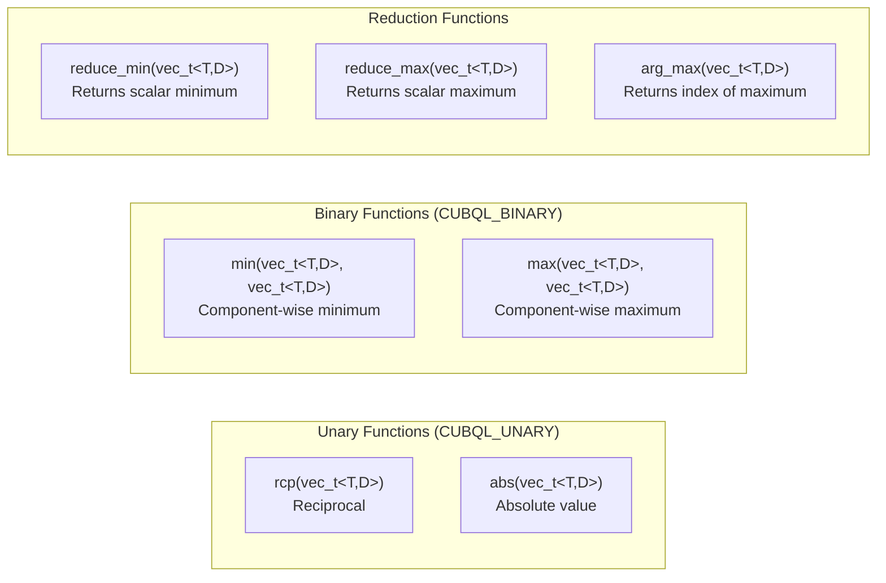

**Macro-generated implementations:**
- `CUBQL_UNARY` macro at [cuBQL/math/vec.h:491-504]() generates component-wise unary ops
- `CUBQL_BINARY` macro at [cuBQL/math/vec.h:506-519]() generates component-wise binary ops
- Reduction functions at [cuBQL/math/vec.h:666-691]()
- `arg_max` implementations at [cuBQL/math/vec.h:737-766]()

**Sources:** [cuBQL/math/vec.h:475-519](), [cuBQL/math/vec.h:666-766]()

---

### Utility Functions

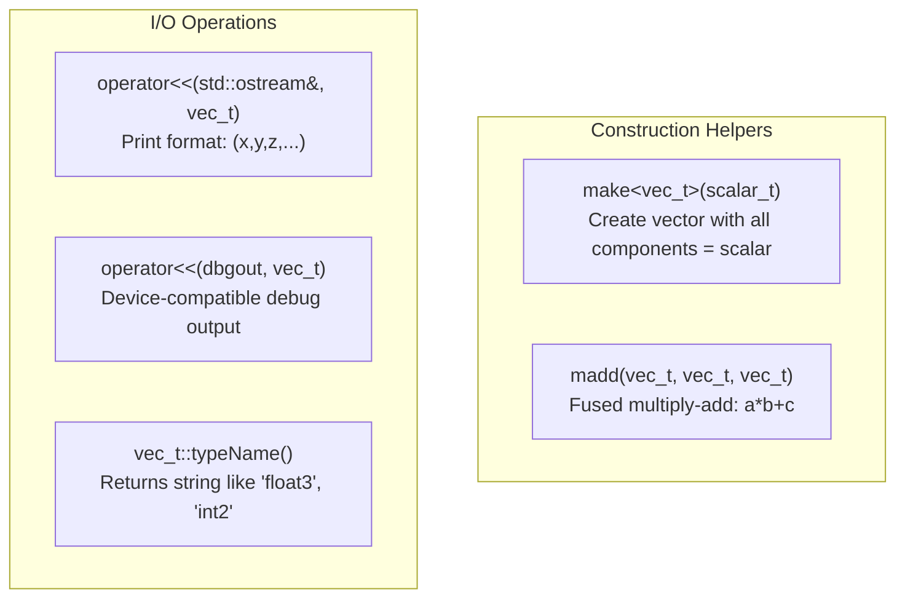

**Sources:** [cuBQL/math/vec.h:286-306](), [cuBQL/math/vec.h:254-257](), [cuBQL/math/vec.h:619-734](), [cuBQL/math/vec.h:775-783](), [cuBQL/math/vec.h:791-798]()

---

## Type Traits and Metaprogramming

### vec_traits Template

The `vec_traits<T>` template provides type introspection for any type used as a vector in cuBQL:

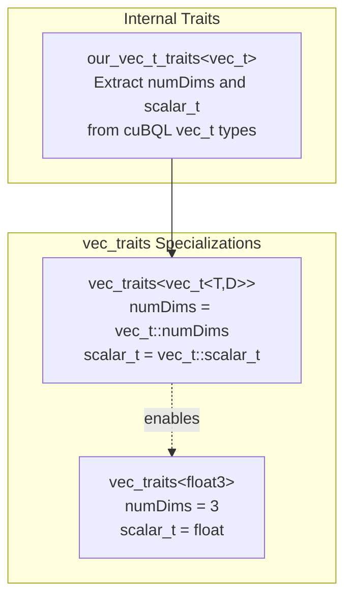

**Purpose:** Allows generic code to work with both cuBQL vectors and external types (e.g., CUDA's `float3`).

**Members:**
- `numDims`: Static constant indicating dimensionality
- `scalar_t`: Type alias for component type

**Sources:** [cuBQL/math/vec.h:267-283]()

---

## Usage Examples

### Basic Vector Arithmetic

```cpp
// Construction and initialization
vec3f a(1.0f, 2.0f, 3.0f);
vec3f b(4.0f);  // Broadcast: (4, 4, 4)

// Arithmetic operations
vec3f sum = a + b;           // (5, 6, 7)
vec3f scaled = a * 2.0f;     // (2, 4, 6)
vec3f componentwise = a * b; // (4, 8, 12)

// Vector operations
float length_a = length(a);          // sqrt(14)
float dot_product = dot(a, b);       // 24.0
vec3f cross_product = cross(a, b);   // Only for 3D vectors
vec3f normalized = normalize(a);     // Unit vector
```

**Sources:** [cuBQL/math/vec.h:355-392](), [cuBQL/math/vec.h:552-617]()

---

### CUDA Interoperability

```cpp
#define CUBQL_SUPPORT_CUDA_VECTOR_TYPES 1
#include <cuBQL/math/vec.h>

__global__ void kernel(float3* cuda_vecs, int n) {
    int idx = threadIdx.x + blockIdx.x * blockDim.x;
    if (idx >= n) return;
    
    // Automatic conversion from CUDA type
    vec3f v = cuda_vecs[idx];
    
    // Perform operations using cuBQL vectors
    v = normalize(v) * 2.0f;
    
    // Automatic conversion back to CUDA type
    cuda_vecs[idx] = v;
}

// Kernel launch using vec_t as dimensions
vec3i grid(10, 10, 1);
vec3i block(16, 16, 1);
kernel<<<grid, block>>>(data, n);  // Implicit conversion to dim3
```

**Sources:** [cuBQL/math/vec.h:82-85](), [cuBQL/math/vec.h:98-101](), [cuBQL/math/vec.h:140-150]()

---

### Type Conversion and Casting

```cpp
// Explicit type conversion between scalar types
vec3i int_vec(1, 2, 3);
vec3f float_vec(int_vec);  // Explicit: (1.0f, 2.0f, 3.0f)

// Access components by name or index
float x = float_vec.x;
float y = float_vec[1];  // Same as float_vec.y
float z = float_vec.get(2);  // Same as float_vec.z

// Generic dimensionality handling
template<typename T, int D>
void process(vec_t<T,D> v) {
    for (int i = 0; i < D; i++) {
        // Array-style access works for all dimensions
        v[i] *= 2;
    }
}
```

**Sources:** [cuBQL/math/vec.h:152-157](), [cuBQL/math/vec.h:33-34](), [cuBQL/math/vec.h:160]()

---

### Reduction and Comparison Operations

```cpp
vec3f v(5.0f, 2.0f, 8.0f);

// Find maximum/minimum component value
float max_val = reduce_max(v);  // 8.0f
float min_val = reduce_min(v);  // 2.0f

// Find index of maximum component
int max_idx = arg_max(v);       // 2 (z-component)

// Component-wise min/max
vec3f a(1.0f, 5.0f, 3.0f);
vec3f b(2.0f, 4.0f, 6.0f);
vec3f mins = min(a, b);         // (1.0f, 4.0f, 3.0f)
vec3f maxs = max(a, b);         // (2.0f, 5.0f, 6.0f)

// Predicate: any component comparison
bool any_lt = any_less_than(a, b);  // true (a.x < b.x)
```

**Sources:** [cuBQL/math/vec.h:666-691](), [cuBQL/math/vec.h:737-766](), [cuBQL/math/vec.h:517-519](), [cuBQL/math/vec.h:701-723]()

---

