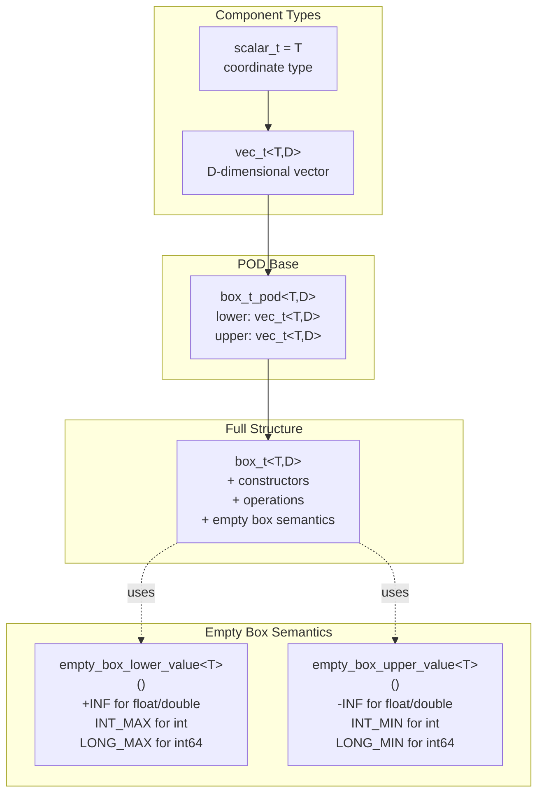
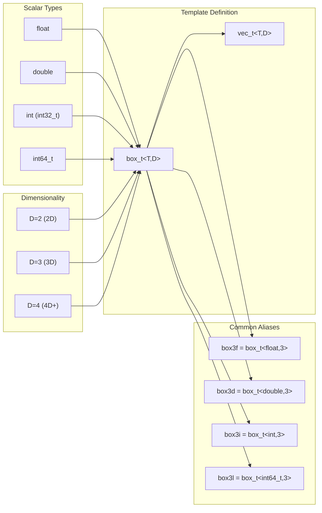
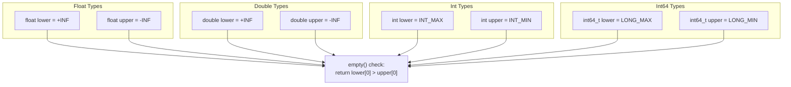
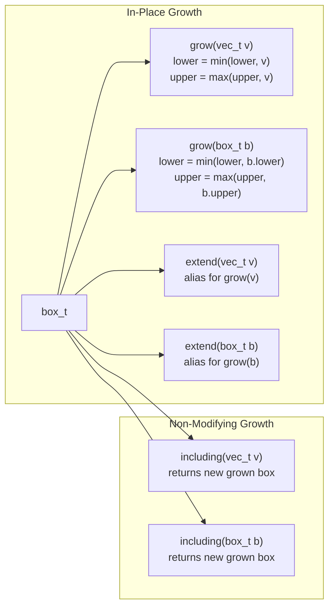
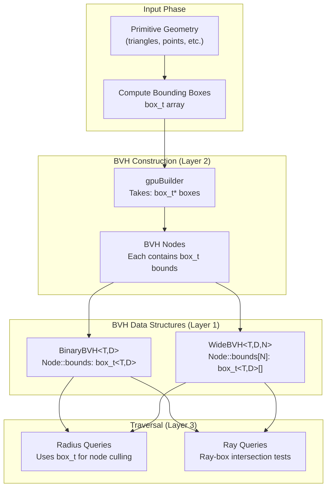

<!-- source: DeepWiki mcp.deepwiki.com · repo NVIDIA/cuBQL · page 4.2 Bounding Boxes (box_t) · fetched 2026-10-26 -->

# Bounding Boxes (box_t)

<details>
<summary>Relevant source files</summary>

The following files were used as context for generating this wiki page:

- [cuBQL/math/box.h](cuBQL/math/box.h)
- [cuBQL/math/common.h](cuBQL/math/common.h)
- [cuBQL/math/vec.h](cuBQL/math/vec.h)

</details>


## Purpose and Scope

This page documents the `box_t` structure, cuBQL's fundamental representation of axis-aligned bounding boxes (AABBs). The `box_t` template provides a generic, dimension-agnostic container for storing spatial bounds used throughout the BVH construction and traversal pipelines. For information about the vector types that compose bounding boxes, see [Vector Types (vec_t)](#4.1). For information about how bounding boxes are used in BVH data structures, see [BinaryBVH](#5.1) and [WideBVH](#5.2).

**Sources**: [cuBQL/math/box.h:1-262]()

---

## Core Structure

The `box_t` template is defined as an axis-aligned bounding box composed of two corner points:

```cpp
template<typename T, int D>
struct box_t : public box_t_pod<T,D> {
    vec_t lower;  // Minimum corner
    vec_t upper;  // Maximum corner
};
```

A box is considered **empty** when any component satisfies `lower[i] > upper[i]`. This convention allows empty boxes to represent invalid or ignored primitives during BVH construction without requiring separate validity flags.

### Structure Hierarchy



**Sources**: [cuBQL/math/box.h:28-48](), [cuBQL/math/box.h:11-26]()

---

## Template Parameterization

The `box_t` template accepts two compile-time parameters:

| Parameter | Type | Purpose | Common Values |
|-----------|------|---------|---------------|
| `T` | typename | Scalar coordinate type | `float`, `double`, `int`, `int64_t` |
| `D` | int | Spatial dimensionality | `2`, `3`, `4` |

These parameters determine:
- **Precision**: Float types support fractional coordinates with hardware acceleration; integer types enable exact arithmetic without rounding
- **Range**: `double` and `int64_t` provide extended range for large-scale scenes
- **Memory footprint**: A `box3f` requires 24 bytes (6 × 4-byte floats), while a `box3d` requires 48 bytes (6 × 8-byte doubles)

### Type System Integration



**Sources**: [cuBQL/math/box.h:48-51](), [cuBQL/math/box.h:176-191]()

---

## Type Aliases

cuBQL provides pre-defined aliases for common bounding box instantiations:

### Float Precision (32-bit)
| Alias | Definition | Use Case |
|-------|------------|----------|
| `box2f` | `box_t<float,2>` | 2D spatial queries, image processing |
| `box3f` | `box_t<float,3>` | 3D graphics, ray tracing, primary BVH type |
| `box4f` | `box_t<float,4>` | 4D spacetime queries, animation |

### Double Precision (64-bit)
| Alias | Definition | Use Case |
|-------|------------|----------|
| `box2d` | `box_t<double,2>` | High-precision 2D geometry |
| `box3d` | `box_t<double,3>` | Large-scale simulations, GIS applications |
| `box4d` | `box_t<double,4>` | Scientific computing |

### Integer Types
| Alias | Definition | Use Case |
|-------|------------|----------|
| `box2i` | `box_t<int,2>` | Pixel-aligned regions |
| `box3i` | `box_t<int,3>` | Voxel grids, discrete spatial indexing |
| `box4i` | `box_t<int,4>` | Multi-dimensional discrete spaces |

### Long Integer (64-bit)
| Alias | Definition | Use Case |
|-------|------------|----------|
| `box2l` | `box_t<int64_t,2>` | Large-scale 2D grids |
| `box3l` | `box_t<int64_t,3>` | Astronomical coordinates, extended range |
| `box4l` | `box_t<int64_t,4>` | High-dimensional discrete indexing |

**Sources**: [cuBQL/math/box.h:176-191]()

---

## Empty Box Semantics

cuBQL uses an inverted representation for empty boxes where `lower > upper`. This design eliminates the need for separate validity flags and enables branchless operations.

### Empty Box Values by Type



### Key Functions

| Function | Purpose | Implementation |
|----------|---------|----------------|
| `box_t()` | Default constructor | Creates empty box with inverted bounds |
| `empty()` | Test if box is empty | Returns `lower[0] > upper[0]` |
| `set_empty()` | Reset box to empty state | Sets `lower` to max, `upper` to min |
| `clear()` | Alias for `set_empty()` | Identical behavior |

**Example behavior**:
- Growing an empty box with a point creates a single-point box
- The intersection of any box with an empty box is empty
- Empty boxes are automatically excluded from BVH construction

**Sources**: [cuBQL/math/box.h:11-26](), [cuBQL/math/box.h:59-63](), [cuBQL/math/box.h:113-120]()

---

## Constructors

The `box_t` structure provides multiple construction patterns:

| Constructor | Signature | Purpose |
|-------------|-----------|---------|
| Default | `box_t()` | Creates empty box |
| Single point | `box_t(const vec_t &v)` | Creates zero-volume box at point |
| Two points | `box_t(const vec_t &a, const vec_t &b)` | Creates box from corners (no min/max enforcement) |
| Copy | `box_t(const box_t_pod<T,D> &ob)` | Copies existing box |
| Type conversion | `box_t(const box_t_pod<OT,D> &ob)` | Converts from different scalar type |

**Important**: The two-point constructor does **not** enforce `lower < upper`. If given inverted bounds, it creates an empty box. This behavior is intentional and used during BVH construction to filter invalid primitives.

**Sources**: [cuBQL/math/box.h:59-86]()

---

## Core Operations

### Modification Operations

These operations modify the box in-place and return a reference for chaining:



**Key differences**:
- `grow()` / `extend()`: Modify the box in-place, return reference to `*this`
- `including()`: Return a new box, leave original unchanged

**Sources**: [cuBQL/math/box.h:97-112]()

### Query Operations

These operations extract information without modifying the box:

| Operation | Return Type | Formula | Use Case |
|-----------|-------------|---------|----------|
| `center()` | `vec_t` | `(lower + upper) / 2` | Central point (may have rounding for ints) |
| `twice_center()` | `vec_t` | `lower + upper` | Exact center for integer types (×2) |
| `size()` | `vec_t` | `upper - lower` | Dimensions along each axis |
| `span()` | `vec_t` | `upper - lower` | Alias for `size()` |
| `get_lower(int i)` | `T` | `lower[i]` | Individual lower coordinate |
| `get_upper(int i)` | `T` | `upper[i]` | Individual upper coordinate |
| `empty()` | `bool` | `lower[0] > upper[0]` | Test for empty box |
| `overlaps(box_t b)` | `bool` | See below | Test for intersection |

**Overlap Test Implementation**:
```cpp
// Returns true if boxes share any volume
// Uses: !(this->upper < b.lower || b.upper < this->lower)
bool overlaps(const box_t<T,D> &other) const {
    return !(any_less_than(this->upper, other.lower) ||
             any_less_than(other.upper, this->lower));
}
```

**Sources**: [cuBQL/math/box.h:131-173](), [cuBQL/math/box.h:202-207]()

### Utility Functions

Free functions that operate on boxes:

| Function | Purpose | Formula |
|----------|---------|---------|
| `surfaceArea(box3f)` | Surface area (3D only) | `2(sx·sy + sx·sz + sy·sz)` |
| `sqrDistance(box, point)` | Squared distance to point | Projects point to box surface |
| `project(box, point)` | Closest point in box to point | `min(max(point, lower), upper)` |
| `make_box(vec_t)` | Construct single-point box | Convenience function |

**Sources**: [cuBQL/math/box.h:193-242]()

---

## Operations Summary Table

### Growth and Union Operations

| Operation | Modifies Box? | Return Type | Purpose |
|-----------|---------------|-------------|---------|
| `grow(vec_t)` | Yes | `box_t&` | Expand to include point |
| `grow(box_t)` | Yes | `box_t&` | Union with another box |
| `extend(vec_t)` | Yes | `box_t&` | Same as `grow(vec_t)` |
| `extend(box_t)` | Yes | `box_t&` | Same as `grow(box_t)` |
| `including(vec_t)` | No | `box_t` | Return union with point |
| `including(box_t)` | No | `box_t` | Return union with box |

### Geometric Queries

| Operation | Return Type | Description |
|-----------|-------------|-------------|
| `center()` | `vec_t` | Midpoint (may round for integers) |
| `twice_center()` | `vec_t` | Sum of corners (exact for integers) |
| `size()` | `vec_t` | Dimensions per axis |
| `span()` | `vec_t` | Alias for `size()` |
| `overlaps(box_t)` | `bool` | Tests for any intersection |
| `empty()` | `bool` | Tests if box is inverted |

### Interpolation

| Operation | Return Type | Description |
|-----------|-------------|-------------|
| `lerp(vec_t<float,D>)` | `vec_t<float,D>` | Linear interpolation (0=lower, 1=upper) |
| `lerp(vec_t<double,D>)` | `vec_t<double,D>` | Double-precision interpolation |

**Sources**: [cuBQL/math/box.h:90-173]()

---

## Integration with BVH System

The `box_t` structure serves as the fundamental spatial representation throughout cuBQL's BVH system:



### Usage Patterns

**During Construction**:
1. User provides array of `box_t` representing primitive bounds
2. Builder algorithms read boxes to compute spatial partitions
3. BVH nodes store `box_t` bounds for subtrees
4. Refit pass uses `grow()` operations to tighten bounds bottom-up

**During Traversal**:
1. Query defines search region (sphere → box conversion for radius queries)
2. Traversal performs `overlaps()` tests against node bounds
3. Culling eliminates subtrees that don't intersect query region
4. `sqrDistance()` computes conservative distance estimates

**Empty Box Handling**:
- Primitives with `lower > upper` are automatically skipped during construction
- Empty boxes in the input array do not create BVH nodes
- This allows marking primitives as "deleted" without reallocation

**Sources**: [cuBQL/math/box.h:1-262](), [cuBQL/bvh.h]() (referenced in context)

---

## CUDA Integration

All `box_t` operations are decorated with `__cubql_both`, enabling compilation for both CPU and GPU:

```cpp
// Usable in device kernels
__global__ void kernel(box_t<float,3> *boxes) {
    box_t<float,3> myBox = boxes[threadIdx.x];
    myBox.grow(vec3f(0.0f, 0.0f, 0.0f));
    boxes[threadIdx.x] = myBox;
}

// Usable in host code
void hostFunction() {
    box3f bounds;
    bounds.grow(vec3f(1.0f, 2.0f, 3.0f));
}
```

When `CUBQL_SUPPORT_CUDA_VECTOR_TYPES=1`, `box_t` supports automatic conversions with CUDA built-in vector types:

```cpp
box3f b;
float3 cudaVec = make_float3(1.0f, 2.0f, 3.0f);
b.grow(cudaVec);  // Automatic conversion
```

**Sources**: [cuBQL/math/box.h:48-262](), [cuBQL/math/common.h:84-95]()

---

## Memory Layout and Alignment

The `box_t` structure uses explicit alignment to ensure efficient GPU memory access:

| Type | Size (bytes) | Alignment | Layout |
|------|--------------|-----------|--------|
| `box3f` | 24 | 8 | 6 × float (4 bytes each) |
| `box3d` | 48 | 8 | 6 × double (8 bytes each) |
| `box3i` | 24 | 8 | 6 × int32 (4 bytes each) |
| `box3l` | 48 | 8 | 6 × int64 (8 bytes each) |

The `CUBQL_ALIGN(8)` attribute ensures proper alignment for vectorized memory operations. This is critical for GPU performance, as misaligned accesses can trigger multiple memory transactions.

**Sources**: [cuBQL/math/box.h:48](), [cuBQL/math/common.h:188-191]()

---

## Comparison and Equality

The library provides comparison operators for `box_t`:

```cpp
template<typename T, int D>
bool operator==(const box_t<T,D> &a, const box_t<T,D> &b) {
    return a.lower == b.lower && a.upper == b.upper;
}

template<typename T, int D>
bool operator!=(const box_t<T,D> &a, const box_t<T,D> &b) {
    return !(a == b);
}
```

**Behavior with empty boxes**:
- Two empty boxes with different inverted values compare as **not equal**
- This is correct behavior, as empty boxes can have any `lower > upper` configuration
- For semantic equivalence, test `a.empty() && b.empty()` separately

**Sources**: [cuBQL/math/box.h:244-250]()

---

## Stream Output

The library provides formatted output for debugging:

```cpp
// Host-side std::ostream
template<typename T, int D>
std::ostream &operator<<(std::ostream &o, const box_t<T,D> &box) {
    o << "{" << box.lower << "," << box.upper << "}";
    return o;
}

// Device-side printf-based output
template<typename T, int D>
__cubql_both dbgout operator<<(dbgout o, const box_t<T,D> &box) {
    o << "{" << box.lower << "," << box.upper << "}";
    return o;
}
```

**Example output**:
```
box3f: {(0,0,0),(10,10,10)}
box3f (empty): {(inf,inf,inf),(-inf,-inf,-inf)}
```

**Sources**: [cuBQL/math/box.h:252-258]()

---

## Performance Considerations

### Branchless Empty Box Operations

The inverted representation enables efficient branchless growth operations:

```cpp
// No branch needed - works for both empty and non-empty boxes
box.lower = min(box.lower, point);  // If empty, lower=+INF, this updates
box.upper = max(box.upper, point);  // If empty, upper=-INF, this updates
```

After one grow operation on an empty box, it becomes a valid single-point box. This eliminates conditional logic in tight loops during BVH construction.

### Integer vs. Float Types

| Aspect | Float Types | Integer Types |
|--------|-------------|---------------|
| Precision | Hardware-accelerated, 23-bit mantissa | Exact for all representable values |
| Rounding | May accumulate error in `center()` | No rounding in `twice_center()` |
| Range | ±3.4×10³⁸ (float), ±1.7×10³⁰⁸ (double) | ±2.1×10⁹ (int), ±9.2×10¹⁸ (int64) |
| Atomics | Requires encoding (see AtomicBox) | Direct atomic operations available |
| Use Case | Graphics, physics, ray tracing | Discrete grids, morton codes |

**Sources**: [cuBQL/math/box.h:1-262]()

---

## Related Types and Structures

| Type | Purpose | Documentation |
|------|---------|---------------|
| `vec_t<T,D>` | Vector type used for corners | See [Vector Types](#4.1) |
| `ray_t<T>` | Ray structure for intersection | See [Rays](#4.3) |
| `BinaryBVH<T,D>` | Uses `box_t` for node bounds | See [BinaryBVH](#5.1) |
| `WideBVH<T,D,N>` | Uses `box_t` arrays for nodes | See [WideBVH](#5.2) |
| `AtomicBox` | Thread-safe box updates | See [Atomic Operations](#9.2) |

**Sources**: [cuBQL/math/box.h:1-262]()

---

