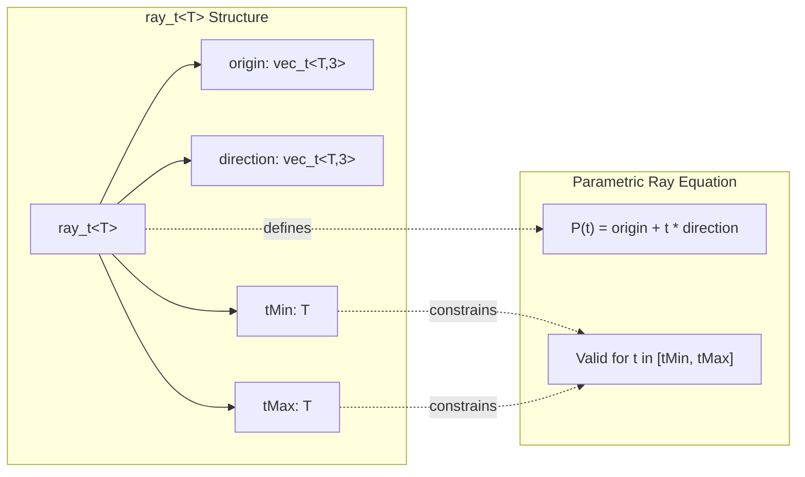
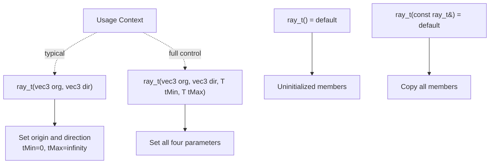
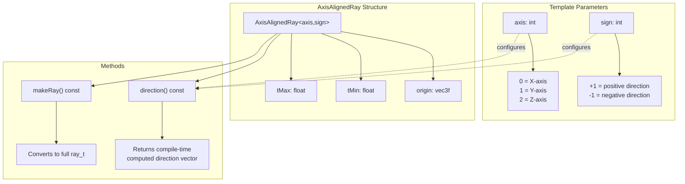
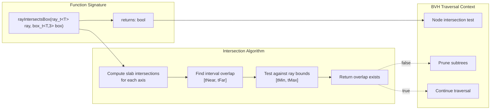
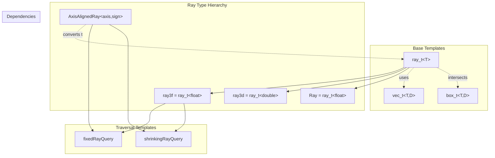

<!-- source: DeepWiki mcp.deepwiki.com · repo NVIDIA/cuBQL · page 4.3 Rays (ray_t) · fetched 2026-10-26 -->

# Rays (ray_t)

<details>
<summary>Relevant source files</summary>

The following files were used as context for generating this wiki page:

- [cuBQL/math/Ray.h](cuBQL/math/Ray.h)

</details>


## Purpose and Scope

This page documents the `ray_t` template structure and related ray types that form the foundational geometric primitives for ray-based BVH traversal in cuBQL. Ray structures define parametric lines with bounded intervals, enabling efficient ray tracing, ray casting, and visibility queries against BVH-accelerated geometry.

For information about ray-based BVH traversal algorithms that use these structures, see [Ray Queries](#7.1). For the bounding box types that rays test against, see [Bounding Boxes (box_t)](#4.2). For vector types used to represent ray origins and directions, see [Vector Types (vec_t)](#4.1).

**Sources**: [cuBQL/math/Ray.h:1-113]()

---

## Ray Structure Overview

The `ray_t<T>` template provides a generic ray representation parameterized by coordinate type `T`. A ray is defined by an origin point, direction vector, and a valid parametric interval `[tMin, tMax]` along which the ray can intersect geometry.



**Diagram: ray_t Structure and Parametric Representation**

The ray represents all points `P(t) = origin + t * direction` where `t` ranges from `tMin` to `tMax`. This bounded interval enables efficient culling during BVH traversal.

**Sources**: [cuBQL/math/Ray.h:15-27]()

---

## Template Parameters and Members

### Template Parameterization

| Parameter | Type | Purpose |
|-----------|------|---------|
| `T` | Numeric type | Coordinate type for origin, direction, and parametric values (default: `float`) |

The template supports arbitrary numeric types, though `float` and `double` are most common for ray tracing applications.

### Member Variables

| Member | Type | Default | Description |
|--------|------|---------|-------------|
| `origin` | `vec_t<T,3>` | Uninitialized | Starting point of the ray in 3D space |
| `direction` | `vec_t<T,3>` | Uninitialized | Direction vector (typically normalized, but not required) |
| `tMin` | `T` | `T(0)` | Minimum valid parametric distance along ray |
| `tMax` | `T` | `T(CUBQL_INF)` | Maximum valid parametric distance along ray |

The `tMin` and `tMax` parameters define the active interval of the ray. For ray tracing, `tMax` is commonly updated to the distance of the closest hit, enabling early termination of farther intersections.

**Sources**: [cuBQL/math/Ray.h:16-27]()

---

## Constructors

The `ray_t` template provides three constructor variants:



**Diagram: ray_t Constructor Variants**

### Constructor Details

1. **Default Constructor**: Uses compiler-generated default initialization
2. **Copy Constructor**: Standard member-wise copy
3. **Two-Parameter Constructor** [cuBQL/math/Ray.h:61-64]()
   - Parameters: `origin`, `direction`
   - Initializes `tMin` to `0` and `tMax` to `CUBQL_INF`
   - Most common for primary rays and shadow rays
4. **Four-Parameter Constructor** [cuBQL/math/Ray.h:54-58]()
   - Parameters: `origin`, `direction`, `tMin`, `tMax`
   - Enables full control over ray interval
   - Used when ray bounds are pre-computed

All constructors are decorated with `__cubql_both`, enabling execution on both CPU and GPU.

**Sources**: [cuBQL/math/Ray.h:19-64]()

---

## Type Aliases

cuBQL provides convenient type aliases for common ray instantiations:

| Alias | Definition | Typical Use Case |
|-------|------------|------------------|
| `ray3f` | `ray_t<float>` | Single-precision ray tracing |
| `ray3d` | `ray_t<double>` | Double-precision scientific applications |
| `Ray` | `ray_t<float>` | Shortened alias for default ray type |

The `Ray` alias is particularly common in application code for brevity.

**Sources**: [cuBQL/math/Ray.h:29-31]()

---

## AxisAlignedRay Specialization

The `AxisAlignedRay<axis, sign>` template provides an optimized representation for rays aligned with coordinate axes. This specialization reduces memory footprint and enables more efficient ray-box intersection tests.



**Diagram: AxisAlignedRay Template Structure**

### Design Rationale

Unlike `ray_t`, `AxisAlignedRay` does not store the direction vector explicitly. Instead, the direction is computed at compile-time based on template parameters:
- **Memory savings**: 3 floats (12 bytes) eliminated
- **Compile-time optimization**: Direction component calculations resolved by compiler
- **Use case**: Grid traversal, orthographic projection, axis-sweep algorithms

### Template Parameters

| Parameter | Type | Values | Description |
|-----------|------|--------|-------------|
| `axis` | `int` | `0`, `1`, or `2` | Coordinate axis (X, Y, or Z) |
| `sign` | `int` | `+1` or `-1` | Direction along axis (positive or negative) |

### Member Variables

| Member | Type | Default | Description |
|--------|------|---------|-------------|
| `origin` | `vec3f` | Uninitialized | Ray starting point |
| `tMin` | `float` | `0.f` | Minimum parametric distance |
| `tMax` | `float` | `CUBQL_INF` | Maximum parametric distance |

**Note**: Currently only supports `float` precision (no template parameterization for coordinate type).

### Methods

#### `direction() const`

Returns the ray direction as a `vec3f` based on template parameters:

| Template Configuration | Returned Direction |
|------------------------|-------------------|
| `AxisAlignedRay<0, +1>` | `{+1.f, 0.f, 0.f}` |
| `AxisAlignedRay<0, -1>` | `{-1.f, 0.f, 0.f}` |
| `AxisAlignedRay<1, +1>` | `{0.f, +1.f, 0.f}` |
| `AxisAlignedRay<1, -1>` | `{0.f, -1.f, 0.f}` |
| `AxisAlignedRay<2, +1>` | `{0.f, 0.f, +1.f}` |
| `AxisAlignedRay<2, -1>` | `{0.f, 0.f, -1.f}` |

The direction computation is implemented at [cuBQL/math/Ray.h:80-87]() using compile-time conditionals that resolve to constants.

#### `makeRay() const`

Converts the axis-aligned ray to a full `ray_t<float>` structure [cuBQL/math/Ray.h:90-93](). This enables interoperability with generic ray traversal code that expects standard ray types.

**Sources**: [cuBQL/math/Ray.h:33-93]()

---

## Ray-Box Intersection

The `rayIntersectsBox` function provides efficient ray-box intersection testing, a fundamental operation in BVH traversal:



**Diagram: Ray-Box Intersection in BVH Traversal**

### Function Signature

```
template<typename T>
inline __cubql_both
bool rayIntersectsBox(ray_t<T> ray, box_t<T,3> box);
```

Declared at [cuBQL/math/Ray.h:45-47]()

### Parameters

| Parameter | Type | Description |
|-----------|------|-------------|
| `ray` | `ray_t<T>` | Ray to test (passed by value for efficiency) |
| `box` | `box_t<T,3>` | 3D axis-aligned bounding box |

### Return Value

Returns `true` if the ray intersects the box within the parametric interval `[ray.tMin, ray.tMax]`, otherwise `false`.

### Algorithm

The function implements the slab method:
1. For each coordinate axis, compute intersection distances with the two parallel planes defining the box
2. Find the interval where all three axis intervals overlap
3. Check if this interval overlaps with `[ray.tMin, ray.tMax]`

This algorithm efficiently culls non-intersecting boxes during BVH traversal, enabling early termination of entire subtrees.

### Integration with BVH System

This function is used internally by ray traversal templates:
- `fixedRayQuery` uses it for unordered node traversal [Ray Queries](#7.1)
- `shrinkingRayQuery` uses it with dynamic `tMax` updates for closest-hit queries

**Sources**: [cuBQL/math/Ray.h:45-47]()

---

## Type Relationships



**Diagram: Ray Types and Their Relationships**

**Sources**: [cuBQL/math/Ray.h:1-113]()

---

## Usage Patterns

### Primary Ray Construction

```
// Basic ray from camera
vec3f cameraPos = {0.f, 0.f, -10.f};
vec3f viewDir = normalize(targetPos - cameraPos);
Ray primaryRay(cameraPos, viewDir);

// Ray with explicit bounds
Ray boundedRay(origin, direction, 0.01f, 1000.f);
```

### Shadow Ray Construction

Shadow rays typically use bounded intervals to test visibility to light sources:

```
vec3f surfacePoint = {x, y, z};
vec3f lightPos = {lx, ly, lz};
vec3f toLight = lightPos - surfacePoint;
float lightDist = length(toLight);
vec3f lightDir = toLight / lightDist;

// Shadow ray: test from surface to light (with epsilon offset)
Ray shadowRay(surfacePoint, lightDir, 0.0001f, lightDist - 0.0001f);
```

### Axis-Aligned Ray Usage

```
// X-axis positive ray
AxisAlignedRay<0, +1> xRay(origin);
vec3f dir = xRay.direction();  // Returns {1, 0, 0}
Ray converted = xRay.makeRay(); // Convert to standard ray

// Y-axis negative ray with bounds
AxisAlignedRay<1, -1> yRay(origin, 0.f, 100.f);
```

### BVH Traversal Integration

```
Ray ray(cameraPos, viewDir);
BinaryBVH<float, 3> bvh = /* ... */;

// Fixed ray query: find all primitives along ray
fixedRayQuery(bvh, ray, [&](int primID, float tHit) {
    // Process intersection at distance tHit
});

// Shrinking ray query: find closest intersection
float closestT = CUBQL_INF;
int closestPrim = -1;
shrinkingRayQuery(bvh, ray, [&](int primID, float tHit) {
    if (tHit < closestT) {
        closestT = tHit;
        closestPrim = primID;
        return tHit;  // Shrink ray interval
    }
    return closestT;
});
```

**Sources**: [cuBQL/math/Ray.h:1-113]()

---

## Debug Output

The ray types provide debug output operators for logging and debugging:

### ray_t Debug Format

```
Ray{<origin>+[<tMin>,<tMax>]*<direction>}
```

Example output:
```
Ray{{0,0,-10}+[0,inf]*{0,0,1}}
```

Implemented at [cuBQL/math/Ray.h:102-107]()

### AxisAlignedRay Debug Format

```
AARay<axis,sign>(<origin>,[<tMin>,<tMax>])
```

Example output:
```
AARay<2,1>({0,0,0},[0,100])
```

Implemented at [cuBQL/math/Ray.h:95-100]()

These operators use the `dbgout` type for consistent formatting across the library.

**Sources**: [cuBQL/math/Ray.h:95-107]()

---

## Design Considerations

### Direction Vector Normalization

The `ray_t` structure does **not enforce** direction vector normalization. This design choice provides flexibility:

| Normalized Direction | Non-Normalized Direction |
|----------------------|--------------------------|
| Parametric distance `t` equals Euclidean distance | Parametric distance `t` must be scaled by `length(direction)` |
| Required for many ray-triangle intersection algorithms | Useful for transformed rays where original scale matters |
| Standard for ray tracing | Sometimes used for optimization |

Users should normalize directions when required by specific intersection algorithms.

### Parametric Interval Semantics

The interval `[tMin, tMax]` serves multiple purposes:
- **Clipping**: Restricts ray to a segment (e.g., shadow rays)
- **Optimization**: Early ray termination when `tMax` is updated to closest hit distance
- **Precision**: `tMin > 0` avoids self-intersection at ray origin (shadow acne)

The default `tMax = CUBQL_INF` represents an infinite ray, commonly used for primary rays and some intersection queries.

### GPU Execution Model

All ray types and operations are decorated with `__cubql_both`, enabling:
- Host-side ray construction and debugging
- Device-side execution in CUDA kernels
- Single-source code for CPU/GPU workflows

This design aligns with cuBQL's philosophy of unified host/device execution (see [CUDA Integration](#3.3)).

**Sources**: [cuBQL/math/Ray.h:1-113]()

---

