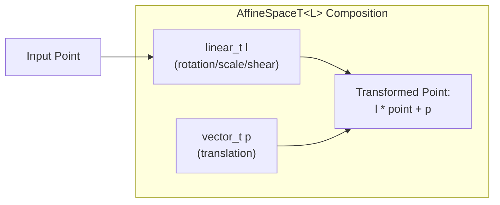
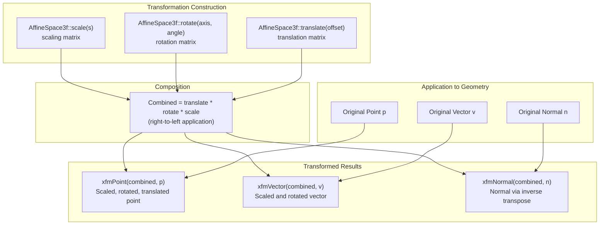

<!-- source: DeepWiki mcp.deepwiki.com · repo NVIDIA/cuBQL · page 4.4 Linear and Affine Transformations · fetched 2026-10-26 -->

# Linear and Affine Transformations

<details>
<summary>Relevant source files</summary>

The following files were used as context for generating this wiki page:

- [cuBQL/math/affine.h](cuBQL/math/affine.h)
- [cuBQL/math/linear.h](cuBQL/math/linear.h)

</details>


## Purpose and Scope

This page documents cuBQL's linear algebra structures for representing matrix transformations and affine transformations. These types form the mathematical foundation for geometric transformations including rotation, scaling, translation, and perspective operations. They are used throughout cuBQL for transforming primitives, bounding boxes, and coordinate frames.

For basic vector operations, see [Vector Types (vec_t)](#4.1). For geometric primitives that these transformations operate on, see [Bounding Boxes (box_t)](#4.2) and [Rays (ray_t)](#4.3). For two-level BVH hierarchies that use affine transformations for instancing, see [Two-Level BVH Traversal](#7.3).

**Sources**: [cuBQL/math/linear.h](), [cuBQL/math/affine.h]()

---

## Type Hierarchy and Structure

The transformation system consists of two primary template structures: `LinearSpace` for matrix operations and `AffineSpaceT` for affine transformations that combine linear transformations with translations.

### Class Structure Diagram

```mermaid
graph TB
    subgraph "Template Parameters"
        T["T: vector_t<br/>(vec2f, vec3f, etc.)"]
        L["L: linear_t<br/>(LinearSpace2, LinearSpace3)"]
    end
    
    subgraph "LinearSpace Templates"
        LS2["LinearSpace2&lt;T&gt;<br/>2x2 matrix"]
        LS3["LinearSpace3&lt;T&gt;<br/>3x3 matrix"]
    end
    
    subgraph "LinearSpace2 Members"
        LS2_VX["vector_t vx<br/>(column 0)"]
        LS2_VY["vector_t vy<br/>(column 1)"]
        LS2_OPS["det()<br/>inverse()<br/>transposed()<br/>adjoint()"]
        LS2_FACTORY["scale(s)<br/>rotate(r)"]
    end
    
    subgraph "LinearSpace3 Members"
        LS3_VX["vector_t vx<br/>(column 0)"]
        LS3_VY["vector_t vy<br/>(column 1)"]
        LS3_VZ["vector_t vz<br/>(column 2)"]
        LS3_OPS["det()<br/>inverse()<br/>transposed()<br/>adjoint()"]
        LS3_FACTORY["scale(s)<br/>rotate(u, r)"]
    end
    
    subgraph "AffineSpaceT Template"
        AS["AffineSpaceT&lt;L&gt;<br/>linear + translation"]
        AS_L["linear_t l<br/>(rotation/scale)"]
        AS_P["vector_t p<br/>(translation)"]
        AS_FACTORY["scale(s)<br/>translate(p)<br/>rotate(...)<br/>lookat(...)"]
        AS_XFM["xfmPoint()<br/>xfmVector()<br/>xfmNormal()"]
    end
    
    subgraph "Type Aliases"
        ALIAS_L2["LinearSpace2f/linear2f<br/>LinearSpace2d/linear2d"]
        ALIAS_L3["LinearSpace3f/linear3f<br/>LinearSpace3d/linear3d"]
        ALIAS_A2["AffineSpace2f/affine2f<br/>AffineSpace2d/affine2d"]
        ALIAS_A3["AffineSpace3f/affine3f<br/>AffineSpace3d/affine3d"]
    end
    
    T --> LS2
    T --> LS3
    LS2 --> LS2_VX
    LS2 --> LS2_VY
    LS2 --> LS2_OPS
    LS2 --> LS2_FACTORY
    LS3 --> LS3_VX
    LS3 --> LS3_VY
    LS3 --> LS3_VZ
    LS3 --> LS3_OPS
    LS3 --> LS3_FACTORY
    
    L --> AS
    AS --> AS_L
    AS --> AS_P
    AS --> AS_FACTORY
    AS --> AS_XFM
    
    LS2 --> ALIAS_L2
    LS3 --> ALIAS_L3
    AS --> ALIAS_A2
    AS --> ALIAS_A3
```



**Sources**: [cuBQL/math/linear.h:14-104](), [cuBQL/math/linear.h:155-247](), [cuBQL/math/affine.h:14-105]()

---

## LinearSpace: Matrix Transformations

`LinearSpace` templates represent pure linear transformations (rotation, scaling, shear) without translation. They are stored in column-major format for compatibility with standard graphics conventions.

### LinearSpace2 (2D Transformations)

The `LinearSpace2<T>` template represents 2×2 matrices for 2D transformations.

| Component | Type | Description |
|-----------|------|-------------|
| `vx` | `vector_t` | First column vector (transforms x-axis) |
| `vy` | `vector_t` | Second column vector (transforms y-axis) |
| `scalar_t` | `typename T::scalar_t` | Underlying scalar type (float, double, etc.) |

**Construction**:
```cpp
// From column vectors
LinearSpace2(const vector_t& vx, const vector_t& vy)

// From row-major components
LinearSpace2(const scalar_t& m00, const scalar_t& m01, 
             const scalar_t& m10, const scalar_t& m11)
```

**Sources**: [cuBQL/math/linear.h:14-35]()

### LinearSpace3 (3D Transformations)

The `LinearSpace3<T>` template represents 3×3 matrices for 3D transformations.

| Component | Type | Description |
|-----------|------|-------------|
| `vx` | `vector_t` | First column vector (transforms x-axis) |
| `vy` | `vector_t` | Second column vector (transforms y-axis) |
| `vz` | `vector_t` | Third column vector (transforms z-axis) |
| `scalar_t` | `typename T::scalar_t` | Underlying scalar type |

**Construction**:
```cpp
// From column vectors
LinearSpace3(const vector_t& vx, const vector_t& vy, const vector_t& vz)

// From row-major components
LinearSpace3(const scalar_t& m00, const scalar_t& m01, const scalar_t& m02,
             const scalar_t& m10, const scalar_t& m11, const scalar_t& m12,
             const scalar_t& m20, const scalar_t& m21, const scalar_t& m22)
```

**Sources**: [cuBQL/math/linear.h:155-185]()

### Matrix Operations

Both `LinearSpace2` and `LinearSpace3` provide standard matrix operations:

| Operation | Method | Description |
|-----------|--------|-------------|
| Determinant | `det()` | Computes matrix determinant |
| Adjoint | `adjoint()` | Returns adjugate matrix |
| Inverse | `inverse()` | Computes matrix inverse via `adjoint()/det()` |
| Transpose | `transposed()` | Returns transposed matrix |
| Row access | `row0()`, `row1()`, `row2()` | Returns individual rows as vectors |
| Reciprocal | `rcp(m)` | Free function, equivalent to `inverse()` |

**Arithmetic Operators**:
- Unary: `-m`, `+m`
- Addition/Subtraction: `m1 + m2`, `m1 - m2`
- Scalar multiplication: `scalar * m`, `m / scalar`
- Matrix multiplication: `m1 * m2`
- Matrix-vector multiplication: `m * v`
- Compound assignment: `m1 *= m2`, `m1 /= m2`

**Sources**: [cuBQL/math/linear.h:37-48](), [cuBQL/math/linear.h:187-206](), [cuBQL/math/linear.h:110-130](), [cuBQL/math/linear.h:253-305]()

### Factory Methods

`LinearSpace` provides static factory methods for common transformations:

#### 2D Transformations

```cpp
// Scaling
static LinearSpace2 scale(const vector_t& s)

// Rotation (angle in radians)
static LinearSpace2 rotate(const scalar_t& r)

// Closest orthogonal matrix (rotation + optional reflection)
LinearSpace2 orthogonal() const
```

**Sources**: [cuBQL/math/linear.h:62-98]()

#### 3D Transformations

```cpp
// Scaling
static LinearSpace3 scale(const vector_t& s)

// Rotation around arbitrary axis
static LinearSpace3 rotate(const vector_t& axis, const scalar_t& angle)
```

**Coordinate Frame Construction**:
```cpp
// Frame from normal vector
template<typename T> LinearSpace3<T> frame(const T& N)

// Frame from normal and approximate x-direction
template<typename T> LinearSpace3<T> frame(const T& N, const T& dxi)
```

These functions construct orthonormal coordinate frames, useful for tangent-space calculations and orientation-independent operations. The first variant automatically selects an arbitrary tangent direction, while the second allows specifying a preferred direction.

**Sources**: [cuBQL/math/linear.h:226-240](), [cuBQL/math/linear.h:258-280]()

### Transformation Functions

LinearSpace provides specialized transformation functions for different geometric types:

| Function | Purpose | Usage |
|----------|---------|-------|
| `xfmPoint(m, p)` | Transform point | Same as matrix-vector multiply for linear transforms |
| `xfmVector(m, v)` | Transform direction vector | Same as `xfmPoint` for linear transforms |
| `xfmNormal(m, n)` | Transform surface normal | Uses inverse transpose: `(m^-1)^T * n` |

The `xfmNormal` function correctly handles non-uniform scaling by applying the inverse transpose transformation, ensuring normals remain perpendicular to transformed surfaces.

**Sources**: [cuBQL/math/linear.h:307-309]()

---

## AffineSpaceT: Affine Transformations

`AffineSpaceT<L>` extends linear transformations with translation, representing full affine transformations of the form `x' = L*x + p`.

### Structure



| Component | Type | Description |
|-----------|------|-------------|
| `l` | `linear_t` | Linear transformation (rotation, scale, shear) |
| `p` | `vector_t` | Translation vector (affine part) |
| `vector_t` | `typename L::vector_t` | Vector type from linear space |
| `scalar_t` | `typename vector_t::scalar_t` | Scalar type |

**Construction**:
```cpp
// Default: identity transformation
AffineSpaceT()

// From linear transformation (no translation)
AffineSpaceT(const L& linear)

// From linear + translation
AffineSpaceT(const L& linear, const vector_t& translation)

// From column vectors + translation
AffineSpaceT(const vector_t& vx, const vector_t& vy, 
             const vector_t& vz, const vector_t& p)
```

**Sources**: [cuBQL/math/affine.h:14-65]()

### Factory Methods

`AffineSpaceT` provides static factory methods for creating common transformations:

| Method | Signature | Description |
|--------|-----------|-------------|
| `scale` | `scale(const vector_t& s)` | Scaling transformation |
| `translate` | `translate(const vector_t& p)` | Pure translation |
| `rotate` | `rotate(const scalar_t& r)` | 2D rotation around origin |
| `rotate` | `rotate(const vector_t& u, const scalar_t& r)` | 3D rotation around axis through origin |
| `rotate` | `rotate(const vector_t& p, const vector_t& u, const scalar_t& r)` | 3D rotation around axis through point `p` |
| `lookat` | `lookat(const vector_t& eye, const vector_t& point, const vector_t& up)` | View transformation (3D only) |

**Rotation around Point Implementation**:
```cpp
// Implemented as: translate to origin, rotate, translate back
static AffineSpaceT rotate(const vector_t& p, const vector_t& u, const scalar_t& r)
{ 
    return translate(+p) * rotate(u,r) * translate(-p);  
}
```

**Lookat Transformation**:
The `lookat` function creates a right-handed coordinate system looking from `eye` toward `point`, with `up` defining the vertical direction. It constructs an orthonormal basis:
- Z-axis: normalized direction from eye to point
- X-axis: perpendicular to both Z and up
- Y-axis: perpendicular to both X and Z

**Sources**: [cuBQL/math/affine.h:74-103](), [cuBQL/math/affine.h:216-217]()

### Transformation Operations

#### Affine Transformation Functions


| Function | Implementation | Description |
|----------|----------------|-------------|
| `xfmPoint(m, p)` | `m.l * p + m.p` | Transforms point with linear + translation |
| `xfmVector(m, v)` | `m.l * v` | Transforms direction (ignores translation) |
| `xfmNormal(m, n)` | `xfmNormal(m.l, n)` | Transforms normal using inverse transpose of linear part |

**Key Distinction**: 
- **Points** are transformed by the full affine transformation (linear + translation)
- **Vectors** represent directions and are only affected by the linear part
- **Normals** require special handling (inverse transpose) to maintain perpendicularity

**Sources**: [cuBQL/math/affine.h:163-182]()

#### Arithmetic Operations

**Inverse (Reciprocal)**:
```cpp
AffineSpaceT rcp(const AffineSpaceT& a)
{
    L il = rcp(a.l);  // Invert linear part
    return AffineSpaceT(il, -(il * a.p));  // Transform translation by inverse
}
```

**Composition** (multiplication combines transformations):
```cpp
// a * b applies b first, then a
AffineSpaceT operator*(const AffineSpaceT& a, const AffineSpaceT& b)
{
    return AffineSpaceT(a.l * b.l, a.l * b.p + a.p);
}
```

**Other Operations**:
- Unary: `-a`, `+a`
- Addition/Subtraction: `a + b`, `a - b`
- Scalar multiplication: `scalar * a`, `a / scalar`
- Division by affine: `a / b` (equivalent to `a * rcp(b)`)
- Compound assignment: `a *= b`, `a /= b`

**Sources**: [cuBQL/math/affine.h:114-161]()

---

## Type Aliases

cuBQL provides convenient type aliases for common instantiations:

### LinearSpace Aliases

| Template Instantiation | Primary Alias | Alternative Alias |
|------------------------|---------------|-------------------|
| `LinearSpace2<vec2f>` | `LinearSpace2f` | `linear2f` |
| `LinearSpace3<vec3f>` | `LinearSpace3f` | `linear3f` |
| `LinearSpace2<vec2d>` | `LinearSpace2d` | `linear2d` |
| `LinearSpace3<vec3d>` | `LinearSpace3d` | `linear3d` |

**Sources**: [cuBQL/math/linear.h:332-341]()

### AffineSpace Aliases

| Template Instantiation | Primary Alias | Alternative Alias |
|------------------------|---------------|-------------------|
| `AffineSpaceT<LinearSpace2f>` | `AffineSpace2f` | `affine2f` |
| `AffineSpaceT<LinearSpace3f>` | `AffineSpace3f` | `affine3f` |
| `AffineSpaceT<LinearSpace2d>` | `AffineSpace2d` | `affine2d` |
| `AffineSpaceT<LinearSpace3d>` | `AffineSpace3d` | `affine3d` |

**Sources**: [cuBQL/math/affine.h:209-223]()

---

## Transformation Composition Pipeline

The following diagram illustrates how transformations are composed and applied in typical usage patterns:



**Composition Order**: Transformations compose right-to-left. In `translate * rotate * scale`, the `scale` is applied first, then `rotate`, then `translate`.

**Sources**: [cuBQL/math/affine.h:133-134](), [cuBQL/math/affine.h:163-182]()

---

## CUDA and Host/Device Compatibility

All `LinearSpace` and `AffineSpaceT` types are decorated with `__cubql_both`, enabling use in both host (CPU) and device (GPU) code. This allows transformation matrices to be:

- Constructed on the host
- Passed to device kernels via kernel parameters or managed memory
- Used directly in device code for geometric transformations
- Applied during BVH traversal for two-level hierarchies with instancing

**Typical Usage Pattern**:
```cpp
// Host: construct transformation
cuBQL::affine3f instanceTransform = 
    cuBQL::affine3f::translate(position) *
    cuBQL::affine3f::rotate(axis, angle) *
    cuBQL::affine3f::scale(scale);

// Device: apply transformation in kernel
__global__ void transformKernel(affine3f xfm, vec3f* points, int count) {
    int i = blockIdx.x * blockDim.x + threadIdx.x;
    if (i < count) {
        points[i] = xfmPoint(xfm, points[i]);
    }
}
```

**Sources**: [cuBQL/math/linear.h:23-24](), [cuBQL/math/linear.h:165-173](), [cuBQL/math/affine.h:28-60]()

---

## Usage in cuBQL

Linear and affine transformations are primarily used in:

1. **Two-Level BVH Hierarchies**: `AffineSpaceT` transforms instances in top-level acceleration structures (TLAS) to bottom-level object spaces (BLAS). See [Two-Level BVH Traversal](#7.3).

2. **Geometric Transformations**: Applying transformations to primitives, bounding boxes, and coordinate frames before or after BVH construction.

3. **Camera and View Matrices**: The `lookat` factory method creates view transformations for ray generation in ray tracing applications.

4. **Coordinate Frame Construction**: The `frame()` functions create tangent-space bases for shading calculations.

**Sources**: [cuBQL/math/affine.h:95-103](), [cuBQL/math/linear.h:258-280]()

---

