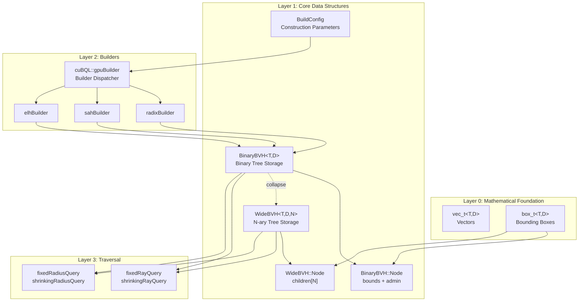
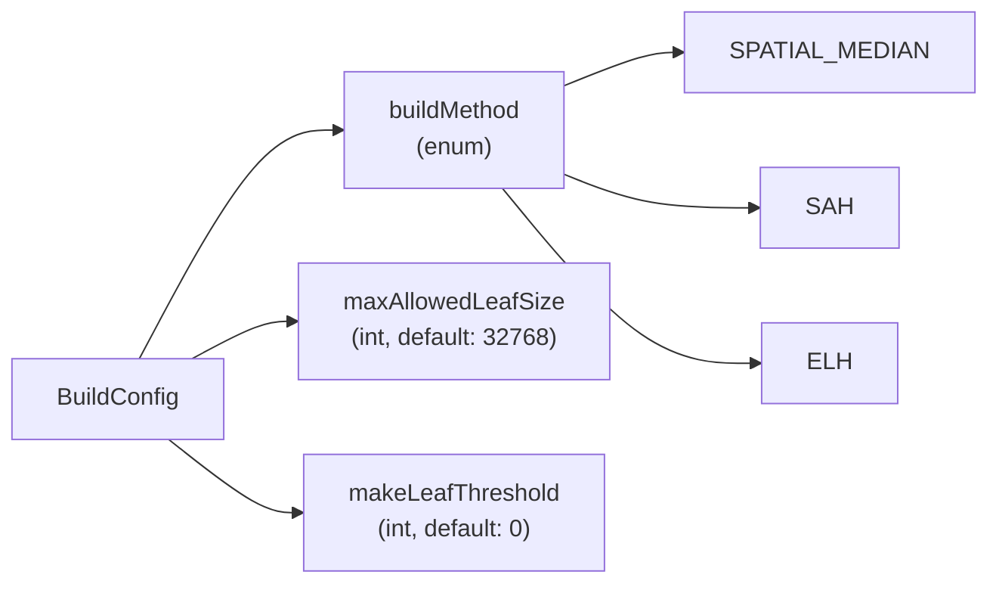
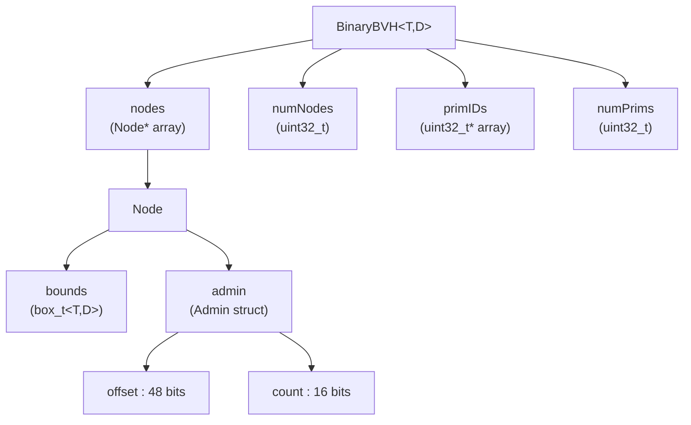
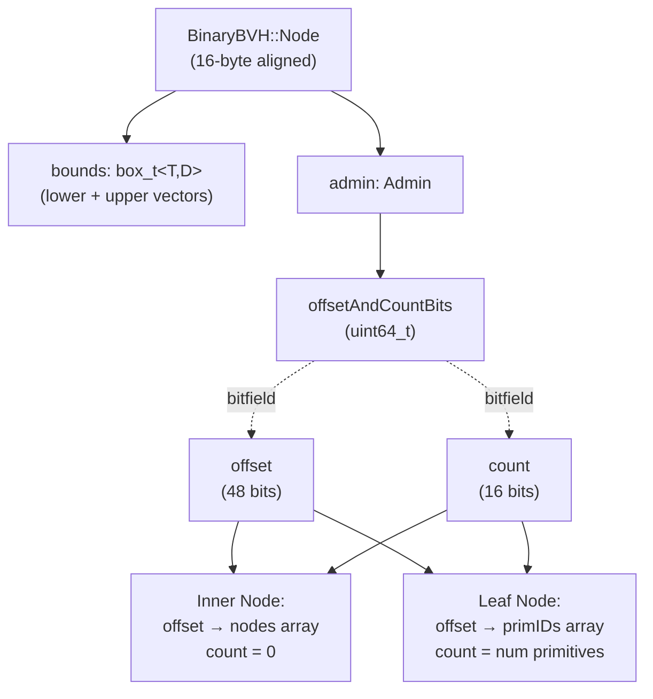
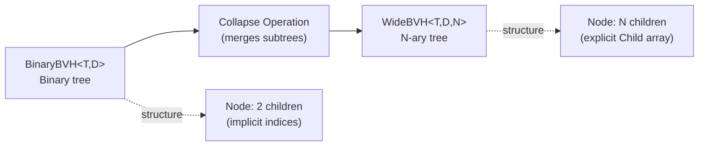
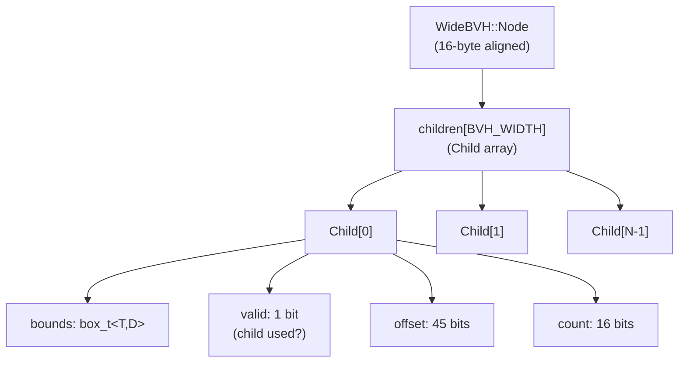
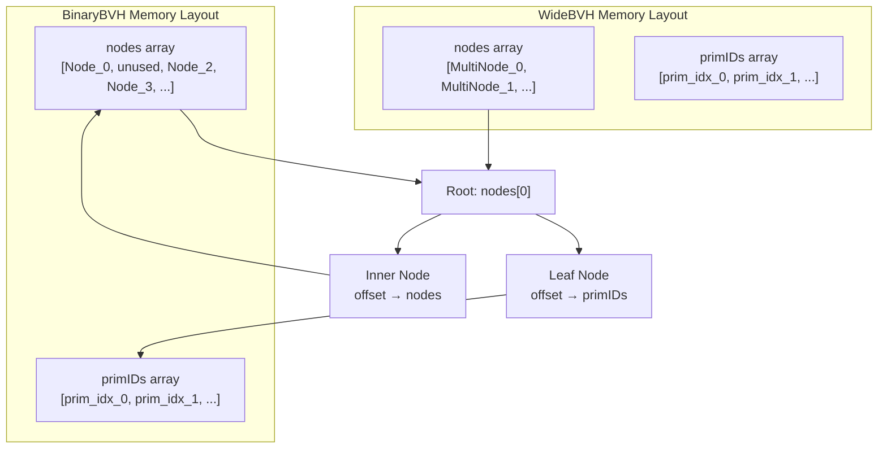
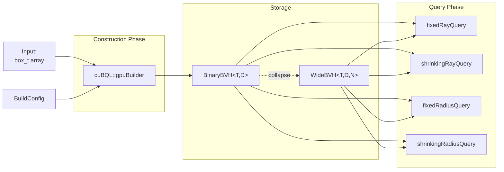

<!-- source: DeepWiki mcp.deepwiki.com · repo NVIDIA/cuBQL · page 5 Core Data Structures · fetched 2026-10-26 -->

# Core Data Structures

<details>
<summary>Relevant source files</summary>

The following files were used as context for generating this wiki page:

- [cuBQL/bvh.h](cuBQL/bvh.h)

</details>


## Purpose and Scope

This document provides an overview of cuBQL's core data structures that define BVH storage formats and construction configuration. These structures form **Layer 1** of the architecture and serve as the foundation upon which builders (Layer 2) and traversal templates (Layer 3) operate.

The three primary structures covered are:
- `BuildConfig`: Configuration parameters controlling BVH construction algorithms and leaf thresholds
- `BinaryBVH<T,D>`: Binary tree BVH storage with two children per inner node
- `WideBVH<T,D,N>`: N-ary tree BVH storage with multiple children per node

For detailed implementation documentation of each structure, see:
- [BinaryBVH](#5.1) for binary tree node layout and memory organization
- [WideBVH](#5.2) for wide tree node layout and collapsing process
- [BuildConfig](#5.3) for build algorithm selection and leaf configuration

For mathematical primitives these structures depend on, see [Mathematical Foundation](#4).

**Sources:** [cuBQL/bvh.h:1-161]()

---

## Data Structure Hierarchy

The following diagram shows how the core data structures relate to each other and to the broader system:



**Sources:** [cuBQL/bvh.h:18-134]()

---

## BuildConfig Structure

`BuildConfig` controls how the BVH construction process operates, including algorithm selection and leaf creation policies. It is defined at [cuBQL/bvh.h:18-51]().

### Build Methods

| Build Method | Enum Value | Description | Performance Characteristics |
|--------------|------------|-------------|----------------------------|
| Spatial Median | `SPATIAL_MEDIAN` | Splits at the middle of the widest dimension of primitive centroids | Fast construction, moderate query performance |
| Surface Area Heuristic | `SAH` | Evaluates split cost using surface area weighting | Slow construction, high query performance for ray tracing |
| Edge Length Heuristic | `ELH` | Experimental heuristic based on edge lengths | Balanced construction/query tradeoff |



### Configuration Fields

- **`buildMethod`**: Selects the construction algorithm (default: `SPATIAL_MEDIAN`)
- **`maxAllowedLeafSize`**: Hard upper limit on primitives per leaf (default: 32768)
- **`makeLeafThreshold`**: Soft threshold for leaf creation; value of 0 delegates decision to builder

**Sources:** [cuBQL/bvh.h:18-51]()

---

## BinaryBVH Template

`BinaryBVH<T,D>` is the primary BVH storage format, representing a binary tree where each inner node has exactly two children. It is defined at [cuBQL/bvh.h:58-100]().

### Template Parameters

| Parameter | Type | Description |
|-----------|------|-------------|
| `T` | `_scalar_t` | Coordinate type (float, double, int32, int64, etc.) |
| `D` | `_numDims` | Spatial dimensionality (typically 2, 3, or 4) |

### Structure Layout



### Key Properties

- **Root node**: Always at `nodes[0]`
- **Node pairing**: Inner nodes store children at consecutive indices (`nodes[offset]` and `nodes[offset+1]`)
- **Node 1 unused**: Index 1 is reserved/unused to ensure all child pairs start at even indices
- **Leaf identification**: Nodes with `count > 0` are leaves; `count == 0` indicates inner nodes
- **Primitive storage**: Leaf nodes reference primitives via `primIDs[offset]` through `primIDs[offset+count-1]`

**Sources:** [cuBQL/bvh.h:58-100]()

---

## BinaryBVH::Node Structure

The `Node` structure stores both spatial bounds and administrative data in a compact 16-byte aligned format:



### Admin Bitfield Layout

The `Admin` struct packs offset and count into a single 64-bit value at [cuBQL/bvh.h:72-90]():

- **`offset`**: 48 bits (supports up to 2^48 nodes or primitives)
- **`count`**: 16 bits (supports up to 65,535 primitives per leaf, though `maxLeafSize` defaults to 32,768)

The union allows reading both fields atomically via `offsetAndCountBits` or accessing them individually.

**Sources:** [cuBQL/bvh.h:67-91]()

---

## WideBVH Template

`WideBVH<T,D,N>` represents an N-ary tree where each node can have up to `N` children. It is typically created by collapsing a `BinaryBVH` to improve cache locality and SIMD utilization during traversal. Defined at [cuBQL/bvh.h:104-134]().

### Template Parameters

| Parameter | Type | Description |
|-----------|------|-------------|
| `T` | `_scalar_t` | Coordinate type (matches `BinaryBVH`) |
| `D` | `_numDims` | Spatial dimensionality (matches `BinaryBVH`) |
| `N` | `BVH_WIDTH` | Number of children per node (typically 4, 8, or 16) |

### Structure Comparison

| Aspect | BinaryBVH | WideBVH |
|--------|-----------|---------|
| Children per node | 2 (fixed) | N (up to N, some may be invalid) |
| Node structure | Single node with two implicit children | Multi-node with explicit child array |
| Memory footprint | Smaller per-node | Larger per-node but fewer total nodes |
| Traversal pattern | Binary descent | N-way branching with SIMD-friendly layout |



**Sources:** [cuBQL/bvh.h:104-134]()

---

## WideBVH::Node Structure

Unlike `BinaryBVH::Node`, a `WideBVH::Node` is a composite structure containing an array of `N` children, each with its own bounds and metadata:



### Child Structure

Each `Child` element at [cuBQL/bvh.h:118-125]() contains:

- **`bounds`**: Bounding box for this child's subtree
- **`valid`**: 1-bit flag indicating whether this child slot is used (allows sparse child arrays)
- **`offset`**: 45-bit index into `nodes` array (inner node) or `primIDs` array (leaf)
- **`count`**: 16-bit primitive count (0 for inner nodes, >0 for leaves)

This layout enables efficient SIMD operations over child bounding boxes during traversal.

**Sources:** [cuBQL/bvh.h:117-126]()

---

## Memory Layout Overview

Both `BinaryBVH` and `WideBVH` use a flat array representation for GPU-friendly memory access:



### Array Organization

**Nodes Array:**
- Allocated in device memory (GPU) or managed memory
- Indexed by `offset` field from parent nodes
- For `BinaryBVH`: node pairs stored at consecutive indices (except index 1)
- For `WideBVH`: each multi-node stored contiguously

**PrimIDs Array:**
- Stores indices into the original primitive array
- Leaf nodes reference contiguous ranges: `[offset, offset+count)`
- Enables indirection: BVH structure remains constant even if primitive data is reorganized

### Memory Ownership

Both structures store raw pointers (`nodes`, `primIDs`) without automatic memory management. Users must:
- Allocate memory via `GpuMemoryResource` or manual CUDA allocation
- Deallocate after use (see [Memory Management](#9.1))
- Ensure device memory remains valid during traversal

**Sources:** [cuBQL/bvh.h:96-99](), [cuBQL/bvh.h:129-133]()

---

## Type Aliases and Common Instantiations

cuBQL provides convenient type aliases for common BVH configurations at [cuBQL/bvh.h:137-149]():

### Standard Aliases

```cpp
// Generic alias (same as BinaryBVH)
template<typename T, int D>
using bvh_t = BinaryBVH<T,D>;

// Common 3D float/double variants
using bvh3f = BinaryBVH<float,3>;
using bvh3d = BinaryBVH<double,3>;
```

### CUDA-Specific Aliases

When compiled with `__CUDACC__` (CUDA compiler):

```cpp
typedef BinaryBVH<float,2> bvh_float2;
typedef BinaryBVH<float,3> bvh_float3;
typedef BinaryBVH<float,4> bvh_float4;
```

These aliases match CUDA's vector type naming convention (`float2`, `float3`, `float4`) for consistency.

### Usage Example Context

```cpp
// Most common: 3D float BVH
cuBQL::bvh3f myBVH;

// Double precision 3D
cuBQL::bvh3d highPrecisionBVH;

// Custom: 2D integer BVH
cuBQL::BinaryBVH<int32_t, 2> integerBVH;

// Wide BVH with 8 children per node
cuBQL::WideBVH<float, 3, 8> wideBVH;
```

**Sources:** [cuBQL/bvh.h:137-149]()

---

## Relationship to Builders and Traversal

The core data structures serve as interfaces between construction and query phases:



### Construction Interface

Builders (see [BVH Construction](#6)) produce `BinaryBVH` instances:
- Populate `nodes` and `primIDs` arrays
- Set `numNodes` and `numPrims` counts
- Ensure node 0 is root, node 1 is unused

Optional collapsing converts `BinaryBVH` to `WideBVH` for traversal optimization.

### Traversal Interface

Traversal templates (see [BVH Traversal](#7)) consume `BinaryBVH` or `WideBVH`:
- Access `nodes` array for tree structure
- Access `primIDs` array for leaf primitive indices
- Use `node_width` constant for compile-time dispatch between binary/wide traversal

The template-based design allows traversal code to work uniformly with both storage formats.

**Sources:** [cuBQL/bvh.h:65-66](), [cuBQL/bvh.h:112-113]()

---

## Summary

The core data structures define the foundational storage layer for cuBQL's BVH system:

| Structure | Purpose | Key Features |
|-----------|---------|--------------|
| `BuildConfig` | Controls BVH construction | Algorithm selection, leaf thresholds |
| `BinaryBVH<T,D>` | Binary tree storage | Two children per node, compact representation |
| `WideBVH<T,D,N>` | N-ary tree storage | Multiple children per node, SIMD-friendly layout |

These structures are designed for GPU execution with:
- Flat array layouts for coalesced memory access
- Bitfield packing to minimize memory footprint
- 16-byte alignment for optimal cache line utilization
- Template parameterization for type/dimension flexibility

For implementation details of each structure, see the child pages:
- [BinaryBVH](#5.1) - Node layout and traversal semantics
- [WideBVH](#5.2) - Multi-child nodes and collapsing algorithm
- [BuildConfig](#5.3) - Algorithm selection and parameter tuning

**Sources:** [cuBQL/bvh.h:1-161]()

---

