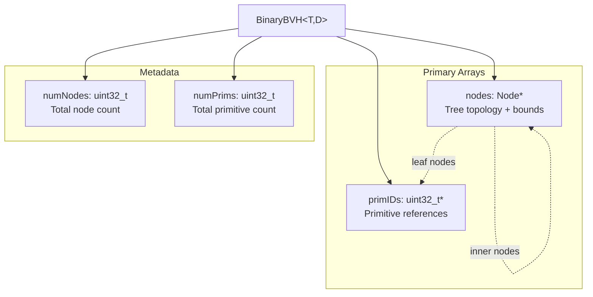
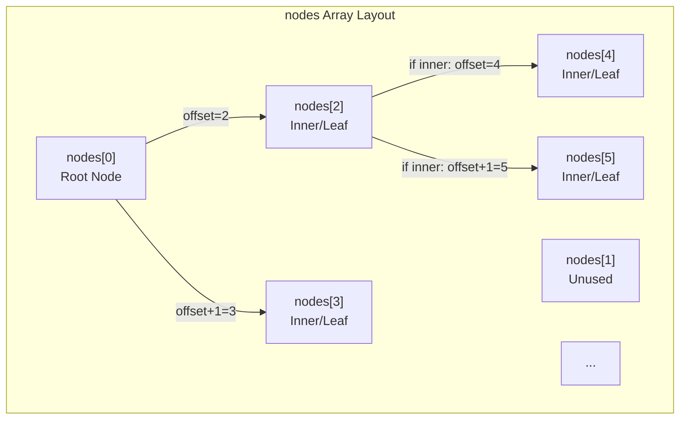
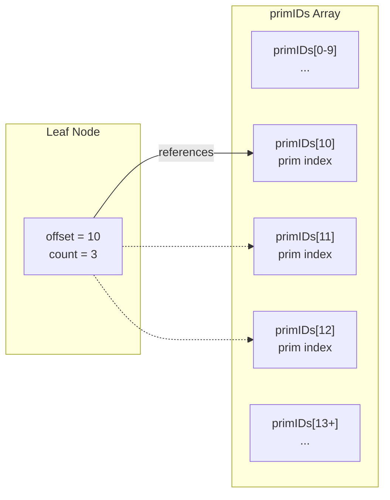
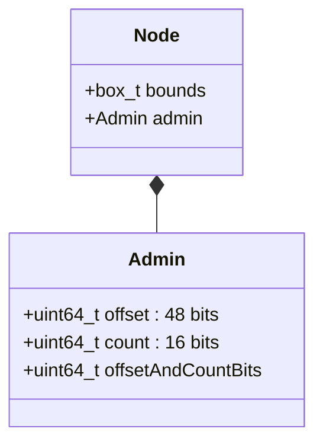
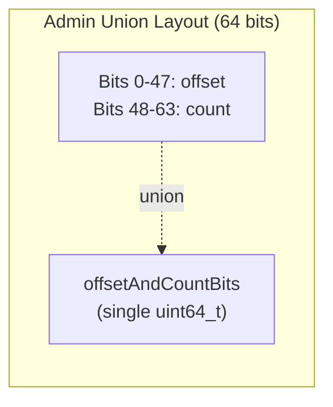
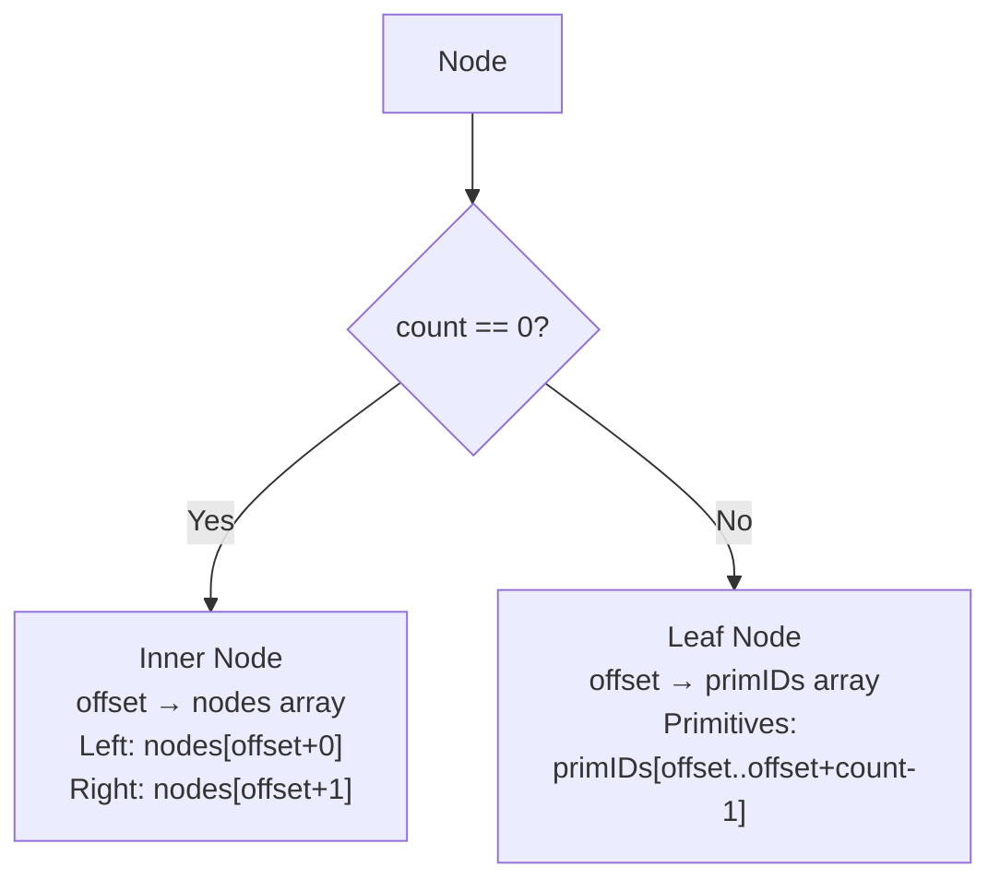
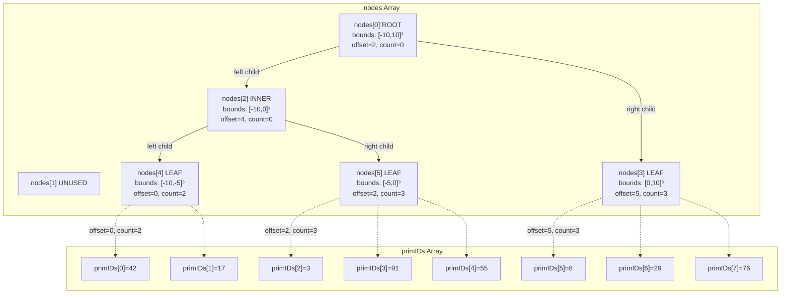

<!-- source: DeepWiki mcp.deepwiki.com · repo NVIDIA/cuBQL · page 5.1 BinaryBVH · fetched 2026-10-26 -->

# BinaryBVH

<details>
<summary>Relevant source files</summary>

The following files were used as context for generating this wiki page:

- [cuBQL/bvh.h](cuBQL/bvh.h)

</details>


## Purpose and Scope

This page documents the `BinaryBVH` data structure, which is the primary tree format used in cuBQL for storing binary bounding volume hierarchies. It describes the memory layout, node structure, administrative fields, and conventions for representing both inner nodes and leaf nodes.

For information on how to construct a `BinaryBVH`, see [GPU Builder Interface](#6.1). For the wide BVH variant with N-ary nodes, see [WideBVH](#5.2). For build configuration options, see [BuildConfig](#5.3).

**Sources**: [cuBQL/bvh.h:53-100]()

---

## Overview

`BinaryBVH` is a template struct that represents a complete binary bounding volume hierarchy. Each node in the tree is either an inner node with exactly two children or a leaf node containing references to primitives. The structure uses two primary arrays: `nodes` for the tree topology and bounding boxes, and `primIDs` for primitive indices at leaf nodes.

The tree uses a breadth-first-like allocation scheme where node pairs are allocated consecutively, enabling cache-efficient traversal on GPU hardware.



**Diagram**: BinaryBVH structure with primary data arrays and metadata fields

**Sources**: [cuBQL/bvh.h:58-100]()

---

## Template Parameters

`BinaryBVH` is parameterized by two template arguments that determine its coordinate type and dimensionality:

| Parameter | Description | Common Values |
|-----------|-------------|---------------|
| `_scalar_t` | Coordinate data type | `float`, `double`, `int32_t`, `int64_t` |
| `_numDims` | Spatial dimensionality | `2`, `3`, `4` |

The template exposes these parameters as public type aliases and constants:

```cpp
using scalar_t = _scalar_t;           // Line 60
enum { numDims = _numDims };          // Line 61
using vec_t = cuBQL::vec_t<scalar_t,numDims>;  // Line 62
using box_t = cuBQL::box_t<scalar_t,numDims>;  // Line 63
```

The structure also defines `node_width = 1` to indicate binary node structure (two children per inner node), distinguishing it from `WideBVH` which has N children per node.

**Sources**: [cuBQL/bvh.h:58-65]()

---

## Data Layout

### Node Array

The `nodes` array stores all tree nodes in a flat, contiguous allocation. Node indexing follows specific conventions:

- **Node 0**: Always the root node of the tree
- **Node 1**: Always unused (reserved to maintain even-indexed node pairs)
- **Node N**: For inner nodes, child nodes are at indices `offset+0` (left) and `offset+1` (right)

This layout ensures that all node pairs (left/right children) begin at even indices, which can improve cache line utilization during traversal.



**Diagram**: Node array indexing scheme showing root at index 0, unused slot at index 1, and paired child allocation

### Primitive ID Array

The `primIDs` array is a flat array of unsigned 32-bit integers that stores indices of primitives contained in leaf nodes. Each leaf node references a contiguous segment of this array via its `offset` and `count` fields.



**Diagram**: Leaf node referencing a contiguous segment of the primIDs array

**Sources**: [cuBQL/bvh.h:96-99]()

---

## Node Structure

Each `Node` is a 16-byte aligned structure containing bounding box information and administrative fields:



**Diagram**: Node structure composition with box_t bounds and Admin administrative data

### Bounds Field

The `bounds` field is of type `box_t<scalar_t, numDims>` and stores the axis-aligned bounding box that encloses all primitives (or child node bounds) within this node's subtree. This enables efficient culling during traversal.

**Sources**: [cuBQL/bvh.h:67-70]()

---

## Administrative Fields

The `Admin` struct uses bit packing to store node metadata compactly within a single 64-bit value. This is implemented as a union allowing both bitfield access and atomic 64-bit read/write operations:

| Field | Bit Width | Purpose |
|-------|-----------|---------|
| `offset` | 48 bits | Index into `nodes[]` for inner nodes, index into `primIDs[]` for leaf nodes |
| `count` | 16 bits | Number of primitives in leaf (0 for inner nodes) |

The union member `offsetAndCountBits` allows reading or writing both fields atomically as a single `uint64_t`, which is useful during concurrent BVH construction on the GPU.



**Diagram**: Bit layout of Admin struct showing offset and count fields within 64-bit word

The 16-bit `count` field limits the maximum leaf size to `(1 << 16) - 1 = 65535` primitives, exposed as `BinaryBVH::maxLeafSize`.

**Sources**: [cuBQL/bvh.h:72-90](), [cuBQL/bvh.h:93]()

---

## Inner Nodes vs Leaf Nodes

The `count` field determines whether a node is an inner node or a leaf node:

### Inner Node Semantics

- `count == 0` indicates an inner node
- `offset` points into the `nodes` array
- Left child is at `nodes[offset + 0]`
- Right child is at `nodes[offset + 1]`
- `bounds` encloses the bounds of both children

### Leaf Node Semantics

- `count > 0` indicates a leaf node with `count` primitives
- `offset` points into the `primIDs` array
- Primitives are `primIDs[offset]`, `primIDs[offset+1]`, ..., `primIDs[offset+count-1]`
- `bounds` encloses all referenced primitives



**Diagram**: Decision tree for interpreting Node admin fields based on count value

**Sources**: [cuBQL/bvh.h:72-84]()

---

## Memory Alignment

The `Node` struct uses a 16-byte alignment requirement specified by the `CUBQL_ALIGN(16)` macro. This alignment ensures:

- Efficient SIMD operations on bounding box data
- Optimal cache line utilization on both CPU and GPU
- Coalesced memory accesses during GPU traversal

The 16-byte alignment is critical for performance on CUDA hardware, where misaligned accesses can significantly degrade memory throughput.

**Sources**: [cuBQL/bvh.h:67]()

---

## Type Aliases

cuBQL provides several convenience type aliases for common `BinaryBVH` instantiations:

| Alias | Full Type | Description |
|-------|-----------|-------------|
| `bvh_t<T,D>` | `BinaryBVH<T,D>` | Generic alias template |
| `bvh3f` | `BinaryBVH<float,3>` | Single-precision 3D BVH (most common) |
| `bvh3d` | `BinaryBVH<double,3>` | Double-precision 3D BVH |
| `bvh_float2` | `BinaryBVH<float,2>` | CUDA-specific 2D alias |
| `bvh_float3` | `BinaryBVH<float,3>` | CUDA-specific 3D alias |
| `bvh_float4` | `BinaryBVH<float,4>` | CUDA-specific 4D alias |

The CUDA-specific aliases (suffixed with `_float2`, `_float3`, `_float4`) are only available when compiling with `nvcc` (guarded by `#ifdef __CUDACC__`).

**Sources**: [cuBQL/bvh.h:137-149]()

---

## Example Tree Structure

The following diagram illustrates a small example tree showing how nodes reference each other and how leaf nodes reference primitives:



**Diagram**: Example BinaryBVH tree with 6 nodes (1 root, 1 inner, 3 leaves, 1 unused) and 8 primitives

In this example:
- Node 0 (root) is an inner node pointing to children at indices 2 and 3
- Node 2 is an inner node pointing to children at indices 4 and 5
- Nodes 3, 4, and 5 are leaf nodes referencing different segments of the `primIDs` array
- Node 1 remains unused per the indexing convention

**Sources**: [cuBQL/bvh.h:53-100]()

---

