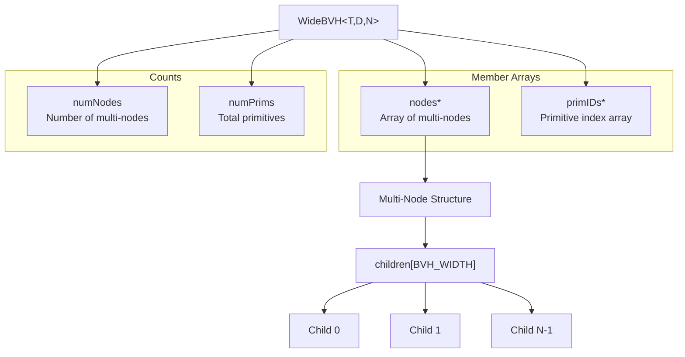
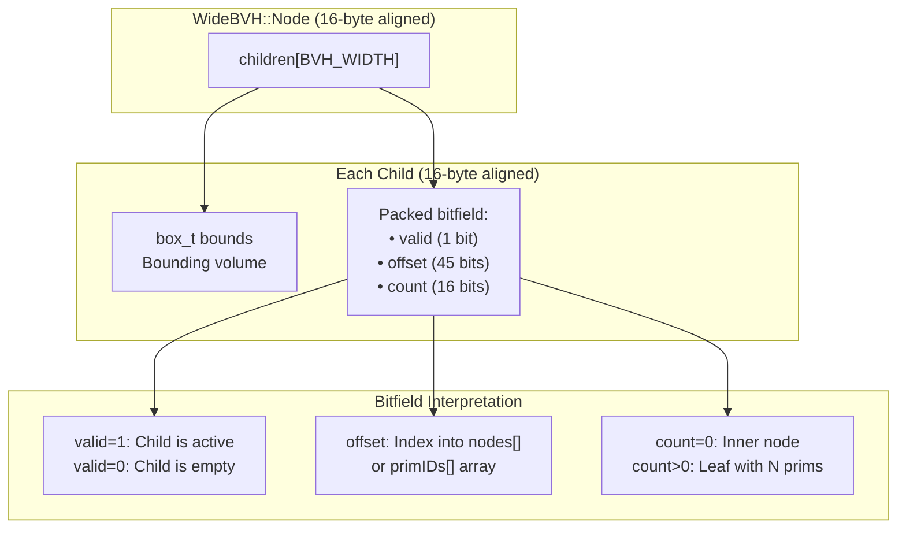
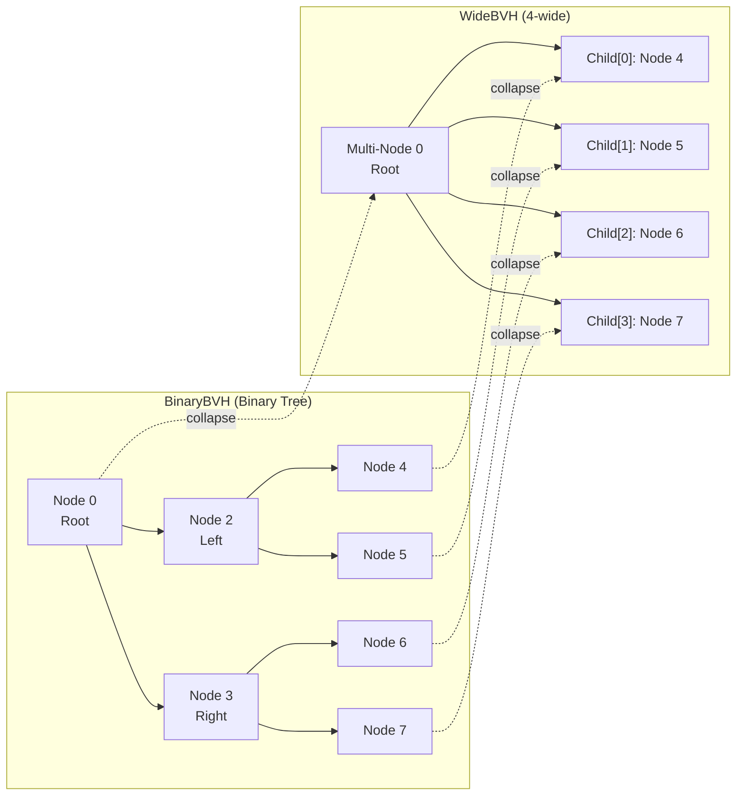
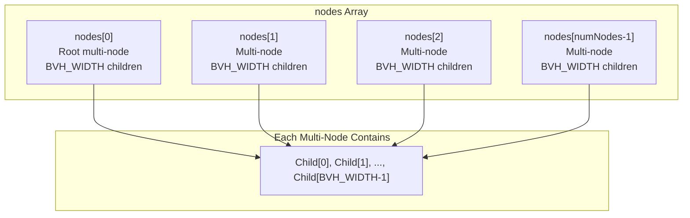
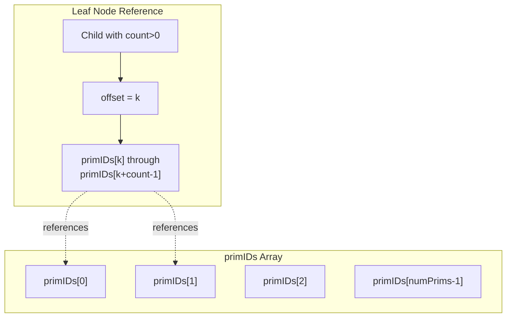
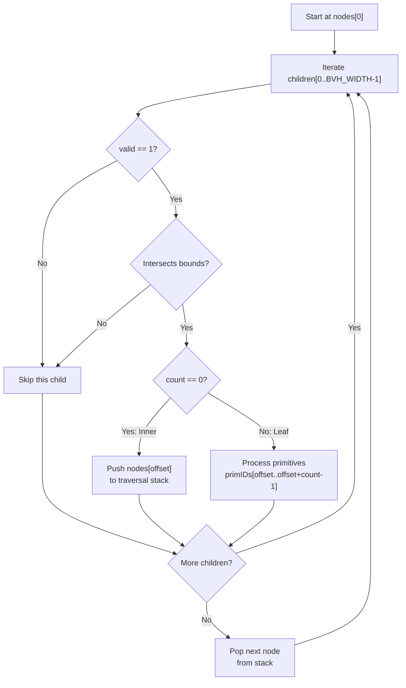
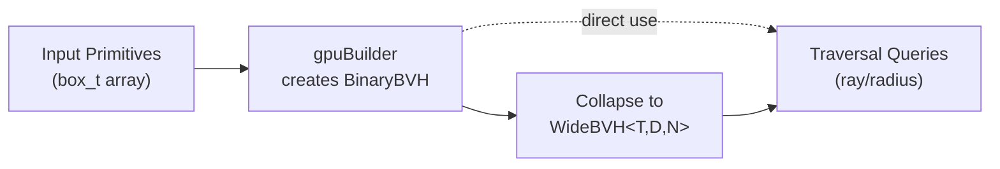

<!-- source: DeepWiki mcp.deepwiki.com · repo NVIDIA/cuBQL · page 5.2 WideBVH · fetched 2026-10-26 -->

# WideBVH

<details>
<summary>Relevant source files</summary>

The following files were used as context for generating this wiki page:

- [cuBQL/bvh.h](cuBQL/bvh.h)

</details>


## Purpose and Scope

This document describes the `WideBVH` data structure, a wide (N-ary) bounding volume hierarchy where each internal node has a fixed number of children (typically 4, 8, or 16). WideBVH is an optimized representation created by collapsing a `BinaryBVH` to improve traversal performance through better cache utilization and SIMD instruction exploitation.

For information about the binary tree structure that serves as the foundation for WideBVH, see [BinaryBVH](#5.1). For build configuration options, see [BuildConfig](#5.3). For the collapsing operation that converts BinaryBVH to WideBVH, see [GPU Builder Interface](#6.1).

**Sources**: [cuBQL/bvh.h:102-134]()

## Template Parameters

`WideBVH` is defined as a template with three parameters:

```cpp
template<typename _scalar_t, int _numDims, int BVH_WIDTH>
struct WideBVH
```

| Parameter | Purpose | Typical Values | Example |
|-----------|---------|----------------|---------|
| `_scalar_t` | Coordinate type for spatial data | `float`, `double` | `float` for single precision |
| `_numDims` | Spatial dimensionality | `2`, `3`, `4` | `3` for 3D space |
| `BVH_WIDTH` | Number of children per node | `4`, `8`, `16` | `8` for octree-like structure |

The structure exposes these through type aliases and constants:

- `scalar_t`: Type alias for `_scalar_t`
- `numDims`: Enum constant equal to `_numDims`
- `node_width`: Static constant equal to `BVH_WIDTH`
- `vec_t`: Type alias for `cuBQL::vec_t<scalar_t,numDims>`
- `box_t`: Type alias for `cuBQL::box_t<scalar_t,numDims>`

**Sources**: [cuBQL/bvh.h:104-112]()

## Structure Overview



**Diagram: WideBVH Top-Level Structure**

Unlike `BinaryBVH` where each node represents a single tree node, `WideBVH::Node` represents a consolidated multi-node containing `BVH_WIDTH` children. This design reduces memory indirection during traversal.

**Sources**: [cuBQL/bvh.h:128-134]()

## Node and Child Layout

The `WideBVH::Node` structure contains an array of `BVH_WIDTH` child descriptors:



**Diagram: WideBVH Node and Child Memory Layout**

### Child Structure Details

Each `Child` within a `Node` contains:

| Field | Type | Bits | Purpose |
|-------|------|------|---------|
| `bounds` | `box_t` | Varies by `scalar_t` and `numDims` | Axis-aligned bounding box for this child's subtree |
| `valid` | `uint64_t` bitfield | 1 | Whether this child slot is used (1) or empty (0) |
| `offset` | `uint64_t` bitfield | 45 | Index into `nodes[]` (inner) or `primIDs[]` (leaf) |
| `count` | `uint64_t` bitfield | 16 | 0 for inner nodes, primitive count for leaves |

The bitfield packing allows encoding all administrative data in a single 64-bit word alongside the bounding box, enabling efficient atomic reads/writes.

**Sources**: [cuBQL/bvh.h:117-126]()

## Collapsing from BinaryBVH

WideBVH is typically created by "collapsing" a `BinaryBVH`, merging chains of binary nodes into wider multi-nodes:



**Diagram: Binary-to-Wide BVH Collapsing Example**

### Collapsing Process

The collapsing operation:

1. **Starts at BinaryBVH root**: Traverses the binary tree
2. **Accumulates children**: Follows binary tree paths, collecting up to `BVH_WIDTH` descendants
3. **Creates multi-nodes**: When `BVH_WIDTH` children are found (or a different termination condition), creates a WideBVH multi-node
4. **Marks empty slots**: If fewer than `BVH_WIDTH` children exist, remaining slots are marked invalid (`valid=0`)
5. **Recursively processes**: Continues for each subtree

This transformation reduces tree depth from `O(log₂ N)` to `O(logₙ N)` where N is `BVH_WIDTH`, improving traversal performance by:
- Reducing pointer chasing and memory indirection
- Enabling better SIMD utilization (testing multiple children in parallel)
- Improving cache line utilization (multiple children per cache line)

**Sources**: Based on system architecture diagrams and [cuBQL/bvh.h:102-104]()

## Memory Layout and Storage

The WideBVH maintains two primary arrays:

### Nodes Array



**Diagram: WideBVH Nodes Array Layout**

- **Type**: `node_t*` (pointer to array of `Node` structures)
- **Size**: `numNodes` multi-nodes
- **Indexing**: `nodes[0]` is always the root; traversal starts here
- **Element**: Each element is a `Node` containing `BVH_WIDTH` children

### PrimIDs Array



**Diagram: WideBVH PrimIDs Array Layout**

- **Type**: `uint32_t*` (pointer to array of primitive indices)
- **Size**: `numPrims` total primitive references
- **Purpose**: Maps BVH leaf references to actual primitive indices in user's geometry arrays
- **Indexing**: Leaf children use `offset` to index into this array, reading `count` consecutive entries

**Sources**: [cuBQL/bvh.h:128-134]()

## Child Encoding and Semantics

### Inner Node Children

For inner node children (`count == 0`):
- `valid = 1`: Child is an active subtree
- `offset`: Index into `nodes[]` array pointing to child multi-node
- `count = 0`: Distinguishes inner from leaf nodes
- `bounds`: Bounding box enclosing all primitives in child's subtree

### Leaf Node Children

For leaf node children (`count > 0`):
- `valid = 1`: Child is an active leaf
- `offset`: Index into `primIDs[]` array
- `count`: Number of primitives in this leaf (1 to 65535, given 16-bit field)
- `bounds`: Bounding box enclosing the leaf's primitives

### Empty Children

For unused child slots (`valid == 0`):
- `valid = 0`: Child slot is empty (not all nodes need `BVH_WIDTH` children)
- Other fields undefined/unused
- Traversal algorithms skip these during descent

**Sources**: [cuBQL/bvh.h:118-125]()

## Traversal Implications

WideBVH's structure affects traversal patterns:



**Diagram: WideBVH Traversal Flow**

### Advantages Over BinaryBVH

1. **Reduced Traversal Depth**: Fewer levels to traverse (log_N vs log_2 depth)
2. **SIMD Opportunities**: Can test multiple `bounds` intersections in parallel
3. **Better Cache Utilization**: Multiple children fit in single cache line
4. **Reduced Branching**: Process multiple children in loop vs. recursive binary descent

### Trade-offs

1. **Memory Overhead**: Empty child slots waste space (partially mitigated by `valid` flag)
2. **Build Complexity**: Collapsing requires additional processing step
3. **Not All Nodes Full**: Leaf distribution may leave many slots unused

**Sources**: Based on system architecture diagrams and traversal template design

## Usage Patterns

### When to Use WideBVH

Use WideBVH when:
- **Traversal-bound workloads**: Query performance is more critical than build time
- **SIMD-capable hardware**: Target GPUs or CPUs with wide vector units
- **Repeated queries**: BVH built once, queried many times
- **Ray tracing**: Wide BVHs particularly effective for coherent ray bundles

### When to Use BinaryBVH

Use BinaryBVH when:
- **Dynamic scenes**: Frequent rebuilds where build time matters
- **Memory-constrained**: Tighter memory layout without empty slots
- **Simple traversal**: Binary descent is easier to implement for custom queries
- **Direct builder output**: Avoid collapsing overhead

### Typical Workflow



**Diagram: Typical WideBVH Construction Workflow**

1. Build `BinaryBVH` using `gpuBuilder` or other builders
2. Optionally collapse to `WideBVH<T,D,N>` with desired width
3. Use WideBVH with traversal templates for queries

The collapsing operation is typically performed by specialized builder variants (e.g., `wideGpuBuilder`) or post-processing utilities.

**Sources**: Based on system architecture diagrams

## Code Entities and File Locations

### Primary Definition

- **Structure Definition**: [cuBQL/bvh.h:104-134]()
- **Node Structure**: [cuBQL/bvh.h:117-126]()
- **Child Structure**: [cuBQL/bvh.h:118-125]()

### Related Structures

- **BinaryBVH**: [cuBQL/bvh.h:58-100]() - Source structure for collapsing
- **BuildConfig**: [cuBQL/bvh.h:18-51]() - Configuration for builders
- **box_t**: Bounding box type used in `Child::bounds`
- **vec_t**: Vector type used by `box_t`

### Key Constants

| Constant | Value | Location | Purpose |
|----------|-------|----------|---------|
| `node_width` | `BVH_WIDTH` | [cuBQL/bvh.h:112]() | Children per multi-node |
| `CUBQL_ALIGN(16)` | 16 bytes | [cuBQL/bvh.h:117-118]() | Memory alignment for Node and Child |

**Sources**: [cuBQL/bvh.h:102-134]()

## Design Rationale

The WideBVH design prioritizes traversal performance through several architectural choices:

1. **Fixed-width nodes**: Compile-time `BVH_WIDTH` enables loop unrolling and SIMD optimization
2. **Bitfield packing**: Compact encoding of `valid`, `offset`, and `count` reduces memory footprint
3. **Alignment requirements**: 16-byte alignment enables efficient SIMD loads
4. **Unified child structure**: Consistent layout for inner and leaf children simplifies traversal code
5. **Explicit valid flag**: Allows partial node filling without special sentinel values

These design decisions reflect WideBVH's role as a traversal-optimized representation, accepting some build-time complexity and memory overhead in exchange for query-time performance gains.

**Sources**: [cuBQL/bvh.h:102-134]()

---

