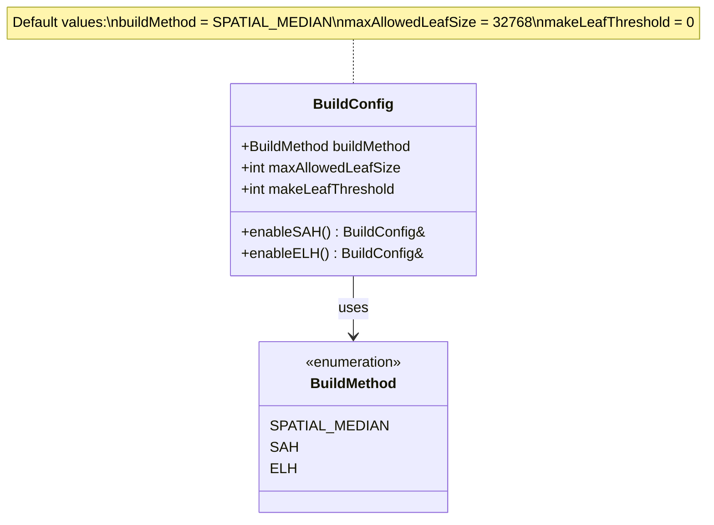
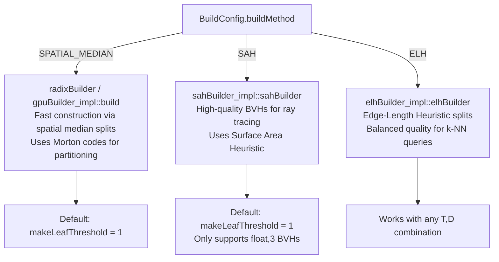
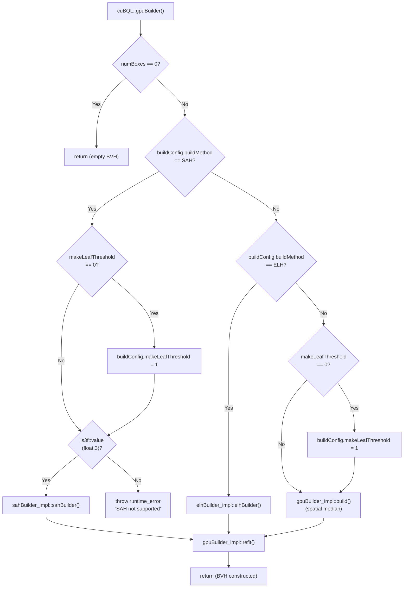
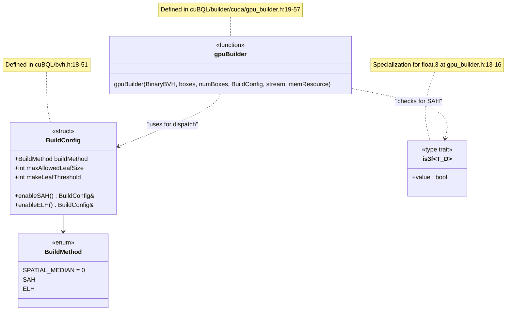

<!-- source: DeepWiki mcp.deepwiki.com · repo NVIDIA/cuBQL · page 5.3 BuildConfig · fetched 2026-10-26 -->

# BuildConfig

<details>
<summary>Relevant source files</summary>

The following files were used as context for generating this wiki page:

- [cuBQL/builder/cuda/gpu_builder.h](cuBQL/builder/cuda/gpu_builder.h)
- [cuBQL/bvh.h](cuBQL/bvh.h)

</details>


## Purpose and Scope

This page documents the `BuildConfig` structure, which controls BVH construction behavior by specifying build algorithms and leaf creation thresholds. For information about the actual builder implementations, see [Builder Algorithms](#6.2). For details about the BVH data structures produced by builders, see [BinaryBVH](#5.1).

**Sources:** [cuBQL/bvh.h:18-51]()

---

## Overview

`BuildConfig` is a configuration struct that allows users to control how BVH builders construct acceleration structures. It serves as the primary interface for selecting build algorithms and tuning performance-quality tradeoffs. The struct is passed to `cuBQL::gpuBuilder()` to determine which builder implementation executes and how it behaves.

The configuration operates at two levels:
1. **Algorithm selection** via the `buildMethod` field, which dispatches to radix, SAH, or ELH builders
2. **Leaf creation policies** via threshold parameters that control when subtrees become leaves

**Sources:** [cuBQL/bvh.h:15-18](), [cuBQL/builder/cuda/gpu_builder.h:19-57]()

---

## BuildConfig Structure



### BuildConfig Member Fields

| Field | Type | Default | Description |
|-------|------|---------|-------------|
| `buildMethod` | `BuildMethod` enum | `SPATIAL_MEDIAN` | Selects which builder algorithm to use |
| `maxAllowedLeafSize` | `int` | `1<<15` (32768) | Hard upper limit on primitives per leaf; builder never exceeds this |
| `makeLeafThreshold` | `int` | `0` | Threshold below which builder creates leaves; 0 means "use builder's default" |

**Sources:** [cuBQL/bvh.h:40-51]()

---

## Build Methods

The `BuildMethod` enum determines which builder implementation constructs the BVH. Each method offers different performance-quality tradeoffs.

### BuildMethod Enumeration



#### SPATIAL_MEDIAN (Default)

The spatial median strategy computes centroid bounding boxes and splits along the widest dimension through the middle. This is the fastest build method.

**Algorithm characteristics:**
- Computes centroid of each primitive in the current subtree
- Finds bounding box of those centroids
- Creates split plane along widest dimension of centroid bounds, through the middle
- Uses Morton code-based radix sorting for efficient GPU parallelism

**Performance:** Very fast (~13ms for 10M primitives)

**Quality:** Moderate; produces reasonably balanced trees but not optimized for specific query patterns

**Implementation:** [cuBQL/builder/cuda/sm_builder.h]()

#### SAH (Surface Area Heuristic)

The SAH method evaluates splitting costs based on surface area, optimizing for ray tracing performance. This produces the highest quality BVHs but is more expensive to build.

**Algorithm characteristics:**
- Bins primitives along each dimension
- Evaluates split cost using surface area heuristic: `cost = SA(left) * N_left + SA(right) * N_right`
- Selects lowest-cost split plane
- Primarily designed for ray tracing workloads

**Performance:** Slower than spatial median due to binning and cost evaluation

**Quality:** Highest; optimal for ray tracing, helpful for other queries

**Limitations:** Only supported for `BinaryBVH<float,3>` (checked at runtime via `is3f<T,D>::value`)

**Implementation:** [cuBQL/builder/cuda/sah_builder.h]()

#### ELH (Edge-Length Heuristic)

The ELH method splits based on the sum of bounding box edge lengths, providing a balance between spatial median and SAH.

**Algorithm characteristics:**
- Splits based on edge-length metrics rather than surface area
- Better than spatial median for k-NN style queries
- Not as optimal as SAH for ray tracing

**Performance:** Between spatial median and SAH

**Quality:** Experimental; often better than spatial median for nearest neighbor queries

**Implementation:** [cuBQL/builder/cuda/elh_builder.h]()

**Sources:** [cuBQL/bvh.h:21-38](), [cuBQL/builder/cuda/gpu_builder.h:31-55]()

---

## Configuration Parameters

### maxAllowedLeafSize

This parameter enforces a hard upper limit on leaf size. No matter what the input primitives look like or what `makeLeafThreshold` specifies, the builder will never create leaves larger than this value.

**Default value:** `1<<15` = 32768 primitives

**Rationale:** Prevents pathological cases where all primitives might end up in a single leaf, which would defeat the purpose of spatial acceleration.

**Constraint:** Must not exceed `BinaryBVH<T,D>::maxLeafSize`, which is `(1<<16)-1` = 65535, determined by the 16-bit `count` field in `BinaryBVH::Node::Admin`.

**Sources:** [cuBQL/bvh.h:40-43](), [cuBQL/bvh.h:68](), [cuBQL/bvh.h:93]()

### makeLeafThreshold

This parameter controls when the builder should create a leaf rather than continuing to subdivide. It represents the target number of primitives per leaf.

**Default value:** `0` (meaning "use builder's default")

**Behavior:**
- When set to `0`, each builder applies its own default threshold
  - For SAH and spatial median: defaults to `1` if not explicitly set
  - Applied in `gpuBuilder()` before dispatching to specific builders
- When set to a positive value, the builder creates leaves when a subtree contains ≤ this many primitives

**Usage pattern:**
```cpp
BuildConfig config;
config.makeLeafThreshold = 4;  // Create leaves with ≤4 primitives
```

**Tradeoffs:**
- **Lower values** (e.g., 1-2): Deeper trees, more nodes, faster traversal, higher memory usage
- **Higher values** (e.g., 8-16): Shallower trees, fewer nodes, more leaf tests, lower memory usage

**Sources:** [cuBQL/bvh.h:45-48](), [cuBQL/builder/cuda/gpu_builder.h:32-35](), [cuBQL/builder/cuda/gpu_builder.h:50-53]()

---

## Builder Dispatch Flow

The following diagram shows how `BuildConfig` parameters control the dispatch logic in `cuBQL::gpuBuilder()`:



**Key dispatch decisions:**

1. **Empty input check:** Returns immediately if no boxes provided
2. **SAH path:** Requires `float,3` specialization, defaults `makeLeafThreshold` to 1
3. **ELH path:** Works with any `T,D`, no default threshold modification
4. **Spatial median path:** Default case, sets `makeLeafThreshold` to 1 if unspecified
5. **Refitting:** All paths end with a refit pass to tighten bounding boxes

**Sources:** [cuBQL/builder/cuda/gpu_builder.h:19-57]()

---

## Usage Examples

### Basic Configuration with Defaults

```cpp
// Uses SPATIAL_MEDIAN with default thresholds
BuildConfig config;
gpuBuilder(bvh, boxes, numBoxes, config, stream, memResource);
```

**Resulting behavior:**
- `buildMethod = SPATIAL_MEDIAN`
- `makeLeafThreshold = 1` (set by gpuBuilder)
- `maxAllowedLeafSize = 32768`

### Enabling SAH for High-Quality BVHs

```cpp
BuildConfig config;
config.enableSAH();  // Chainable method
gpuBuilder(bvh, boxes, numBoxes, config, stream, memResource);
```

**Method implementation:**
```cpp
inline BuildConfig &enableSAH() { buildMethod = SAH; return *this; }
```

The chainable design allows:
```cpp
BuildConfig config;
config.enableSAH().makeLeafThreshold = 2;
```

### Enabling ELH for k-NN Queries

```cpp
BuildConfig config;
config.enableELH();
gpuBuilder(bvh, boxes, numBoxes, config, stream, memResource);
```

### Custom Leaf Threshold

```cpp
BuildConfig config;
config.buildMethod = BuildConfig::SPATIAL_MEDIAN;
config.makeLeafThreshold = 8;  // Larger leaves for memory efficiency
gpuBuilder(bvh, boxes, numBoxes, config, stream, memResource);
```

### Restricting Maximum Leaf Size

```cpp
BuildConfig config;
config.maxAllowedLeafSize = 16;  // Smaller leaves for better culling
gpuBuilder(bvh, boxes, numBoxes, config, stream, memResource);
```

**Sources:** [cuBQL/bvh.h:19-20](), [cuBQL/builder/cuda/gpu_builder.h:19-24]()

---

## Default Behavior Summary

| Scenario | Effective Settings |
|----------|-------------------|
| Default-constructed `BuildConfig` | `SPATIAL_MEDIAN`, `makeLeafThreshold=1` (set by gpuBuilder), `maxAllowedLeafSize=32768` |
| `config.enableSAH()` | `SAH`, `makeLeafThreshold=1` (set by gpuBuilder), `maxAllowedLeafSize=32768` |
| `config.enableELH()` | `ELH`, `makeLeafThreshold` unchanged (uses builder's internal logic), `maxAllowedLeafSize=32768` |
| User sets `makeLeafThreshold` | User value respected, not overridden by gpuBuilder |

**Important note:** The `gpuBuilder()` function modifies `makeLeafThreshold` to 1 for SAH and spatial median builders **only if** it's initially 0. If you explicitly set it to any other value (including 1), your setting is preserved.

**Sources:** [cuBQL/bvh.h:50](), [cuBQL/builder/cuda/gpu_builder.h:32-35](), [cuBQL/builder/cuda/gpu_builder.h:50-53]()

---

## Type Constraints

### SAH Builder Limitation

The SAH builder only supports `BinaryBVH<float,3>`. This is enforced at runtime:

```cpp
if (is3f<T,D>::value) {
    sahBuilder_impl::sahBuilder((BinaryBVH<float,3>&)bvh, ...);
} else {
    throw std::runtime_error("SAH builder not supported for this type of BVH");
}
```

**Rationale:** The SAH implementation is optimized specifically for 3D single-precision float geometries, which are the most common use case for ray tracing applications.

**Workaround:** Use `SPATIAL_MEDIAN` or `ELH` for other type combinations (e.g., `BinaryBVH<double,3>`, `BinaryBVH<float,2>`).

**Sources:** [cuBQL/builder/cuda/gpu_builder.h:13-16](), [cuBQL/builder/cuda/gpu_builder.h:36-42]()

---

## BuildConfig Type Definition Reference



**Sources:** [cuBQL/bvh.h:18-51](), [cuBQL/builder/cuda/gpu_builder.h:13-16](), [cuBQL/builder/cuda/gpu_builder.h:19-57]()

---

