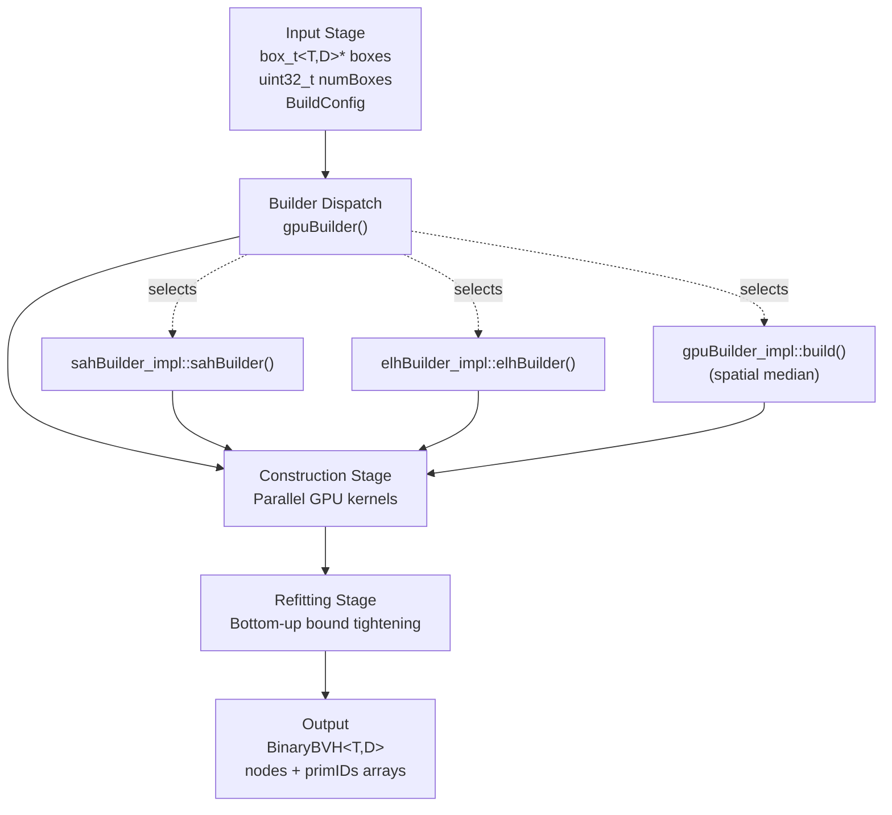
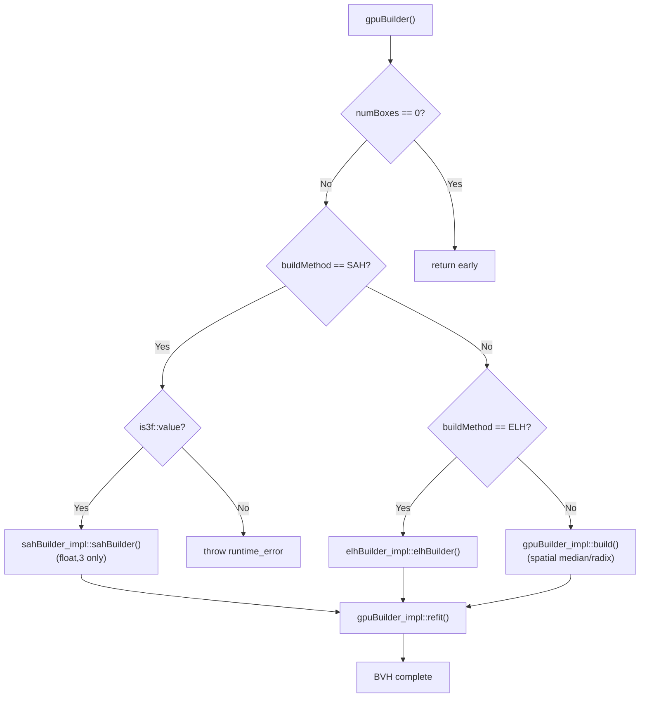
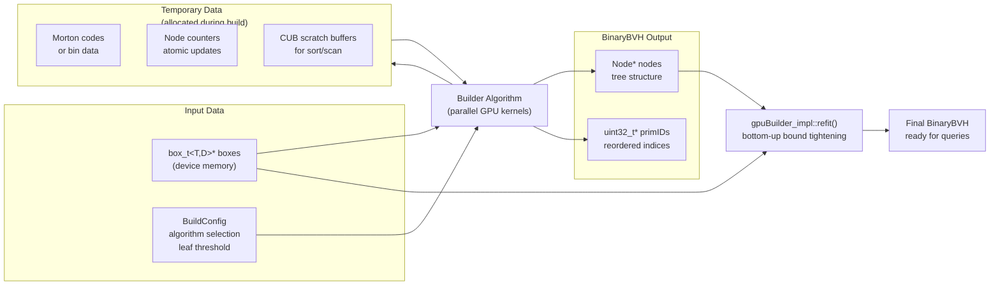
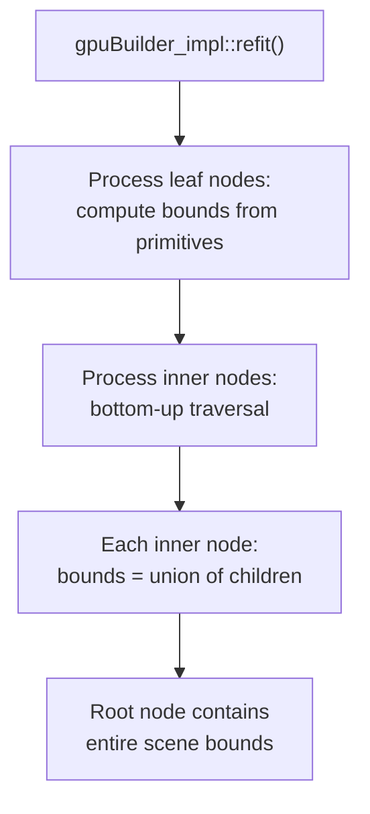

<!-- source: DeepWiki mcp.deepwiki.com · repo NVIDIA/cuBQL · page 6 BVH Construction · fetched 2026-10-26 -->

# BVH Construction

<details>
<summary>Relevant source files</summary>

The following files were used as context for generating this wiki page:

- [cuBQL/builder/cuda/gpu_builder.h](cuBQL/builder/cuda/gpu_builder.h)
- [cuBQL/builder/cuda/instantiate_builders.cu](cuBQL/builder/cuda/instantiate_builders.cu)

</details>


## Purpose and Scope

This document provides an overview of cuBQL's GPU-accelerated BVH construction system. It covers the construction pipeline, builder selection mechanisms, and the overall workflow for transforming primitive bounding boxes into optimized spatial acceleration structures.

This page focuses on the high-level construction architecture. For implementation details of specific algorithms, see [Builder Algorithms](#6.2). For the API interface and memory management, see [GPU Builder Interface](#6.1). For low-level kernel implementation details, see [Builder Internals](#6.3). Information about the resulting data structures is covered in [Core Data Structures](#5).

---

## Construction Pipeline Overview

The BVH construction process in cuBQL transforms an array of primitive bounding boxes into a hierarchical tree structure optimized for efficient spatial queries. The pipeline consists of four main stages:



**Sources**: [cuBQL/builder/cuda/gpu_builder.h:19-57]()

---

## Builder Entry Point

The primary construction interface is the `cuBQL::gpuBuilder` function template, which accepts:

| Parameter | Type | Description |
|-----------|------|-------------|
| `bvh` | `BinaryBVH<T,D>&` | Output BVH structure (allocated arrays written here) |
| `boxes` | `const box_t<T,D>*` | Input primitive bounding boxes on GPU |
| `numBoxes` | `uint32_t` | Number of primitives to build over |
| `buildConfig` | `BuildConfig` | Algorithm selection and parameters |
| `s` | `cudaStream_t` | CUDA stream for asynchronous execution |
| `memResource` | `GpuMemoryResource&` | Memory allocation abstraction |

The function signature:

```cpp
template<typename T, int D>
void gpuBuilder(BinaryBVH<T,D>    &bvh,
                const box_t<T,D>  *boxes,
                uint32_t           numBoxes,
                BuildConfig        buildConfig,
                cudaStream_t       s,
                GpuMemoryResource &memResource)
```

This function handles early exit for empty input, builder dispatch, construction execution, and refitting.

**Sources**: [cuBQL/builder/cuda/gpu_builder.h:19-57]()

---

## Builder Selection and Dispatch

The `gpuBuilder` function acts as a dispatcher, selecting the appropriate construction algorithm based on `BuildConfig::buildMethod`:



### Algorithm Selection Logic

The dispatch logic in [cuBQL/builder/cuda/gpu_builder.h:31-55]() implements these rules:

1. **SAH Builder** (`BuildConfig::SAH`): 
   - Only available for `BinaryBVH<float,3>`
   - Uses Surface Area Heuristic for high-quality trees
   - Sets default `makeLeafThreshold = 1` if not specified
   - Casts to `(BinaryBVH<float,3>&)` and `(const box_t<float,3>*)` for type safety

2. **ELH Builder** (`BuildConfig::ELH`):
   - Available for all types
   - Uses Edge-Length Heuristic (sum of bounding box edge lengths)
   - Better for k-NN queries than spatial median

3. **Default (Spatial Median/Radix)**:
   - Falls through to `gpuBuilder_impl::build`
   - Uses morton code radix sort for fast construction
   - Sets default `makeLeafThreshold = 1` if not specified

**Sources**: [cuBQL/builder/cuda/gpu_builder.h:31-55]()

---

## Construction Data Flow

The following diagram traces data transformations through the construction pipeline:



### Memory Allocation Pattern

The construction process allocates device memory through `GpuMemoryResource`:

1. **Node array** (`bvh.nodes`): Allocated to hold up to `2*numBoxes-1` nodes (worst-case full binary tree)
2. **Primitive IDs** (`bvh.primIDs`): Array of `numBoxes` indices mapping tree leaves to input primitives
3. **Temporary storage**: Algorithm-specific scratch space (morton codes, bins, CUB buffers)

All allocations use the provided `GpuMemoryResource` for pluggable memory management strategies.

**Sources**: [cuBQL/builder/cuda/gpu_builder.h:19-57]()

---

## Build and Refit Phases

### Construction Phase

Each builder algorithm implements the construction phase differently, but all produce the same output format:

- Populate `bvh.nodes` array with tree topology
- Write primitive indices to `bvh.primIDs` in tree order
- Set node administrative fields (count, offset)
- May use intermediate sorting, binning, or partitioning

See [Builder Algorithms](#6.2) for algorithm-specific details.

### Refitting Phase

After construction, `gpuBuilder_impl::refit` performs a bottom-up pass to tighten bounding boxes:



The refit pass ensures that:
- Leaf node bounds exactly match their primitive bounds
- Inner node bounds are minimal enclosures of children
- The final tree has tight bounds for efficient traversal

**Sources**: [cuBQL/builder/cuda/gpu_builder.h:56]()

---

## Template Instantiation Strategy

The cuBQL library uses explicit template instantiation to reduce compilation time and binary size. The [cuBQL/builder/cuda/instantiate_builders.cu]() file contains macros that instantiate builders for common types:

### Pre-instantiated Configurations

| Type | Dimensions | BVH Types |
|------|------------|-----------|
| `float` | 3 | `BinaryBVH<float,3>` |
| `float` | 3 | `WideBVH<float,3,4>` |
| `float` | 3 | `WideBVH<float,3,8>` |
| `float` | 3 | `WideBVH<float,3,16>` |

By default, only `(float,3)` configurations are instantiated. Custom types can be instantiated by defining `CUBQL_INSTANTIATE_T` and `CUBQL_INSTANTIATE_D` before including the instantiation file.

### Instantiated Functions

The instantiation macros generate concrete implementations for:

- `cuBQL::gpuBuilder<T,D>`
- `cuBQL::radixBuilder_impl::build<T,D>`
- `cuBQL::cuda::radixBuilder<T,D>`
- `cuBQL::cuda::rebinRadixBuilder<T,D>`
- `cuBQL::cuda::sahBuilder<T,D>`
- `cuBQL::cuda::free<T,D>` (for both `BinaryBVH` and `WideBVH`)

**Sources**: [cuBQL/builder/cuda/instantiate_builders.cu:13-89]()

---

## Code Entity Map

The following table maps high-level concepts to concrete code entities:

| Concept | Namespace/Function | File Location |
|---------|-------------------|---------------|
| Main entry point | `cuBQL::gpuBuilder<T,D>()` | [cuBQL/builder/cuda/gpu_builder.h:19]() |
| SAH builder | `cuBQL::sahBuilder_impl::sahBuilder()` | Referenced in [gpu_builder.h:39]() |
| ELH builder | `cuBQL::elhBuilder_impl::elhBuilder()` | Referenced in [gpu_builder.h:48]() |
| Spatial median builder | `cuBQL::gpuBuilder_impl::build()` | Referenced in [gpu_builder.h:54]() |
| Refitting | `cuBQL::gpuBuilder_impl::refit()` | Referenced in [gpu_builder.h:56]() |
| Memory deallocation | `cuBQL::cuda::free<T,D>()` | [cuBQL/builder/cuda/gpu_builder.h:61-70]() |
| Template instantiation | `CUBQL_INSTANTIATE_BINARY_BVH` | [cuBQL/builder/cuda/instantiate_builders.cu:13]() |

---

## Usage Pattern

A typical construction workflow:

1. Prepare input data: array of `box_t<T,D>` on GPU memory
2. Configure build parameters via `BuildConfig`
3. Create empty `BinaryBVH<T,D>` structure
4. Call `cuBQL::gpuBuilder` to populate the BVH
5. Optionally collapse to `WideBVH` for traversal optimization
6. Use resulting structure for queries

Example code pattern:
```cpp
// 1. Input data already on GPU
box_t<float,3>* d_boxes = ...;
uint32_t numPrims = ...;

// 2. Configure build
BuildConfig config;
config.buildMethod = BuildConfig::SAH;  // or ELH, or default

// 3. Empty BVH structure
BinaryBVH<float,3> bvh;

// 4. Build
GpuMemoryResource memRes;
cuBQL::gpuBuilder(bvh, d_boxes, numPrims, config, stream, memRes);

// 5. BVH ready for traversal queries
```

For detailed API documentation, see [GPU Builder Interface](#6.1).

**Sources**: [cuBQL/builder/cuda/gpu_builder.h:19-57]()

---

## Deallocation

BVH memory is freed via `cuBQL::cuda::free`:

```cpp
template<typename T, int D>
void free(BinaryBVH<T,D>    &bvh,
          cudaStream_t       s,
          GpuMemoryResource &memResource)
```

This function:
1. Synchronizes the stream before freeing
2. Deallocates `bvh.primIDs` array
3. Deallocates `bvh.nodes` array
4. Synchronizes again after freeing
5. Nulls out `bvh.primIDs` pointer

The double synchronization ensures all GPU operations complete before memory is released, and that deallocation completes before the host continues.

**Sources**: [cuBQL/builder/cuda/gpu_builder.h:61-70]()

---

## Related Topics

- For configuration options and algorithm selection, see [BuildConfig](#5.3)
- For output data structure details, see [BinaryBVH](#5.1) and [WideBVH](#5.2)
- For memory management abstractions, see [Memory Management](#9.1)
- For low-level kernel implementations, see [Builder Internals](#6.3)
- For performance characteristics of different algorithms, see [Builder Algorithms](#6.2)

---

