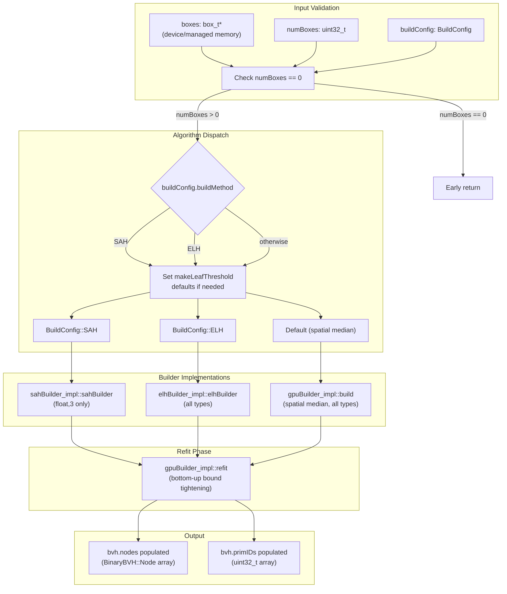
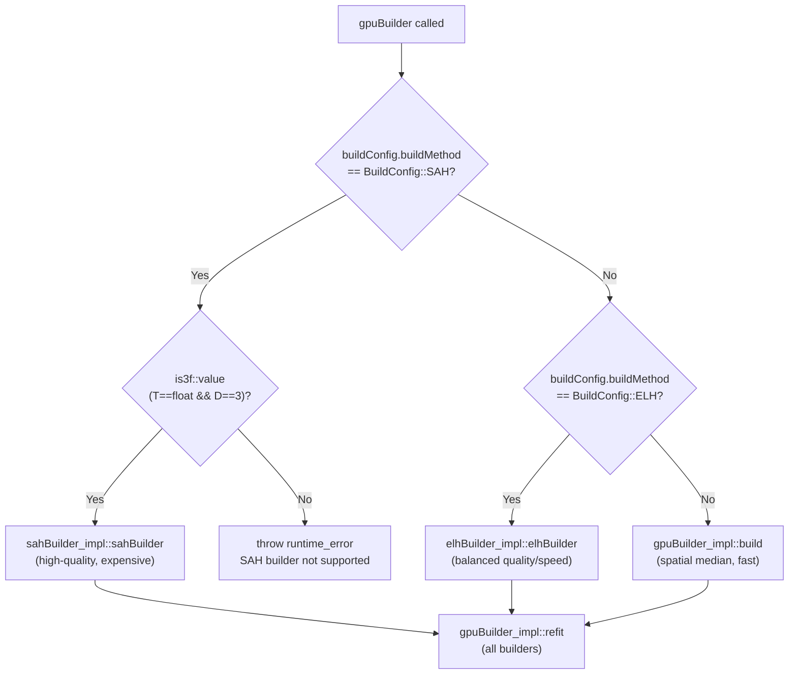
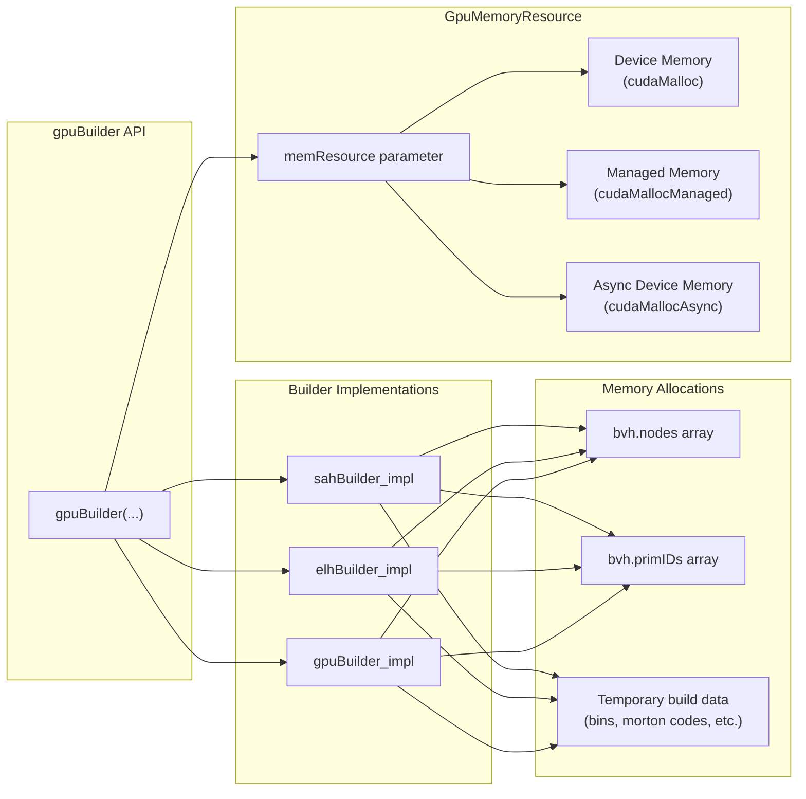
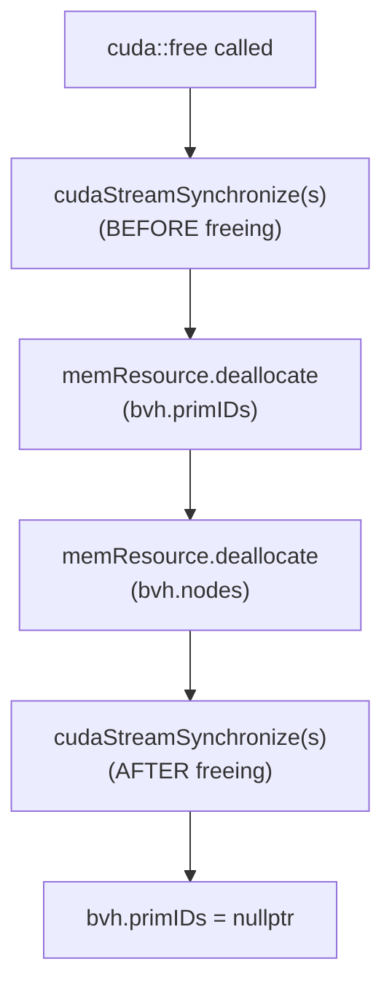

<!-- source: DeepWiki mcp.deepwiki.com · repo NVIDIA/cuBQL · page 6.1 GPU Builder Interface · fetched 2026-10-26 -->

# GPU Builder Interface

<details>
<summary>Relevant source files</summary>

The following files were used as context for generating this wiki page:

- [README.md](README.md)
- [cuBQL/builder/cuda/gpu_builder.h](cuBQL/builder/cuda/gpu_builder.h)

</details>


## Purpose and Scope

This page documents the primary API for constructing BVH structures on the GPU: the `cuBQL::gpuBuilder` function and its associated memory management utilities. This interface serves as the main entry point for BVH construction, handling algorithm selection, memory allocation, and the complete build pipeline.

For details on specific build algorithms (SAH, radix, ELH), see [Builder Algorithms](#6.2). For information on the output `BinaryBVH` structure, see [BinaryBVH](#5.1). For build configuration options, see [BuildConfig](#5.3). For memory management abstractions, see [Memory Management](#9.1).

---

## Core Function Signature

The primary builder function is defined in [cuBQL/builder/cuda/gpu_builder.h:18-57]():

```cpp
template<typename T, int D>
void gpuBuilder(BinaryBVH<T,D>    &bvh,
                const box_t<T,D>  *boxes,
                uint32_t           numBoxes,
                BuildConfig        buildConfig,
                cudaStream_t       s,
                GpuMemoryResource &memResource)
```

### Template Parameters

| Parameter | Description |
|-----------|-------------|
| `T` | Scalar coordinate type (`float`, `double`, `int32_t`, `int64_t`) |
| `D` | Dimensionality (typically 2, 3, or 4) |

### Function Parameters

| Parameter | Type | Description |
|-----------|------|-------------|
| `bvh` | `BinaryBVH<T,D>&` | Output BVH structure (nodes and primIDs arrays populated by builder) |
| `boxes` | `const box_t<T,D>*` | Input array of bounding boxes in device or managed memory |
| `numBoxes` | `uint32_t` | Number of primitives to build BVH over |
| `buildConfig` | `BuildConfig` | Configuration specifying algorithm and build parameters |
| `s` | `cudaStream_t` | CUDA stream for asynchronous execution (default: stream 0) |
| `memResource` | `GpuMemoryResource&` | Memory allocation strategy (device, managed, or async) |

**Sources**: [cuBQL/builder/cuda/gpu_builder.h:18-57](), [README.md:132-149]()

---

## Build Workflow

The `gpuBuilder` function orchestrates a multi-phase construction pipeline that dispatches to specialized algorithms based on configuration.

### Build Pipeline Overview



**Workflow Explanation**:

1. **Input Validation** [line 26](): Early exit if `numBoxes == 0`
2. **Device Query** [lines 28-29](): Retrieves current CUDA device ID
3. **Leaf Threshold Setup** [lines 32-35, 50-53](): Sets default `makeLeafThreshold = 1` for SAH and spatial median if not explicitly specified
4. **Algorithm Dispatch** [lines 31-55]():
   - `BuildConfig::SAH` → `sahBuilder_impl::sahBuilder` (only for `float,3`)
   - `BuildConfig::ELH` → `elhBuilder_impl::elhBuilder` (all types)
   - Default → `gpuBuilder_impl::build` (spatial median, all types)
5. **Refit** [line 56](): All builders conclude with `gpuBuilder_impl::refit` to tighten bounding boxes

**Sources**: [cuBQL/builder/cuda/gpu_builder.h:18-57](), [README.md:106-122]()

---

## Algorithm Dispatch Logic

### Dispatch Decision Tree



### Type Support Matrix

| Algorithm | Template Support | Notes |
|-----------|------------------|-------|
| **SAH** (`BuildConfig::SAH`) | `<float,3>` only | Highest quality for ray tracing; restricted by `is3f<T,D>` check [lines 36-42]() |
| **ELH** (`BuildConfig::ELH`) | All `<T,D>` combinations | Edge-length heuristic; better than spatial median for kNN [lines 43-48]() |
| **Spatial Median** (default) | All `<T,D>` combinations | Fast construction via morton codes [lines 49-55]() |

**Sources**: [cuBQL/builder/cuda/gpu_builder.h:31-55](), [cuBQL/builder/cuda/gpu_builder.h:13-16]()

---

## Memory Management

### GpuMemoryResource Integration

The `gpuBuilder` function delegates all device memory allocation to the `GpuMemoryResource` abstraction, enabling flexible memory strategies:



**Memory Ownership**:
- The `bvh.nodes` and `bvh.primIDs` pointers are populated by the builder
- All allocations occur via `memResource` in the specified `cudaStream_t`
- Caller is responsible for freeing memory via `cuBQL::cuda::free` (see below)

**Sources**: [cuBQL/builder/cuda/gpu_builder.h:24](), [README.md:176-179]()

---

## BVH Cleanup

### Free Function

```cpp
namespace cuda {
  template<typename T, int D>
  void free(BinaryBVH<T,D>    &bvh,
            cudaStream_t       s,
            GpuMemoryResource &memResource)
}
```

Defined in [cuBQL/builder/cuda/gpu_builder.h:60-71](), this function safely deallocates BVH memory:



**Synchronization Pattern**:
- Synchronizes **before** freeing [line 65]() to ensure build operations complete
- Synchronizes **after** freeing [line 68]() to ensure deallocation completes
- Sets `bvh.primIDs = nullptr` [line 69]() to prevent dangling pointers

**Sources**: [cuBQL/builder/cuda/gpu_builder.h:60-71]()

---

## Usage Patterns

### Basic Construction Example

From [README.md:135-146]():

```cpp
#include "cuBQL/bvh.h"

// Input: array of bounding boxes on device
box3f *d_boxes  = nullptr;
int    numBoxes = 0;
userCodeForGeneratingPrims(&d_boxes, &numBoxes);

// Build BVH
cuBQL::BinaryBVH<float,3> bvh;
cuBQL::BuildConfig buildParams;
cuBQL::gpuBuilder(bvh, d_boxes, numBoxes, buildParams);

// Use BVH for queries...
```

### Stream-Ordered Construction

```cpp
cudaStream_t stream;
cudaStreamCreate(&stream);

cuBQL::BinaryBVH<float,3> bvh;
cuBQL::BuildConfig config;
cuBQL::GpuMemoryResource memResource; // defaults to device memory

// Asynchronous build
cuBQL::gpuBuilder(bvh, d_boxes, numBoxes, config, stream, memResource);

// Other work can proceed on different streams...

// Cleanup when done
cuBQL::cuda::free(bvh, stream, memResource);
cudaStreamDestroy(stream);
```

### Multi-Dimensional Construction

```cpp
// 2D integer BVH
cuBQL::BinaryBVH<int32_t, 2> bvh2di;
box_t<int32_t, 2> *d_boxes2d = ...;
cuBQL::gpuBuilder(bvh2di, d_boxes2d, numBoxes, config);

// 4D double BVH
cuBQL::BinaryBVH<double, 4> bvh4dd;
box_t<double, 4> *d_boxes4d = ...;
cuBQL::gpuBuilder(bvh4dd, d_boxes4d, numBoxes, config);
```

**Sources**: [README.md:132-149](), [README.md:170-179]()

---

## Invalid Primitive Handling

The builder automatically filters invalid primitives during construction:

| Condition | Treatment |
|-----------|-----------|
| `box.lower.x > box.upper.x` | **Excluded** from BVH; not present in any leaf |
| `box.lower == box.upper` (zero-volume) | **Included** as valid primitive |
| NaN, denorm, or infinity | **Undefined behavior** |

This allows users to mark primitives for exclusion by setting invalid bounds rather than pre-filtering arrays.

**Sources**: [README.md:151-162]()

---

## Error Handling

### SAH Type Restriction

The SAH builder enforces type restrictions via compile-time template specialization:

```cpp
template<typename T, int D>
struct is3f { enum { value = false }; };

template<>
struct is3f<float,3> { enum { value = true }; };
```

[Lines 13-16]() define a trait that enables SAH only for `<float,3>`. Attempting to use SAH with other types throws:

```cpp
throw std::runtime_error("SAH builder not supported for this type of BVH");
```

[Line 42]()

**Sources**: [cuBQL/builder/cuda/gpu_builder.h:13-16](), [cuBQL/builder/cuda/gpu_builder.h:36-42]()

---

## Integration with Build System

### Header-Only Mode

```cpp
#define CUBQL_GPU_BUILDER_IMPLEMENTATION 1
#include <cuBQL/bvh.h>

void myBuildFunction() {
    cuBQL::gpuBuilder(...);  // implementation included
}
```

### Pre-Built Library Mode

Link against type-specific targets:

```cmake
target_link_libraries(myTarget cuBQL_cuda_float3)
```

**Sources**: [README.md:319-368]()

---

