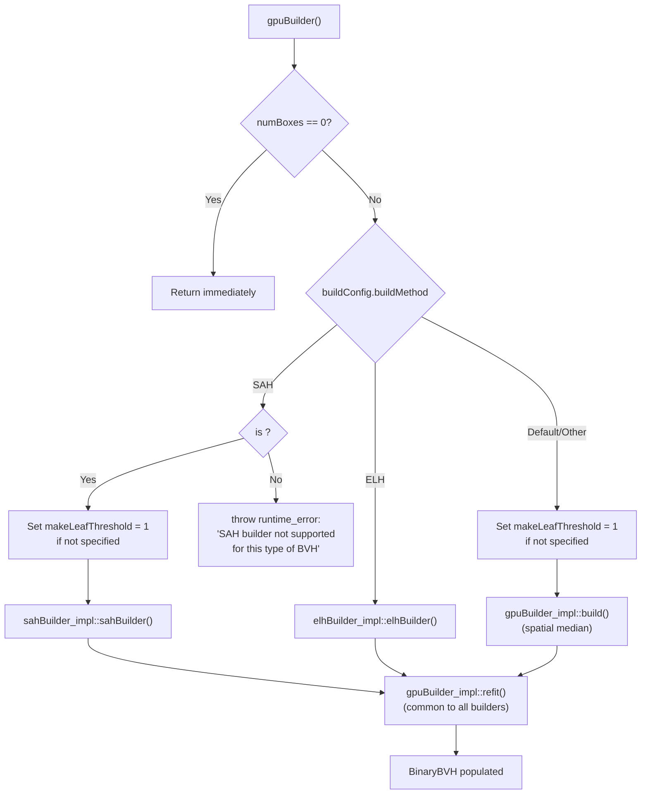
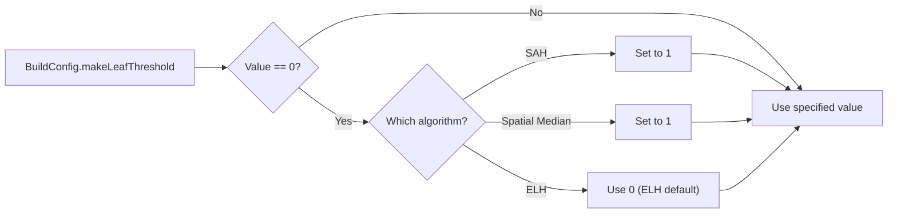
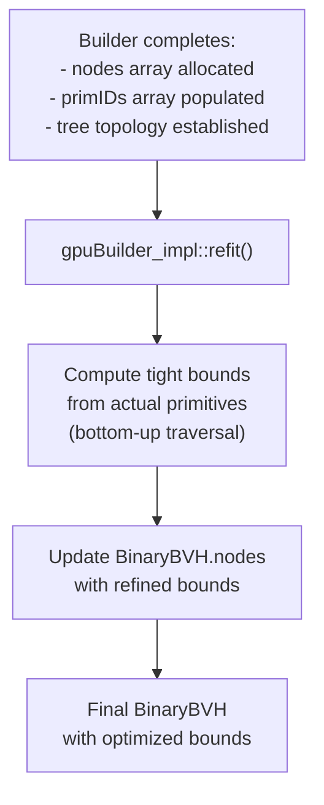
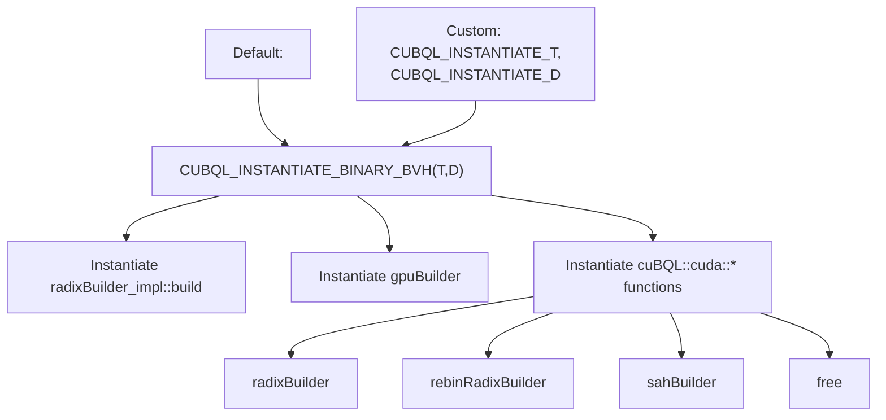

<!-- source: DeepWiki mcp.deepwiki.com · repo NVIDIA/cuBQL · page 6.2 Builder Algorithms · fetched 2026-10-26 -->

# Builder Algorithms

<details>
<summary>Relevant source files</summary>

The following files were used as context for generating this wiki page:

- [cuBQL/builder/cuda/gpu_builder.h](cuBQL/builder/cuda/gpu_builder.h)
- [cuBQL/builder/cuda/instantiate_builders.cu](cuBQL/builder/cuda/instantiate_builders.cu)

</details>


This page provides an overview of the BVH construction algorithms available in cuBQL and explains the tradeoffs between them. For detailed implementation documentation of specific algorithms, see [Radix Builder](#6.2.1), [SAH Builder](#6.2.2), and [Advanced Builders](#6.2.3). For the high-level GPU builder interface that dispatches to these algorithms, see [GPU Builder Interface](#6.1).

## Purpose and Scope

cuBQL provides multiple BVH construction algorithms that offer different tradeoffs between build speed and traversal quality. This page explains:

- The three primary build methods: Spatial Median (default), SAH, and ELH
- Performance characteristics and quality metrics for each algorithm
- The dispatcher mechanism that selects algorithms based on `BuildConfig`
- Type and dimensionality restrictions for specific builders
- The common refitting stage that follows all construction algorithms

Implementation details for each algorithm are documented in dedicated child pages.

## Algorithm Overview

cuBQL's builder algorithms fall along a spectrum from fast construction to high-quality traversal:

| Algorithm | Build Method Flag | Speed | Quality | Best Use Case | Type Support |
|-----------|------------------|-------|---------|---------------|--------------|
| **Radix/Spatial Median** | `BuildConfig::SPATIAL_MEDIAN` (default) | Fastest | Moderate | General purpose, dynamic scenes | All `<T,D>` |
| **ELH** | `BuildConfig::ELH` | Fast | Good | k-NN queries, closest point searches | All `<T,D>` |
| **SAH** | `BuildConfig::SAH` | Slower | Best | Ray tracing, static high-quality BVHs | `<float,3>` only |
| **Rebin Radix** | N/A (direct API) | Fast | Better than basic radix | Improved quality with minimal overhead | All `<T,D>` |

**Sources:** [cuBQL/builder/cuda/gpu_builder.h:31-55]()

## Dispatcher Mechanism

### Algorithm Selection Flow

The `gpuBuilder` function acts as the primary dispatcher, selecting the appropriate builder based on `BuildConfig::buildMethod`:



**Dispatcher Logic:**
1. Early exit for empty primitive sets [cuBQL/builder/cuda/gpu_builder.h:26]()
2. Check `buildMethod` flag to determine algorithm [cuBQL/builder/cuda/gpu_builder.h:31]()
3. SAH requires compile-time type check for `<float,3>` [cuBQL/builder/cuda/gpu_builder.h:36-42]()
4. ELH works for all types [cuBQL/builder/cuda/gpu_builder.h:43-48]()
5. Default spatial median builder handles remaining cases [cuBQL/builder/cuda/gpu_builder.h:49-55]()
6. All builders conclude with a refitting pass [cuBQL/builder/cuda/gpu_builder.h:56]()

**Sources:** [cuBQL/builder/cuda/gpu_builder.h:19-57]()

### Builder Function Signatures

All builder implementations follow a consistent function signature pattern:

```mermaid
classDiagram
    class gpuBuilder {
        +gpuBuilder(BinaryBVH~T,D~ bvh, box_t~T,D~* boxes, uint32_t numBoxes, BuildConfig config, cudaStream_t stream, GpuMemoryResource mem)
    }
    
    class radixBuilder {
        +build(BinaryBVH~T,D~ bvh, box_t~T,D~* boxes, uint32_t numPrims, BuildConfig config, cudaStream_t stream, GpuMemoryResource mem)
    }
    
    class sahBuilder {
        +sahBuilder(BinaryBVH~float,3~ bvh, box_t~float,3~* boxes, uint32_t numBoxes, BuildConfig config, cudaStream_t stream, GpuMemoryResource mem)
    }
    
    class elhBuilder {
        +elhBuilder(BinaryBVH~T,D~ bvh, box_t~T,D~* boxes, uint32_t numBoxes, BuildConfig config, cudaStream_t stream, GpuMemoryResource mem)
    }
    
    class rebinRadixBuilder {
        +rebinRadixBuilder(BinaryBVH~T,D~ bvh, box_t~T,D~* boxes, uint32_t numBoxes, BuildConfig config, cudaStream_t stream, GpuMemoryResource mem)
    }
    
    gpuBuilder --> radixBuilder : "dispatches (default)"
    gpuBuilder --> sahBuilder : "dispatches (SAH)"
    gpuBuilder --> elhBuilder : "dispatches (ELH)"
    
    note for sahBuilder "Type restriction:<br/>T=float, D=3 only"
    note for radixBuilder "Also called as<br/>gpuBuilder_impl::build()"
```



**Sources:** [cuBQL/builder/cuda/instantiate_builders.cu:14-56]()

## Algorithm Characteristics

### Spatial Median (Radix Builder)

The default builder uses morton codes and radix sorting to partition primitives along spatial median planes. Key characteristics:

- **Build Strategy:** Compute 3D morton codes from primitive centroids, sort with CUB radix sort, recursively partition at median positions
- **Splitting Criterion:** Geometric center of current primitive set (spatial median)
- **Performance:** Fastest construction time, O(n log n) with efficient GPU parallel sorting
- **Quality:** Produces balanced trees but may create suboptimal partitions when primitives cluster
- **Best For:** Dynamic scenes requiring frequent rebuilds, general-purpose queries

The implementation resides in namespace `radixBuilder_impl` and is invoked via `gpuBuilder_impl::build()`.

**Sources:** [cuBQL/builder/cuda/gpu_builder.h:49-55](), [cuBQL/builder/cuda/instantiate_builders.cu:15-22]()

### Surface Area Heuristic (SAH)

SAH optimizes for ray tracing performance by estimating traversal cost during construction:

- **Build Strategy:** Evaluate multiple candidate split planes using binning, select split minimizing SAH cost function
- **Splitting Criterion:** Minimizes `cost = C_trav + P_left * N_left * C_isect + P_right * N_right * C_isect` where P is surface area probability
- **Performance:** Slowest construction, requires multiple kernel launches per tree level
- **Quality:** Produces highest-quality BVHs for ray tracing workloads
- **Best For:** Static scenes, offline preprocessing, ray tracing applications
- **Type Restriction:** Only supports `BinaryBVH<float,3>` [cuBQL/builder/cuda/gpu_builder.h:36-42]()

The type check `is3f<T,D>::value` enforces this restriction at compile time. Non-conforming types throw `std::runtime_error`.

**Sources:** [cuBQL/builder/cuda/gpu_builder.h:31-42](), [cuBQL/builder/cuda/instantiate_builders.cu:46-51]()

### Edge Length Heuristic (ELH)

ELH provides a middle ground between speed and quality by using edge lengths as a splitting heuristic:

- **Build Strategy:** Split based on sum of bounding box edge lengths rather than surface area
- **Splitting Criterion:** Minimizes sum of edge lengths weighted by primitive counts
- **Performance:** Faster than SAH, slower than spatial median
- **Quality:** Better than spatial median for certain query patterns (k-NN, closest point)
- **Best For:** Nearest neighbor searches, queries that benefit from volume-based partitioning rather than surface area
- **Type Support:** Works for all `<T,D>` combinations [cuBQL/builder/cuda/gpu_builder.h:43-48]()

ELH often produces BVHs with better locality for ball-shaped queries compared to surface-area optimization.

**Sources:** [cuBQL/builder/cuda/gpu_builder.h:43-48]()

## Build Configuration

### Leaf Threshold Behavior

The `makeLeafThreshold` parameter controls when to stop subdivision and create leaf nodes. The dispatcher applies algorithm-specific defaults:



**Default Threshold Logic:**
- SAH and spatial median builders set `makeLeafThreshold = 1` if unspecified [cuBQL/builder/cuda/gpu_builder.h:32-35](), [cuBQL/builder/cuda/gpu_builder.h:50-53]()
- A threshold of `1` means create a leaf when only one primitive remains
- Higher thresholds create larger leaves, reducing tree depth but increasing leaf intersection costs

**Sources:** [cuBQL/builder/cuda/gpu_builder.h:32-35](), [cuBQL/builder/cuda/gpu_builder.h:50-53]()

## Common Refitting Stage

All builder algorithms conclude with a refitting pass that tightens bounding boxes bottom-up:



**Refitting Purpose:**
- Initial builder passes may compute conservative (loose) bounds during tree construction
- Refitting performs a bottom-up pass to compute exact tight-fitting bounds from leaf primitives
- Improves traversal efficiency by reducing false positive intersection tests
- Operates as a separate kernel launch after primary construction

The refitting operation is invoked for all algorithms via `gpuBuilder_impl::refit(bvh, boxes, s, memResource)`.

**Sources:** [cuBQL/builder/cuda/gpu_builder.h:56]()

## Template Instantiation

Builder algorithms are explicitly instantiated for specific type combinations to support separate compilation:



**Instantiation Strategy:**
- Macro `CUBQL_INSTANTIATE_BINARY_BVH(T,D)` generates explicit template instantiations [cuBQL/builder/cuda/instantiate_builders.cu:13-57]()
- Default build instantiates `<float,3>` only [cuBQL/builder/cuda/instantiate_builders.cu:85]()
- Custom types enabled via compile-time defines `CUBQL_INSTANTIATE_T` and `CUBQL_INSTANTIATE_D` [cuBQL/builder/cuda/instantiate_builders.cu:77-82]()
- Separate instantiations for `radixBuilder`, `rebinRadixBuilder`, `sahBuilder` in `cuBQL::cuda` namespace
- Reduces compilation time and binary size for common use cases

**Sources:** [cuBQL/builder/cuda/instantiate_builders.cu:13-89]()

## Type Support Matrix

The following table summarizes type and dimensionality support across builders:

| Builder | Template Parameters | Restrictions | Reason |
|---------|-------------------|--------------|--------|
| **radixBuilder** | `<T,D>` | None | Morton code computation works for any numeric type and dimension |
| **sahBuilder** | `<float,3>` | Must be `<float,3>` | Implementation optimized for 3D float geometry, explicit check enforced |
| **elhBuilder** | `<T,D>` | None | Edge length heuristic generalizes to arbitrary types/dimensions |
| **rebinRadixBuilder** | `<T,D>` | None | Extension of radix builder, inherits full type support |

The type restriction for SAH is enforced via template specialization `is3f<T,D>` which only has `value = true` for `<float,3>`:

```
template<typename T, int D>
struct is3f { enum { value = false }; };
template<>
struct is3f<float,3> { enum { value = true }; };
```

Attempting to use SAH with non-`<float,3>` types throws `std::runtime_error` at runtime.

**Sources:** [cuBQL/builder/cuda/gpu_builder.h:13-42]()

## Algorithm Selection Guidelines

### Decision Matrix

Choose a builder algorithm based on your application requirements:

| Requirement | Recommended Algorithm | Rationale |
|-------------|----------------------|-----------|
| Fastest possible build time | Spatial Median (default) | Radix sort is highly parallelizable on GPU |
| Best ray tracing performance | SAH | Optimizes for surface area, minimizes ray traversal cost |
| k-NN or closest point queries | ELH | Volume-based heuristic better for ball-shaped queries |
| Dynamic/frequently rebuilt scenes | Spatial Median | Build time matters more than traversal quality |
| Static high-value scenes | SAH | One-time build cost amortized over many queries |
| Non-float or non-3D types | ELH or Spatial Median | SAH unavailable for these types |
| Balanced quality/speed | ELH | Good compromise for general-purpose applications |

**Sources:** [cuBQL/builder/cuda/gpu_builder.h:31-55]()

## Integration with Build Pipeline

All builder algorithms follow the same integration pattern within cuBQL's construction pipeline:

1. **Input validation:** Check for empty primitive sets
2. **Configuration:** Apply algorithm-specific defaults (leaf thresholds, etc.)
3. **Memory allocation:** Allocate device arrays for nodes and primIDs via `GpuMemoryResource`
4. **Tree construction:** Execute algorithm-specific kernels to build topology
5. **Refitting:** Tighten bounds bottom-up [cuBQL/builder/cuda/gpu_builder.h:56]()
6. **Output:** Populated `BinaryBVH<T,D>` structure ready for traversal

For details on the memory management and kernel orchestration, see [Builder Internals](#6.3). For information on using the high-level builder API, see [GPU Builder Interface](#6.1).

**Sources:** [cuBQL/builder/cuda/gpu_builder.h:19-57]()

---

