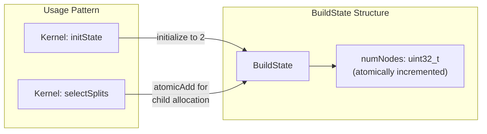
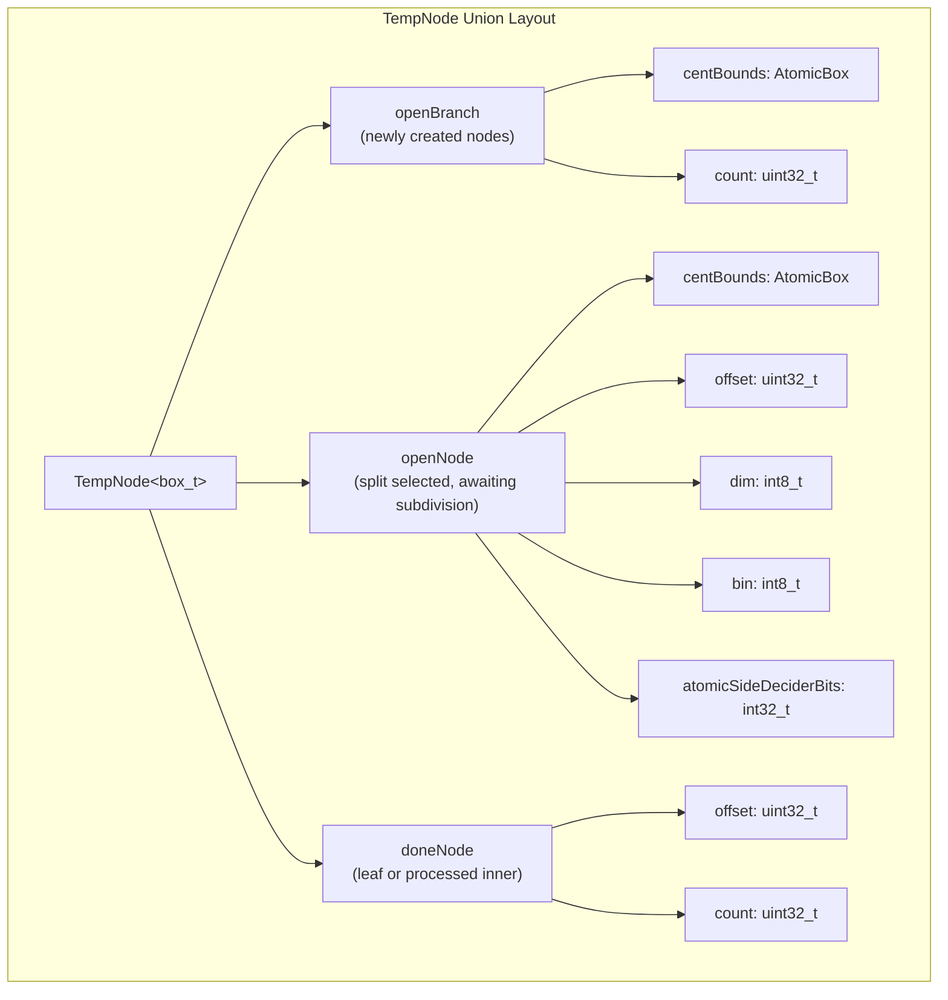
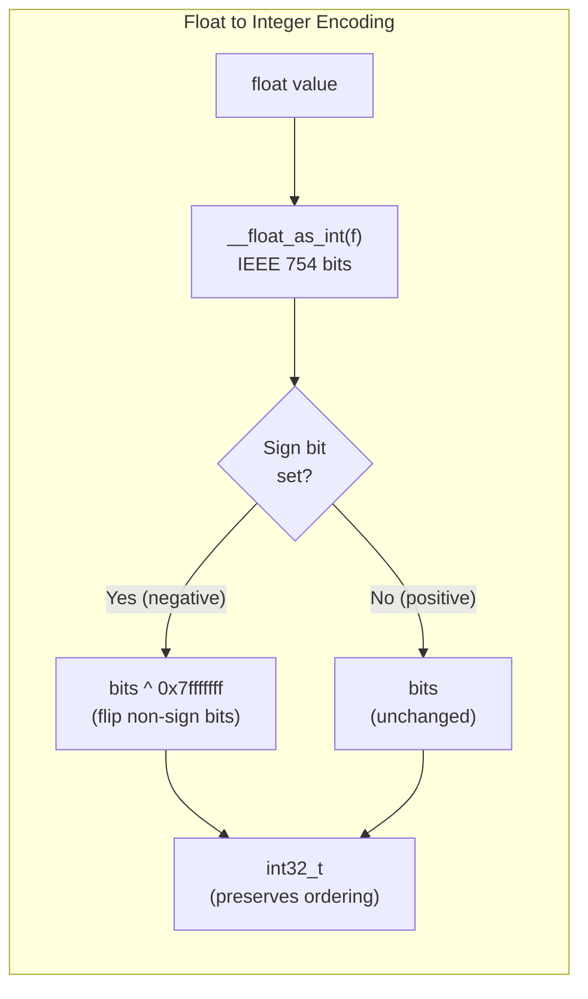
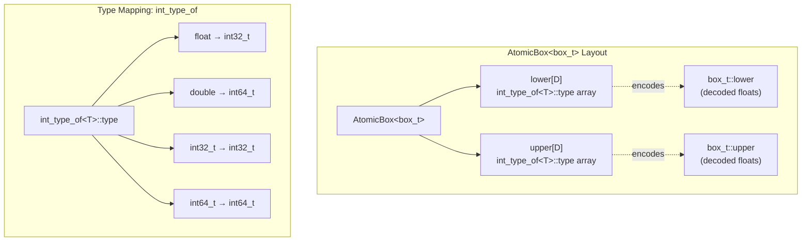
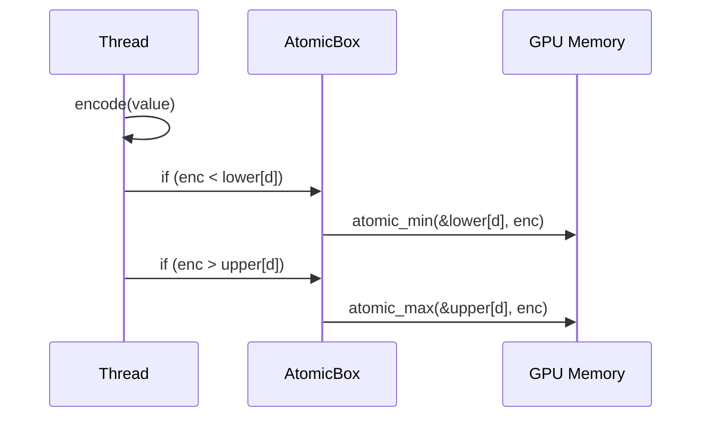
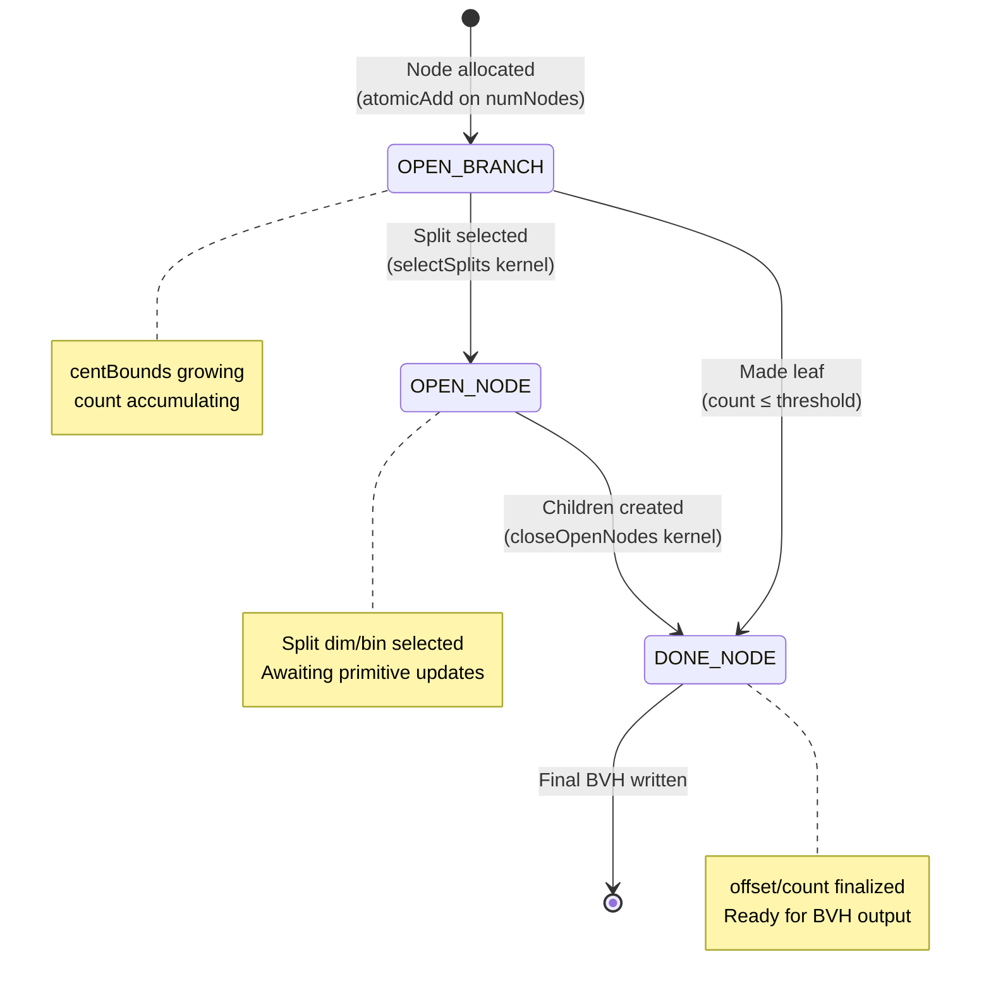
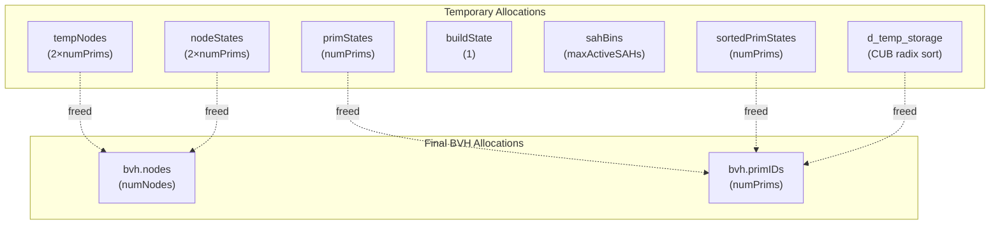
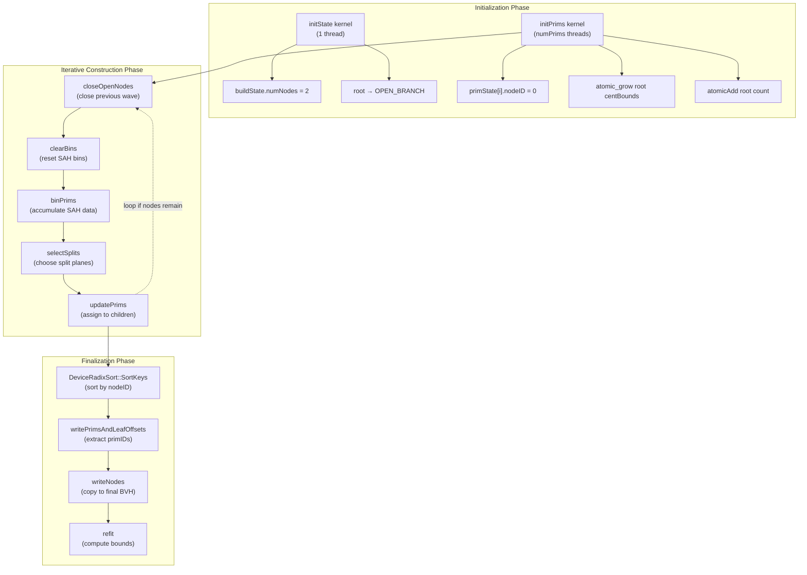
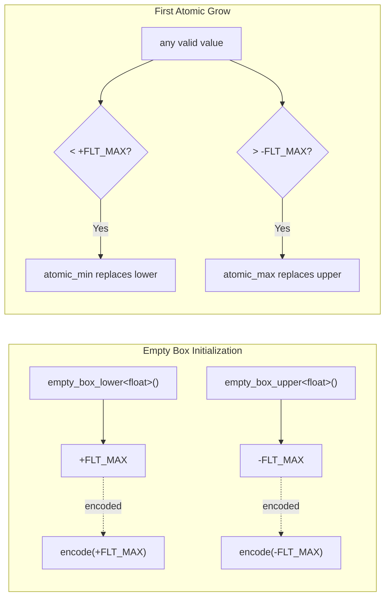
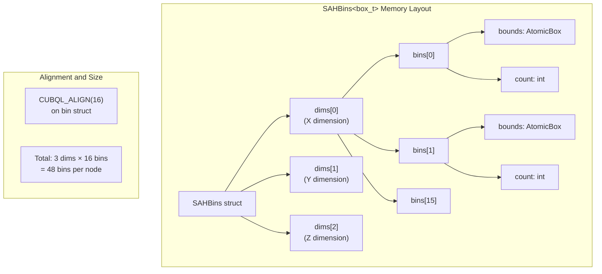

<!-- source: DeepWiki mcp.deepwiki.com · repo NVIDIA/cuBQL · page 6.3 Builder Internals · fetched 2026-10-26 -->

# Builder Internals

<details>
<summary>Relevant source files</summary>

The following files were used as context for generating this wiki page:

- [cuBQL/builder/cuda/builder_common.h](cuBQL/builder/cuda/builder_common.h)
- [cuBQL/builder/cuda/sah_builder.h](cuBQL/builder/cuda/sah_builder.h)

</details>


## Purpose and Scope

This page documents the low-level implementation details shared across cuBQL's GPU builder algorithms, including temporary data structures, atomic operations, encoded arithmetic, and memory management patterns. These internals enable lock-free concurrent BVH construction on GPUs.

For the high-level builder interface and workflow, see [GPU Builder Interface](#6.1). For algorithm-specific construction strategies, see [Builder Algorithms](#6.2).

---

## Temporary Data Structures

GPU builders use temporary structures during construction that differ from the final `BinaryBVH` layout. These temporary structures support concurrent updates and incremental tree construction.

### BuildState

The `BuildState` structure tracks global construction progress:



**Sources**: [cuBQL/builder/cuda/builder_common.h:296-298]()

The `numNodes` field is atomically incremented as new nodes are allocated during tree construction. Builders start with 2 nodes (root and sentinel) and grow the tree by atomically reserving pairs of child nodes.

### PrimState

The `PrimState` structure tracks each primitive's progress through construction:

| Field | Type | Purpose |
|-------|------|---------|
| `primID` | `uint32_t` | Original primitive index |
| `nodeID` | `uint32_t` | Current node assignment (32-bit) |
| `done` | `bool` | Whether primitive has reached a leaf (8-bit) |

This structure is packed into 64 bits for efficient sorting by `nodeID` using CUB's radix sort. Primitives are sorted by node assignment to produce the final `primIDs` array.

**Sources**: [cuBQL/builder/cuda/sm_builder.h:30-37]()

### TempNode (SAH Builder)

The SAH builder uses a union-based `TempNode` structure that changes layout based on node state:



**Sources**: [cuBQL/builder/cuda/sah_builder.h:20-46]()

This union-based design minimizes memory usage by reusing the same memory for different construction phases. The `CUBQL_ALIGN(16)` attribute ensures proper alignment for atomic operations.

---

## Atomic Operations and Encoded Arithmetic

GPU builders use atomic operations for lock-free concurrent updates to bounding boxes and counters. Since CUDA does not natively support atomic operations on floating-point min/max, cuBQL implements encoded arithmetic.

### Integer Encoding for Floating-Point Atomics

Floating-point values are encoded as sign-magnitude integers that preserve ordering:



**Sources**: [cuBQL/builder/cuda/builder_common.h:84-112]()

This encoding ensures that `encode(a) < encode(b)` if and only if `a < b`, enabling use of integer `atomicMin` and `atomicMax` for floating-point values.

### AtomicBox Structure

The `AtomicBox` structure stores bounding boxes in encoded integer format for concurrent updates:



**Sources**: [cuBQL/builder/cuda/builder_common.h:145-191](), [cuBQL/builder/cuda/builder_common.h:76-82]()

Key methods:
- `set_empty()` - Initialize to inverted bounds for grow operations
- `get_lower(dim)`, `get_upper(dim)` - Decode and return scalar values
- `make_box()` - Decode entire box to `box_t`
- `is_empty()` - Check if `lower[0] > upper[0]`

### Atomic Grow Operations

The `atomic_grow` function template performs lock-free bounding box expansion:

| Overload | Purpose |
|----------|---------|
| `atomic_grow(AtomicBox, vec_t)` | Grow box to include point |
| `atomic_grow(AtomicBox, box_t)` | Grow box to include box |
| `atomic_grow(AtomicBox, AtomicBox)` | Merge two atomic boxes |

**Implementation Pattern** ([cuBQL/builder/cuda/builder_common.h:248-294]()):
1. Encode new values to integers
2. Compare against current encoded bounds
3. Use `atomic_min` for lower bounds, `atomic_max` for upper bounds
4. Loop unrolls for each dimension



**Sources**: [cuBQL/builder/cuda/builder_common.h:248-294]()

---

## Node State Machine

Builders track node progression through construction using the `NodeState` enum:



**Sources**: [cuBQL/builder/cuda/builder_common.h:47]()

### State Transitions in SAH Builder

The SAH builder ([cuBQL/builder/cuda/sah_builder.h]()) transitions nodes through states across multiple kernel invocations:

| Kernel | State Transitions |
|--------|-------------------|
| `initState` | Root: `→ OPEN_BRANCH`, Sentinel: `→ DONE_NODE` |
| `selectSplits` | `OPEN_BRANCH → OPEN_NODE` (inner) or `OPEN_BRANCH → DONE_NODE` (leaf) |
| `closeOpenNodes` | `OPEN_NODE → DONE_NODE` (after children created) |

**Sources**: [cuBQL/builder/cuda/sah_builder.h:106-120](), [cuBQL/builder/cuda/sah_builder.h:230-285](), [cuBQL/builder/cuda/sah_builder.h:205-228]()

---

## Memory Management

Builders use temporary GPU allocations that are freed after construction completes.

### Allocation Pattern



**Sources**: [cuBQL/builder/cuda/sah_builder.h:414-424](), [cuBQL/builder/cuda/sah_builder.h:526-543]()

### _ALLOC and _FREE Macros

The `_ALLOC` and `_FREE` template functions wrap `GpuMemoryResource` for stream-ordered allocation:

**_ALLOC** ([cuBQL/builder/cuda/builder_common.h:38-41]()):
```cpp
template<typename T, typename count_t>
inline void _ALLOC(T *&ptr, count_t count, cudaStream_t s,
                   GpuMemoryResource &mem_resource)
```

**_FREE** ([cuBQL/builder/cuda/builder_common.h:43-45]()):
```cpp
template<typename T>
inline void _FREE(T *&ptr, cudaStream_t s, GpuMemoryResource &mem_resource)
```

These ensure allocations are associated with CUDA streams for asynchronous execution and proper cleanup.

**Sources**: [cuBQL/builder/cuda/builder_common.h:38-45]()

---

## Build Phases

GPU builders operate in distinct phases, each implemented as one or more kernel launches.

### SAH Builder Phase Diagram



**Sources**: [cuBQL/builder/cuda/sah_builder.h:426-497](), [cuBQL/builder/cuda/sah_builder.h:500-544]()

### Kernel Responsibilities

| Kernel | Input | Output | Atomic Operations |
|--------|-------|--------|-------------------|
| `initState` | - | `buildState`, `nodeStates[0,1]`, `tempNodes[0,1]` | None |
| `initPrims` | `primBoxes` | `primState`, root bounds/count | `atomicAdd`, `atomic_grow` |
| `binPrims` | `primBoxes`, `tempNodes` | `sahBins` | `atomic_grow`, `atomicAdd` |
| `selectSplits` | `sahBins` | `nodeStates`, `tempNodes`, child nodes | `atomicAdd` (on `numNodes`) |
| `updatePrims` | `tempNodes`, `primBoxes` | `primState` (updated `nodeID`) | `atomicAdd`, `atomic_grow`, `atomicAdd` (side decision) |
| `writePrimsAndLeafOffsets` | `primState` (sorted) | `bvh.primIDs`, leaf offsets | `atomicMin` (leaf offset) |
| `writeNodes` | `tempNodes` | `bvh.nodes` (admin fields only) | None |

**Sources**: [cuBQL/builder/cuda/sah_builder.h:106-120](), [cuBQL/builder/cuda/sah_builder.h:123-146](), [cuBQL/builder/cuda/sah_builder.h:149-201](), [cuBQL/builder/cuda/sah_builder.h:230-285](), [cuBQL/builder/cuda/sah_builder.h:288-335](), [cuBQL/builder/cuda/sah_builder.h:343-360](), [cuBQL/builder/cuda/sah_builder.h:379-390]()

---

## Empty Box Semantics

Builders use inverted bounds to represent empty boxes, enabling correct atomic grow operations without special cases:



**Sources**: [cuBQL/builder/cuda/builder_common.h:49-74](), [cuBQL/builder/cuda/builder_common.h:237-246]()

Type-specific empty bounds are provided for `float`, `double`, `int`, and `int64_t`. Invalid primitives (where `lower > upper`) are automatically filtered during `initPrims` by setting their `nodeID` to `-1`.

**Sources**: [cuBQL/builder/cuda/sah_builder.h:136-145]()

---

## SAH Binning Internals

The SAH builder uses a specialized binning structure for efficient Surface Area Heuristic evaluation.

### SAHBins Structure



**Sources**: [cuBQL/builder/cuda/sah_builder.h:48-57]()

Each bin is aligned to 16 bytes to ensure efficient atomic operations. The builder allocates `maxActiveSAHs = 4 + numPrims/(8*numBins)` SAH structures to process nodes in batches.

**Sources**: [cuBQL/builder/cuda/sah_builder.h:419]()

### Bin Selection

Primitives are assigned to bins based on their centroid position relative to the node's centroid bounds ([cuBQL/builder/cuda/sah_builder.h:174-196]()):

```
bin = int(rel * numBins)
where rel = (centroid[dim] - centBounds.lower[dim]) / (centBounds.upper[dim] - centBounds.lower[dim])
```

The bin selection is clamped to `[0, numBins-1]` to handle numerical edge cases.

**Sources**: [cuBQL/builder/cuda/sah_builder.h:174-196]()

---

