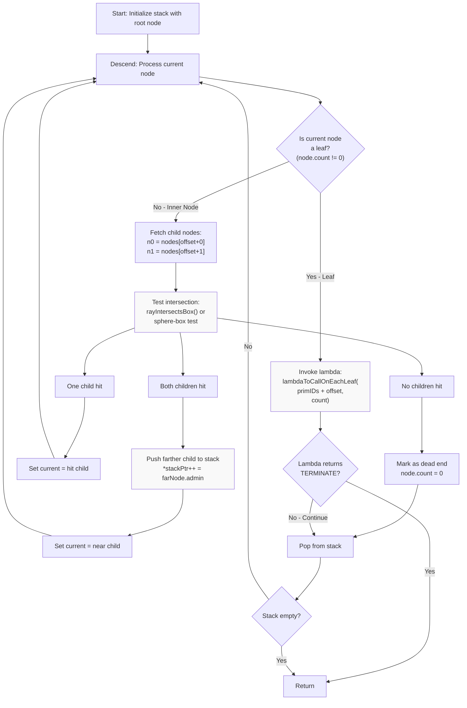
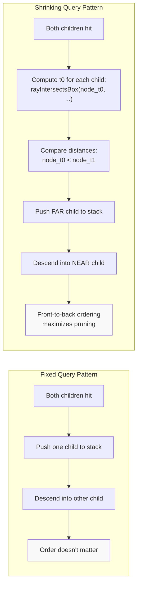
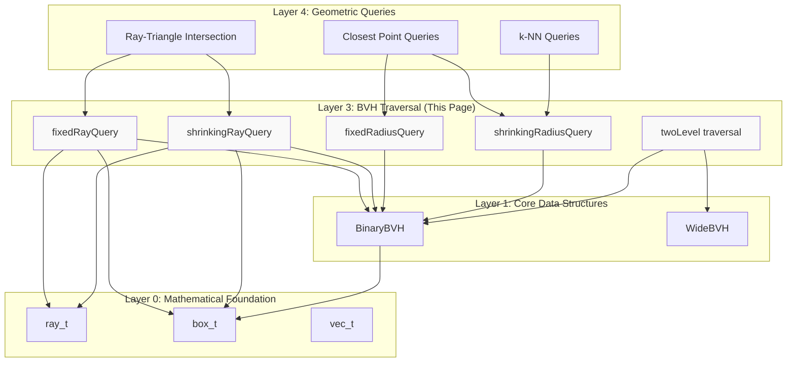

<!-- source: DeepWiki mcp.deepwiki.com · repo NVIDIA/cuBQL · page 7 BVH Traversal · fetched 2026-10-26 -->

# BVH Traversal

<details>
<summary>Relevant source files</summary>

The following files were used as context for generating this wiki page:

- [README.md](README.md)
- [cuBQL/traversal/rayQueries.h](cuBQL/traversal/rayQueries.h)

</details>


## Purpose and Scope

This document provides an overview of cuBQL's BVH traversal system, which implements the core algorithms for walking BVH data structures to find primitives that satisfy spatial or ray-based queries. This is Layer 3 in cuBQL's architecture.

The traversal layer provides generic **traversal templates** that can be customized via lambda functions to implement diverse query types without modifying the core traversal logic. For information about BVH data structures themselves, see [Core Data Structures](#5). For specific implementations of geometric queries built on these templates, see [Geometric Queries](#8).

**Child pages:**
- [Ray Queries](#7.1) - Ray-based traversal for ray tracing
- [Radius Queries](#7.2) - Ball-shaped spatial queries for nearest neighbor searches
- [Two-Level BVH Traversal](#7.3) - TLAS/BLAS hierarchical traversal

**Sources:** [README.md:193-248](), [cuBQL/traversal/rayQueries.h:1-69]()

## Traversal Fundamentals

BVH traversal is the process of efficiently walking a BVH tree structure to identify primitives (leaf contents) that intersect or are relevant to a query. Rather than testing every primitive in a scene, traversal uses the hierarchical bounding volume structure to prune large portions of the search space.

cuBQL implements **stack-based iterative descent** rather than recursive traversal to avoid stack overflow on GPU and to enable better control flow. All traversal functions are decorated with `__cubql_both`, allowing them to execute on both CPU and GPU.

### Key Design Principles

1. **Template-based generality**: Traversal templates work with any `bvh_t` type and `ray_t`/query type through template parameters
2. **Lambda-driven customization**: User-provided lambdas define what happens when encountering primitives, enabling diverse query types from the same traversal code
3. **Early termination support**: Lambdas can signal traversal to stop via return values (`CUBQL_TERMINATE_TRAVERSAL` vs `CUBQL_CONTINUE_TRAVERSAL`)
4. **Fixed vs shrinking queries**: Two fundamental patterns based on whether the search space can dynamically reduce during traversal

**Sources:** [cuBQL/traversal/rayQueries.h:18-69](), [README.md:193-221]()

## Query Type Taxonomy

cuBQL organizes traversal templates into two primary dimensions:

### Fixed vs Shrinking Query Dimension

| Query Type | Search Space | Child Ordering | Use Cases |
|------------|--------------|----------------|-----------|
| **Fixed** | Constant throughout traversal | Unordered | Any-hit ray queries, all primitives in region, shadow rays |
| **Shrinking** | Dynamically reduces based on found hits | Front-to-back ordered | Closest-hit ray queries, k-NN, closest point |

**Fixed queries** maintain a constant search region (e.g., `ray.tMax` never changes). Because no hit can shrink the search space, child node ordering is irrelevant—traversal can visit children in any order. Implemented in namespace `fixedRayQuery` [cuBQL/traversal/rayQueries.h:18-23]().

**Shrinking queries** allow the search region to dynamically contract when better hits are found. For example, finding a triangle at distance `t` allows reducing `ray.tMax = t`, potentially culling entire subtrees. This requires **ordered traversal** (front-to-back for rays) to maximize pruning efficiency. Implemented in namespace `shrinkingRayQuery` [cuBQL/traversal/rayQueries.h:71-75]().

### Shape-Based Query Dimension

- **Ray queries**: Test intersection between rays (`ray_t<T>`) and bounding boxes
- **Radius queries**: Test intersection between spheres (point + radius) and bounding boxes

**Sources:** [cuBQL/traversal/rayQueries.h:18-75](), [README.md:193-221]()

## Traversal Algorithm Architecture

The core traversal algorithm follows a common pattern across all query types:



### Stack Management

All traversal implementations use a fixed-size stack allocated on the stack (pun intended):

```
typename node_t::Admin traversalStack[64], *stackPtr = traversalStack;
```

The stack stores `node_t::Admin` structures, which contain the `offset` and `count` fields needed to identify a node. The 64-element depth limit is sufficient for virtually all practical BVH structures.

**Sources:** [cuBQL/traversal/rayQueries.h:254-315](), [cuBQL/traversal/rayQueries.h:346-420]()

## Lambda Integration Pattern

Traversal templates accept user-provided lambdas that define custom processing logic. There are two lambda invocation patterns:

### forEachLeaf Pattern

Invokes lambda once per leaf node, passing pointers to the primitive ID array:

```
template<typename Lambda, typename bvh_t, typename ray_t>
void forEachLeaf(const Lambda &lambdaToCallOnEachLeaf,
                 bvh_t bvh,
                 ray_t ray,
                 bool dbg=false)
```

**Lambda signature:** `int lambda(const uint32_t *leafPrims, size_t numPrims)`

The lambda receives:
- `leafPrims`: Pointer to start of primitive IDs in this leaf (points into `bvh.primIDs + node.offset`)
- `numPrims`: Number of primitives in this leaf (`node.count`)

The lambda returns:
- `CUBQL_CONTINUE_TRAVERSAL` to continue searching
- `CUBQL_TERMINATE_TRAVERSAL` to stop immediately
- For shrinking queries: a `float` representing the new maximum search distance

**Sources:** [cuBQL/traversal/rayQueries.h:82-85](), [cuBQL/traversal/rayQueries.h:250-315]()

### forEachPrim Pattern

Invokes lambda once per primitive, automatically iterating over leaf contents:

```
template<typename Lambda, typename bvh_t, typename ray_t>
void forEachPrim(const Lambda &lambdaToExecuteForEachCandidate,
                 bvh_t bvh,
                 ray_t ray,
                 bool dbg=false)
```

**Lambda signature:** `int lambda(uint32_t primID)` (fixed) or `float lambda(uint32_t primID)` (shrinking)

The traversal handles leaf iteration internally [cuBQL/traversal/rayQueries.h:232-243]():

```cpp
auto leafCode = [lambdaToExecuteForEachCandidate](const uint32_t *leafPrims,
                                                   size_t numPrims)->int {
    for (int i=0; i<numPrims; i++) 
        if (lambdaToExecuteForEachCandidate(leafPrims[i])
            == CUBQL_TERMINATE_TRAVERSAL)
            return CUBQL_TERMINATE_TRAVERSAL;
    return CUBQL_CONTINUE_TRAVERSAL;
};
```

**Sources:** [cuBQL/traversal/rayQueries.h:92-96](), [cuBQL/traversal/rayQueries.h:321-342]()

## Query Type Matrix

The following table maps query characteristics to specific cuBQL traversal functions:

| Query Shape | Search Space | Namespace | Function | Primary Use Case |
|-------------|--------------|-----------|----------|------------------|
| Ray | Fixed | `fixedRayQuery` | `forEachLeaf()` / `forEachPrim()` | Shadow rays, any-hit tests |
| Ray | Shrinking | `shrinkingRayQuery` | `forEachLeaf()` / `forEachPrim()` | Primary visibility, closest-hit |
| Sphere | Fixed | `fixedRadiusQuery` | `forEachLeaf()` / `forEachPrim()` | All points in radius |
| Sphere | Shrinking | `shrinkingRadiusQuery` | `forEachLeaf()` / `forEachPrim()` | k-NN, closest point |

Additionally, `shrinkingRayQuery::twoLevel` provides specialized traversal for hierarchical TLAS/BLAS structures with transformation support.

**Sources:** [cuBQL/traversal/rayQueries.h:18-149]()

## Intersection Testing

### Ray-Box Intersection

The `rayIntersectsBox()` helper computes ray-box intersection using the slab method [cuBQL/traversal/rayQueries.h:156-169]():

```cpp
template<typename T>
bool rayIntersectsBox(ray_t<T> ray, box_t<T,3> box)
{
    vec_t<T,3> inv = rcp(ray.direction);
    vec_t<T,3> lo = (box.lower - ray.origin) * inv;
    vec_t<T,3> hi = (box.upper - ray.origin) * inv;
    vec_t<T,3> nr = min(lo,hi);
    vec_t<T,3> fr = max(lo,hi);
    T tin  = max(ray.tMin, reduce_max(nr));
    T tout = min(ray.tMax, reduce_min(fr));
    return tin <= tout;
}
```

For shrinking queries, an overload also returns the near intersection distance `t0` for ordering children [cuBQL/traversal/rayQueries.h:186-200]().

### Zero Direction Component Handling

To avoid division by zero when `ray.direction` has zero components, shrinking ray queries add small epsilon values [cuBQL/traversal/rayQueries.h:359-362]():

```cpp
if (ray.direction.x == (T)0) ray.direction.x = T(1e-20);
if (ray.direction.y == (T)0) ray.direction.y = T(1e-20);
if (ray.direction.z == (T)0) ray.direction.z = T(1e-20);
vec_t<T,3> rcp_dir = rcp(ray.direction);
```

**Sources:** [cuBQL/traversal/rayQueries.h:156-200](), [cuBQL/traversal/rayQueries.h:359-362]()

## Fixed vs Shrinking Implementation Differences



**Fixed query child selection** [cuBQL/traversal/rayQueries.h:282-296]():
```cpp
if (o0) {
    if (o1) {
        *stackPtr++ = n1.admin;  // Arbitrary choice
    }
    node = n0.admin;
} else if (o1) {
    node = n1.admin;
}
```

**Shrinking query child selection** [cuBQL/traversal/rayQueries.h:388-403]():
```cpp
float node_t0 = 0.f, node_t1 = 0.f;
bool o0 = rayIntersectsBox(node_t0, ray, rcp_dir, n0.bounds);
bool o1 = rayIntersectsBox(node_t1, ray, rcp_dir, n1.bounds);

if (o0 && o1) {
    *stackPtr++ = (node_t0 < node_t1) ? n1.admin : n0.admin;  // Push far
    node = (node_t0 < node_t1) ? n0.admin : n1.admin;         // Descend near
}
```

**Sources:** [cuBQL/traversal/rayQueries.h:282-296](), [cuBQL/traversal/rayQueries.h:384-403]()

## Axis-Aligned Ray Optimization

For axis-aligned rays (rays along X, Y, or Z axes), cuBQL provides a specialized optimization via `AxisAlignedRay<axis, sign>` [cuBQL/traversal/rayQueries.h:203-217]():

```cpp
template<int axis, int sign, typename Lambda>
void fixedRayQuery::forEachLeaf(const Lambda &lambda,
                                cuBQL::bvh3f bvh,
                                AxisAlignedRay<axis,sign> ray,
                                bool dbg)
{
    vec3f A = ray.origin + ray.tMin * ray.direction();
    vec3f B = ray.origin + ray.tMax * ray.direction();
    box3f rayAsBox { min(A,B), max(A,B) };
    cuBQL::fixedBoxQuery::forEachLeaf(lambda, bvh, rayAsBox, dbg);
}
```

Axis-aligned rays are converted to bounding boxes and processed using box-box intersection tests, which are faster than general ray-box tests.

**Sources:** [cuBQL/traversal/rayQueries.h:203-244]()

## Common Usage Patterns

### Example: Shadow Ray (Fixed Ray Query)

```cpp
__device__ bool isOccluded(bvh3f sceneBVH, Triangle *triangles,
                          ray3f shadowRay)
{
    bool occluded = false;
    auto lambda = [&](uint32_t primID) {
        if (intersectTriangle(shadowRay, triangles[primID])) {
            occluded = true;
            return CUBQL_TERMINATE_TRAVERSAL;  // Early exit
        }
        return CUBQL_CONTINUE_TRAVERSAL;
    };
    
    fixedRayQuery::forEachPrim(lambda, sceneBVH, shadowRay);
    return occluded;
}
```

### Example: Closest Hit (Shrinking Ray Query)

```cpp
__device__ float traceRay(bvh3f sceneBVH, Triangle *triangles,
                         ray3f &ray)
{
    auto lambda = [&](uint32_t primID) -> float {
        float t = intersectTriangle(ray, triangles[primID]);
        if (t < ray.tMax) {
            ray.tMax = t;  // Shrink search interval
        }
        return ray.tMax;  // Return new tMax
    };
    
    shrinkingRayQuery::forEachPrim(lambda, sceneBVH, ray);
    return ray.tMax;
}
```

**Sources:** [README.md:254-266]()

## Performance Considerations

| Factor | Impact | Mitigation |
|--------|--------|------------|
| **Stack depth** | Fixed at 64 elements | Sufficient for all practical BVH depths (log₂ structure) |
| **Lambda inlining** | Critical for performance | Lambdas auto-inline in device code when captured variables are registers |
| **Ordered traversal overhead** | ~10-20% slower than unordered | Only use shrinking queries when dynamic pruning is beneficial |
| **Zero direction components** | Division by zero | Epsilon adjustment adds minimal overhead [cuBQL/traversal/rayQueries.h:359-362]() |

**Sources:** [cuBQL/traversal/rayQueries.h:254-420]()

## Relationship to Other Systems



Traversal templates form the bridge between raw BVH data structures and high-level geometric queries. They depend on:
- **Upward (Layer 0)**: Mathematical primitives for intersection tests
- **Upward (Layer 1)**: BVH data structures for node access

They are used by:
- **Downward (Layer 4)**: Specific geometric query implementations

**Sources:** [README.md:30-60]()

---

