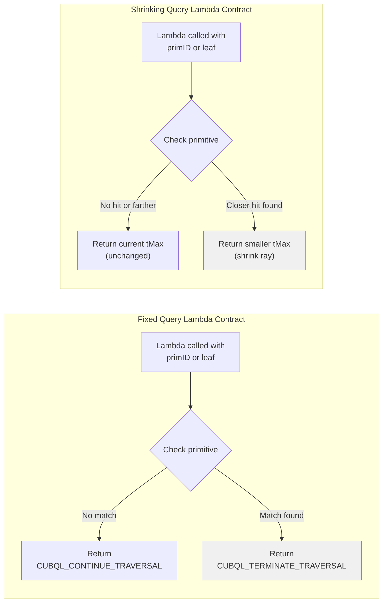
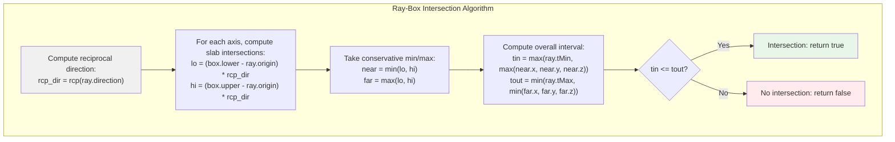
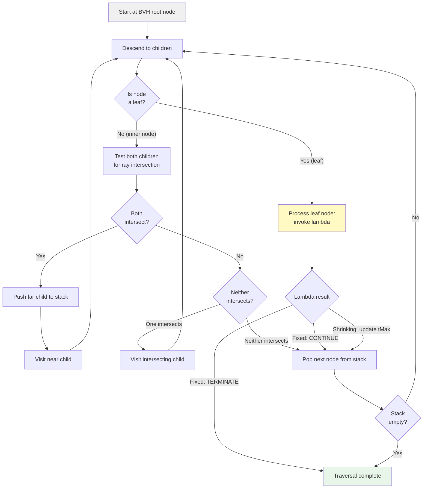
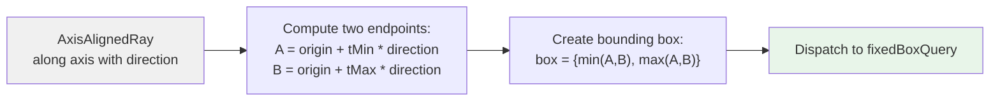
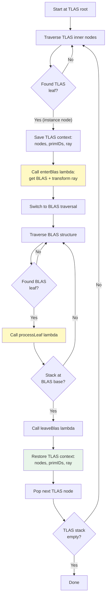

<!-- source: DeepWiki mcp.deepwiki.com · repo NVIDIA/cuBQL · page 7.1 Ray Queries · fetched 2026-10-26 -->

# Ray Queries

<details>
<summary>Relevant source files</summary>

The following files were used as context for generating this wiki page:

- [cuBQL/traversal/rayQueries.h](cuBQL/traversal/rayQueries.h)

</details>


## Purpose and Scope

This page provides an overview of ray-based BVH traversal functionality in cuBQL, which enables efficient ray tracing queries against spatial acceleration structures. Ray queries are essential for applications such as ray tracing, line-of-sight calculations, and ray casting.

For specific details on the two ray query variants, see [Fixed Ray Query](#7.1.1) and [Shrinking Ray Query](#7.1.2). For ball-shaped spatial queries, see [Radius Queries](#7.2). For higher-level geometric applications, see [Ray-Triangle Intersection](#8.2).

**Sources**: [cuBQL/traversal/rayQueries.h:1-654]()

---

## Overview

cuBQL provides two distinct ray query namespaces, each designed for different query patterns:

| Query Type | Namespace | Ray Interval Behavior | Child Node Ordering | Typical Use Case |
|------------|-----------|----------------------|---------------------|------------------|
| **Fixed** | `cuBQL::fixedRayQuery` | `[tMin, tMax]` remains constant | Unordered | Any-hit queries, shadow rays |
| **Shrinking** | `cuBQL::shrinkingRayQuery` | `tMax` can decrease during traversal | Front-to-back ordered | Closest-hit queries, primary rays |

### Fixed Ray Queries

Fixed ray queries maintain a constant ray interval `[tMin, tMax]` throughout traversal. Because the search space never changes, child nodes do not need to be traversed in any particular order. This allows for simpler traversal logic and is optimal for queries that need to find *any* intersection within the interval (e.g., shadow ray occlusion testing).

### Shrinking Ray Queries

Shrinking ray queries allow the `tMax` value to decrease as closer hits are found. When a closer intersection is discovered in one subtree, the ray's `tMax` shrinks, potentially pruning entire subtrees that are now beyond the updated interval. To maximize pruning efficiency, children are traversed front-to-back based on their intersection distances. This is optimal for finding the *closest* intersection (e.g., primary rays in path tracing).

```mermaid
graph TB
    subgraph "Fixed Ray Query"
        FR1["Ray with fixed [tMin, tMax]"]
        FR2["Traverse BVH unordered"]
        FR3["Lambda checks each primitive"]
        FR4["tMax never changes"]
        FR5["Can terminate early via lambda"]
        
        FR1 --> FR2
        FR2 --> FR3
        FR3 --> FR4
        FR4 --> FR5
    end
    
    subgraph "Shrinking Ray Query"
        SR1["Ray with initial [tMin, tMax]"]
        SR2["Traverse BVH front-to-back"]
        SR3["Lambda checks each primitive"]
        SR4["Lambda returns new tMax"]
        SR5["tMax shrinks on closer hits"]
        SR6["Prunes distant subtrees"]
        
        SR1 --> SR2
        SR2 --> SR3
        SR3 --> SR4
        SR4 --> SR5
        SR5 --> SR6
        SR6 --> SR2
    end
    
    style FR1 fill:#f0f0f0
    style SR1 fill:#f0f0f0
    style FR4 fill:#e8f5e9
    style SR5 fill:#fff9c4
```



**Sources**: [cuBQL/traversal/rayQueries.h:18-22](), [cuBQL/traversal/rayQueries.h:71-74]()

---

## Query Interface Functions

Both query namespaces provide two primary interface functions that differ in granularity of callback invocation:

### forEachLeaf Functions

```cpp
// Fixed ray query - visits each leaf node
template<typename Lambda>
void fixedRayQuery::forEachLeaf(
    const Lambda &lambdaToCallOnEachLeaf,
    cuBQL::bvh3f bvh,
    cuBQL::ray3f ray,
    bool dbg=false);

// Shrinking ray query - visits each leaf node, returns final tMax
template<typename Lambda, typename bvh_t, typename ray_t>
float shrinkingRayQuery::forEachLeaf(
    const Lambda &lambdaToCallOnEachLeaf,
    bvh_t bvh,
    ray_t ray,
    bool dbg=false);
```

The `forEachLeaf` functions invoke the user lambda once per BVH leaf node, passing:
- Pointer to the leaf's primitive ID array: `const uint32_t *leafPrims`
- Number of primitives in the leaf: `size_t numPrims`

The lambda must handle iteration over primitives within the leaf.

### forEachPrim Functions

```cpp
// Fixed ray query - visits each primitive
template<typename Lambda>
void fixedRayQuery::forEachPrim(
    const Lambda &lambdaToExecuteForEachCandidate,
    cuBQL::bvh3f bvh,
    cuBQL::ray3f ray,
    bool dbg=false);

// Shrinking ray query - visits each primitive
template<typename Lambda, typename bvh_t, typename ray_t>
void shrinkingRayQuery::forEachPrim(
    const Lambda &lambdaToExecuteForEachCandidate,
    bvh_t bvh,
    ray_t &ray,
    bool dbg=false);
```

The `forEachPrim` functions invoke the user lambda once per primitive, passing:
- Primitive ID: `uint32_t primID`

This provides a simpler interface when per-primitive processing is needed without explicit leaf handling.

### Lambda Return Values

| Query Type | Return Type | Return Value Meaning |
|------------|-------------|----------------------|
| **Fixed - forEachLeaf** | `int` | `CUBQL_CONTINUE_TRAVERSAL` or `CUBQL_TERMINATE_TRAVERSAL` |
| **Fixed - forEachPrim** | `int` | `CUBQL_CONTINUE_TRAVERSAL` or `CUBQL_TERMINATE_TRAVERSAL` |
| **Shrinking - forEachLeaf** | `float` | New `tMax` value (can shrink ray interval) |
| **Shrinking - forEachPrim** | `float` | New `tMax` value (can shrink ray interval) |



**Sources**: [cuBQL/traversal/rayQueries.h:24-68](), [cuBQL/traversal/rayQueries.h:76-96](), [cuBQL/traversal/rayQueries.h:203-243](), [cuBQL/traversal/rayQueries.h:317-342]()

---

## Ray-Box Intersection Utilities

The ray query system provides optimized ray-box intersection functions used internally during BVH traversal:

### rayIntersectsBox (Boolean Test)

```cpp
template<typename T>
inline __cubql_both
bool rayIntersectsBox(ray_t<T> ray, box_t<T,3> box);
```

Performs a simple boolean intersection test to determine if the ray intersects the bounding box within the interval `[ray.tMin, ray.tMax]`.

**Implementation**: Computes slab intersections by calculating entry/exit points along each axis using the ray's reciprocal direction vector.

### rayBoxTest (Parametric Test)

```cpp
template<typename T>
inline __cubql_both
void rayBoxTest(T &tin, T &tout,
                ray_t<T> ray, box_t<T,3> box);
```

Computes the parametric entry (`tin`) and exit (`tout`) distances where the ray intersects the box.

### rayIntersectsBox with Distance

```cpp
template<typename T>
inline __cubql_both
bool rayIntersectsBox(float &ret_t0,
                      ray_t<T> ray, vec_t<T,3> rcp_dir, box_t<T,3> box);
```

Performs intersection test and returns the entry distance `ret_t0`. Accepts a precomputed reciprocal direction vector `rcp_dir` for efficiency when testing the same ray against multiple boxes.

### Slab Intersection Algorithm

The intersection tests use the standard slab method:



**Sources**: [cuBQL/traversal/rayQueries.h:156-200]()

---

## Stack-Based Traversal Algorithm

Both fixed and shrinking ray queries use iterative stack-based traversal to avoid recursion overhead on GPU hardware. The traversal maintains a local stack of pending nodes to visit.

### Traversal Structure



### Key Implementation Details

**Stack Management**: A fixed-size array of 64 node entries (128 for two-level traversal) is allocated on the function stack. This size is sufficient for virtually all practical BVH depths.

**Node Administration**: The `node.admin` field contains both the offset and count information:
- For inner nodes: `count == 0`, `offset` points to first child
- For leaf nodes: `count > 0`, `offset` points to first primitive ID

**Traversal Ordering**:
- **Fixed queries**: Children tested in arbitrary order since pruning opportunities don't change
- **Shrinking queries**: Children ordered front-to-back based on intersection distance `node_t0 < node_t1` to maximize early pruning

**Zero Direction Handling**: To avoid division by zero, zero-valued direction components are clamped to `1e-20` before computing reciprocal directions.

**Sources**: [cuBQL/traversal/rayQueries.h:248-315](), [cuBQL/traversal/rayQueries.h:344-420]()

---

## Axis-Aligned Ray Optimization

Fixed ray queries provide specialized implementations for axis-aligned rays using the `AxisAlignedRay<axis,sign>` template:

```cpp
template<int axis, int sign, typename Lambda>
void fixedRayQuery::forEachLeaf(
    const Lambda &lambdaToExecuteForEachCandidate,
    cuBQL::bvh3f bvh,
    AxisAlignedRay<axis,sign> ray,
    bool dbg=false);
```

### Optimization Strategy

Axis-aligned rays are converted to axis-aligned bounding boxes and dispatched to `fixedBoxQuery::forEachLeaf` for simpler and faster traversal:



This optimization eliminates the need for direction-based slab calculations since box-box overlap tests are cheaper than ray-box tests for axis-aligned rays.

**Sources**: [cuBQL/traversal/rayQueries.h:203-244]()

---

## Two-Level BVH Traversal

The `shrinkingRayQuery::twoLevel` namespace provides support for hierarchical BVH structures consisting of a top-level acceleration structure (TLAS) containing multiple bottom-level acceleration structures (BLAS). This is essential for instanced geometry with transformations.

### Two-Level Interface

```cpp
template<typename EnterBlasLambda,
         typename LeaveBlasLambda,
         typename ProcessLeafLambda,
         typename bvh_t, typename ray_t>
void shrinkingRayQuery::twoLevel::forEachLeaf(
    const EnterBlasLambda   &enterBlas,
    const LeaveBlasLambda   &leaveBlas,
    const ProcessLeafLambda &processLeaf,
    bvh_t bvh,
    ray_t &ray,
    bool dbg=false);
```

### Lambda Responsibilities

| Lambda | Parameters | Purpose |
|--------|-----------|---------|
| `enterBlas` | `ray_t &ray, bvh_t &blas, int instID` | Transform ray into instance space, return BLAS to traverse |
| `leaveBlas` | None | Clean up after BLAS traversal (if needed) |
| `processLeaf` | `const uint32_t *primIDs, int offset, int count` | Process primitives in BLAS leaf, return new `tMax` |

### Traversal Flow



### Implementation Details

**Stack Segmentation**: The traversal stack is conceptually divided into TLAS and BLAS regions. The `blasStackBase` pointer marks the boundary between them, enabling proper context switches.

**Context Preservation**: When entering a BLAS:
- Original TLAS node and primitive arrays are saved
- Original ray origin and direction are saved
- Ray is transformed by `enterBlas` lambda

When leaving a BLAS:
- TLAS pointers are restored
- Ray is restored to original coordinate frame
- Traversal continues in TLAS

**Instance Encoding**: TLAS leaves must contain exactly one primitive per leaf (`node.count == 1`). The primitive ID identifies which instance to traverse.

**Ray Transformation**: The `enterBlas` lambda is responsible for transforming the ray into the instance's local coordinate space. cuBQL handles saving and restoring the original ray automatically.

**Sources**: [cuBQL/traversal/rayQueries.h:97-147](), [cuBQL/traversal/rayQueries.h:440-651]()

---

## Usage Examples

### Fixed Ray Query (Shadow Ray)

```cpp
// Shadow ray: any intersection blocks light
ray3f shadowRay = {origin, direction, 0.001f, distToLight};
bool occluded = false;

auto checkOcclusion = [&](uint32_t primID) {
    // Check if primitive blocks ray
    if (intersectsPrimitive(primID, shadowRay)) {
        occluded = true;
        return CUBQL_TERMINATE_TRAVERSAL; // Early out
    }
    return CUBQL_CONTINUE_TRAVERSAL;
};

fixedRayQuery::forEachPrim(checkOcclusion, bvh, shadowRay);
```

### Shrinking Ray Query (Closest Hit)

```cpp
// Primary ray: find closest intersection
ray3f primaryRay = {origin, direction, 0.0f, FLT_MAX};
float closestT = FLT_MAX;
int closestPrim = -1;

auto findClosest = [&](uint32_t primID) -> float {
    float t = intersectPrimitive(primID, primaryRay);
    if (t < closestT) {
        closestT = t;
        closestPrim = primID;
        return t; // Shrink ray to this distance
    }
    return closestT; // Keep current distance
};

shrinkingRayQuery::forEachPrim(findClosest, bvh, primaryRay);
```

### Two-Level Ray Query (Instanced Geometry)

```cpp
// Ray trace through instanced scene
ray3f ray = {origin, direction, 0.0f, FLT_MAX};
HitInfo closestHit;

auto enterInstance = [&](ray_t<float> &r, bvh3f &blas, int instID) {
    // Transform ray to instance space
    r.origin = instances[instID].transform.xfmPoint(r.origin);
    r.direction = instances[instID].transform.xfmVector(r.direction);
    blas = instances[instID].geometry_bvh;
};

auto leaveInstance = []() {
    // Cleanup if needed
};

auto processLeaf = [&](const uint32_t *prims, int offset, int count) {
    for (int i = 0; i < count; i++) {
        float t = intersectPrimitive(prims[offset + i], ray);
        if (t < closestHit.t) {
            closestHit.t = t;
            closestHit.primID = prims[offset + i];
        }
    }
    return closestHit.t;
};

shrinkingRayQuery::twoLevel::forEachLeaf(
    enterInstance, leaveInstance, processLeaf, tlas, ray);
```

**Sources**: [cuBQL/traversal/rayQueries.h:18-69](), [cuBQL/traversal/rayQueries.h:97-147]()

---

## Related Pages

- [Fixed Ray Query](#7.1.1) - Detailed documentation of constant-interval ray traversal
- [Shrinking Ray Query](#7.1.2) - Detailed documentation of adaptive-interval ray traversal  
- [Radius Queries](#7.2) - Ball-shaped spatial queries for nearest neighbor searches
- [Ray-Triangle Intersection](#8.2) - Geometric algorithms for ray-primitive intersection
- [Two-Level BVH Traversal](#7.3) - Additional details on TLAS/BLAS hierarchies

---

