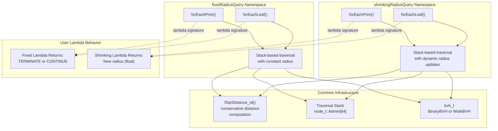
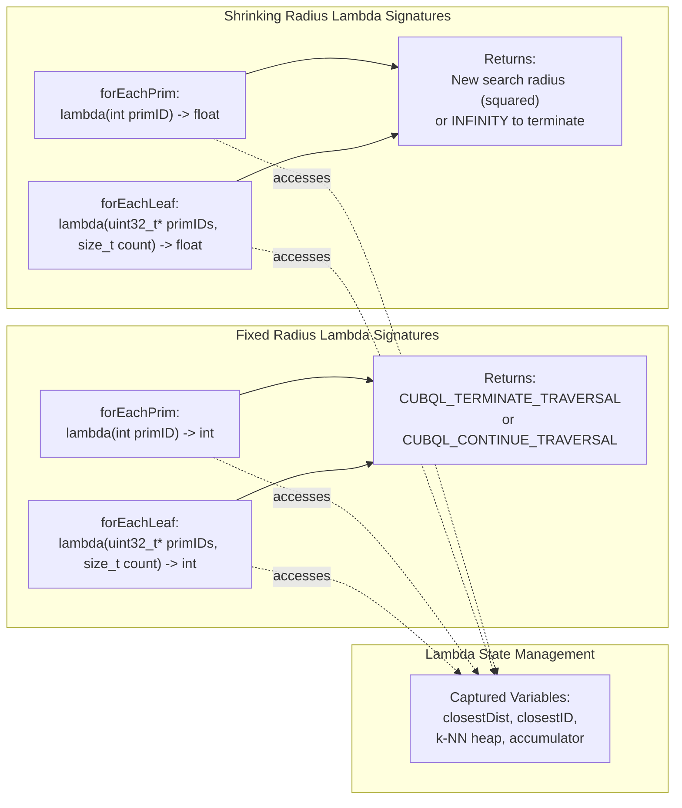
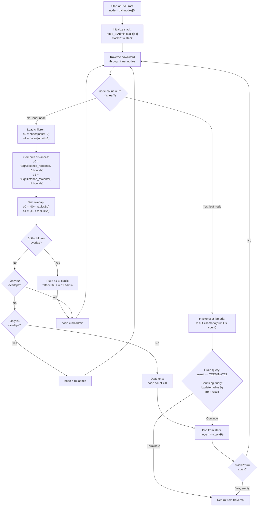
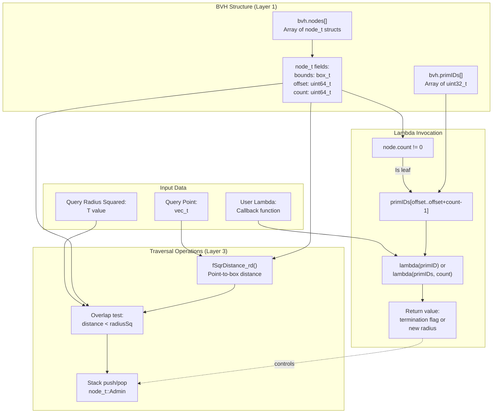

<!-- source: DeepWiki mcp.deepwiki.com · repo NVIDIA/cuBQL · page 7.2 Radius Queries · fetched 2026-10-26 -->

# Radius Queries

<details>
<summary>Relevant source files</summary>

The following files were used as context for generating this wiki page:

- [README.md](README.md)
- [cuBQL/traversal/fixedRadiusQuery.h](cuBQL/traversal/fixedRadiusQuery.h)

</details>


## Purpose and Scope

This page provides an overview of radius-based spatial queries in cuBQL, which enable ball-shaped searches through BVH structures for applications such as nearest neighbor searches, proximity detection, and closest point queries. Radius queries use a spherical search volume centered at a query point to efficiently identify primitives or leaves within a specified distance.

For detailed information about fixed-radius traversal, see [Fixed Radius Query](#7.2.1). For information about dynamically shrinking radius traversal for k-NN and closest point queries, see [Shrinking Radius Query](#7.2.2). For ray-based queries, see [Ray Queries](#7.1).

**Sources**: README.md:223-266, cuBQL/traversal/fixedRadiusQuery.h:1-11

---

## Radius Query Fundamentals

Radius queries traverse a BVH using a **query ball** (sphere) defined by a center point and a radius. The traversal identifies all BVH nodes and primitives whose bounding boxes intersect or lie within this query ball. Unlike ray queries that test line segments, radius queries test spherical regions, making them ideal for proximity-based spatial operations.

### Query Ball Definition

| Parameter | Type | Description |
|-----------|------|-------------|
| **Query Center** | `vec_t<T,D>` | Center point of the search sphere in D-dimensional space |
| **Query Radius** | `T` | Distance from center; note that implementations use **squared radius** for efficiency |
| **BVH Structure** | `bvh_t<T,D>` | The BVH to traverse (either `BinaryBVH<T,D>` or `WideBVH<T,D,N>`) |
| **User Lambda** | Callback function | Processes each encountered primitive or leaf |

The use of **squared radius** (`queryBallRadiusSquare`) throughout the API avoids expensive square root operations during distance computations, as most intersection tests naturally work with squared distances.

**Sources**: cuBQL/traversal/fixedRadiusQuery.h:44-56, README.md:223-230

---

## Two Query Variants

### Diagram: Fixed vs Shrinking Radius Query Architecture



**Sources**: cuBQL/traversal/fixedRadiusQuery.h:19-236, README.md:223-266

### Fixed Radius Queries

Fixed radius queries maintain a **constant search radius** throughout traversal. The query ball never changes size, and the traversal reports all primitives or leaves within that fixed distance. User lambdas return control flow indicators (`CUBQL_TERMINATE_TRAVERSAL` or `CUBQL_CONTINUE_TRAVERSAL`) but cannot modify the search radius.

**Use cases**:
- Find all points within a fixed distance threshold
- Collision detection with fixed bounding spheres
- Range queries where all results within a distance are needed
- Spatial hashing and grid-based lookups

**Key characteristic**: Unordered traversal—nodes are visited based on stack order, not distance from query point.

**Sources**: cuBQL/traversal/fixedRadiusQuery.h:26-40, cuBQL/traversal/fixedRadiusQuery.h:58-71

### Shrinking Radius Queries

Shrinking radius queries allow the **search radius to decrease dynamically** during traversal based on primitives encountered. User lambdas return a new (typically smaller) radius value, enabling the traversal to prune more of the search space as better candidates are found.

**Use cases**:
- k-nearest neighbor (k-NN) search
- Closest point queries
- Nearest surface point on triangle meshes
- Photon mapping with progressive radius reduction

**Key characteristic**: Adaptive traversal—as closer primitives are found, the shrinking radius eliminates distant subtrees from consideration.

**Sources**: README.md:223-266, README.md:251-266

---

## Lambda Callback Signatures

### Diagram: Lambda Interface Contract



**Sources**: cuBQL/traversal/fixedRadiusQuery.h:36-39, cuBQL/traversal/fixedRadiusQuery.h:67-70, README.md:242-265

### Per-Primitive vs Per-Leaf Callbacks

Both fixed and shrinking radius queries offer two callback granularities:

| Function | Callback Level | Lambda Receives | Use Case |
|----------|---------------|-----------------|----------|
| `forEachPrim` | Individual primitives | Single `primID` | When each primitive needs different processing |
| `forEachLeaf` | Entire leaf nodes | Array `primIDs[]` and `count` | When batch processing is beneficial |

The `forEachPrim` variant internally calls `forEachLeaf` and loops over primitives within each leaf [cuBQL/traversal/fixedRadiusQuery.h:219-234](). This provides convenience at minimal overhead for typical use cases.

**Sources**: cuBQL/traversal/fixedRadiusQuery.h:41-56, cuBQL/traversal/fixedRadiusQuery.h:72-85

---

## Traversal Algorithm

### Diagram: Radius Query Traversal Flow



**Sources**: cuBQL/traversal/fixedRadiusQuery.h:120-188

### Conservative Distance Computation

The traversal uses **conservative distance** functions (`fSqrDistance_rd`) that compute a lower bound on the squared distance between a query point and a bounding box. This ensures no false negatives—if a box truly intersects the query ball, it will always be reported as overlapping. The "_rd" suffix indicates "rounded down" semantics for conservative geometric computations.

**Sources**: cuBQL/traversal/fixedRadiusQuery.h:15, cuBQL/traversal/fixedRadiusQuery.h:143-146

---

## Stack-Based Traversal

Radius queries use **iterative stack-based traversal** rather than recursion, which is critical for GPU execution where recursion depth is limited. The stack holds `node_t::Admin` structures (compact 64-bit node descriptors containing `offset` and `count` fields) for deferred subtree traversal.

### Stack Management

| Aspect | Implementation Detail |
|--------|----------------------|
| **Stack Size** | 64 elements (sufficient for trees with billions of primitives) |
| **Stack Content** | `node_t::Admin` structures (8 bytes each) |
| **Push Operation** | `*stackPtr++ = node.admin` |
| **Pop Operation** | `node = *--stackPtr` |
| **Termination** | When `stackPtr == traversalStack` (stack empty) |

The algorithm prioritizes left child traversal and defers right child processing to the stack when both children overlap the query ball [cuBQL/traversal/fixedRadiusQuery.h:155-169]().

**Sources**: cuBQL/traversal/fixedRadiusQuery.h:120-121, cuBQL/traversal/fixedRadiusQuery.h:184-187

---

## Usage Examples

### Fixed Radius Query Pattern

The following pattern demonstrates a typical fixed radius query that collects all primitive IDs within a search radius:

```cpp
// User-defined state for accumulating results
std::vector<int> foundPrims;
float searchRadius = 5.0f;
vec3f queryPoint = ...;

// Lambda captures state by reference
auto lambda = [&foundPrims](int primID) -> int {
    foundPrims.push_back(primID);
    return CUBQL_CONTINUE_TRAVERSAL;  // Process all candidates
};

// Execute query
cuBQL::fixedRadiusQuery::forEachPrim(
    lambda,
    bvh,
    queryPoint,
    searchRadius * searchRadius  // Note: squared radius
);
```

**Sources**: cuBQL/traversal/fixedRadiusQuery.h:208-234, README.md:235-248

### Shrinking Radius Query Pattern

The shrinking radius pattern for closest point search dynamically reduces the search radius:

```cpp
float closestDist = INFINITY;
int closestID = -1;
vec3f queryPoint = ...;
Point *points = ...;  // Primitive data

auto lambda = [&closestDist, &closestID, queryPoint, points](int primID) -> float {
    float dist = distance(queryPoint, points[primID].position);
    if (dist < closestDist) {
        closestDist = dist;
        closestID = primID;
    }
    return closestDist;  // Shrink search radius for subsequent nodes
};

// Initial search radius can be INFINITY for unbounded search
cuBQL::shrinkingRadiusQuery::forEachPrim(
    lambda,
    bvh,
    queryPoint,
    INFINITY  // Will shrink as candidates are found
);
```

**Sources**: README.md:254-266

---

## Relationship to BVH Structure

### Diagram: Data Flow Through Radius Query



**Sources**: cuBQL/traversal/fixedRadiusQuery.h:120-188, README.md:71-90

Radius queries operate on the `bvh_t<T,D>` structure (typically `BinaryBVH<float,3>` or similar), accessing:
- **nodes array**: For traversing the tree hierarchy and testing bounding box intersections
- **primIDs array**: For retrieving primitive indices when leaves are encountered
- **Node admin fields**: Compact 64-bit representation of `offset` and `count` for efficient stack storage

**Sources**: cuBQL/traversal/fixedRadiusQuery.h:48-49, cuBQL/traversal/fixedRadiusQuery.h:121-122

---

## Performance Characteristics

### Traversal Complexity

| Factor | Impact on Performance |
|--------|----------------------|
| **BVH Quality** | Better-constructed BVHs (e.g., SAH) reduce nodes visited |
| **Query Radius** | Larger radii require more node intersection tests |
| **Primitive Distribution** | Clustered primitives improve cache coherence |
| **Early Termination** | Lambdas returning `CUBQL_TERMINATE_TRAVERSAL` immediately exit |
| **Radius Shrinking** | Shrinking queries prune more subtrees, improving performance |

### Optimization Strategies

1. **Use squared distances**: API consistently uses squared radius to avoid `sqrt()` operations
2. **Conservative distance**: The `fSqrDistance_rd()` function provides tight lower bounds for effective pruning
3. **Stack depth**: The 64-element stack handles up to ~2^64 nodes (vastly exceeding practical limits)
4. **Shrinking for k-NN**: Maintaining a k-element heap in the lambda enables efficient dynamic pruning

**Sources**: cuBQL/traversal/fixedRadiusQuery.h:143-146, README.md:223-230

---

## Integration with Geometric Queries

Radius queries serve as the foundation for higher-level geometric operations (Layer 4 in cuBQL's architecture):

| Geometric Query | Radius Query Type | Implementation Approach |
|----------------|-------------------|------------------------|
| **k-Nearest Neighbor** | Shrinking | Maintain min-heap of k closest points; shrink radius to distance of k-th point |
| **Closest Point** | Shrinking | Track single closest point; shrink radius to its distance |
| **Range Search** | Fixed | Collect all primitives within constant distance |
| **Closest Surface Point** | Shrinking | Test point-to-triangle distance; shrink as closer triangles found |

These queries combine radius traversal templates with primitive-specific geometry tests (point-to-point distance, point-to-triangle distance, etc.).

**Sources**: README.md:200-221, README.md:270-280

---

## Comparison with Ray Queries

| Aspect | Radius Queries | Ray Queries |
|--------|---------------|-------------|
| **Search Volume** | Spherical (ball-shaped) | Linear (ray segment) |
| **Intersection Test** | Point-to-box distance | Ray-box intersection |
| **Primary Use** | Proximity searches, k-NN | Ray tracing, visibility |
| **Traversal Order** | Unordered (fixed) or distance-based (shrinking) | Front-to-back along ray direction |
| **Termination** | Lambda-controlled or radius-based pruning | `tMax` parameter or early termination |

For ray-based queries (ray tracing, ray casting, occlusion tests), see [Ray Queries](#7.1).

**Sources**: README.md:223-266, cuBQL/traversal/fixedRadiusQuery.h:1-11

---

