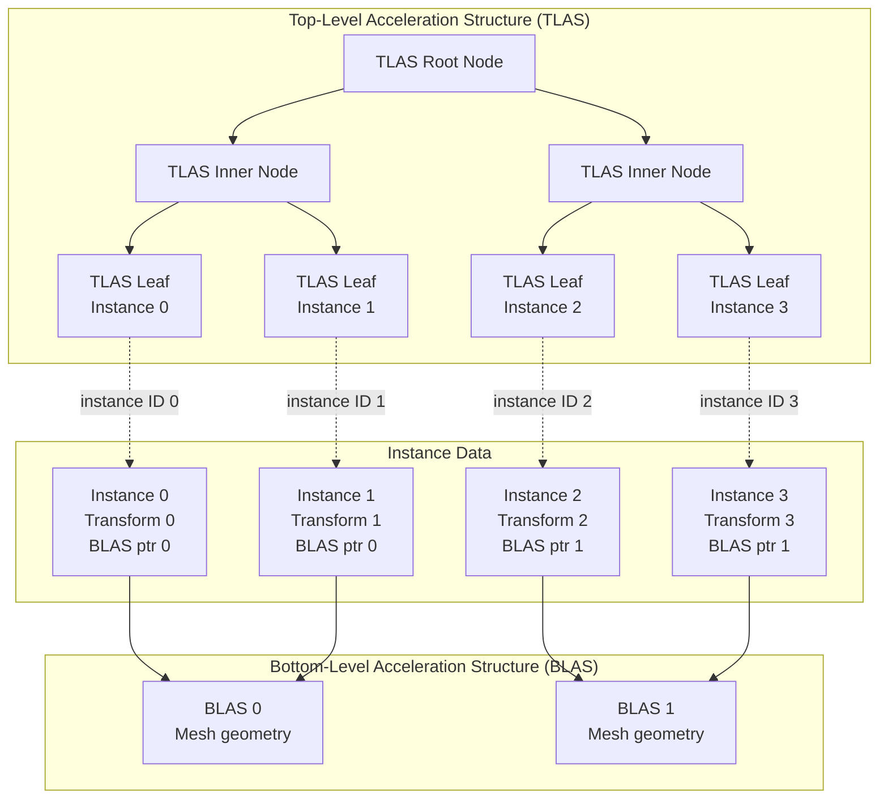
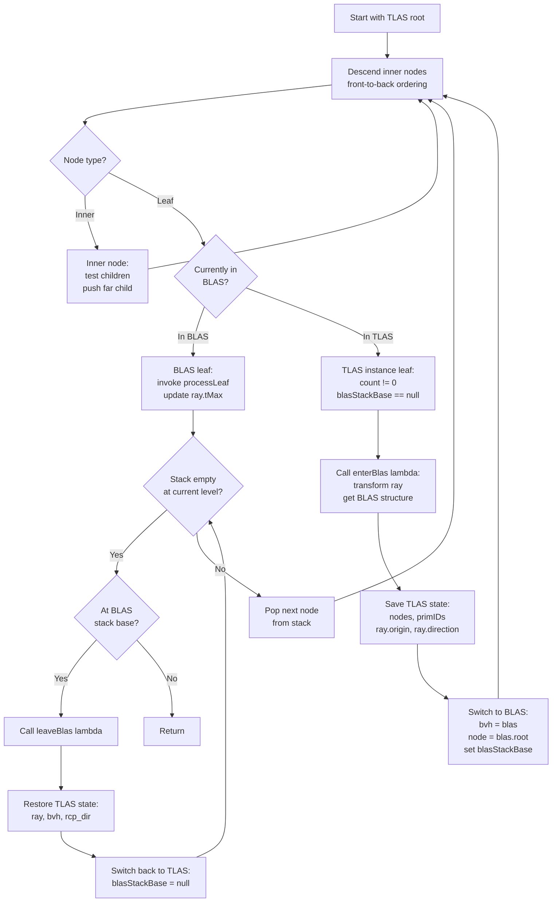
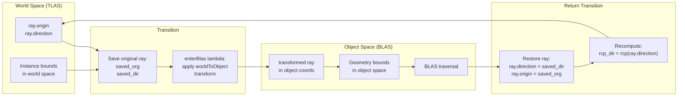
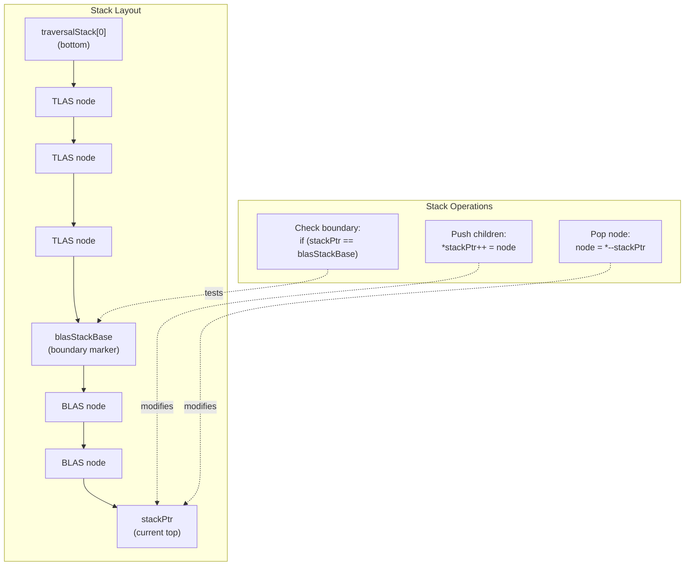
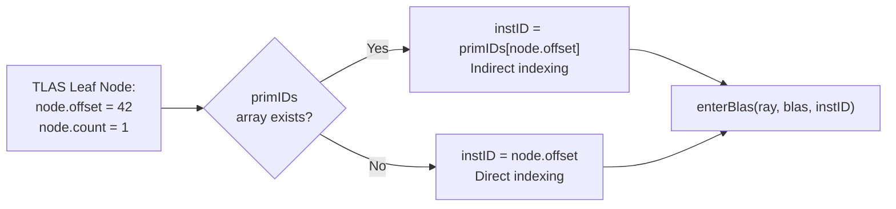

<!-- source: DeepWiki mcp.deepwiki.com · repo NVIDIA/cuBQL · page 7.3 Two-Level BVH Traversal · fetched 2026-10-26 -->

# Two-Level BVH Traversal

<details>
<summary>Relevant source files</summary>

The following files were used as context for generating this wiki page:

- [cuBQL/traversal/rayQueries.h](cuBQL/traversal/rayQueries.h)

</details>


## Purpose and Scope

This document covers two-level BVH traversal functionality in cuBQL, which enables efficient ray tracing of instanced geometry with transformations. The two-level hierarchy consists of a Top-Level Acceleration Structure (TLAS) containing instance references and multiple Bottom-Level Acceleration Structures (BLAS) containing actual geometry. This pattern is essential for scenes with repeated objects (trees, buildings, characters) where each instance can have different positions, orientations, and scales.

For single-level BVH traversal patterns without instancing, see [Fixed Ray Query](#7.1.1) and [Shrinking Ray Query](#7.1.2). For non-ray spatial queries, see [Radius Queries](#7.2).

**Sources**: [cuBQL/traversal/rayQueries.h:97-651]()

---

## TLAS/BLAS Hierarchy Concept

Two-level BVH traversal separates scene organization into two distinct acceleration structures:



**Key Properties**:

| Component | Purpose | Storage |
|-----------|---------|---------|
| **TLAS** | Spatial organization of instances | `BinaryBVH` with transformed instance bounds |
| **BLAS** | Geometry-level acceleration structures | `BinaryBVH` per unique mesh |
| **Instance Data** | Transformation matrices and BLAS references | User-managed array |

**Important**: The TLAS must be built with **exactly one primitive per leaf node** (`BuildConfig::maxPrimsPerLeaf = 1`), as each TLAS leaf represents a single instance reference.

**Sources**: [cuBQL/traversal/rayQueries.h:98-109](), [cuBQL/traversal/rayQueries.h:440-451](), [cuBQL/traversal/rayQueries.h:510-511]()

---

## Interface Functions

### forEachLeaf

```cpp
template<typename EnterBlasLambda,
         typename LeaveBlasLambda,
         typename ProcessLeafLambda,
         typename bvh_t, typename ray_t>
void shrinkingRayQuery::twoLevel::forEachLeaf(
    const EnterBlasLambda   &enterBlas,
    const LeaveBlasLambda   &leaveBlas,
    const ProcessLeafLambda &processLeaf,
    bvh_t bvh,
    ray_t &ray,
    bool dbg=false);
```

**Parameters**:

| Parameter | Type | Purpose |
|-----------|------|---------|
| `enterBlas` | Lambda | Transform ray into BLAS space and return BLAS structure |
| `leaveBlas` | Lambda | Cleanup when exiting BLAS traversal |
| `processLeaf` | Lambda | Process geometry leaves, return updated `ray.tMax` |
| `bvh` | `bvh_t` | TLAS structure |
| `ray` | `ray_t&` | Ray being traced (modified during traversal) |
| `dbg` | `bool` | Enable debug output |

### forEachPrim

```cpp
template<typename EnterBlasLambda,
         typename LeaveBlasLambda,
         typename IntersectPrimLambda,
         typename bvh_t, typename ray_t>
void shrinkingRayQuery::twoLevel::forEachPrim(
    const EnterBlasLambda     &enterBlas,
    const LeaveBlasLambda     &leaveBlas,
    const IntersectPrimLambda &intersectPrim,
    bvh_t bvh,
    ray_t &ray,
    bool dbg=false);
```

**Parameters**:

| Parameter | Type | Purpose |
|-----------|------|---------|
| `enterBlas` | Lambda | Transform ray into BLAS space and return BLAS structure |
| `leaveBlas` | Lambda | Cleanup when exiting BLAS traversal |
| `intersectPrim` | Lambda | Test ray against individual primitive, return hit distance |
| `bvh` | `bvh_t` | TLAS structure |
| `ray` | `ray_t&` | Ray being traced (modified during traversal) |
| `dbg` | `bool` | Enable debug output |

**Sources**: [cuBQL/traversal/rayQueries.h:110-121](), [cuBQL/traversal/rayQueries.h:135-146](), [cuBQL/traversal/rayQueries.h:457-464](), [cuBQL/traversal/rayQueries.h:626-633]()

---

## Lambda Signatures

### EnterBlasLambda

Invoked when traversal reaches a TLAS leaf (instance node). Must transform the ray into the BLAS coordinate system and return the appropriate BLAS structure.

```cpp
// Expected signature:
void operator()(ray_t &ray, bvh_t &blas, int instanceID) const;
```

**Responsibilities**:
- Look up instance transformation matrix using `instanceID`
- Transform `ray.origin` and `ray.direction` into BLAS space
- Set `blas.nodes` and `blas.primIDs` to point to the instance's BLAS data
- Modification of `ray` is saved and restored automatically by cuBQL

**Example**:
```cpp
auto enterBlas = [&instances](ray_t &ray, bvh_t &blas, int instID) {
    const Instance &inst = instances[instID];
    ray.origin = xfmPoint(inst.worldToObject, ray.origin);
    ray.direction = xfmVector(inst.worldToObject, ray.direction);
    blas = inst.blas;
};
```

### LeaveBlasLambda

Invoked when traversal exits a BLAS and returns to the TLAS. Used for cleanup or state restoration.

```cpp
// Expected signature:
void operator()() const;
```

**Note**: Ray transformation is automatically restored by cuBQL after this lambda returns.

### ProcessLeafLambda / IntersectPrimLambda

**ProcessLeafLambda** (used by `forEachLeaf`):
```cpp
// Expected signature:
float operator()(const uint32_t *primIDs, int offset, int count) const;
```

**IntersectPrimLambda** (used by `forEachPrim`):
```cpp
// Expected signature:
float operator()(int primID) const;
```

**Return Value**: Updated `ray.tMax` value. Return smaller values to shrink the ray and enable early termination of distant subtrees.

**Sources**: [cuBQL/traversal/rayQueries.h:102-109](), [cuBQL/traversal/rayQueries.h:127-134](), [cuBQL/traversal/rayQueries.h:523-529](), [cuBQL/traversal/rayQueries.h:635-648]()

---

## Traversal Algorithm

The two-level traversal algorithm extends single-level shrinking ray traversal with instance transition logic:



**Algorithm Key Points**:

1. **State Detection**: `blasStackBase` distinguishes TLAS vs BLAS traversal (null = TLAS, non-null = BLAS)
2. **Instance Recognition**: TLAS leaf nodes have `node.count != 0` and `blasStackBase == nullptr`
3. **Ordering**: Children are traversed front-to-back based on ray-box intersection distances
4. **Ray Shrinking**: `ray.tMax` updates from leaf processing enable progressive culling

**Sources**: [cuBQL/traversal/rayQueries.h:457-607]()

---

## Coordinate Transformation



**Transformation Sequence**:

| Step | Location | Action |
|------|----------|--------|
| 1. Hit TLAS leaf | [cuBQL/traversal/rayQueries.h:518-522]() | Extract instance ID from `primIDs` or `node.offset` |
| 2. Save state | [cuBQL/traversal/rayQueries.h:523-524]() | `saved_dir = ray.direction`<br/>`saved_org = ray.origin` |
| 3. Transform ray | [cuBQL/traversal/rayQueries.h:525-529]() | `enterBlas` modifies `ray` to object space |
| 4. Update reciprocal | [cuBQL/traversal/rayQueries.h:530-533]() | Recompute `rcp_dir` for transformed ray |
| 5. Switch BVH | [cuBQL/traversal/rayQueries.h:534-537]() | Set `bvh.nodes`, `bvh.primIDs` to BLAS |
| 6. Traverse BLAS | [cuBQL/traversal/rayQueries.h:491-605]() | Standard shrinking ray traversal |
| 7. Restore | [cuBQL/traversal/rayQueries.h:595-598]() | `ray.direction = saved_dir`<br/>`ray.origin = saved_org` |
| 8. Switch back | [cuBQL/traversal/rayQueries.h:600-601]() | Restore TLAS `nodes` and `primIDs` |

**Important**: Zero-valued ray direction components are clamped to `1e-20` to avoid division by zero in reciprocal calculation.

**Sources**: [cuBQL/traversal/rayQueries.h:478-601]()

---

## Stack Management

Two-level traversal uses a single unified stack with a boundary marker to separate TLAS and BLAS levels:



**Stack State Variables**:

| Variable | Type | Purpose |
|----------|------|---------|
| `traversalStack[128]` | `node_t::Admin[]` | Fixed-size stack array |
| `stackPtr` | `node_t::Admin*` | Current stack top pointer |
| `blasStackBase` | `node_t::Admin*` | Boundary between TLAS and BLAS nodes |

**Stack Depth**: `STACK_DEPTH = 128` provides sufficient space for typical scenes. Stack overflow is detected at [cuBQL/traversal/rayQueries.h:561-563]().

**Transition Logic**:

```cpp
// Entering BLAS:
blasStackBase = stackPtr;  // Mark current position

// Exiting BLAS:
if (stackPtr == blasStackBase) {
    // Restore TLAS state
    leaveBlas();
    ray.direction = saved_dir;
    ray.origin = saved_org;
    blasStackBase = nullptr;
}

// Final exit:
if (stackPtr == traversalStack) {
    return;  // Complete
}
```

**Sources**: [cuBQL/traversal/rayQueries.h:471-476](), [cuBQL/traversal/rayQueries.h:536-537](), [cuBQL/traversal/rayQueries.h:594-605]()

---

## Instance ID Resolution

The TLAS leaf node's primitive reference is interpreted as an instance ID:



**Implementation**:

```cpp
int instID = bvh.primIDs 
    ? bvh.primIDs[node.offset]  // Indirect: user-defined mapping
    : node.offset;               // Direct: offset is instance ID
```

**Use Cases**:

| `primIDs` State | Behavior | Use Case |
|-----------------|----------|----------|
| **Present** | Indirect indexing through `primIDs` | Custom instance ordering or filtered subsets |
| **Absent** | Direct use of `node.offset` | Sequential instance IDs matching leaf order |

**Sources**: [cuBQL/traversal/rayQueries.h:518-522]()

---

## Example: Ray-Triangle Intersection with Instances

```cpp
struct Instance {
    bvh3f blas;
    AffineSpace3f worldToObject;
    AffineSpace3f objectToWorld;
};

std::vector<Instance> instances;
std::vector<Triangle> triangles;

// Build TLAS with transformed instance bounds
std::vector<box3f> instanceBounds;
for (const Instance &inst : instances) {
    box3f bounds = transform(inst.objectToWorld, inst.blas.getBounds());
    instanceBounds.push_back(bounds);
}
bvh3f tlas;
cuBQL::gpuBuilder(tlas, instanceBounds);

// Ray tracing kernel
auto enterBlas = [&instances](ray3f &ray, bvh3f &blas, int instID) {
    const Instance &inst = instances[instID];
    ray.origin = xfmPoint(inst.worldToObject, ray.origin);
    ray.direction = xfmVector(inst.worldToObject, ray.direction);
    blas = inst.blas;
};

auto leaveBlas = []() {
    // Optional cleanup
};

auto intersectPrim = [&triangles](int primID) -> float {
    float t, u, v;
    if (intersect(ray, triangles[primID], t, u, v)) {
        return t;  // Shrink ray to this hit
    }
    return ray.tMax;  // No hit
};

ray3f ray(origin, direction);
shrinkingRayQuery::twoLevel::forEachPrim(
    enterBlas, leaveBlas, intersectPrim, tlas, ray);
```

**Sources**: [cuBQL/traversal/rayQueries.h:626-651]()

---

## Performance Considerations

| Aspect | Recommendation | Rationale |
|--------|----------------|-----------|
| **TLAS Leaf Size** | Always use `maxPrimsPerLeaf = 1` | Required by two-level algorithm |
| **BLAS Quality** | Use SAH builder for static geometry | Better traversal performance |
| **Instance Transforms** | Precompute inverse matrices | Avoid redundant computation in `enterBlas` |
| **Stack Depth** | Monitor for overflow (128 limit) | Deep hierarchies may need larger stacks |
| **Ray Direction** | Avoid exact zeros | Implementation clamps to `1e-20` |

**Transformation Cost**: Each instance transition requires:
- 2× 3D point transforms (origin)
- 2× 3D vector transforms (direction)  
- 1× reciprocal vector computation

Minimize instance transitions by building high-quality TLAS structures that enable early culling.

**Sources**: [cuBQL/traversal/rayQueries.h:471-476](), [cuBQL/traversal/rayQueries.h:482-484](), [cuBQL/traversal/rayQueries.h:510-511](), [cuBQL/traversal/rayQueries.h:530-533]()

---

## Limitations

1. **Single-Level forEachLeaf/forEachPrim Only**: Two-level traversal is only available in the `shrinkingRayQuery` namespace, not `fixedRayQuery`

2. **TLAS Constraint**: TLAS must have exactly one primitive per leaf (`node.count == 1`). Violation triggers debug message at [cuBQL/traversal/rayQueries.h:510-511]()

3. **Ray Modification**: The `ray` parameter is passed by reference and will be modified during traversal. Make a copy if the original ray is needed after traversal

4. **Stack Depth**: Fixed stack size of 128 may be insufficient for extremely deep hierarchies (combined TLAS + BLAS depth)

5. **No Occlusion Queries**: Two-level traversal uses shrinking ray logic; fixed-ray "any-hit" queries are not supported

**Sources**: [cuBQL/traversal/rayQueries.h:97-147](), [cuBQL/traversal/rayQueries.h:471](), [cuBQL/traversal/rayQueries.h:510-511]()

---

