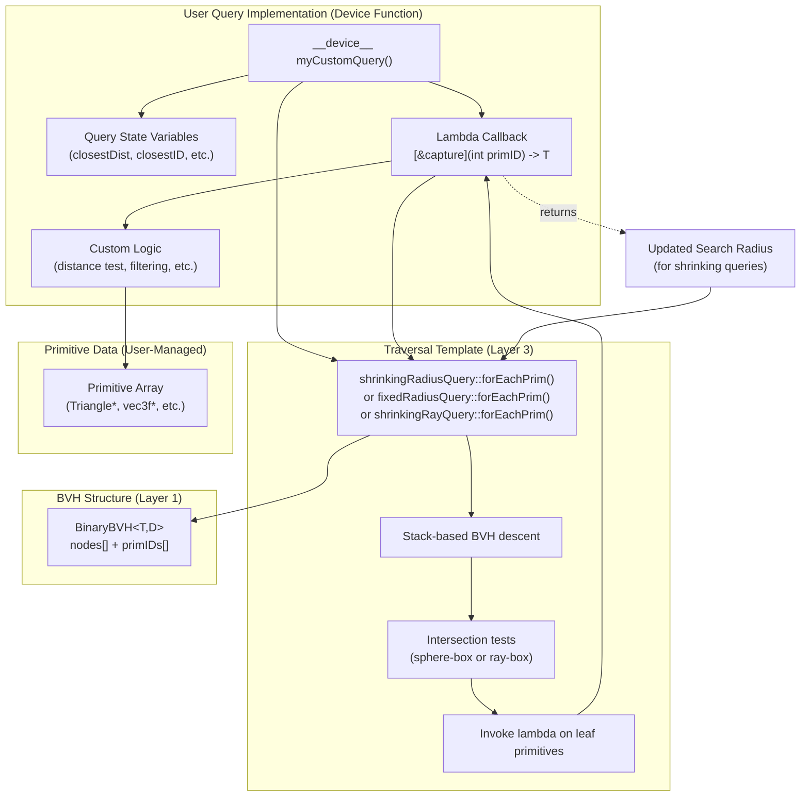
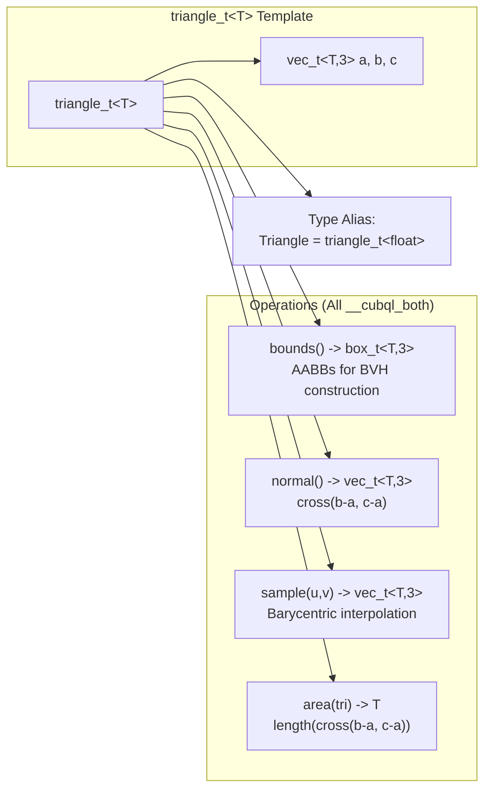
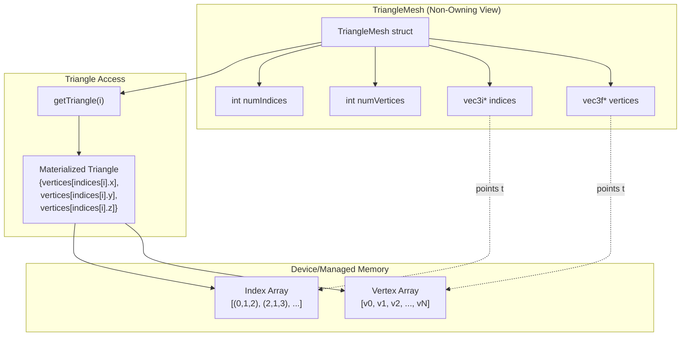

<!-- source: DeepWiki mcp.deepwiki.com · repo NVIDIA/cuBQL · page 8 Geometric Queries · fetched 2026-10-26 -->

# Geometric Queries

<details>
<summary>Relevant source files</summary>

The following files were used as context for generating this wiki page:

- [README.md](README.md)
- [cuBQL/queries/triangleData/Triangle.h](cuBQL/queries/triangleData/Triangle.h)

</details>


## Purpose and Scope

This page documents cuBQL's geometric query implementations, which represent the application layer (Layer 4) built on top of BVH traversal templates. These queries serve as **concrete examples** demonstrating how to combine traversal templates with user-defined lambda functions to solve specific spatial problems. While cuBQL provides sample implementations for common operations (closest point, k-NN, ray-triangle intersection), the primary intent is to illustrate patterns that users can adapt for custom query requirements.

For information about the underlying traversal mechanisms, see [BVH Traversal](#7). For details on specific traversal patterns (fixed/shrinking radius and ray queries), see [Ray Queries](#7.1) and [Radius Queries](#7.2).

---

## Architecture Context

Geometric queries occupy the top layer of cuBQL's four-layer architecture. They combine three lower-layer components:

1. **BVH data structures** from Layer 1 (e.g., `BinaryBVH<T,D>`)
2. **Traversal templates** from Layer 3 (e.g., `shrinkingRadiusQuery::forEachPrim`)
3. **Mathematical primitives** from Layer 0 (e.g., `vec_t<T,D>`, `box_t<T,D>`, `ray_t<T>`)

The design philosophy treats provided queries as **samples** rather than exhaustive implementations, anticipating that users will need variations (e.g., culling by surface normal, distance thresholds, custom metrics) not covered by the library.

**Diagram: Geometric Query Composition Pattern**



**Sources**: [README.md:209-266](), [cuBQL/queries/triangleData/Triangle.h:1-125]()

---

## Query Implementation Pattern

Geometric queries in cuBQL follow a standard pattern that maximizes code reuse while allowing customization:

### Standard Query Structure

```
__device__ void customQuery(
    BinaryBVH<T,D> bvh,
    PrimitiveType* primitives,
    QueryParameters params
) {
    // 1. Initialize query state (mutable via lambda capture)
    T searchRadius = params.initialRadius;
    ResultType result;
    
    // 2. Define lambda with captured state
    auto processCandidate = [&](int primID) -> T {
        // Custom per-primitive logic
        // Update result if candidate is better
        // Return new search radius (for shrinking queries)
    };
    
    // 3. Invoke traversal template
    traversalTemplate::forEachPrim(
        processCandidate,
        params.queryPoint,
        bvh,
        searchRadius
    );
    
    // 4. Use accumulated result
    return result;
}
```

The lambda function receives a primitive ID and returns a value controlling subsequent traversal behavior:
- **Shrinking queries**: Return updated radius (e.g., distance to closest point found so far)
- **Fixed queries**: Return value is ignored; lambda processes all candidates within fixed radius/range

**Sources**: [README.md:232-269]()

---

## Triangle Geometry

### triangle_t Template

The `triangle_t<T>` template provides a generic triangle representation parameterized by coordinate type:

| Member | Type | Description |
|--------|------|-------------|
| `a` | `vec_t<T,3>` | First vertex |
| `b` | `vec_t<T,3>` | Second vertex |
| `c` | `vec_t<T,3>` | Third vertex |

**Key Operations**:

| Function | Return Type | Description |
|----------|-------------|-------------|
| `bounds()` | `box_t<T,3>` | Compute axis-aligned bounding box enclosing triangle |
| `normal()` | `vec_t<T,3>` | Compute unnormalized geometric normal via `cross(b-a, c-a)` |
| `sample(u,v)` | `vec_t<T,3>` | Sample point at barycentric coordinates (u,v) with folding |
| `area(triangle_t<T>)` | `T` | Compute triangle area via `length(cross(b-a, c-a))` |

The `Triangle` type alias instantiates `triangle_t<float>` for convenience.

**Implementation Details**:
- `bounds()`: Uses chained `including()` calls to expand empty box to encompass all three vertices [cuBQL/queries/triangleData/Triangle.h:94-95]()
- `normal()`: Returns cross product without normalization (magnitude encodes area) [cuBQL/queries/triangleData/Triangle.h:90-91]()
- `sample()`: Folds (u,v) coordinates if `u+v >= 1` to ensure point lies within triangle [cuBQL/queries/triangleData/Triangle.h:103-107]()

**Diagram: triangle_t Structure and Operations**



**Sources**: [cuBQL/queries/triangleData/Triangle.h:32-50](), [cuBQL/queries/triangleData/Triangle.h:88-107]()

---

### TriangleMesh Structure

The `TriangleMesh` struct provides a **non-owning view** over indexed triangle mesh data:

| Member | Type | Description |
|--------|------|-------------|
| `vertices` | `vec3f*` | Pointer to vertex array (device or host memory) |
| `indices` | `vec3i*` | Pointer to index array (triplets of vertex indices) |
| `numVertices` | `int` | Total number of vertices |
| `numIndices` | `int` | Total number of index triplets (= number of triangles) |

**Key Method**:
- `getTriangle(int i)`: Returns materialized `Triangle` for the i-th triangle by indexing into `vertices` using `indices[i]` [cuBQL/queries/triangleData/Triangle.h:82-86]()

**Memory Management Notes**:
- `TriangleMesh` does **not** allocate or deallocate memory
- Can be used identically on host and device via `__cubql_both` decoration
- Pointers must reside in appropriate memory space for context (device memory for GPU builders/queries)
- Enables zero-copy sharing between host and device via managed memory

**Diagram: TriangleMesh Memory Layout**



**Sources**: [cuBQL/queries/triangleData/Triangle.h:54-86]()

---

## Building BVHs Over Triangle Meshes

To perform spatial queries on triangle meshes, users must first:

1. **Compute bounding boxes** for each triangle
2. **Invoke GPU builder** with box array
3. **Store mesh reference** for lambda access during queries

### Example Workflow

```
// Step 1: Allocate box array on device
box3f* d_triBoxes;
cudaMalloc(&d_triBoxes, mesh.numIndices * sizeof(box3f));

// Step 2: Compute boxes (device kernel)
computeTriangleBounds<<<...>>>(d_triBoxes, mesh);

// Step 3: Build BVH over triangle boxes
BinaryBVH<float,3> bvh;
BuildConfig config;
gpuBuilder(bvh, d_triBoxes, mesh.numIndices, config);

// Step 4: Queries can now use bvh + mesh together
// (mesh.getTriangle(primID) in lambda functions)
```

The `BinaryBVH::primIDs[]` array will contain indices into the triangle array (not the vertex array). For triangle `i`, the primitive ID is `i`, and `mesh.getTriangle(i)` retrieves the full triangle.

**Sources**: [README.md:123-145](), [cuBQL/queries/triangleData/Triangle.h:43-45]()

---

## Query Examples and Patterns

### Closest Point on Point Cloud

Uses `shrinkingRadiusQuery::forEachPrim` with a lambda that maintains the closest point found:

**Pattern**:
```
float closestDist = INFINITY;
int closestID = -1;

auto processPoint = [&](int primID) -> float {
    float dist = distance(queryPoint, points[primID]);
    if (dist < closestDist) {
        closestDist = dist;
        closestID = primID;
    }
    return closestDist; // Shrink radius to closest distance
};

shrinkingRadiusQuery::forEachPrim(
    processPoint, queryPoint, bvh, INFINITY
);
```

**Sources**: [README.md:250-266]()

---

### Closest Point on Triangle Surface

Similar structure, but lambda computes point-to-triangle distance:

**Pattern**:
```
float closestDist = INFINITY;
vec3f closestPoint;

auto processTriangle = [&](int primID) -> float {
    Triangle tri = mesh.getTriangle(primID);
    vec3f closestOnTri = computeClosestPointOnTriangle(queryPoint, tri);
    float dist = distance(queryPoint, closestOnTri);
    
    if (dist < closestDist) {
        closestDist = dist;
        closestPoint = closestOnTri;
    }
    return closestDist;
};

shrinkingRadiusQuery::forEachPrim(
    processTriangle, queryPoint, bvh, INFINITY
);
```

The key difference is the per-primitive distance computation, not the traversal mechanism.

**Sources**: [README.md:200-207]()

---

### k-Nearest Neighbors

Maintains a bounded priority queue (or fixed-size array) of k closest points:

**Pattern**:
```
struct KNNState {
    float maxDist = INFINITY;
    int ids[K];
    float dists[K];
    int count = 0;
};

KNNState state;

auto processCandidate = [&](int primID) -> float {
    float dist = distance(queryPoint, points[primID]);
    
    if (dist < state.maxDist) {
        // Insert into sorted array, evict farthest if full
        insertSorted(state, primID, dist, K);
        
        // Update search radius to k-th distance
        state.maxDist = (state.count == K) ? state.dists[K-1] : INFINITY;
    }
    return state.maxDist;
};

shrinkingRadiusQuery::forEachPrim(
    processCandidate, queryPoint, bvh, INFINITY
);
```

**Sources**: [README.md:203-222]()

---

### Ray-Triangle Intersection

Uses ray traversal templates with triangle intersection test in lambda. See [Ray-Triangle Intersection](#8.2) for detailed algorithms.

**Sources**: [README.md:270-280]()

---

## Type Flexibility

All query patterns work identically across different template instantiations:

| Coordinate Type | Dimensionality | Example BVH Type |
|-----------------|----------------|------------------|
| `float` | 2 | `BinaryBVH<float,2>` |
| `float` | 3 | `BinaryBVH<float,3>` (alias: `bvh3f`) |
| `double` | 3 | `BinaryBVH<double,3>` (alias: `bvh3d`) |
| `int32_t` | 2 | `BinaryBVH<int,2>` |
| `int64_t` | 4 | `BinaryBVH<int64_t,4>` |

The same query code (with appropriate type adjustments) works for finding closest `vec2i` point, closest `vec3d` point, etc. This is enabled by cuBQL's fully templated type system (see [Type System and Templates](#3.2)).

**Sources**: [README.md:18-21](), [README.md:267-269]()

---

## Comparison with Fixed Query Implementations

cuBQL's approach differs from libraries that provide only fixed query kernels:

| Aspect | Fixed Kernels | cuBQL Approach |
|--------|---------------|----------------|
| **Flexibility** | Limited to predefined operations | Lambda-based customization |
| **Code Reuse** | Duplicate traversal logic for each query | Single traversal template, multiple lambdas |
| **Maintenance** | N separate kernel implementations | 1 template + N lambdas |
| **User Extensions** | Requires library modification | User writes lambda, no library changes |
| **Type Safety** | Per-query type handling | Template parameterization handles all types |

**Example**: To exclude points based on surface normal in a k-NN query, users simply add filtering logic to their lambda rather than requesting a new library feature.

**Sources**: [README.md:195-222]()

---

## Summary

Geometric queries in cuBQL are:

1. **Application-layer implementations** combining BVH structures, traversal templates, and mathematical primitives
2. **Example-driven**: Provided queries demonstrate patterns, not exhaustive coverage
3. **Lambda-based**: User-defined callbacks enable customization without modifying library code
4. **Type-generic**: Same query logic works across `float3`, `int2`, `double4`, etc.
5. **Composable**: Triangle geometry (`triangle_t`, `TriangleMesh`) integrates seamlessly with BVH traversal

The `triangle_t<T>` template and `TriangleMesh` struct provide foundational geometry support, while the query pattern (state initialization → lambda definition → traversal invocation → result extraction) serves as a blueprint for custom implementations.

For traversal mechanics, see [BVH Traversal](#7). For triangle intersection algorithms, see [Ray-Triangle Intersection](#8.2).

**Sources**: [README.md:270-296](), [cuBQL/queries/triangleData/Triangle.h:1-125]()

---

