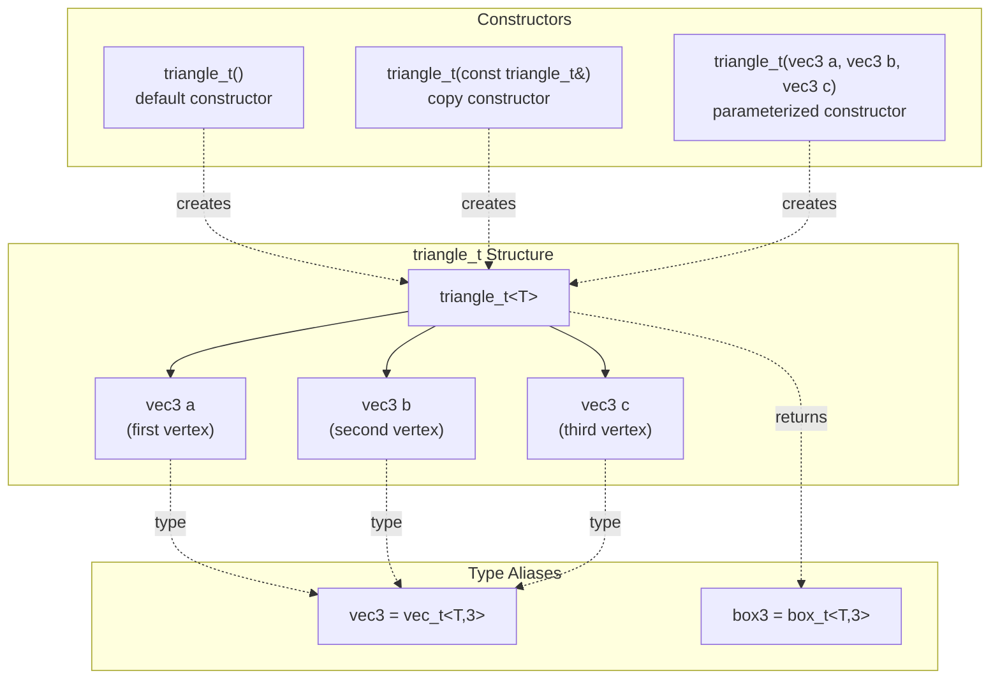
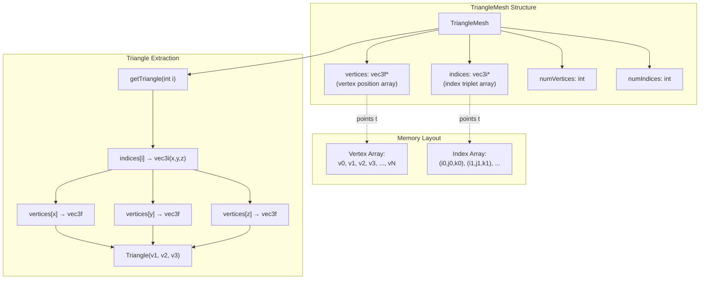
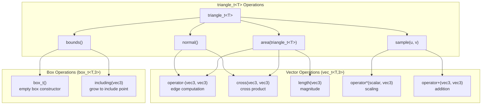

<!-- source: DeepWiki mcp.deepwiki.com · repo NVIDIA/cuBQL · page 8.1 Triangle Geometry · fetched 2026-10-26 -->

# Triangle Geometry

<details>
<summary>Relevant source files</summary>

The following files were used as context for generating this wiki page:

- [cuBQL/queries/triangleData/Triangle.h](cuBQL/queries/triangleData/Triangle.h)

</details>


## Purpose and Scope

This page documents the triangle data structures and basic geometric operations provided by cuBQL. The library defines a template-based `triangle_t<T>` structure for representing individual triangles and a `TriangleMesh` structure for indexed triangle mesh data. These types serve as foundational geometry primitives for spatial queries.

This page covers:
- Triangle storage formats and template parameterization
- Basic geometric operations (bounds, normal, sampling, area)
- Indexed mesh representation and memory layout

For information about ray-triangle intersection algorithms, see [Ray-Triangle Intersection](#8.2). For general mathematical foundation types (vectors, boxes), see [Mathematical Foundation](#4).

**Sources:** [cuBQL/queries/triangleData/Triangle.h:1-125]()

---

## Triangle Structure (`triangle_t<T>`)

The `triangle_t<T>` template represents a single triangle defined by three vertex positions. It is parameterized by coordinate type `T`, enabling support for different precision levels (float, double) and coordinate types.

### Template Definition

```
template<typename T>
struct triangle_t
{
  using vec3 = vec_t<T,3>;
  using box3 = box_t<T,3>;
  
  vec3 a;
  vec3 b;
  vec3 c;
};
```

The structure stores three vertices (`a`, `b`, `c`) as 3D vectors. All member functions are decorated with `__cubql_both` to enable execution on both CPU and GPU.

**Sources:** [cuBQL/queries/triangleData/Triangle.h:32-50]()

### Type Aliases

The library provides a commonly-used type alias:

| Alias | Definition | Description |
|-------|------------|-------------|
| `Triangle` | `triangle_t<float>` | Single-precision floating-point triangle |

**Sources:** [cuBQL/queries/triangleData/Triangle.h:52]()

### Memory Layout and Construction

The following diagram illustrates the `triangle_t<T>` structure and its relationship to the vector type system:



**Diagram: Triangle Structure and Type Dependencies**

**Sources:** [cuBQL/queries/triangleData/Triangle.h:32-42]()

---

## TriangleMesh Structure

The `TriangleMesh` structure represents indexed triangle mesh data, a common format for storing large-scale triangulated geometry efficiently. It uses shared vertex arrays with integer indices to avoid duplicating vertex data.

### Structure Definition

```
struct TriangleMesh {
  vec3f *vertices;
  vec3i *indices;
  int numVertices;
  int numIndices;
};
```

| Field | Type | Description |
|-------|------|-------------|
| `vertices` | `vec3f*` | Pointer to vertex position array (shared vertices) |
| `indices` | `vec3i*` | Pointer to triangle index array (triplets of vertex indices) |
| `numVertices` | `int` | Total number of vertices in the mesh |
| `numIndices` | `int` | Total number of index triplets (number of triangles) |

**Sources:** [cuBQL/queries/triangleData/Triangle.h:59-74]()

### Memory Management Semantics

The `TriangleMesh` structure acts as a **view** or **reference** to externally-managed memory:

- **No ownership**: The structure does not allocate or deallocate memory
- **No smart pointers**: Uses raw pointers for maximum flexibility
- **Memory space agnostic**: Can point to CPU or GPU memory depending on usage context
- **Device/host compatibility**: Can be used identically on both CPU and GPU

When passing a `TriangleMesh` to GPU builders or queries, the `vertices` and `indices` pointers **must** point to GPU-accessible memory (device or managed memory).

**Sources:** [cuBQL/queries/triangleData/Triangle.h:54-58]()

### Indexed Mesh Organization

The following diagram shows how the `TriangleMesh` structure organizes data and retrieves individual triangles:



**Diagram: TriangleMesh Indexed Data Organization**

**Sources:** [cuBQL/queries/triangleData/Triangle.h:59-86]()

### Triangle Extraction

The `getTriangle(int i)` method retrieves an individual triangle by index:

```
inline __cubql_both Triangle getTriangle(int i) const {
  vec3i index = indices[i];
  return { vertices[index.x], vertices[index.y], vertices[index.z] };
}
```

This method:
1. Fetches the index triplet `(x, y, z)` from `indices[i]`
2. Looks up the three vertex positions from the `vertices` array
3. Constructs and returns a `Triangle` object

**Sources:** [cuBQL/queries/triangleData/Triangle.h:82-86]()

---

## Geometric Operations

The `triangle_t<T>` template provides several fundamental geometric operations. All operations are implemented as inline functions with `__cubql_both` decoration for CPU/GPU compatibility.

### Available Operations Summary

| Operation | Return Type | Description |
|-----------|-------------|-------------|
| `bounds()` | `box_t<T,3>` | Computes axis-aligned bounding box |
| `normal()` | `vec_t<T,3>` | Computes unnormalized surface normal |
| `sample(float u, float v)` | `vec_t<T,3>` | Samples point using barycentric coordinates |
| `area(triangle_t<T>)` | `float` | Computes triangle area |

**Sources:** [cuBQL/queries/triangleData/Triangle.h:43-45, 90-107]()

### Bounding Box Computation

The `bounds()` method computes the axis-aligned bounding box (AABB) that encloses the triangle:

```
inline __cubql_both box_t<T,3> bounds() const {
  return box_t<T,3>().including(a).including(b).including(c);
}
```

The implementation:
1. Creates an empty bounding box
2. Grows the box to include vertex `a`
3. Grows the box to include vertex `b`
4. Grows the box to include vertex `c`

This leverages the `including()` method from `box_t<T,D>` (see [Bounding Boxes](#4.2)).

**Sources:** [cuBQL/queries/triangleData/Triangle.h:94-95]()

### Normal Computation

The `normal()` method computes the surface normal using the cross product of edge vectors:

```
inline __cubql_both vec_t<T,3> normal() const {
  return cross(b-a, c-a);
}
```

**Important characteristics:**
- Returns an **unnormalized** normal vector
- The magnitude equals twice the triangle area
- Direction follows right-hand rule: `(b-a) × (c-a)`
- Users must normalize the result if a unit normal is required

**Sources:** [cuBQL/queries/triangleData/Triangle.h:90-91]()

### Barycentric Sampling

The `sample(float u, float v)` method computes a point on the triangle surface using barycentric coordinates:

```
inline __cubql_both vec_t<T,3> sample(float u, float v) const {
  if (u+v >= 1.f) { u = 1.f-u; v = 1.f-v; }
  return (1.f-u-v)*a + u*b + v*c;
}
```

**Behavior:**
- Parameters `u` and `v` should be in `[0, 1]`
- If `u+v >= 1`, the point is reflected to stay within the triangle
- Returns the weighted combination: `w*a + u*b + v*c` where `w = 1-u-v`
- Useful for uniform or stratified sampling over triangle surfaces

**Sources:** [cuBQL/queries/triangleData/Triangle.h:102-107]()

### Area Computation

The free function `area()` computes the triangle's area:

```
template<typename T>
inline __cubql_both float area(triangle_t<T> tri) {
  return length(cross(tri.b-tri.a, tri.c-tri.a));
}
```

The implementation uses the cross product magnitude, which equals the parallelogram area formed by the edge vectors. The triangle area is half this value, but the function returns the full magnitude (this appears to be the unnormalized normal length, which is twice the area).

**Sources:** [cuBQL/queries/triangleData/Triangle.h:98-99]()

---

## Operation Flow and Dependencies

The following diagram illustrates how triangle operations depend on the mathematical foundation layer:



**Diagram: Triangle Operations and Mathematical Dependencies**

This shows how triangle operations are built on top of the mathematical foundation layer (Layer 0 in the four-layer architecture). All operations leverage vector and box primitives documented in [Vector Types](#4.1) and [Bounding Boxes](#4.2).

**Sources:** [cuBQL/queries/triangleData/Triangle.h:90-107]()

---

## Usage Patterns

### Constructing Triangles

```
// Direct construction with vertices
vec3f v0(0.0f, 0.0f, 0.0f);
vec3f v1(1.0f, 0.0f, 0.0f);
vec3f v2(0.0f, 1.0f, 0.0f);
Triangle tri(v0, v1, v2);

// From mesh
TriangleMesh mesh = { /* ... */ };
Triangle tri = mesh.getTriangle(0);
```

### Computing Properties

```
// Bounding box for BVH construction
box3f bounds = tri.bounds();

// Surface normal for shading
vec3f n = tri.normal();
vec3f unitNormal = normalize(n);

// Random point on surface
float u = randomFloat();
float v = randomFloat();
vec3f point = tri.sample(u, v);
```

### Mesh Traversal

```
TriangleMesh mesh;
for (int i = 0; i < mesh.numIndices; i++) {
  Triangle tri = mesh.getTriangle(i);
  // Process triangle...
}
```

**Sources:** [cuBQL/queries/triangleData/Triangle.h:40-42, 82-86, 90-107]()

---

## Integration with BVH Construction

Triangle meshes are commonly used as input to BVH builders. The typical workflow:

1. **Allocate bounding box array**: Create a `box3f` array with one element per triangle
2. **Compute bounds**: For each triangle, call `bounds()` and store in the array
3. **Build BVH**: Pass the bounding box array to `gpuBuilder()` (see [GPU Builder Interface](#6.1))
4. **Query triangles**: During BVH traversal, use primitive IDs to retrieve triangles from the mesh

Example:

```
TriangleMesh mesh;
box3f* bounds = allocateDeviceMemory<box3f>(mesh.numIndices);

// Compute bounds in parallel on GPU
parallel_for(0, mesh.numIndices, [=] __device__ (int i) {
  bounds[i] = mesh.getTriangle(i).bounds();
});

// Build BVH
BinaryBVH<float,3> bvh;
cuBQL::gpuBuilder(bvh, bounds, mesh.numIndices);
```

The BVH stores primitive IDs that index into the original mesh, allowing efficient triangle retrieval during queries.

**Sources:** [cuBQL/queries/triangleData/Triangle.h:59-86, 94-95]()

---

## Debug Output

The library provides stream output for debugging:

```
template<typename T>
inline __cubql_both dbgout operator<<(dbgout o, const triangle_t<T>& triangle) {
  o << "{" << triangle.a << "," << triangle.b << "," << triangle.c << "}";
  return o;
}
```

This enables printing triangles in the format: `{vertex_a, vertex_b, vertex_c}`.

**Sources:** [cuBQL/queries/triangleData/Triangle.h:114-120]()

---

