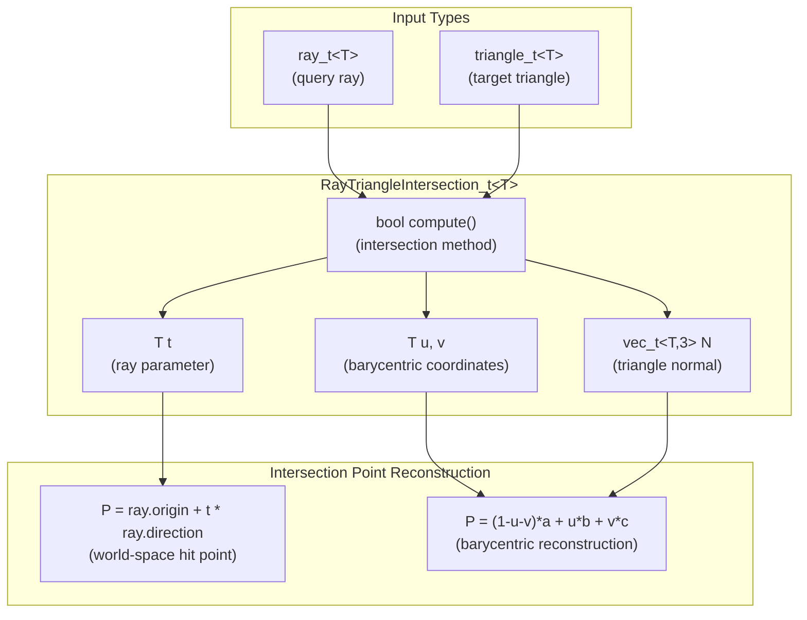
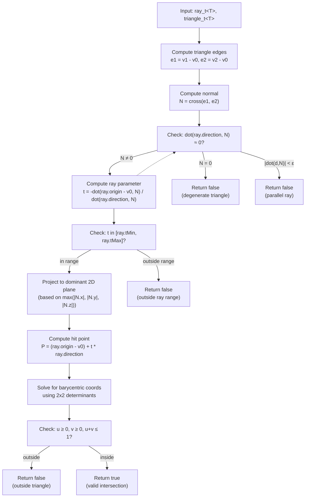
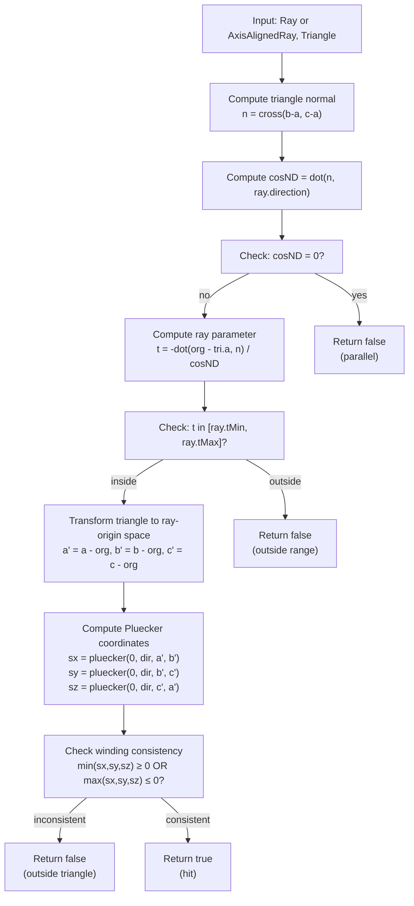
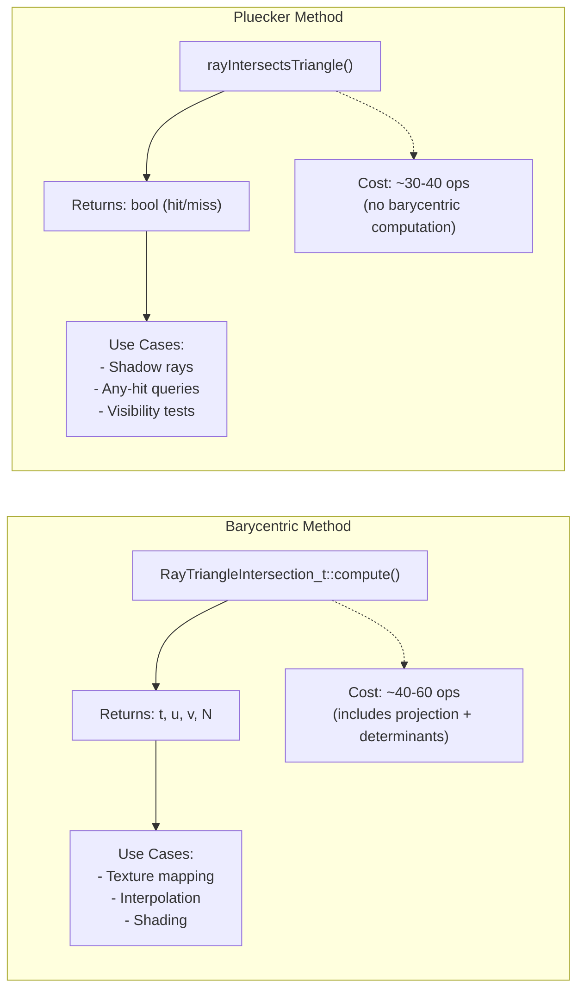
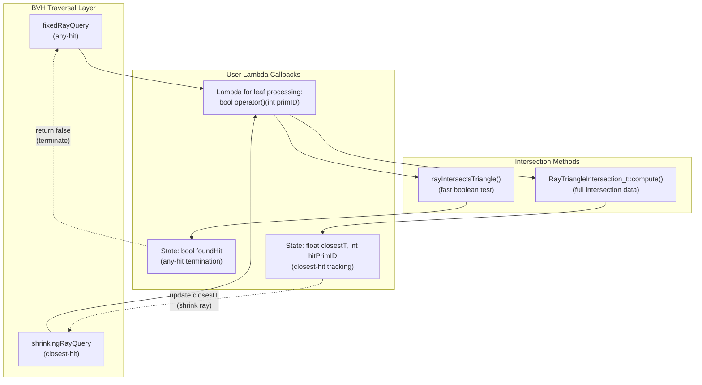

<!-- source: DeepWiki mcp.deepwiki.com · repo NVIDIA/cuBQL · page 8.2 Ray-Triangle Intersection · fetched 2026-10-26 -->

# Ray-Triangle Intersection

<details>
<summary>Relevant source files</summary>

The following files were used as context for generating this wiki page:

- [cuBQL/queries/triangleData/Triangle.h](cuBQL/queries/triangleData/Triangle.h)
- [cuBQL/queries/triangleData/math/rayTriangleIntersections.h](cuBQL/queries/triangleData/math/rayTriangleIntersections.h)

</details>


## Purpose and Scope

This page documents the ray-triangle intersection algorithms implemented in cuBQL. These algorithms determine whether a ray intersects a triangle and compute intersection parameters such as barycentric coordinates and surface normals. The implementations support both CPU and GPU execution via the `__cubql_both` macro.

For documentation of the underlying triangle data structures (`triangle_t`, `TriangleMesh`), see [Triangle Geometry](#8.1). For information on ray-based BVH traversal that uses these intersection routines, see [Ray Queries](#7.1).

**Sources:** [cuBQL/queries/triangleData/math/rayTriangleIntersections.h:1-291]()

---

## Overview

cuBQL provides two complementary approaches to ray-triangle intersection:

1. **Barycentric Coordinate Method** - Computes full intersection details including parametric distance `t`, barycentric coordinates `(u,v)`, and surface normal `N`. Used when detailed intersection information is required.

2. **Pluecker Coordinate Method** - Performs fast boolean intersection tests without computing detailed parameters. Optimized for any-hit queries and shadow rays.

Both methods are templated on coordinate type `T` (float, double, etc.) and work with the generic `ray_t<T>` and `triangle_t<T>` types defined in the mathematical foundation layer.

**Sources:** [cuBQL/queries/triangleData/math/rayTriangleIntersections.h:1-291]()

---

## Intersection Result Structure



**Diagram: RayTriangleIntersection_t data structure and usage**

The `RayTriangleIntersection_t<T>` struct stores the result of a ray-triangle intersection test:

| Field | Type | Description |
|-------|------|-------------|
| `t` | `T` | Ray parameter where intersection occurs (ray.origin + t * ray.direction) |
| `u` | `T` | First barycentric coordinate (weight for vertex b) |
| `v` | `T` | Second barycentric coordinate (weight for vertex c) |
| `N` | `vec_t<T,3>` | Triangle surface normal (unnormalized cross product of edges) |
| `compute()` | `bool` | Computes intersection and returns true if ray hits triangle within valid range |

The type alias `RayTriangleIntersection = RayTriangleIntersection_t<float>` provides a convenient shorthand for single-precision intersections.

**Sources:** [cuBQL/queries/triangleData/math/rayTriangleIntersections.h:22-33]()

---

## Barycentric Coordinate Method

### Algorithm Overview



**Diagram: Barycentric coordinate intersection algorithm flow**

### Implementation Details

The `RayTriangleIntersection_t<T>::compute()` method implements a robust intersection test with the following key steps:

**1. Normal Computation and Degeneracy Check** ([rayTriangleIntersections.h:50-55]()):
   - Computes `N = cross(e1, e2)` where `e1 = v1-v0`, `e2 = v2-v0`
   - Returns false if `N = 0` (degenerate triangle)

**2. Ray-Plane Intersection** ([rayTriangleIntersections.h:57-66]()):
   - Checks if ray is parallel: `|dot(ray.direction, N)| < 1e-12`
   - Computes `t = -dot(ray.origin - v0, N) / dot(ray.direction, N)`
   - Validates `t` is within `[ray.tMin, ray.tMax]`

**3. 2D Projection** ([rayTriangleIntersections.h:68-81]()):
   - Projects triangle and hit point to 2D by selecting the two dimensions perpendicular to the dominant normal component
   - If `|N.x|` is largest, uses (y,z) coordinates; if `|N.y|`, uses (x,z); otherwise uses (x,y)
   - This projection avoids degeneracy and improves numerical stability

**4. Barycentric Coordinate Computation** ([rayTriangleIntersections.h:82-106]()):
   - Defines 2x2 determinant helper: `det(a,b,c,d) = a*d - c*b`
   - Solves the linear system `P = v0 + u*e1 + v*e2` in the projected 2D space:
     - `u = det(Pu, e2u, Pv, e2v) / det(e1u, e2u, e1v, e2v)`
     - `v = det(e1u, Pu, e1v, Pv) / det(e1u, e2u, e1v, e2v)`
   - Validates barycentric coordinates: `u ≥ 0`, `v ≥ 0`, `u+v ≤ 1`

The implementation includes an optimized version (commented out at [rayTriangleIntersections.h:89-100]()) that performs early-exit tests using signed denominators to avoid division until intersection is confirmed.

**Sources:** [cuBQL/queries/triangleData/math/rayTriangleIntersections.h:39-108]()

---

## Pluecker Coordinate Method

### Algorithm Overview



**Diagram: Pluecker coordinate intersection algorithm flow**

### Implementation Details

The `rayIntersectsTriangle()` functions provide boolean intersection tests using Pluecker coordinates. Two overloads are available:

**1. General Ray Version** ([rayTriangleIntersections.h:223-287]()):
   - Accepts arbitrary `Ray` (type alias for `ray_t<float>`)
   - Suitable for any ray direction

**2. Axis-Aligned Ray Version** ([rayTriangleIntersections.h:158-220]()):
   - Template specialized for `AxisAlignedRay<axis, sign>`
   - Leverages axis-aligned properties for optimized evaluation
   - The ray direction is mostly zeros and ones, simplifying Pluecker coordinate calculations

Both versions implement the same core algorithm:

**Ray-Plane Intersection** ([rayTriangleIntersections.h:237-251]()):
- Computes normal `n = triangle.normal()`
- Tests parallelism: `dot(n, dir) = 0`
- Computes `t = -dot(org - triangle.a, n) / dot(n, dir)`
- Validates `t ∈ [ray.tMin, ray.tMax]`

**Pluecker Coordinate Test** ([rayTriangleIntersections.h:253-279]()):
- Transforms triangle vertices to ray-origin-centered space: `a' = a - org`
- Defines Pluecker coordinate function:
  ```
  pluecker(a0, a1, b0, b1) = dot(a1-a0, cross(b1,b0)) + dot(b1-b0, cross(a1,a0))
  ```
- Computes signed distances for all three edges:
  - `sx = pluecker(0, dir, a', b')`
  - `sy = pluecker(0, dir, b', c')`
  - `sz = pluecker(0, dir, c', a')`
- Tests winding consistency: All three values must have the same sign
  - If `min(sx,sy,sz) ≥ 0` or `max(sx,sy,sz) ≤ 0`, the point is inside all edges

The Pluecker coordinate approach is geometrically robust and avoids explicit projection to 2D. The winding test directly determines if the ray-plane intersection point lies inside the triangle's edges.

**Sources:** [cuBQL/queries/triangleData/math/rayTriangleIntersections.h:158-287]()

---

## Algorithm Comparison



**Diagram: Comparison of intersection methods**

| Aspect | Barycentric Method | Pluecker Method |
|--------|-------------------|-----------------|
| **Entry Point** | `RayTriangleIntersection_t<T>::compute()` | `rayIntersectsTriangle()` |
| **Return Type** | `bool` with `t`, `u`, `v`, `N` populated | `bool` only |
| **Output Data** | Full intersection details | Hit/miss status |
| **Primary Use** | Closest-hit queries, shading | Any-hit queries, occlusion |
| **Performance** | Moderate (additional computation for barycentrics) | Fast (early-exit, no barycentric solve) |
| **Numerical Method** | 2D projection + determinant solving | Pluecker coordinate winding test |
| **Axis-Aligned Optimization** | No special case | Specialized `AxisAlignedRay<axis,sign>` template |
| **BVH Traversal Usage** | Used with `shrinkingRayQuery` for closest hit | Used with `fixedRayQuery` for any hit |

**When to Use Each Method:**

- **Barycentric Method**: Use when you need intersection details for shading, texture coordinate interpolation, or normal computation. Suitable for primary rays in ray tracing where you need to compute surface properties at the hit point.

- **Pluecker Method**: Use for shadow rays, ambient occlusion queries, or any scenario where you only need to know if an intersection exists. The boolean result enables early termination in BVH traversal.

**Sources:** [cuBQL/queries/triangleData/math/rayTriangleIntersections.h:1-291]()

---

## Integration with BVH Traversal



**Diagram: Integration of ray-triangle intersection with BVH traversal**

The intersection methods integrate with cuBQL's traversal layer (see [Ray Queries](#7.1)):

**Any-Hit Pattern** (using Pluecker method):
```cpp
bool foundHit = false;
fixedRayQuery(bvh, ray, [&](int primID) {
    if (rayIntersectsTriangle(ray, triangles[primID])) {
        foundHit = true;
        return false; // terminate traversal
    }
    return true; // continue
});
```

**Closest-Hit Pattern** (using barycentric method):
```cpp
RayTriangleIntersection hit;
float closestT = ray.tMax;
shrinkingRayQuery(bvh, ray, [&](int primID) {
    if (hit.compute(ray, triangles[primID]) && hit.t < closestT) {
        closestT = hit.t;
        ray.tMax = hit.t; // shrink ray
        // Store hit.u, hit.v, hit.N for shading
    }
    return true; // always continue for closest hit
});
```

The `shrinkingRayQuery` template automatically handles the ray interval shrinking by using the updated `ray.tMax` value, which the barycentric method respects in its intersection test.

**Sources:** [cuBQL/queries/triangleData/math/rayTriangleIntersections.h:1-291](), [cuBQL/traversal/rayQueries.h]()

---

## Implementation Notes

### Numerical Robustness

The barycentric method employs several techniques for numerical stability:

1. **Dominant Axis Projection** ([rayTriangleIntersections.h:72-81]()): Projects to the 2D plane most perpendicular to the triangle normal, avoiding near-degenerate configurations.

2. **Parallelism Threshold** ([rayTriangleIntersections.h:57]()): Uses `1e-12` epsilon for parallel ray detection to handle floating-point imprecision.

3. **Determinant Check** ([rayTriangleIntersections.h:87]()): Validates that the 2D projection is non-degenerate before computing barycentric coordinates.

### Template Flexibility

Both intersection methods are templated on coordinate type `T`, supporting:
- `float` - Standard precision for real-time applications
- `double` - High precision for scientific computing
- Custom numeric types satisfying arithmetic requirements

The type aliases `RayTriangleIntersection = RayTriangleIntersection_t<float>` and `Ray = ray_t<float>` provide convenient defaults for common use cases.

### Debug Support

Both implementations accept an optional `bool dbg` parameter ([rayTriangleIntersections.h:30](), [rayTriangleIntersections.h:162]()) that enables detailed logging via the `dout` stream, useful for debugging intersection failures.

**Sources:** [cuBQL/queries/triangleData/math/rayTriangleIntersections.h:1-291]()

---

