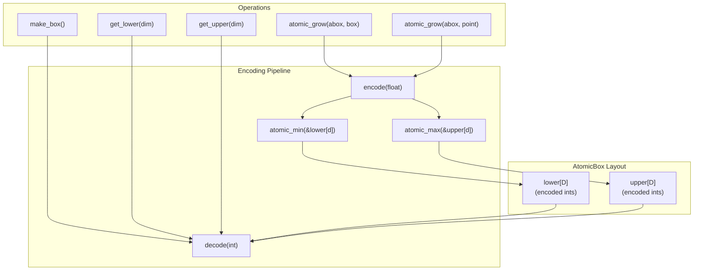
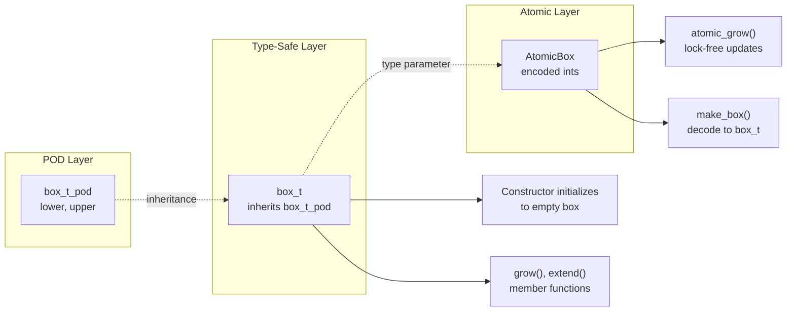

<!-- source: DeepWiki mcp.deepwiki.com · repo NVIDIA/cuBQL · page 9 Advanced Topics · fetched 2026-10-26 -->

# Advanced Topics

<details>
<summary>Relevant source files</summary>

The following files were used as context for generating this wiki page:

- [cuBQL/builder/cuda/builder_common.h](cuBQL/builder/cuda/builder_common.h)
- [cuBQL/math/box.h](cuBQL/math/box.h)
- [cuBQL/math/common.h](cuBQL/math/common.h)
- [cuBQL/math/vec.h](cuBQL/math/vec.h)

</details>


This section provides in-depth technical information about cuBQL's implementation details that are essential for advanced users, performance optimization, and contributors who want to extend or modify the library. These topics cover cross-cutting concerns that affect multiple layers of the system.

For basic usage patterns and API documentation, see [Getting Started](#2). For architectural overview, see [Architecture](#3).

---

## Overview

cuBQL's implementation leverages several advanced techniques to achieve high performance on GPUs while maintaining type safety and flexibility. These techniques fall into three primary categories:

| Category | Purpose | Key Challenge |
|----------|---------|---------------|
| **Memory Management** | Efficient GPU memory allocation with stream ordering | Avoiding synchronization bottlenecks |
| **Atomic Operations** | Lock-free concurrent updates during BVH construction | Atomics on floating-point values |
| **Template Instantiation** | Compile-time type specialization with manageable binary size | Explicit vs. implicit instantiation |

Each of these topics is covered in detail in dedicated subsections. This page provides the conceptual foundation and shows how these techniques interact within the system.

---

## Cross-Cutting Concerns

### Device/Host Execution Model

cuBQL uses the `__cubql_both` macro defined in [cuBQL/math/common.h:95]() to mark functions that can execute on both CPU and GPU. This is implemented as:

```
#define __cubql_both __cubql_host __cubql_device
```

When compiled with `__CUDACC__` (CUDA) or `__HIPCC__` (HIP), these expand to `__host__ __device__`. Otherwise they are ignored, enabling CPU-only compilation.

**Single-source strategy**: Most mathematical primitives (`vec_t`, `box_t`, etc.) use `__cubql_both` so the same code compiles for both host and device contexts.

**Sources**: [cuBQL/math/common.h:84-95]()

---

### Alignment and Memory Layout

Critical data structures use explicit alignment to ensure optimal memory access patterns:

```cpp
template<typename T, int D>
struct CUBQL_ALIGN(8) box_t : public box_t_pod<T,D>
```

The `CUBQL_ALIGN(alignment)` macro is platform-specific:
- **MSVC**: `__declspec(align(alignment))`
- **GCC/Clang**: `__attribute__((aligned(alignment)))`

Defined in [cuBQL/math/common.h:187-191]().

**AtomicBox alignment**: The `AtomicBox` structure uses 8-byte alignment to ensure atomic operations execute correctly:

```cpp
template<typename box_t>
struct CUBQL_ALIGN(8) AtomicBox
```

Sources: [cuBQL/math/common.h:187-191](), [cuBQL/builder/cuda/builder_common.h:146](), [cuBQL/math/box.h:48]()

---

### Loop Unrolling

cuBQL uses pragma-based loop unrolling for performance-critical tight loops. The `CUBQL_PRAGMA_UNROLL` macro is defined in [cuBQL/math/vec.h:14-18]():

```cpp
#ifdef _MSC_VER
# define CUBQL_PRAGMA_UNROLL /* nothing */
#else
# define CUBQL_PRAGMA_UNROLL _Pragma("unroll")
#endif
```

This is applied extensively in vector operations:

```cpp
template<typename T, int D>
inline __cubql_both vec_t<T,D> operator+(vec_t<T,D> a, vec_t<T,D> b)
{
  vec_t<T,D> r;
  CUBQL_PRAGMA_UNROLL
    for (int i=0;i<D;i++) r[i] = a[i] + b[i];
  return r;
}
```

**Impact**: On GPU, loop unrolling eliminates branch instructions and enables instruction-level parallelism. On CPU, compilers can better vectorize unrolled loops.

**Sources**: [cuBQL/math/vec.h:14-18](), [cuBQL/math/vec.h:356-386]()

---

## Memory Management Strategy

### GpuMemoryResource Abstraction

cuBQL uses a `GpuMemoryResource` abstraction to decouple BVH construction from specific memory allocation strategies. This is referenced in [cuBQL/builder/cuda/builder_common.h:38-45]():

```cpp
template<typename T, typename count_t>
inline void _ALLOC(T *&ptr, count_t count, cudaStream_t s,
                   GpuMemoryResource &mem_resource)
{ mem_resource.malloc((void**)&ptr, count*sizeof(T), s); }

template<typename T>
inline void _FREE(T *&ptr, cudaStream_t s, GpuMemoryResource &mem_resource)
{ mem_resource.free((void*)ptr, s); ptr = 0; }
```

**Stream ordering**: Allocations are associated with CUDA streams, enabling asynchronous memory management without explicit synchronization.

For detailed memory management patterns, see [Memory Management](#9.1).

**Sources**: [cuBQL/builder/cuda/builder_common.h:38-45]()

---

## Atomic Operations on Bounding Boxes

### The Encoding Problem

Standard CUDA atomic operations (`atomicMin`, `atomicMax`) only work on integer types. BVH construction requires atomic updates to floating-point bounding boxes during parallel binning and refitting.

**Solution**: cuBQL encodes floating-point values as integers while preserving ordering, performs atomic operations, then decodes back to floating-point.

### Encoding/Decoding Implementation

The encoding scheme is implemented in [cuBQL/builder/cuda/builder_common.h:84-143]():

```cpp
template<> inline __device__
int32_t encode(float f)
{
  const int32_t sign = 0x80000000;
  int32_t bits = __float_as_int(f);
  if (bits & sign) bits ^= 0x7fffffff;
  return bits;
}

template<> inline __device__
float decode<float>(int32_t bits)
{
  const int32_t sign = 0x80000000;
  if (bits & sign) bits ^= 0x7fffffff;
  return __int_as_float(bits);
}
```

**Key insight**: IEEE 754 floating-point format already has ordering properties, but negative numbers need sign bit flipping to maintain correct ordering when interpreted as signed integers.

### AtomicBox Structure

The `AtomicBox` template stores encoded integer representations of box bounds:



**Sources**: [cuBQL/builder/cuda/builder_common.h:146-294]()

### Atomic Growth Operations

The `atomic_grow` function performs lock-free bounding box expansion:

```cpp
template<typename box_t>
inline __device__ void atomic_grow(AtomicBox<box_t> &abox, const box_t &other)
{
  using scalar_t = typename AtomicBox<box_t>::scalar_t;
  #pragma unroll
  for (int d=0; d<box_t::numDims; d++) {
    const typename int_type_of<scalar_t>::type 
      enc_lower = encode(other.get_lower(d));
    const typename int_type_of<scalar_t>::type 
      enc_upper = encode(other.get_upper(d));
    if (enc_lower < abox.lower[d]) atomic_min(&abox.lower[d], enc_lower);
    if (enc_upper > abox.upper[d]) atomic_max(&abox.upper[d], enc_upper);
  }
}
```

Multiple threads can simultaneously grow the same `AtomicBox` without locks or race conditions.

For complete details on atomic operation design, see [Atomic Operations](#9.2).

**Sources**: [cuBQL/builder/cuda/builder_common.h:264-279]()

---

## Template Instantiation Strategy

### The Compile-Time vs Binary Size Tradeoff

cuBQL's heavy use of templates enables type flexibility and compile-time optimization, but creates challenges:

| Strategy | Advantages | Disadvantages |
|----------|------------|---------------|
| **Header-only** | No linking complexity, full inlining | Long compile times, code bloat |
| **Explicit instantiation** | Fast compiles, small binaries | Limited to predefined types |
| **Hybrid** | Balances flexibility and size | Requires careful API design |

### Type Trait System

cuBQL uses type traits to handle different scalar types uniformly:

```cpp
template<typename T> struct int_type_of;
template<> struct int_type_of<float>    { typedef int32_t type; };
template<> struct int_type_of<double>   { typedef int64_t type; };
template<> struct int_type_of<int32_t>  { typedef int32_t type; };
template<> struct int_type_of<int64_t>  { typedef int64_t type; };
```

This maps scalar types to their integer equivalents for atomic operations.

**Sources**: [cuBQL/builder/cuda/builder_common.h:76-82]()

### CUDA Vector Type Interoperability

When `CUBQL_SUPPORT_CUDA_VECTOR_TYPES=1`, cuBQL provides automatic conversions between its `vec_t<T,D>` and CUDA's built-in types (`float3`, `int4`, etc.):

```cpp
#if CUBQL_SUPPORT_CUDA_VECTOR_TYPES
template<typename T, int D> struct cuda_eq_t { using type = invalid_t; };
template<> struct cuda_eq_t<float,2> { using type = float2; };
template<> struct cuda_eq_t<float,3> { using type = float3; };
template<> struct cuda_eq_t<float,4> { using type = float4; };
// ... additional specializations
#endif
```

Conversion operators enable seamless interoperation:

```cpp
using cuda_t = typename cuda_eq_t<T,3>::type;
inline __cubql_both operator cuda_t() 
{ cuda_t t; t.x = x; t.y = y; t.z = z; return t; }
```

For detailed template instantiation patterns and custom type support, see [Template Instantiation](#9.3).

**Sources**: [cuBQL/math/vec.h:27-29](), [cuBQL/math/vec.h:63-74](), [cuBQL/math/vec.h:102-105]()

---

## Error Handling and Debugging

### CUDA Error Checking Macros

cuBQL provides comprehensive error checking through macros defined in [cuBQL/math/common.h:303-384]():

```cpp
#define CUBQL_CUDA_CHECK(call)
#define CUBQL_CUDA_SYNC_CHECK()
#define CUBQL_CUDA_SYNC_CHECK_STREAM(s)
```

**Throwing vs non-throwing variants**:
- `CUBQL_CUDA_CHECK`: Calls `CUBQL_RAISE` on error, which throws on CPU or triggers debugger break
- `CUBQL_CUDA_CHECK_NOTHROW`: Calls `exit(2)` on error

**Stream synchronization**: `CUBQL_CUDA_SYNC_CHECK_STREAM(s)` synchronizes a specific stream and checks for errors, enabling fine-grained debugging.

### Device-Side Debug Output

The `dbgout` type provides printf-style debugging in device code:

```cpp
inline __cubql_both dbgout operator<<(dbgout o, int32_t i)
{ printf("%i", i); return o; }

inline __cubql_both dbgout operator<<(dbgout o, vec_t<T,3> v)
{ o << "(" << v.x << "," << v.y << "," << v.z << ")"; return o; }
```

Usage in kernels:

```cpp
__global__ void myKernel() {
  dout << "Thread " << threadIdx.x << " value: " << myVec << endl;
}
```

**Sources**: [cuBQL/math/common.h:390-412]()

### Empty Box Semantics

cuBQL treats boxes with `lower > upper` as "empty" or invalid. Empty box constants are provided per-type:

```cpp
template<> inline __cubql_both float empty_box_lower_value<float>() 
{ return +CUBQL_INF; }
template<> inline __cubql_both float empty_box_upper_value<float>() 
{ return -CUBQL_INF; }
```

This convention enables:
- **Filtering invalid primitives** during BVH construction
- **Initializing reduction operations** with neutral elements
- **Detecting uninitialized boxes** via `box.empty()` check

**Sources**: [cuBQL/math/box.h:13-26](), [cuBQL/builder/cuda/builder_common.h:49-74]()

---

## Performance Optimization Utilities

### Pretty-Printing for Profiling

cuBQL includes formatting utilities for human-readable performance metrics:

```cpp
inline std::string prettyNumber(const size_t s)
// Returns "3.4M" instead of "3400000"

inline std::string prettyBytes(const size_t s)  
// Returns "64K" for 65536 (1024-based)

inline std::string prettyDouble(const double val)
// Handles scientific notation with unit suffixes
```

Used extensively in build-time reporting and memory allocation diagnostics.

**Sources**: [cuBQL/math/common.h:209-269]()

### Timing Utilities

The `getCurrentTime()` function provides cross-platform high-resolution timing:

```cpp
inline double getCurrentTime()
{
#ifdef _WIN32
  SYSTEMTIME tp; GetSystemTime(&tp);
  // ... calculate seconds since epoch
#else
  struct timeval tp; gettimeofday(&tp, nullptr);
  return double(tp.tv_sec) + double(tp.tv_usec)/1E6;
#endif
}
```

Returns time in seconds with microsecond precision on Unix, millisecond on Windows.

**Sources**: [cuBQL/math/common.h:271-289]()

---

## Implementation Patterns

### NodeState Enum for Build Phases

Builder implementations use a state enum to track node processing:

```cpp
typedef enum : int8_t { OPEN_BRANCH, OPEN_NODE, DONE_NODE } NodeState;
```

- `OPEN_BRANCH`: Node needs to be split into children
- `OPEN_NODE`: Node is allocated but not yet processed
- `DONE_NODE`: Node construction complete

**Sources**: [cuBQL/builder/cuda/builder_common.h:47]()

### Type-Safe Wrapper Pattern



**Pattern**: Plain-old-data (POD) base classes enable low-level manipulation, while derived classes add type safety and convenience methods.

**Sources**: [cuBQL/math/box.h:28-174](), [cuBQL/builder/cuda/builder_common.h:146-294]()

---

## Platform Abstraction

### CUDA vs HIP Support

cuBQL supports both CUDA and HIP through conditional compilation:

```cpp
#if defined(__HIPCC__)
#  include <hipcub/hipcub.hpp>
#elif defined(__CUDACC__)
#  include <cub/cub.cuh>
#endif
```

The library uses CUB (CUDA Unbound) for parallel primitives on CUDA and HipCUB on AMD GPUs, maintaining API compatibility.

**Sources**: [cuBQL/builder/cuda/builder_common.h:9-13]()

### Compiler-Specific Handling

```cpp
#ifdef _MSC_VER
# define CUBQL_DLL_EXPORT __declspec(dllexport)
#elif defined(__clang__) || defined(__GNUC__)
# define CUBQL_DLL_EXPORT __attribute__((visibility("default")))
#endif
```

Platform-specific symbol visibility ensures proper linking behavior across Windows (MSVC) and Unix (GCC/Clang).

**Sources**: [cuBQL/math/common.h:52-61]()

---

## Summary

Advanced cuBQL topics revolve around three core challenges:

1. **Memory Management**: Stream-ordered allocation enables asynchronous GPU operations without CPU-GPU synchronization overhead. Details in [Memory Management](#9.1).

2. **Atomic Operations**: Encoded floating-point arithmetic enables lock-free parallel BVH construction. Details in [Atomic Operations](#9.2).

3. **Template Instantiation**: Balancing compile-time specialization with binary size through explicit instantiation and type traits. Details in [Template Instantiation](#9.3).

These techniques work together to provide a high-performance, type-safe, and flexible BVH library that runs efficiently on modern GPUs.

**Sources**: [cuBQL/math/common.h](), [cuBQL/math/vec.h](), [cuBQL/builder/cuda/builder_common.h](), [cuBQL/math/box.h]()

---

