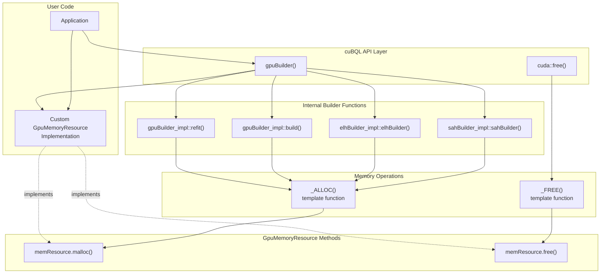
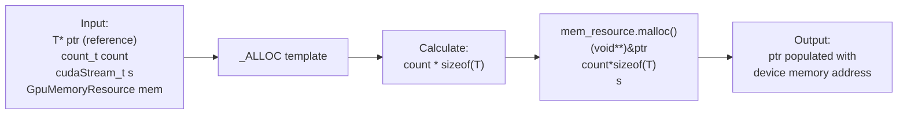
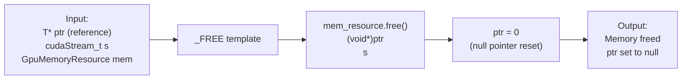
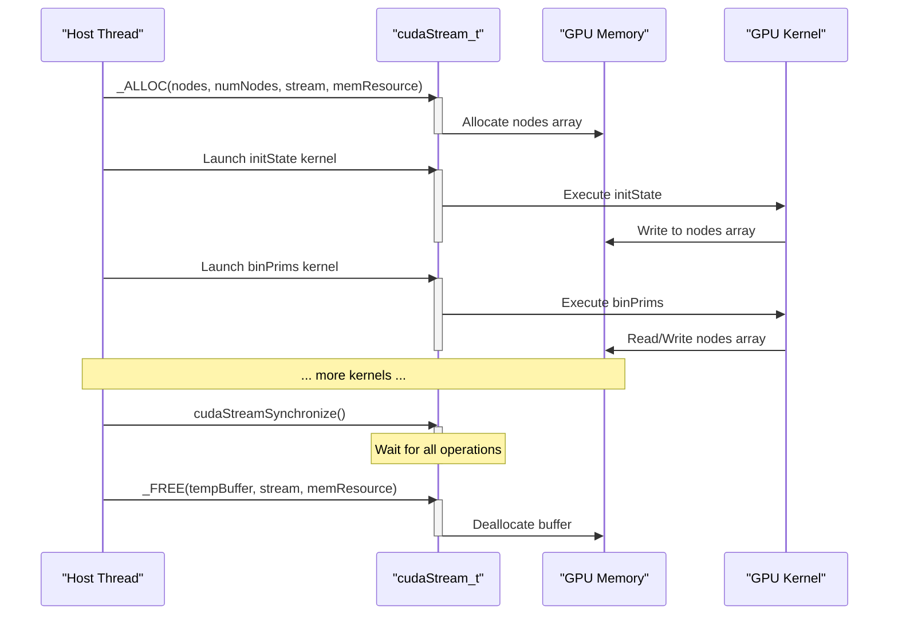
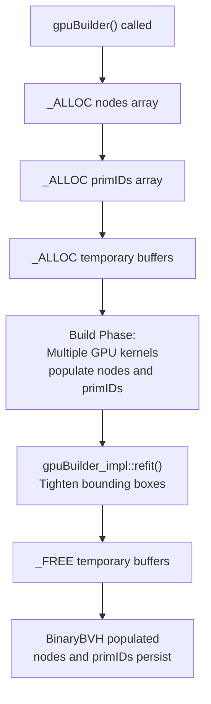
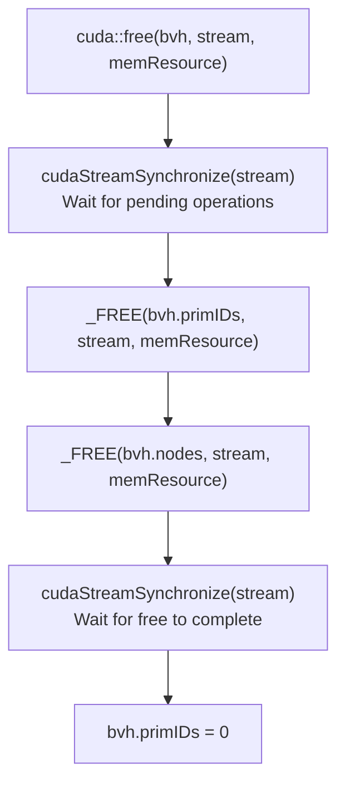
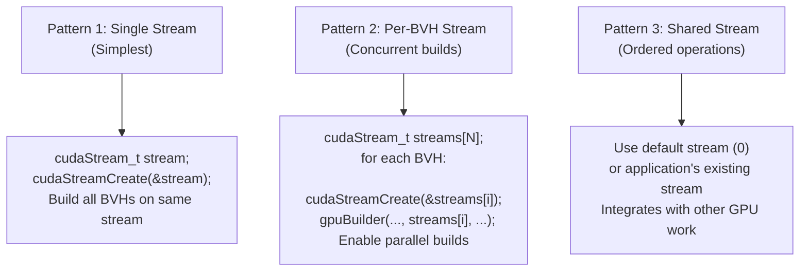

<!-- source: DeepWiki mcp.deepwiki.com · repo NVIDIA/cuBQL · page 9.1 Memory Management · fetched 2026-10-26 -->

# Memory Management

<details>
<summary>Relevant source files</summary>

The following files were used as context for generating this wiki page:

- [cuBQL/builder/cuda/builder_common.h](cuBQL/builder/cuda/builder_common.h)
- [cuBQL/builder/cuda/gpu_builder.h](cuBQL/builder/cuda/gpu_builder.h)

</details>


This document covers cuBQL's GPU memory management architecture, including the `GpuMemoryResource` abstraction, allocation/deallocation patterns, stream-ordered operations, and synchronization requirements. Memory management is a critical component of cuBQL's GPU-accelerated BVH construction and traversal.

For information about the BVH data structures that are allocated in GPU memory, see [Core Data Structures](#5). For details on the builder interface that uses these memory management facilities, see [GPU Builder Interface](#6.1).

---

## Overview

cuBQL abstracts GPU memory operations through the `GpuMemoryResource` interface, enabling flexible memory allocation strategies while maintaining stream-ordered semantics for asynchronous execution. All memory allocations for BVH construction (nodes, primitive IDs, temporary buffers) flow through this abstraction, ensuring consistent behavior across different memory types (device, managed, pinned).

**Sources**: [cuBQL/builder/cuda/gpu_builder.h:1-76](), [cuBQL/builder/cuda/builder_common.h:1-303]()

---

## GpuMemoryResource Abstraction

### Memory Resource Interface

The `GpuMemoryResource` class provides a pluggable interface for GPU memory allocation and deallocation. All builder functions accept a `GpuMemoryResource&` parameter, allowing users to provide custom memory allocation strategies.



The interface requires two methods:
- `malloc(void** ptr, size_t bytes, cudaStream_t stream)` - Allocates GPU memory
- `free(void* ptr, cudaStream_t stream)` - Deallocates GPU memory

**Sources**: [cuBQL/builder/cuda/builder_common.h:38-45](), [cuBQL/builder/cuda/gpu_builder.h:19-57]()

---

## Allocation and Deallocation Functions

### Template Allocation Function

The `_ALLOC` template function provides type-safe memory allocation with automatic size calculation:



**Function Signature**:
```cpp
template<typename T, typename count_t>
inline void _ALLOC(T *&ptr, count_t count, cudaStream_t s, GpuMemoryResource &mem_resource)
```

Located at [cuBQL/builder/cuda/builder_common.h:38-41]()

**Parameters**:
- `ptr` - Reference to pointer that will receive the allocated address
- `count` - Number of elements to allocate (not bytes)
- `s` - CUDA stream for stream-ordered allocation
- `mem_resource` - Memory resource abstraction to perform allocation

**Sources**: [cuBQL/builder/cuda/builder_common.h:38-41]()

### Template Deallocation Function

The `_FREE` template function handles memory deallocation and pointer reset:



**Function Signature**:
```cpp
template<typename T>
inline void _FREE(T *&ptr, cudaStream_t s, GpuMemoryResource &mem_resource)
```

Located at [cuBQL/builder/cuda/builder_common.h:43-45]()

**Key Behavior**: After freeing, the pointer is automatically set to `0` (null), preventing use-after-free errors.

**Sources**: [cuBQL/builder/cuda/builder_common.h:43-45]()

---

## Stream-Ordered Operations

All memory operations in cuBQL are stream-ordered, meaning they execute asynchronously on a specified CUDA stream. This enables overlap between memory operations and kernel execution for improved performance.

### Stream Ordering Pattern



**Key Characteristics**:
- Memory allocations are ordered with respect to kernels on the same stream
- Multiple operations on the same stream execute in sequence
- Operations on different streams may execute concurrently
- Host code continues without waiting (unless explicitly synchronized)

**Sources**: [cuBQL/builder/cuda/builder_common.h:38-45](), [cuBQL/builder/cuda/gpu_builder.h:19-57]()

---

## Memory Lifecycle for BVH Construction

### Allocation Pattern

During BVH construction, multiple memory allocations occur in sequence:

| **Data Structure** | **Type** | **Size** | **Purpose** |
|-------------------|----------|----------|-------------|
| `nodes` | `BinaryBVH<T,D>::Node*` | `(numBoxes * 2 - 1) * sizeof(Node)` | BVH tree structure |
| `primIDs` | `uint32_t*` | `numBoxes * sizeof(uint32_t)` | Primitive index mapping |
| `tempState` | Builder-specific | Varies | Temporary build state |
| `tempBins` | Builder-specific | Varies | SAH binning buffers |
| `mortonCodes` | `uint64_t*` | `numBoxes * sizeof(uint64_t)` | Radix builder sorting |



**Persistent Allocations**: The `nodes` and `primIDs` arrays remain allocated after construction and are owned by the `BinaryBVH` structure. Users must call `cuda::free()` to deallocate them when done.

**Temporary Allocations**: Builder-specific temporary buffers are allocated and freed within the construction process, not visible to the user.

**Sources**: [cuBQL/builder/cuda/gpu_builder.h:19-57]()

---

## BVH Memory Deallocation

### cuda::free() Function

The `cuda::free()` function in the `cuBQL::cuda` namespace properly deallocates BVH memory with required synchronization:



**Function Location**: [cuBQL/builder/cuda/gpu_builder.h:60-71]()

**Critical Synchronization Points**:

1. **Pre-Free Synchronization** [line 65](): Ensures all kernels using the BVH have completed
2. **Post-Free Synchronization** [line 68](): Ensures memory is fully deallocated before returning

This double synchronization pattern is essential for correctness:
- Without pre-sync: Kernels may still be accessing memory being freed
- Without post-sync: Subsequent operations may assume memory is freed when it's not

**Sources**: [cuBQL/builder/cuda/gpu_builder.h:60-71]()

---

## Memory Usage Patterns

### Typical Construction Memory Footprint

For a BVH built from N primitives:

| **Component** | **Formula** | **Example (N=10M)** |
|--------------|-------------|---------------------|
| Input boxes | `N * sizeof(box_t<T,D>)` | ~240 MB (float, 3D) |
| BVH nodes | `(2N - 1) * sizeof(Node)` | ~640 MB (float, 3D) |
| Primitive IDs | `N * sizeof(uint32_t)` | ~40 MB |
| Morton codes (radix) | `N * sizeof(uint64_t)` | ~80 MB (temporary) |
| SAH bins (SAH) | `numThreads * numBins * sizeof(Bin)` | ~10-50 MB (temporary) |
| **Peak Usage** | ~1010 MB (radix) or ~980 MB (SAH) | ~1.0 GB |
| **Persistent** | ~920 MB (nodes + primIDs + input) | ~0.9 GB |

**Note**: Temporary allocations are freed before `gpuBuilder()` returns, so peak memory usage occurs during construction, not after.

**Sources**: [cuBQL/builder/cuda/builder_common.h:1-303]()

---

## Best Practices

### Stream Management



**Recommendation**: For building multiple BVHs, use separate streams to enable concurrent construction when GPU resources are available.

**Sources**: [cuBQL/builder/cuda/gpu_builder.h:19-57]()

### Memory Resource Implementation

Users can implement custom `GpuMemoryResource` classes for:
- **Memory pooling**: Reduce allocation overhead by reusing buffers
- **Managed memory**: Use `cudaMallocManaged()` for CPU/GPU shared access
- **Pinned memory**: Use `cudaMallocHost()` for faster CPU-GPU transfers
- **Device memory**: Use `cudaMalloc()` for GPU-only access (fastest)
- **Memory tracking**: Instrument allocations for profiling

**Required Interface**:
```cpp
class CustomMemoryResource {
public:
    void malloc(void** ptr, size_t bytes, cudaStream_t stream);
    void free(void* ptr, cudaStream_t stream);
};
```

**Sources**: [cuBQL/builder/cuda/builder_common.h:38-45]()

---

## Synchronization Requirements

### When to Synchronize

| **Scenario** | **Synchronization Required** | **Reason** |
|-------------|----------------------------|-----------|
| Before accessing BVH on CPU | `cudaStreamSynchronize(stream)` | Ensure construction completed |
| Before freeing BVH | `cudaStreamSynchronize(stream)` | Ensure no kernels are using it |
| Between independent operations | Not required | Stream ordering maintains correctness |
| Before `cudaDeviceReset()` | `cudaDeviceSynchronize()` | All streams must complete |
| After BVH free | `cudaStreamSynchronize(stream)` | Ensure deallocation completed |

**Implicit Synchronization**: The `cuda::free()` function handles synchronization internally, so users don't need to manually synchronize before calling it.

**Sources**: [cuBQL/builder/cuda/gpu_builder.h:60-71]()

---

## Integration with Builder Algorithms

### Algorithm-Specific Memory Patterns

Different builder algorithms have different temporary memory requirements:

```mermaid
graph TB
    subgraph "Radix Builder (Spatial Median)"
        R_INPUT["Input: boxes array"]
        R_ALLOC1["Allocate: morton codes<br/>Allocate: temp sort buffer"]
        R_BUILD["GPU kernels:<br/>Compute codes<br/>Radix sort<br/>Build tree"]
        R_FREE["Free: morton codes<br/>Free: temp sort buffer"]
        R_OUTPUT["Output: nodes, primIDs"]
        
        R_INPUT --> R_ALLOC1
        R_ALLOC1 --> R_BUILD
        R_BUILD --> R_FREE
        R_FREE --> R_OUTPUT
    end
    
    subgraph "SAH Builder"
        S_INPUT["Input: boxes array"]
        S_ALLOC1["Allocate: bin arrays<br/>Allocate: node state"]
        S_BUILD["GPU kernels:<br/>Bin primitives<br/>Select splits<br/>Build tree"]
        S_FREE["Free: bin arrays<br/>Free: node state"]
        S_OUTPUT["Output: nodes, primIDs"]
        
        S_INPUT --> S_ALLOC1
        S_ALLOC1 --> S_BUILD
        S_BUILD --> S_FREE
        S_FREE --> S_OUTPUT
    end
    
    subgraph "ELH Builder"
        E_INPUT["Input: boxes array"]
        E_ALLOC1["Allocate: edge lengths<br/>Allocate: split candidates"]
        E_BUILD["GPU kernels:<br/>Compute edge heuristic<br/>Build tree"]
        E_FREE["Free: edge lengths<br/>Free: split candidates"]
        E_OUTPUT["Output: nodes, primIDs"]
        
        E_INPUT --> E_ALLOC1
        E_ALLOC1 --> E_BUILD
        E_BUILD --> E_FREE
        E_FREE --> E_OUTPUT
    end
```



**Key Observation**: All builders follow the same pattern: allocate temporary buffers, execute construction kernels, free temporary buffers. The persistent `nodes` and `primIDs` allocations are common across all algorithms.

**Sources**: [cuBQL/builder/cuda/gpu_builder.h:19-57](), [cuBQL/builder/cuda/builder_common.h:1-303]()

---

