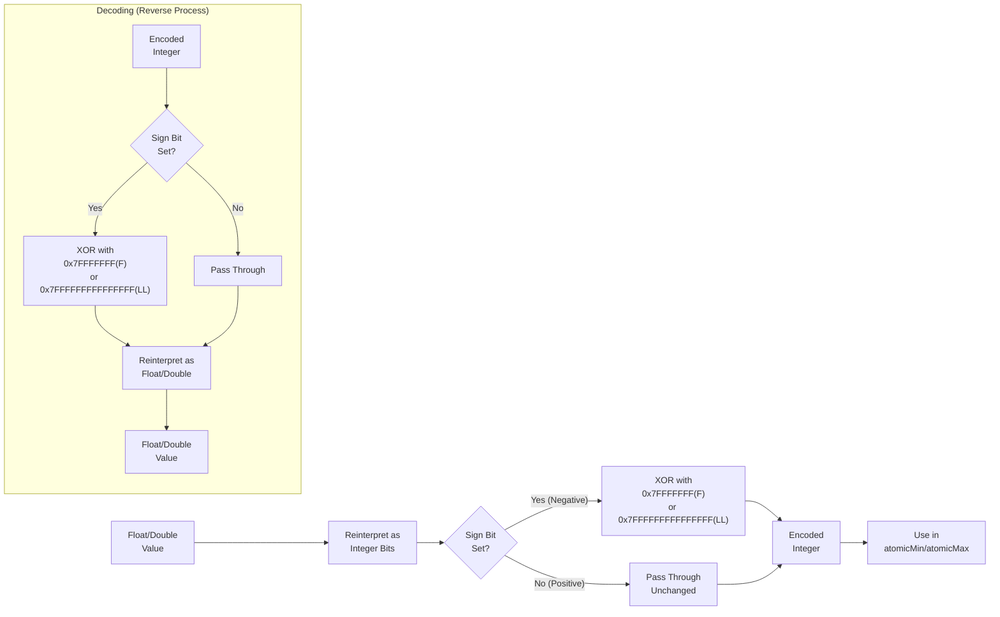
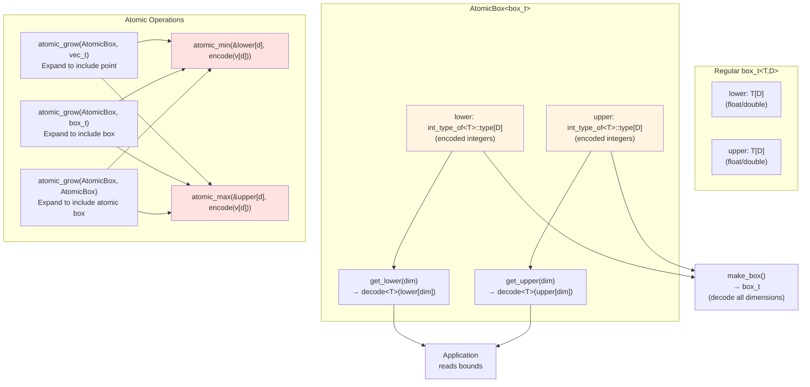
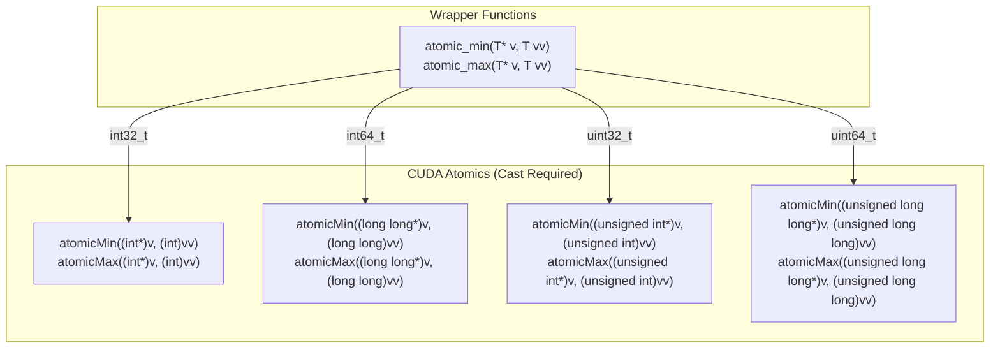
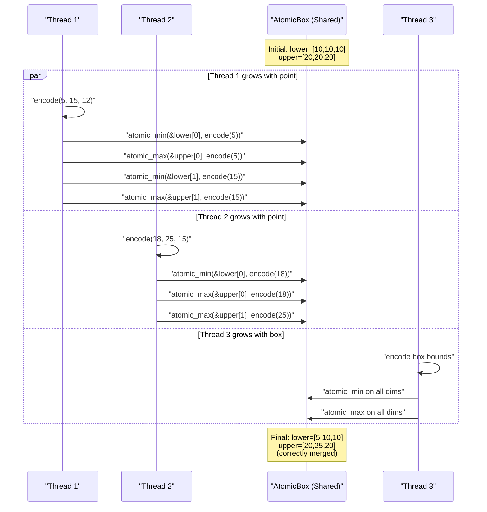
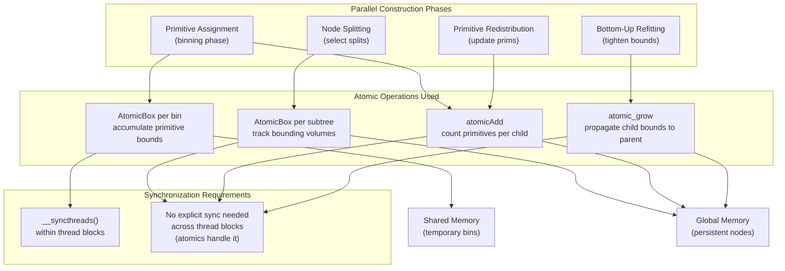

<!-- source: DeepWiki mcp.deepwiki.com · repo NVIDIA/cuBQL · page 9.2 Atomic Operations · fetched 2026-10-26 -->

# Atomic Operations

<details>
<summary>Relevant source files</summary>

The following files were used as context for generating this wiki page:

- [cuBQL/builder/cuda/builder_common.h](cuBQL/builder/cuda/builder_common.h)

</details>


## Purpose and Scope

This document describes cuBQL's lock-free atomic operations infrastructure for concurrent bounding box updates during BVH construction. When multiple GPU threads simultaneously build portions of the BVH hierarchy, they must safely update shared bounding box bounds without data races. Since CUDA does not provide native atomic operations for floating-point min/max, cuBQL implements **encoded arithmetic**: converting floating-point values to integers that preserve ordering, enabling the use of integer atomic operations.

This page covers:
- The `AtomicBox<box_t>` structure for concurrent-safe bounding boxes
- Encoding/decoding functions that map floats/doubles to order-preserving integers
- Atomic min/max wrappers for various integer types
- The `atomic_grow()` functions for lock-free bounding box expansion

For general memory management concepts, see [Memory Management](#9.1). For how these atomics are used in the construction pipeline, see [Builder Internals](#6.3).

**Sources:** [cuBQL/builder/cuda/builder_common.h:1-303]()

---

## Encoded Arithmetic

### Overview

CUDA provides atomic operations for integers (`atomicMin`, `atomicMax`, `atomicAdd`) but not for floating-point min/max operations. cuBQL solves this by **encoding** floating-point values into signed integers such that:
- Numerical ordering is preserved: if `a < b`, then `encode(a) < encode(b)`
- Standard integer atomic operations can be applied to the encoded values
- The original floating-point value can be recovered by **decoding**

This technique enables lock-free concurrent updates to bounding box bounds across thousands of GPU threads.

### Encoding Algorithm

The encoding process handles the IEEE 754 floating-point representation's sign-magnitude format by converting it to two's complement representation:



**Sources:** [cuBQL/builder/cuda/builder_common.h:84-143]()

### Implementation Details

#### Float Encoding (32-bit)

```
encode(float) -> int32_t:
1. Reinterpret float bits as int32_t
2. If sign bit (0x80000000) is set:
   - XOR with 0x7FFFFFFF (flips all bits except sign)
3. Return encoded integer
```

**Key Insight:** Negative floats in IEEE 754 have inverted ordering (more negative = larger bit pattern). The XOR operation corrects this, ensuring `encode(-2.0) < encode(-1.0)`.

#### Double Encoding (64-bit)

```
encode(double) -> int64_t:
1. Reinterpret double bits as int64_t
2. If sign bit (0x8000000000000000LL) is set:
   - XOR with 0x7FFFFFFFFFFFFFFFLL
3. Return encoded integer
```

**Sources:** [cuBQL/builder/cuda/builder_common.h:87-102]()

#### Decoding Operations

The `decode<T>()` function reverses the encoding by applying the same XOR operation:

```
decode<float>(int32_t) -> float:
1. If sign bit (0x80000000) is set:
   - XOR with 0x7FFFFFFF
2. Reinterpret result as float

decode<double>(int64_t) -> double:
1. If sign bit (0x8000000000000000LL) is set:
   - XOR with 0x7FFFFFFFFFFFFFFFLL
2. Reinterpret result as double
```

For integer types (`int32_t`, `int64_t`), encoding and decoding are identity operations since integers already have the desired ordering properties.

**Sources:** [cuBQL/builder/cuda/builder_common.h:114-143]()

### Type Mapping

The `int_type_of<T>` template maps scalar types to their integer equivalents:

| Scalar Type | Integer Type |
|-------------|--------------|
| `float` | `int32_t` |
| `double` | `int64_t` |
| `int32_t` | `int32_t` |
| `int64_t` | `int64_t` |
| `uint32_t` | `uint32_t` |
| `uint64_t` | `uint64_t` |

**Sources:** [cuBQL/builder/cuda/builder_common.h:76-82]()

---

## AtomicBox Structure

### Design

`AtomicBox<box_t>` is a specialized bounding box representation that stores bounds as **encoded integers** rather than raw floating-point values. This enables lock-free concurrent updates during parallel BVH construction.



**Sources:** [cuBQL/builder/cuda/builder_common.h:145-246]()

### Structure Definition

```cpp
template<typename box_t>
struct CUBQL_ALIGN(8) AtomicBox {
    using scalar_t = typename box_t::scalar_t;
    
    // Encoded bounds (order-preserving integers)
    typename int_type_of<scalar_t>::type lower[box_t::numDims];
    typename int_type_of<scalar_t>::type upper[box_t::numDims];
    
    // Query methods
    __device__ bool is_empty() const;
    __device__ void set_empty();
    __device__ void clear();  // Alias for set_empty()
    __device__ scalar_t get_center(int dim) const;
    __device__ scalar_t get_lower(int dim) const;
    __device__ scalar_t get_upper(int dim) const;
    __device__ box_t make_box() const;
};
```

**Sources:** [cuBQL/builder/cuda/builder_common.h:145-191]()

### Key Methods

#### Empty Box Initialization

An empty box is represented by `lower > upper` after decoding. The `set_empty()` method initializes bounds to extreme values:

```
set_empty():
  For each dimension d:
    lower[d] = encode(+MAX)  // e.g., +FLT_MAX for float
    upper[d] = encode(-MAX)  // e.g., -FLT_MAX for float
```

| Type | Empty Lower | Empty Upper |
|------|-------------|-------------|
| `float` | `+FLT_MAX` | `-FLT_MAX` |
| `double` | `+DBL_MAX` | `-DBL_MAX` |
| `int` | `INT_MAX` | `INT_MIN` |
| `int64_t` | `LLONG_MAX` | `LLONG_MIN` |

**Sources:** [cuBQL/builder/cuda/builder_common.h:237-246](), [cuBQL/builder/cuda/builder_common.h:49-74]()

#### Bound Accessors

The `get_lower()` and `get_upper()` methods decode stored integers back to scalar values. They include optimizations for common dimensionalities (2D, 3D, 4D) to reduce indexing overhead:

```
get_lower(dim) -> scalar_t:
  If numDims > 4:
    return decode<scalar_t>(lower[dim])
  Else if numDims == 3:
    return decode<scalar_t>(lower[dim])  // optimized branching
  Else:
    return decode<scalar_t>(lower[dim])
```

**Sources:** [cuBQL/builder/cuda/builder_common.h:155-182]()

#### Box Reconstruction

The `make_box()` method creates a regular `box_t` by decoding all dimensions:

```
make_box() -> box_t:
  For each dimension d:
    box.lower[d] = decode<scalar_t>(lower[d])
    box.upper[d] = decode<scalar_t>(upper[d])
  return box
```

This is typically called once after all atomic updates are complete.

**Sources:** [cuBQL/builder/cuda/builder_common.h:207-218]()

---

## Atomic Min/Max Wrappers

cuBQL provides type-safe wrappers around CUDA's `atomicMin` and `atomicMax` functions to handle different integer types uniformly:



**Sources:** [cuBQL/builder/cuda/builder_common.h:20-36]()

### Supported Overloads

| Function Signature | CUDA Atomic Called |
|-------------------|-------------------|
| `atomic_min(int32_t*, int32_t)` | `atomicMin((int*), (int))` |
| `atomic_min(int64_t*, int64_t)` | `atomicMin((long long*), (long long))` |
| `atomic_min(uint32_t*, uint32_t)` | `atomicMin((unsigned int*), (unsigned int))` |
| `atomic_min(uint64_t*, uint64_t)` | `atomicMin((unsigned long long*), (unsigned long long))` |
| `atomic_max(int32_t*, int32_t)` | `atomicMax((int*), (int))` |
| `atomic_max(int64_t*, int64_t)` | `atomicMax((long long*), (long long))` |
| `atomic_max(uint32_t*, uint32_t)` | `atomicMax((unsigned int*), (unsigned int))` |
| `atomic_max(uint64_t*, uint64_t)` | `atomicMax((unsigned long long*), (unsigned long long))` |

These wrappers eliminate the need for explicit casts in calling code, improving type safety and readability.

**Sources:** [cuBQL/builder/cuda/builder_common.h:20-36]()

---

## Atomic Grow Operations

The `atomic_grow()` family of functions implements lock-free bounding box expansion. Multiple threads can concurrently grow a shared `AtomicBox` to include new primitives without explicit synchronization.

### Concurrent Update Pattern



**Sources:** [cuBQL/builder/cuda/builder_common.h:248-294]()

### Overload 1: Grow by Point

```cpp
template<typename box_t>
inline __device__ void atomic_grow(AtomicBox<box_t> &abox, 
                                   const typename box_t::vec_t &point)
```

Expands the atomic box to include a single point:

```
For each dimension d:
  encoded = encode(point[d])
  if encoded < abox.lower[d]:
    atomic_min(&abox.lower[d], encoded)
  if encoded > abox.upper[d]:
    atomic_max(&abox.upper[d], encoded)
```

**Usage:** During BVH construction, threads grow node bounding boxes to include primitive centroids.

**Sources:** [cuBQL/builder/cuda/builder_common.h:248-262]()

### Overload 2: Grow by Bounding Box

```cpp
template<typename box_t>
inline __device__ void atomic_grow(AtomicBox<box_t> &abox, 
                                   const box_t &other)
```

Expands the atomic box to encompass another regular bounding box:

```
For each dimension d:
  enc_lower = encode(other.get_lower(d))
  enc_upper = encode(other.get_upper(d))
  if enc_lower < abox.lower[d]:
    atomic_min(&abox.lower[d], enc_lower)
  if enc_upper > abox.upper[d]:
    atomic_max(&abox.upper[d], enc_upper)
```

**Usage:** When merging primitive bounding boxes into parent nodes during refitting passes.

**Sources:** [cuBQL/builder/cuda/builder_common.h:264-279]()

### Overload 3: Grow by AtomicBox

```cpp
template<typename box_t>
inline __device__ void atomic_grow(AtomicBox<box_t> &abox, 
                                   const AtomicBox<box_t> &other)
```

Merges two atomic boxes (useful when child nodes are also atomic boxes):

```
For each dimension d:
  enc_lower = other.lower[d]  // already encoded
  enc_upper = other.upper[d]  // already encoded
  if enc_lower < abox.lower[d]:
    atomic_min(&abox.lower[d], enc_lower)
  if enc_upper > abox.upper[d]:
    atomic_max(&abox.upper[d], enc_upper)
```

**Usage:** Bottom-up refitting where child nodes' bounds are propagated to parents.

**Sources:** [cuBQL/builder/cuda/builder_common.h:281-294]()

---

## Usage in BVH Construction

### Construction Pipeline Integration

Atomic operations are critical during several phases of parallel BVH construction:



**Sources:** [cuBQL/builder/cuda/builder_common.h:248-294]()

### Example: SAH Binning

During Surface Area Heuristic (SAH) binning, multiple threads process primitives concurrently and update shared bin bounds:

```
Per thread:
  prim_id = threadIdx.x + blockIdx.x * blockDim.x
  if prim_id < numPrims:
    prim_box = input_boxes[prim_id]
    prim_center = prim_box.center()
    
    // Determine which bin this primitive belongs to
    bin_idx = compute_bin(prim_center, split_axis)
    
    // Atomically grow bin's bounding box
    atomic_grow(bins[bin_idx].bounds, prim_box)
    
    // Atomically increment bin's primitive count
    atomicAdd(&bins[bin_idx].count, 1)
```

The `AtomicBox` ensures that `bins[bin_idx].bounds` is correctly updated even when multiple threads target the same bin simultaneously.

### Example: Bottom-Up Refitting

After initial tree construction, a refitting pass tightens bounding boxes by propagating child bounds upward:

```
// Kernel: refit from leaves to root
Per thread:
  node_id = threadIdx.x + blockIdx.x * blockDim.x
  if node_id < numNodes && nodes[node_id].is_leaf:
    
    // Leaf: compute tight bound over primitives
    AtomicBox<box_t> tight_box;
    tight_box.set_empty();
    for prim in node.primitives:
      atomic_grow(tight_box, input_boxes[prim])
    
    nodes[node_id].bounds = tight_box.make_box()
    
  else if nodes[node_id].is_inner:
    
    // Inner: union of child bounds
    left_bounds = nodes[node_id].left_child].bounds
    right_bounds = nodes[node_id].right_child].bounds
    
    AtomicBox<box_t> merged;
    merged.set_empty();
    atomic_grow(merged, left_bounds)
    atomic_grow(merged, right_bounds)
    
    nodes[node_id].bounds = merged.make_box()
```

This pattern avoids race conditions when multiple threads process different nodes at the same level.

**Sources:** [cuBQL/builder/cuda/builder_common.h:248-294]()

---

## Performance Considerations

### Lock-Free Guarantees

All atomic operations in cuBQL are **lock-free**:
- No thread ever blocks waiting for another thread
- Progress is guaranteed: at least one thread completes its operation in bounded time
- Suitable for massively parallel GPU execution with thousands of threads

### Memory Ordering

CUDA atomic operations provide **sequentially consistent** ordering by default:
- All atomic operations appear to execute in a single global order
- Memory visibility is guaranteed across threads
- No additional memory fences required for correctness

### Throughput Characteristics

| Operation | Atomic Operations per Update | Notes |
|-----------|------------------------------|-------|
| `atomic_grow(point)` | 2D dimensions | 2 atomics per dim (min + max) |
| `atomic_grow(box)` | 2D dimensions | 2 atomics per dim (min + max) |
| `atomic_grow(AtomicBox)` | 2D dimensions | 2 atomics per dim (min + max) |

For 3D boxes, each `atomic_grow` call performs **6 atomic operations** (3 min, 3 max). High contention on shared bins can become a bottleneck, which is why cuBQL uses **spatial subdivision** to distribute primitives across multiple bins, reducing contention.

### Encoding Overhead

The encode/decode operations add minimal overhead:
- **Encoding:** 2-4 instructions (bit reinterpretation + conditional XOR)
- **Decoding:** 2-4 instructions (conditional XOR + bit reinterpretation)
- Amortized across thousands of primitives, the cost is negligible compared to memory bandwidth

**Sources:** [cuBQL/builder/cuda/builder_common.h:84-143](), [cuBQL/builder/cuda/builder_common.h:248-294]()

---

## Summary

cuBQL's atomic operations infrastructure enables efficient, lock-free BVH construction on GPUs:

| Component | Purpose | Key Files |
|-----------|---------|-----------|
| `encode<T>()`/`decode<T>()` | Convert floats/doubles to order-preserving integers | [cuBQL/builder/cuda/builder_common.h:84-143]() |
| `AtomicBox<box_t>` | Bounding box with encoded integer storage | [cuBQL/builder/cuda/builder_common.h:145-246]() |
| `atomic_min()`/`atomic_max()` | Type-safe wrappers for integer atomics | [cuBQL/builder/cuda/builder_common.h:20-36]() |
| `atomic_grow()` | Lock-free bounding box expansion (3 overloads) | [cuBQL/builder/cuda/builder_common.h:248-294]() |

The combination of encoded arithmetic and atomic primitives allows cuBQL to avoid explicit locks or synchronization barriers during parallel construction, maximizing GPU utilization and minimizing build times. For 10 million primitives, this approach contributes to construction times around 13ms on modern GPUs.

**Sources:** [cuBQL/builder/cuda/builder_common.h:1-303]()

---

