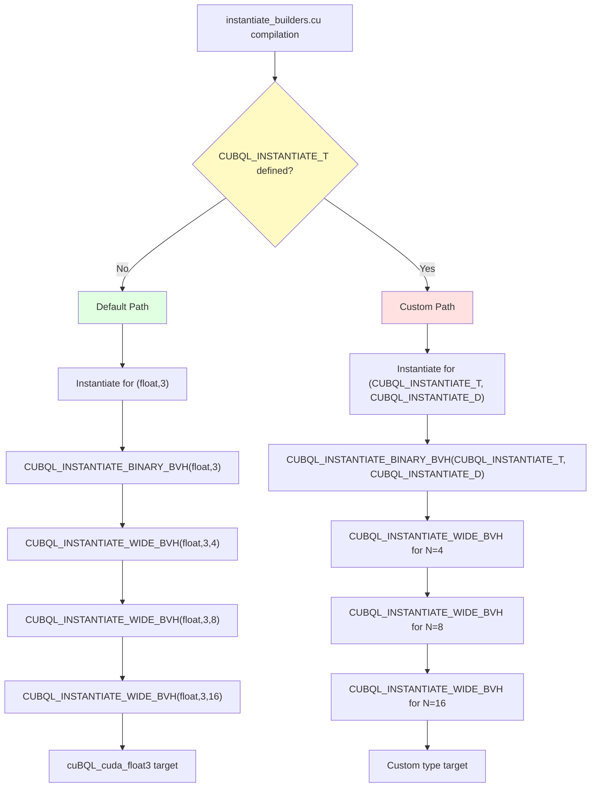
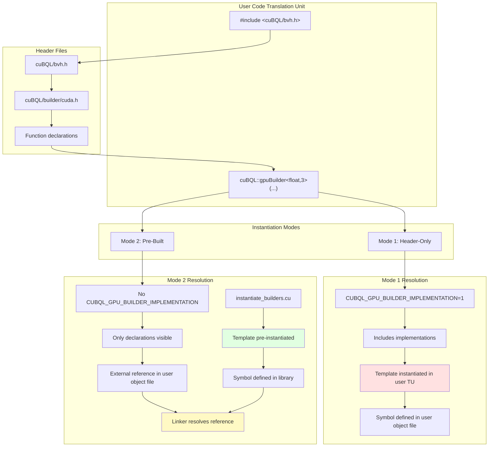

<!-- source: DeepWiki mcp.deepwiki.com · repo NVIDIA/cuBQL · page 9.3 Template Instantiation · fetched 2026-10-26 -->

# Template Instantiation

<details>
<summary>Relevant source files</summary>

The following files were used as context for generating this wiki page:

- [README.md](README.md)
- [cuBQL/builder/cuda/instantiate_builders.cu](cuBQL/builder/cuda/instantiate_builders.cu)

</details>


## Purpose and Scope

This document explains cuBQL's template instantiation strategy, which determines how templated BVH builders and related functions are compiled and linked into user applications. Template instantiation controls whether code is compiled as header-only (instantiated in user translation units) or as pre-built library targets (instantiated once in dedicated compilation units).

This page covers the mechanics of explicit template instantiation, the `CUBQL_GPU_BUILDER_IMPLEMENTATION` macro, default type instantiations, and custom type support. For general information about cuBQL's type system and template parameters, see [Type System and Templates](#3.2). For BVH construction APIs, see [GPU Builder Interface](#6.1).

---

## Instantiation Strategy Overview

cuBQL is primarily a header-only library built on C++ templates parameterized by coordinate type `T` and dimensionality `D`. However, template instantiation of complex GPU builders can significantly increase compile times and binary sizes when done repeatedly across multiple translation units. cuBQL addresses this through two instantiation modes:

| Mode | Description | Use Case |
|------|-------------|----------|
| **Header-Only (Explicit Instantiation)** | User defines `CUBQL_GPU_BUILDER_IMPLEMENTATION=1` in one `.cu` file, causing all builder templates to be instantiated in that translation unit | Custom types, single-file projects, maximum flexibility |
| **Pre-Built Library Targets** | User links against pre-instantiated CMake targets like `cuBQL_cuda_float3`, which provide compiled builder implementations | Standard types (`float,3`), faster builds, reduced binary bloat |

Both modes use the same source code and APIs—only the compilation and linking strategy differs.

**Sources**: [README.md:181-191](), [cuBQL/builder/cuda/instantiate_builders.cu:1-92]()

---

## Instantiation Modes Comparison

### Diagram: Instantiation Mode Build Flows

```mermaid
graph TB
    subgraph "Mode 1: Header-Only Instantiation"
        U1["User Code (userMain.cu)"]
        U2["#define CUBQL_GPU_BUILDER_IMPLEMENTATION 1"]
        U3["#include &lt;cuBQL/bvh.h&gt;"]
        U4["cuBQL::gpuBuilder(...) calls"]
        
        U2 --> U3
        U3 --> U4
        U4 --> C1["Compiler instantiates templates"]
        C1 --> O1["userMain.o contains builder code"]
        O1 --> L1["Link with cuBQL interface target"]
        L1 --> E1["Final executable"]
    end
    
    subgraph "Mode 2: Pre-Built Library Target"
        V1["User Code (userMain.cu)"]
        V2["// NO #define CUBQL_GPU_BUILDER_IMPLEMENTATION"]
        V3["#include &lt;cuBQL/bvh.h&gt;"]
        V4["cuBQL::gpuBuilder(...) calls"]
        
        V2 --> V3
        V3 --> V4
        V4 --> C2["Compiler sees declarations only"]
        C2 --> O2["userMain.o has external references"]
        
        P1["instantiate_builders.cu"]
        P2["Pre-instantiated for float,3"]
        P3["Compiled separately"]
        
        P1 --> P2
        P2 --> P3
        P3 --> LIB["cuBQL_cuda_float3.a/.so"]
        
        O2 --> L2["Link with cuBQL_cuda_float3"]
        LIB --> L2
        L2 --> E2["Final executable"]
    end
    
    style U2 fill:#ffe1e1
    style V2 fill:#e1ffe1
    style C1 fill:#fff9c4
    style C2 fill:#fff9c4
    style LIB fill:#e1f5ff
```



**Key Differences**:
- **Header-Only**: Template instantiation occurs in user translation units, increasing compile time but supporting arbitrary types
- **Pre-Built**: Template instantiation occurs once during library build, reducing user compile time but limited to pre-instantiated types

**Sources**: [README.md:319-367](), [cuBQL/builder/cuda/instantiate_builders.cu:5-6]()

---

## The Instantiation File

The file [cuBQL/builder/cuda/instantiate_builders.cu]() serves as the dedicated compilation unit for explicit template instantiation. It contains no runtime code—only template instantiation directives.

### File Structure

```mermaid
graph TB
    FILE["instantiate_builders.cu"]
    
    FILE --> MACRO_DEF["Macro Definition"]
    FILE --> INST_LOGIC["Instantiation Logic"]
    
    MACRO_DEF --> M1["CUBQL_INSTANTIATE_BINARY_BVH(T,D)"]
    MACRO_DEF --> M2["CUBQL_INSTANTIATE_WIDE_BVH(T,D,N)"]
    
    M1 --> F1["radixBuilder_impl::build&lt;T,D&gt;"]
    M1 --> F2["cuBQL::gpuBuilder&lt;T,D&gt;"]
    M1 --> F3["cuBQL::cuda::radixBuilder&lt;T,D&gt;"]
    M1 --> F4["cuBQL::cuda::rebinRadixBuilder&lt;T,D&gt;"]
    M1 --> F5["cuBQL::cuda::sahBuilder&lt;T,D&gt;"]
    M1 --> F6["cuBQL::cuda::free&lt;BinaryBVH&lt;T,D&gt;&gt;"]
    
    M2 --> F7["cuBQL::gpuBuilder&lt;WideBVH&lt;T,D,N&gt;&gt;"]
    M2 --> F8["cuBQL::cuda::free&lt;WideBVH&lt;T,D,N&gt;&gt;"]
    
    INST_LOGIC --> COND["Conditional Compilation"]
    COND --> CUSTOM["#ifdef CUBQL_INSTANTIATE_T"]
    COND --> DEFAULT["#else default"]
    
    CUSTOM --> CI1["CUBQL_INSTANTIATE_BINARY_BVH(CUBQL_INSTANTIATE_T, CUBQL_INSTANTIATE_D)"]
    CUSTOM --> CI2["CUBQL_INSTANTIATE_WIDE_BVH for N=4,8,16"]
    
    DEFAULT --> DI1["CUBQL_INSTANTIATE_BINARY_BVH(float,3)"]
    DEFAULT --> DI2["CUBQL_INSTANTIATE_WIDE_BVH(float,3,4)"]
    DEFAULT --> DI3["CUBQL_INSTANTIATE_WIDE_BVH(float,3,8)"]
    DEFAULT --> DI4["CUBQL_INSTANTIATE_WIDE_BVH(float,3,16)"]
```



**Sources**: [cuBQL/builder/cuda/instantiate_builders.cu:13-89]()

---

## Instantiation Macros

### `CUBQL_INSTANTIATE_BINARY_BVH(T,D)`

This macro instantiates all builder-related function templates for `BinaryBVH<T,D>`:

| Function Template | Namespace | Purpose |
|-------------------|-----------|---------|
| `build<T,D>` | `cuBQL::radixBuilder_impl` | Internal radix builder implementation |
| `gpuBuilder<T,D>` | `cuBQL` | Main dispatcher function (see [GPU Builder Interface](#6.1)) |
| `radixBuilder<T,D>` | `cuBQL::cuda` | Radix/morton builder (see [Radix Builder](#6.2.1)) |
| `rebinRadixBuilder<T,D>` | `cuBQL::cuda` | Rebinning radix builder (see [Advanced Builders](#6.2.3)) |
| `sahBuilder<T,D>` | `cuBQL::cuda` | SAH builder (see [SAH Builder](#6.2.2)) |
| `free<BinaryBVH<T,D>>` | `cuBQL::cuda` | Memory deallocation for BinaryBVH |

**Sources**: [cuBQL/builder/cuda/instantiate_builders.cu:13-57]()

### `CUBQL_INSTANTIATE_WIDE_BVH(T,D,N)`

This macro instantiates builder and utility functions for `WideBVH<T,D,N>`:

| Function Template | Namespace | Purpose |
|-------------------|-----------|---------|
| `gpuBuilder<WideBVH<T,D,N>>` | `cuBQL` | Wide BVH builder dispatcher |
| `free<WideBVH<T,D,N>>` | `cuBQL::cuda` | Memory deallocation for WideBVH |

Wide BVHs are typically instantiated for `N` values of 4, 8, and 16, representing 4-way, 8-way, and 16-way branching factors.

**Sources**: [cuBQL/builder/cuda/instantiate_builders.cu:59-72]()

---

## Default vs. Custom Type Instantiation

### Diagram: Instantiation Decision Tree



### Default Instantiation

When compiled without preprocessor overrides, [cuBQL/builder/cuda/instantiate_builders.cu:84-88]() instantiates builders for the most common case:

- **Type**: `float`
- **Dimensionality**: `3`
- **BVH Widths**: Binary (2-way), plus Wide variants with `N=4,8,16`

This produces the `cuBQL_cuda_float3` CMake target.

### Custom Type Instantiation

To instantiate builders for custom types, define `CUBQL_INSTANTIATE_T` and `CUBQL_INSTANTIATE_D` during compilation:

```bash
# CMake example
add_library(cuBQL_custom_double2 
    cuBQL/builder/cuda/instantiate_builders.cu)
target_compile_definitions(cuBQL_custom_double2 PRIVATE
    CUBQL_INSTANTIATE_T=double
    CUBQL_INSTANTIATE_D=2)
```

This instantiates all builder functions for `BinaryBVH<double,2>` and `WideBVH<double,2,N>`.

**Sources**: [cuBQL/builder/cuda/instantiate_builders.cu:77-89]()

---

## CMake Integration

### Pre-Built Target Usage

When using pre-built library targets, the user's `CMakeLists.txt` links against specific type-instantiated targets:

```cmake
add_subdirectory(cuBQL)

add_executable(my_app main.cu)

# Link against pre-built float3 builders
target_link_libraries(my_app PRIVATE cuBQL_cuda_float3)
```

The user's source code does **not** define `CUBQL_GPU_BUILDER_IMPLEMENTATION`:

```cpp
// main.cu
#include <cuBQL/bvh.h>

void foo() {
    cuBQL::BinaryBVH<float,3> bvh;
    cuBQL::gpuBuilder(bvh, boxes, numBoxes, config);  // Links to pre-built
}
```

### Header-Only Target Usage

For header-only mode, link against the interface-only `cuBQL` target:

```cmake
add_subdirectory(cuBQL)

add_executable(my_app main.cu)

# Link against header-only interface
target_link_libraries(my_app PRIVATE cuBQL)
```

The user's source code **must** define `CUBQL_GPU_BUILDER_IMPLEMENTATION` in exactly one translation unit:

```cpp
// main.cu (or separate instantiation.cu)
#define CUBQL_GPU_BUILDER_IMPLEMENTATION 1
#include <cuBQL/bvh.h>

void foo() {
    cuBQL::BinaryBVH<double,4> bvh;  // Supports arbitrary types
    cuBQL::gpuBuilder(bvh, boxes, numBoxes, config);
}
```

**Sources**: [README.md:319-367]()

---

## Symbol Resolution and Linking

### Diagram: Template Instantiation and Symbol Resolution



### Symbol Visibility

The instantiation strategy affects which symbols are visible and where they're defined:

| Scenario | `CUBQL_GPU_BUILDER_IMPLEMENTATION` | Symbol Location | Link Requirement |
|----------|-------------------------------------|-----------------|------------------|
| Header-Only, custom type | Defined in user `.cu` | User object file | None (self-contained) |
| Header-Only, standard type | Defined in user `.cu` | User object file | None (self-contained) |
| Pre-Built, standard type | Not defined | Library `.a/.so` | Must link against library target |
| Pre-Built, custom type | Not defined | **Symbol not found** | **Link error** (must use header-only) |

**Important**: Pre-built library targets only provide symbols for their instantiated types. Using `cuBQL::gpuBuilder<double,4>(...)` while linking against `cuBQL_cuda_float3` will result in linker errors because `double,4` was never instantiated in that library.

**Sources**: [cuBQL/builder/cuda/instantiate_builders.cu:1-92](), [README.md:181-191]()

---

## Advanced Usage Patterns

### Multiple Type Support

Projects requiring multiple type/dimensionality combinations can use hybrid approaches:

```cpp
// instantiation_float3.cu
#define CUBQL_GPU_BUILDER_IMPLEMENTATION 1
#include <cuBQL/bvh.h>
// Instantiates for float,3

// instantiation_double2.cu
#define CUBQL_GPU_BUILDER_IMPLEMENTATION 1
#include <cuBQL/bvh.h>
// Instantiates for double,2 (if used in this TU)

// user_code.cu
// No CUBQL_GPU_BUILDER_IMPLEMENTATION
#include <cuBQL/bvh.h>
// Uses builders from both instantiation TUs
```

This pattern reduces compile time by instantiating each type once, while supporting multiple types in a single project.

### Custom Library Targets

CMake can define custom library targets for specific types:

```cmake
# Create double,3 builder library
add_library(cuBQL_custom_double3
    cuBQL/builder/cuda/instantiate_builders.cu)
    
target_compile_definitions(cuBQL_custom_double3 PRIVATE
    CUBQL_INSTANTIATE_T=double
    CUBQL_INSTANTIATE_D=3)
    
target_link_libraries(cuBQL_custom_double3 PUBLIC cuBQL)

# User application
add_executable(my_app main.cu)
target_link_libraries(my_app PRIVATE cuBQL_custom_double3)
```

This creates a reusable library with consistent compilation flags across the project.

**Sources**: [cuBQL/builder/cuda/instantiate_builders.cu:77-82]()

---

## Instantiation Overhead

### Compile-Time Costs

Template instantiation of GPU builders is compile-intensive due to:
- Complex CUDA kernel template expansion
- Multiple builder algorithms (radix, SAH, rebin)
- Device code generation for all instantiated types

Typical instantiation compile times:
- **Single type (float,3)**: ~5-15 seconds
- **Multiple types in one TU**: Time scales linearly with number of types
- **Header-only across 10 TUs**: 10x compile time vs pre-built

### Binary Size Impact

Each template instantiation adds:
- **BinaryBVH builders**: ~200-500 KB of device code per type
- **WideBVH builders**: Additional ~100-200 KB per width variant
- **Total per type/dim**: ~600-900 KB for all builders and widths

Pre-built libraries amortize this cost across all executables linking against them.

**Sources**: [cuBQL/builder/cuda/instantiate_builders.cu:13-72]()

---

## Troubleshooting

### Common Issues

| Problem | Symptom | Solution |
|---------|---------|----------|
| **Linker error: undefined reference to `cuBQL::gpuBuilder`** | Using pre-built target with non-instantiated type | Switch to header-only mode or create custom target for that type |
| **Multiple definition error** | `CUBQL_GPU_BUILDER_IMPLEMENTATION=1` in multiple `.cu` files | Define in only one translation unit |
| **Slow compile times** | Each source file takes minutes to compile | Use pre-built library target instead of header-only |
| **Custom type not working** | Link errors with custom type and pre-built target | Pre-built targets don't support custom types—use header-only mode |

### Verification

To verify which symbols are instantiated in a library:

```bash
# Linux/macOS
nm libcuBQL_cuda_float3.a | grep gpuBuilder

# Expected output includes:
# T cuBQL::gpuBuilder<float, 3>(...)
```

**Sources**: [README.md:319-367](), [cuBQL/builder/cuda/instantiate_builders.cu:77-89]()

---

