# Page: Overview

# Overview

<details>
<summary>Relevant source files</summary>

The following files were used as context for generating this wiki page:

- [README.md](README.md)
- [cuBQL/bvh.h](cuBQL/bvh.h)

</details>


## Purpose and Scope

This page provides a high-level introduction to cuBQL, a CUDA/C++ library for GPU-accelerated construction and traversal of Bounding Volume Hierarchies (BVHs). The overview covers the library's purpose, architecture, core data structures, and basic usage patterns. For detailed installation and build instructions, see [Getting Started](#2). For in-depth architectural details, see [Architecture](#3).

**Sources:** [README.md:1-12]()

## What is cuBQL?

cuBQL (pronounced "cubicle") is a header-only CUDA/C++ library designed to enable efficient GPU-accelerated spatial queries over geometric primitives. The library provides tools for both constructing BVH data structures on the GPU and performing various spatial queries against them.

The library is inspired by the Standard Template Library (STL) and CUB, using templates and lambda functions to support different primitive types, coordinate types (float, double, int), dimensionalities (2D, 3D, 4D, N-D), and query patterns. This design enables a single codebase to handle diverse use cases: from `float3` ray tracing to `int2` spatial indexing.

**Key Design Goals:**
- **Robustness**: All builders work for all input types and handle numerically challenging data
- **Generality**: Template-based design supports arbitrary scalar types and dimensionalities
- **Ease of Use**: Simple API with sensible defaults and flexible customization
- **Performance**: GPU-accelerated construction (~13ms for 10M points) and traversal

**Sources:** [README.md:8-26]()

## Core Architecture: Four-Layer System

cuBQL organizes functionality into four distinct layers, each building on the layer below:

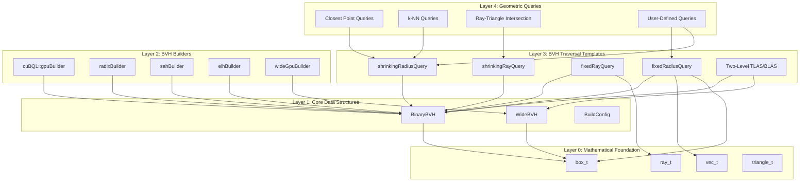

**Layer 0 (Mathematical Foundation)**: Template-based geometric primitives that work on both CPU and GPU. All types are parameterized by scalar type `T` and dimensionality `D`. See [Mathematical Foundation](#4) for details.

**Layer 1 (Core Data Structures)**: BVH storage formats defined in [cuBQL/bvh.h](). `BinaryBVH<T,D>` is the primary structure; `WideBVH<T,D,N>` provides N-ary trees for traversal optimization. See [Core Data Structures](#5).

**Layer 2 (BVH Builders)**: GPU-accelerated construction algorithms with different speed/quality tradeoffs. The `cuBQL::gpuBuilder` function dispatches to specialized builders based on `BuildConfig` settings. See [BVH Construction](#6).

**Layer 3 (Traversal Templates)**: Generic query patterns customizable via lambda callbacks. Users can implement custom queries without modifying core BVH code. See [BVH Traversal](#7).

**Layer 4 (Geometric Queries)**: Example implementations that demonstrate how to use the traversal templates. These serve as both usable queries and reference implementations. See [Geometric Queries](#8).

**Sources:** [README.md:30-60](), [cuBQL/bvh.h:1-161]()

## Core Data Structures

### BinaryBVH Structure

The primary BVH type is `BinaryBVH<T,D>`, a binary tree where each node contains a bounding box and administrative data:

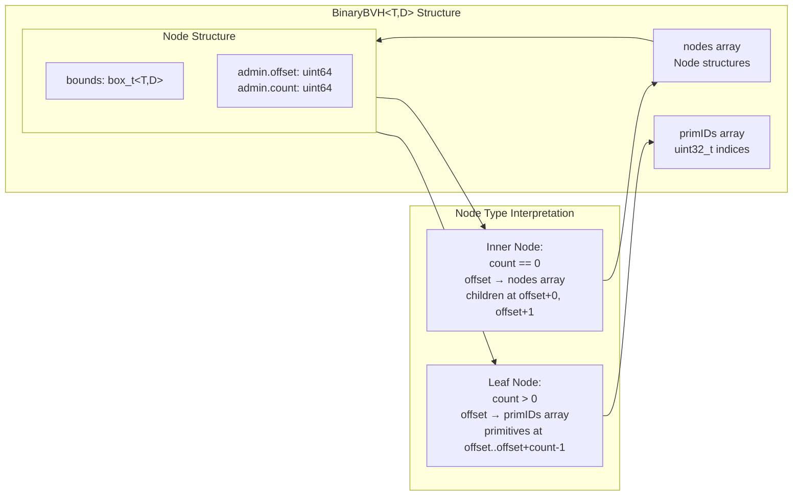

**Key characteristics:**
- Node 0 is always the root
- Node 1 is unused (ensures child pairs start at even indices)
- Inner nodes: `count=0`, `offset` indexes into `nodes[]` array
- Leaf nodes: `count>0`, `offset` indexes into `primIDs[]` array
- Maximum leaf size: `(1<<16)-1` = 65535 primitives

The structure definition from [cuBQL/bvh.h:58-100]():

| Field | Type | Purpose |
|-------|------|---------|
| `nodes` | `Node*` | Array of BVH nodes (device or host memory) |
| `numNodes` | `uint32_t` | Total number of nodes in the tree |
| `primIDs` | `uint32_t*` | Array of primitive indices |
| `numPrims` | `uint32_t` | Total number of primitives indexed |

**Sources:** [cuBQL/bvh.h:53-100](), [README.md:64-91]()

### WideBVH Structure

`WideBVH<T,D,N>` provides N-ary trees with fixed branching factor. Each "node" is actually N child slots merged together:

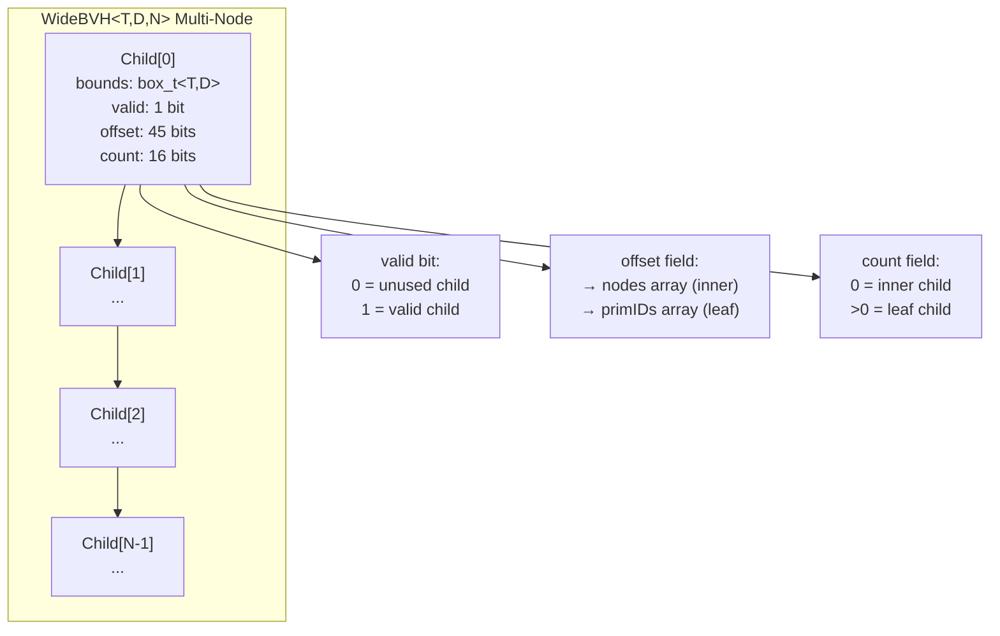

Wide BVHs are typically created by collapsing binary BVHs, improving traversal efficiency through better cache utilization and SIMD opportunities.

**Sources:** [cuBQL/bvh.h:102-134]()

## Template Type System

cuBQL uses three primary template parameters to achieve flexibility:

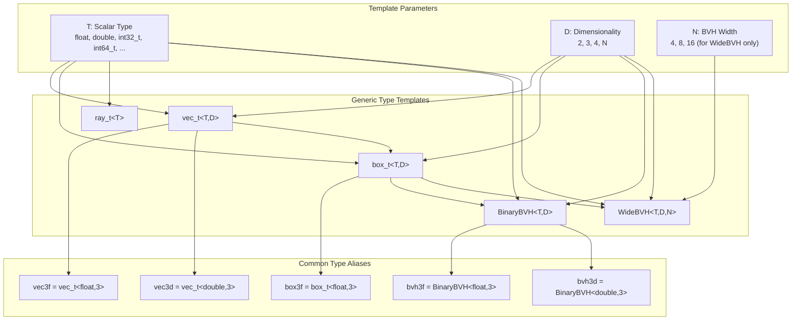

**Type Aliases:** The library provides common aliases to reduce verbosity. For example, `bvh3f` is shorthand for `BinaryBVH<float,3>`, and `vec3f` is shorthand for `vec_t<float,3>`.

**CUDA Integration:** When `CUBQL_SUPPORT_CUDA_VECTOR_TYPES=1`, automatic conversions enable interoperation with CUDA built-in types like `float3`, `int4`, and `dim3`.

**Sources:** [cuBQL/bvh.h:58-149](), [README.md:99-104]()

## Build and Query Workflow

The typical cuBQL usage follows a two-phase pattern: construction followed by queries.

### Construction Phase

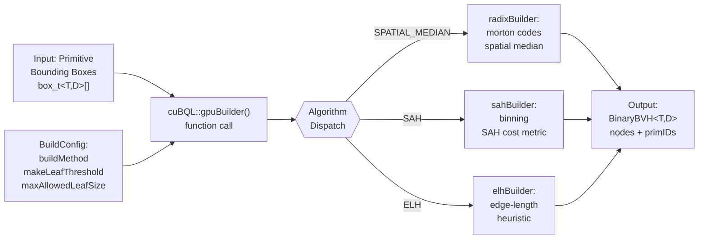

Example build invocation from [README.md:135-145]():

```cpp
box3f *d_boxes  = 0;
int    numBoxes = 0;
// User code generates boxes on GPU
userCodeForGeneratingPrims(&d_boxes, &numBoxes);

cuBQL::BinaryBVH<float,3> bvh;
cuBQL::BuildConfig buildParams;
cuBQL::gpuBuilder(bvh, d_boxes, numBoxes, buildParams);
```

The builder:
- Accepts bounding boxes in device or managed memory
- Does not modify input boxes
- Handles invalid boxes (where `lower.x > upper.x`) by excluding them
- Handles zero-volume boxes (where `lower == upper`) as valid
- Populates `bvh.nodes[]` and `bvh.primIDs[]` arrays

**Sources:** [README.md:106-169](), [cuBQL/bvh.h:18-51]()

### Query Phase

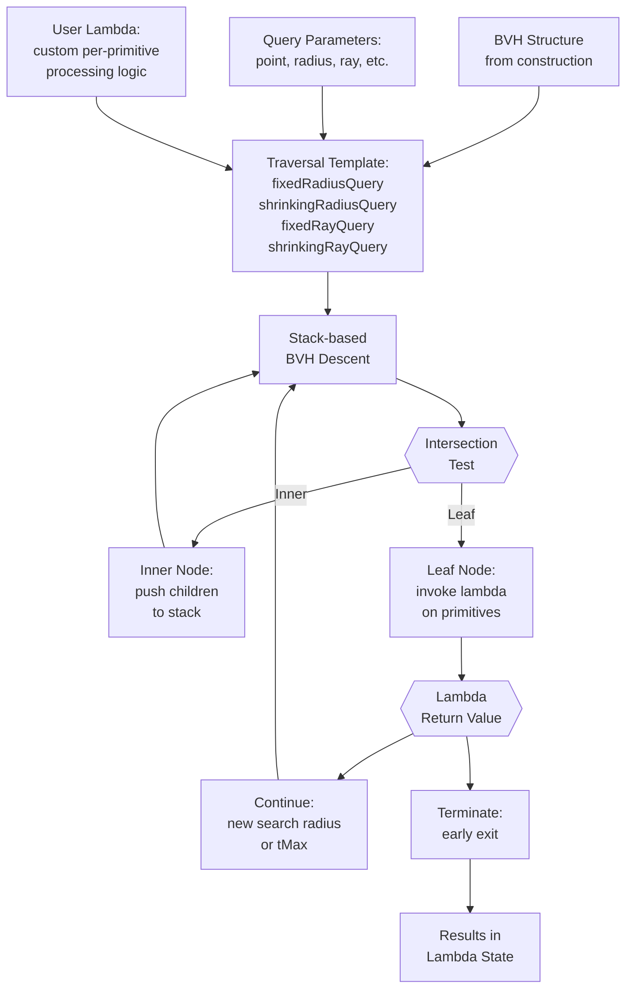

Example query from [README.md:254-266]():

```cpp
void findClosestPoint(...) {
   float closestDist = INFINITY;
   int   closestID   = -1;
   auto myQueryLambda = [&closestDist,&closestID,...](int primID) -> float {
      float dist = distance(queryPoint, myPrims[primID]);
      if (dist < closestDist) {
         closestDist = dist;
         closestID = primID;
      }
      return closestDist;  // New search radius
   };
   cuBQL::shrinkingRadiusQuery::forEachPrim(myQueryLambda, queryPoint, myBVH, ...);
}
```

The lambda-based design enables:
- **Custom per-primitive processing**: Lambda implements query-specific logic
- **Dynamic search space reduction**: Lambda returns new radius/tMax for shrinking queries
- **Early termination**: Lambda can signal traversal to stop
- **Flexible result accumulation**: Results stored in lambda-captured variables

**Sources:** [README.md:193-269]()

## Key File Organization

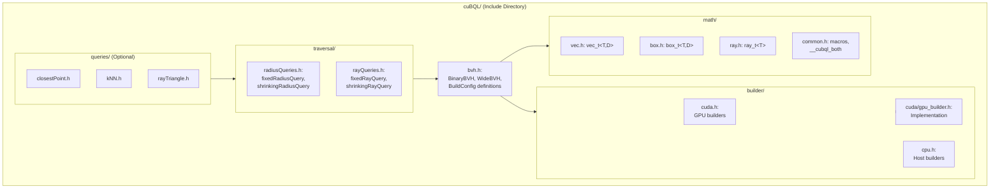

**Core Library (`cuBQL/`)**: Everything needed for BVH construction and traversal

**Math Foundation (`cuBQL/math/`)**: Template-based geometric primitives with CPU/GPU support

**Builders (`cuBQL/builder/`)**: Construction algorithms; can be used header-only or as pre-built targets

**Traversal (`cuBQL/traversal/`)**: Generic query patterns via lambda callbacks

**Queries (`cuBQL/queries/`)**: Example implementations demonstrating traversal template usage

**Sources:** [README.md:282-296]()

## Build Configuration Options

The `BuildConfig` structure controls builder behavior:

| Field | Type | Default | Purpose |
|-------|------|---------|---------|
| `buildMethod` | `BuildMethod` enum | `SPATIAL_MEDIAN` | Algorithm selection: `SPATIAL_MEDIAN`, `SAH`, or `ELH` |
| `makeLeafThreshold` | `int` | `0` | Threshold below which to create leaves (0 = let builder decide) |
| `maxAllowedLeafSize` | `int` | `1<<15` (32768) | Maximum primitives per leaf |

**Build Methods:**
- **SPATIAL_MEDIAN** (default): Fast construction using morton codes and spatial median splits
- **SAH**: Higher quality using Surface Area Heuristic, slower build but better query performance
- **ELH**: Edge-Length Heuristic, experimental balanced approach

Methods can be enabled via:
```cpp
BuildConfig config;
config.enableSAH();  // Use SAH builder
config.enableELH();  // Use ELH builder
```

**Sources:** [cuBQL/bvh.h:18-51]()

## Memory Management

cuBQL supports flexible memory allocation strategies:

**Default**: Device memory allocated via `cudaMalloc`/`cudaFree`

**Managed Memory**: Use `cuBQL::ManagedMemoryResource` for automatic CPU/GPU migration

**Async Device Memory**: Use `cuBQL::AsyncDeviceMemoryResource` for stream-ordered allocations

**Custom Resources**: Implement `cuBQL::GpuMemoryResource` interface for custom allocators

Memory resources can be passed to builders:
```cpp
cuBQL::ManagedMemoryResource mr;
cuBQL::gpuBuilder(bvh, d_boxes, numBoxes, buildParams, 0, mr);
```

See [Memory Management](#9.1) for detailed documentation.

**Sources:** [README.md:176-179]()

## Header-Only vs. Pre-Built Libraries

cuBQL supports two usage modes:

### Header-Only Mode

Define `CUBQL_GPU_BUILDER_IMPLEMENTATION=1` in exactly one translation unit to include implementation:

```cpp
#define CUBQL_GPU_BUILDER_IMPLEMENTATION 1
#include <cuBQL/bvh.h>
```

This allows compilation with custom flags and architectures.

### Pre-Built Library Mode

Link against type-specific targets in CMake:

```cmake
target_link_libraries(userExec cuBQL_cuda_float3)
```

Available targets include `cuBQL_cuda_float3`, `cuBQL_cuda_double3`, `cuBQL_host_int4`, etc.

See [Getting Started](#2) for build system integration details and [Template Instantiation](#9.3) for advanced customization.

**Sources:** [README.md:181-191](), [README.md:308-368]()

## Next Steps

- **Installation and Build**: See [Getting Started](#2) for CMake integration and build instructions
- **Architecture Details**: See [Architecture](#3) for in-depth layer descriptions
- **Mathematical Types**: See [Mathematical Foundation](#4) for `vec_t`, `box_t`, and related types
- **BVH Construction**: See [BVH Construction](#6) for builder algorithms and implementation details
- **BVH Traversal**: See [BVH Traversal](#7) for traversal templates and query patterns
- **Example Queries**: See [Geometric Queries](#8) for reference implementations

**Sources:** [README.md:1-369]()

---

# Page: Getting Started

# Getting Started

<details>
<summary>Relevant source files</summary>

The following files were used as context for generating this wiki page:

- [README.md](README.md)
- [cuBQL/builder/cuda/instantiate_builders.cu](cuBQL/builder/cuda/instantiate_builders.cu)

</details>


This page provides installation instructions, CMake integration guidance, and basic usage examples for cuBQL. It covers the prerequisites, integration methods, and a quick start guide for building your first BVH and performing queries.

For detailed information about cuBQL's architecture and design principles, see [Architecture](#3). For in-depth documentation of specific builders and traversal patterns, see [BVH Construction](#6) and [BVH Traversal](#7).

---

## Prerequisites

cuBQL requires the following dependencies:

| Dependency | Version | Notes |
|------------|---------|-------|
| CUDA Toolkit | 12.x or later | CUDA 11.x may work but 12.2+ is highly recommended |
| CMake | 3.18+ | Required for CMake-based integration |
| C++ Compiler | C++14 or later | Must support CUDA compilation |

The library is designed to work on both Linux and Windows platforms. Ensure your CUDA installation includes `nvcc` and that it is accessible in your system PATH.

**Sources:** [README.md:299-306]()

---

## Integration Methods

cuBQL can be integrated into your project in two primary ways: header-only mode with explicit instantiation, or by linking against pre-built library targets. The choice depends on your compilation preferences and whether you need custom type instantiations.

### Integration Workflow Diagram

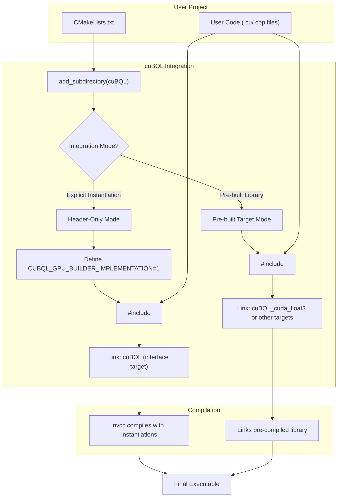

**Sources:** [README.md:308-369]()

---

## CMake Integration (Recommended)

### Method 1: Header-Only with Explicit Instantiation

This approach compiles the builder implementations directly into your code. You control the compilation flags and can instantiate custom types.

**Step 1:** Add cuBQL as a subdirectory in your `CMakeLists.txt`:

```cmake
add_subdirectory(<pathTo>/cuBQL)

add_executable(myApp
    main.cu
    # ... other sources
)

target_link_libraries(myApp
    cuBQL  # Interface target - sets include paths only
)
```

**Step 2:** In your CUDA source file (e.g., `main.cu`):

```cpp
#define CUBQL_GPU_BUILDER_IMPLEMENTATION 1
#include <cuBQL/bvh.h>

// Your code here
```

The `CUBQL_GPU_BUILDER_IMPLEMENTATION` macro triggers inclusion of implementation code. This must be defined in exactly one compilation unit.

**Sources:** [README.md:319-345]()

### Method 2: Pre-built Library Targets

This approach links against pre-compiled builder implementations for common type combinations. It results in faster compilation for most use cases.

**Step 1:** Add cuBQL and link to a specific target in your `CMakeLists.txt`:

```cmake
add_subdirectory(<pathTo>/cuBQL)

add_executable(myApp
    main.cu
    # ... other sources
)

target_link_libraries(myApp
    cuBQL_cuda_float3  # Pre-built for BinaryBVH<float,3>
)
```

**Step 2:** In your CUDA source file (e.g., `main.cu`):

```cpp
// Do NOT define CUBQL_GPU_BUILDER_IMPLEMENTATION
#include <cuBQL/bvh.h>

// Your code here
```

**Sources:** [README.md:346-369]()

### Available Pre-built Targets

The following CMake targets are available for common type combinations:

| Target Name | Type Parameters | BVH Types |
|-------------|-----------------|-----------|
| `cuBQL_cuda_float3` | `<float, 3>` | `BinaryBVH<float,3>`, `WideBVH<float,3,N>` (N=4,8,16) |
| `cuBQL` | Interface only | Header-only, no pre-compiled code |

By default, cuBQL instantiates builders for `<float, 3>` which covers the common 3D floating-point use case. Custom type instantiations require header-only mode with custom `CUBQL_INSTANTIATE_T` and `CUBQL_INSTANTIATE_D` definitions.

**Sources:** [cuBQL/builder/cuda/instantiate_builders.cu:75-89]()

---

## Quick Start: Building Your First BVH

### Basic BVH Construction Example

The following workflow demonstrates the minimal steps to construct a BVH from bounding boxes:


**Step-by-step implementation:**

1. **Prepare input data** - Create an array of `box_t<T,D>` bounding boxes on the GPU:

```cpp
// Assuming you have primitives and need their bounding boxes
box3f *d_boxes = nullptr;  // box3f is an alias for box_t<float,3>
int numBoxes = 1000000;

// Allocate device memory
cudaMalloc(&d_boxes, numBoxes * sizeof(box3f));

// Populate boxes (via kernel, cudaMemcpy, or other means)
// Each box should have box.lower and box.upper set appropriately
```

2. **Instantiate BVH structure** - Create a `BinaryBVH` instance:

```cpp
cuBQL::BinaryBVH<float,3> bvh;  // or use alias: cuBQL::bvh3f
```

3. **Configure build parameters** - Create a `BuildConfig` object:

```cpp
cuBQL::BuildConfig buildConfig;
// Default settings use spatial median splits (fast)
// See BuildConfig documentation for SAH and other options
```

4. **Build the BVH** - Call `cuBQL::gpuBuilder`:

```cpp
cuBQL::gpuBuilder(bvh, d_boxes, numBoxes, buildConfig);
```

After this call, `bvh.nodes` and `bvh.primIDs` are populated on device memory and ready for traversal.

**Sources:** [README.md:123-169]()

### Understanding BVH Output Structure

After construction, the `BinaryBVH` structure contains:

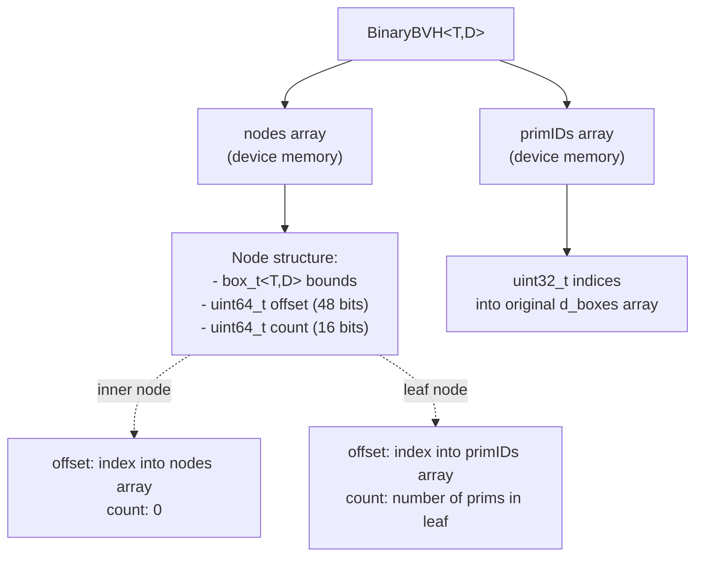

- **Inner nodes**: `count == 0`, `offset` points to children in `nodes` array
- **Leaf nodes**: `count > 0`, `offset` points to primitive IDs in `primIDs` array
- The `primIDs` array contains indices into your original `d_boxes` array

**Sources:** [README.md:62-91]()

---

## Quick Start: Performing Queries

### Traversal Template Usage

cuBQL provides traversal templates that accept lambda functions for custom query logic. Here's the basic pattern for a shrinking radius query:

```cpp
// Device-side query kernel
__global__ void queryKernel(cuBQL::bvh3f bvh, 
                            vec3f *queryPoints,
                            float *results,
                            int numQueries) {
    int queryIdx = blockIdx.x * blockDim.x + threadIdx.x;
    if (queryIdx >= numQueries) return;
    
    vec3f queryPoint = queryPoints[queryIdx];
    float closestDist = INFINITY;
    
    // Define lambda for processing each candidate primitive
    auto processCandidate = [&](int primID) -> float {
        // Custom logic: compute distance to primitive
        float dist = computeDistance(queryPoint, primID);
        if (dist < closestDist) {
            closestDist = dist;
        }
        return closestDist;  // Return new search radius
    };
    
    // Invoke traversal template
    cuBQL::shrinkingRadiusQuery::forEachPrim(
        processCandidate,
        queryPoint,
        bvh,
        INFINITY  // initial search radius
    );
    
    results[queryIdx] = closestDist;
}
```

The lambda function receives a `primID` and returns the updated search radius. The traversal template handles the BVH descent, intersection tests, and invokes your lambda only for relevant primitives.

**Sources:** [README.md:193-266]()

---

## Common Build Configuration Options

The `BuildConfig` structure controls builder behavior:

| Configuration | Values | Description |
|---------------|--------|-------------|
| Build method | `BuildConfig::SAH` | Surface Area Heuristic - higher quality, slower build |
| | `BuildConfig::ELH` | Edge Length Heuristic - balanced quality/speed |
| | (default) | Spatial median splits - fastest build |
| Max leaf size | Integer (default varies) | Maximum primitives per leaf node |
| Memory resource | `GpuMemoryResource` | Custom device/managed memory allocator |
| Stream | `cudaStream_t` | CUDA stream for async execution |

Example with custom configuration:

```cpp
cuBQL::BuildConfig config;
config.buildMethod = cuBQL::BuildConfig::SAH;  // Use SAH for quality
config.maxLeafSize = 4;  // Smaller leaves (more nodes, faster traversal)

cuBQL::gpuBuilder(bvh, d_boxes, numBoxes, config, 
                  cudaStream, memoryResource);
```

**Sources:** [README.md:164-180]()

---

## Invalid and Empty Primitives

cuBQL automatically handles invalid input:

- **Invalid primitives**: Boxes where `lower.x > upper.x` are excluded from the BVH
- **Empty boxes**: Boxes where `lower == upper` (zero volume) are valid and included
- **NaNs and denorms**: Behavior is undefined - sanitize input data

This allows you to mark primitives for exclusion by setting invalid bounds without filtering the input array.

**Sources:** [README.md:153-163]()

---

## Type System Overview

cuBQL is fully templated over coordinate type `T` and dimensionality `D`:

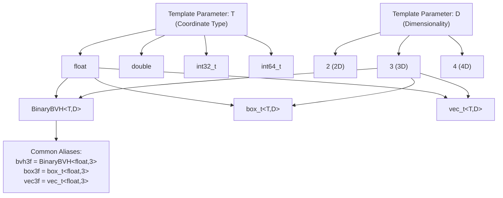

Common type aliases are provided for convenience:
- `bvh3f`, `bvh3d` - Binary BVHs for float/double 3D
- `box3f`, `box3d` - Bounding boxes for float/double 3D
- `vec3f`, `vec3d` - Vectors for float/double 3D

**Sources:** [README.md:34-38, 147-149]()

---

## Memory Management

### GPU Memory Allocation

By default, `cuBQL::gpuBuilder` allocates device memory using standard CUDA allocators. You can customize this behavior:

```cpp
// Option 1: Default device memory (implicit)
cuBQL::gpuBuilder(bvh, d_boxes, numBoxes, buildConfig);

// Option 2: Custom memory resource
cuBQL::GpuMemoryResource customMemory = /* ... */;
cuBQL::gpuBuilder(bvh, d_boxes, numBoxes, buildConfig, 
                  0 /* stream */, customMemory);

// Option 3: Stream-ordered execution
cudaStream_t stream;
cudaStreamCreate(&stream);
cuBQL::gpuBuilder(bvh, d_boxes, numBoxes, buildConfig, stream);
```

The builder allocates:
- `nodes` array: `sizeof(Node) * numNodes` (determined during build)
- `primIDs` array: `sizeof(uint32_t) * numPrims`

Both arrays are allocated in the memory space specified by `GpuMemoryResource`, defaulting to device memory.

**Sources:** [README.md:172-180]()

### Cleanup

To free BVH memory:

```cpp
cuBQL::cuda::free(bvh, stream, memoryResource);
```

This deallocates both the `nodes` and `primIDs` arrays using the same memory resource and stream used during construction.

**Sources:** [cuBQL/builder/cuda/instantiate_builders.cu:53-56]()

---

## Next Steps

After completing this quick start, explore the following topics:

- **[Architecture](#3)** - Understand cuBQL's four-layer design and how components interact
- **[Mathematical Foundation](#4)** - Learn about `vec_t`, `box_t`, and other core types
- **[BVH Construction](#6)** - Deep dive into builder algorithms (radix, SAH, ELH)
- **[BVH Traversal](#7)** - Master traversal templates for custom queries
- **[Geometric Queries](#8)** - Use pre-built query implementations as examples

The samples directory contains complete working examples demonstrating various usage patterns.

**Sources:** [README.md:282-296]()

---

# Page: Architecture

# Architecture

<details>
<summary>Relevant source files</summary>

The following files were used as context for generating this wiki page:

- [README.md](README.md)
- [cuBQL/bvh.h](cuBQL/bvh.h)

</details>


## Purpose and Scope

This document provides a high-level overview of cuBQL's architectural organization, explaining how the library's major components are structured and how they interact. It covers the four-layer design philosophy, the separation between construction and traversal pipelines, and the overall data flow through the system.

For detailed information about specific aspects of the architecture:
- Layer-by-layer component details: see [Four-Layer Design](#3.1)
- Template parameterization and type aliases: see [Type System and Templates](#3.2)
- CUDA-specific integration patterns: see [CUDA Integration](#3.3)

---

## Four-Layer Architecture Overview

cuBQL is organized into four distinct functional layers, each building upon the previous one. This separation enables modularity and allows users to work at the abstraction level appropriate for their needs.

### Layer Diagram

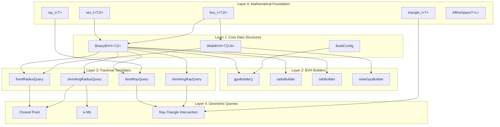

**Sources:** [README.md:30-61](), [cuBQL/bvh.h:1-161]()

### Layer Descriptions

| Layer | Purpose | Key Components | Location |
|-------|---------|----------------|----------|
| **Layer 0: Mathematical Foundation** | Provides template-based geometric primitives that work on both CPU and GPU | `vec_t<T,D>`, `box_t<T,D>`, `ray_t<T>`, `triangle_t<T>`, `LinearSpace<T,D>`, `AffineSpaceT<L>` | `cuBQL/math/` |
| **Layer 1: Core Data Structures** | Defines BVH storage formats and build configuration | `BinaryBVH<T,D>`, `WideBVH<T,D,N>`, `BuildConfig` | `cuBQL/bvh.h` |
| **Layer 2: BVH Builders** | Implements GPU-accelerated construction algorithms | `gpuBuilder()`, `radixBuilder`, `sahBuilder`, `rebinRadixBuilder`, `wideGpuBuilder` | `cuBQL/builder/cuda/` |
| **Layer 3: Traversal Templates** | Provides generic query patterns customizable via lambdas | `fixedRadiusQuery`, `shrinkingRadiusQuery`, `fixedRayQuery`, `shrinkingRayQuery` | `cuBQL/traversal/` |
| **Layer 4: Geometric Queries** | Concrete query implementations as usage examples | Closest point, k-NN, ray-triangle intersection | `cuBQL/queries/` |

**Sources:** [README.md:30-61](), [cuBQL/bvh.h:1-161]()

---

## Construction and Traversal Separation

cuBQL separates BVH construction from traversal, allowing BVHs to be built once and queried many times with different query types. This design improves performance for applications that perform multiple queries on static geometry.

### Construction and Traversal Pipeline Diagram

```mermaid
graph LR
    subgraph Construction["Construction Pipeline (GPU)"]
        direction TB
        InputBoxes["box_t&lt;T,D&gt;* boxes<br/>numPrims"]
        Config["BuildConfig<br/>buildMethod, makeLeafThreshold"]
        
        InputBoxes --> Dispatcher["gpuBuilder()<br/>cuBQL/builder/cuda/gpu_builder.h"]
        Config --> Dispatcher
        
        Dispatcher --> AlgoSelect{Algorithm<br/>Selection}
        
        AlgoSelect -->|"SAH"| SAH["sahBuilder<br/>SAH bins & splits"]
        AlgoSelect -->|"ELH"| ELH["elhBuilder<br/>edge-length heuristic"]
        AlgoSelect -->|"SPATIAL_MEDIAN"| Radix["radixBuilder<br/>morton codes"]
        
        SAH --> BVHOut["BinaryBVH&lt;T,D&gt;<br/>nodes[], primIDs[]"]
        ELH --> BVHOut
        Radix --> BVHOut
        
        BVHOut -.optional.-> Wide["collapse to<br/>WideBVH&lt;T,D,N&gt;"]
    end
    
    subgraph Traversal["Traversal Pipeline (Device)"]
        direction TB
        BVHInput["BinaryBVH or WideBVH"]
        QueryParams["Query parameters<br/>point/ray, radius/tMax"]
        UserLambda["User lambda<br/>custom per-primitive logic"]
        
        BVHInput --> Template["Traversal Template<br/>fixedRadiusQuery::forEachPrim()<br/>shrinkingRadiusQuery::forEachPrim()<br/>fixedRayQuery::forEachPrim()"]
        QueryParams --> Template
        UserLambda --> Template
        
        Template --> Stack["Stack-based<br/>iterative descent"]
        Stack --> Test["Intersection<br/>test"]
        Test -->|"Inner node"| Push["Push children"]
        Test -->|"Leaf"| Invoke["Invoke lambda<br/>on primIDs[]"]
        
        Push --> Stack
        Invoke --> Decision{Lambda<br/>returns}
        Decision -->|"continue"| Stack
        Decision -->|"terminate"| Results["Results in<br/>lambda state"]
    end
    
    BVHOut --> BVHInput
    Wide --> BVHInput
```

**Sources:** [cuBQL/bvh.h:15-51](), [README.md:106-169](), [README.md:193-248]()

### Construction Pipeline

The construction pipeline accepts an array of bounding boxes (one per primitive) and produces a `BinaryBVH` or `WideBVH` structure:

1. **Input**: Array of `box_t<T,D>` in device or managed memory [cuBQL/bvh.h:63]()
2. **Configuration**: `BuildConfig` specifies algorithm and parameters [cuBQL/bvh.h:18-51]()
3. **Dispatch**: `gpuBuilder()` selects appropriate builder based on `BuildConfig::buildMethod` [cuBQL/bvh.h:19-37]()
4. **Construction**: Specialized builders create BVH structure
5. **Output**: Populated `BinaryBVH::nodes[]` and `BinaryBVH::primIDs[]` arrays [cuBQL/bvh.h:96-99]()

**Sources:** [README.md:123-169](), [cuBQL/bvh.h:18-51]()

### Traversal Pipeline

The traversal pipeline operates on a constructed BVH using user-provided lambdas:

1. **Input**: Constructed BVH, query parameters (point/ray, radius/tMax), user lambda
2. **Template Selection**: Choose traversal pattern (fixed vs shrinking, radius vs ray)
3. **Iterative Descent**: Stack-based tree traversal with intersection tests
4. **Lambda Invocation**: User callback processes primitives at leaf nodes
5. **Early Termination**: Lambda can signal termination or continue searching
6. **Results**: Accumulated in lambda-captured state variables

**Sources:** [README.md:193-248]()

---

## Data Flow Through the System

The following diagram illustrates how data flows from input geometry through construction, optional optimization, querying, and result extraction.

### End-to-End Data Flow Diagram

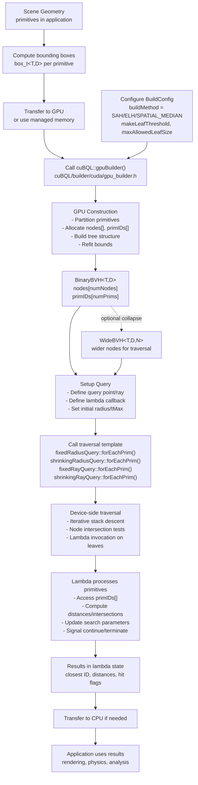

**Sources:** [README.md:123-169](), [README.md:193-248](), [cuBQL/bvh.h:1-161]()

### Key Data Structures in Flow

| Stage | Data Structure | Memory Location | Description |
|-------|----------------|-----------------|-------------|
| Input | `box_t<T,D>*` | Device or Managed | Array of primitive bounding boxes [cuBQL/bvh.h:63]() |
| Build Config | `BuildConfig` | Host | Algorithm selection and parameters [cuBQL/bvh.h:18-51]() |
| Construction Output | `BinaryBVH<T,D>` | Device | Binary tree with `nodes[]` and `primIDs[]` [cuBQL/bvh.h:58-100]() |
| Optional Output | `WideBVH<T,D,N>` | Device | N-ary tree collapsed from binary [cuBQL/bvh.h:104-134]() |
| Query Input | `vec_t<T,D>` or `ray_t<T>` | Device | Query origin and parameters |
| Query Logic | User lambda | Device | Callback function processing primitives |
| Query Output | Lambda state | Device | Results captured by lambda |

**Sources:** [cuBQL/bvh.h:18-134]()

---

## Key Design Principles

### Separation of Concerns

cuBQL's architecture enforces clear boundaries between layers:

- **Mathematical types** are independent of BVH structures
- **BVH data structures** are independent of construction algorithms
- **Builders** produce standardized BVH formats without knowledge of query patterns
- **Traversal templates** operate on BVH structures without knowledge of specific geometric operations
- **Geometric queries** combine traversal templates with domain-specific logic

This separation allows users to:
- Mix and match builders with traversal patterns
- Create custom queries without modifying core library code
- Use the same BVH for multiple query types

**Sources:** [README.md:30-61](), [README.md:193-221]()

### Template-Based Genericity

The entire library is built on C++ templates parameterized by:

- **T (scalar type)**: `float`, `double`, `int32_t`, `int64_t`, etc.
- **D (dimensionality)**: 2, 3, 4, or higher dimensions
- **N (BVH width)**: 4, 8, 16 children per node (for `WideBVH`)

This enables:
- Single implementation supporting multiple precision levels
- Same code for 2D, 3D, and higher-dimensional spaces
- Compile-time optimization for specific instantiations

Common type aliases reduce verbosity: `bvh3f` = `BinaryBVH<float,3>`, `vec3f` = `vec_t<float,3>`, `box3f` = `box_t<float,3>`.

**Sources:** [cuBQL/bvh.h:58-144](), [README.md:69-83]()

### Lambda-Based Customization

Traversal templates accept user-provided lambdas that define per-primitive operations. This pattern enables:

- **Code reuse**: Same traversal logic for different geometric operations
- **Performance**: Lambdas inline during compilation, avoiding function call overhead
- **Flexibility**: Users can capture local state, implement custom logic, and control termination

Example pattern from `shrinkingRadiusQuery`:
```cpp
auto lambda = [&closestDist, &closestID](int primID) -> float {
    // Custom per-primitive logic
    // Return new search radius
};
cuBQL::shrinkingRadiusQuery::forEachPrim(lambda, queryPoint, bvh, ...);
```

**Sources:** [README.md:223-248]()

### CPU/GPU Code Sharing

The `__cubql_both` macro (defined as `__host__ __device__` when compiling with CUDA) enables single-source code that executes on both CPU and GPU. Mathematical types, BVH structures, and traversal templates use this pattern extensively.

**Sources:** [cuBQL/bvh.h:9-11]()

### Header-Only Option with Pre-Built Targets

cuBQL supports two usage patterns:

1. **Header-only mode**: Define `CUBQL_GPU_BUILDER_IMPLEMENTATION=1` in one translation unit
2. **Pre-built libraries**: Link against targets like `cuBQL_cuda_float3` for specific instantiations

This flexibility allows users to control compilation flags, CUDA architectures, and link-time optimization while maintaining ease of integration.

**Sources:** [README.md:182-192](), [README.md:319-367]()

---

# Page: Four-Layer Design

# Four-Layer Design

<details>
<summary>Relevant source files</summary>

The following files were used as context for generating this wiki page:

- [README.md](README.md)
- [cuBQL/bvh.h](cuBQL/bvh.h)
- [cuBQL/traversal/rayQueries.h](cuBQL/traversal/rayQueries.h)

</details>


## Purpose and Scope

This document explains cuBQL's architectural organization into four distinct layers, detailing the responsibilities, dependencies, and code entities within each layer. The design enables modularity through clear separation of concerns, allowing users to build custom queries without modifying lower-level components.

For information about specific template parameterization and type aliases, see [Type System and Templates](#3.2). For CUDA-specific execution model details, see [CUDA Integration](#3.3).

## Architecture Overview

cuBQL implements a hierarchical four-layer architecture (with a foundational Layer 0) where each layer builds upon the abstractions provided by lower layers. This separation enables:

- **Reusability**: Core data structures and traversal patterns work across different query types
- **Extensibility**: New queries can be added without modifying BVH construction code
- **Type flexibility**: Template-based design supports multiple scalar types and dimensionalities
- **Performance**: Compile-time specialization eliminates runtime overhead

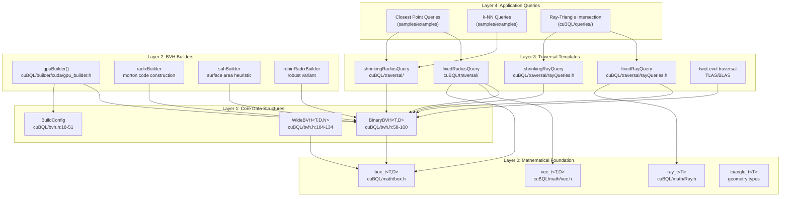

**Sources**: README.md:30-60, cuBQL/bvh.h, cuBQL/traversal/rayQueries.h

## Layer 0: Mathematical Foundation

The mathematical foundation layer provides template-based geometric primitives that work uniformly on CPU and GPU via the `__cubql_both` macro. These types form the basis for all spatial operations in higher layers.

### Core Mathematical Types

| Type | Purpose | Template Parameters | Key File |
|------|---------|-------------------|----------|
| `vec_t<T,D>` | Generic vectors | T=scalar type, D=dimensions | cuBQL/math/vec.h |
| `box_t<T,D>` | Axis-aligned bounding boxes | T=scalar type, D=dimensions | cuBQL/math/box.h |
| `ray_t<T>` | Ray representation | T=scalar type (3D assumed) | cuBQL/math/Ray.h |
| `triangle_t<T>` | Triangle geometry | T=scalar type | cuBQL/queries/triangles.h |
| `AffineSpaceT<L>` | Affine transformations | L=LinearSpace type | cuBQL/math/AffineSpace.h |

### Type Aliases for Common Use Cases

The library provides concrete type aliases to reduce verbosity:

```cpp
// From cuBQL/bvh.h:142-143
using bvh3f = BinaryBVH<float,3>;
using bvh3d = BinaryBVH<double,3>;

// Common vector types: vec2f, vec3f, vec4f, vec2d, vec3d, vec4d
// Common box types: box3f, box3d
// Common ray types: ray3f, Ray (alias for ray_t<float>)
```

All mathematical types support standard operations (addition, scalar multiplication, dot/cross products for vectors, intersection tests for boxes, etc.) and are designed for efficient GPU execution.

**Sources**: cuBQL/math/vec.h, cuBQL/math/box.h, cuBQL/math/Ray.h, cuBQL/bvh.h:142-143

## Layer 1: Core Data Structures

Layer 1 defines BVH storage formats and configuration parameters. These structures are generic containers that make no assumptions about construction or traversal algorithms.

### BinaryBVH Structure

The primary BVH type is `BinaryBVH<T,D>`, defined in [cuBQL/bvh.h:58-100](). Each node contains:

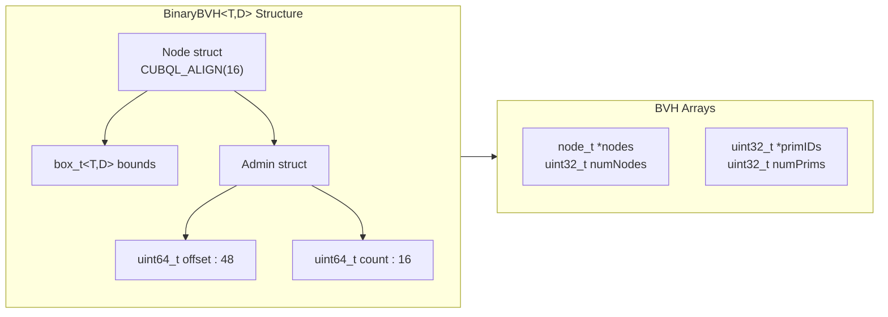

**Node Admin Field Semantics** ([cuBQL/bvh.h:72-89]()):
- **Inner nodes**: `count == 0`, `offset` indexes into `nodes[]` array. Children at `nodes[offset+0]` and `nodes[offset+1]`.
- **Leaf nodes**: `count > 0`, `offset` indexes into `primIDs[]` array. Contains `primIDs[offset]` through `primIDs[offset+count-1]`.

The design uses a single `uint64_t` for both fields to enable atomic read/write operations during construction.

### WideBVH Structure

`WideBVH<T,D,N>` ([cuBQL/bvh.h:104-134]()) stores N-ary trees with fixed branching factor `N`:

```cpp
template<typename T, int D, int N>
struct WideBVH {
    struct Node {
        struct Child {
            box_t<T,D> bounds;
            uint64_t valid  :  1;  // Is this child slot used?
            uint64_t offset : 45;  // Index into nodes[] or primIDs[]
            uint64_t count  : 16;  // Prim count if leaf, 0 if inner
        } children[N];  // Fixed-size array
    };
    
    Node *nodes;        // Multi-node array
    uint32_t numNodes;  // Count of N-wide nodes
    uint32_t *primIDs;
    uint32_t numPrims;
};
```

Wide BVHs are typically created by collapsing binary BVHs, improving cache efficiency and SIMD utilization during traversal.

### BuildConfig

`BuildConfig` ([cuBQL/bvh.h:18-51]()) controls builder behavior:

| Field | Type | Purpose | Default |
|-------|------|---------|---------|
| `buildMethod` | enum | Algorithm selection: SPATIAL_MEDIAN, SAH, ELH | SPATIAL_MEDIAN |
| `maxAllowedLeafSize` | int | Maximum primitives per leaf | 32768 |
| `makeLeafThreshold` | int | Force leaf creation below this count (0=auto) | 0 |

**Sources**: cuBQL/bvh.h:18-134, README.md:64-98

## Layer 2: BVH Builders

The builder layer provides multiple construction algorithms with different speed/quality tradeoffs. All builders consume arrays of bounding boxes and produce populated BVH structures.

### Builder Dispatcher

The `gpuBuilder()` function ([cuBQL/builder/cuda/gpu_builder.h]()) acts as the primary interface:

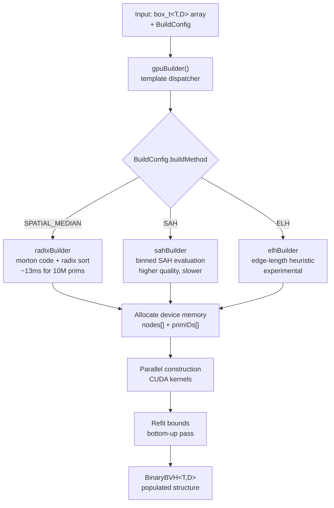

### Builder Characteristics

| Builder | Algorithm | Build Speed | Query Quality | Use Case |
|---------|-----------|-------------|---------------|----------|
| `radixBuilder` | Morton code spatial median | Fast (~13ms/10M) | Good | General purpose |
| `sahBuilder` | Surface area heuristic | Slow | Excellent | Ray tracing |
| `rebinRadixBuilder` | Robust spatial median | Medium | Good | Numerically challenging data |
| `wideGpuBuilder` | N-ary construction | Medium | Good | Wide BVH output |

All builders properly handle invalid primitives (boxes where `lower.x > upper.x`) by excluding them from the BVH structure ([README.md:154-162]()).

### Memory Management

Builders accept an optional `GpuMemoryResource` parameter to control allocation strategy:
- Default: Standard `cudaMalloc`/`cudaFree`
- Managed memory: `cudaMallocManaged`
- Async allocation: Stream-ordered memory pools

**Sources**: cuBQL/builder/cuda/gpu_builder.h, README.md:106-169, cuBQL/bvh.h:18-51

## Layer 3: Traversal Templates

Traversal templates implement generic BVH descent algorithms that accept user-provided lambda functions to customize per-primitive processing. This enables a single traversal implementation to support multiple query types.

### Template Categories

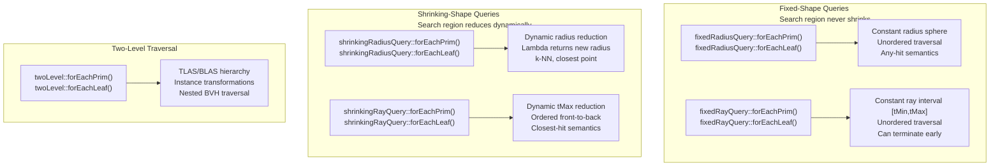

### Traversal Stack-Based Implementation

All templates use iterative stack-based descent ([cuBQL/traversal/rayQueries.h:255-315]()):

```cpp
// Simplified structure from fixedRayQuery::forEachLeaf
typename node_t::Admin traversalStack[64], *stackPtr = traversalStack;
typename node_t::Admin node = bvh.nodes[0].admin;

while (true) {
    // Descend through inner nodes
    while (node.count == 0) {  // Inner node
        // Test both children, push to stack if needed
        if (intersects(child0)) {
            if (intersects(child1))
                *stackPtr++ = child1.admin;  // Push deferred child
            node = child0.admin;
        } else if (intersects(child1)) {
            node = child1.admin;
        } else {
            break;  // Dead end
        }
    }
    
    // Process leaf
    if (node.count != 0)
        lambdaResult = lambda(bvh.primIDs + node.offset, node.count);
    
    // Pop next node
    if (stackPtr == traversalStack) return;
    node = *--stackPtr;
}
```

### Lambda Function Contracts

| Template | Lambda Signature | Return Value | Purpose |
|----------|-----------------|--------------|---------|
| Fixed radius (prim) | `int operator()(uint32_t primID)` | `CUBQL_CONTINUE_TRAVERSAL` or `CUBQL_TERMINATE_TRAVERSAL` | Test single primitive |
| Fixed radius (leaf) | `int operator()(const uint32_t* prims, size_t count)` | Continue/terminate | Process leaf batch |
| Shrinking radius | `float operator()(uint32_t primID)` | New search radius | Update search distance |
| Shrinking ray | `float operator()(uint32_t primID)` | New `ray.tMax` | Update ray interval |

### Two-Level Traversal

Two-level queries ([cuBQL/traversal/rayQueries.h:97-147, 440-651]()) require three lambdas:

```cpp
shrinkingRayQuery::twoLevel::forEachPrim(
    enterBlas,    // Transform ray into instance space, return BLAS
    leaveBlas,    // Restore state after BLAS traversal
    intersectPrim, // Per-primitive intersection test
    tlas,         // Top-level BVH
    ray           // Ray reference (modified by enterBlas)
);
```

The traversal saves/restores ray state when transitioning between TLAS and BLAS levels, enabling correct handling of instance transformations.

**Sources**: cuBQL/traversal/rayQueries.h:18-651, README.md:193-247

## Layer 4: Application Queries

Application-level queries combine traversal templates with specific geometric operations. These serve primarily as examples and can be customized or replaced.

### Example Query Implementations

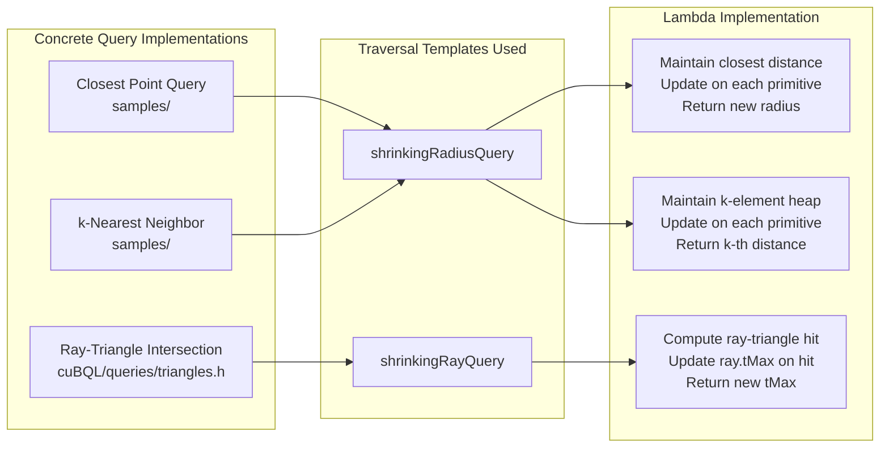

### Closest Point Query Pattern

```cpp
// Conceptual example from README.md:254-266
void findClosestPoint(bvh3f bvh, vec3f* points, vec3f queryPoint) {
    float closestDist = INFINITY;
    int   closestID   = -1;
    
    auto lambda = [&](uint32_t primID) -> float {
        float dist = distance(queryPoint, points[primID]);
        if (dist < closestDist) {
            closestDist = dist;
            closestID = primID;
        }
        return closestDist;  // New search radius
    };
    
    shrinkingRadiusQuery::forEachPrim(lambda, queryPoint, bvh, ...);
}
```

The same pattern works for:
- Point-to-triangle distance (different distance function)
- Different scalar types (`float`, `double`)
- Different dimensionalities (2D, 3D, 4D)

**Sources**: README.md:254-280, cuBQL/queries/triangles.h

## Separation of Concerns and Benefits

### Architectural Advantages

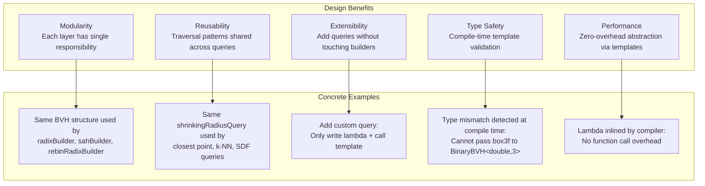

### Layer Independence

Each layer can evolve independently:

- **Layer 0**: Add new mathematical primitives (e.g., oriented bounding boxes) without affecting BVH structures
- **Layer 1**: Modify BVH node layout for better alignment without changing builders or traversal
- **Layer 2**: Implement new build algorithms (e.g., LBVH, HLBVH) without modifying traversal code
- **Layer 3**: Add specialized traversal patterns (e.g., frustum culling) without changing queries
- **Layer 4**: Create application-specific queries without touching library internals

### Build Once, Query Many Times

The separation between Layers 2 and 3 enables efficient workflows ([README.md:102-169]()):

```mermaid
graph LR
    Build["Build Phase<br/>Layer 2<br/>~13ms for 10M prims"]
    BVH["BinaryBVH<br/>Layer 1<br/>Persistent structure"]
    Q1["Query 1<br/>Closest point<br/>Layer 3+4"]
    Q2["Query 2<br/>k-NN<br/>Layer 3+4"]
    Q3["Query N<br/>Custom<br/>Layer 3+4"]
    
    Build --> BVH
    BVH --> Q1
    BVH --> Q2
    BVH --> Q3
```

A single BVH construction supports unlimited queries of any type, amortizing build costs across many operations.

**Sources**: README.md:30-60, 193-247, cuBQL/bvh.h, cuBQL/traversal/rayQueries.h

## Summary

cuBQL's four-layer architecture separates concerns across:

1. **Layer 0 (Math)**: Generic, dimension-agnostic geometric primitives
2. **Layer 1 (Data)**: Type-parameterized BVH storage formats
3. **Layer 2 (Build)**: Multiple construction algorithms with quality/speed tradeoffs
4. **Layer 3 (Traversal)**: Generic query patterns customizable via lambdas
5. **Layer 4 (Queries)**: Application-specific implementations as examples

This design enables users to leverage existing builders and traversal templates while implementing custom query logic, maintaining type safety and performance through C++ templates and compile-time specialization.

**Sources**: README.md:30-60, cuBQL/bvh.h, cuBQL/traversal/rayQueries.h, cuBQL/builder/cuda/gpu_builder.h

---

# Page: Type System and Templates

# Type System and Templates

<details>
<summary>Relevant source files</summary>

The following files were used as context for generating this wiki page:

- [cuBQL/bvh.h](cuBQL/bvh.h)
- [cuBQL/math/box.h](cuBQL/math/box.h)
- [cuBQL/math/common.h](cuBQL/math/common.h)
- [cuBQL/math/vec.h](cuBQL/math/vec.h)

</details>


## Purpose and Scope

This page documents cuBQL's compile-time type system, which is built on C++ templates to provide flexible, type-safe spatial data structures that work across CPU and GPU. The system is parameterized by three primary axes: coordinate type (T), dimensionality (D), and BVH node width (N). This design enables users to instantiate BVH structures with different numeric precisions, spatial dimensions, and tree arities while maintaining a single codebase.

For details on how these types integrate with CUDA execution, see [CUDA Integration](#3.3). For the mathematical operations defined on these types, see [Mathematical Foundation](#4). For the BVH data structures built on this type system, see [Core Data Structures](#5).

---

## Template Parameterization Axes

cuBQL's type system is organized around three independent template parameters that control compile-time specialization:

| Parameter | Symbol | Common Values | Purpose |
|-----------|--------|---------------|---------|
| **Coordinate Type** | `T` | `float`, `double`, `int32_t`, `int64_t`, `uint32_t`, `uint64_t` | Determines numeric precision and range |
| **Dimensionality** | `D` | `2`, `3`, `4` (arbitrary positive integers supported) | Number of spatial dimensions |
| **BVH Width** | `N` | `4`, `8`, `16` | Number of children per node in wide BVHs |

### Coordinate Type (T)

The scalar type parameter controls both precision and performance characteristics:

- **Floating-point types** (`float`, `double`): Used for continuous spatial queries, ray tracing, and geometric operations requiring fractional coordinates
- **Integer types** (`int32_t`, `int64_t`): Used for grid-based structures, voxel representations, and exact arithmetic
- **Unsigned types** (`uint32_t`, `uint64_t`): Used for morton code computation and memory-efficient indexing

The type system handles type-specific behaviors through template specialization. For example, empty box initialization uses type-appropriate sentinel values: `+/-∞` for floating-point types, `INT_MAX/INT_MIN` for integers.

**Sources:** [cuBQL/math/vec.h:31-36](), [cuBQL/math/box.h:13-26]()

### Dimensionality (D)

The dimensionality parameter allows BVH construction in arbitrary dimensions:

- **2D** (`D=2`): Used for planar geometric queries, image processing, 2D collision detection
- **3D** (`D=3`): Most common case for 3D graphics, physics simulations, point clouds
- **4D and higher**: Supported for specialized applications (e.g., spacetime queries, high-dimensional embedding spaces)

Dimension-specific optimizations are provided through template specialization for `D=2,3,4` while maintaining generic implementations for arbitrary dimensions.

**Sources:** [cuBQL/math/vec.h:77-119](), [cuBQL/bvh.h:58-61]()

### BVH Width (N)

The node width parameter applies only to `WideBVH` structures and controls the branching factor:

- **Narrow trees** (`N=4`): Lower memory overhead, better cache locality for small working sets
- **Wide trees** (`N=8,16`): Better SIMD utilization, reduced tree depth, higher traversal throughput

Binary BVHs implicitly use `N=2` (represented by the `BinaryBVH` template, which does not expose N as a parameter).

**Sources:** [cuBQL/bvh.h:104-112]()

---

## Core Template Types

### Vector Type: `vec_t<T,D>`

The fundamental building block for spatial coordinates and directions.

```mermaid
graph TB
    subgraph "vec_t Template Structure"
        VecT["vec_t&lt;T,D&gt;<br/>Primary template"]
        VecData["vec_t_data&lt;T,D&gt;<br/>Storage layer"]
        
        VecT2["vec_t&lt;T,2&gt;<br/>2D specialization"]
        VecT3["vec_t&lt;T,3&gt;<br/>3D specialization"]
        VecT4["vec_t&lt;T,4&gt;<br/>4D specialization"]
        
        VecData2["vec_t_data&lt;T,2&gt;<br/>T x, y"]
        VecData3["vec_t_data&lt;T,3&gt;<br/>T x, y, z"]
        VecData4["vec_t_data&lt;T,4&gt;<br/>T x, y, z, w"]
        VecDataN["vec_t_data&lt;T,D&gt;<br/>T v[D]"]
    end
    
    VecT -.inherits.-> VecData
    VecT2 -.inherits.-> VecData2
    VecT3 -.inherits.-> VecData3
    VecT4 -.inherits.-> VecData4
    
    VecData2 -.specializes.-> VecDataN
    VecData3 -.specializes.-> VecDataN
    VecData4 -.specializes.-> VecDataN
```

**Key Design Elements:**

1. **Two-tier structure:** `vec_t_data<T,D>` provides storage, `vec_t<T,D>` adds operations and constructors
2. **Specialized storage for D=2,3,4:** Named fields (`x`, `y`, `z`, `w`) instead of array indexing for better code generation and debuggability
3. **Generic fallback:** Array-based storage `T v[D]` for arbitrary dimensions
4. **Component access:** Both array indexing `operator[]` and named accessors (`x`, `y`, `z`, `w`)

**Sources:** [cuBQL/math/vec.h:31-226]()

### Bounding Box Type: `box_t<T,D>`

Axis-aligned bounding boxes represented as pairs of corner vectors.

```mermaid
graph LR
    subgraph "box_t Structure"
        BoxT["box_t&lt;T,D&gt;"]
        BoxPOD["box_t_pod&lt;T,D&gt;<br/>Data-only layer"]
        Lower["vec_t&lt;T,D&gt; lower"]
        Upper["vec_t&lt;T,D&gt; upper"]
    end
    
    BoxT -.inherits.-> BoxPOD
    BoxPOD --> Lower
    BoxPOD --> Upper
```

**Empty Box Semantics:**

Empty boxes are represented by having `lower > upper` in any dimension. Type-specific sentinel values are used:

- **Floating-point:** `lower = +∞`, `upper = -∞`
- **Integer:** `lower = TYPE_MAX`, `upper = TYPE_MIN`

This representation allows empty boxes to be detected with a single comparison and ensures that extending an empty box with any point produces the correct result.

**Sources:** [cuBQL/math/box.h:33-174]()

### BVH Types: `BinaryBVH<T,D>` and `WideBVH<T,D,N>`

```mermaid
graph TB
    subgraph "BVH Template Hierarchy"
        BinaryBVH["BinaryBVH&lt;T,D&gt;<br/>Binary tree structure"]
        WideBVH["WideBVH&lt;T,D,N&gt;<br/>N-ary tree structure"]
        
        BinaryNode["BinaryBVH::Node<br/>box_t&lt;T,D&gt; bounds<br/>Admin admin"]
        WideNode["WideBVH::Node<br/>Child children[N]"]
        
        BinaryAdmin["Admin struct<br/>uint64 offset:48<br/>uint64 count:16"]
        WideChild["Child struct<br/>box_t&lt;T,D&gt; bounds<br/>uint64 valid:1<br/>uint64 offset:45<br/>uint64 count:16"]
    end
    
    BinaryBVH --> BinaryNode
    WideBVH --> WideNode
    BinaryNode --> BinaryAdmin
    WideNode --> WideChild
```

**Key Characteristics:**

| Feature | BinaryBVH | WideBVH |
|---------|-----------|---------|
| Children per node | 2 (implicit) | N (template parameter) |
| Node alignment | 16 bytes | 16 bytes |
| Offset field width | 48 bits | 45 bits |
| Count field width | 16 bits | 16 bits |
| Max leaf size | 65,535 primitives | 65,535 primitives |

**Sources:** [cuBQL/bvh.h:58-134]()

---

## Type Aliases and Conventions

cuBQL provides convenient type aliases for common instantiations, reducing verbosity and standardizing usage patterns.

### Vector Type Aliases

```mermaid
graph TB
    subgraph "Float Vector Aliases"
        vec2f["vec2f = vec_t&lt;float,2&gt;"]
        vec3f["vec3f = vec_t&lt;float,3&gt;"]
        vec4f["vec4f = vec_t&lt;float,4&gt;"]
    end
    
    subgraph "Double Vector Aliases"
        vec2d["vec2d = vec_t&lt;double,2&gt;"]
        vec3d["vec3d = vec_t&lt;double,3&gt;"]
        vec4d["vec4d = vec_t&lt;double,4&gt;"]
    end
    
    subgraph "Integer Vector Aliases"
        vec2i["vec2i = vec_t&lt;int32_t,2&gt;"]
        vec3i["vec3i = vec_t&lt;int32_t,3&gt;"]
        vec4i["vec4i = vec_t&lt;int32_t,4&gt;"]
        
        vec2ui["vec2ui = vec_t&lt;uint32_t,2&gt;"]
        vec3ui["vec3ui = vec_t&lt;uint32_t,3&gt;"]
        vec4ui["vec4ui = vec_t&lt;uint32_t,4&gt;"]
        
        vec2l["vec2l = vec_t&lt;int64_t,2&gt;"]
        vec3l["vec3l = vec_t&lt;int64_t,3&gt;"]
        vec4l["vec4l = vec_t&lt;int64_t,4&gt;"]
        
        vec2ul["vec2ul = vec_t&lt;uint64_t,2&gt;"]
        vec3ul["vec3ul = vec_t&lt;uint64_t,3&gt;"]
        vec4ul["vec4ul = vec_t&lt;uint64_t,4&gt;"]
    end
```

**Naming Convention:** `vec{D}{type_suffix}` where:
- `D` = dimensionality (2, 3, or 4)
- `type_suffix` = `f` (float), `d` (double), `i` (int32), `ui` (uint32), `l` (int64), `ul` (uint64)

**Sources:** [cuBQL/math/vec.h:228-251]()

### Bounding Box Type Aliases

| Alias | Full Type | Description |
|-------|-----------|-------------|
| `box2f` | `box_t<float,2>` | 2D single-precision box |
| `box3f` | `box_t<float,3>` | 3D single-precision box |
| `box4f` | `box_t<float,4>` | 4D single-precision box |
| `box2d` | `box_t<double,2>` | 2D double-precision box |
| `box3d` | `box_t<double,3>` | 3D double-precision box |
| `box4d` | `box_t<double,4>` | 4D double-precision box |
| `box2i` | `box_t<int,2>` | 2D integer box |
| `box3i` | `box_t<int,3>` | 3D integer box |
| `box4i` | `box_t<int,4>` | 4D integer box |
| `box2l` | `box_t<long long,2>` | 2D 64-bit integer box |
| `box3l` | `box_t<long long,3>` | 3D 64-bit integer box |
| `box4l` | `box_t<long long,4>` | 4D 64-bit integer box |

**Sources:** [cuBQL/math/box.h:176-191]()

### BVH Type Aliases

```mermaid
graph LR
    subgraph "Primary BVH Aliases"
        bvh3f["bvh3f = BinaryBVH&lt;float,3&gt;"]
        bvh3d["bvh3d = BinaryBVH&lt;double,3&gt;"]
        bvh_t["bvh_t&lt;T,D&gt; = BinaryBVH&lt;T,D&gt;"]
    end
    
    subgraph "CUDA-specific Aliases (when __CUDACC__ defined)"
        bvh_float2["bvh_float2 = BinaryBVH&lt;float,2&gt;"]
        bvh_float3["bvh_float3 = BinaryBVH&lt;float,3&gt;"]
        bvh_float4["bvh_float4 = BinaryBVH&lt;float,4&gt;"]
    end
```

**Most Common Alias:** `bvh3f` is the canonical type for 3D single-precision BVHs, used in the majority of examples and applications.

**Sources:** [cuBQL/bvh.h:137-149]()

---

## CUDA Integration and Cross-Compilation

### The `__cubql_both` Macro

cuBQL uses a unified macro system to enable single-source code that compiles for both CPU (host) and GPU (device):

```mermaid
graph TB
    subgraph "Macro Resolution"
        CUDACC{"Compiler is<br/>__CUDACC__ or __HIPCC__?"}
        HOST["__cubql_host = __host__"]
        DEVICE["__cubql_device = __device__"]
        BOTH["__cubql_both =<br/>__host__ __device__"]
        
        NOOP_HOST["__cubql_host = /* empty */"]
        NOOP_DEVICE["__cubql_device = /* empty */"]
        NOOP_BOTH["__cubql_both = /* empty */"]
    end
    
    CUDACC -->|Yes| HOST
    CUDACC -->|Yes| DEVICE
    CUDACC -->|Yes| BOTH
    
    CUDACC -->|No| NOOP_HOST
    CUDACC -->|No| NOOP_DEVICE
    CUDACC -->|No| NOOP_BOTH
```

**Usage Pattern:**

All fundamental operations (constructors, operators, mathematical functions) are declared with `__cubql_both`, enabling them to be called from:
- Host code (CPU-side)
- Device code (GPU kernels)
- Device-callable host code (when compiling with `nvcc`)

**Example from codebase:**

```cpp
inline __cubql_both vec_t(const T &t) { x = y = z = t; }
inline __cubql_both vec_t &grow(const vec_t &v) { /*...*/ }
inline __cubql_both bool overlaps(const box_t<T,D> &other) const { /*...*/ }
```

**Sources:** [cuBQL/math/common.h:84-95]()

### CUDA Vector Type Conversions

When `CUBQL_SUPPORT_CUDA_VECTOR_TYPES` is enabled (set to `1`), cuBQL provides automatic conversions between its vector types and CUDA's built-in vector types (`float2`, `float3`, `float4`, `int2`, etc.).

```mermaid
graph TB
    subgraph "Conversion System"
        DEFINE["CUBQL_SUPPORT_CUDA_VECTOR_TYPES"]
        
        ENABLED{"Value = 1?"}
        
        TRAIT["cuda_eq_t&lt;T,D&gt;::type<br/>Template trait"]
        
        CONV_TO["operator cuda_t()<br/>cuBQL → CUDA"]
        CONV_FROM["vec_t(cuda_t)<br/>CUDA → cuBQL"]
        
        NO_CONV["cuda_eq_t&lt;T,D&gt;::type = invalid_t<br/>No conversion available"]
    end
    
    DEFINE --> ENABLED
    ENABLED -->|Yes| TRAIT
    TRAIT --> CONV_TO
    TRAIT --> CONV_FROM
    
    ENABLED -->|No| NO_CONV
```

**Supported Conversions:**

| cuBQL Type | CUDA Type | Condition |
|------------|-----------|-----------|
| `vec_t<float,2>` | `float2` | Always when enabled |
| `vec_t<float,3>` | `float3` | Always when enabled |
| `vec_t<float,4>` | `float4` | Always when enabled |
| `vec_t<int,2>` | `int2` | Always when enabled |
| `vec_t<int,3>` | `int3` | Always when enabled |
| `vec_t<int,4>` | `int4` | Always when enabled |
| `vec_t<double,2>` | `double2` | Always when enabled |
| `vec_t<double,3>` | `double3` | Always when enabled |
| `vec_t<double,4>` | `double4` | Always when enabled |
| Other `vec_t<T,D>` | `invalid_t` | No conversion |

**Conversion Implementation:**

The conversion operators are implemented in the `vec_t_data` specializations for D=2,3,4:

```cpp
// Automatic conversion TO CUDA type
using cuda_t = typename cuda_eq_t<T,3>::type;
inline __cubql_both operator cuda_t() { 
    cuda_t t; 
    t.x = x; 
    t.y = y; 
    t.z = z; 
    return t; 
}

// Construction FROM CUDA type
inline __cubql_both vec_t(const cuda_t &o) 
{ this->x = (o.x); this->y = (o.y); this->z = (o.z); }
```

**dim3 Conversion:**

Vector types of dimensionality 2 and 3 can be automatically converted to CUDA's `dim3` type (used for kernel launch configurations):

```cpp
inline __cubql_both operator dim3() { 
    dim3 t; 
    t.x = x; 
    t.y = y; 
    t.z = z; 
    return t; 
}
```

This allows code like:
```cpp
vec3i blockDim(16, 16, 1);
myKernel<<<gridDim, blockDim>>>(...);  // Implicit conversion
```

**Sources:** [cuBQL/math/vec.h:27-29](), [cuBQL/math/vec.h:63-74](), [cuBQL/math/vec.h:82-105]()

### Host-Only CUDA Type Definitions

When compiling without CUDA (`__CUDACC__` not defined), cuBQL provides minimal stub definitions for CUDA vector types to maintain source compatibility:

```cpp
#ifndef __CUDACC__
struct float2 { float x, y; };
struct float3 { float x, y, z; };
struct CUBQL_ALIGN(16) float4 { float x, y, z, w; };
// ... similar for int2, int3, int4, double2, double3, double4
#endif
```

This enables code to be compiled and tested on CPU-only systems without CUDA toolkit installation.

**Sources:** [cuBQL/math/vec.h:49-61]()

---

## Type Traits and Metaprogramming

cuBQL uses C++ template metaprogramming to provide compile-time type introspection and selection.

### Vector Traits: `vec_traits<T>`

The `vec_traits` template provides compile-time information about vector-like types:

```mermaid
graph TB
    subgraph "vec_traits Resolution"
        VecTraits["vec_traits&lt;T&gt;"]
        
        OurVec["our_vec_t_traits&lt;vec_t&gt;<br/>For cuBQL vectors"]
        CustomTrait["Specializations<br/>For external types"]
        
        ScalarType["using scalar_t = typename T::scalar_t"]
        NumDims["enum { numDims = T::numDims }"]
        
        Float3Trait["vec_traits&lt;float3&gt;<br/>scalar_t = float<br/>numDims = 3"]
    end
    
    VecTraits -.default.-> OurVec
    VecTraits -.specialized.-> CustomTrait
    
    OurVec --> ScalarType
    OurVec --> NumDims
    
    CustomTrait --> Float3Trait
```

**Purpose:** Allows generic code to introspect vector properties without assuming the vector type is `vec_t<T,D>`.

**Example Usage:**
```cpp
template<typename VecType>
void processVector(VecType v) {
    using Scalar = typename vec_traits<VecType>::scalar_t;
    constexpr int Dims = vec_traits<VecType>::numDims;
    // ... generic code using Scalar and Dims
}
```

**Sources:** [cuBQL/math/vec.h:267-282]()

### Dot Product Result Type: `dot_result_t<T>`

To avoid integer overflow and maintain precision, the dot product operation uses a type promotion system:

| Input Scalar Type | Dot Product Result Type |
|-------------------|-------------------------|
| `float` | `float` |
| `double` | `double` |
| `int32_t` | `int64_t` |
| `long long int` | `int64_t` |

**Rationale:** Integer dot products can overflow when multiplying and summing components. Promoting to 64-bit integers prevents this for most practical cases.

**Implementation:**
```cpp
template<typename T> struct dot_result_t;
template<> struct dot_result_t<float> { using type = float; };
template<> struct dot_result_t<double> { using type = double; };
template<> struct dot_result_t<int32_t> { using type = int64_t; };
```

**Sources:** [cuBQL/math/vec.h:546-560]()

### Real Number Detection: `is_real<T>`

Used to enable or disable certain operations (like normalization, distance computation) that only make sense for floating-point types:

```cpp
template<typename T> struct is_real { enum { value = false }; };
template<> struct is_real<float> { enum { value = true }; };
template<> struct is_real<double> { enum { value = true }; };
```

**Sources:** [cuBQL/math/common.h:296-298]()

---

## Template Instantiation Strategy

cuBQL uses explicit template instantiation in some compilation units to reduce compile times while maintaining flexibility for custom types.

**Key Types Pre-Instantiated:**

The library pre-compiles common instantiations in object files to avoid recompiling template code in every translation unit:

- `BinaryBVH<float,2>`, `BinaryBVH<float,3>`, `BinaryBVH<float,4>`
- `BinaryBVH<double,2>`, `BinaryBVH<double,3>`, `BinaryBVH<double,4>`
- Builder algorithms for these types
- Traversal templates for these types

**User-Defined Types:**

Users can still instantiate templates with custom types by including the header-only implementations. The library structure allows both:
1. **Pre-compiled library:** Fast linking for common types
2. **Header-only mode:** Full flexibility for custom type instantiations

For more details on custom type support and instantiation patterns, see [Template Instantiation](#9.3).

**Sources:** [cuBQL/bvh.h:145-149]()

---

## Summary Table: Complete Type Hierarchy

| Category | Template | Common Aliases | Purpose |
|----------|----------|----------------|---------|
| **Vectors** | `vec_t<T,D>` | `vec2f`, `vec3f`, `vec4f`, `vec3d`, `vec3i` | Spatial coordinates, directions |
| **Boxes** | `box_t<T,D>` | `box2f`, `box3f`, `box4f`, `box3d`, `box3i` | Axis-aligned bounding volumes |
| **Binary BVH** | `BinaryBVH<T,D>` | `bvh3f`, `bvh3d`, `bvh_t<T,D>` | Binary tree acceleration structure |
| **Wide BVH** | `WideBVH<T,D,N>` | *(no standard aliases)* | N-ary tree for SIMD optimization |
| **Rays** | `ray_t<T>` | `ray3f`, `Ray` | Ray geometry for intersection tests |
| **Triangles** | `triangle_t<T>` | `Triangle` | Triangle primitives |
| **Transforms** | `AffineSpaceT<L>` | *(various)* | Affine transformations |

**Sources:** [cuBQL/math/vec.h](), [cuBQL/math/box.h](), [cuBQL/bvh.h]()

---

# Page: CUDA Integration

# CUDA Integration

<details>
<summary>Relevant source files</summary>

The following files were used as context for generating this wiki page:

- [cuBQL/builder/cuda/builder_common.h](cuBQL/builder/cuda/builder_common.h)
- [cuBQL/math/box.h](cuBQL/math/box.h)
- [cuBQL/math/common.h](cuBQL/math/common.h)
- [cuBQL/math/vec.h](cuBQL/math/vec.h)

</details>


## Purpose and Scope

This document describes how cuBQL integrates with CUDA to enable single-source code that compiles for both CPU and GPU execution. It covers the `__cubql_both` macro for dual-target compilation, automatic conversions between cuBQL vector types and CUDA built-in types (float3, int4, etc.), and the execution model that allows the same mathematical primitives to run on host or device.

For information about the broader template-based type system, see [Type System and Templates](#3.2). For details on GPU memory management and builder kernels, see [GPU Builder Interface](#6.1).

---

## The `__cubql_both` Macro

The core of cuBQL's CUDA integration is the `__cubql_both` macro, which enables mathematical functions and data structures to compile for both CPU and GPU execution without code duplication.

### Macro Definition

The macro is conditionally defined based on the compiler:

```
__cubql_both = __host__ __device__   (when __CUDACC__ or __HIPCC__ defined)
__cubql_both = /* ignore */          (otherwise)
```

**Sources:** [cuBQL/math/common.h:84-95]()

### Single-Source Compilation Strategy

When compiling with `nvcc` or `hipcc`, the macro expands to `__host__ __device__`, instructing the compiler to generate code for both CPU and GPU targets. When compiling with a standard C++ compiler (e.g., g++, clang++), the macro expands to nothing, allowing the same source to compile as regular CPU code.

```mermaid
graph TB
    subgraph "Source Code"
        SRC["inline __cubql_both<br/>vec_t<T,D> operator+(vec_t<T,D> a, vec_t<T,D> b)"]
    end
    
    subgraph "NVCC/HIPCC Compilation"
        NVCC["Preprocessor"]
        BOTH1["__host__ __device__<br/>vec_t<T,D> operator+(...)"]
        HOST["Host Code<br/>(x86/ARM binary)"]
        DEV["Device Code<br/>(PTX/CUBIN)"]
        
        NVCC --> BOTH1
        BOTH1 --> HOST
        BOTH1 --> DEV
    end
    
    subgraph "Standard C++ Compilation"
        GCC["Preprocessor"]
        BOTH2["vec_t<T,D> operator+(...)"]
        CPU["CPU-only Binary"]
        
        GCC --> BOTH2
        BOTH2 --> CPU
    end
    
    SRC --> NVCC
    SRC --> GCC
```

This strategy enables:
- Zero-overhead CPU execution for testing and non-GPU platforms
- GPU acceleration when CUDA/HIP is available
- No `#ifdef` clutter in mathematical code
- Compile-time verification that algorithms work on both targets

**Sources:** [cuBQL/math/common.h:84-95](), [cuBQL/math/vec.h:31-162]()

### Usage Patterns in the Codebase

The macro decorates:

| Code Category | Example | Location |
|--------------|---------|----------|
| Vector operations | `__cubql_both vec_t<T,D> operator+(vec_t<T,D> a, vec_t<T,D> b)` | [cuBQL/math/vec.h:355-391]() |
| Bounding box methods | `__cubql_both box_t &grow(const vec_t &v)` | [cuBQL/math/box.h:97-100]() |
| Geometric queries | `__cubql_both T reduce_max(vec_t<T,3> v)` | [cuBQL/math/vec.h:675-677]() |
| Utility functions | `__cubql_both int32_t divRoundUp(int32_t a, int32_t b)` | [cuBQL/math/common.h:197-200]() |

**Sources:** [cuBQL/math/vec.h:1-804](), [cuBQL/math/box.h:1-262](), [cuBQL/math/common.h:197-200]()

---

## Device and Host Execution Model

cuBQL distinguishes between three execution contexts through compiler-specific decorators:

```mermaid
graph LR
    subgraph "Decorator Definitions"
        BOTH["__cubql_both<br/>= __host__ __device__"]
        HOST["__cubql_host<br/>= __host__"]
        DEVICE["__cubql_device<br/>= __device__"]
    end
    
    subgraph "Execution Contexts"
        CPU["CPU<br/>(host code)"]
        GPU["GPU<br/>(device code)"]
        KERNEL["CUDA Kernel<br/>(device-only)"]
    end
    
    BOTH --> CPU
    BOTH --> GPU
    HOST --> CPU
    DEVICE --> GPU
    DEVICE --> KERNEL
```

### Decorator Semantics

| Decorator | CPU Callable | GPU Callable | Use Case |
|-----------|-------------|-------------|----------|
| `__cubql_both` | ✓ | ✓ | Math primitives, data structure methods |
| `__cubql_host` | ✓ | ✗ | Host-only APIs, file I/O, C++ standard library |
| `__cubql_device` | ✗ | ✓ | GPU-only operations, shared memory access |

**Sources:** [cuBQL/math/common.h:84-95]()

### Device-Only Code Patterns

Builder kernels and traversal operations use `__device__` (via `__cubql_device`) for GPU-exclusive code:

```mermaid
graph TB
    subgraph "Host Code"
        API["gpuBuilder(...)"]
        LAUNCH["cudaLaunchKernel"]
    end
    
    subgraph "Device Code"
        KERNEL["__global__ void buildKernel"]
        ATOMIC["__device__ void atomic_min<br/>AtomicBox operations"]
        ENCODE["__device__ int32_t encode(float)"]
        DECODE["__device__ float decode(int32_t)"]
    end
    
    API --> LAUNCH
    LAUNCH --> KERNEL
    KERNEL --> ATOMIC
    KERNEL --> ENCODE
    ATOMIC --> DECODE
```

Examples of device-only functions:

| Function | Purpose | Location |
|----------|---------|----------|
| `atomic_min`, `atomic_max` | Lock-free bounding box updates | [cuBQL/builder/cuda/builder_common.h:20-36]() |
| `encode<T>`, `decode<T>` | Floating-point to integer conversion for atomics | [cuBQL/builder/cuda/builder_common.h:84-143]() |
| `atomic_grow` | Concurrent bounding box expansion | [cuBQL/builder/cuda/builder_common.h:248-294]() |

**Sources:** [cuBQL/builder/cuda/builder_common.h:20-143]()

---

## CUDA Vector Type Conversions

When `CUBQL_SUPPORT_CUDA_VECTOR_TYPES=1`, cuBQL vector types can automatically convert to and from CUDA's built-in vector types (`float2`, `float3`, `int4`, etc.).

### Conditional Compilation Flag

```cpp
#ifndef CUBQL_SUPPORT_CUDA_VECTOR_TYPES
#define CUBQL_SUPPORT_CUDA_VECTOR_TYPES 0
#endif
```

Default is disabled. Enable by defining this macro before including cuBQL headers or via compiler flags.

**Sources:** [cuBQL/math/vec.h:27-29]()

### Type Mapping System

The `cuda_eq_t` template maps cuBQL types to CUDA equivalents:

```mermaid
graph LR
    subgraph "cuBQL Types"
        VEC2F["vec_t<float,2>"]
        VEC3F["vec_t<float,3>"]
        VEC4F["vec_t<float,4>"]
        VEC2I["vec_t<int,2>"]
        VEC3D["vec_t<double,3>"]
    end
    
    subgraph "CUDA Built-in Types"
        F2["float2"]
        F3["float3"]
        F4["float4"]
        I2["int2"]
        D3["double3"]
    end
    
    VEC2F -.cuda_eq_t.-> F2
    VEC3F -.cuda_eq_t.-> F3
    VEC4F -.cuda_eq_t.-> F4
    VEC2I -.cuda_eq_t.-> I2
    VEC3D -.cuda_eq_t.-> D3
```

Implementation uses template specialization:

| cuBQL Type | CUDA Type | Specialization |
|------------|-----------|----------------|
| `vec_t<float,2>` | `float2` | [cuBQL/math/vec.h:65]() |
| `vec_t<float,3>` | `float3` | [cuBQL/math/vec.h:66]() |
| `vec_t<float,4>` | `float4` | [cuBQL/math/vec.h:67]() |
| `vec_t<int,2>` | `int2` | [cuBQL/math/vec.h:68]() |
| `vec_t<double,3>` | `double3` | [cuBQL/math/vec.h:72]() |

**Sources:** [cuBQL/math/vec.h:63-74]()

### Automatic Conversion Operators

cuBQL vectors provide implicit conversion operators when CUDA support is enabled:

#### vec_t to CUDA Type

Conversion operators embedded in `vec_t_data` specializations:

```cpp
// vec_t<T,3> can implicitly convert to float3/int3/double3
#if CUBQL_SUPPORT_CUDA_VECTOR_TYPES
using cuda_t = typename cuda_eq_t<T,3>::type;
inline __cubql_both operator cuda_t() { 
    cuda_t t; 
    t.x = x; 
    t.y = y; 
    t.z = z; 
    return t; 
}
#endif
```

**Sources:** [cuBQL/math/vec.h:102-105]()

#### CUDA Type to vec_t

Constructor accepting CUDA types:

```cpp
#if CUBQL_SUPPORT_CUDA_VECTOR_TYPES
inline __cubql_both vec_t(const cuda_t &o) 
{ this->x = o.x; this->y = o.y; this->z = o.z; }
#endif
```

**Sources:** [cuBQL/math/vec.h:182-183]()

#### Mixed Operations

Arithmetic operators support mixed cuBQL/CUDA types:

```cpp
// Enables: float3 + vec3f, vec3f * int3, etc.
template<typename T, int D>
inline __cubql_both
vec_t<T,D> operator+(typename cuda_eq_t<T,D>::type a, vec_t<T,D> b)
{
    vec_t<T,D> r;
    for (int i=0; i<D; i++) 
        r[i] = (&a.x)[i] + b[i];
    return r;
}
```

**Sources:** [cuBQL/math/vec.h:329-353]()

### dim3 Conversion for Kernel Launches

`vec_t<T,2>` and `vec_t<T,3>` can convert to CUDA's `dim3` type for kernel launch parameters:

```cpp
#ifdef __CUDACC__
inline __cubql_both operator dim3() { 
    dim3 t; 
    t.x = x; 
    t.y = y; 
    t.z = z; 
    return t; 
}
#endif
```

This enables idioms like:
```cpp
vec3i gridDim = computeGridDimensions();
myKernel<<<gridDim, blockDim>>>(args);  // vec3i implicitly converts to dim3
```

**Sources:** [cuBQL/math/vec.h:98-101]()

---

## Integration with CUDA Built-in Types

When not using `nvcc`/`hipcc`, cuBQL provides its own definitions of CUDA vector types to enable CPU compilation:

```mermaid
graph TB
    subgraph "Compilation Context"
        NVCC["NVCC/HIPCC<br/>(__CUDACC__ defined)"]
        GCC["GCC/Clang<br/>(__CUDACC__ undefined)"]
    end
    
    subgraph "Type Availability"
        CUDA_NATIVE["CUDA SDK provides:<br/>float2, float3, float4<br/>int2, int3, int4<br/>double2, double3, double4"]
        CUBQL_DEF["cuBQL provides:<br/>struct float2 { float x, y; };<br/>struct float3 { float x, y, z; };<br/>struct float4 { ... };<br/>..."]
    end
    
    NVCC --> CUDA_NATIVE
    GCC --> CUBQL_DEF
```

### Fallback Definitions

When `__CUDACC__` is not defined, cuBQL declares CUDA-compatible types:

| Type | Definition | Location |
|------|-----------|----------|
| `float2` | `struct float2 { float x, y; };` | [cuBQL/math/vec.h:50]() |
| `float3` | `struct float3 { float x, y, z; };` | [cuBQL/math/vec.h:51]() |
| `float4` | `struct CUBQL_ALIGN(16) float4 { float x, y, z, w; };` | [cuBQL/math/vec.h:52]() |
| `int2`, `int3`, `int4` | Similar patterns | [cuBQL/math/vec.h:54-56]() |
| `double2`, `double3`, `double4` | Similar patterns | [cuBQL/math/vec.h:58-60]() |

Alignment directives (`CUBQL_ALIGN(16)`) ensure memory layout matches CUDA's native types.

**Sources:** [cuBQL/math/vec.h:49-61]()

### Trait System for External Types

cuBQL provides `vec_traits<T>` to describe properties of external vector types:

```cpp
template<> struct vec_traits<float3> { 
    enum { numDims = 3 }; 
    using scalar_t = float; 
};
```

This allows CUDA's `float3` to participate in cuBQL's generic algorithms without modification.

**Sources:** [cuBQL/math/vec.h:280-282]()

---

## Atomic Operations for Concurrent GPU Updates

GPU builders use atomic operations for lock-free concurrent updates to bounding boxes. Since CUDA atomics only support integer types, cuBQL implements encoded arithmetic for floating-point values.

### Encoded Arithmetic Strategy

```mermaid
graph LR
    subgraph "Floating-Point to Integer Encoding"
        FLOAT["float value"]
        ENCODE["encode(float)<br/>preserves ordering"]
        INT["int32_t<br/>(atomically comparable)"]
        ATOMIC["atomicMin/Max"]
        DECODE["decode(int32_t)"]
        RESULT["float result"]
    end
    
    FLOAT --> ENCODE
    ENCODE --> INT
    INT --> ATOMIC
    ATOMIC --> INT
    INT --> DECODE
    DECODE --> RESULT
```

### Encoding Functions

Encoding preserves numeric ordering while converting to integers:

| Function | Purpose | Implementation Detail |
|----------|---------|----------------------|
| `encode<float>` | Float → int32_t | XOR sign bit if negative | [cuBQL/builder/cuda/builder_common.h:88-94]() |
| `encode<double>` | Double → int64_t | XOR sign bit if negative | [cuBQL/builder/cuda/builder_common.h:96-102]() |
| `decode<float>` | int32_t → Float | Reverse XOR operation | [cuBQL/builder/cuda/builder_common.h:124-129]() |
| `decode<double>` | int64_t → Double | Reverse XOR operation | [cuBQL/builder/cuda/builder_common.h:138-143]() |

**Sources:** [cuBQL/builder/cuda/builder_common.h:84-143]()

### AtomicBox Structure

The `AtomicBox<box_t>` structure stores bounding boxes in encoded form for atomic updates:

```cpp
template<typename box_t>
struct AtomicBox {
    typename int_type_of<scalar_t>::type lower[numDims];
    typename int_type_of<scalar_t>::type upper[numDims];
    
    inline __device__ void set_empty();
    inline __device__ box_t make_box() const;
};
```

Operations:
- `set_empty()`: Initialize to inverted bounds (encoded ±infinity)
- `make_box()`: Convert encoded integers back to `box_t`
- `get_lower(int)`, `get_upper(int)`: Decode individual bounds

**Sources:** [cuBQL/builder/cuda/builder_common.h:145-219]()

### Atomic Growth Operations

Multiple GPU threads can concurrently grow the same `AtomicBox`:

```cpp
template<typename box_t>
inline __device__ void atomic_grow(AtomicBox<box_t> &abox, const box_t &other)
{
    for (int d = 0; d < numDims; d++) {
        auto enc_lower = encode(other.get_lower(d));
        auto enc_upper = encode(other.get_upper(d));
        if (enc_lower < abox.lower[d]) atomic_min(&abox.lower[d], enc_lower);
        if (enc_upper > abox.upper[d]) atomic_max(&abox.upper[d], enc_upper);
    }
}
```

This pattern enables lock-free parallel bounding box computation during BVH construction.

**Sources:** [cuBQL/builder/cuda/builder_common.h:264-279]()

---

## Memory Space Decorators

cuBQL code accesses different GPU memory spaces depending on context:

```mermaid
graph TB
    subgraph "Memory Spaces"
        GLOBAL["Device Global Memory<br/>(nodes, primIDs, boxes)"]
        SHARED["Shared Memory<br/>(bins, temporary data)"]
        CONST["Constant Memory<br/>(BuildConfig parameters)"]
    end
    
    subgraph "Access Patterns"
        KERNEL["__global__ kernel"]
        DEVICE["__device__ functions"]
        HOST["Host code"]
    end
    
    HOST -.cudaMalloc/cudaMemcpy.-> GLOBAL
    KERNEL --> GLOBAL
    KERNEL --> SHARED
    KERNEL --> CONST
    DEVICE --> GLOBAL
    DEVICE --> SHARED
```

### Global Memory

Primary storage for BVH data structures:
- Node arrays: `bvh.nodes`
- Primitive IDs: `bvh.primIDs`
- Input bounding boxes

Accessed from any kernel or device function via pointers.

### Shared Memory

Used for temporary per-block data in builder kernels:
- SAH binning histograms
- Local reduction results
- Cached frequently-accessed data

Declared with `__shared__` keyword within kernels.

### Device/Host Memory Management

The `GpuMemoryResource` abstraction (see [Memory Management](#9.1)) handles:
- `cudaMalloc` / `cudaFree` calls
- Stream-ordered allocations
- Managed memory support

**Sources:** [cuBQL/builder/cuda/builder_common.h:38-45]()

---

## Compilation Flow Summary

```mermaid
graph TB
    subgraph "Source Files"
        VEC["cuBQL/math/vec.h"]
        BOX["cuBQL/math/box.h"]
        BVH["cuBQL/bvh.h"]
        BUILDER["cuBQL/builder/cuda/gpu_builder.h"]
    end
    
    subgraph "Compilation Targets"
        CPU_PATH["CPU-Only Path<br/>(g++, clang++)"]
        GPU_PATH["GPU Path<br/>(nvcc, hipcc)"]
    end
    
    subgraph "CPU Artifacts"
        CPU_OBJ["Host object files<br/>(__cubql_both → inline)"]
    end
    
    subgraph "GPU Artifacts"
        HOST_OBJ["Host object files<br/>(__cubql_both → __host__)"]
        DEV_OBJ["Device object files<br/>(__cubql_both → __device__)"]
        PTX["PTX/CUBIN<br/>(GPU binary)"]
    end
    
    VEC --> CPU_PATH
    BOX --> CPU_PATH
    BVH --> CPU_PATH
    BUILDER -.requires GPU.-> GPU_PATH
    
    VEC --> GPU_PATH
    BOX --> GPU_PATH
    BVH --> GPU_PATH
    BUILDER --> GPU_PATH
    
    CPU_PATH --> CPU_OBJ
    GPU_PATH --> HOST_OBJ
    GPU_PATH --> DEV_OBJ
    GPU_PATH --> PTX
```

### Preprocessor Symbol Detection

cuBQL detects the compilation environment via:

| Symbol | Defined By | Indicates |
|--------|-----------|-----------|
| `__CUDACC__` | nvcc | NVIDIA CUDA compilation |
| `__HIPCC__` | hipcc | AMD HIP compilation |
| `__CUDA_ARCH__` | nvcc (device pass) | Device code generation |
| `CUBQL_SUPPORT_CUDA_VECTOR_TYPES` | User | Enable CUDA type conversions |

These control conditional compilation of CUDA-specific features.

**Sources:** [cuBQL/math/vec.h:10-29](), [cuBQL/math/common.h:27-33, 84-95]()

---

## Summary

cuBQL's CUDA integration provides:

1. **Single-source code**: `__cubql_both` macro enables mathematical operations on CPU and GPU from the same source
2. **Seamless type conversions**: Automatic conversion between cuBQL vectors and CUDA built-in types (`float3`, etc.)
3. **Device-optimized operations**: Atomic operations for lock-free concurrent updates during BVH construction
4. **Flexible compilation**: Same headers compile with standard C++ compilers or CUDA/HIP compilers

This architecture minimizes code duplication while enabling high-performance GPU execution when available.

**Sources:** [cuBQL/math/vec.h:1-804](), [cuBQL/math/common.h:1-420](), [cuBQL/builder/cuda/builder_common.h:1-303](), [cuBQL/math/box.h:1-262]()

---

# Page: Mathematical Foundation

# Mathematical Foundation

<details>
<summary>Relevant source files</summary>

The following files were used as context for generating this wiki page:

- [cuBQL/math/box.h](cuBQL/math/box.h)
- [cuBQL/math/common.h](cuBQL/math/common.h)
- [cuBQL/math/vec.h](cuBQL/math/vec.h)

</details>


## Purpose and Scope

The Mathematical Foundation layer (Layer 0) provides the fundamental mathematical primitives that underpin the entire cuBQL library. This page presents an overview of the template-based type system for vectors, bounding boxes, rays, and transformations that form the basis for all BVH operations.

For detailed documentation of specific types, see:
- Vector operations and arithmetic: [Vector Types (vec_t)](#4.1)
- Bounding box structures and operations: [Bounding Boxes (box_t)](#4.2)
- Ray structures and intersection utilities: [Rays (ray_t)](#4.3)
- Transformation matrices: [Linear and Affine Transformations](#4.4)

For how these types are used in BVH data structures, see [Core Data Structures](#5).

**Sources**: cuBQL/math/vec.h, cuBQL/math/box.h, cuBQL/math/common.h

---

## Core Mathematical Types

cuBQL's mathematical foundation consists of five primary template-based structures:

| Type | Template Signature | Purpose | Key Operations |
|------|-------------------|---------|----------------|
| `vec_t<T,D>` | Coordinate type T, dimension D | Generic N-dimensional vectors | Arithmetic, dot product, cross product, normalization |
| `box_t<T,D>` | Coordinate type T, dimension D | Axis-aligned bounding boxes | Grow, extend, overlap tests, surface area |
| `ray_t<T>` | Coordinate type T | Ray structures (3D only) | Ray-box intersection, ray-triangle intersection |
| `LinearSpace<T,D>` | Coordinate type T, dimension D | Matrix transformations | Matrix-vector multiplication, inversion |
| `AffineSpaceT<L>` | LinearSpace type L | Affine transformations | Point/vector transformation, composition |

All types are designed to execute on both CPU and GPU through the `__cubql_both` macro, enabling single-source compilation for CUDA/HIP kernels and host code.

**Sources**: cuBQL/math/vec.h:31-162, cuBQL/math/box.h:33-174, cuBQL/math/common.h:84-96

---

## Mathematical Type Dependency Graph

```mermaid
graph TB
    subgraph "Template Parameters"
        T["T: scalar_t<br/>(float, double, int32_t, int64_t)"]
        D["D: numDims<br/>(2, 3, 4, ...)"]
    end
    
    subgraph "Core Templates"
        vec["vec_t&lt;T,D&gt;<br/>cuBQL/math/vec.h:121-162"]
        vecdata["vec_t_data&lt;T,D&gt;<br/>Specialized for D=2,3,4<br/>cuBQL/math/vec.h:32-119"]
        box["box_t&lt;T,D&gt;<br/>cuBQL/math/box.h:48-174"]
        boxpod["box_t_pod&lt;T,D&gt;<br/>cuBQL/math/box.h:33-40"]
        ray["ray_t&lt;T&gt;<br/>Implicitly D=3"]
    end
    
    subgraph "Vector Operations"
        ops1["operator+,-,*,/<br/>cuBQL/math/vec.h:355-391"]
        ops2["dot, cross, length<br/>cuBQL/math/vec.h:552-616"]
        ops3["min, max, abs<br/>cuBQL/math/vec.h:517-519"]
    end
    
    subgraph "Box Operations"
        boxops1["grow, extend<br/>cuBQL/math/box.h:97-112"]
        boxops2["overlaps, sqrDistance<br/>cuBQL/math/box.h:203-214"]
        boxops3["center, size, span<br/>cuBQL/math/box.h:134-145"]
    end
    
    subgraph "Common Type Aliases"
        vec3f["vec3f = vec_t&lt;float,3&gt;<br/>cuBQL/math/vec.h:229"]
        vec3d["vec3d = vec_t&lt;double,3&gt;<br/>cuBQL/math/vec.h:233"]
        vec3i["vec3i = vec_t&lt;int32_t,3&gt;<br/>cuBQL/math/vec.h:237"]
        box3f["box3f = box_t&lt;float,3&gt;<br/>cuBQL/math/box.h:178"]
        box3d["box3d = box_t&lt;double,3&gt;<br/>cuBQL/math/box.h:190"]
    end
    
    T --> vec
    D --> vec
    T --> box
    D --> box
    
    vecdata --> vec
    boxpod --> box
    
    vec --> ops1
    vec --> ops2
    vec --> ops3
    
    vec --> box
    box --> boxops1
    box --> boxops2
    box --> boxops3
    
    vec --> vec3f
    vec --> vec3d
    vec --> vec3i
    box --> box3f
    box --> box3d
    
    vec --> ray
```

**Sources**: cuBQL/math/vec.h:31-252, cuBQL/math/box.h:33-192

---

## Template Parameterization System

cuBQL's mathematical types use two primary template parameters:

### Type Parameter `T` (scalar_t)

The coordinate type determines precision and numeric behavior:

| Type | Use Case | Range | Precision |
|------|----------|-------|-----------|
| `float` | General-purpose, GPU-optimized | ±3.4e38 | ~7 decimal digits |
| `double` | High-precision scientific computing | ±1.7e308 | ~16 decimal digits |
| `int32_t` | Integer coordinates, voxel grids | -2.1B to 2.1B | Exact |
| `int64_t` | Large integer domains | -9.2e18 to 9.2e18 | Exact |
| `uint32_t` | Unsigned coordinates, morton codes | 0 to 4.3B | Exact |
| `uint64_t` | Extended unsigned domains | 0 to 1.8e19 | Exact |

The library provides special handling for empty boxes based on type:

```cpp
// Empty box sentinels by type
empty_box_lower_value<float>()   // returns +INFINITY
empty_box_upper_value<float>()   // returns -INFINITY
empty_box_lower_value<int>()     // returns INT_MAX
empty_box_upper_value<int>()     // returns INT_MIN
```

**Sources**: cuBQL/math/vec.h:31, cuBQL/math/box.h:13-26

### Dimension Parameter `D` (numDims)

The dimension parameter enables N-dimensional spatial operations:

- **D=2**: 2D spatial structures (quadtrees, 2D collision detection)
- **D=3**: 3D spatial structures (octrees, typical BVH applications)
- **D=4**: 4D space-time structures, homogeneous coordinates
- **D>4**: Higher-dimensional nearest-neighbor search

Specialized implementations exist for common dimensions to optimize performance:

```cpp
// Generic D-dimensional implementation
template<typename T, int D>
struct vec_t_data { T v[D]; };

// Specialized for D=2 (named components)
template<typename T>
struct vec_t_data<T,2> { T x, y; };

// Specialized for D=3 (named components + dim3 conversion)
template<typename T>
struct vec_t_data<T,3> { T x, y, z; };

// Specialized for D=4 (named components)
template<typename T>
struct vec_t_data<T,4> { T x, y, z, w; };
```

**Sources**: cuBQL/math/vec.h:32-119

---

## Type Instantiation and Aliases

```mermaid
graph LR
    subgraph "Generic Templates"
        vectd["vec_t&lt;T,D&gt;"]
        boxtd["box_t&lt;T,D&gt;"]
    end
    
    subgraph "Float Instantiations"
        vec2f["vec2f<br/>vec_t&lt;float,2&gt;"]
        vec3f["vec3f<br/>vec_t&lt;float,3&gt;"]
        vec4f["vec4f<br/>vec_t&lt;float,4&gt;"]
        box2f["box2f<br/>box_t&lt;float,2&gt;"]
        box3f["box3f<br/>box_t&lt;float,3&gt;"]
        box4f["box4f<br/>box_t&lt;float,4&gt;"]
    end
    
    subgraph "Double Instantiations"
        vec2d["vec2d<br/>vec_t&lt;double,2&gt;"]
        vec3d["vec3d<br/>vec_t&lt;double,3&gt;"]
        vec4d["vec4d<br/>vec_t&lt;double,4&gt;"]
        box2d["box2d<br/>box_t&lt;double,2&gt;"]
        box3d["box3d<br/>box_t&lt;double,3&gt;"]
        box4d["box4d<br/>box_t&lt;double,4&gt;"]
    end
    
    subgraph "Integer Instantiations"
        vec2i["vec2i<br/>vec_t&lt;int32_t,2&gt;"]
        vec3i["vec3i<br/>vec_t&lt;int32_t,3&gt;"]
        vec4i["vec4i<br/>vec_t&lt;int32_t,4&gt;"]
        vec2l["vec2l<br/>vec_t&lt;int64_t,2&gt;"]
        vec3l["vec3l<br/>vec_t&lt;int64_t,3&gt;"]
        box2i["box2i<br/>box_t&lt;int,2&gt;"]
        box3i["box3i<br/>box_t&lt;int,3&gt;"]
        box2l["box2l<br/>box_t&lt;longlong,2&gt;"]
        box3l["box3l<br/>box_t&lt;longlong,3&gt;"]
    end
    
    vectd ==> vec2f
    vectd ==> vec3f
    vectd ==> vec4f
    vectd ==> vec2d
    vectd ==> vec3d
    vectd ==> vec4d
    vectd ==> vec2i
    vectd ==> vec3i
    vectd ==> vec4i
    vectd ==> vec2l
    vectd ==> vec3l
    
    boxtd ==> box2f
    boxtd ==> box3f
    boxtd ==> box4f
    boxtd ==> box2d
    boxtd ==> box3d
    boxtd ==> box4d
    boxtd ==> box2i
    boxtd ==> box3i
    boxtd ==> box2l
    boxtd ==> box3l
```

**Sources**: cuBQL/math/vec.h:228-251, cuBQL/math/box.h:176-191

---

## Device-Host Execution Model

### The `__cubql_both` Macro

All mathematical operations are annotated with the `__cubql_both` macro, which expands to `__device__ __host__` when compiling with CUDA/HIP, enabling execution on both CPU and GPU from the same source code:

```cpp
// Defined in cuBQL/math/common.h:84-95
#if defined(__CUDACC__)
# define __cubql_device   __device__
# define __cubql_host     __host__
#else
# define __cubql_device   /* ignore */
# define __cubql_host     /* ignore */
#endif

# define __cubql_both   __cubql_host __cubql_device
```

This design allows operations like vector addition to compile for both targets:

```cpp
template<typename T, int D>
inline __cubql_both
vec_t<T,D> operator+(vec_t<T,D> a, vec_t<T,D> b)
{
  vec_t<T,D> r;
  for (int i=0; i<D; i++) r[i] = a[i] + b[i];
  return r;
}
```

### Execution Context Decision Tree

```mermaid
graph TB
    code["Mathematical Operation<br/>(e.g., operator+, dot, grow)"]
    
    compile{"Compilation<br/>Context?"}
    
    nvcc["nvcc/hipcc<br/>CUDA compiler"]
    gcc["gcc/clang/msvc<br/>Host compiler"]
    
    both_device["__cubql_both expands to<br/>__device__ __host__"]
    both_host["__cubql_both expands to<br/>empty (ignored)"]
    
    gpu["GPU Code<br/>Callable from __device__"]
    cpu_cuda["CPU Code<br/>Callable from __host__"]
    cpu_std["CPU Code<br/>Standard C++"]
    
    result["Single source compiles<br/>for both CPU and GPU"]
    
    code --> compile
    compile -->|CUDA/HIP| nvcc
    compile -->|Standard C++| gcc
    
    nvcc --> both_device
    gcc --> both_host
    
    both_device --> gpu
    both_device --> cpu_cuda
    both_host --> cpu_std
    
    gpu --> result
    cpu_cuda --> result
    cpu_std --> result
```

**Sources**: cuBQL/math/common.h:84-96, cuBQL/math/vec.h:355-391

---

## CUDA Vector Type Integration

When `CUBQL_SUPPORT_CUDA_VECTOR_TYPES=1` is defined, cuBQL provides automatic conversions between its vector types and CUDA's built-in vector types (`float2`, `float3`, `float4`, `int2`, `int3`, `int4`, `double2`, `double3`, `double4`).

### Conversion Mechanism

```mermaid
graph LR
    subgraph "cuBQL Types"
        cubql_vec3f["vec3f<br/>(vec_t&lt;float,3&gt;)"]
    end
    
    subgraph "CUDA Built-in Types"
        cuda_float3["float3<br/>(CUDA native)"]
        cuda_dim3["dim3<br/>(kernel launch)"]
    end
    
    subgraph "Conversion Operators"
        eq_t["cuda_eq_t&lt;T,D&gt;::type<br/>cuBQL/math/vec.h:64-73"]
        cast_op["operator cuda_t()<br/>cuBQL/math/vec.h:84, 104, 116"]
        dim3_op["operator dim3()<br/>cuBQL/math/vec.h:88, 100"]
    end
    
    cubql_vec3f -->|"implicit cast"| cast_op
    cast_op --> cuda_float3
    
    cubql_vec3f -->|"kernel launch"| dim3_op
    dim3_op --> cuda_dim3
    
    eq_t -.defines.-> cast_op
```

### Type Mapping Table

| cuBQL Type | CUDA Equivalent | Conversion Support |
|------------|-----------------|-------------------|
| `vec_t<float,2>` | `float2` | ✓ Bidirectional |
| `vec_t<float,3>` | `float3` | ✓ Bidirectional |
| `vec_t<float,4>` | `float4` | ✓ Bidirectional |
| `vec_t<int,2>` | `int2` | ✓ Bidirectional |
| `vec_t<int,3>` | `int3` | ✓ Bidirectional |
| `vec_t<int,4>` | `int4` | ✓ Bidirectional |
| `vec_t<double,2>` | `double2` | ✓ Bidirectional |
| `vec_t<double,3>` | `double3` | ✓ Bidirectional |
| `vec_t<double,4>` | `double4` | ✓ Bidirectional |
| `vec_t<T,D>` (other) | `invalid_t` | ✗ No conversion |

### Example Usage

```cpp
// Construction from CUDA types
float3 cuda_point = make_float3(1.0f, 2.0f, 3.0f);
vec3f cubql_point(cuda_point);  // Implicit conversion

// Kernel launch with vec3i as grid dimensions
vec3i grid_dims(16, 16, 1);
myKernel<<<grid_dims, block_dims>>>();  // operator dim3() invoked

// Assignment from CUDA types
vec4f cubql_vec;
cubql_vec = make_float4(1, 2, 3, 4);  // operator= invoked
```

**Sources**: cuBQL/math/vec.h:63-74, cuBQL/math/vec.h:82-88, cuBQL/math/vec.h:138-151

---

## Mathematical Operations Overview

### Vector Operations

| Category | Operations | File Reference |
|----------|------------|----------------|
| **Arithmetic** | `+`, `-`, `*`, `/`, `+=`, `-=`, `*=` | [cuBQL/math/vec.h:355-415]() |
| **Component-wise** | `min()`, `max()`, `abs()`, `rcp()` | [cuBQL/math/vec.h:491-519]() |
| **Reduction** | `reduce_min()`, `reduce_max()`, `arg_max()` | [cuBQL/math/vec.h:666-766]() |
| **Dot products** | `dot()`, `sqrLength()`, `sqrDistance()` | [cuBQL/math/vec.h:552-587]() |
| **3D operations** | `cross()`, `normalize()` | [cuBQL/math/vec.h:260-265, 693-695]() |
| **Distance** | `length()`, `distance()` | [cuBQL/math/vec.h:610-787]() |
| **Comparison** | `==`, `!=`, `any_less_than()` | [cuBQL/math/vec.h:635-722]() |
| **Bitwise (int)** | `<<`, `>>` | [cuBQL/math/vec.h:417-473]() |

### Box Operations

| Category | Operations | File Reference |
|----------|------------|----------------|
| **Construction** | Empty box, point box, two-point box | [cuBQL/math/box.h:59-86]() |
| **Expansion** | `grow()`, `extend()`, `including()` | [cuBQL/math/box.h:90-112]() |
| **Queries** | `center()`, `size()`, `span()`, `empty()` | [cuBQL/math/box.h:120-145]() |
| **Spatial tests** | `overlaps()`, `sqrDistance()`, `project()` | [cuBQL/math/box.h:173, 203-242]() |
| **Interpolation** | `lerp()` | [cuBQL/math/box.h:164-172]() |
| **Comparison** | `==`, `!=` | [cuBQL/math/box.h:245-250]() |
| **Metrics** | `surfaceArea()` (3D only) | [cuBQL/math/box.h:193-200]() |

**Sources**: cuBQL/math/vec.h:254-803, cuBQL/math/box.h:48-259

---

## Integration with BVH Structures

The mathematical foundation provides the primitive types used throughout the BVH implementation:

```mermaid
graph TB
    subgraph "Layer 0: Mathematical Foundation"
        vec["vec_t&lt;T,D&gt;<br/>Spatial coordinates"]
        box["box_t&lt;T,D&gt;<br/>Bounding volumes"]
        ray["ray_t&lt;T&gt;<br/>Query rays"]
    end
    
    subgraph "Layer 1: BVH Data Structures"
        bvh["BinaryBVH&lt;T,D&gt;<br/>cuBQL/bvh.h"]
        node["BinaryBVH::Node<br/>Contains box_t&lt;T,D&gt;"]
    end
    
    subgraph "Layer 2: BVH Construction"
        builder["gpuBuilder()<br/>cuBQL/builder/cuda/gpu_builder.h"]
        input["Input: box_t&lt;T,D&gt;* prims"]
    end
    
    subgraph "Layer 3: Traversal"
        fixed_radius["fixedRadiusQuery()<br/>Input: vec_t&lt;T,D&gt; center"]
        fixed_ray["fixedRayQuery()<br/>Input: ray_t&lt;T&gt;"]
    end
    
    vec --> node
    box --> node
    box --> input
    ray --> fixed_ray
    vec --> fixed_radius
    
    node --> bvh
    input --> builder
    builder --> bvh
    bvh --> fixed_radius
    bvh --> fixed_ray
```

### Type Flow Example

```
User provides primitives as box3f array
    ↓
box_t<float,3> used in BinaryBVH<float,3>::Node
    ↓
BVH constructed with vec_t<float,3> operations
    ↓
Query uses ray_t<float> or vec_t<float,3> + radius
    ↓
Results returned as primitive indices
```

**Sources**: cuBQL/math/vec.h, cuBQL/math/box.h, Layer architecture from high-level diagrams

---

## Empty Box Semantics

cuBQL uses a consistent convention for representing empty bounding boxes across all numeric types:

### Empty Box Definition

A box is considered empty if **any** component of `lower` is greater than the corresponding component of `upper`:

```cpp
template<typename T, int D>
inline __cubql_both bool box_t<T,D>::empty() const 
{ 
  return get_lower(0) > get_upper(0); 
}
```

This single-component check is sufficient because all valid boxes satisfy `lower[i] <= upper[i]` for all dimensions.

### Empty Box Initialization

```mermaid
graph LR
    subgraph "Type-Dependent Empty Values"
        float_empty["float:<br/>lower = +∞<br/>upper = -∞"]
        double_empty["double:<br/>lower = +∞<br/>upper = -∞"]
        int_empty["int32_t:<br/>lower = INT_MAX<br/>upper = INT_MIN"]
        int64_empty["int64_t:<br/>lower = LONG_MAX<br/>upper = LONG_MIN"]
    end
    
    subgraph "Default Construction"
        default_ctor["box_t() constructor<br/>cuBQL/math/box.h:59-63"]
    end
    
    subgraph "Empty Box Properties"
        prop1["Any grow() adds first point"]
        prop2["overlaps() always false"]
        prop3["Used to filter invalid primitives"]
    end
    
    float_empty --> default_ctor
    double_empty --> default_ctor
    int_empty --> default_ctor
    int64_empty --> default_ctor
    
    default_ctor --> prop1
    default_ctor --> prop2
    default_ctor --> prop3
```

### Empty Box Usage in BVH Construction

Empty boxes serve as markers for primitives to exclude from the BVH:

1. **Input filtering**: Primitives with `lower > upper` are automatically skipped during construction
2. **Incremental bounds**: Starting with empty box, call `grow()` to accumulate bounds
3. **Invalid geometry**: User can mark degenerate triangles/points as empty boxes

**Sources**: cuBQL/math/box.h:13-26, cuBQL/math/box.h:59-120

---

## Compile-Time Optimization

The template-based design enables several compile-time optimizations:

### Static Unrolling

Loop unrolling is controlled via the `CUBQL_PRAGMA_UNROLL` macro:

```cpp
// Defined in cuBQL/math/vec.h:14-18
#ifdef _MSC_VER
# define CUBQL_PRAGMA_UNROLL /* nothing */
#else
# define CUBQL_PRAGMA_UNROLL _Pragma("unroll")
#endif
```

Operations on vectors automatically unroll at compile time:

```cpp
template<typename T, int D>
inline __cubql_both vec_t<T,D> operator+(vec_t<T,D> a, vec_t<T,D> b)
{
  vec_t<T,D> r;
  CUBQL_PRAGMA_UNROLL
    for (int i=0; i<D; i++) r[i] = a[i] + b[i];
  return r;
}
// For vec3f, this becomes: r.x = a.x + b.x; r.y = a.y + b.y; r.z = a.z + b.z;
```

### Specialized Implementations

Critical operations have hand-optimized specializations for common dimensions:

| Operation | Generic | D=2 | D=3 | D=4 | Reference |
|-----------|---------|-----|-----|-----|-----------|
| `reduce_max()` | Loop | `max(x,y)` | `max(max(x,y),z)` | `max(max(x,y),max(z,w))` | [cuBQL/math/vec.h:668-690]() |
| `arg_max()` | Loop | Compare 2 | Compare 3 | Compare 4 | [cuBQL/math/vec.h:748-766]() |
| `any_less_than()` | Loop | `(x<b.x)\|(y<b.y)` | `(x<b.x)\|(y<b.y)\|(z<b.z)` | 4-way OR | [cuBQL/math/vec.h:709-722]() |
| `operator==` | Loop | `x==b.x && y==b.y` | `x==b.x && y==b.y && z==b.z` | 4-way AND | [cuBQL/math/vec.h:635-647]() |

**Sources**: cuBQL/math/vec.h:14-18, cuBQL/math/vec.h:668-722

---

## Debug Output Support

Both host and device code support formatted output through the `dbgout` stream abstraction:

### Host Output

Standard C++ streams with `operator<<` overloads:

```cpp
vec3f v(1.0f, 2.0f, 3.0f);
std::cout << v << std::endl;  // Output: (1,2,3)

box3f b({0,0,0}, {10,10,10});
std::cout << b << std::endl;  // Output: {(0,0,0),(10,10,10)}
```

### Device Output

GPU-compatible `printf`-based output via `dbgout`:

```cpp
__device__ void myKernel() {
  vec3f v(1.0f, 2.0f, 3.0f);
  cuBQL::dout << v << cuBQL::endl;  // GPU printf: (1,2,3)
}
```

The `dbgout` type provides overloaded `operator<<` for all mathematical types, translating to `printf` calls with appropriate format specifiers.

**Sources**: cuBQL/math/vec.h:620-630, cuBQL/math/vec.h:791-798, cuBQL/math/box.h:253-258, cuBQL/math/common.h:390-417

---

## Type Traits and Metaprogramming

cuBQL provides type trait structures for compile-time introspection:

### Vector Traits

```cpp
// Extract properties from vector types
template<typename vec_t>
struct our_vec_t_traits {
  enum { numDims = vec_t::numDims };
  using scalar_t = typename vec_t::scalar_t;
};

// Usage example:
vec_traits<vec3f>::numDims    // Returns 3
vec_traits<vec3f>::scalar_t   // Returns float
```

### Dot Product Result Types

Integer dot products promote to wider types to avoid overflow:

| Input Type | Dot Product Result Type |
|------------|------------------------|
| `float` | `float` |
| `double` | `double` |
| `int32_t` | `int64_t` (promotion) |
| `longlong` | `int64_t` |

```cpp
template<typename T> struct dot_result_t;
template<> struct dot_result_t<int32_t> { using type = int64_t; };
```

### Real Number Detection

```cpp
template<typename T> struct is_real { enum { value = false }; };
template<> struct is_real<float>  { enum { value = true }; };
template<> struct is_real<double> { enum { value = true }; };

// Usage in SFINAE or if constexpr
if constexpr (is_real<T>::value) {
  // Floating-point specific code
}
```

**Sources**: cuBQL/math/vec.h:267-280, cuBQL/math/vec.h:546-560, cuBQL/math/common.h:296-298

---

# Page: Vector Types (vec_t)

# Vector Types (vec_t)

<details>
<summary>Relevant source files</summary>

The following files were used as context for generating this wiki page:

- [cuBQL/math/box.h](cuBQL/math/box.h)
- [cuBQL/math/common.h](cuBQL/math/common.h)
- [cuBQL/math/vec.h](cuBQL/math/vec.h)

</details>


## Purpose and Scope

The `vec_t<T,D>` template provides cuBQL's foundational vector type for representing points, directions, and mathematical vectors in arbitrary dimensions. This type serves as the basis for all spatial operations throughout the library, including bounding box coordinates, ray origins/directions, and geometric computations. All vector operations are decorated with `__cubql_both` to enable execution on both CPU and GPU.

For bounding box types built on vectors, see [Bounding Boxes (box_t)](#4.2). For ray types that use vectors, see [Rays (ray_t)](#4.3).

**Sources:** [cuBQL/math/vec.h:1-805]()

---

## Template Structure

### Core Template Definition

```mermaid
graph TB
    subgraph "Base Data Layer"
        VTD["vec_t_data&lt;T,D&gt;<br/>Base storage structure"]
        VTD2["vec_t_data&lt;T,2&gt;<br/>T x, y"]
        VTD3["vec_t_data&lt;T,3&gt;<br/>T x, y, z"]
        VTD4["vec_t_data&lt;T,4&gt;<br/>T x, y, z, w"]
    end
    
    subgraph "Main Template Layer"
        VT["vec_t&lt;T,D&gt;<br/>Generic D-dimensional"]
        VT3["vec_t&lt;T,3&gt;<br/>Specialized 3D"]
        VT4["vec_t&lt;T,4&gt;<br/>Specialized 4D"]
    end
    
    subgraph "Template Parameters"
        TP1["T: scalar_t<br/>float, double, int32_t,<br/>int64_t, uint32_t, uint64_t"]
        TP2["D: numDims<br/>2, 3, 4, or arbitrary"]
    end
    
    VTD --> VT
    VTD2 --> VT
    VTD3 --> VT3
    VTD4 --> VT4
    
    TP1 -.parameterizes.-> VT
    TP1 -.parameterizes.-> VT3
    TP1 -.parameterizes.-> VT4
    TP2 -.parameterizes.-> VT
    
    VT -.inherits.-> VTD
    VT3 -.inherits.-> VTD3
    VT4 -.inherits.-> VTD4
```

The `vec_t` template hierarchy consists of two layers:

| Layer | Template | Purpose | Storage |
|-------|----------|---------|---------|
| Data | `vec_t_data<T,D>` | POD-style storage with indexing | Generic: `T v[D]` array |
| Data | `vec_t_data<T,2>` | Specialized 2D storage | Named: `T x, y` |
| Data | `vec_t_data<T,3>` | Specialized 3D storage | Named: `T x, y, z` |
| Data | `vec_t_data<T,4>` | Specialized 4D storage | Named: `T x, y, z, w` |
| Logic | `vec_t<T,D>` | Generic operations and constructors | Inherits from `vec_t_data<T,D>` |
| Logic | `vec_t<T,3>` | Specialized 3D with optimized operations | Inherits from `vec_t_data<T,3>` |
| Logic | `vec_t<T,4>` | Specialized 4D with optimized operations | Inherits from `vec_t_data<T,4>` |

**Key members:**
- `numDims`: Compile-time constant indicating dimensionality
- `scalar_t`: Type alias for the scalar component type `T`
- `operator[]`: Array-style access for all dimensions
- Named accessors: `x`, `y`, `z`, `w` for dimensions 2-4

**Sources:** [cuBQL/math/vec.h:31-226]()

---

## Memory Layout and Alignment

### Dimension-Specific Specializations

The library provides specialized implementations for common dimensionalities (2, 3, 4) that use named member variables instead of arrays for improved readability and potential compiler optimizations.

```mermaid
graph LR
    subgraph "Generic vec_t&lt;T,D&gt;"
        GEN["T v[D]<br/>Array storage<br/>operator[](int)"]
    end
    
    subgraph "vec_t&lt;T,2&gt;"
        V2["T x<br/>T y<br/>operator[](int)<br/>get(int)"]
    end
    
    subgraph "vec_t&lt;T,3&gt;"
        V3["T x<br/>T y<br/>T z<br/>operator[](int)<br/>get(int)"]
    end
    
    subgraph "vec_t&lt;T,4&gt; CUBQL_ALIGN(16)"
        V4["T x<br/>T y<br/>T z<br/>T w<br/>operator[](int)<br/>get(int)"]
    end
    
    GEN -.D=5,6,....-> GEN
    GEN -.D=2.-> V2
    GEN -.D=3.-> V3
    GEN -.D=4.-> V4
```

**Alignment requirements:**
- `vec_t<T,2>`: Natural alignment of `T`
- `vec_t<T,3>`: Natural alignment of `T`
- `vec_t<T,4>`: 16-byte aligned (via `CUBQL_ALIGN(16)`) for SIMD optimization
- Generic `vec_t<T,D>`: Natural alignment

The 4D specialization's 16-byte alignment ensures compatibility with SSE/AVX vector instructions and matches CUDA's float4/int4 alignment.

**Sources:** [cuBQL/math/vec.h:32-119](), [cuBQL/math/common.h:188-191]()

---

## CUDA Integration

### Cross-Platform Compilation

The `__cubql_both` macro (defined as `__host__ __device__` on CUDA, empty otherwise) enables all vector operations to compile for both CPU and GPU execution paths.

```mermaid
graph TB
    subgraph "Macro Definition cuBQL/math/common.h"
        MACRO["__cubql_both =<br/>__host__ __device__ (CUDA)<br/>empty (CPU-only)"]
    end
    
    subgraph "Vector Operations"
        OPS["operator+<br/>operator*<br/>dot()<br/>cross()<br/>normalize()<br/>...all marked __cubql_both"]
    end
    
    subgraph "Compilation Targets"
        CPU["CPU Code<br/>std::min/max<br/>std::abs"]
        GPU["GPU Code<br/>cuda::min/max<br/>cuda::abs"]
    end
    
    MACRO --> OPS
    OPS -.nvcc/hipcc.-> GPU
    OPS -.gcc/clang.-> CPU
```

**Sources:** [cuBQL/math/common.h:84-95](), [cuBQL/math/vec.h:22-25]()

---

### CUDA Vector Type Conversions

When `CUBQL_SUPPORT_CUDA_VECTOR_TYPES=1` is defined, `vec_t` provides automatic conversions to/from CUDA's built-in vector types (`float2`, `float3`, `float4`, `int2`, `int3`, `int4`, `double2`, `double3`, `double4`).

```mermaid
graph LR
    subgraph "cuBQL Types"
        VF2["vec_t&lt;float,2&gt;<br/>vec2f"]
        VF3["vec_t&lt;float,3&gt;<br/>vec3f"]
        VF4["vec_t&lt;float,4&gt;<br/>vec4f"]
        VI3["vec_t&lt;int,3&gt;<br/>vec3i"]
    end
    
    subgraph "CUDA Built-in Types"
        CF2["float2"]
        CF3["float3"]
        CF4["float4"]
        CI3["int3"]
    end
    
    subgraph "cuda_eq_t Trait"
        TRAIT["cuda_eq_t&lt;float,2&gt;::type = float2<br/>cuda_eq_t&lt;float,3&gt;::type = float3<br/>cuda_eq_t&lt;float,4&gt;::type = float4<br/>cuda_eq_t&lt;int,3&gt;::type = int3<br/>..."]
    end
    
    VF2 <-.operator cuda_t().-> CF2
    VF3 <-.operator cuda_t().-> CF3
    VF4 <-.operator cuda_t().-> CF4
    VI3 <-.operator cuda_t().-> CI3
    
    CF2 <-.vec_t constructor.-> VF2
    CF3 <-.vec_t constructor.-> VF3
    CF4 <-.vec_t constructor.-> VF4
    CI3 <-.vec_t constructor.-> VI3
    
    TRAIT -.defines mapping.-> VF2
    TRAIT -.defines mapping.-> VF3
```

**Conversion operators:**
- **From CUDA types:** Constructor `vec_t(const cuda_t &o)` at [cuBQL/math/vec.h:140-144]()
- **To CUDA types:** Conversion operator `operator cuda_t()` at [cuBQL/math/vec.h:83-85](), [cuBQL/math/vec.h:103-105](), [cuBQL/math/vec.h:115-117]()
- **Type trait mapping:** `cuda_eq_t<T,D>` at [cuBQL/math/vec.h:64-74]()

Additionally, 2D and 3D vectors provide conversion to CUDA's `dim3` type for kernel launch parameters:
- `operator dim3()` for `vec_t<T,2>` at [cuBQL/math/vec.h:88]()
- `operator dim3()` for `vec_t<T,3>` at [cuBQL/math/vec.h:100]()

**Sources:** [cuBQL/math/vec.h:63-151](), [cuBQL/math/vec.h:180-186](), [cuBQL/math/vec.h:218-224]()

---

## Type Aliases

### Common Instantiations

cuBQL provides type aliases for frequently-used vector configurations to reduce verbosity:

```mermaid
graph TB
    subgraph "Float Vectors"
        V2F["vec2f = vec_t&lt;float,2&gt;"]
        V3F["vec3f = vec_t&lt;float,3&gt;"]
        V4F["vec4f = vec_t&lt;float,4&gt;"]
    end
    
    subgraph "Double Vectors"
        V2D["vec2d = vec_t&lt;double,2&gt;"]
        V3D["vec3d = vec_t&lt;double,3&gt;"]
        V4D["vec4d = vec_t&lt;double,4&gt;"]
    end
    
    subgraph "Signed Integer Vectors"
        V2I["vec2i = vec_t&lt;int32_t,2&gt;"]
        V3I["vec3i = vec_t&lt;int32_t,3&gt;"]
        V4I["vec4i = vec_t&lt;int32_t,4&gt;"]
        V2L["vec2l = vec_t&lt;int64_t,2&gt;"]
        V3L["vec3l = vec_t&lt;int64_t,3&gt;"]
        V4L["vec4l = vec_t&lt;int64_t,4&gt;"]
    end
    
    subgraph "Unsigned Integer Vectors"
        V2UI["vec2ui = vec_t&lt;uint32_t,2&gt;"]
        V3UI["vec3ui = vec_t&lt;uint32_t,3&gt;"]
        V4UI["vec4ui = vec_t&lt;uint32_t,4&gt;"]
        V2UL["vec2ul = vec_t&lt;uint64_t,2&gt;"]
        V3UL["vec3ul = vec_t&lt;uint64_t,3&gt;"]
        V4UL["vec4ul = vec_t&lt;uint64_t,4&gt;"]
    end
```

| Precision | 2D | 3D | 4D |
|-----------|----|----|-----|
| **Float (32-bit)** | `vec2f` | `vec3f` | `vec4f` |
| **Double (64-bit)** | `vec2d` | `vec3d` | `vec4d` |
| **Int32** | `vec2i` | `vec3i` | `vec4i` |
| **Int64** | `vec2l` | `vec3l` | `vec4l` |
| **UInt32** | `vec2ui` | `vec3ui` | `vec4ui` |
| **UInt64** | `vec2ul` | `vec3ul` | `vec4ul` |

**Sources:** [cuBQL/math/vec.h:228-252]()

---

## Constructors

The `vec_t` template provides multiple constructor overloads for flexible initialization:

| Constructor | Syntax | Description |
|-------------|--------|-------------|
| Default | `vec_t()` | Uninitialized (for generic `D`), default for specialized 3D |
| Scalar broadcast | `vec_t(T value)` | All components set to `value` |
| 2D explicit | `vec_t(T x, T y)` | Two-component initialization |
| 3D explicit | `vec_t(T x, T y, T z)` | Three-component initialization |
| 4D explicit | `vec_t(T x, T y, T z, T w)` | Four-component initialization |
| Copy from data | `vec_t(const vec_t_data<T,D>&)` | Copy from base data structure |
| Type conversion | `explicit vec_t(const vec_t_data<OT,D>&)` | Explicit scalar type conversion |
| From CUDA type | `vec_t(const cuda_t&)` | When `CUBQL_SUPPORT_CUDA_VECTOR_TYPES=1` |

**Sources:** [cuBQL/math/vec.h:126-158](), [cuBQL/math/vec.h:172-190](), [cuBQL/math/vec.h:204-216]()

---

## Operations and Functions

### Arithmetic Operations

All standard arithmetic operations are implemented for `vec_t`, supporting vector-vector, vector-scalar, and scalar-vector combinations:

```mermaid
graph TB
    subgraph "Binary Operators"
        ADD["operator+(vec_t, vec_t)<br/>operator+(vec_t, T)<br/>operator+(T, vec_t)"]
        SUB["operator-(vec_t, vec_t)<br/>operator-(vec_t, T)<br/>operator-(T, vec_t)"]
        MUL["operator*(vec_t, vec_t)<br/>operator*(vec_t, T)<br/>operator*(T, vec_t)"]
        DIV["operator/(vec_t, vec_t)<br/>operator/(vec_t, T)<br/>operator/(T, vec_t)"]
    end
    
    subgraph "Unary Operators"
        NEG["operator-(vec_t)<br/>negation"]
        POS["operator+(vec_t)<br/>identity"]
    end
    
    subgraph "Compound Assignment"
        ADDEQ["operator+=(vec_t&, vec_t)"]
        SUBEQ["operator-=(vec_t&, vec_t)"]
        MULEQ["operator*=(vec_t&, vec_t)<br/>operator*=(vec_t&, T)"]
    end
    
    subgraph "Bitwise (Integer Types Only)"
        SHL["operator&lt;&lt;(vec_t&lt;int,D&gt;, int)<br/>operator&lt;&lt;(vec_t&lt;uint32_t,D&gt;, int)<br/>operator&lt;&lt;(vec_t&lt;int64_t,D&gt;, int)<br/>operator&lt;&lt;(vec_t&lt;uint64_t,D&gt;, int)"]
        SHR["operator&gt;&gt;(vec_t&lt;int,D&gt;, int)<br/>operator&gt;&gt;(vec_t&lt;uint32_t,D&gt;, int)<br/>operator&gt;&gt;(vec_t&lt;int64_t,D&gt;, int)<br/>operator&gt;&gt;(vec_t&lt;uint64_t,D&gt;, int)"]
    end
```

**Implementation details:**
- Component-wise operations use macro-generated templates at [cuBQL/math/vec.h:355-392]()
- Operations automatically work with CUDA vector types when enabled at [cuBQL/math/vec.h:329-353]()
- Bitwise shift operators specialized for integer types at [cuBQL/math/vec.h:417-474]()

**Sources:** [cuBQL/math/vec.h:308-474]()

---

### Comparison Operations

```mermaid
graph LR
    subgraph "Equality"
        EQ["operator==(vec_t&lt;T,D&gt;, vec_t&lt;T,D&gt;)<br/>Component-wise equality"]
        NEQ["operator!=(vec_t&lt;T,D&gt;, vec_t&lt;T,D&gt;)<br/>Negation of =="]
    end
    
    subgraph "Ordering Predicates"
        ALT["any_less_than(vec_t&lt;T,D&gt;, vec_t&lt;T,D&gt;)<br/>Returns true if ANY a[i] &lt; b[i]"]
    end
    
    EQ --> NEQ
```

**Specializations:**
- Generic `operator==` at [cuBQL/math/vec.h:650-657]()
- Optimized 2D equality at [cuBQL/math/vec.h:635-637]()
- Optimized 3D equality at [cuBQL/math/vec.h:640-642]()
- Optimized 4D equality at [cuBQL/math/vec.h:645-647]()
- `any_less_than` predicate at [cuBQL/math/vec.h:701-723]()

**Sources:** [cuBQL/math/vec.h:634-663](), [cuBQL/math/vec.h:699-723]()

---

### Mathematical Functions

#### Vector-Specific Operations

```mermaid
graph TB
    subgraph "Geometric Operations"
        DOT["dot(vec_t&lt;T,D&gt;, vec_t&lt;T,D&gt;)<br/>Returns dot_result_t&lt;T&gt;::type<br/>int32 → int64, float → float"]
        CROSS["cross(vec_t&lt;T,3&gt;, vec_t&lt;T,3&gt;)<br/>3D cross product<br/>Returns vec_t&lt;T,3&gt;"]
        NORM["normalize(vec_t&lt;T,N&gt;)<br/>Returns unit vector"]
    end
    
    subgraph "Length Functions"
        LEN["length(vec_t&lt;float,D&gt;)<br/>length(vec_t&lt;double,D&gt;)<br/>Returns sqrt(dot(v,v))"]
        SQRLEN["sqrLength(vec_t&lt;T,D&gt;)<br/>Returns dot(v,v)<br/>Avoids sqrt for efficiency"]
    end
    
    subgraph "Distance Functions"
        DIST["distance(vec_t&lt;T,D&gt;, vec_t&lt;T,D&gt;)<br/>Euclidean distance"]
        SQRDIST["sqrDistance(vec_t&lt;T,D&gt;, vec_t&lt;T,D&gt;)<br/>Squared distance<br/>Avoids sqrt"]
    end
    
    DOT --> SQRLEN
    SQRLEN --> LEN
    SQRLEN --> SQRDIST
    LEN --> NORM
    SQRDIST --> DIST
```

**Key type conversions:**
- `dot_result_t<int32_t>::type` = `int64_t` (prevents overflow)
- `dot_result_t<int64_t>::type` = `int64_t`
- `dot_result_t<float>::type` = `float`
- `dot_result_t<double>::type` = `double`

**Sources:** [cuBQL/math/vec.h:546-617](), [cuBQL/math/vec.h:260-265](), [cuBQL/math/vec.h:693-696]()

---

#### Component-wise Functions

The library provides component-wise application of standard mathematical functions:

```mermaid
graph LR
    subgraph "Unary Functions (CUBQL_UNARY)"
        RCP["rcp(vec_t&lt;T,D&gt;)<br/>Reciprocal"]
        ABS["abs(vec_t&lt;T,D&gt;)<br/>Absolute value"]
    end
    
    subgraph "Binary Functions (CUBQL_BINARY)"
        MIN["min(vec_t&lt;T,D&gt;, vec_t&lt;T,D&gt;)<br/>Component-wise minimum"]
        MAX["max(vec_t&lt;T,D&gt;, vec_t&lt;T,D&gt;)<br/>Component-wise maximum"]
    end
    
    subgraph "Reduction Functions"
        RMIN["reduce_min(vec_t&lt;T,D&gt;)<br/>Returns scalar minimum"]
        RMAX["reduce_max(vec_t&lt;T,D&gt;)<br/>Returns scalar maximum"]
        ARGMAX["arg_max(vec_t&lt;T,D&gt;)<br/>Returns index of maximum"]
    end
```

**Macro-generated implementations:**
- `CUBQL_UNARY` macro at [cuBQL/math/vec.h:491-504]() generates component-wise unary ops
- `CUBQL_BINARY` macro at [cuBQL/math/vec.h:506-519]() generates component-wise binary ops
- Reduction functions at [cuBQL/math/vec.h:666-691]()
- `arg_max` implementations at [cuBQL/math/vec.h:737-766]()

**Sources:** [cuBQL/math/vec.h:475-519](), [cuBQL/math/vec.h:666-766]()

---

### Utility Functions

```mermaid
graph TB
    subgraph "Construction Helpers"
        MAKE["make&lt;vec_t&gt;(scalar_t)<br/>Create vector with all components = scalar"]
        MADD["madd(vec_t, vec_t, vec_t)<br/>Fused multiply-add: a*b+c"]
    end
    
    subgraph "I/O Operations"
        OSTREAM["operator&lt;&lt;(std::ostream&, vec_t)<br/>Print format: (x,y,z,...)"]
        DBGOUT["operator&lt;&lt;(dbgout, vec_t)<br/>Device-compatible debug output"]
        TYPENAME["vec_t::typeName()<br/>Returns string like 'float3', 'int2'"]
    end
```

**Sources:** [cuBQL/math/vec.h:286-306](), [cuBQL/math/vec.h:254-257](), [cuBQL/math/vec.h:619-734](), [cuBQL/math/vec.h:775-783](), [cuBQL/math/vec.h:791-798]()

---

## Type Traits and Metaprogramming

### vec_traits Template

The `vec_traits<T>` template provides type introspection for any type used as a vector in cuBQL:

```mermaid
graph TB
    subgraph "vec_traits Specializations"
        DEFAULT["vec_traits&lt;vec_t&lt;T,D&gt;&gt;<br/>numDims = vec_t::numDims<br/>scalar_t = vec_t::scalar_t"]
        FLOAT3["vec_traits&lt;float3&gt;<br/>numDims = 3<br/>scalar_t = float"]
    end
    
    subgraph "Internal Traits"
        OVEC["our_vec_t_traits&lt;vec_t&gt;<br/>Extract numDims and scalar_t<br/>from cuBQL vec_t types"]
    end
    
    OVEC --> DEFAULT
    DEFAULT -.enables.-> FLOAT3
```

**Purpose:** Allows generic code to work with both cuBQL vectors and external types (e.g., CUDA's `float3`).

**Members:**
- `numDims`: Static constant indicating dimensionality
- `scalar_t`: Type alias for component type

**Sources:** [cuBQL/math/vec.h:267-283]()

---

## Usage Examples

### Basic Vector Arithmetic

```cpp
// Construction and initialization
vec3f a(1.0f, 2.0f, 3.0f);
vec3f b(4.0f);  // Broadcast: (4, 4, 4)

// Arithmetic operations
vec3f sum = a + b;           // (5, 6, 7)
vec3f scaled = a * 2.0f;     // (2, 4, 6)
vec3f componentwise = a * b; // (4, 8, 12)

// Vector operations
float length_a = length(a);          // sqrt(14)
float dot_product = dot(a, b);       // 24.0
vec3f cross_product = cross(a, b);   // Only for 3D vectors
vec3f normalized = normalize(a);     // Unit vector
```

**Sources:** [cuBQL/math/vec.h:355-392](), [cuBQL/math/vec.h:552-617]()

---

### CUDA Interoperability

```cpp
#define CUBQL_SUPPORT_CUDA_VECTOR_TYPES 1
#include <cuBQL/math/vec.h>

__global__ void kernel(float3* cuda_vecs, int n) {
    int idx = threadIdx.x + blockIdx.x * blockDim.x;
    if (idx >= n) return;
    
    // Automatic conversion from CUDA type
    vec3f v = cuda_vecs[idx];
    
    // Perform operations using cuBQL vectors
    v = normalize(v) * 2.0f;
    
    // Automatic conversion back to CUDA type
    cuda_vecs[idx] = v;
}

// Kernel launch using vec_t as dimensions
vec3i grid(10, 10, 1);
vec3i block(16, 16, 1);
kernel<<<grid, block>>>(data, n);  // Implicit conversion to dim3
```

**Sources:** [cuBQL/math/vec.h:82-85](), [cuBQL/math/vec.h:98-101](), [cuBQL/math/vec.h:140-150]()

---

### Type Conversion and Casting

```cpp
// Explicit type conversion between scalar types
vec3i int_vec(1, 2, 3);
vec3f float_vec(int_vec);  // Explicit: (1.0f, 2.0f, 3.0f)

// Access components by name or index
float x = float_vec.x;
float y = float_vec[1];  // Same as float_vec.y
float z = float_vec.get(2);  // Same as float_vec.z

// Generic dimensionality handling
template<typename T, int D>
void process(vec_t<T,D> v) {
    for (int i = 0; i < D; i++) {
        // Array-style access works for all dimensions
        v[i] *= 2;
    }
}
```

**Sources:** [cuBQL/math/vec.h:152-157](), [cuBQL/math/vec.h:33-34](), [cuBQL/math/vec.h:160]()

---

### Reduction and Comparison Operations

```cpp
vec3f v(5.0f, 2.0f, 8.0f);

// Find maximum/minimum component value
float max_val = reduce_max(v);  // 8.0f
float min_val = reduce_min(v);  // 2.0f

// Find index of maximum component
int max_idx = arg_max(v);       // 2 (z-component)

// Component-wise min/max
vec3f a(1.0f, 5.0f, 3.0f);
vec3f b(2.0f, 4.0f, 6.0f);
vec3f mins = min(a, b);         // (1.0f, 4.0f, 3.0f)
vec3f maxs = max(a, b);         // (2.0f, 5.0f, 6.0f)

// Predicate: any component comparison
bool any_lt = any_less_than(a, b);  // true (a.x < b.x)
```

**Sources:** [cuBQL/math/vec.h:666-691](), [cuBQL/math/vec.h:737-766](), [cuBQL/math/vec.h:517-519](), [cuBQL/math/vec.h:701-723]()

---

# Page: Bounding Boxes (box_t)

# Bounding Boxes (box_t)

<details>
<summary>Relevant source files</summary>

The following files were used as context for generating this wiki page:

- [cuBQL/math/box.h](cuBQL/math/box.h)
- [cuBQL/math/common.h](cuBQL/math/common.h)
- [cuBQL/math/vec.h](cuBQL/math/vec.h)

</details>


## Purpose and Scope

This page documents the `box_t` structure, cuBQL's fundamental representation of axis-aligned bounding boxes (AABBs). The `box_t` template provides a generic, dimension-agnostic container for storing spatial bounds used throughout the BVH construction and traversal pipelines. For information about the vector types that compose bounding boxes, see [Vector Types (vec_t)](#4.1). For information about how bounding boxes are used in BVH data structures, see [BinaryBVH](#5.1) and [WideBVH](#5.2).

**Sources**: [cuBQL/math/box.h:1-262]()

---

## Core Structure

The `box_t` template is defined as an axis-aligned bounding box composed of two corner points:

```cpp
template<typename T, int D>
struct box_t : public box_t_pod<T,D> {
    vec_t lower;  // Minimum corner
    vec_t upper;  // Maximum corner
};
```

A box is considered **empty** when any component satisfies `lower[i] > upper[i]`. This convention allows empty boxes to represent invalid or ignored primitives during BVH construction without requiring separate validity flags.

### Structure Hierarchy

```mermaid
graph TB
    subgraph "POD Base"
        POD["box_t_pod&lt;T,D&gt;<br/>lower: vec_t&lt;T,D&gt;<br/>upper: vec_t&lt;T,D&gt;"]
    end
    
    subgraph "Full Structure"
        BOX["box_t&lt;T,D&gt;<br/>+ constructors<br/>+ operations<br/>+ empty box semantics"]
    end
    
    subgraph "Component Types"
        VEC["vec_t&lt;T,D&gt;<br/>D-dimensional vector"]
        SCALAR["scalar_t = T<br/>coordinate type"]
    end
    
    POD --> BOX
    VEC --> POD
    SCALAR --> VEC
    
    subgraph "Empty Box Semantics"
        EMPTY_L["empty_box_lower_value&lt;T&gt;()<br/>+INF for float/double<br/>INT_MAX for int<br/>LONG_MAX for int64"]
        EMPTY_U["empty_box_upper_value&lt;T&gt;()<br/>-INF for float/double<br/>INT_MIN for int<br/>LONG_MIN for int64"]
    end
    
    BOX -.uses.-> EMPTY_L
    BOX -.uses.-> EMPTY_U
```

**Sources**: [cuBQL/math/box.h:28-48](), [cuBQL/math/box.h:11-26]()

---

## Template Parameterization

The `box_t` template accepts two compile-time parameters:

| Parameter | Type | Purpose | Common Values |
|-----------|------|---------|---------------|
| `T` | typename | Scalar coordinate type | `float`, `double`, `int`, `int64_t` |
| `D` | int | Spatial dimensionality | `2`, `3`, `4` |

These parameters determine:
- **Precision**: Float types support fractional coordinates with hardware acceleration; integer types enable exact arithmetic without rounding
- **Range**: `double` and `int64_t` provide extended range for large-scale scenes
- **Memory footprint**: A `box3f` requires 24 bytes (6 × 4-byte floats), while a `box3d` requires 48 bytes (6 × 8-byte doubles)

### Type System Integration

```mermaid
graph LR
    subgraph "Template Definition"
        BOX_T["box_t&lt;T,D&gt;"]
        VEC_T["vec_t&lt;T,D&gt;"]
    end
    
    subgraph "Scalar Types"
        FLOAT["float"]
        DOUBLE["double"]
        INT["int (int32_t)"]
        INT64["int64_t"]
    end
    
    subgraph "Dimensionality"
        D2["D=2 (2D)"]
        D3["D=3 (3D)"]
        D4["D=4 (4D+)"]
    end
    
    BOX_T --> VEC_T
    
    FLOAT --> BOX_T
    DOUBLE --> BOX_T
    INT --> BOX_T
    INT64 --> BOX_T
    
    D2 --> BOX_T
    D3 --> BOX_T
    D4 --> BOX_T
    
    subgraph "Common Aliases"
        BOX3F["box3f = box_t&lt;float,3&gt;"]
        BOX3D["box3d = box_t&lt;double,3&gt;"]
        BOX3I["box3i = box_t&lt;int,3&gt;"]
        BOX3L["box3l = box_t&lt;int64_t,3&gt;"]
    end
    
    BOX_T --> BOX3F
    BOX_T --> BOX3D
    BOX_T --> BOX3I
    BOX_T --> BOX3L
```

**Sources**: [cuBQL/math/box.h:48-51](), [cuBQL/math/box.h:176-191]()

---

## Type Aliases

cuBQL provides pre-defined aliases for common bounding box instantiations:

### Float Precision (32-bit)
| Alias | Definition | Use Case |
|-------|------------|----------|
| `box2f` | `box_t<float,2>` | 2D spatial queries, image processing |
| `box3f` | `box_t<float,3>` | 3D graphics, ray tracing, primary BVH type |
| `box4f` | `box_t<float,4>` | 4D spacetime queries, animation |

### Double Precision (64-bit)
| Alias | Definition | Use Case |
|-------|------------|----------|
| `box2d` | `box_t<double,2>` | High-precision 2D geometry |
| `box3d` | `box_t<double,3>` | Large-scale simulations, GIS applications |
| `box4d` | `box_t<double,4>` | Scientific computing |

### Integer Types
| Alias | Definition | Use Case |
|-------|------------|----------|
| `box2i` | `box_t<int,2>` | Pixel-aligned regions |
| `box3i` | `box_t<int,3>` | Voxel grids, discrete spatial indexing |
| `box4i` | `box_t<int,4>` | Multi-dimensional discrete spaces |

### Long Integer (64-bit)
| Alias | Definition | Use Case |
|-------|------------|----------|
| `box2l` | `box_t<int64_t,2>` | Large-scale 2D grids |
| `box3l` | `box_t<int64_t,3>` | Astronomical coordinates, extended range |
| `box4l` | `box_t<int64_t,4>` | High-dimensional discrete indexing |

**Sources**: [cuBQL/math/box.h:176-191]()

---

## Empty Box Semantics

cuBQL uses an inverted representation for empty boxes where `lower > upper`. This design eliminates the need for separate validity flags and enables branchless operations.

### Empty Box Values by Type

```mermaid
graph TD
    subgraph "Float Types"
        FLOAT_L["float lower = +INF"]
        FLOAT_U["float upper = -INF"]
    end
    
    subgraph "Double Types"
        DOUBLE_L["double lower = +INF"]
        DOUBLE_U["double upper = -INF"]
    end
    
    subgraph "Int Types"
        INT_L["int lower = INT_MAX"]
        INT_U["int upper = INT_MIN"]
    end
    
    subgraph "Int64 Types"
        INT64_L["int64_t lower = LONG_MAX"]
        INT64_U["int64_t upper = LONG_MIN"]
    end
    
    CHECK["empty() check:<br/>return lower[0] &gt; upper[0]"]
    
    FLOAT_L --> CHECK
    FLOAT_U --> CHECK
    DOUBLE_L --> CHECK
    DOUBLE_U --> CHECK
    INT_L --> CHECK
    INT_U --> CHECK
    INT64_L --> CHECK
    INT64_U --> CHECK
```

### Key Functions

| Function | Purpose | Implementation |
|----------|---------|----------------|
| `box_t()` | Default constructor | Creates empty box with inverted bounds |
| `empty()` | Test if box is empty | Returns `lower[0] > upper[0]` |
| `set_empty()` | Reset box to empty state | Sets `lower` to max, `upper` to min |
| `clear()` | Alias for `set_empty()` | Identical behavior |

**Example behavior**:
- Growing an empty box with a point creates a single-point box
- The intersection of any box with an empty box is empty
- Empty boxes are automatically excluded from BVH construction

**Sources**: [cuBQL/math/box.h:11-26](), [cuBQL/math/box.h:59-63](), [cuBQL/math/box.h:113-120]()

---

## Constructors

The `box_t` structure provides multiple construction patterns:

| Constructor | Signature | Purpose |
|-------------|-----------|---------|
| Default | `box_t()` | Creates empty box |
| Single point | `box_t(const vec_t &v)` | Creates zero-volume box at point |
| Two points | `box_t(const vec_t &a, const vec_t &b)` | Creates box from corners (no min/max enforcement) |
| Copy | `box_t(const box_t_pod<T,D> &ob)` | Copies existing box |
| Type conversion | `box_t(const box_t_pod<OT,D> &ob)` | Converts from different scalar type |

**Important**: The two-point constructor does **not** enforce `lower < upper`. If given inverted bounds, it creates an empty box. This behavior is intentional and used during BVH construction to filter invalid primitives.

**Sources**: [cuBQL/math/box.h:59-86]()

---

## Core Operations

### Modification Operations

These operations modify the box in-place and return a reference for chaining:

```mermaid
graph LR
    subgraph "In-Place Growth"
        BOX["box_t"]
        
        GROW_V["grow(vec_t v)<br/>lower = min(lower, v)<br/>upper = max(upper, v)"]
        GROW_B["grow(box_t b)<br/>lower = min(lower, b.lower)<br/>upper = max(upper, b.upper)"]
        
        EXTEND_V["extend(vec_t v)<br/>alias for grow(v)"]
        EXTEND_B["extend(box_t b)<br/>alias for grow(b)"]
    end
    
    subgraph "Non-Modifying Growth"
        INCL_V["including(vec_t v)<br/>returns new grown box"]
        INCL_B["including(box_t b)<br/>returns new grown box"]
    end
    
    BOX --> GROW_V
    BOX --> GROW_B
    BOX --> EXTEND_V
    BOX --> EXTEND_B
    BOX --> INCL_V
    BOX --> INCL_B
```

**Key differences**:
- `grow()` / `extend()`: Modify the box in-place, return reference to `*this`
- `including()`: Return a new box, leave original unchanged

**Sources**: [cuBQL/math/box.h:97-112]()

### Query Operations

These operations extract information without modifying the box:

| Operation | Return Type | Formula | Use Case |
|-----------|-------------|---------|----------|
| `center()` | `vec_t` | `(lower + upper) / 2` | Central point (may have rounding for ints) |
| `twice_center()` | `vec_t` | `lower + upper` | Exact center for integer types (×2) |
| `size()` | `vec_t` | `upper - lower` | Dimensions along each axis |
| `span()` | `vec_t` | `upper - lower` | Alias for `size()` |
| `get_lower(int i)` | `T` | `lower[i]` | Individual lower coordinate |
| `get_upper(int i)` | `T` | `upper[i]` | Individual upper coordinate |
| `empty()` | `bool` | `lower[0] > upper[0]` | Test for empty box |
| `overlaps(box_t b)` | `bool` | See below | Test for intersection |

**Overlap Test Implementation**:
```cpp
// Returns true if boxes share any volume
// Uses: !(this->upper < b.lower || b.upper < this->lower)
bool overlaps(const box_t<T,D> &other) const {
    return !(any_less_than(this->upper, other.lower) ||
             any_less_than(other.upper, this->lower));
}
```

**Sources**: [cuBQL/math/box.h:131-173](), [cuBQL/math/box.h:202-207]()

### Utility Functions

Free functions that operate on boxes:

| Function | Purpose | Formula |
|----------|---------|---------|
| `surfaceArea(box3f)` | Surface area (3D only) | `2(sx·sy + sx·sz + sy·sz)` |
| `sqrDistance(box, point)` | Squared distance to point | Projects point to box surface |
| `project(box, point)` | Closest point in box to point | `min(max(point, lower), upper)` |
| `make_box(vec_t)` | Construct single-point box | Convenience function |

**Sources**: [cuBQL/math/box.h:193-242]()

---

## Operations Summary Table

### Growth and Union Operations

| Operation | Modifies Box? | Return Type | Purpose |
|-----------|---------------|-------------|---------|
| `grow(vec_t)` | Yes | `box_t&` | Expand to include point |
| `grow(box_t)` | Yes | `box_t&` | Union with another box |
| `extend(vec_t)` | Yes | `box_t&` | Same as `grow(vec_t)` |
| `extend(box_t)` | Yes | `box_t&` | Same as `grow(box_t)` |
| `including(vec_t)` | No | `box_t` | Return union with point |
| `including(box_t)` | No | `box_t` | Return union with box |

### Geometric Queries

| Operation | Return Type | Description |
|-----------|-------------|-------------|
| `center()` | `vec_t` | Midpoint (may round for integers) |
| `twice_center()` | `vec_t` | Sum of corners (exact for integers) |
| `size()` | `vec_t` | Dimensions per axis |
| `span()` | `vec_t` | Alias for `size()` |
| `overlaps(box_t)` | `bool` | Tests for any intersection |
| `empty()` | `bool` | Tests if box is inverted |

### Interpolation

| Operation | Return Type | Description |
|-----------|-------------|-------------|
| `lerp(vec_t<float,D>)` | `vec_t<float,D>` | Linear interpolation (0=lower, 1=upper) |
| `lerp(vec_t<double,D>)` | `vec_t<double,D>` | Double-precision interpolation |

**Sources**: [cuBQL/math/box.h:90-173]()

---

## Integration with BVH System

The `box_t` structure serves as the fundamental spatial representation throughout cuBQL's BVH system:

```mermaid
graph TB
    subgraph "Input Phase"
        PRIMS["Primitive Geometry<br/>(triangles, points, etc.)"]
        COMPUTE["Compute Bounding Boxes<br/>box_t array"]
    end
    
    subgraph "BVH Construction (Layer 2)"
        BUILDER["gpuBuilder<br/>Takes: box_t* boxes"]
        NODES["BVH Nodes<br/>Each contains box_t bounds"]
    end
    
    subgraph "BVH Data Structures (Layer 1)"
        BINARY["BinaryBVH&lt;T,D&gt;<br/>Node::bounds: box_t&lt;T,D&gt;"]
        WIDE["WideBVH&lt;T,D,N&gt;<br/>Node::bounds[N]: box_t&lt;T,D&gt;[]"]
    end
    
    subgraph "Traversal (Layer 3)"
        RADIUS["Radius Queries<br/>Uses box_t for node culling"]
        RAY["Ray Queries<br/>Ray-box intersection tests"]
    end
    
    PRIMS --> COMPUTE
    COMPUTE --> BUILDER
    BUILDER --> NODES
    NODES --> BINARY
    NODES --> WIDE
    BINARY --> RADIUS
    BINARY --> RAY
    WIDE --> RADIUS
    WIDE --> RAY
```

### Usage Patterns

**During Construction**:
1. User provides array of `box_t` representing primitive bounds
2. Builder algorithms read boxes to compute spatial partitions
3. BVH nodes store `box_t` bounds for subtrees
4. Refit pass uses `grow()` operations to tighten bounds bottom-up

**During Traversal**:
1. Query defines search region (sphere → box conversion for radius queries)
2. Traversal performs `overlaps()` tests against node bounds
3. Culling eliminates subtrees that don't intersect query region
4. `sqrDistance()` computes conservative distance estimates

**Empty Box Handling**:
- Primitives with `lower > upper` are automatically skipped during construction
- Empty boxes in the input array do not create BVH nodes
- This allows marking primitives as "deleted" without reallocation

**Sources**: [cuBQL/math/box.h:1-262](), [cuBQL/bvh.h]() (referenced in context)

---

## CUDA Integration

All `box_t` operations are decorated with `__cubql_both`, enabling compilation for both CPU and GPU:

```cpp
// Usable in device kernels
__global__ void kernel(box_t<float,3> *boxes) {
    box_t<float,3> myBox = boxes[threadIdx.x];
    myBox.grow(vec3f(0.0f, 0.0f, 0.0f));
    boxes[threadIdx.x] = myBox;
}

// Usable in host code
void hostFunction() {
    box3f bounds;
    bounds.grow(vec3f(1.0f, 2.0f, 3.0f));
}
```

When `CUBQL_SUPPORT_CUDA_VECTOR_TYPES=1`, `box_t` supports automatic conversions with CUDA built-in vector types:

```cpp
box3f b;
float3 cudaVec = make_float3(1.0f, 2.0f, 3.0f);
b.grow(cudaVec);  // Automatic conversion
```

**Sources**: [cuBQL/math/box.h:48-262](), [cuBQL/math/common.h:84-95]()

---

## Memory Layout and Alignment

The `box_t` structure uses explicit alignment to ensure efficient GPU memory access:

| Type | Size (bytes) | Alignment | Layout |
|------|--------------|-----------|--------|
| `box3f` | 24 | 8 | 6 × float (4 bytes each) |
| `box3d` | 48 | 8 | 6 × double (8 bytes each) |
| `box3i` | 24 | 8 | 6 × int32 (4 bytes each) |
| `box3l` | 48 | 8 | 6 × int64 (8 bytes each) |

The `CUBQL_ALIGN(8)` attribute ensures proper alignment for vectorized memory operations. This is critical for GPU performance, as misaligned accesses can trigger multiple memory transactions.

**Sources**: [cuBQL/math/box.h:48](), [cuBQL/math/common.h:188-191]()

---

## Comparison and Equality

The library provides comparison operators for `box_t`:

```cpp
template<typename T, int D>
bool operator==(const box_t<T,D> &a, const box_t<T,D> &b) {
    return a.lower == b.lower && a.upper == b.upper;
}

template<typename T, int D>
bool operator!=(const box_t<T,D> &a, const box_t<T,D> &b) {
    return !(a == b);
}
```

**Behavior with empty boxes**:
- Two empty boxes with different inverted values compare as **not equal**
- This is correct behavior, as empty boxes can have any `lower > upper` configuration
- For semantic equivalence, test `a.empty() && b.empty()` separately

**Sources**: [cuBQL/math/box.h:244-250]()

---

## Stream Output

The library provides formatted output for debugging:

```cpp
// Host-side std::ostream
template<typename T, int D>
std::ostream &operator<<(std::ostream &o, const box_t<T,D> &box) {
    o << "{" << box.lower << "," << box.upper << "}";
    return o;
}

// Device-side printf-based output
template<typename T, int D>
__cubql_both dbgout operator<<(dbgout o, const box_t<T,D> &box) {
    o << "{" << box.lower << "," << box.upper << "}";
    return o;
}
```

**Example output**:
```
box3f: {(0,0,0),(10,10,10)}
box3f (empty): {(inf,inf,inf),(-inf,-inf,-inf)}
```

**Sources**: [cuBQL/math/box.h:252-258]()

---

## Performance Considerations

### Branchless Empty Box Operations

The inverted representation enables efficient branchless growth operations:

```cpp
// No branch needed - works for both empty and non-empty boxes
box.lower = min(box.lower, point);  // If empty, lower=+INF, this updates
box.upper = max(box.upper, point);  // If empty, upper=-INF, this updates
```

After one grow operation on an empty box, it becomes a valid single-point box. This eliminates conditional logic in tight loops during BVH construction.

### Integer vs. Float Types

| Aspect | Float Types | Integer Types |
|--------|-------------|---------------|
| Precision | Hardware-accelerated, 23-bit mantissa | Exact for all representable values |
| Rounding | May accumulate error in `center()` | No rounding in `twice_center()` |
| Range | ±3.4×10³⁸ (float), ±1.7×10³⁰⁸ (double) | ±2.1×10⁹ (int), ±9.2×10¹⁸ (int64) |
| Atomics | Requires encoding (see AtomicBox) | Direct atomic operations available |
| Use Case | Graphics, physics, ray tracing | Discrete grids, morton codes |

**Sources**: [cuBQL/math/box.h:1-262]()

---

## Related Types and Structures

| Type | Purpose | Documentation |
|------|---------|---------------|
| `vec_t<T,D>` | Vector type used for corners | See [Vector Types](#4.1) |
| `ray_t<T>` | Ray structure for intersection | See [Rays](#4.3) |
| `BinaryBVH<T,D>` | Uses `box_t` for node bounds | See [BinaryBVH](#5.1) |
| `WideBVH<T,D,N>` | Uses `box_t` arrays for nodes | See [WideBVH](#5.2) |
| `AtomicBox` | Thread-safe box updates | See [Atomic Operations](#9.2) |

**Sources**: [cuBQL/math/box.h:1-262]()

---

# Page: Rays (ray_t)

# Rays (ray_t)

<details>
<summary>Relevant source files</summary>

The following files were used as context for generating this wiki page:

- [cuBQL/math/Ray.h](cuBQL/math/Ray.h)

</details>


## Purpose and Scope

This page documents the `ray_t` template structure and related ray types that form the foundational geometric primitives for ray-based BVH traversal in cuBQL. Ray structures define parametric lines with bounded intervals, enabling efficient ray tracing, ray casting, and visibility queries against BVH-accelerated geometry.

For information about ray-based BVH traversal algorithms that use these structures, see [Ray Queries](#7.1). For the bounding box types that rays test against, see [Bounding Boxes (box_t)](#4.2). For vector types used to represent ray origins and directions, see [Vector Types (vec_t)](#4.1).

**Sources**: [cuBQL/math/Ray.h:1-113]()

---

## Ray Structure Overview

The `ray_t<T>` template provides a generic ray representation parameterized by coordinate type `T`. A ray is defined by an origin point, direction vector, and a valid parametric interval `[tMin, tMax]` along which the ray can intersect geometry.

```mermaid
graph LR
    subgraph "ray_t&lt;T&gt; Structure"
        R["ray_t&lt;T&gt;"]
        O["origin: vec_t&lt;T,3&gt;"]
        D["direction: vec_t&lt;T,3&gt;"]
        TMin["tMin: T"]
        TMax["tMax: T"]
    end
    
    R --> O
    R --> D
    R --> TMin
    R --> TMax
    
    subgraph "Parametric Ray Equation"
        P["P(t) = origin + t * direction"]
        V["Valid for t in [tMin, tMax]"]
    end
    
    R -.defines.-> P
    TMin -.constrains.-> V
    TMax -.constrains.-> V
```

**Diagram: ray_t Structure and Parametric Representation**

The ray represents all points `P(t) = origin + t * direction` where `t` ranges from `tMin` to `tMax`. This bounded interval enables efficient culling during BVH traversal.

**Sources**: [cuBQL/math/Ray.h:15-27]()

---

## Template Parameters and Members

### Template Parameterization

| Parameter | Type | Purpose |
|-----------|------|---------|
| `T` | Numeric type | Coordinate type for origin, direction, and parametric values (default: `float`) |

The template supports arbitrary numeric types, though `float` and `double` are most common for ray tracing applications.

### Member Variables

| Member | Type | Default | Description |
|--------|------|---------|-------------|
| `origin` | `vec_t<T,3>` | Uninitialized | Starting point of the ray in 3D space |
| `direction` | `vec_t<T,3>` | Uninitialized | Direction vector (typically normalized, but not required) |
| `tMin` | `T` | `T(0)` | Minimum valid parametric distance along ray |
| `tMax` | `T` | `T(CUBQL_INF)` | Maximum valid parametric distance along ray |

The `tMin` and `tMax` parameters define the active interval of the ray. For ray tracing, `tMax` is commonly updated to the distance of the closest hit, enabling early termination of farther intersections.

**Sources**: [cuBQL/math/Ray.h:16-27]()

---

## Constructors

The `ray_t` template provides three constructor variants:

```mermaid
graph TD
    C1["ray_t() = default"]
    C2["ray_t(const ray_t&) = default"]
    C3["ray_t(vec3 org, vec3 dir)"]
    C4["ray_t(vec3 org, vec3 dir, T tMin, T tMax)"]
    
    C1 --> D1["Uninitialized members"]
    C2 --> D2["Copy all members"]
    C3 --> D3["Set origin and direction<br/>tMin=0, tMax=infinity"]
    C4 --> D4["Set all four parameters"]
    
    U["Usage Context"]
    U -.typical.-> C3
    U -.full control.-> C4
```

**Diagram: ray_t Constructor Variants**

### Constructor Details

1. **Default Constructor**: Uses compiler-generated default initialization
2. **Copy Constructor**: Standard member-wise copy
3. **Two-Parameter Constructor** [cuBQL/math/Ray.h:61-64]()
   - Parameters: `origin`, `direction`
   - Initializes `tMin` to `0` and `tMax` to `CUBQL_INF`
   - Most common for primary rays and shadow rays
4. **Four-Parameter Constructor** [cuBQL/math/Ray.h:54-58]()
   - Parameters: `origin`, `direction`, `tMin`, `tMax`
   - Enables full control over ray interval
   - Used when ray bounds are pre-computed

All constructors are decorated with `__cubql_both`, enabling execution on both CPU and GPU.

**Sources**: [cuBQL/math/Ray.h:19-64]()

---

## Type Aliases

cuBQL provides convenient type aliases for common ray instantiations:

| Alias | Definition | Typical Use Case |
|-------|------------|------------------|
| `ray3f` | `ray_t<float>` | Single-precision ray tracing |
| `ray3d` | `ray_t<double>` | Double-precision scientific applications |
| `Ray` | `ray_t<float>` | Shortened alias for default ray type |

The `Ray` alias is particularly common in application code for brevity.

**Sources**: [cuBQL/math/Ray.h:29-31]()

---

## AxisAlignedRay Specialization

The `AxisAlignedRay<axis, sign>` template provides an optimized representation for rays aligned with coordinate axes. This specialization reduces memory footprint and enables more efficient ray-box intersection tests.

```mermaid
graph TB
    subgraph "Template Parameters"
        P1["axis: int"]
        P2["sign: int"]
        P1 --> V1["0 = X-axis<br/>1 = Y-axis<br/>2 = Z-axis"]
        P2 --> V2["+1 = positive direction<br/>-1 = negative direction"]
    end
    
    subgraph "AxisAlignedRay Structure"
        AAR["AxisAlignedRay&lt;axis,sign&gt;"]
        O["origin: vec3f"]
        TMin["tMin: float"]
        TMax["tMax: float"]
    end
    
    AAR --> O
    AAR --> TMin
    AAR --> TMax
    
    subgraph "Methods"
        M1["direction() const"]
        M2["makeRay() const"]
        M1 --> R1["Returns compile-time<br/>computed direction vector"]
        M2 --> R2["Converts to full ray_t"]
    end
    
    AAR --> M1
    AAR --> M2
    
    P1 -.configures.-> M1
    P2 -.configures.-> M1
```

**Diagram: AxisAlignedRay Template Structure**

### Design Rationale

Unlike `ray_t`, `AxisAlignedRay` does not store the direction vector explicitly. Instead, the direction is computed at compile-time based on template parameters:
- **Memory savings**: 3 floats (12 bytes) eliminated
- **Compile-time optimization**: Direction component calculations resolved by compiler
- **Use case**: Grid traversal, orthographic projection, axis-sweep algorithms

### Template Parameters

| Parameter | Type | Values | Description |
|-----------|------|--------|-------------|
| `axis` | `int` | `0`, `1`, or `2` | Coordinate axis (X, Y, or Z) |
| `sign` | `int` | `+1` or `-1` | Direction along axis (positive or negative) |

### Member Variables

| Member | Type | Default | Description |
|--------|------|---------|-------------|
| `origin` | `vec3f` | Uninitialized | Ray starting point |
| `tMin` | `float` | `0.f` | Minimum parametric distance |
| `tMax` | `float` | `CUBQL_INF` | Maximum parametric distance |

**Note**: Currently only supports `float` precision (no template parameterization for coordinate type).

### Methods

#### `direction() const`

Returns the ray direction as a `vec3f` based on template parameters:

| Template Configuration | Returned Direction |
|------------------------|-------------------|
| `AxisAlignedRay<0, +1>` | `{+1.f, 0.f, 0.f}` |
| `AxisAlignedRay<0, -1>` | `{-1.f, 0.f, 0.f}` |
| `AxisAlignedRay<1, +1>` | `{0.f, +1.f, 0.f}` |
| `AxisAlignedRay<1, -1>` | `{0.f, -1.f, 0.f}` |
| `AxisAlignedRay<2, +1>` | `{0.f, 0.f, +1.f}` |
| `AxisAlignedRay<2, -1>` | `{0.f, 0.f, -1.f}` |

The direction computation is implemented at [cuBQL/math/Ray.h:80-87]() using compile-time conditionals that resolve to constants.

#### `makeRay() const`

Converts the axis-aligned ray to a full `ray_t<float>` structure [cuBQL/math/Ray.h:90-93](). This enables interoperability with generic ray traversal code that expects standard ray types.

**Sources**: [cuBQL/math/Ray.h:33-93]()

---

## Ray-Box Intersection

The `rayIntersectsBox` function provides efficient ray-box intersection testing, a fundamental operation in BVH traversal:

```mermaid
graph LR
    subgraph "Function Signature"
        F["rayIntersectsBox(ray_t&lt;T&gt; ray, box_t&lt;T,3&gt; box)"]
        F --> R["returns: bool"]
    end
    
    subgraph "Intersection Algorithm"
        S1["Compute slab intersections<br/>for each axis"]
        S2["Find interval overlap<br/>[tNear, tFar]"]
        S3["Test against ray bounds<br/>[tMin, tMax]"]
        S4["Return overlap exists"]
        
        S1 --> S2
        S2 --> S3
        S3 --> S4
    end
    
    F --> S1
    
    subgraph "BVH Traversal Context"
        T1["Node intersection test"]
        T2["Prune subtrees"]
        T3["Continue traversal"]
        
        S4 -.true.-> T3
        S4 -.false.-> T2
    end
    
    R --> T1
```

**Diagram: Ray-Box Intersection in BVH Traversal**

### Function Signature

```
template<typename T>
inline __cubql_both
bool rayIntersectsBox(ray_t<T> ray, box_t<T,3> box);
```

Declared at [cuBQL/math/Ray.h:45-47]()

### Parameters

| Parameter | Type | Description |
|-----------|------|-------------|
| `ray` | `ray_t<T>` | Ray to test (passed by value for efficiency) |
| `box` | `box_t<T,3>` | 3D axis-aligned bounding box |

### Return Value

Returns `true` if the ray intersects the box within the parametric interval `[ray.tMin, ray.tMax]`, otherwise `false`.

### Algorithm

The function implements the slab method:
1. For each coordinate axis, compute intersection distances with the two parallel planes defining the box
2. Find the interval where all three axis intervals overlap
3. Check if this interval overlaps with `[ray.tMin, ray.tMax]`

This algorithm efficiently culls non-intersecting boxes during BVH traversal, enabling early termination of entire subtrees.

### Integration with BVH System

This function is used internally by ray traversal templates:
- `fixedRayQuery` uses it for unordered node traversal [Ray Queries](#7.1)
- `shrinkingRayQuery` uses it with dynamic `tMax` updates for closest-hit queries

**Sources**: [cuBQL/math/Ray.h:45-47]()

---

## Type Relationships

```mermaid
graph TD
    subgraph "Base Templates"
        V["vec_t&lt;T,D&gt;"]
        B["box_t&lt;T,D&gt;"]
        R["ray_t&lt;T&gt;"]
    end
    
    subgraph "Ray Type Hierarchy"
        R --> R1["ray3f = ray_t&lt;float&gt;"]
        R --> R2["ray3d = ray_t&lt;double&gt;"]
        R --> R3["Ray = ray_t&lt;float&gt;"]
        
        AAR["AxisAlignedRay&lt;axis,sign&gt;"]
    end
    
    subgraph "Dependencies"
        R -.uses.-> V
        R -.intersects.-> B
        AAR -.converts to.-> R
    end
    
    subgraph "Traversal Templates"
        T1["fixedRayQuery"]
        T2["shrinkingRayQuery"]
    end
    
    R1 --> T1
    R1 --> T2
    AAR --> T1
    AAR --> T2
```

**Diagram: Ray Types and Their Relationships**

**Sources**: [cuBQL/math/Ray.h:1-113]()

---

## Usage Patterns

### Primary Ray Construction

```
// Basic ray from camera
vec3f cameraPos = {0.f, 0.f, -10.f};
vec3f viewDir = normalize(targetPos - cameraPos);
Ray primaryRay(cameraPos, viewDir);

// Ray with explicit bounds
Ray boundedRay(origin, direction, 0.01f, 1000.f);
```

### Shadow Ray Construction

Shadow rays typically use bounded intervals to test visibility to light sources:

```
vec3f surfacePoint = {x, y, z};
vec3f lightPos = {lx, ly, lz};
vec3f toLight = lightPos - surfacePoint;
float lightDist = length(toLight);
vec3f lightDir = toLight / lightDist;

// Shadow ray: test from surface to light (with epsilon offset)
Ray shadowRay(surfacePoint, lightDir, 0.0001f, lightDist - 0.0001f);
```

### Axis-Aligned Ray Usage

```
// X-axis positive ray
AxisAlignedRay<0, +1> xRay(origin);
vec3f dir = xRay.direction();  // Returns {1, 0, 0}
Ray converted = xRay.makeRay(); // Convert to standard ray

// Y-axis negative ray with bounds
AxisAlignedRay<1, -1> yRay(origin, 0.f, 100.f);
```

### BVH Traversal Integration

```
Ray ray(cameraPos, viewDir);
BinaryBVH<float, 3> bvh = /* ... */;

// Fixed ray query: find all primitives along ray
fixedRayQuery(bvh, ray, [&](int primID, float tHit) {
    // Process intersection at distance tHit
});

// Shrinking ray query: find closest intersection
float closestT = CUBQL_INF;
int closestPrim = -1;
shrinkingRayQuery(bvh, ray, [&](int primID, float tHit) {
    if (tHit < closestT) {
        closestT = tHit;
        closestPrim = primID;
        return tHit;  // Shrink ray interval
    }
    return closestT;
});
```

**Sources**: [cuBQL/math/Ray.h:1-113]()

---

## Debug Output

The ray types provide debug output operators for logging and debugging:

### ray_t Debug Format

```
Ray{<origin>+[<tMin>,<tMax>]*<direction>}
```

Example output:
```
Ray{{0,0,-10}+[0,inf]*{0,0,1}}
```

Implemented at [cuBQL/math/Ray.h:102-107]()

### AxisAlignedRay Debug Format

```
AARay<axis,sign>(<origin>,[<tMin>,<tMax>])
```

Example output:
```
AARay<2,1>({0,0,0},[0,100])
```

Implemented at [cuBQL/math/Ray.h:95-100]()

These operators use the `dbgout` type for consistent formatting across the library.

**Sources**: [cuBQL/math/Ray.h:95-107]()

---

## Design Considerations

### Direction Vector Normalization

The `ray_t` structure does **not enforce** direction vector normalization. This design choice provides flexibility:

| Normalized Direction | Non-Normalized Direction |
|----------------------|--------------------------|
| Parametric distance `t` equals Euclidean distance | Parametric distance `t` must be scaled by `length(direction)` |
| Required for many ray-triangle intersection algorithms | Useful for transformed rays where original scale matters |
| Standard for ray tracing | Sometimes used for optimization |

Users should normalize directions when required by specific intersection algorithms.

### Parametric Interval Semantics

The interval `[tMin, tMax]` serves multiple purposes:
- **Clipping**: Restricts ray to a segment (e.g., shadow rays)
- **Optimization**: Early ray termination when `tMax` is updated to closest hit distance
- **Precision**: `tMin > 0` avoids self-intersection at ray origin (shadow acne)

The default `tMax = CUBQL_INF` represents an infinite ray, commonly used for primary rays and some intersection queries.

### GPU Execution Model

All ray types and operations are decorated with `__cubql_both`, enabling:
- Host-side ray construction and debugging
- Device-side execution in CUDA kernels
- Single-source code for CPU/GPU workflows

This design aligns with cuBQL's philosophy of unified host/device execution (see [CUDA Integration](#3.3)).

**Sources**: [cuBQL/math/Ray.h:1-113]()

---

# Page: Linear and Affine Transformations

# Linear and Affine Transformations

<details>
<summary>Relevant source files</summary>

The following files were used as context for generating this wiki page:

- [cuBQL/math/affine.h](cuBQL/math/affine.h)
- [cuBQL/math/linear.h](cuBQL/math/linear.h)

</details>


## Purpose and Scope

This page documents cuBQL's linear algebra structures for representing matrix transformations and affine transformations. These types form the mathematical foundation for geometric transformations including rotation, scaling, translation, and perspective operations. They are used throughout cuBQL for transforming primitives, bounding boxes, and coordinate frames.

For basic vector operations, see [Vector Types (vec_t)](#4.1). For geometric primitives that these transformations operate on, see [Bounding Boxes (box_t)](#4.2) and [Rays (ray_t)](#4.3). For two-level BVH hierarchies that use affine transformations for instancing, see [Two-Level BVH Traversal](#7.3).

**Sources**: [cuBQL/math/linear.h](), [cuBQL/math/affine.h]()

---

## Type Hierarchy and Structure

The transformation system consists of two primary template structures: `LinearSpace` for matrix operations and `AffineSpaceT` for affine transformations that combine linear transformations with translations.

### Class Structure Diagram

```mermaid
graph TB
    subgraph "Template Parameters"
        T["T: vector_t<br/>(vec2f, vec3f, etc.)"]
        L["L: linear_t<br/>(LinearSpace2, LinearSpace3)"]
    end
    
    subgraph "LinearSpace Templates"
        LS2["LinearSpace2&lt;T&gt;<br/>2x2 matrix"]
        LS3["LinearSpace3&lt;T&gt;<br/>3x3 matrix"]
    end
    
    subgraph "LinearSpace2 Members"
        LS2_VX["vector_t vx<br/>(column 0)"]
        LS2_VY["vector_t vy<br/>(column 1)"]
        LS2_OPS["det()<br/>inverse()<br/>transposed()<br/>adjoint()"]
        LS2_FACTORY["scale(s)<br/>rotate(r)"]
    end
    
    subgraph "LinearSpace3 Members"
        LS3_VX["vector_t vx<br/>(column 0)"]
        LS3_VY["vector_t vy<br/>(column 1)"]
        LS3_VZ["vector_t vz<br/>(column 2)"]
        LS3_OPS["det()<br/>inverse()<br/>transposed()<br/>adjoint()"]
        LS3_FACTORY["scale(s)<br/>rotate(u, r)"]
    end
    
    subgraph "AffineSpaceT Template"
        AS["AffineSpaceT&lt;L&gt;<br/>linear + translation"]
        AS_L["linear_t l<br/>(rotation/scale)"]
        AS_P["vector_t p<br/>(translation)"]
        AS_FACTORY["scale(s)<br/>translate(p)<br/>rotate(...)<br/>lookat(...)"]
        AS_XFM["xfmPoint()<br/>xfmVector()<br/>xfmNormal()"]
    end
    
    subgraph "Type Aliases"
        ALIAS_L2["LinearSpace2f/linear2f<br/>LinearSpace2d/linear2d"]
        ALIAS_L3["LinearSpace3f/linear3f<br/>LinearSpace3d/linear3d"]
        ALIAS_A2["AffineSpace2f/affine2f<br/>AffineSpace2d/affine2d"]
        ALIAS_A3["AffineSpace3f/affine3f<br/>AffineSpace3d/affine3d"]
    end
    
    T --> LS2
    T --> LS3
    LS2 --> LS2_VX
    LS2 --> LS2_VY
    LS2 --> LS2_OPS
    LS2 --> LS2_FACTORY
    LS3 --> LS3_VX
    LS3 --> LS3_VY
    LS3 --> LS3_VZ
    LS3 --> LS3_OPS
    LS3 --> LS3_FACTORY
    
    L --> AS
    AS --> AS_L
    AS --> AS_P
    AS --> AS_FACTORY
    AS --> AS_XFM
    
    LS2 --> ALIAS_L2
    LS3 --> ALIAS_L3
    AS --> ALIAS_A2
    AS --> ALIAS_A3
```

**Sources**: [cuBQL/math/linear.h:14-104](), [cuBQL/math/linear.h:155-247](), [cuBQL/math/affine.h:14-105]()

---

## LinearSpace: Matrix Transformations

`LinearSpace` templates represent pure linear transformations (rotation, scaling, shear) without translation. They are stored in column-major format for compatibility with standard graphics conventions.

### LinearSpace2 (2D Transformations)

The `LinearSpace2<T>` template represents 2×2 matrices for 2D transformations.

| Component | Type | Description |
|-----------|------|-------------|
| `vx` | `vector_t` | First column vector (transforms x-axis) |
| `vy` | `vector_t` | Second column vector (transforms y-axis) |
| `scalar_t` | `typename T::scalar_t` | Underlying scalar type (float, double, etc.) |

**Construction**:
```cpp
// From column vectors
LinearSpace2(const vector_t& vx, const vector_t& vy)

// From row-major components
LinearSpace2(const scalar_t& m00, const scalar_t& m01, 
             const scalar_t& m10, const scalar_t& m11)
```

**Sources**: [cuBQL/math/linear.h:14-35]()

### LinearSpace3 (3D Transformations)

The `LinearSpace3<T>` template represents 3×3 matrices for 3D transformations.

| Component | Type | Description |
|-----------|------|-------------|
| `vx` | `vector_t` | First column vector (transforms x-axis) |
| `vy` | `vector_t` | Second column vector (transforms y-axis) |
| `vz` | `vector_t` | Third column vector (transforms z-axis) |
| `scalar_t` | `typename T::scalar_t` | Underlying scalar type |

**Construction**:
```cpp
// From column vectors
LinearSpace3(const vector_t& vx, const vector_t& vy, const vector_t& vz)

// From row-major components
LinearSpace3(const scalar_t& m00, const scalar_t& m01, const scalar_t& m02,
             const scalar_t& m10, const scalar_t& m11, const scalar_t& m12,
             const scalar_t& m20, const scalar_t& m21, const scalar_t& m22)
```

**Sources**: [cuBQL/math/linear.h:155-185]()

### Matrix Operations

Both `LinearSpace2` and `LinearSpace3` provide standard matrix operations:

| Operation | Method | Description |
|-----------|--------|-------------|
| Determinant | `det()` | Computes matrix determinant |
| Adjoint | `adjoint()` | Returns adjugate matrix |
| Inverse | `inverse()` | Computes matrix inverse via `adjoint()/det()` |
| Transpose | `transposed()` | Returns transposed matrix |
| Row access | `row0()`, `row1()`, `row2()` | Returns individual rows as vectors |
| Reciprocal | `rcp(m)` | Free function, equivalent to `inverse()` |

**Arithmetic Operators**:
- Unary: `-m`, `+m`
- Addition/Subtraction: `m1 + m2`, `m1 - m2`
- Scalar multiplication: `scalar * m`, `m / scalar`
- Matrix multiplication: `m1 * m2`
- Matrix-vector multiplication: `m * v`
- Compound assignment: `m1 *= m2`, `m1 /= m2`

**Sources**: [cuBQL/math/linear.h:37-48](), [cuBQL/math/linear.h:187-206](), [cuBQL/math/linear.h:110-130](), [cuBQL/math/linear.h:253-305]()

### Factory Methods

`LinearSpace` provides static factory methods for common transformations:

#### 2D Transformations

```cpp
// Scaling
static LinearSpace2 scale(const vector_t& s)

// Rotation (angle in radians)
static LinearSpace2 rotate(const scalar_t& r)

// Closest orthogonal matrix (rotation + optional reflection)
LinearSpace2 orthogonal() const
```

**Sources**: [cuBQL/math/linear.h:62-98]()

#### 3D Transformations

```cpp
// Scaling
static LinearSpace3 scale(const vector_t& s)

// Rotation around arbitrary axis
static LinearSpace3 rotate(const vector_t& axis, const scalar_t& angle)
```

**Coordinate Frame Construction**:
```cpp
// Frame from normal vector
template<typename T> LinearSpace3<T> frame(const T& N)

// Frame from normal and approximate x-direction
template<typename T> LinearSpace3<T> frame(const T& N, const T& dxi)
```

These functions construct orthonormal coordinate frames, useful for tangent-space calculations and orientation-independent operations. The first variant automatically selects an arbitrary tangent direction, while the second allows specifying a preferred direction.

**Sources**: [cuBQL/math/linear.h:226-240](), [cuBQL/math/linear.h:258-280]()

### Transformation Functions

LinearSpace provides specialized transformation functions for different geometric types:

| Function | Purpose | Usage |
|----------|---------|-------|
| `xfmPoint(m, p)` | Transform point | Same as matrix-vector multiply for linear transforms |
| `xfmVector(m, v)` | Transform direction vector | Same as `xfmPoint` for linear transforms |
| `xfmNormal(m, n)` | Transform surface normal | Uses inverse transpose: `(m^-1)^T * n` |

The `xfmNormal` function correctly handles non-uniform scaling by applying the inverse transpose transformation, ensuring normals remain perpendicular to transformed surfaces.

**Sources**: [cuBQL/math/linear.h:307-309]()

---

## AffineSpaceT: Affine Transformations

`AffineSpaceT<L>` extends linear transformations with translation, representing full affine transformations of the form `x' = L*x + p`.

### Structure

```mermaid
graph LR
    subgraph "AffineSpaceT&lt;L&gt; Composition"
        L["linear_t l<br/>(rotation/scale/shear)"]
        P["vector_t p<br/>(translation)"]
        RESULT["Transformed Point:<br/>l * point + p"]
    end
    
    INPUT["Input Point"] --> L
    L --> RESULT
    P --> RESULT
```

| Component | Type | Description |
|-----------|------|-------------|
| `l` | `linear_t` | Linear transformation (rotation, scale, shear) |
| `p` | `vector_t` | Translation vector (affine part) |
| `vector_t` | `typename L::vector_t` | Vector type from linear space |
| `scalar_t` | `typename vector_t::scalar_t` | Scalar type |

**Construction**:
```cpp
// Default: identity transformation
AffineSpaceT()

// From linear transformation (no translation)
AffineSpaceT(const L& linear)

// From linear + translation
AffineSpaceT(const L& linear, const vector_t& translation)

// From column vectors + translation
AffineSpaceT(const vector_t& vx, const vector_t& vy, 
             const vector_t& vz, const vector_t& p)
```

**Sources**: [cuBQL/math/affine.h:14-65]()

### Factory Methods

`AffineSpaceT` provides static factory methods for creating common transformations:

| Method | Signature | Description |
|--------|-----------|-------------|
| `scale` | `scale(const vector_t& s)` | Scaling transformation |
| `translate` | `translate(const vector_t& p)` | Pure translation |
| `rotate` | `rotate(const scalar_t& r)` | 2D rotation around origin |
| `rotate` | `rotate(const vector_t& u, const scalar_t& r)` | 3D rotation around axis through origin |
| `rotate` | `rotate(const vector_t& p, const vector_t& u, const scalar_t& r)` | 3D rotation around axis through point `p` |
| `lookat` | `lookat(const vector_t& eye, const vector_t& point, const vector_t& up)` | View transformation (3D only) |

**Rotation around Point Implementation**:
```cpp
// Implemented as: translate to origin, rotate, translate back
static AffineSpaceT rotate(const vector_t& p, const vector_t& u, const scalar_t& r)
{ 
    return translate(+p) * rotate(u,r) * translate(-p);  
}
```

**Lookat Transformation**:
The `lookat` function creates a right-handed coordinate system looking from `eye` toward `point`, with `up` defining the vertical direction. It constructs an orthonormal basis:
- Z-axis: normalized direction from eye to point
- X-axis: perpendicular to both Z and up
- Y-axis: perpendicular to both X and Z

**Sources**: [cuBQL/math/affine.h:74-103](), [cuBQL/math/affine.h:216-217]()

### Transformation Operations

#### Affine Transformation Functions

```mermaid
graph TB
    subgraph "Point Transformation"
        PT_IN["Point p"]
        PT_XFM["xfmPoint(affine, p)<br/>= l.vx*p.x + l.vy*p.y + l.vz*p.z + p"]
        PT_OUT["Transformed Point"]
        PT_IN --> PT_XFM
        PT_XFM --> PT_OUT
    end
    
    subgraph "Vector Transformation"
        VT_IN["Direction Vector v"]
        VT_XFM["xfmVector(affine, v)<br/>= l.vx*v.x + l.vy*v.y + l.vz*v.z<br/>(no translation)"]
        VT_OUT["Transformed Vector"]
        VT_IN --> VT_XFM
        VT_XFM --> VT_OUT
    end
    
    subgraph "Normal Transformation"
        NT_IN["Surface Normal n"]
        NT_XFM["xfmNormal(affine, n)<br/>= xfmNormal(l, n)<br/>(inverse transpose)"]
        NT_OUT["Transformed Normal"]
        NT_IN --> NT_XFM
        NT_XFM --> NT_OUT
    end
```

| Function | Implementation | Description |
|----------|----------------|-------------|
| `xfmPoint(m, p)` | `m.l * p + m.p` | Transforms point with linear + translation |
| `xfmVector(m, v)` | `m.l * v` | Transforms direction (ignores translation) |
| `xfmNormal(m, n)` | `xfmNormal(m.l, n)` | Transforms normal using inverse transpose of linear part |

**Key Distinction**: 
- **Points** are transformed by the full affine transformation (linear + translation)
- **Vectors** represent directions and are only affected by the linear part
- **Normals** require special handling (inverse transpose) to maintain perpendicularity

**Sources**: [cuBQL/math/affine.h:163-182]()

#### Arithmetic Operations

**Inverse (Reciprocal)**:
```cpp
AffineSpaceT rcp(const AffineSpaceT& a)
{
    L il = rcp(a.l);  // Invert linear part
    return AffineSpaceT(il, -(il * a.p));  // Transform translation by inverse
}
```

**Composition** (multiplication combines transformations):
```cpp
// a * b applies b first, then a
AffineSpaceT operator*(const AffineSpaceT& a, const AffineSpaceT& b)
{
    return AffineSpaceT(a.l * b.l, a.l * b.p + a.p);
}
```

**Other Operations**:
- Unary: `-a`, `+a`
- Addition/Subtraction: `a + b`, `a - b`
- Scalar multiplication: `scalar * a`, `a / scalar`
- Division by affine: `a / b` (equivalent to `a * rcp(b)`)
- Compound assignment: `a *= b`, `a /= b`

**Sources**: [cuBQL/math/affine.h:114-161]()

---

## Type Aliases

cuBQL provides convenient type aliases for common instantiations:

### LinearSpace Aliases

| Template Instantiation | Primary Alias | Alternative Alias |
|------------------------|---------------|-------------------|
| `LinearSpace2<vec2f>` | `LinearSpace2f` | `linear2f` |
| `LinearSpace3<vec3f>` | `LinearSpace3f` | `linear3f` |
| `LinearSpace2<vec2d>` | `LinearSpace2d` | `linear2d` |
| `LinearSpace3<vec3d>` | `LinearSpace3d` | `linear3d` |

**Sources**: [cuBQL/math/linear.h:332-341]()

### AffineSpace Aliases

| Template Instantiation | Primary Alias | Alternative Alias |
|------------------------|---------------|-------------------|
| `AffineSpaceT<LinearSpace2f>` | `AffineSpace2f` | `affine2f` |
| `AffineSpaceT<LinearSpace3f>` | `AffineSpace3f` | `affine3f` |
| `AffineSpaceT<LinearSpace2d>` | `AffineSpace2d` | `affine2d` |
| `AffineSpaceT<LinearSpace3d>` | `AffineSpace3d` | `affine3d` |

**Sources**: [cuBQL/math/affine.h:209-223]()

---

## Transformation Composition Pipeline

The following diagram illustrates how transformations are composed and applied in typical usage patterns:

```mermaid
graph TB
    subgraph "Transformation Construction"
        SCALE["AffineSpace3f::scale(s)<br/>scaling matrix"]
        ROT["AffineSpace3f::rotate(axis, angle)<br/>rotation matrix"]
        TRANS["AffineSpace3f::translate(offset)<br/>translation matrix"]
    end
    
    subgraph "Composition"
        COMP["Combined = translate * rotate * scale<br/>(right-to-left application)"]
    end
    
    subgraph "Application to Geometry"
        POINT["Original Point p"]
        VEC["Original Vector v"]
        NORM["Original Normal n"]
    end
    
    subgraph "Transformed Results"
        TPOINT["xfmPoint(combined, p)<br/>Scaled, rotated, translated point"]
        TVEC["xfmVector(combined, v)<br/>Scaled and rotated vector"]
        TNORM["xfmNormal(combined, n)<br/>Normal via inverse transpose"]
    end
    
    SCALE --> COMP
    ROT --> COMP
    TRANS --> COMP
    
    COMP --> TPOINT
    COMP --> TVEC
    COMP --> TNORM
    
    POINT --> TPOINT
    VEC --> TVEC
    NORM --> TNORM
```

**Composition Order**: Transformations compose right-to-left. In `translate * rotate * scale`, the `scale` is applied first, then `rotate`, then `translate`.

**Sources**: [cuBQL/math/affine.h:133-134](), [cuBQL/math/affine.h:163-182]()

---

## CUDA and Host/Device Compatibility

All `LinearSpace` and `AffineSpaceT` types are decorated with `__cubql_both`, enabling use in both host (CPU) and device (GPU) code. This allows transformation matrices to be:

- Constructed on the host
- Passed to device kernels via kernel parameters or managed memory
- Used directly in device code for geometric transformations
- Applied during BVH traversal for two-level hierarchies with instancing

**Typical Usage Pattern**:
```cpp
// Host: construct transformation
cuBQL::affine3f instanceTransform = 
    cuBQL::affine3f::translate(position) *
    cuBQL::affine3f::rotate(axis, angle) *
    cuBQL::affine3f::scale(scale);

// Device: apply transformation in kernel
__global__ void transformKernel(affine3f xfm, vec3f* points, int count) {
    int i = blockIdx.x * blockDim.x + threadIdx.x;
    if (i < count) {
        points[i] = xfmPoint(xfm, points[i]);
    }
}
```

**Sources**: [cuBQL/math/linear.h:23-24](), [cuBQL/math/linear.h:165-173](), [cuBQL/math/affine.h:28-60]()

---

## Usage in cuBQL

Linear and affine transformations are primarily used in:

1. **Two-Level BVH Hierarchies**: `AffineSpaceT` transforms instances in top-level acceleration structures (TLAS) to bottom-level object spaces (BLAS). See [Two-Level BVH Traversal](#7.3).

2. **Geometric Transformations**: Applying transformations to primitives, bounding boxes, and coordinate frames before or after BVH construction.

3. **Camera and View Matrices**: The `lookat` factory method creates view transformations for ray generation in ray tracing applications.

4. **Coordinate Frame Construction**: The `frame()` functions create tangent-space bases for shading calculations.

**Sources**: [cuBQL/math/affine.h:95-103](), [cuBQL/math/linear.h:258-280]()

---

# Page: Core Data Structures

# Core Data Structures

<details>
<summary>Relevant source files</summary>

The following files were used as context for generating this wiki page:

- [cuBQL/bvh.h](cuBQL/bvh.h)

</details>


## Purpose and Scope

This document provides an overview of cuBQL's core data structures that define BVH storage formats and construction configuration. These structures form **Layer 1** of the architecture and serve as the foundation upon which builders (Layer 2) and traversal templates (Layer 3) operate.

The three primary structures covered are:
- `BuildConfig`: Configuration parameters controlling BVH construction algorithms and leaf thresholds
- `BinaryBVH<T,D>`: Binary tree BVH storage with two children per inner node
- `WideBVH<T,D,N>`: N-ary tree BVH storage with multiple children per node

For detailed implementation documentation of each structure, see:
- [BinaryBVH](#5.1) for binary tree node layout and memory organization
- [WideBVH](#5.2) for wide tree node layout and collapsing process
- [BuildConfig](#5.3) for build algorithm selection and leaf configuration

For mathematical primitives these structures depend on, see [Mathematical Foundation](#4).

**Sources:** [cuBQL/bvh.h:1-161]()

---

## Data Structure Hierarchy

The following diagram shows how the core data structures relate to each other and to the broader system:

```mermaid
graph TB
    subgraph "Layer 0: Mathematical Foundation"
        VEC["vec_t&lt;T,D&gt;<br/>Vectors"]
        BOX["box_t&lt;T,D&gt;<br/>Bounding Boxes"]
    end
    
    subgraph "Layer 1: Core Data Structures"
        CONFIG["BuildConfig<br/>Construction Parameters"]
        BINARY["BinaryBVH&lt;T,D&gt;<br/>Binary Tree Storage"]
        WIDE["WideBVH&lt;T,D,N&gt;<br/>N-ary Tree Storage"]
        
        NODE_BINARY["BinaryBVH::Node<br/>bounds + admin"]
        NODE_WIDE["WideBVH::Node<br/>children[N]"]
        
        BINARY --> NODE_BINARY
        WIDE --> NODE_WIDE
    end
    
    subgraph "Layer 2: Builders"
        DISPATCHER["cuBQL::gpuBuilder<br/>Builder Dispatcher"]
        RADIX["radixBuilder"]
        SAH["sahBuilder"]
        ELH["elhBuilder"]
    end
    
    subgraph "Layer 3: Traversal"
        TRAV_RAY["fixedRayQuery<br/>shrinkingRayQuery"]
        TRAV_RADIUS["fixedRadiusQuery<br/>shrinkingRadiusQuery"]
    end
    
    BOX --> NODE_BINARY
    BOX --> NODE_WIDE
    
    CONFIG --> DISPATCHER
    DISPATCHER --> RADIX
    DISPATCHER --> SAH
    DISPATCHER --> ELH
    
    RADIX --> BINARY
    SAH --> BINARY
    ELH --> BINARY
    
    BINARY -.collapse.-> WIDE
    
    BINARY --> TRAV_RAY
    BINARY --> TRAV_RADIUS
    WIDE --> TRAV_RAY
    WIDE --> TRAV_RADIUS
```

**Sources:** [cuBQL/bvh.h:18-134]()

---

## BuildConfig Structure

`BuildConfig` controls how the BVH construction process operates, including algorithm selection and leaf creation policies. It is defined at [cuBQL/bvh.h:18-51]().

### Build Methods

| Build Method | Enum Value | Description | Performance Characteristics |
|--------------|------------|-------------|----------------------------|
| Spatial Median | `SPATIAL_MEDIAN` | Splits at the middle of the widest dimension of primitive centroids | Fast construction, moderate query performance |
| Surface Area Heuristic | `SAH` | Evaluates split cost using surface area weighting | Slow construction, high query performance for ray tracing |
| Edge Length Heuristic | `ELH` | Experimental heuristic based on edge lengths | Balanced construction/query tradeoff |

```mermaid
graph LR
    CONFIG["BuildConfig"]
    
    METHOD["buildMethod<br/>(enum)"]
    MAX_LEAF["maxAllowedLeafSize<br/>(int, default: 32768)"]
    THRESHOLD["makeLeafThreshold<br/>(int, default: 0)"]
    
    CONFIG --> METHOD
    CONFIG --> MAX_LEAF
    CONFIG --> THRESHOLD
    
    METHOD --> SPATIAL["SPATIAL_MEDIAN"]
    METHOD --> SAH["SAH"]
    METHOD --> ELH["ELH"]
```

### Configuration Fields

- **`buildMethod`**: Selects the construction algorithm (default: `SPATIAL_MEDIAN`)
- **`maxAllowedLeafSize`**: Hard upper limit on primitives per leaf (default: 32768)
- **`makeLeafThreshold`**: Soft threshold for leaf creation; value of 0 delegates decision to builder

**Sources:** [cuBQL/bvh.h:18-51]()

---

## BinaryBVH Template

`BinaryBVH<T,D>` is the primary BVH storage format, representing a binary tree where each inner node has exactly two children. It is defined at [cuBQL/bvh.h:58-100]().

### Template Parameters

| Parameter | Type | Description |
|-----------|------|-------------|
| `T` | `_scalar_t` | Coordinate type (float, double, int32, int64, etc.) |
| `D` | `_numDims` | Spatial dimensionality (typically 2, 3, or 4) |

### Structure Layout

```mermaid
graph TB
    BVH["BinaryBVH&lt;T,D&gt;"]
    
    NODES["nodes<br/>(Node* array)"]
    NUM_NODES["numNodes<br/>(uint32_t)"]
    PRIMS["primIDs<br/>(uint32_t* array)"]
    NUM_PRIMS["numPrims<br/>(uint32_t)"]
    
    BVH --> NODES
    BVH --> NUM_NODES
    BVH --> PRIMS
    BVH --> NUM_PRIMS
    
    NODE["Node"]
    BOUNDS["bounds<br/>(box_t&lt;T,D&gt;)"]
    ADMIN["admin<br/>(Admin struct)"]
    
    NODES --> NODE
    NODE --> BOUNDS
    NODE --> ADMIN
    
    OFFSET["offset : 48 bits"]
    COUNT["count : 16 bits"]
    
    ADMIN --> OFFSET
    ADMIN --> COUNT
```

### Key Properties

- **Root node**: Always at `nodes[0]`
- **Node pairing**: Inner nodes store children at consecutive indices (`nodes[offset]` and `nodes[offset+1]`)
- **Node 1 unused**: Index 1 is reserved/unused to ensure all child pairs start at even indices
- **Leaf identification**: Nodes with `count > 0` are leaves; `count == 0` indicates inner nodes
- **Primitive storage**: Leaf nodes reference primitives via `primIDs[offset]` through `primIDs[offset+count-1]`

**Sources:** [cuBQL/bvh.h:58-100]()

---

## BinaryBVH::Node Structure

The `Node` structure stores both spatial bounds and administrative data in a compact 16-byte aligned format:

```mermaid
graph TB
    NODE["BinaryBVH::Node<br/>(16-byte aligned)"]
    
    BOUNDS["bounds: box_t&lt;T,D&gt;<br/>(lower + upper vectors)"]
    ADMIN["admin: Admin"]
    
    NODE --> BOUNDS
    NODE --> ADMIN
    
    BITS["offsetAndCountBits<br/>(uint64_t)"]
    
    ADMIN --> BITS
    
    OFFSET["offset<br/>(48 bits)"]
    COUNT["count<br/>(16 bits)"]
    
    BITS -.bitfield.-> OFFSET
    BITS -.bitfield.-> COUNT
    
    INNER["Inner Node:<br/>offset → nodes array<br/>count = 0"]
    LEAF["Leaf Node:<br/>offset → primIDs array<br/>count = num primitives"]
    
    OFFSET --> INNER
    OFFSET --> LEAF
    COUNT --> INNER
    COUNT --> LEAF
```

### Admin Bitfield Layout

The `Admin` struct packs offset and count into a single 64-bit value at [cuBQL/bvh.h:72-90]():

- **`offset`**: 48 bits (supports up to 2^48 nodes or primitives)
- **`count`**: 16 bits (supports up to 65,535 primitives per leaf, though `maxLeafSize` defaults to 32,768)

The union allows reading both fields atomically via `offsetAndCountBits` or accessing them individually.

**Sources:** [cuBQL/bvh.h:67-91]()

---

## WideBVH Template

`WideBVH<T,D,N>` represents an N-ary tree where each node can have up to `N` children. It is typically created by collapsing a `BinaryBVH` to improve cache locality and SIMD utilization during traversal. Defined at [cuBQL/bvh.h:104-134]().

### Template Parameters

| Parameter | Type | Description |
|-----------|------|-------------|
| `T` | `_scalar_t` | Coordinate type (matches `BinaryBVH`) |
| `D` | `_numDims` | Spatial dimensionality (matches `BinaryBVH`) |
| `N` | `BVH_WIDTH` | Number of children per node (typically 4, 8, or 16) |

### Structure Comparison

| Aspect | BinaryBVH | WideBVH |
|--------|-----------|---------|
| Children per node | 2 (fixed) | N (up to N, some may be invalid) |
| Node structure | Single node with two implicit children | Multi-node with explicit child array |
| Memory footprint | Smaller per-node | Larger per-node but fewer total nodes |
| Traversal pattern | Binary descent | N-way branching with SIMD-friendly layout |

```mermaid
graph LR
    BINARY["BinaryBVH&lt;T,D&gt;<br/>Binary tree"]
    
    COLLAPSE["Collapse Operation<br/>(merges subtrees)"]
    
    WIDE["WideBVH&lt;T,D,N&gt;<br/>N-ary tree"]
    
    BINARY --> COLLAPSE
    COLLAPSE --> WIDE
    
    NODE_BIN["Node: 2 children<br/>(implicit indices)"]
    NODE_WIDE["Node: N children<br/>(explicit Child array)"]
    
    BINARY -.structure.-> NODE_BIN
    WIDE -.structure.-> NODE_WIDE
```

**Sources:** [cuBQL/bvh.h:104-134]()

---

## WideBVH::Node Structure

Unlike `BinaryBVH::Node`, a `WideBVH::Node` is a composite structure containing an array of `N` children, each with its own bounds and metadata:

```mermaid
graph TB
    NODE["WideBVH::Node<br/>(16-byte aligned)"]
    
    CHILDREN["children[BVH_WIDTH]<br/>(Child array)"]
    
    NODE --> CHILDREN
    
    CHILD0["Child[0]"]
    CHILD1["Child[1]"]
    CHILD_N["Child[N-1]"]
    
    CHILDREN --> CHILD0
    CHILDREN --> CHILD1
    CHILDREN --> CHILD_N
    
    BOUNDS["bounds: box_t&lt;T,D&gt;"]
    VALID["valid: 1 bit<br/>(child used?)"]
    OFFSET["offset: 45 bits"]
    COUNT["count: 16 bits"]
    
    CHILD0 --> BOUNDS
    CHILD0 --> VALID
    CHILD0 --> OFFSET
    CHILD0 --> COUNT
```

### Child Structure

Each `Child` element at [cuBQL/bvh.h:118-125]() contains:

- **`bounds`**: Bounding box for this child's subtree
- **`valid`**: 1-bit flag indicating whether this child slot is used (allows sparse child arrays)
- **`offset`**: 45-bit index into `nodes` array (inner node) or `primIDs` array (leaf)
- **`count`**: 16-bit primitive count (0 for inner nodes, >0 for leaves)

This layout enables efficient SIMD operations over child bounding boxes during traversal.

**Sources:** [cuBQL/bvh.h:117-126]()

---

## Memory Layout Overview

Both `BinaryBVH` and `WideBVH` use a flat array representation for GPU-friendly memory access:

```mermaid
graph TB
    subgraph "BinaryBVH Memory Layout"
        BIN_NODES["nodes array<br/>[Node_0, unused, Node_2, Node_3, ...]"]
        BIN_PRIMS["primIDs array<br/>[prim_idx_0, prim_idx_1, ...]"]
    end
    
    subgraph "WideBVH Memory Layout"
        WIDE_NODES["nodes array<br/>[MultiNode_0, MultiNode_1, ...]"]
        WIDE_PRIMS["primIDs array<br/>[prim_idx_0, prim_idx_1, ...]"]
    end
    
    ROOT["Root: nodes[0]"]
    
    BIN_NODES --> ROOT
    WIDE_NODES --> ROOT
    
    LEAF_BIN["Leaf Node<br/>offset → primIDs"]
    INNER_BIN["Inner Node<br/>offset → nodes"]
    
    ROOT --> LEAF_BIN
    ROOT --> INNER_BIN
    
    LEAF_BIN --> BIN_PRIMS
    INNER_BIN --> BIN_NODES
```

### Array Organization

**Nodes Array:**
- Allocated in device memory (GPU) or managed memory
- Indexed by `offset` field from parent nodes
- For `BinaryBVH`: node pairs stored at consecutive indices (except index 1)
- For `WideBVH`: each multi-node stored contiguously

**PrimIDs Array:**
- Stores indices into the original primitive array
- Leaf nodes reference contiguous ranges: `[offset, offset+count)`
- Enables indirection: BVH structure remains constant even if primitive data is reorganized

### Memory Ownership

Both structures store raw pointers (`nodes`, `primIDs`) without automatic memory management. Users must:
- Allocate memory via `GpuMemoryResource` or manual CUDA allocation
- Deallocate after use (see [Memory Management](#9.1))
- Ensure device memory remains valid during traversal

**Sources:** [cuBQL/bvh.h:96-99](), [cuBQL/bvh.h:129-133]()

---

## Type Aliases and Common Instantiations

cuBQL provides convenient type aliases for common BVH configurations at [cuBQL/bvh.h:137-149]():

### Standard Aliases

```cpp
// Generic alias (same as BinaryBVH)
template<typename T, int D>
using bvh_t = BinaryBVH<T,D>;

// Common 3D float/double variants
using bvh3f = BinaryBVH<float,3>;
using bvh3d = BinaryBVH<double,3>;
```

### CUDA-Specific Aliases

When compiled with `__CUDACC__` (CUDA compiler):

```cpp
typedef BinaryBVH<float,2> bvh_float2;
typedef BinaryBVH<float,3> bvh_float3;
typedef BinaryBVH<float,4> bvh_float4;
```

These aliases match CUDA's vector type naming convention (`float2`, `float3`, `float4`) for consistency.

### Usage Example Context

```cpp
// Most common: 3D float BVH
cuBQL::bvh3f myBVH;

// Double precision 3D
cuBQL::bvh3d highPrecisionBVH;

// Custom: 2D integer BVH
cuBQL::BinaryBVH<int32_t, 2> integerBVH;

// Wide BVH with 8 children per node
cuBQL::WideBVH<float, 3, 8> wideBVH;
```

**Sources:** [cuBQL/bvh.h:137-149]()

---

## Relationship to Builders and Traversal

The core data structures serve as interfaces between construction and query phases:

```mermaid
graph LR
    INPUT["Input:<br/>box_t array"]
    CONFIG["BuildConfig"]
    
    subgraph "Construction Phase"
        BUILDER["cuBQL::gpuBuilder"]
    end
    
    subgraph "Storage"
        BINARY["BinaryBVH&lt;T,D&gt;"]
        WIDE["WideBVH&lt;T,D,N&gt;"]
    end
    
    subgraph "Query Phase"
        FIXED_RAY["fixedRayQuery"]
        SHRINK_RAY["shrinkingRayQuery"]
        FIXED_RAD["fixedRadiusQuery"]
        SHRINK_RAD["shrinkingRadiusQuery"]
    end
    
    INPUT --> BUILDER
    CONFIG --> BUILDER
    
    BUILDER --> BINARY
    BINARY -.collapse.-> WIDE
    
    BINARY --> FIXED_RAY
    BINARY --> SHRINK_RAY
    BINARY --> FIXED_RAD
    BINARY --> SHRINK_RAD
    
    WIDE --> FIXED_RAY
    WIDE --> SHRINK_RAY
    WIDE --> FIXED_RAD
    WIDE --> SHRINK_RAD
```

### Construction Interface

Builders (see [BVH Construction](#6)) produce `BinaryBVH` instances:
- Populate `nodes` and `primIDs` arrays
- Set `numNodes` and `numPrims` counts
- Ensure node 0 is root, node 1 is unused

Optional collapsing converts `BinaryBVH` to `WideBVH` for traversal optimization.

### Traversal Interface

Traversal templates (see [BVH Traversal](#7)) consume `BinaryBVH` or `WideBVH`:
- Access `nodes` array for tree structure
- Access `primIDs` array for leaf primitive indices
- Use `node_width` constant for compile-time dispatch between binary/wide traversal

The template-based design allows traversal code to work uniformly with both storage formats.

**Sources:** [cuBQL/bvh.h:65-66](), [cuBQL/bvh.h:112-113]()

---

## Summary

The core data structures define the foundational storage layer for cuBQL's BVH system:

| Structure | Purpose | Key Features |
|-----------|---------|--------------|
| `BuildConfig` | Controls BVH construction | Algorithm selection, leaf thresholds |
| `BinaryBVH<T,D>` | Binary tree storage | Two children per node, compact representation |
| `WideBVH<T,D,N>` | N-ary tree storage | Multiple children per node, SIMD-friendly layout |

These structures are designed for GPU execution with:
- Flat array layouts for coalesced memory access
- Bitfield packing to minimize memory footprint
- 16-byte alignment for optimal cache line utilization
- Template parameterization for type/dimension flexibility

For implementation details of each structure, see the child pages:
- [BinaryBVH](#5.1) - Node layout and traversal semantics
- [WideBVH](#5.2) - Multi-child nodes and collapsing algorithm
- [BuildConfig](#5.3) - Algorithm selection and parameter tuning

**Sources:** [cuBQL/bvh.h:1-161]()

---

# Page: BinaryBVH

# BinaryBVH

<details>
<summary>Relevant source files</summary>

The following files were used as context for generating this wiki page:

- [cuBQL/bvh.h](cuBQL/bvh.h)

</details>


## Purpose and Scope

This page documents the `BinaryBVH` data structure, which is the primary tree format used in cuBQL for storing binary bounding volume hierarchies. It describes the memory layout, node structure, administrative fields, and conventions for representing both inner nodes and leaf nodes.

For information on how to construct a `BinaryBVH`, see [GPU Builder Interface](#6.1). For the wide BVH variant with N-ary nodes, see [WideBVH](#5.2). For build configuration options, see [BuildConfig](#5.3).

**Sources**: [cuBQL/bvh.h:53-100]()

---

## Overview

`BinaryBVH` is a template struct that represents a complete binary bounding volume hierarchy. Each node in the tree is either an inner node with exactly two children or a leaf node containing references to primitives. The structure uses two primary arrays: `nodes` for the tree topology and bounding boxes, and `primIDs` for primitive indices at leaf nodes.

The tree uses a breadth-first-like allocation scheme where node pairs are allocated consecutively, enabling cache-efficient traversal on GPU hardware.

```mermaid
graph TB
    BVH["BinaryBVH&lt;T,D&gt;"]
    
    subgraph "Primary Arrays"
        NA["nodes: Node*<br/>Tree topology + bounds"]
        PA["primIDs: uint32_t*<br/>Primitive references"]
    end
    
    subgraph "Metadata"
        NN["numNodes: uint32_t<br/>Total node count"]
        NP["numPrims: uint32_t<br/>Total primitive count"]
    end
    
    BVH --> NA
    BVH --> PA
    BVH --> NN
    BVH --> NP
    
    NA -.inner nodes.-> NA
    NA -.leaf nodes.-> PA
```

**Diagram**: BinaryBVH structure with primary data arrays and metadata fields

**Sources**: [cuBQL/bvh.h:58-100]()

---

## Template Parameters

`BinaryBVH` is parameterized by two template arguments that determine its coordinate type and dimensionality:

| Parameter | Description | Common Values |
|-----------|-------------|---------------|
| `_scalar_t` | Coordinate data type | `float`, `double`, `int32_t`, `int64_t` |
| `_numDims` | Spatial dimensionality | `2`, `3`, `4` |

The template exposes these parameters as public type aliases and constants:

```cpp
using scalar_t = _scalar_t;           // Line 60
enum { numDims = _numDims };          // Line 61
using vec_t = cuBQL::vec_t<scalar_t,numDims>;  // Line 62
using box_t = cuBQL::box_t<scalar_t,numDims>;  // Line 63
```

The structure also defines `node_width = 1` to indicate binary node structure (two children per inner node), distinguishing it from `WideBVH` which has N children per node.

**Sources**: [cuBQL/bvh.h:58-65]()

---

## Data Layout

### Node Array

The `nodes` array stores all tree nodes in a flat, contiguous allocation. Node indexing follows specific conventions:

- **Node 0**: Always the root node of the tree
- **Node 1**: Always unused (reserved to maintain even-indexed node pairs)
- **Node N**: For inner nodes, child nodes are at indices `offset+0` (left) and `offset+1` (right)

This layout ensures that all node pairs (left/right children) begin at even indices, which can improve cache line utilization during traversal.

```mermaid
graph TD
    subgraph "nodes Array Layout"
        N0["nodes[0]<br/>Root Node"]
        N1["nodes[1]<br/>Unused"]
        N2["nodes[2]<br/>Inner/Leaf"]
        N3["nodes[3]<br/>Inner/Leaf"]
        N4["nodes[4]<br/>Inner/Leaf"]
        N5["nodes[5]<br/>Inner/Leaf"]
        NDOTS["..."]
    end
    
    N0 -->|"offset=2"| N2
    N0 -->|"offset+1=3"| N3
    N2 -->|"if inner: offset=4"| N4
    N2 -->|"if inner: offset+1=5"| N5
```

**Diagram**: Node array indexing scheme showing root at index 0, unused slot at index 1, and paired child allocation

### Primitive ID Array

The `primIDs` array is a flat array of unsigned 32-bit integers that stores indices of primitives contained in leaf nodes. Each leaf node references a contiguous segment of this array via its `offset` and `count` fields.

```mermaid
graph LR
    subgraph "Leaf Node"
        LN["offset = 10<br/>count = 3"]
    end
    
    subgraph "primIDs Array"
        P0["primIDs[0-9]<br/>..."]
        P10["primIDs[10]<br/>prim index"]
        P11["primIDs[11]<br/>prim index"]
        P12["primIDs[12]<br/>prim index"]
        P13["primIDs[13+]<br/>..."]
    end
    
    LN -->|"references"| P10
    LN -.-> P11
    LN -.-> P12
```

**Diagram**: Leaf node referencing a contiguous segment of the primIDs array

**Sources**: [cuBQL/bvh.h:96-99]()

---

## Node Structure

Each `Node` is a 16-byte aligned structure containing bounding box information and administrative fields:

```mermaid
classDiagram
    class Node {
        +box_t bounds
        +Admin admin
    }
    
    class Admin {
        +uint64_t offset : 48 bits
        +uint64_t count : 16 bits
        +uint64_t offsetAndCountBits
    }
    
    Node *-- Admin
```

**Diagram**: Node structure composition with box_t bounds and Admin administrative data

### Bounds Field

The `bounds` field is of type `box_t<scalar_t, numDims>` and stores the axis-aligned bounding box that encloses all primitives (or child node bounds) within this node's subtree. This enables efficient culling during traversal.

**Sources**: [cuBQL/bvh.h:67-70]()

---

## Administrative Fields

The `Admin` struct uses bit packing to store node metadata compactly within a single 64-bit value. This is implemented as a union allowing both bitfield access and atomic 64-bit read/write operations:

| Field | Bit Width | Purpose |
|-------|-----------|---------|
| `offset` | 48 bits | Index into `nodes[]` for inner nodes, index into `primIDs[]` for leaf nodes |
| `count` | 16 bits | Number of primitives in leaf (0 for inner nodes) |

The union member `offsetAndCountBits` allows reading or writing both fields atomically as a single `uint64_t`, which is useful during concurrent BVH construction on the GPU.

```mermaid
graph LR
    subgraph "Admin Union Layout (64 bits)"
        BITS["Bits 0-47: offset<br/>Bits 48-63: count"]
        SINGLE["offsetAndCountBits<br/>(single uint64_t)"]
    end
    
    BITS -.union.-> SINGLE
```

**Diagram**: Bit layout of Admin struct showing offset and count fields within 64-bit word

The 16-bit `count` field limits the maximum leaf size to `(1 << 16) - 1 = 65535` primitives, exposed as `BinaryBVH::maxLeafSize`.

**Sources**: [cuBQL/bvh.h:72-90](), [cuBQL/bvh.h:93]()

---

## Inner Nodes vs Leaf Nodes

The `count` field determines whether a node is an inner node or a leaf node:

### Inner Node Semantics

- `count == 0` indicates an inner node
- `offset` points into the `nodes` array
- Left child is at `nodes[offset + 0]`
- Right child is at `nodes[offset + 1]`
- `bounds` encloses the bounds of both children

### Leaf Node Semantics

- `count > 0` indicates a leaf node with `count` primitives
- `offset` points into the `primIDs` array
- Primitives are `primIDs[offset]`, `primIDs[offset+1]`, ..., `primIDs[offset+count-1]`
- `bounds` encloses all referenced primitives

```mermaid
flowchart TD
    NODE["Node"]
    
    CHECK{"count == 0?"}
    
    INNER["Inner Node<br/>offset → nodes array<br/>Left: nodes[offset+0]<br/>Right: nodes[offset+1]"]
    
    LEAF["Leaf Node<br/>offset → primIDs array<br/>Primitives: primIDs[offset..offset+count-1]"]
    
    NODE --> CHECK
    CHECK -->|"Yes"| INNER
    CHECK -->|"No"| LEAF
```

**Diagram**: Decision tree for interpreting Node admin fields based on count value

**Sources**: [cuBQL/bvh.h:72-84]()

---

## Memory Alignment

The `Node` struct uses a 16-byte alignment requirement specified by the `CUBQL_ALIGN(16)` macro. This alignment ensures:

- Efficient SIMD operations on bounding box data
- Optimal cache line utilization on both CPU and GPU
- Coalesced memory accesses during GPU traversal

The 16-byte alignment is critical for performance on CUDA hardware, where misaligned accesses can significantly degrade memory throughput.

**Sources**: [cuBQL/bvh.h:67]()

---

## Type Aliases

cuBQL provides several convenience type aliases for common `BinaryBVH` instantiations:

| Alias | Full Type | Description |
|-------|-----------|-------------|
| `bvh_t<T,D>` | `BinaryBVH<T,D>` | Generic alias template |
| `bvh3f` | `BinaryBVH<float,3>` | Single-precision 3D BVH (most common) |
| `bvh3d` | `BinaryBVH<double,3>` | Double-precision 3D BVH |
| `bvh_float2` | `BinaryBVH<float,2>` | CUDA-specific 2D alias |
| `bvh_float3` | `BinaryBVH<float,3>` | CUDA-specific 3D alias |
| `bvh_float4` | `BinaryBVH<float,4>` | CUDA-specific 4D alias |

The CUDA-specific aliases (suffixed with `_float2`, `_float3`, `_float4`) are only available when compiling with `nvcc` (guarded by `#ifdef __CUDACC__`).

**Sources**: [cuBQL/bvh.h:137-149]()

---

## Example Tree Structure

The following diagram illustrates a small example tree showing how nodes reference each other and how leaf nodes reference primitives:

```mermaid
graph TD
    subgraph "nodes Array"
        N0["nodes[0] ROOT<br/>bounds: [-10,10]³<br/>offset=2, count=0"]
        N1["nodes[1] UNUSED"]
        N2["nodes[2] INNER<br/>bounds: [-10,0]³<br/>offset=4, count=0"]
        N3["nodes[3] LEAF<br/>bounds: [0,10]³<br/>offset=5, count=3"]
        N4["nodes[4] LEAF<br/>bounds: [-10,-5]³<br/>offset=0, count=2"]
        N5["nodes[5] LEAF<br/>bounds: [-5,0]³<br/>offset=2, count=3"]
    end
    
    subgraph "primIDs Array"
        P0["primIDs[0]=42"]
        P1["primIDs[1]=17"]
        P2["primIDs[2]=3"]
        P3["primIDs[3]=91"]
        P4["primIDs[4]=55"]
        P5["primIDs[5]=8"]
        P6["primIDs[6]=29"]
        P7["primIDs[7]=76"]
    end
    
    N0 -->|"left child"| N2
    N0 -->|"right child"| N3
    N2 -->|"left child"| N4
    N2 -->|"right child"| N5
    
    N3 -.->|"offset=5, count=3"| P5
    N3 -.-> P6
    N3 -.-> P7
    
    N4 -.->|"offset=0, count=2"| P0
    N4 -.-> P1
    
    N5 -.->|"offset=2, count=3"| P2
    N5 -.-> P3
    N5 -.-> P4
```

**Diagram**: Example BinaryBVH tree with 6 nodes (1 root, 1 inner, 3 leaves, 1 unused) and 8 primitives

In this example:
- Node 0 (root) is an inner node pointing to children at indices 2 and 3
- Node 2 is an inner node pointing to children at indices 4 and 5
- Nodes 3, 4, and 5 are leaf nodes referencing different segments of the `primIDs` array
- Node 1 remains unused per the indexing convention

**Sources**: [cuBQL/bvh.h:53-100]()

---

# Page: WideBVH

# WideBVH

<details>
<summary>Relevant source files</summary>

The following files were used as context for generating this wiki page:

- [cuBQL/bvh.h](cuBQL/bvh.h)

</details>


## Purpose and Scope

This document describes the `WideBVH` data structure, a wide (N-ary) bounding volume hierarchy where each internal node has a fixed number of children (typically 4, 8, or 16). WideBVH is an optimized representation created by collapsing a `BinaryBVH` to improve traversal performance through better cache utilization and SIMD instruction exploitation.

For information about the binary tree structure that serves as the foundation for WideBVH, see [BinaryBVH](#5.1). For build configuration options, see [BuildConfig](#5.3). For the collapsing operation that converts BinaryBVH to WideBVH, see [GPU Builder Interface](#6.1).

**Sources**: [cuBQL/bvh.h:102-134]()

## Template Parameters

`WideBVH` is defined as a template with three parameters:

```cpp
template<typename _scalar_t, int _numDims, int BVH_WIDTH>
struct WideBVH
```

| Parameter | Purpose | Typical Values | Example |
|-----------|---------|----------------|---------|
| `_scalar_t` | Coordinate type for spatial data | `float`, `double` | `float` for single precision |
| `_numDims` | Spatial dimensionality | `2`, `3`, `4` | `3` for 3D space |
| `BVH_WIDTH` | Number of children per node | `4`, `8`, `16` | `8` for octree-like structure |

The structure exposes these through type aliases and constants:

- `scalar_t`: Type alias for `_scalar_t`
- `numDims`: Enum constant equal to `_numDims`
- `node_width`: Static constant equal to `BVH_WIDTH`
- `vec_t`: Type alias for `cuBQL::vec_t<scalar_t,numDims>`
- `box_t`: Type alias for `cuBQL::box_t<scalar_t,numDims>`

**Sources**: [cuBQL/bvh.h:104-112]()

## Structure Overview

```mermaid
graph TB
    WideBVH["WideBVH&lt;T,D,N&gt;"]
    
    subgraph "Member Arrays"
        Nodes["nodes*<br/>Array of multi-nodes"]
        PrimIDs["primIDs*<br/>Primitive index array"]
    end
    
    subgraph "Counts"
        NumNodes["numNodes<br/>Number of multi-nodes"]
        NumPrims["numPrims<br/>Total primitives"]
    end
    
    WideBVH --> Nodes
    WideBVH --> PrimIDs
    WideBVH --> NumNodes
    WideBVH --> NumPrims
    
    Nodes --> MultiNode["Multi-Node Structure"]
    MultiNode --> ChildArray["children[BVH_WIDTH]"]
    ChildArray --> Child0["Child 0"]
    ChildArray --> Child1["Child 1"]
    ChildArray --> ChildN["Child N-1"]
```

**Diagram: WideBVH Top-Level Structure**

Unlike `BinaryBVH` where each node represents a single tree node, `WideBVH::Node` represents a consolidated multi-node containing `BVH_WIDTH` children. This design reduces memory indirection during traversal.

**Sources**: [cuBQL/bvh.h:128-134]()

## Node and Child Layout

The `WideBVH::Node` structure contains an array of `BVH_WIDTH` child descriptors:

```mermaid
graph TB
    subgraph "WideBVH::Node (16-byte aligned)"
        ChildArray["children[BVH_WIDTH]"]
    end
    
    subgraph "Each Child (16-byte aligned)"
        Bounds["box_t bounds<br/>Bounding volume"]
        Bitfield["Packed bitfield:<br/>• valid (1 bit)<br/>• offset (45 bits)<br/>• count (16 bits)"]
    end
    
    ChildArray --> Bounds
    ChildArray --> Bitfield
    
    subgraph "Bitfield Interpretation"
        Valid["valid=1: Child is active<br/>valid=0: Child is empty"]
        Offset["offset: Index into nodes[]<br/>or primIDs[] array"]
        Count["count=0: Inner node<br/>count>0: Leaf with N prims"]
    end
    
    Bitfield --> Valid
    Bitfield --> Offset
    Bitfield --> Count
```

**Diagram: WideBVH Node and Child Memory Layout**

### Child Structure Details

Each `Child` within a `Node` contains:

| Field | Type | Bits | Purpose |
|-------|------|------|---------|
| `bounds` | `box_t` | Varies by `scalar_t` and `numDims` | Axis-aligned bounding box for this child's subtree |
| `valid` | `uint64_t` bitfield | 1 | Whether this child slot is used (1) or empty (0) |
| `offset` | `uint64_t` bitfield | 45 | Index into `nodes[]` (inner) or `primIDs[]` (leaf) |
| `count` | `uint64_t` bitfield | 16 | 0 for inner nodes, primitive count for leaves |

The bitfield packing allows encoding all administrative data in a single 64-bit word alongside the bounding box, enabling efficient atomic reads/writes.

**Sources**: [cuBQL/bvh.h:117-126]()

## Collapsing from BinaryBVH

WideBVH is typically created by "collapsing" a `BinaryBVH`, merging chains of binary nodes into wider multi-nodes:

```mermaid
graph LR
    subgraph "BinaryBVH (Binary Tree)"
        B0["Node 0<br/>Root"]
        B1["Node 2<br/>Left"]
        B2["Node 3<br/>Right"]
        B3["Node 4"]
        B4["Node 5"]
        B5["Node 6"]
        B6["Node 7"]
        
        B0 --> B1
        B0 --> B2
        B1 --> B3
        B1 --> B4
        B2 --> B5
        B2 --> B6
    end
    
    subgraph "WideBVH (4-wide)"
        W0["Multi-Node 0<br/>Root"]
        W0C0["Child[0]: Node 4"]
        W0C1["Child[1]: Node 5"]
        W0C2["Child[2]: Node 6"]
        W0C3["Child[3]: Node 7"]
        
        W0 --> W0C0
        W0 --> W0C1
        W0 --> W0C2
        W0 --> W0C3
    end
    
    B0 -.collapse.-> W0
    B3 -.collapse.-> W0C0
    B4 -.collapse.-> W0C1
    B5 -.collapse.-> W0C2
    B6 -.collapse.-> W0C3
```

**Diagram: Binary-to-Wide BVH Collapsing Example**

### Collapsing Process

The collapsing operation:

1. **Starts at BinaryBVH root**: Traverses the binary tree
2. **Accumulates children**: Follows binary tree paths, collecting up to `BVH_WIDTH` descendants
3. **Creates multi-nodes**: When `BVH_WIDTH` children are found (or a different termination condition), creates a WideBVH multi-node
4. **Marks empty slots**: If fewer than `BVH_WIDTH` children exist, remaining slots are marked invalid (`valid=0`)
5. **Recursively processes**: Continues for each subtree

This transformation reduces tree depth from `O(log₂ N)` to `O(logₙ N)` where N is `BVH_WIDTH`, improving traversal performance by:
- Reducing pointer chasing and memory indirection
- Enabling better SIMD utilization (testing multiple children in parallel)
- Improving cache line utilization (multiple children per cache line)

**Sources**: Based on system architecture diagrams and [cuBQL/bvh.h:102-104]()

## Memory Layout and Storage

The WideBVH maintains two primary arrays:

### Nodes Array

```mermaid
graph TB
    subgraph "nodes Array"
        N0["nodes[0]<br/>Root multi-node<br/>BVH_WIDTH children"]
        N1["nodes[1]<br/>Multi-node<br/>BVH_WIDTH children"]
        N2["nodes[2]<br/>Multi-node<br/>BVH_WIDTH children"]
        Nn["nodes[numNodes-1]<br/>Multi-node<br/>BVH_WIDTH children"]
    end
    
    subgraph "Each Multi-Node Contains"
        Array["Child[0], Child[1], ..., Child[BVH_WIDTH-1]"]
    end
    
    N0 --> Array
    N1 --> Array
    N2 --> Array
    Nn --> Array
```

**Diagram: WideBVH Nodes Array Layout**

- **Type**: `node_t*` (pointer to array of `Node` structures)
- **Size**: `numNodes` multi-nodes
- **Indexing**: `nodes[0]` is always the root; traversal starts here
- **Element**: Each element is a `Node` containing `BVH_WIDTH` children

### PrimIDs Array

```mermaid
graph TB
    subgraph "primIDs Array"
        P0["primIDs[0]"]
        P1["primIDs[1]"]
        P2["primIDs[2]"]
        Pn["primIDs[numPrims-1]"]
    end
    
    subgraph "Leaf Node Reference"
        LeafChild["Child with count>0"]
        LeafChild --> LeafOffset["offset = k"]
        LeafOffset --> LeafSpan["primIDs[k] through<br/>primIDs[k+count-1]"]
    end
    
    LeafSpan -.references.-> P0
    LeafSpan -.references.-> P1
```

**Diagram: WideBVH PrimIDs Array Layout**

- **Type**: `uint32_t*` (pointer to array of primitive indices)
- **Size**: `numPrims` total primitive references
- **Purpose**: Maps BVH leaf references to actual primitive indices in user's geometry arrays
- **Indexing**: Leaf children use `offset` to index into this array, reading `count` consecutive entries

**Sources**: [cuBQL/bvh.h:128-134]()

## Child Encoding and Semantics

### Inner Node Children

For inner node children (`count == 0`):
- `valid = 1`: Child is an active subtree
- `offset`: Index into `nodes[]` array pointing to child multi-node
- `count = 0`: Distinguishes inner from leaf nodes
- `bounds`: Bounding box enclosing all primitives in child's subtree

### Leaf Node Children

For leaf node children (`count > 0`):
- `valid = 1`: Child is an active leaf
- `offset`: Index into `primIDs[]` array
- `count`: Number of primitives in this leaf (1 to 65535, given 16-bit field)
- `bounds`: Bounding box enclosing the leaf's primitives

### Empty Children

For unused child slots (`valid == 0`):
- `valid = 0`: Child slot is empty (not all nodes need `BVH_WIDTH` children)
- Other fields undefined/unused
- Traversal algorithms skip these during descent

**Sources**: [cuBQL/bvh.h:118-125]()

## Traversal Implications

WideBVH's structure affects traversal patterns:

```mermaid
graph TB
    Start["Start at nodes[0]"]
    
    Start --> IterateChildren["Iterate children[0..BVH_WIDTH-1]"]
    
    IterateChildren --> CheckValid{"valid == 1?"}
    CheckValid -->|No| SkipChild["Skip this child"]
    CheckValid -->|Yes| TestBounds{"Intersects bounds?"}
    
    TestBounds -->|No| SkipChild
    TestBounds -->|Yes| CheckType{"count == 0?"}
    
    CheckType -->|Yes: Inner| PushInner["Push nodes[offset]<br/>to traversal stack"]
    CheckType -->|No: Leaf| ProcessLeaf["Process primitives<br/>primIDs[offset..offset+count-1]"]
    
    SkipChild --> NextChild{"More children?"}
    PushInner --> NextChild
    ProcessLeaf --> NextChild
    
    NextChild -->|Yes| IterateChildren
    NextChild -->|No| PopStack["Pop next node<br/>from stack"]
    PopStack --> IterateChildren
```

**Diagram: WideBVH Traversal Flow**

### Advantages Over BinaryBVH

1. **Reduced Traversal Depth**: Fewer levels to traverse (log_N vs log_2 depth)
2. **SIMD Opportunities**: Can test multiple `bounds` intersections in parallel
3. **Better Cache Utilization**: Multiple children fit in single cache line
4. **Reduced Branching**: Process multiple children in loop vs. recursive binary descent

### Trade-offs

1. **Memory Overhead**: Empty child slots waste space (partially mitigated by `valid` flag)
2. **Build Complexity**: Collapsing requires additional processing step
3. **Not All Nodes Full**: Leaf distribution may leave many slots unused

**Sources**: Based on system architecture diagrams and traversal template design

## Usage Patterns

### When to Use WideBVH

Use WideBVH when:
- **Traversal-bound workloads**: Query performance is more critical than build time
- **SIMD-capable hardware**: Target GPUs or CPUs with wide vector units
- **Repeated queries**: BVH built once, queried many times
- **Ray tracing**: Wide BVHs particularly effective for coherent ray bundles

### When to Use BinaryBVH

Use BinaryBVH when:
- **Dynamic scenes**: Frequent rebuilds where build time matters
- **Memory-constrained**: Tighter memory layout without empty slots
- **Simple traversal**: Binary descent is easier to implement for custom queries
- **Direct builder output**: Avoid collapsing overhead

### Typical Workflow

```mermaid
graph LR
    Input["Input Primitives<br/>(box_t array)"]
    Build["gpuBuilder<br/>creates BinaryBVH"]
    Collapse["Collapse to<br/>WideBVH&lt;T,D,N&gt;"]
    Query["Traversal Queries<br/>(ray/radius)"]
    
    Input --> Build
    Build --> Collapse
    Build -.direct use.-> Query
    Collapse --> Query
```

**Diagram: Typical WideBVH Construction Workflow**

1. Build `BinaryBVH` using `gpuBuilder` or other builders
2. Optionally collapse to `WideBVH<T,D,N>` with desired width
3. Use WideBVH with traversal templates for queries

The collapsing operation is typically performed by specialized builder variants (e.g., `wideGpuBuilder`) or post-processing utilities.

**Sources**: Based on system architecture diagrams

## Code Entities and File Locations

### Primary Definition

- **Structure Definition**: [cuBQL/bvh.h:104-134]()
- **Node Structure**: [cuBQL/bvh.h:117-126]()
- **Child Structure**: [cuBQL/bvh.h:118-125]()

### Related Structures

- **BinaryBVH**: [cuBQL/bvh.h:58-100]() - Source structure for collapsing
- **BuildConfig**: [cuBQL/bvh.h:18-51]() - Configuration for builders
- **box_t**: Bounding box type used in `Child::bounds`
- **vec_t**: Vector type used by `box_t`

### Key Constants

| Constant | Value | Location | Purpose |
|----------|-------|----------|---------|
| `node_width` | `BVH_WIDTH` | [cuBQL/bvh.h:112]() | Children per multi-node |
| `CUBQL_ALIGN(16)` | 16 bytes | [cuBQL/bvh.h:117-118]() | Memory alignment for Node and Child |

**Sources**: [cuBQL/bvh.h:102-134]()

## Design Rationale

The WideBVH design prioritizes traversal performance through several architectural choices:

1. **Fixed-width nodes**: Compile-time `BVH_WIDTH` enables loop unrolling and SIMD optimization
2. **Bitfield packing**: Compact encoding of `valid`, `offset`, and `count` reduces memory footprint
3. **Alignment requirements**: 16-byte alignment enables efficient SIMD loads
4. **Unified child structure**: Consistent layout for inner and leaf children simplifies traversal code
5. **Explicit valid flag**: Allows partial node filling without special sentinel values

These design decisions reflect WideBVH's role as a traversal-optimized representation, accepting some build-time complexity and memory overhead in exchange for query-time performance gains.

**Sources**: [cuBQL/bvh.h:102-134]()

---

# Page: BuildConfig

# BuildConfig

<details>
<summary>Relevant source files</summary>

The following files were used as context for generating this wiki page:

- [cuBQL/builder/cuda/gpu_builder.h](cuBQL/builder/cuda/gpu_builder.h)
- [cuBQL/bvh.h](cuBQL/bvh.h)

</details>


## Purpose and Scope

This page documents the `BuildConfig` structure, which controls BVH construction behavior by specifying build algorithms and leaf creation thresholds. For information about the actual builder implementations, see [Builder Algorithms](#6.2). For details about the BVH data structures produced by builders, see [BinaryBVH](#5.1).

**Sources:** [cuBQL/bvh.h:18-51]()

---

## Overview

`BuildConfig` is a configuration struct that allows users to control how BVH builders construct acceleration structures. It serves as the primary interface for selecting build algorithms and tuning performance-quality tradeoffs. The struct is passed to `cuBQL::gpuBuilder()` to determine which builder implementation executes and how it behaves.

The configuration operates at two levels:
1. **Algorithm selection** via the `buildMethod` field, which dispatches to radix, SAH, or ELH builders
2. **Leaf creation policies** via threshold parameters that control when subtrees become leaves

**Sources:** [cuBQL/bvh.h:15-18](), [cuBQL/builder/cuda/gpu_builder.h:19-57]()

---

## BuildConfig Structure

```mermaid
classDiagram
    class BuildConfig {
        +BuildMethod buildMethod
        +int maxAllowedLeafSize
        +int makeLeafThreshold
        +enableSAH() BuildConfig&
        +enableELH() BuildConfig&
    }
    
    class BuildMethod {
        <<enumeration>>
        SPATIAL_MEDIAN
        SAH
        ELH
    }
    
    BuildConfig --> BuildMethod : uses
    
    note for BuildConfig "Default values:\nbuildMethod = SPATIAL_MEDIAN\nmaxAllowedLeafSize = 32768\nmakeLeafThreshold = 0"
```

### BuildConfig Member Fields

| Field | Type | Default | Description |
|-------|------|---------|-------------|
| `buildMethod` | `BuildMethod` enum | `SPATIAL_MEDIAN` | Selects which builder algorithm to use |
| `maxAllowedLeafSize` | `int` | `1<<15` (32768) | Hard upper limit on primitives per leaf; builder never exceeds this |
| `makeLeafThreshold` | `int` | `0` | Threshold below which builder creates leaves; 0 means "use builder's default" |

**Sources:** [cuBQL/bvh.h:40-51]()

---

## Build Methods

The `BuildMethod` enum determines which builder implementation constructs the BVH. Each method offers different performance-quality tradeoffs.

### BuildMethod Enumeration

```mermaid
graph TD
    BC[BuildConfig.buildMethod]
    
    BC -->|SPATIAL_MEDIAN| SM["radixBuilder / gpuBuilder_impl::build<br/>Fast construction via spatial median splits<br/>Uses Morton codes for partitioning"]
    BC -->|SAH| SAH_B["sahBuilder_impl::sahBuilder<br/>High-quality BVHs for ray tracing<br/>Uses Surface Area Heuristic"]
    BC -->|ELH| ELH_B["elhBuilder_impl::elhBuilder<br/>Edge-Length Heuristic splits<br/>Balanced quality for k-NN queries"]
    
    SM --> Note1["Default: makeLeafThreshold = 1"]
    SAH_B --> Note2["Default: makeLeafThreshold = 1<br/>Only supports float,3 BVHs"]
    ELH_B --> Note3["Works with any T,D combination"]
```

#### SPATIAL_MEDIAN (Default)

The spatial median strategy computes centroid bounding boxes and splits along the widest dimension through the middle. This is the fastest build method.

**Algorithm characteristics:**
- Computes centroid of each primitive in the current subtree
- Finds bounding box of those centroids
- Creates split plane along widest dimension of centroid bounds, through the middle
- Uses Morton code-based radix sorting for efficient GPU parallelism

**Performance:** Very fast (~13ms for 10M primitives)

**Quality:** Moderate; produces reasonably balanced trees but not optimized for specific query patterns

**Implementation:** [cuBQL/builder/cuda/sm_builder.h]()

#### SAH (Surface Area Heuristic)

The SAH method evaluates splitting costs based on surface area, optimizing for ray tracing performance. This produces the highest quality BVHs but is more expensive to build.

**Algorithm characteristics:**
- Bins primitives along each dimension
- Evaluates split cost using surface area heuristic: `cost = SA(left) * N_left + SA(right) * N_right`
- Selects lowest-cost split plane
- Primarily designed for ray tracing workloads

**Performance:** Slower than spatial median due to binning and cost evaluation

**Quality:** Highest; optimal for ray tracing, helpful for other queries

**Limitations:** Only supported for `BinaryBVH<float,3>` (checked at runtime via `is3f<T,D>::value`)

**Implementation:** [cuBQL/builder/cuda/sah_builder.h]()

#### ELH (Edge-Length Heuristic)

The ELH method splits based on the sum of bounding box edge lengths, providing a balance between spatial median and SAH.

**Algorithm characteristics:**
- Splits based on edge-length metrics rather than surface area
- Better than spatial median for k-NN style queries
- Not as optimal as SAH for ray tracing

**Performance:** Between spatial median and SAH

**Quality:** Experimental; often better than spatial median for nearest neighbor queries

**Implementation:** [cuBQL/builder/cuda/elh_builder.h]()

**Sources:** [cuBQL/bvh.h:21-38](), [cuBQL/builder/cuda/gpu_builder.h:31-55]()

---

## Configuration Parameters

### maxAllowedLeafSize

This parameter enforces a hard upper limit on leaf size. No matter what the input primitives look like or what `makeLeafThreshold` specifies, the builder will never create leaves larger than this value.

**Default value:** `1<<15` = 32768 primitives

**Rationale:** Prevents pathological cases where all primitives might end up in a single leaf, which would defeat the purpose of spatial acceleration.

**Constraint:** Must not exceed `BinaryBVH<T,D>::maxLeafSize`, which is `(1<<16)-1` = 65535, determined by the 16-bit `count` field in `BinaryBVH::Node::Admin`.

**Sources:** [cuBQL/bvh.h:40-43](), [cuBQL/bvh.h:68](), [cuBQL/bvh.h:93]()

### makeLeafThreshold

This parameter controls when the builder should create a leaf rather than continuing to subdivide. It represents the target number of primitives per leaf.

**Default value:** `0` (meaning "use builder's default")

**Behavior:**
- When set to `0`, each builder applies its own default threshold
  - For SAH and spatial median: defaults to `1` if not explicitly set
  - Applied in `gpuBuilder()` before dispatching to specific builders
- When set to a positive value, the builder creates leaves when a subtree contains ≤ this many primitives

**Usage pattern:**
```cpp
BuildConfig config;
config.makeLeafThreshold = 4;  // Create leaves with ≤4 primitives
```

**Tradeoffs:**
- **Lower values** (e.g., 1-2): Deeper trees, more nodes, faster traversal, higher memory usage
- **Higher values** (e.g., 8-16): Shallower trees, fewer nodes, more leaf tests, lower memory usage

**Sources:** [cuBQL/bvh.h:45-48](), [cuBQL/builder/cuda/gpu_builder.h:32-35](), [cuBQL/builder/cuda/gpu_builder.h:50-53]()

---

## Builder Dispatch Flow

The following diagram shows how `BuildConfig` parameters control the dispatch logic in `cuBQL::gpuBuilder()`:

```mermaid
flowchart TD
    Start["cuBQL::gpuBuilder()"]
    CheckEmpty{"numBoxes == 0?"}
    Return1["return (empty BVH)"]
    
    CheckSAH{"buildConfig.buildMethod<br/>== SAH?"}
    CheckELH{"buildConfig.buildMethod<br/>== ELH?"}
    
    CheckThreshold1{"makeLeafThreshold<br/>== 0?"}
    SetDefault1["buildConfig.makeLeafThreshold = 1"]
    
    CheckIs3f{"is3f<T,D>::value<br/>(float,3)?"}
    CallSAH["sahBuilder_impl::sahBuilder()"]
    ThrowError["throw runtime_error<br/>'SAH not supported'"]
    
    CallELH["elhBuilder_impl::elhBuilder()"]
    
    CheckThreshold2{"makeLeafThreshold<br/>== 0?"}
    SetDefault2["buildConfig.makeLeafThreshold = 1"]
    CallSM["gpuBuilder_impl::build()<br/>(spatial median)"]
    
    Refit["gpuBuilder_impl::refit()"]
    End["return (BVH constructed)"]
    
    Start --> CheckEmpty
    CheckEmpty -->|Yes| Return1
    CheckEmpty -->|No| CheckSAH
    
    CheckSAH -->|Yes| CheckThreshold1
    CheckThreshold1 -->|Yes| SetDefault1
    CheckThreshold1 -->|No| CheckIs3f
    SetDefault1 --> CheckIs3f
    
    CheckIs3f -->|Yes| CallSAH
    CheckIs3f -->|No| ThrowError
    
    CheckSAH -->|No| CheckELH
    CheckELH -->|Yes| CallELH
    
    CheckELH -->|No| CheckThreshold2
    CheckThreshold2 -->|Yes| SetDefault2
    CheckThreshold2 -->|No| CallSM
    SetDefault2 --> CallSM
    
    CallSAH --> Refit
    CallELH --> Refit
    CallSM --> Refit
    Refit --> End
```

**Key dispatch decisions:**

1. **Empty input check:** Returns immediately if no boxes provided
2. **SAH path:** Requires `float,3` specialization, defaults `makeLeafThreshold` to 1
3. **ELH path:** Works with any `T,D`, no default threshold modification
4. **Spatial median path:** Default case, sets `makeLeafThreshold` to 1 if unspecified
5. **Refitting:** All paths end with a refit pass to tighten bounding boxes

**Sources:** [cuBQL/builder/cuda/gpu_builder.h:19-57]()

---

## Usage Examples

### Basic Configuration with Defaults

```cpp
// Uses SPATIAL_MEDIAN with default thresholds
BuildConfig config;
gpuBuilder(bvh, boxes, numBoxes, config, stream, memResource);
```

**Resulting behavior:**
- `buildMethod = SPATIAL_MEDIAN`
- `makeLeafThreshold = 1` (set by gpuBuilder)
- `maxAllowedLeafSize = 32768`

### Enabling SAH for High-Quality BVHs

```cpp
BuildConfig config;
config.enableSAH();  // Chainable method
gpuBuilder(bvh, boxes, numBoxes, config, stream, memResource);
```

**Method implementation:**
```cpp
inline BuildConfig &enableSAH() { buildMethod = SAH; return *this; }
```

The chainable design allows:
```cpp
BuildConfig config;
config.enableSAH().makeLeafThreshold = 2;
```

### Enabling ELH for k-NN Queries

```cpp
BuildConfig config;
config.enableELH();
gpuBuilder(bvh, boxes, numBoxes, config, stream, memResource);
```

### Custom Leaf Threshold

```cpp
BuildConfig config;
config.buildMethod = BuildConfig::SPATIAL_MEDIAN;
config.makeLeafThreshold = 8;  // Larger leaves for memory efficiency
gpuBuilder(bvh, boxes, numBoxes, config, stream, memResource);
```

### Restricting Maximum Leaf Size

```cpp
BuildConfig config;
config.maxAllowedLeafSize = 16;  // Smaller leaves for better culling
gpuBuilder(bvh, boxes, numBoxes, config, stream, memResource);
```

**Sources:** [cuBQL/bvh.h:19-20](), [cuBQL/builder/cuda/gpu_builder.h:19-24]()

---

## Default Behavior Summary

| Scenario | Effective Settings |
|----------|-------------------|
| Default-constructed `BuildConfig` | `SPATIAL_MEDIAN`, `makeLeafThreshold=1` (set by gpuBuilder), `maxAllowedLeafSize=32768` |
| `config.enableSAH()` | `SAH`, `makeLeafThreshold=1` (set by gpuBuilder), `maxAllowedLeafSize=32768` |
| `config.enableELH()` | `ELH`, `makeLeafThreshold` unchanged (uses builder's internal logic), `maxAllowedLeafSize=32768` |
| User sets `makeLeafThreshold` | User value respected, not overridden by gpuBuilder |

**Important note:** The `gpuBuilder()` function modifies `makeLeafThreshold` to 1 for SAH and spatial median builders **only if** it's initially 0. If you explicitly set it to any other value (including 1), your setting is preserved.

**Sources:** [cuBQL/bvh.h:50](), [cuBQL/builder/cuda/gpu_builder.h:32-35](), [cuBQL/builder/cuda/gpu_builder.h:50-53]()

---

## Type Constraints

### SAH Builder Limitation

The SAH builder only supports `BinaryBVH<float,3>`. This is enforced at runtime:

```cpp
if (is3f<T,D>::value) {
    sahBuilder_impl::sahBuilder((BinaryBVH<float,3>&)bvh, ...);
} else {
    throw std::runtime_error("SAH builder not supported for this type of BVH");
}
```

**Rationale:** The SAH implementation is optimized specifically for 3D single-precision float geometries, which are the most common use case for ray tracing applications.

**Workaround:** Use `SPATIAL_MEDIAN` or `ELH` for other type combinations (e.g., `BinaryBVH<double,3>`, `BinaryBVH<float,2>`).

**Sources:** [cuBQL/builder/cuda/gpu_builder.h:13-16](), [cuBQL/builder/cuda/gpu_builder.h:36-42]()

---

## BuildConfig Type Definition Reference

```mermaid
classDiagram
    class BuildConfig {
        <<struct>>
        +BuildMethod buildMethod
        +int maxAllowedLeafSize
        +int makeLeafThreshold
        +enableSAH() BuildConfig&
        +enableELH() BuildConfig&
    }
    
    class BuildMethod {
        <<enum>>
        SPATIAL_MEDIAN = 0
        SAH
        ELH
    }
    
    class gpuBuilder {
        <<function>>
        gpuBuilder(BinaryBVH, boxes, numBoxes, BuildConfig, stream, memResource)
    }
    
    class is3f~T_D~ {
        <<type trait>>
        +value : bool
    }
    
    BuildConfig --> BuildMethod
    gpuBuilder ..> BuildConfig : "uses for dispatch"
    gpuBuilder ..> is3f : "checks for SAH"
    
    note for BuildConfig "Defined in cuBQL/bvh.h:18-51"
    note for gpuBuilder "Defined in cuBQL/builder/cuda/gpu_builder.h:19-57"
    note for is3f "Specialization for float,3 at gpu_builder.h:13-16"
```

**Sources:** [cuBQL/bvh.h:18-51](), [cuBQL/builder/cuda/gpu_builder.h:13-16](), [cuBQL/builder/cuda/gpu_builder.h:19-57]()

---

# Page: BVH Construction

# BVH Construction

<details>
<summary>Relevant source files</summary>

The following files were used as context for generating this wiki page:

- [cuBQL/builder/cuda/gpu_builder.h](cuBQL/builder/cuda/gpu_builder.h)
- [cuBQL/builder/cuda/instantiate_builders.cu](cuBQL/builder/cuda/instantiate_builders.cu)

</details>


## Purpose and Scope

This document provides an overview of cuBQL's GPU-accelerated BVH construction system. It covers the construction pipeline, builder selection mechanisms, and the overall workflow for transforming primitive bounding boxes into optimized spatial acceleration structures.

This page focuses on the high-level construction architecture. For implementation details of specific algorithms, see [Builder Algorithms](#6.2). For the API interface and memory management, see [GPU Builder Interface](#6.1). For low-level kernel implementation details, see [Builder Internals](#6.3). Information about the resulting data structures is covered in [Core Data Structures](#5).

---

## Construction Pipeline Overview

The BVH construction process in cuBQL transforms an array of primitive bounding boxes into a hierarchical tree structure optimized for efficient spatial queries. The pipeline consists of four main stages:

```mermaid
graph TB
    Input["Input Stage<br/>box_t&lt;T,D&gt;* boxes<br/>uint32_t numBoxes<br/>BuildConfig"]
    Dispatch["Builder Dispatch<br/>gpuBuilder()"]
    Build["Construction Stage<br/>Parallel GPU kernels"]
    Refit["Refitting Stage<br/>Bottom-up bound tightening"]
    Output["Output<br/>BinaryBVH&lt;T,D&gt;<br/>nodes + primIDs arrays"]
    
    Input --> Dispatch
    Dispatch --> Build
    Build --> Refit
    Refit --> Output
    
    Dispatch -.selects.-> SAH["sahBuilder_impl::sahBuilder()"]
    Dispatch -.selects.-> ELH["elhBuilder_impl::elhBuilder()"]
    Dispatch -.selects.-> SM["gpuBuilder_impl::build()<br/>(spatial median)"]
    
    SAH --> Build
    ELH --> Build
    SM --> Build
```

**Sources**: [cuBQL/builder/cuda/gpu_builder.h:19-57]()

---

## Builder Entry Point

The primary construction interface is the `cuBQL::gpuBuilder` function template, which accepts:

| Parameter | Type | Description |
|-----------|------|-------------|
| `bvh` | `BinaryBVH<T,D>&` | Output BVH structure (allocated arrays written here) |
| `boxes` | `const box_t<T,D>*` | Input primitive bounding boxes on GPU |
| `numBoxes` | `uint32_t` | Number of primitives to build over |
| `buildConfig` | `BuildConfig` | Algorithm selection and parameters |
| `s` | `cudaStream_t` | CUDA stream for asynchronous execution |
| `memResource` | `GpuMemoryResource&` | Memory allocation abstraction |

The function signature:

```cpp
template<typename T, int D>
void gpuBuilder(BinaryBVH<T,D>    &bvh,
                const box_t<T,D>  *boxes,
                uint32_t           numBoxes,
                BuildConfig        buildConfig,
                cudaStream_t       s,
                GpuMemoryResource &memResource)
```

This function handles early exit for empty input, builder dispatch, construction execution, and refitting.

**Sources**: [cuBQL/builder/cuda/gpu_builder.h:19-57]()

---

## Builder Selection and Dispatch

The `gpuBuilder` function acts as a dispatcher, selecting the appropriate construction algorithm based on `BuildConfig::buildMethod`:

```mermaid
graph TD
    Entry["gpuBuilder<T,D>()"]
    Check1{"buildMethod == SAH?"}
    Check2{"buildMethod == ELH?"}
    Check3{"is3f<T,D>::value?"}
    
    Entry --> EmptyCheck{"numBoxes == 0?"}
    EmptyCheck -->|Yes| Return["return early"]
    EmptyCheck -->|No| Check1
    
    Check1 -->|Yes| Check3
    Check3 -->|Yes| SAH["sahBuilder_impl::sahBuilder()<br/>(float,3 only)"]
    Check3 -->|No| Error["throw runtime_error"]
    
    Check1 -->|No| Check2
    Check2 -->|Yes| ELH["elhBuilder_impl::elhBuilder()"]
    Check2 -->|No| SM["gpuBuilder_impl::build()<br/>(spatial median/radix)"]
    
    SAH --> Refit["gpuBuilder_impl::refit()"]
    ELH --> Refit
    SM --> Refit
    Refit --> Done["BVH complete"]
```

### Algorithm Selection Logic

The dispatch logic in [cuBQL/builder/cuda/gpu_builder.h:31-55]() implements these rules:

1. **SAH Builder** (`BuildConfig::SAH`): 
   - Only available for `BinaryBVH<float,3>`
   - Uses Surface Area Heuristic for high-quality trees
   - Sets default `makeLeafThreshold = 1` if not specified
   - Casts to `(BinaryBVH<float,3>&)` and `(const box_t<float,3>*)` for type safety

2. **ELH Builder** (`BuildConfig::ELH`):
   - Available for all types
   - Uses Edge-Length Heuristic (sum of bounding box edge lengths)
   - Better for k-NN queries than spatial median

3. **Default (Spatial Median/Radix)**:
   - Falls through to `gpuBuilder_impl::build`
   - Uses morton code radix sort for fast construction
   - Sets default `makeLeafThreshold = 1` if not specified

**Sources**: [cuBQL/builder/cuda/gpu_builder.h:31-55]()

---

## Construction Data Flow

The following diagram traces data transformations through the construction pipeline:

```mermaid
flowchart LR
    subgraph Input["Input Data"]
        Boxes["box_t&lt;T,D&gt;* boxes<br/>(device memory)"]
        Config["BuildConfig<br/>algorithm selection<br/>leaf threshold"]
    end
    
    subgraph Temp["Temporary Data<br/>(allocated during build)"]
        Morton["Morton codes<br/>or bin data"]
        Counters["Node counters<br/>atomic updates"]
        Scratch["CUB scratch buffers<br/>for sort/scan"]
    end
    
    subgraph Output["BinaryBVH Output"]
        Nodes["Node* nodes<br/>tree structure"]
        PrimIDs["uint32_t* primIDs<br/>reordered indices"]
    end
    
    Boxes --> Builder["Builder Algorithm<br/>(parallel GPU kernels)"]
    Config --> Builder
    
    Builder --> Temp
    Temp --> Builder
    
    Builder --> Nodes
    Builder --> PrimIDs
    
    Nodes --> Refit["gpuBuilder_impl::refit()<br/>bottom-up bound tightening"]
    Boxes --> Refit
    
    Refit --> Final["Final BinaryBVH<br/>ready for queries"]
```

### Memory Allocation Pattern

The construction process allocates device memory through `GpuMemoryResource`:

1. **Node array** (`bvh.nodes`): Allocated to hold up to `2*numBoxes-1` nodes (worst-case full binary tree)
2. **Primitive IDs** (`bvh.primIDs`): Array of `numBoxes` indices mapping tree leaves to input primitives
3. **Temporary storage**: Algorithm-specific scratch space (morton codes, bins, CUB buffers)

All allocations use the provided `GpuMemoryResource` for pluggable memory management strategies.

**Sources**: [cuBQL/builder/cuda/gpu_builder.h:19-57]()

---

## Build and Refit Phases

### Construction Phase

Each builder algorithm implements the construction phase differently, but all produce the same output format:

- Populate `bvh.nodes` array with tree topology
- Write primitive indices to `bvh.primIDs` in tree order
- Set node administrative fields (count, offset)
- May use intermediate sorting, binning, or partitioning

See [Builder Algorithms](#6.2) for algorithm-specific details.

### Refitting Phase

After construction, `gpuBuilder_impl::refit` performs a bottom-up pass to tighten bounding boxes:

```mermaid
graph TB
    Start["gpuBuilder_impl::refit()"]
    Start --> Leaf["Process leaf nodes:<br/>compute bounds from primitives"]
    Leaf --> Inner["Process inner nodes:<br/>bottom-up traversal"]
    Inner --> Combine["Each inner node:<br/>bounds = union of children"]
    Combine --> Root["Root node contains<br/>entire scene bounds"]
```

The refit pass ensures that:
- Leaf node bounds exactly match their primitive bounds
- Inner node bounds are minimal enclosures of children
- The final tree has tight bounds for efficient traversal

**Sources**: [cuBQL/builder/cuda/gpu_builder.h:56]()

---

## Template Instantiation Strategy

The cuBQL library uses explicit template instantiation to reduce compilation time and binary size. The [cuBQL/builder/cuda/instantiate_builders.cu]() file contains macros that instantiate builders for common types:

### Pre-instantiated Configurations

| Type | Dimensions | BVH Types |
|------|------------|-----------|
| `float` | 3 | `BinaryBVH<float,3>` |
| `float` | 3 | `WideBVH<float,3,4>` |
| `float` | 3 | `WideBVH<float,3,8>` |
| `float` | 3 | `WideBVH<float,3,16>` |

By default, only `(float,3)` configurations are instantiated. Custom types can be instantiated by defining `CUBQL_INSTANTIATE_T` and `CUBQL_INSTANTIATE_D` before including the instantiation file.

### Instantiated Functions

The instantiation macros generate concrete implementations for:

- `cuBQL::gpuBuilder<T,D>`
- `cuBQL::radixBuilder_impl::build<T,D>`
- `cuBQL::cuda::radixBuilder<T,D>`
- `cuBQL::cuda::rebinRadixBuilder<T,D>`
- `cuBQL::cuda::sahBuilder<T,D>`
- `cuBQL::cuda::free<T,D>` (for both `BinaryBVH` and `WideBVH`)

**Sources**: [cuBQL/builder/cuda/instantiate_builders.cu:13-89]()

---

## Code Entity Map

The following table maps high-level concepts to concrete code entities:

| Concept | Namespace/Function | File Location |
|---------|-------------------|---------------|
| Main entry point | `cuBQL::gpuBuilder<T,D>()` | [cuBQL/builder/cuda/gpu_builder.h:19]() |
| SAH builder | `cuBQL::sahBuilder_impl::sahBuilder()` | Referenced in [gpu_builder.h:39]() |
| ELH builder | `cuBQL::elhBuilder_impl::elhBuilder()` | Referenced in [gpu_builder.h:48]() |
| Spatial median builder | `cuBQL::gpuBuilder_impl::build()` | Referenced in [gpu_builder.h:54]() |
| Refitting | `cuBQL::gpuBuilder_impl::refit()` | Referenced in [gpu_builder.h:56]() |
| Memory deallocation | `cuBQL::cuda::free<T,D>()` | [cuBQL/builder/cuda/gpu_builder.h:61-70]() |
| Template instantiation | `CUBQL_INSTANTIATE_BINARY_BVH` | [cuBQL/builder/cuda/instantiate_builders.cu:13]() |

---

## Usage Pattern

A typical construction workflow:

1. Prepare input data: array of `box_t<T,D>` on GPU memory
2. Configure build parameters via `BuildConfig`
3. Create empty `BinaryBVH<T,D>` structure
4. Call `cuBQL::gpuBuilder` to populate the BVH
5. Optionally collapse to `WideBVH` for traversal optimization
6. Use resulting structure for queries

Example code pattern:
```cpp
// 1. Input data already on GPU
box_t<float,3>* d_boxes = ...;
uint32_t numPrims = ...;

// 2. Configure build
BuildConfig config;
config.buildMethod = BuildConfig::SAH;  // or ELH, or default

// 3. Empty BVH structure
BinaryBVH<float,3> bvh;

// 4. Build
GpuMemoryResource memRes;
cuBQL::gpuBuilder(bvh, d_boxes, numPrims, config, stream, memRes);

// 5. BVH ready for traversal queries
```

For detailed API documentation, see [GPU Builder Interface](#6.1).

**Sources**: [cuBQL/builder/cuda/gpu_builder.h:19-57]()

---

## Deallocation

BVH memory is freed via `cuBQL::cuda::free`:

```cpp
template<typename T, int D>
void free(BinaryBVH<T,D>    &bvh,
          cudaStream_t       s,
          GpuMemoryResource &memResource)
```

This function:
1. Synchronizes the stream before freeing
2. Deallocates `bvh.primIDs` array
3. Deallocates `bvh.nodes` array
4. Synchronizes again after freeing
5. Nulls out `bvh.primIDs` pointer

The double synchronization ensures all GPU operations complete before memory is released, and that deallocation completes before the host continues.

**Sources**: [cuBQL/builder/cuda/gpu_builder.h:61-70]()

---

## Related Topics

- For configuration options and algorithm selection, see [BuildConfig](#5.3)
- For output data structure details, see [BinaryBVH](#5.1) and [WideBVH](#5.2)
- For memory management abstractions, see [Memory Management](#9.1)
- For low-level kernel implementations, see [Builder Internals](#6.3)
- For performance characteristics of different algorithms, see [Builder Algorithms](#6.2)

---

# Page: GPU Builder Interface

# GPU Builder Interface

<details>
<summary>Relevant source files</summary>

The following files were used as context for generating this wiki page:

- [README.md](README.md)
- [cuBQL/builder/cuda/gpu_builder.h](cuBQL/builder/cuda/gpu_builder.h)

</details>


## Purpose and Scope

This page documents the primary API for constructing BVH structures on the GPU: the `cuBQL::gpuBuilder` function and its associated memory management utilities. This interface serves as the main entry point for BVH construction, handling algorithm selection, memory allocation, and the complete build pipeline.

For details on specific build algorithms (SAH, radix, ELH), see [Builder Algorithms](#6.2). For information on the output `BinaryBVH` structure, see [BinaryBVH](#5.1). For build configuration options, see [BuildConfig](#5.3). For memory management abstractions, see [Memory Management](#9.1).

---

## Core Function Signature

The primary builder function is defined in [cuBQL/builder/cuda/gpu_builder.h:18-57]():

```cpp
template<typename T, int D>
void gpuBuilder(BinaryBVH<T,D>    &bvh,
                const box_t<T,D>  *boxes,
                uint32_t           numBoxes,
                BuildConfig        buildConfig,
                cudaStream_t       s,
                GpuMemoryResource &memResource)
```

### Template Parameters

| Parameter | Description |
|-----------|-------------|
| `T` | Scalar coordinate type (`float`, `double`, `int32_t`, `int64_t`) |
| `D` | Dimensionality (typically 2, 3, or 4) |

### Function Parameters

| Parameter | Type | Description |
|-----------|------|-------------|
| `bvh` | `BinaryBVH<T,D>&` | Output BVH structure (nodes and primIDs arrays populated by builder) |
| `boxes` | `const box_t<T,D>*` | Input array of bounding boxes in device or managed memory |
| `numBoxes` | `uint32_t` | Number of primitives to build BVH over |
| `buildConfig` | `BuildConfig` | Configuration specifying algorithm and build parameters |
| `s` | `cudaStream_t` | CUDA stream for asynchronous execution (default: stream 0) |
| `memResource` | `GpuMemoryResource&` | Memory allocation strategy (device, managed, or async) |

**Sources**: [cuBQL/builder/cuda/gpu_builder.h:18-57](), [README.md:132-149]()

---

## Build Workflow

The `gpuBuilder` function orchestrates a multi-phase construction pipeline that dispatches to specialized algorithms based on configuration.

### Build Pipeline Overview

```mermaid
graph TB
    subgraph Input["Input Validation"]
        I1["boxes: box_t<T,D>*<br/>(device/managed memory)"]
        I2["numBoxes: uint32_t"]
        I3["buildConfig: BuildConfig"]
        I4["Check numBoxes == 0"]
    end
    
    subgraph Dispatch["Algorithm Dispatch"]
        D1{"buildConfig.buildMethod"}
        D2["BuildConfig::SAH"]
        D3["BuildConfig::ELH"]
        D4["Default (spatial median)"]
        
        D5["Set makeLeafThreshold<br/>defaults if needed"]
    end
    
    subgraph Builders["Builder Implementations"]
        B1["sahBuilder_impl::sahBuilder<br/>(float,3 only)"]
        B2["elhBuilder_impl::elhBuilder<br/>(all types)"]
        B3["gpuBuilder_impl::build<br/>(spatial median, all types)"]
    end
    
    subgraph Refit["Refit Phase"]
        R1["gpuBuilder_impl::refit<br/>(bottom-up bound tightening)"]
    end
    
    subgraph Output["Output"]
        O1["bvh.nodes populated<br/>(BinaryBVH::Node array)"]
        O2["bvh.primIDs populated<br/>(uint32_t array)"]
    end
    
    I1 --> I4
    I2 --> I4
    I3 --> I4
    I4 -->|"numBoxes > 0"| D1
    I4 -->|"numBoxes == 0"| Exit["Early return"]
    
    D1 -->|SAH| D5
    D1 -->|ELH| D5
    D1 -->|otherwise| D5
    
    D5 --> D2
    D5 --> D3
    D5 --> D4
    
    D2 --> B1
    D3 --> B2
    D4 --> B3
    
    B1 --> R1
    B2 --> R1
    B3 --> R1
    
    R1 --> O1
    R1 --> O2
```

**Workflow Explanation**:

1. **Input Validation** [line 26](): Early exit if `numBoxes == 0`
2. **Device Query** [lines 28-29](): Retrieves current CUDA device ID
3. **Leaf Threshold Setup** [lines 32-35, 50-53](): Sets default `makeLeafThreshold = 1` for SAH and spatial median if not explicitly specified
4. **Algorithm Dispatch** [lines 31-55]():
   - `BuildConfig::SAH` → `sahBuilder_impl::sahBuilder` (only for `float,3`)
   - `BuildConfig::ELH` → `elhBuilder_impl::elhBuilder` (all types)
   - Default → `gpuBuilder_impl::build` (spatial median, all types)
5. **Refit** [line 56](): All builders conclude with `gpuBuilder_impl::refit` to tighten bounding boxes

**Sources**: [cuBQL/builder/cuda/gpu_builder.h:18-57](), [README.md:106-122]()

---

## Algorithm Dispatch Logic

### Dispatch Decision Tree

```mermaid
graph TD
    Start["gpuBuilder called"]
    
    CheckSAH{"buildConfig.buildMethod<br/>== BuildConfig::SAH?"}
    CheckFloat3{"is3f<T,D>::value<br/>(T==float && D==3)?"}
    
    SAH["sahBuilder_impl::sahBuilder<br/>(high-quality, expensive)"]
    SAHError["throw runtime_error<br/>SAH builder not supported"]
    
    CheckELH{"buildConfig.buildMethod<br/>== BuildConfig::ELH?"}
    ELH["elhBuilder_impl::elhBuilder<br/>(balanced quality/speed)"]
    
    DefaultBuilder["gpuBuilder_impl::build<br/>(spatial median, fast)"]
    
    Refit["gpuBuilder_impl::refit<br/>(all builders)"]
    
    Start --> CheckSAH
    CheckSAH -->|Yes| CheckFloat3
    CheckFloat3 -->|Yes| SAH
    CheckFloat3 -->|No| SAHError
    
    CheckSAH -->|No| CheckELH
    CheckELH -->|Yes| ELH
    CheckELH -->|No| DefaultBuilder
    
    SAH --> Refit
    ELH --> Refit
    DefaultBuilder --> Refit
```

### Type Support Matrix

| Algorithm | Template Support | Notes |
|-----------|------------------|-------|
| **SAH** (`BuildConfig::SAH`) | `<float,3>` only | Highest quality for ray tracing; restricted by `is3f<T,D>` check [lines 36-42]() |
| **ELH** (`BuildConfig::ELH`) | All `<T,D>` combinations | Edge-length heuristic; better than spatial median for kNN [lines 43-48]() |
| **Spatial Median** (default) | All `<T,D>` combinations | Fast construction via morton codes [lines 49-55]() |

**Sources**: [cuBQL/builder/cuda/gpu_builder.h:31-55](), [cuBQL/builder/cuda/gpu_builder.h:13-16]()

---

## Memory Management

### GpuMemoryResource Integration

The `gpuBuilder` function delegates all device memory allocation to the `GpuMemoryResource` abstraction, enabling flexible memory strategies:

```mermaid
graph LR
    subgraph API["gpuBuilder API"]
        GB["gpuBuilder<T,D>(...)"]
    end
    
    subgraph MemResource["GpuMemoryResource"]
        MR["memResource parameter"]
        DevMem["Device Memory<br/>(cudaMalloc)"]
        ManagedMem["Managed Memory<br/>(cudaMallocManaged)"]
        AsyncMem["Async Device Memory<br/>(cudaMallocAsync)"]
    end
    
    subgraph Builders["Builder Implementations"]
        SAH["sahBuilder_impl"]
        ELH["elhBuilder_impl"]
        SM["gpuBuilder_impl"]
    end
    
    subgraph Allocations["Memory Allocations"]
        Nodes["bvh.nodes array"]
        PrimIDs["bvh.primIDs array"]
        Temp["Temporary build data<br/>(bins, morton codes, etc.)"]
    end
    
    GB --> MR
    MR --> DevMem
    MR --> ManagedMem
    MR --> AsyncMem
    
    GB --> SAH
    GB --> ELH
    GB --> SM
    
    SAH --> Nodes
    ELH --> Nodes
    SM --> Nodes
    
    SAH --> PrimIDs
    ELH --> PrimIDs
    SM --> PrimIDs
    
    SAH --> Temp
    ELH --> Temp
    SM --> Temp
```

**Memory Ownership**:
- The `bvh.nodes` and `bvh.primIDs` pointers are populated by the builder
- All allocations occur via `memResource` in the specified `cudaStream_t`
- Caller is responsible for freeing memory via `cuBQL::cuda::free` (see below)

**Sources**: [cuBQL/builder/cuda/gpu_builder.h:24](), [README.md:176-179]()

---

## BVH Cleanup

### Free Function

```cpp
namespace cuda {
  template<typename T, int D>
  void free(BinaryBVH<T,D>    &bvh,
            cudaStream_t       s,
            GpuMemoryResource &memResource)
}
```

Defined in [cuBQL/builder/cuda/gpu_builder.h:60-71](), this function safely deallocates BVH memory:

```mermaid
graph TD
    Start["cuda::free called"]
    
    Sync1["cudaStreamSynchronize(s)<br/>(BEFORE freeing)"]
    FreePrimIDs["memResource.deallocate<br/>(bvh.primIDs)"]
    FreeNodes["memResource.deallocate<br/>(bvh.nodes)"]
    Sync2["cudaStreamSynchronize(s)<br/>(AFTER freeing)"]
    NullPtrs["bvh.primIDs = nullptr"]
    
    Start --> Sync1
    Sync1 --> FreePrimIDs
    FreePrimIDs --> FreeNodes
    FreeNodes --> Sync2
    Sync2 --> NullPtrs
```

**Synchronization Pattern**:
- Synchronizes **before** freeing [line 65]() to ensure build operations complete
- Synchronizes **after** freeing [line 68]() to ensure deallocation completes
- Sets `bvh.primIDs = nullptr` [line 69]() to prevent dangling pointers

**Sources**: [cuBQL/builder/cuda/gpu_builder.h:60-71]()

---

## Usage Patterns

### Basic Construction Example

From [README.md:135-146]():

```cpp
#include "cuBQL/bvh.h"

// Input: array of bounding boxes on device
box3f *d_boxes  = nullptr;
int    numBoxes = 0;
userCodeForGeneratingPrims(&d_boxes, &numBoxes);

// Build BVH
cuBQL::BinaryBVH<float,3> bvh;
cuBQL::BuildConfig buildParams;
cuBQL::gpuBuilder(bvh, d_boxes, numBoxes, buildParams);

// Use BVH for queries...
```

### Stream-Ordered Construction

```cpp
cudaStream_t stream;
cudaStreamCreate(&stream);

cuBQL::BinaryBVH<float,3> bvh;
cuBQL::BuildConfig config;
cuBQL::GpuMemoryResource memResource; // defaults to device memory

// Asynchronous build
cuBQL::gpuBuilder(bvh, d_boxes, numBoxes, config, stream, memResource);

// Other work can proceed on different streams...

// Cleanup when done
cuBQL::cuda::free(bvh, stream, memResource);
cudaStreamDestroy(stream);
```

### Multi-Dimensional Construction

```cpp
// 2D integer BVH
cuBQL::BinaryBVH<int32_t, 2> bvh2di;
box_t<int32_t, 2> *d_boxes2d = ...;
cuBQL::gpuBuilder(bvh2di, d_boxes2d, numBoxes, config);

// 4D double BVH
cuBQL::BinaryBVH<double, 4> bvh4dd;
box_t<double, 4> *d_boxes4d = ...;
cuBQL::gpuBuilder(bvh4dd, d_boxes4d, numBoxes, config);
```

**Sources**: [README.md:132-149](), [README.md:170-179]()

---

## Invalid Primitive Handling

The builder automatically filters invalid primitives during construction:

| Condition | Treatment |
|-----------|-----------|
| `box.lower.x > box.upper.x` | **Excluded** from BVH; not present in any leaf |
| `box.lower == box.upper` (zero-volume) | **Included** as valid primitive |
| NaN, denorm, or infinity | **Undefined behavior** |

This allows users to mark primitives for exclusion by setting invalid bounds rather than pre-filtering arrays.

**Sources**: [README.md:151-162]()

---

## Error Handling

### SAH Type Restriction

The SAH builder enforces type restrictions via compile-time template specialization:

```cpp
template<typename T, int D>
struct is3f { enum { value = false }; };

template<>
struct is3f<float,3> { enum { value = true }; };
```

[Lines 13-16]() define a trait that enables SAH only for `<float,3>`. Attempting to use SAH with other types throws:

```cpp
throw std::runtime_error("SAH builder not supported for this type of BVH");
```

[Line 42]()

**Sources**: [cuBQL/builder/cuda/gpu_builder.h:13-16](), [cuBQL/builder/cuda/gpu_builder.h:36-42]()

---

## Integration with Build System

### Header-Only Mode

```cpp
#define CUBQL_GPU_BUILDER_IMPLEMENTATION 1
#include <cuBQL/bvh.h>

void myBuildFunction() {
    cuBQL::gpuBuilder(...);  // implementation included
}
```

### Pre-Built Library Mode

Link against type-specific targets:

```cmake
target_link_libraries(myTarget cuBQL_cuda_float3)
```

**Sources**: [README.md:319-368]()

---

# Page: Builder Algorithms

# Builder Algorithms

<details>
<summary>Relevant source files</summary>

The following files were used as context for generating this wiki page:

- [cuBQL/builder/cuda/gpu_builder.h](cuBQL/builder/cuda/gpu_builder.h)
- [cuBQL/builder/cuda/instantiate_builders.cu](cuBQL/builder/cuda/instantiate_builders.cu)

</details>


This page provides an overview of the BVH construction algorithms available in cuBQL and explains the tradeoffs between them. For detailed implementation documentation of specific algorithms, see [Radix Builder](#6.2.1), [SAH Builder](#6.2.2), and [Advanced Builders](#6.2.3). For the high-level GPU builder interface that dispatches to these algorithms, see [GPU Builder Interface](#6.1).

## Purpose and Scope

cuBQL provides multiple BVH construction algorithms that offer different tradeoffs between build speed and traversal quality. This page explains:

- The three primary build methods: Spatial Median (default), SAH, and ELH
- Performance characteristics and quality metrics for each algorithm
- The dispatcher mechanism that selects algorithms based on `BuildConfig`
- Type and dimensionality restrictions for specific builders
- The common refitting stage that follows all construction algorithms

Implementation details for each algorithm are documented in dedicated child pages.

## Algorithm Overview

cuBQL's builder algorithms fall along a spectrum from fast construction to high-quality traversal:

| Algorithm | Build Method Flag | Speed | Quality | Best Use Case | Type Support |
|-----------|------------------|-------|---------|---------------|--------------|
| **Radix/Spatial Median** | `BuildConfig::SPATIAL_MEDIAN` (default) | Fastest | Moderate | General purpose, dynamic scenes | All `<T,D>` |
| **ELH** | `BuildConfig::ELH` | Fast | Good | k-NN queries, closest point searches | All `<T,D>` |
| **SAH** | `BuildConfig::SAH` | Slower | Best | Ray tracing, static high-quality BVHs | `<float,3>` only |
| **Rebin Radix** | N/A (direct API) | Fast | Better than basic radix | Improved quality with minimal overhead | All `<T,D>` |

**Sources:** [cuBQL/builder/cuda/gpu_builder.h:31-55]()

## Dispatcher Mechanism

### Algorithm Selection Flow

The `gpuBuilder` function acts as the primary dispatcher, selecting the appropriate builder based on `BuildConfig::buildMethod`:

```mermaid
flowchart TD
    Start["gpuBuilder()"] --> CheckEmpty{"numBoxes == 0?"}
    CheckEmpty -->|Yes| Return["Return immediately"]
    CheckEmpty -->|No| CheckMethod{"buildConfig.buildMethod"}
    
    CheckMethod -->|"SAH"| CheckType{"is <float,3>?"}
    CheckType -->|Yes| SetLeafSAH["Set makeLeafThreshold = 1<br/>if not specified"]
    CheckType -->|No| ErrorSAH["throw runtime_error:<br/>'SAH builder not supported<br/>for this type of BVH'"]
    SetLeafSAH --> CallSAH["sahBuilder_impl::sahBuilder()"]
    
    CheckMethod -->|"ELH"| CallELH["elhBuilder_impl::elhBuilder()"]
    
    CheckMethod -->|"Default/Other"| SetLeafSM["Set makeLeafThreshold = 1<br/>if not specified"]
    SetLeafSM --> CallSM["gpuBuilder_impl::build()<br/>(spatial median)"]
    
    CallSAH --> Refit["gpuBuilder_impl::refit()<br/>(common to all builders)"]
    CallELH --> Refit
    CallSM --> Refit
    
    Refit --> Done["BinaryBVH populated"]
```

**Dispatcher Logic:**
1. Early exit for empty primitive sets [cuBQL/builder/cuda/gpu_builder.h:26]()
2. Check `buildMethod` flag to determine algorithm [cuBQL/builder/cuda/gpu_builder.h:31]()
3. SAH requires compile-time type check for `<float,3>` [cuBQL/builder/cuda/gpu_builder.h:36-42]()
4. ELH works for all types [cuBQL/builder/cuda/gpu_builder.h:43-48]()
5. Default spatial median builder handles remaining cases [cuBQL/builder/cuda/gpu_builder.h:49-55]()
6. All builders conclude with a refitting pass [cuBQL/builder/cuda/gpu_builder.h:56]()

**Sources:** [cuBQL/builder/cuda/gpu_builder.h:19-57]()

### Builder Function Signatures

All builder implementations follow a consistent function signature pattern:

```mermaid
classDiagram
    class gpuBuilder {
        +gpuBuilder(BinaryBVH~T,D~ bvh, box_t~T,D~* boxes, uint32_t numBoxes, BuildConfig config, cudaStream_t stream, GpuMemoryResource mem)
    }
    
    class radixBuilder {
        +build(BinaryBVH~T,D~ bvh, box_t~T,D~* boxes, uint32_t numPrims, BuildConfig config, cudaStream_t stream, GpuMemoryResource mem)
    }
    
    class sahBuilder {
        +sahBuilder(BinaryBVH~float,3~ bvh, box_t~float,3~* boxes, uint32_t numBoxes, BuildConfig config, cudaStream_t stream, GpuMemoryResource mem)
    }
    
    class elhBuilder {
        +elhBuilder(BinaryBVH~T,D~ bvh, box_t~T,D~* boxes, uint32_t numBoxes, BuildConfig config, cudaStream_t stream, GpuMemoryResource mem)
    }
    
    class rebinRadixBuilder {
        +rebinRadixBuilder(BinaryBVH~T,D~ bvh, box_t~T,D~* boxes, uint32_t numBoxes, BuildConfig config, cudaStream_t stream, GpuMemoryResource mem)
    }
    
    gpuBuilder --> radixBuilder : "dispatches (default)"
    gpuBuilder --> sahBuilder : "dispatches (SAH)"
    gpuBuilder --> elhBuilder : "dispatches (ELH)"
    
    note for sahBuilder "Type restriction:<br/>T=float, D=3 only"
    note for radixBuilder "Also called as<br/>gpuBuilder_impl::build()"
```

**Sources:** [cuBQL/builder/cuda/instantiate_builders.cu:14-56]()

## Algorithm Characteristics

### Spatial Median (Radix Builder)

The default builder uses morton codes and radix sorting to partition primitives along spatial median planes. Key characteristics:

- **Build Strategy:** Compute 3D morton codes from primitive centroids, sort with CUB radix sort, recursively partition at median positions
- **Splitting Criterion:** Geometric center of current primitive set (spatial median)
- **Performance:** Fastest construction time, O(n log n) with efficient GPU parallel sorting
- **Quality:** Produces balanced trees but may create suboptimal partitions when primitives cluster
- **Best For:** Dynamic scenes requiring frequent rebuilds, general-purpose queries

The implementation resides in namespace `radixBuilder_impl` and is invoked via `gpuBuilder_impl::build()`.

**Sources:** [cuBQL/builder/cuda/gpu_builder.h:49-55](), [cuBQL/builder/cuda/instantiate_builders.cu:15-22]()

### Surface Area Heuristic (SAH)

SAH optimizes for ray tracing performance by estimating traversal cost during construction:

- **Build Strategy:** Evaluate multiple candidate split planes using binning, select split minimizing SAH cost function
- **Splitting Criterion:** Minimizes `cost = C_trav + P_left * N_left * C_isect + P_right * N_right * C_isect` where P is surface area probability
- **Performance:** Slowest construction, requires multiple kernel launches per tree level
- **Quality:** Produces highest-quality BVHs for ray tracing workloads
- **Best For:** Static scenes, offline preprocessing, ray tracing applications
- **Type Restriction:** Only supports `BinaryBVH<float,3>` [cuBQL/builder/cuda/gpu_builder.h:36-42]()

The type check `is3f<T,D>::value` enforces this restriction at compile time. Non-conforming types throw `std::runtime_error`.

**Sources:** [cuBQL/builder/cuda/gpu_builder.h:31-42](), [cuBQL/builder/cuda/instantiate_builders.cu:46-51]()

### Edge Length Heuristic (ELH)

ELH provides a middle ground between speed and quality by using edge lengths as a splitting heuristic:

- **Build Strategy:** Split based on sum of bounding box edge lengths rather than surface area
- **Splitting Criterion:** Minimizes sum of edge lengths weighted by primitive counts
- **Performance:** Faster than SAH, slower than spatial median
- **Quality:** Better than spatial median for certain query patterns (k-NN, closest point)
- **Best For:** Nearest neighbor searches, queries that benefit from volume-based partitioning rather than surface area
- **Type Support:** Works for all `<T,D>` combinations [cuBQL/builder/cuda/gpu_builder.h:43-48]()

ELH often produces BVHs with better locality for ball-shaped queries compared to surface-area optimization.

**Sources:** [cuBQL/builder/cuda/gpu_builder.h:43-48]()

## Build Configuration

### Leaf Threshold Behavior

The `makeLeafThreshold` parameter controls when to stop subdivision and create leaf nodes. The dispatcher applies algorithm-specific defaults:

```mermaid
flowchart LR
    Config["BuildConfig.makeLeafThreshold"] --> Check{"Value == 0?"}
    Check -->|No| UseValue["Use specified value"]
    Check -->|Yes| CheckAlgo{"Which algorithm?"}
    
    CheckAlgo -->|SAH| SetSAH["Set to 1"]
    CheckAlgo -->|"Spatial Median"| SetSM["Set to 1"]
    CheckAlgo -->|ELH| NoChange["Use 0 (ELH default)"]
    
    SetSAH --> UseValue
    SetSM --> UseValue
    NoChange --> UseValue
```

**Default Threshold Logic:**
- SAH and spatial median builders set `makeLeafThreshold = 1` if unspecified [cuBQL/builder/cuda/gpu_builder.h:32-35](), [cuBQL/builder/cuda/gpu_builder.h:50-53]()
- A threshold of `1` means create a leaf when only one primitive remains
- Higher thresholds create larger leaves, reducing tree depth but increasing leaf intersection costs

**Sources:** [cuBQL/builder/cuda/gpu_builder.h:32-35](), [cuBQL/builder/cuda/gpu_builder.h:50-53]()

## Common Refitting Stage

All builder algorithms conclude with a refitting pass that tightens bounding boxes bottom-up:

```mermaid
flowchart TD
    Builder["Builder completes:<br/>- nodes array allocated<br/>- primIDs array populated<br/>- tree topology established"] --> Refit["gpuBuilder_impl::refit()"]
    
    Refit --> Compute["Compute tight bounds<br/>from actual primitives<br/>(bottom-up traversal)"]
    
    Compute --> Update["Update BinaryBVH.nodes<br/>with refined bounds"]
    
    Update --> Result["Final BinaryBVH<br/>with optimized bounds"]
```

**Refitting Purpose:**
- Initial builder passes may compute conservative (loose) bounds during tree construction
- Refitting performs a bottom-up pass to compute exact tight-fitting bounds from leaf primitives
- Improves traversal efficiency by reducing false positive intersection tests
- Operates as a separate kernel launch after primary construction

The refitting operation is invoked for all algorithms via `gpuBuilder_impl::refit(bvh, boxes, s, memResource)`.

**Sources:** [cuBQL/builder/cuda/gpu_builder.h:56]()

## Template Instantiation

Builder algorithms are explicitly instantiated for specific type combinations to support separate compilation:

```mermaid
graph TD
    MacroDef["CUBQL_INSTANTIATE_BINARY_BVH(T,D)"] --> InstRadix["Instantiate radixBuilder_impl::build<T,D>"]
    MacroDef --> InstGpuBuilder["Instantiate gpuBuilder<T,D>"]
    MacroDef --> InstNamespace["Instantiate cuBQL::cuda::* functions"]
    
    InstNamespace --> InstRadixAPI["radixBuilder<T,D>"]
    InstNamespace --> InstRebin["rebinRadixBuilder<T,D>"]
    InstNamespace --> InstSAH["sahBuilder<T,D>"]
    InstNamespace --> InstFree["free<T,D>"]
    
    DefaultInst["Default: <float,3>"] --> MacroDef
    CustomInst["Custom: CUBQL_INSTANTIATE_T,<br/>CUBQL_INSTANTIATE_D"] --> MacroDef
```

**Instantiation Strategy:**
- Macro `CUBQL_INSTANTIATE_BINARY_BVH(T,D)` generates explicit template instantiations [cuBQL/builder/cuda/instantiate_builders.cu:13-57]()
- Default build instantiates `<float,3>` only [cuBQL/builder/cuda/instantiate_builders.cu:85]()
- Custom types enabled via compile-time defines `CUBQL_INSTANTIATE_T` and `CUBQL_INSTANTIATE_D` [cuBQL/builder/cuda/instantiate_builders.cu:77-82]()
- Separate instantiations for `radixBuilder`, `rebinRadixBuilder`, `sahBuilder` in `cuBQL::cuda` namespace
- Reduces compilation time and binary size for common use cases

**Sources:** [cuBQL/builder/cuda/instantiate_builders.cu:13-89]()

## Type Support Matrix

The following table summarizes type and dimensionality support across builders:

| Builder | Template Parameters | Restrictions | Reason |
|---------|-------------------|--------------|--------|
| **radixBuilder** | `<T,D>` | None | Morton code computation works for any numeric type and dimension |
| **sahBuilder** | `<float,3>` | Must be `<float,3>` | Implementation optimized for 3D float geometry, explicit check enforced |
| **elhBuilder** | `<T,D>` | None | Edge length heuristic generalizes to arbitrary types/dimensions |
| **rebinRadixBuilder** | `<T,D>` | None | Extension of radix builder, inherits full type support |

The type restriction for SAH is enforced via template specialization `is3f<T,D>` which only has `value = true` for `<float,3>`:

```
template<typename T, int D>
struct is3f { enum { value = false }; };
template<>
struct is3f<float,3> { enum { value = true }; };
```

Attempting to use SAH with non-`<float,3>` types throws `std::runtime_error` at runtime.

**Sources:** [cuBQL/builder/cuda/gpu_builder.h:13-42]()

## Algorithm Selection Guidelines

### Decision Matrix

Choose a builder algorithm based on your application requirements:

| Requirement | Recommended Algorithm | Rationale |
|-------------|----------------------|-----------|
| Fastest possible build time | Spatial Median (default) | Radix sort is highly parallelizable on GPU |
| Best ray tracing performance | SAH | Optimizes for surface area, minimizes ray traversal cost |
| k-NN or closest point queries | ELH | Volume-based heuristic better for ball-shaped queries |
| Dynamic/frequently rebuilt scenes | Spatial Median | Build time matters more than traversal quality |
| Static high-value scenes | SAH | One-time build cost amortized over many queries |
| Non-float or non-3D types | ELH or Spatial Median | SAH unavailable for these types |
| Balanced quality/speed | ELH | Good compromise for general-purpose applications |

**Sources:** [cuBQL/builder/cuda/gpu_builder.h:31-55]()

## Integration with Build Pipeline

All builder algorithms follow the same integration pattern within cuBQL's construction pipeline:

1. **Input validation:** Check for empty primitive sets
2. **Configuration:** Apply algorithm-specific defaults (leaf thresholds, etc.)
3. **Memory allocation:** Allocate device arrays for nodes and primIDs via `GpuMemoryResource`
4. **Tree construction:** Execute algorithm-specific kernels to build topology
5. **Refitting:** Tighten bounds bottom-up [cuBQL/builder/cuda/gpu_builder.h:56]()
6. **Output:** Populated `BinaryBVH<T,D>` structure ready for traversal

For details on the memory management and kernel orchestration, see [Builder Internals](#6.3). For information on using the high-level builder API, see [GPU Builder Interface](#6.1).

**Sources:** [cuBQL/builder/cuda/gpu_builder.h:19-57]()

---

# Page: Radix Builder (Spatial Median)

# Radix Builder (Spatial Median)

<details>
<summary>Relevant source files</summary>

The following files were used as context for generating this wiki page:

- [cuBQL/builder/cuda/builder_common.h](cuBQL/builder/cuda/builder_common.h)
- [cuBQL/builder/cuda/gpu_builder.h](cuBQL/builder/cuda/gpu_builder.h)

</details>


## Purpose and Scope

The radix builder is cuBQL's default BVH construction algorithm, optimized for fast GPU-accelerated build times using spatial median splits and morton code-based partitioning. It constructs binary BVH hierarchies by recursively subdividing space at the median of primitive centroids along alternating dimensions.

This builder prioritizes construction speed over traversal quality, making it suitable for dynamic scenes requiring frequent BVH rebuilds or scenarios where build time is more critical than query performance. For applications requiring higher-quality BVHs (e.g., ray tracing), see the SAH Builder ([#6.2.2](#6.2.2)). For a balanced approach, see the ELH and rebin builders ([#6.2.3](#6.2.3)).

**Sources**: [cuBQL/builder/cuda/gpu_builder.h:49-55](), [cuBQL/builder/cuda/sm_builder.h:7]()

---

## Algorithm Overview

The radix builder implements a top-down construction strategy that partitions primitives based on their centroid positions in space. Unlike the SAH builder which evaluates costs to find optimal split planes, the radix builder uses deterministic spatial median splits, significantly reducing computation at the expense of traversal efficiency.

### Key Algorithmic Properties

| Property | Description |
|----------|-------------|
| **Split Strategy** | Spatial median along longest axis or round-robin dimensions |
| **Partitioning** | Morton code sorting for cache-coherent primitive ordering |
| **Parallelism** | Fully GPU-parallelized using CUDA kernels and CUB primitives |
| **Quality** | Lower than SAH but adequate for many spatial queries |
| **Build Speed** | Fastest among cuBQL builders (~13ms for 10M primitives) |
| **Memory Overhead** | Moderate temporary allocations for sorting and bin data |

The spatial median approach guarantees balanced tree depth (O(log N)) regardless of primitive distribution, preventing degenerate trees that can occur with naive splitting strategies.

**Sources**: [cuBQL/builder/cuda/gpu_builder.h:49-55](), README.md context from diagrams

---

## Construction Pipeline

The radix builder executes through a sequence of GPU kernel launches, each performing a specific phase of the construction process:

```mermaid
graph TD
    Input["Input: box_t&lt;T,D&gt;* boxes<br/>numBoxes primitives"]
    Config["BuildConfig<br/>makeLeafThreshold=1 (default)"]
    
    Input --> Build["gpuBuilder_impl::build()"]
    Config --> Build
    
    Build --> Init["Phase 1: initState<br/>Initialize BuildState"]
    Init --> InitPrims["Phase 2: initPrims<br/>Compute centroids & morton codes"]
    
    InitPrims --> Sort["Phase 3: Sort<br/>CUB DeviceRadixSort on morton codes"]
    
    Sort --> Partition["Phase 4: Recursive Partitioning<br/>Split at spatial medians"]
    
    Partition --> AllocNodes["Phase 5: allocateNodes<br/>Allocate nodes array"]
    
    AllocNodes --> Populate["Phase 6: populateNodes<br/>Write node structure & primIDs"]
    
    Populate --> Refit["Phase 7: refit<br/>Tighten bounds bottom-up"]
    
    Refit --> Output["Output: BinaryBVH<br/>nodes + primIDs arrays"]
    
    style Input fill:#e8f5e9
    style Output fill:#fff9c4
    style Sort fill:#e1f5ff
    style Refit fill:#ffe1e1
```

**Diagram: Radix Builder Construction Pipeline**

### Phase Descriptions

1. **initState**: Initializes the `BuildState` structure tracking global construction counters like `numNodes`
2. **initPrims**: Computes primitive centroid positions and calculates morton codes for spatial ordering
3. **Sort**: Uses CUB's `DeviceRadixSort` to reorder primitives by morton codes, improving memory coherence
4. **Recursive Partitioning**: Traverses the primitive list, splitting at median positions to form tree structure
5. **allocateNodes**: Allocates GPU memory for the final `nodes` array based on computed node count
6. **populateNodes**: Writes node data (bounding boxes, child pointers, primitive ranges) and reordered `primIDs`
7. **refit**: Post-processing pass that tightens bounding boxes from leaves to root

**Sources**: [cuBQL/builder/cuda/gpu_builder.h:54](), [cuBQL/builder/cuda/builder_common.h:296-298]()

---

## Entry Points and Configuration

### Dispatcher Integration

The radix builder is invoked automatically when `BuildConfig.buildMethod` is not explicitly set to `SAH` or `ELH`:

```mermaid
graph LR
    API["gpuBuilder()"]
    
    API --> CheckSAH{"buildMethod<br/>== SAH?"}
    API --> CheckELH{"buildMethod<br/>== ELH?"}
    API --> Default["Default case"]
    
    CheckSAH -->|Yes| SAH["sahBuilder_impl::sahBuilder()"]
    CheckELH -->|Yes| ELH["elhBuilder_impl::elhBuilder()"]
    Default -->|Otherwise| Radix["gpuBuilder_impl::build()"]
    
    Radix --> SetLeaf["Set makeLeafThreshold=1<br/>if not specified"]
    SetLeaf --> Execute["Execute radix build"]
```

**Diagram: Builder Selection Logic in gpuBuilder**

**Sources**: [cuBQL/builder/cuda/gpu_builder.h:31-54]()

### Configuration Parameters

| Parameter | Type | Default | Effect |
|-----------|------|---------|--------|
| `buildMethod` | `BuildConfig::BuildMethod` | (default) | Implicitly selects radix when not SAH/ELH |
| `makeLeafThreshold` | `uint32_t` | 1 | Maximum primitives per leaf node |

The radix builder sets `makeLeafThreshold` to 1 if not explicitly configured, creating leaves with single primitives for optimal spatial partitioning.

**Sources**: [cuBQL/builder/cuda/gpu_builder.h:50-53]()

### Example Usage

```cpp
// Radix builder is used by default
cuBQL::BinaryBVH<float, 3> bvh;
cuBQL::BuildConfig config;
// config.buildMethod implicitly uses radix (default)
config.makeLeafThreshold = 1; // optional, already default for radix

cuBQL::gpuBuilder(bvh, boxes, numBoxes, config, stream, memResource);
```

To explicitly ensure radix is NOT used:
```cpp
config.buildMethod = cuBQL::BuildConfig::SAH; // Use SAH instead
// or
config.buildMethod = cuBQL::BuildConfig::ELH; // Use ELH instead
```

**Sources**: [cuBQL/builder/cuda/gpu_builder.h:19-56]()

---

## Atomic Operations and Concurrency

The radix builder relies heavily on atomic operations to enable lock-free parallel updates during construction. This is critical for GPU performance where thousands of threads operate concurrently.

### AtomicBox Structure

The `AtomicBox<box_t>` type provides thread-safe bounding box updates using integer-encoded floating-point values:

```mermaid
graph TB
    subgraph "AtomicBox Structure"
        Lower["lower[D]<br/>encoded min coordinates"]
        Upper["upper[D]<br/>encoded max coordinates"]
    end
    
    subgraph "Atomic Operations"
        Grow["atomic_grow()<br/>Extend bounds thread-safely"]
        SetEmpty["set_empty()<br/>Initialize to empty box"]
        MakeBox["make_box()<br/>Decode to box_t"]
    end
    
    subgraph "Encoding Functions"
        Encode["encode&lt;T&gt;()<br/>float/double → int32/int64<br/>preserving order"]
        Decode["decode&lt;T&gt;()<br/>int32/int64 → float/double"]
    end
    
    Lower --> Decode
    Upper --> Decode
    Decode --> MakeBox
    
    Grow --> AtomicMin["atomic_min()<br/>on lower bounds"]
    Grow --> AtomicMax["atomic_max()<br/>on upper bounds"]
    
    Encode --> AtomicMin
    Encode --> AtomicMax
```

**Diagram: AtomicBox and Encoding System**

### Encoding Rationale

CUDA atomic operations natively support integer types but not floating-point min/max. The radix builder uses a bit-manipulation encoding scheme that maps floating-point values to integers while preserving numerical ordering:

| Type | Encoded As | Encoding Function |
|------|------------|-------------------|
| `float` | `int32_t` | [builder_common.h:88-94]() |
| `double` | `int64_t` | [builder_common.h:96-102]() |
| `int32_t` | `int32_t` | Identity (pass-through) |
| `int64_t` | `int64_t` | Identity (pass-through) |

The encoding handles sign bits specially to ensure negative values encode to smaller integers than positive values, maintaining correct ordering for atomic min/max operations.

**Sources**: [cuBQL/builder/cuda/builder_common.h:146-294]()

### Parallel Bound Updates

During node construction, multiple threads may simultaneously update the same node's bounding box as they process child primitives:

```mermaid
sequenceDiagram
    participant T1 as "Thread 1"
    participant T2 as "Thread 2"
    participant AB as "AtomicBox"
    participant T3 as "Thread 3"
    
    T1->>AB: atomic_grow(prim1.box)
    Note over T1,AB: encode float→int<br/>atomicMin/Max
    
    T2->>AB: atomic_grow(prim2.box)
    Note over T2,AB: concurrent update<br/>no locking needed
    
    T3->>AB: atomic_grow(prim3.box)
    Note over T3,AB: hardware atomics<br/>ensure correctness
    
    AB-->>AB: Final bounds<br/>union of all prims
```

**Diagram: Concurrent Atomic Bound Updates**

This lock-free approach eliminates serialization bottlenecks that would severely limit GPU parallelism.

**Sources**: [cuBQL/builder/cuda/builder_common.h:248-294]()

---

## Memory Management

The radix builder allocates temporary and permanent GPU memory through the `GpuMemoryResource` abstraction:

### Memory Allocation Pattern

| Allocation | Type | Size | Lifetime |
|------------|------|------|----------|
| **nodes** | Permanent | `numNodes * sizeof(BVHNode<T,D>)` | Until BVH freed |
| **primIDs** | Permanent | `numBoxes * sizeof(uint32_t)` | Until BVH freed |
| **Morton codes** | Temporary | `numBoxes * sizeof(uint64_t)` | Build phase only |
| **Sorted indices** | Temporary | `numBoxes * sizeof(uint32_t)` | Build phase only |
| **BuildState** | Temporary | `sizeof(BuildState)` | Build phase only |
| **CUB temp storage** | Temporary | Variable (sort/scan) | Per-kernel |

### Allocation API

The builder uses helper functions that wrap the `GpuMemoryResource` interface:

```mermaid
graph LR
    Builder["gpuBuilder_impl::build()"]
    
    Builder --> Alloc["_ALLOC&lt;T&gt;(ptr, count, stream, memResource)"]
    Alloc --> Resource["GpuMemoryResource::malloc()"]
    
    Builder --> Free["_FREE&lt;T&gt;(ptr, stream, memResource)"]
    Free --> Resource2["GpuMemoryResource::free()"]
    
    Resource --> DevMem["Device Global Memory"]
    Resource2 --> DevMem
```

**Diagram: Memory Allocation Through GpuMemoryResource**

All allocations are stream-ordered, enabling asynchronous execution and proper synchronization with kernel launches.

**Sources**: [cuBQL/builder/cuda/builder_common.h:38-45](), [cuBQL/builder/cuda/gpu_builder.h:24]()

---

## Performance Characteristics

### Speed vs. Quality Tradeoffs

The radix builder occupies a specific position in the builder performance spectrum:

| Builder | Build Speed | Traversal Quality | Use Case |
|---------|-------------|-------------------|----------|
| **Radix** | **Fastest** | Lower | Dynamic scenes, spatial queries |
| ELH | Medium | Medium | Balanced performance |
| SAH | Slowest | **Highest** | Static scenes, ray tracing |

### Typical Performance

Based on the architecture documentation:
- **Build time**: ~13ms for 10M primitives (hardware-dependent)
- **Tree depth**: O(log N) guaranteed balanced
- **Memory**: O(N) with low constant factors
- **Traversal**: 1.5-2x slower than SAH-built trees for ray queries

### When to Use Radix Builder

**Recommended scenarios:**
- Rebuilding BVHs every frame (e.g., deformable meshes)
- Large primitive counts where build time dominates
- k-NN and spatial queries where traversal quality is less critical
- Prototyping and initial development

**Avoid when:**
- Build time is amortized over many queries
- Ray tracing with high sample counts
- Maximum traversal performance is required

**Sources**: Context from README.md and diagram annotations

---

## Implementation Files

The radix builder implementation is distributed across multiple files in the codebase:

```mermaid
graph TB
    Main["cuBQL/builder/cuda/gpu_builder.h<br/>Dispatcher and main entry point"]
    
    Impl["cuBQL/builder/cuda/sm_builder.h<br/>Spatial median builder implementation"]
    
    Common["cuBQL/builder/cuda/builder_common.h<br/>Shared utilities and types"]
    
    BVH["cuBQL/bvh.h<br/>BinaryBVH data structure"]
    
    Main --> Impl
    Main --> Common
    Impl --> Common
    Impl --> BVH
    
    Common --> AtomicBox["AtomicBox&lt;box_t&gt;<br/>Lock-free bound updates"]
    Common --> Encode["encode()/decode()<br/>Float-to-int conversion"]
    Common --> BuildState["BuildState<br/>Global counters"]
```

**Diagram: File Organization for Radix Builder**

| File | Lines | Key Contents |
|------|-------|--------------|
| [gpu_builder.h]() | 19-56 | Main `gpuBuilder()` function, builder dispatch logic |
| [sm_builder.h]() | (included) | Radix builder kernel implementations |
| [builder_common.h]() | 1-303 | `AtomicBox`, encoding, atomic operations, `BuildState` |

**Sources**: [cuBQL/builder/cuda/gpu_builder.h](), [cuBQL/builder/cuda/builder_common.h]()

---

## Refitting Pass

After the initial tree construction, the radix builder performs a refitting pass to tighten bounding boxes:

```mermaid
graph TD
    Built["Tree structure built<br/>Initial loose bounds"]
    
    Built --> Refit["gpuBuilder_impl::refit()"]
    
    Refit --> Leaves["Phase 1: Process leaves<br/>Compute exact prim bounds"]
    
    Leaves --> BottomUp["Phase 2: Bottom-up traversal<br/>Propagate child bounds"]
    
    BottomUp --> Output["Output: Tightened BVH<br/>Optimal bounding volumes"]
    
    style Leaves fill:#e1f5ff
    style BottomUp fill:#ffe1e1
```

**Diagram: Refitting Process**

The refitting pass is shared across all builders (radix, SAH, ELH) and is invoked at line 56 of `gpu_builder.h`. It ensures that internal node bounds are minimal unions of their children, improving traversal efficiency without altering tree topology.

**Sources**: [cuBQL/builder/cuda/gpu_builder.h:56]()

---

## Related Components

The radix builder integrates with several other cuBQL subsystems:

- **BinaryBVH Data Structure** ([#5.1](#5.1)): Output format for constructed trees
- **BuildConfig** ([#5.3](#5.3)): Configuration interface for builder selection
- **GpuMemoryResource** ([#9.1](#9.1)): Memory management abstraction
- **SAH Builder** ([#6.2.2](#6.2.2)): Alternative high-quality builder
- **Advanced Builders** ([#6.2.3](#6.2.3)): ELH and rebinning variants

**Sources**: Context from table of contents structure

---

# Page: SAH Builder

# SAH Builder

<details>
<summary>Relevant source files</summary>

The following files were used as context for generating this wiki page:

- [cuBQL/builder/cuda/gpu_builder.h](cuBQL/builder/cuda/gpu_builder.h)
- [cuBQL/builder/cuda/sah_builder.h](cuBQL/builder/cuda/sah_builder.h)

</details>


## Purpose and Scope

The SAH Builder constructs high-quality BVHs optimized for ray tracing applications using the Surface Area Heuristic (SAH). This builder evaluates multiple split candidates across each axis and selects splits that minimize the expected ray traversal cost. It produces trees with better spatial partitioning than simpler builders like the radix builder, at the cost of longer construction time.

This document covers the SAH builder implementation, algorithm phases, data structures, and integration with the dispatcher. For general BVH construction concepts, see [Builder Algorithms](#6.2). For the fast spatial median builder, see [Radix Builder](#6.2.1). For configuration options, see [BuildConfig](#5.3).

**Sources**: [cuBQL/builder/cuda/sah_builder.h:1-581](), [cuBQL/builder/cuda/gpu_builder.h:31-42]()

---

## Overview

The SAH builder is selected by setting `BuildConfig::buildMethod = BuildConfig::SAH` and is currently restricted to 3-dimensional data with `float` or `double` coordinate types. The dispatcher in `gpuBuilder` performs type checking and routing to the SAH implementation.

### When to Use SAH Builder

| Use Case | SAH Builder | Radix Builder |
|----------|-------------|---------------|
| Ray tracing applications | ✓ Optimal | Limited quality |
| Real-time construction | Limited (slower) | ✓ Fast |
| k-NN spatial queries | Good | ✓ Better |
| High-quality offline builds | ✓ Optimal | Acceptable |
| Non-3D or non-float data | ✗ Not supported | ✓ Supported |

The SAH builder typically produces BVHs with 20-40% better ray tracing performance compared to spatial median builders, but requires approximately 2-5× longer construction time.

**Sources**: [cuBQL/builder/cuda/gpu_builder.h:31-42](), [cuBQL/builder/cuda/sah_builder.h:393-399]()

---

## Builder Dispatch and Type Restrictions

```mermaid
graph TB
    subgraph "gpuBuilder Dispatcher"
        GP["gpuBuilder&lt;T,D&gt;"]
        CHK{"BuildConfig::SAH?"}
        TYPE{"is3f&lt;T,D&gt;::value?"}
    end
    
    subgraph "Type Validation"
        IS3F["is3f&lt;float,3&gt;::value = true"]
        NOT3F["is3f&lt;T,D&gt;::value = false"]
    end
    
    subgraph "SAH Implementation"
        CAST["Type cast to BinaryBVH&lt;float,3&gt;"]
        SAHIMPL["sahBuilder_impl::sahBuilder"]
        REAL3["real3_sahBuilder&lt;T&gt;"]
        F3["Template specialization<br/>BinaryBVH&lt;float,3&gt;"]
        D3["Template specialization<br/>BinaryBVH&lt;double,3&gt;"]
    end
    
    ERR["throw runtime_error:<br/>'SAH builder not supported<br/>for this type of BVH'"]
    
    GP --> CHK
    CHK -->|Yes| TYPE
    CHK -->|No| OTHER["radixBuilder or elhBuilder"]
    
    TYPE --> IS3F
    TYPE --> NOT3F
    
    IS3F --> CAST
    NOT3F --> ERR
    
    CAST --> SAHIMPL
    SAHIMPL --> F3
    SAHIMPL --> D3
    F3 --> REAL3
    D3 --> REAL3
```

The dispatcher uses the `is3f<T,D>` template trait to validate types at compile time. Only `float` and `double` types with dimension `D=3` pass validation. The implementation casts the BVH reference to the appropriate specialized type before invoking the builder.

**Sources**: [cuBQL/builder/cuda/gpu_builder.h:13-42](), [cuBQL/builder/cuda/sah_builder.h:393-399](), [cuBQL/builder/cuda/sah_builder.h:548-564]()

---

## Key Data Structures

### TempNode Structure

The `TempNode<box_t>` union represents intermediate node states during construction. It uses a discriminated union to minimize memory footprint while storing different information for each node state.

```mermaid
graph LR
    subgraph "TempNode Union"
        UNION["TempNode&lt;box_t&gt;<br/>16-byte aligned"]
        
        subgraph "openBranch Variant"
            OB_CB["centBounds: AtomicBox"]
            OB_CNT["count: uint32_t"]
        end
        
        subgraph "openNode Variant"
            ON_CB["centBounds: AtomicBox"]
            ON_OFF["offset: uint32_t"]
            ON_DIM["dim: int8_t"]
            ON_BIN["bin: int8_t"]
            ON_ATOMIC["atomicSideDeciderBits: int32_t"]
        end
        
        subgraph "doneNode Variant"
            DN_OFF["offset: uint32_t"]
            DN_CNT["count: uint32_t"]
        end
    end
    
    UNION --> OB_CB
    UNION --> ON_CB
    UNION --> DN_OFF
```

| Variant | Purpose | Fields |
|---------|---------|--------|
| `openBranch` | Active node collecting primitives | `centBounds`, `count` |
| `openNode` | Node ready to split | `centBounds`, `offset`, `dim`, `bin`, `atomicSideDeciderBits` |
| `doneNode` | Finalized leaf node | `offset`, `count` |

The `centBounds` field stores the bounding box of primitive centroids (not the primitives themselves) for computing split positions.

**Sources**: [cuBQL/builder/cuda/sah_builder.h:20-46]()

### SAHBins Structure

The `SAHBins<box_t>` structure maintains binning information for split evaluation across all three spatial dimensions.

```mermaid
graph TB
    subgraph "SAHBins Structure"
        SAHB["SAHBins&lt;box_t&gt;"]
        
        subgraph "dims[3] Array"
            D0["dims[0]: X-axis"]
            D1["dims[1]: Y-axis"]
            D2["dims[2]: Z-axis"]
        end
        
        subgraph "Each Dimension"
            B0["bins[0]"]
            B1["bins[1]"]
            BDOTS["..."]
            B15["bins[15]"]
        end
        
        subgraph "Each Bin (16-byte aligned)"
            BOUNDS["bounds: AtomicBox"]
            COUNT["count: int"]
        end
    end
    
    SAHB --> D0
    SAHB --> D1
    SAHB --> D2
    
    D0 --> B0
    D0 --> B1
    D0 --> BDOTS
    D0 --> B15
    
    B0 --> BOUNDS
    B0 --> COUNT
```

The structure uses 16 bins per dimension (constant `numBins = 16`), resulting in 48 total bins per node. Each bin accumulates:
- `bounds`: Spatial extent of primitives whose centroids fall in this bin
- `count`: Number of primitives in this bin

**Sources**: [cuBQL/builder/cuda/sah_builder.h:48-57]()

---

## Algorithm Phases

The SAH builder executes a multi-phase algorithm with iterative refinement. Each phase launches GPU kernels that operate on temporary data structures.

```mermaid
graph TD
    START["Input: boxes[numPrims]"]
    
    subgraph "Phase 1: Initialization"
        INIT["initState kernel:<br/>Initialize buildState, nodeStates[0:1]<br/>Set root as OPEN_BRANCH"]
        INITP["initPrims kernel:<br/>Initialize primStates[numPrims]<br/>Filter invalid boxes<br/>Accumulate to root centBounds"]
    end
    
    subgraph "Phase 2: Iterative Refinement Loop"
        DLNUM["Download buildState->numNodes<br/>to host"]
        CHECK{"numNodes == numDone?"}
        
        CLOSE["closeOpenNodes kernel:<br/>Convert OPEN_NODE -> DONE_NODE<br/>from previous iteration"]
        
        subgraph "SAH Processing Block"
            BATCH["Process nodes in batches<br/>of maxActiveSAHs"]
            CLEAR["clearBins kernel:<br/>Reset SAHBins for batch"]
            BIN["binPrims kernel:<br/>Accumulate prims into bins"]
            SELECT["selectSplits kernel:<br/>Evaluate SAH cost<br/>Choose split or make leaf"]
        end
        
        UPDATE["updatePrims kernel:<br/>Move prims to child nodes<br/>or mark done"]
    end
    
    subgraph "Phase 3: Sort and Finalize"
        SORT["cub::DeviceRadixSort:<br/>Sort primStates by nodeID"]
        WRITE["writePrimsAndLeafOffsets kernel:<br/>Extract primIDs array<br/>Set leaf offsets"]
        NODES["writeNodes kernel:<br/>Copy TempNode -> BinaryBVH::Node"]
    end
    
    REFIT["gpuBuilder_impl::refit:<br/>Bottom-up bounds tightening"]
    
    START --> INIT
    INIT --> INITP
    INITP --> DLNUM
    
    DLNUM --> CHECK
    CHECK -->|Yes: Done| SORT
    CHECK -->|No: Continue| CLOSE
    
    CLOSE --> BATCH
    BATCH --> CLEAR
    CLEAR --> BIN
    BIN --> SELECT
    SELECT --> UPDATE
    UPDATE --> DLNUM
    
    SORT --> WRITE
    WRITE --> NODES
    NODES --> REFIT
    REFIT --> END["Output: BinaryBVH"]
```

**Sources**: [cuBQL/builder/cuda/sah_builder.h:401-546]()

---

## Phase 1: Initialization

### initState Kernel

The `initState` kernel initializes the build state with a root node and a dummy node:

```mermaid
graph LR
    subgraph "Initial Node Configuration"
        N0["nodes[0]:<br/>OPEN_BRANCH<br/>count=0<br/>centBounds=empty"]
        N1["nodes[1]:<br/>DONE_NODE<br/>offset=0<br/>count=0"]
        BS["buildState->numNodes = 2"]
    end
    
    INIT["initState<<<1,1>>>"] --> N0
    INIT --> N1
    INIT --> BS
```

Node 0 serves as the root, while node 1 is a placeholder that remains unused.

**Sources**: [cuBQL/builder/cuda/sah_builder.h:104-120](), [cuBQL/builder/cuda/sah_builder.h:426-429]()

### initPrims Kernel

The `initPrims` kernel processes each primitive in parallel:

| Operation | Description |
|-----------|-------------|
| Validity check | If `box.lower <= box.upper`, primitive is valid |
| Valid primitives | Assigned `nodeID=0`, `done=false`, added to root via `atomicAdd` and `atomic_grow` |
| Invalid primitives | Assigned `nodeID=(uint32_t)-1`, `done=true`, excluded from tree |

The kernel accumulates the centroid bounds of all valid primitives into `nodes[0].openBranch.centBounds` using atomic operations.

**Sources**: [cuBQL/builder/cuda/sah_builder.h:122-146](), [cuBQL/builder/cuda/sah_builder.h:430-433]()

---

## Phase 2: Iterative Refinement Loop

The main construction loop continues until all nodes are finalized. Each iteration processes active nodes in batches constrained by `maxActiveSAHs`, the maximum number of concurrent SAH evaluations.

### Batch Size Calculation

```cpp
int maxActiveSAHs = 4 + numPrims / (8 * SAHBins<box_t<T,D>>::numBins);
```

This formula limits memory usage for SAH bins. Typical values:
- 1M primitives: ~8,200 nodes per batch
- 10M primitives: ~78,000 nodes per batch

**Sources**: [cuBQL/builder/cuda/sah_builder.h:419](), [cuBQL/builder/cuda/sah_builder.h:458-461]()

### closeOpenNodes Kernel

Before processing a new wave of nodes, `closeOpenNodes` converts `OPEN_NODE` states from the previous iteration to `DONE_NODE`. This occurs when a node was marked for splitting but never received primitives (degenerate case).

**Sources**: [cuBQL/builder/cuda/sah_builder.h:203-228](), [cuBQL/builder/cuda/sah_builder.h:446-448]()

### clearBins Kernel

For each batch of nodes, `clearBins` resets the SAH bin arrays:

```mermaid
graph LR
    CLEAR["clearBins<<<divRoundUp(numSAH,32), 32>>>"]
    
    subgraph "Per Thread tid"
        LOOP["for d in [0,1,2]:<br/>  for b in [0,15]:<br/>    sahBins[tid].dims[d].bins[b].count = 0<br/>    sahBins[tid].dims[d].bins[b].bounds.set_empty()"]
    end
    
    CLEAR --> LOOP
```

**Sources**: [cuBQL/builder/cuda/sah_builder.h:362-375](), [cuBQL/builder/cuda/sah_builder.h:463-464]()

### binPrims Kernel

The `binPrims` kernel distributes primitives into SAH bins across all three dimensions:

```mermaid
graph TB
    START["binPrims: primID thread"]
    GETPS["ps = primStates[primID]"]
    CHECKDONE{"ps.done?"}
    CHECKRANGE{"nodeID in<br/>[sahNodeBegin, sahNodeEnd)?"}
    
    GETBOX["primBox = primBoxes[primID]"]
    GETCENT["centBounds = nodes[nodeID]<br/>.openBranch.centBounds"]
    
    subgraph "For Each Dimension d=0,1,2"
        CALCREL["rel = (prim_d - lo) / (hi - lo)"]
        CALCBIN["bin = int(rel * numBins)<br/>clamped to [0, 15]"]
        GROW["atomic_grow(sahBins[nodeID].dims[d].bins[bin].bounds, primBox)"]
        ADD["atomicAdd(&sahBins[nodeID].dims[d].bins[bin].count, 1)"]
    end
    
    START --> GETPS
    GETPS --> CHECKDONE
    CHECKDONE -->|Yes| RETURN["return"]
    CHECKDONE -->|No| CHECKRANGE
    CHECKRANGE -->|No| RETURN
    CHECKRANGE -->|Yes| GETBOX
    GETBOX --> GETCENT
    GETCENT --> CALCREL
    CALCREL --> CALCBIN
    CALCBIN --> GROW
    GROW --> ADD
```

The binning formula computes the relative position of each primitive's centroid within the node's centroid bounds and maps it to a bin index. The use of `1e-20f` in the denominator prevents division by zero for degenerate cases.

**Sources**: [cuBQL/builder/cuda/sah_builder.h:148-201](), [cuBQL/builder/cuda/sah_builder.h:469-472]()

---

## SAH Cost Evaluation

The `evaluateSAH` device function computes the optimal split plane by evaluating all possible split positions across three dimensions.

### Cost Formula

For each candidate split at bin `b` in dimension `d`, the cost is:

```
cost = surfaceArea(leftBox) * leftCount + surfaceArea(rightBox) * rightCount
```

The function also considers making a leaf node with cost:

```
leafCost = surfaceArea(nodeBounds) * totalCount
```

A leaf is created if:
1. `leafCost < bestCost`, AND
2. `totalCount <= maxAllowedLeafSize`

### Evaluation Algorithm

```mermaid
graph TD
    START["evaluateSAH"]
    INITBEST["bestCost = infinity<br/>splitDim = -1"]
    
    subgraph "For Each Dimension d"
        RPASS["Right-to-left pass:<br/>Accumulate rAreas[b]<br/>rCount = sum of bins[b:15]"]
        LEAFTEST{"totalCount <= maxAllowedLeafSize<br/>AND leafCost < bestCost?"}
        LPASS["Left-to-right pass:<br/>For each bin b:<br/>  Compute lArea, lCount<br/>  Compute rArea, rCount<br/>  Evaluate cost"]
        CMPBEST{"cost < bestCost?"}
        UPDATEBEST["bestCost = cost<br/>splitDim = d<br/>splitBin = b"]
    end
    
    START --> INITBEST
    INITBEST --> RPASS
    RPASS --> LEAFTEST
    LEAFTEST -->|Yes| MARKLEAF["splitDim = -1"]
    LEAFTEST -->|No| LPASS
    MARKLEAF --> LPASS
    LPASS --> CMPBEST
    CMPBEST -->|Yes| UPDATEBEST
    CMPBEST -->|No| LPASS
    UPDATEBEST --> LPASS
```

The two-pass approach (right-to-left precomputation followed by left-to-right evaluation) allows constant-time cost computation for each split candidate. Surface area is computed via the `surfaceArea` function on `box_t<T,D>` types.

**Sources**: [cuBQL/builder/cuda/sah_builder.h:59-102]()

---

## selectSplits Kernel

The `selectSplits` kernel processes each active node to determine its fate: become a leaf or split into children.

```mermaid
graph TB
    SELECT["selectSplits: nodeID thread"]
    GETCOUNT["count = nodes[nodeID]<br/>.openBranch.count"]
    CHECKSPLIT{"count > makeLeafThreshold?"}
    
    EVALSAH["evaluateSAH:<br/>splitDim, splitBin"]
    CHECKLEAF{"splitDim < 0<br/>AND count <= maxAllowedLeafSize?"}
    
    subgraph "Make Leaf Path"
        SETDONE["nodeStates[nodeID] = DONE_NODE"]
        SETCOUNT["nodes[nodeID].doneNode.count = count"]
        SETOFF["nodes[nodeID].doneNode.offset = -1"]
    end
    
    subgraph "Make Inner Path"
        SETOPEN["nodeStates[nodeID] = OPEN_NODE"]
        STOREDIM["nodes[nodeID].openNode.dim = splitDim<br/>nodes[nodeID].openNode.bin = splitBin"]
        ALLOCCHILDREN["offset = atomicAdd(&buildState->numNodes, 2)"]
        INITCHILDREN["For side in [0,1]:<br/>  childID = offset + side<br/>  nodeStates[childID] = OPEN_BRANCH<br/>  nodes[childID].openBranch.count = 0<br/>  nodes[childID].openBranch.centBounds.set_empty()"]
    end
    
    SELECT --> GETCOUNT
    GETCOUNT --> CHECKSPLIT
    CHECKSPLIT -->|Yes| EVALSAH
    CHECKSPLIT -->|No| CHECKLEAF
    EVALSAH --> CHECKLEAF
    
    CHECKLEAF -->|Yes| SETDONE
    CHECKLEAF -->|No| SETOPEN
    
    SETDONE --> SETCOUNT
    SETCOUNT --> SETOFF
    
    SETOPEN --> STOREDIM
    STOREDIM --> ALLOCCHILDREN
    ALLOCCHILDREN --> INITCHILDREN
```

**Key Fields**:
- `openNode.dim`: Split dimension (0, 1, 2, or -1 for degenerate case)
- `openNode.bin`: Split bin index [0, 15]
- `openNode.offset`: Index of first child in `nodes` array
- `doneNode.offset`: Set to `(uint32_t)-1` initially; later atomically minimized by primitives

**Sources**: [cuBQL/builder/cuda/sah_builder.h:230-285](), [cuBQL/builder/cuda/sah_builder.h:477-481]()

---

## updatePrims Kernel

The `updatePrims` kernel reassigns each active primitive to its appropriate child node or marks it as done.

### Side Selection Logic

```mermaid
graph TB
    UPDATE["updatePrims: primID thread"]
    GETSTATE["nodeState = nodeStates[primState.nodeID]"]
    CHECKDONE{"nodeState == DONE_NODE?"}
    
    GETOPEN["openNode = nodes[primState.nodeID].openNode"]
    CHECKDIM{"openNode.dim == -1?"}
    
    subgraph "Degenerate Case"
        ATOMIC["side = atomicAdd(&openNode.atomicSideDeciderBits, 1) & 1"]
    end
    
    subgraph "Normal Split"
        CALCBIN["Recompute primitive's bin<br/>in split dimension"]
        CMP["side = (prim_bin >= openNode.bin) ? 1 : 0"]
    end
    
    ASSIGN["newNodeID = openNode.offset + side<br/>atomicAdd(&nodes[newNodeID].openBranch.count, 1)<br/>atomic_grow(nodes[newNodeID].openBranch.centBounds, primBox.center())<br/>primState.nodeID = newNodeID"]
    
    UPDATE --> GETSTATE
    GETSTATE --> CHECKDONE
    CHECKDONE -->|Yes| MARKDONE["primState.done = true<br/>return"]
    CHECKDONE -->|No| GETOPEN
    GETOPEN --> CHECKDIM
    CHECKDIM -->|Yes| ATOMIC
    CHECKDIM -->|No| CALCBIN
    CALCBIN --> CMP
    ATOMIC --> ASSIGN
    CMP --> ASSIGN
```

**Degenerate Case Handling**: When `dim == -1`, all primitives have identical centroids along every axis. The kernel distributes them evenly between children using an atomic counter to alternate assignments.

**Sources**: [cuBQL/builder/cuda/sah_builder.h:287-335](), [cuBQL/builder/cuda/sah_builder.h:494-496]()

---

## Phase 3: Sort and Finalize

### Radix Sort by Node ID

After all primitives are assigned to leaf nodes, the `PrimState` array is sorted by `nodeID` using CUB's `DeviceRadixSort`. The `PrimState` structure is 64 bits:

```
PrimState:
  [63:32] = nodeID (sort key)
  [31:0]  = primID (value)
```

The sort operates on bits 32-63 to group primitives by their leaf node.

**Sources**: [cuBQL/builder/cuda/sah_builder.h:501-519]()

### writePrimsAndLeafOffsets Kernel

This kernel performs two operations in a single pass:

```mermaid
graph LR
    WRITE["writePrimsAndLeafOffsets:<br/>offset thread"]
    
    subgraph "Operation 1"
        EXTRACT["bvhItemList[offset] = primStates[offset].primID"]
    end
    
    subgraph "Operation 2"
        CHECKVALID{"primStates[offset].nodeID >= 0?"}
        ATOMICMIN["atomicMin(&nodes[nodeID].doneNode.offset, offset)"]
    end
    
    WRITE --> EXTRACT
    WRITE --> CHECKVALID
    CHECKVALID -->|Yes| ATOMICMIN
```

**Operation 1**: Extracts primitive IDs into the final `bvh.primIDs` array in sorted order.

**Operation 2**: Uses `atomicMin` to set each leaf node's offset to the first occurrence of its node ID in the sorted array. This works because the array is sorted by node ID, so the minimum offset corresponds to the first primitive in each leaf.

**Sources**: [cuBQL/builder/cuda/sah_builder.h:337-360](), [cuBQL/builder/cuda/sah_builder.h:525-528]()

### writeNodes Kernel

The `writeNodes` kernel copies administrative data from temporary nodes to the final `BinaryBVH::Node` structure:

```cpp
finalNodes[nodeID].admin.offset = tempNodes[nodeID].doneNode.offset;
finalNodes[nodeID].admin.count  = tempNodes[nodeID].doneNode.count;
```

Bounding box data is **not** written here; it will be computed in the subsequent refit phase.

**Sources**: [cuBQL/builder/cuda/sah_builder.h:377-390](), [cuBQL/builder/cuda/sah_builder.h:534-536]()

---

## Memory Allocation and Cleanup

The SAH builder allocates several temporary arrays on the GPU:

| Array | Size | Purpose |
|-------|------|---------|
| `tempNodes` | `2 * numPrims` | Temporary node states during construction |
| `nodeStates` | `2 * numPrims` | Node state flags (OPEN_BRANCH, OPEN_NODE, DONE_NODE) |
| `primStates` | `numPrims` | Per-primitive state (nodeID, primID, done flag) |
| `buildState` | `1` | Global build state (node counter) |
| `sahBins` | `maxActiveSAHs` | SAH binning information for active nodes |
| `sortedPrimStates` | `numPrims` | Sorted copy for radix sort output |
| `d_temp_storage` | Variable | CUB temporary storage for radix sort |

All allocations use the provided `GpuMemoryResource` and are freed before the function returns. The `_ALLOC` and `_FREE` macros handle allocation/deallocation with proper error checking.

**Sources**: [cuBQL/builder/cuda/sah_builder.h:413-424](), [cuBQL/builder/cuda/sah_builder.h:537-543]()

---

## Integration with gpuBuilder

The SAH builder integrates into the main dispatch pipeline through type specialization:

```mermaid
graph TB
    DISP["gpuBuilder&lt;T,D&gt;(bvh, boxes, numBoxes,<br/>buildConfig, stream, memResource)"]
    
    CHECK{"buildConfig.buildMethod<br/>== BuildConfig::SAH?"}
    
    TYPECHECK{"is3f&lt;T,D&gt;::value?"}
    
    CAST["Cast to BinaryBVH&lt;float,3&gt; &"]
    
    CALL["sahBuilder_impl::sahBuilder"]
    
    SPEC{"Template specialization:<br/>float,3 or double,3?"}
    
    REAL3F["real3_sahBuilder&lt;float&gt;"]
    REAL3D["real3_sahBuilder&lt;double&gt;"]
    
    REFIT["gpuBuilder_impl::refit"]
    
    ERR["throw runtime_error"]
    
    DISP --> CHECK
    CHECK -->|Yes| TYPECHECK
    CHECK -->|No| OTHER["Other builders"]
    
    TYPECHECK -->|true| CAST
    TYPECHECK -->|false| ERR
    
    CAST --> CALL
    
    CALL --> SPEC
    SPEC -->|float,3| REAL3F
    SPEC -->|double,3| REAL3D
    
    REAL3F --> REFIT
    REAL3D --> REFIT
```

The dispatcher also sets default configuration values if not explicitly specified:

```cpp
if (buildConfig.makeLeafThreshold == 0)
    buildConfig.makeLeafThreshold = 1;
```

**Sources**: [cuBQL/builder/cuda/gpu_builder.h:31-42](), [cuBQL/builder/cuda/sah_builder.h:393-399](), [cuBQL/builder/cuda/sah_builder.h:548-564]()

---

## Configuration Parameters

The SAH builder respects the following `BuildConfig` fields:

| Parameter | Type | Default | Description |
|-----------|------|---------|-------------|
| `buildMethod` | `enum` | N/A | Must be `BuildConfig::SAH` |
| `makeLeafThreshold` | `int` | `1` | Minimum primitives to attempt splitting |
| `maxAllowedLeafSize` | `int` | `MAX_INT` | Maximum primitives per leaf node |

**makeLeafThreshold**: Nodes with count ≤ this value skip SAH evaluation and become leaves immediately (unless they exceed `maxAllowedLeafSize`).

**maxAllowedLeafSize**: Hard limit on leaf size. Even if the SAH cost favors a leaf, nodes exceeding this count must split.

**Sources**: [cuBQL/builder/cuda/gpu_builder.h:32-35](), [cuBQL/builder/cuda/sah_builder.h:250-256]()

---

## Performance Characteristics

### Complexity Analysis

| Metric | Complexity |
|--------|-----------|
| Time | O(N log N) expected, O(N²) worst case |
| Space | O(N) temporary storage |
| GPU Memory | ~16N bytes (temporary arrays) |
| Kernel Launches | O(log N) iterations × 5-10 kernels per iteration |

The iterative refinement typically requires 15-30 iterations for balanced scenes, depending on primitive distribution.

### Comparison with Radix Builder

```mermaid
graph LR
    subgraph "Build Time (10M prims)"
        RADIX_T["Radix: ~13ms"]
        SAH_T["SAH: ~30-50ms"]
    end
    
    subgraph "Traversal Quality (ray tracing)"
        RADIX_Q["Radix: Baseline"]
        SAH_Q["SAH: 20-40% fewer<br/>box intersections"]
    end
    
    subgraph "Memory Usage"
        RADIX_M["Radix: ~10N bytes"]
        SAH_M["SAH: ~16N bytes"]
    end
```

The SAH builder is recommended when:
- Ray tracing performance is critical
- Build time is not a bottleneck (offline or infrequent construction)
- Scene geometry is 3D with float or double precision

**Sources**: [cuBQL/builder/cuda/gpu_builder.h:43-48](), [cuBQL/builder/cuda/sah_builder.h:1-581]()

---

## Limitations and Future Work

### Current Limitations

1. **Type Restriction**: Only supports `float` and `double` with `D=3`
2. **Binning Resolution**: Fixed at 16 bins per dimension; may be suboptimal for highly non-uniform distributions
3. **Batch Processing**: Memory-constrained batching may increase iteration count for very large datasets
4. **No Spatial Splits**: Pure object partitioning; does not support splitting primitives across multiple leaves

### Extension Points

The SAH builder could be extended to:
- Support arbitrary dimension `D` by generalizing the binning loop
- Support integer coordinate types with appropriate bin calculation
- Adjust bin count based on primitive distribution
- Implement spatial splits for overlapping geometry

**Sources**: [cuBQL/builder/cuda/sah_builder.h:393-399](), [cuBQL/builder/cuda/sah_builder.h:48-57]()

---

# Page: Advanced Builders

# Advanced Builders

<details>
<summary>Relevant source files</summary>

The following files were used as context for generating this wiki page:

- [cuBQL/builder/cuda/gpu_builder.h](cuBQL/builder/cuda/gpu_builder.h)
- [cuBQL/builder/cuda/instantiate_builders.cu](cuBQL/builder/cuda/instantiate_builders.cu)

</details>


## Purpose and Scope

This page documents specialized BVH construction algorithms that provide alternative quality/performance tradeoffs beyond the basic radix and SAH builders. The advanced builders covered here are:

- **ELH Builder**: Edge-Length Heuristic builder optimized for nearest neighbor queries
- **RebinRadix Builder**: Enhanced radix builder with rebinning for improved quality

For basic spatial median construction, see [Radix Builder](#6.2.1). For high-quality ray tracing BVHs, see [SAH Builder](#6.2.2). For general builder interface and workflow, see [GPU Builder Interface](#6.1).

---

## ELH Builder (Edge-Length Heuristic)

### Overview

The **ELH builder** (`elhBuilder`) uses an edge-length heuristic for split selection, computing splits based on the sum of edge lengths of bounding boxes rather than surface area. This heuristic provides better performance for k-NN and closest-point queries compared to spatial median, while offering faster construction than full SAH.

**Sources**: [cuBQL/builder/cuda/gpu_builder.h:43-48]()

### Activation

The ELH builder is activated by setting `BuildConfig::buildMethod` to `BuildConfig::ELH`:

```cpp
BuildConfig config;
config.buildMethod = BuildConfig::ELH;
cuBQL::gpuBuilder(bvh, boxes, numBoxes, config, stream, memResource);
```

The dispatcher in `gpuBuilder` routes to `elhBuilder_impl::elhBuilder` when this method is selected.

**Sources**: [cuBQL/builder/cuda/gpu_builder.h:43-48]()

### Algorithm Characteristics

| Property | Description |
|----------|-------------|
| **Split Heuristic** | Sum of bounding box edge lengths |
| **Quality vs. Speed** | Intermediate: better than spatial median, faster than SAH |
| **Optimal Use Cases** | k-NN queries, closest point searches, radius queries |
| **Build Time** | Moderate (between radix and SAH) |
| **Traversal Performance** | Good for spatial proximity queries |

The comment in the code states: *"not as good as sah for tracing rays, but often somewhat better than spatial median for kNN style queries"* [cuBQL/builder/cuda/gpu_builder.h:45-47]()

### Implementation

```mermaid
graph LR
    subgraph "ELH Builder Dispatch"
        A["gpuBuilder()"]
        B["buildConfig.buildMethod<br/>== ELH?"]
        C["elhBuilder_impl::<br/>elhBuilder()"]
        D["Build BinaryBVH"]
        E["Refit bounds"]
    end
    
    A --> B
    B -->|"Yes"| C
    C --> D
    D --> E
```

The ELH builder is implemented in the `elhBuilder_impl` namespace and invoked via `elhBuilder_impl::elhBuilder(bvh, boxes, numBoxes, buildConfig, s, memResource)`.

**Sources**: [cuBQL/builder/cuda/gpu_builder.h:48]()

### Configuration Parameters

The ELH builder respects the following `BuildConfig` parameters:

| Parameter | Effect | Default Behavior |
|-----------|--------|------------------|
| `makeLeafThreshold` | Maximum primitives per leaf node | Inherits default from builder implementation |
| `maxPrimsPerLeaf` | Hard limit on leaf size | Used for splitting decisions |

Unlike SAH, the ELH builder does not require binning parameters since it uses edge-length computation rather than spatial binning.

**Sources**: [cuBQL/builder/cuda/gpu_builder.h:43-48]()

---

## RebinRadix Builder

### Overview

The **rebinRadix builder** (`rebinRadixBuilder`) combines the speed of morton code spatial partitioning with iterative rebinning passes to improve BVH quality. This hybrid approach provides better traversal performance than pure radix builders while maintaining faster construction than SAH.

**Sources**: [cuBQL/builder/cuda/instantiate_builders.cu:39-44]()

### Instantiation and Usage

The `rebinRadixBuilder` is explicitly instantiated for supported types:

```cpp
namespace cuBQL {
namespace cuda {
  template
  void rebinRadixBuilder<T,D>(BinaryBVH<T,D>    &bvh,
                              const box_t<T,D>  *boxes,
                              uint32_t           numBoxes,
                              BuildConfig        buildConfig,
                              cudaStream_t       s,
                              GpuMemoryResource &mem_resource);
}
}
```

**Sources**: [cuBQL/builder/cuda/instantiate_builders.cu:38-44]()

### Implementation Location

The rebinRadix builder is defined in a separate header file:

- **Header**: `cuBQL/builder/cuda/rebinMortonBuilder.h`
- **Namespace**: `cuBQL::cuda`
- **Function**: `rebinRadixBuilder<T,D>()`

**Sources**: [cuBQL/builder/cuda/instantiate_builders.cu:9]()

### Algorithm Concept

```mermaid
graph TD
    subgraph "RebinRadix Builder Pipeline"
        A["Input: box_t array"]
        B["Initial Morton Code<br/>Spatial Partitioning"]
        C["Build Initial BVH<br/>(radix-style)"]
        D["Rebinning Pass 1:<br/>Refine Split Quality"]
        E["Rebinning Pass N:<br/>Further Refinement"]
        F["Final BVH Structure"]
    end
    
    A --> B
    B --> C
    C --> D
    D --> E
    E --> F
    
    subgraph "Quality-Speed Tradeoff"
        G["Pure Radix:<br/>Fastest, Lower Quality"]
        H["RebinRadix:<br/>Moderate Speed, Better Quality"]
        I["SAH:<br/>Slower, Highest Quality"]
    end
```

The rebinning process iteratively improves split decisions made by the initial morton code partitioning, resulting in tighter bounding volumes and more efficient traversal.

**Sources**: [cuBQL/builder/cuda/instantiate_builders.cu:9,39-44]()

### Instantiation Strategy

The `rebinRadixBuilder` follows the same explicit instantiation pattern as other builders:

```mermaid
graph TB
    subgraph "Explicit Template Instantiation"
        A["instantiate_builders.cu"]
        B["CUBQL_INSTANTIATE_<br/>BINARY_BVH macro"]
        C["rebinRadixBuilder&lt;T,D&gt;<br/>instantiation"]
        D["Default: float,3"]
        E["Custom: CUBQL_INSTANTIATE_T,<br/>CUBQL_INSTANTIATE_D"]
    end
    
    A --> B
    B --> C
    C --> D
    C --> E
    
    D --> F["Pre-built for<br/>float3 BVHs"]
    E --> G["User-defined<br/>type combinations"]
```

**Sources**: [cuBQL/builder/cuda/instantiate_builders.cu:13-90]()

---

## Builder Comparison and Selection Guide

### Complete Builder Comparison

| Builder | Speed | Quality | Best Use Case | Implementation |
|---------|-------|---------|---------------|----------------|
| **Radix** | Fastest | Basic | Initial prototyping, uniform distributions | `gpuBuilder_impl::build` |
| **RebinRadix** | Fast | Good | Balanced quality/speed, moderate scenes | `cuda::rebinRadixBuilder` |
| **ELH** | Moderate | Good | k-NN, closest point, radius queries | `elhBuilder_impl::elhBuilder` |
| **SAH** | Slowest | Highest | Ray tracing, complex geometry | `sahBuilder_impl::sahBuilder` |

**Sources**: [cuBQL/builder/cuda/gpu_builder.h:31-55](), [cuBQL/builder/cuda/instantiate_builders.cu:38-44]()

### Selection Decision Flow

```mermaid
graph TD
    START["Need to build BVH"]
    
    Q1{"Primary use case?"}
    Q2{"Quality requirements?"}
    Q3{"Build time critical?"}
    
    R1["Ray Tracing"]
    R2["k-NN / Closest Point"]
    R3["General Spatial Queries"]
    
    B1["Use SAH Builder"]
    B2["Use ELH Builder"]
    B3["Use RebinRadix Builder"]
    B4["Use Radix Builder"]
    
    START --> Q1
    
    Q1 -->|"Ray tracing"| R1
    Q1 -->|"Nearest neighbor"| R2
    Q1 -->|"Mixed/General"| R3
    
    R1 --> B1
    
    R2 --> Q2
    Q2 -->|"High quality needed"| B2
    Q2 -->|"Speed priority"| B4
    
    R3 --> Q3
    Q3 -->|"Yes - need fast builds"| B4
    Q3 -->|"No - prefer quality"| B3
```

**Sources**: [cuBQL/builder/cuda/gpu_builder.h:31-56]()

### Configuration Matrix

```mermaid
graph LR
    subgraph "BuildConfig::buildMethod Values"
        A["BuildConfig::SAH"]
        B["BuildConfig::ELH"]
        C["BuildConfig::DEFAULT"]
        D["(or any other value)"]
    end
    
    subgraph "Dispatched Builder"
        E["sahBuilder_impl::<br/>sahBuilder()"]
        F["elhBuilder_impl::<br/>elhBuilder()"]
        G["gpuBuilder_impl::<br/>build()"]
    end
    
    subgraph "Alternative Direct Call"
        H["cuda::rebinRadixBuilder()"]
    end
    
    A --> E
    B --> F
    C --> G
    D --> G
    
    H -."|Manual invocation<br/>bypasses gpuBuilder"| G
```

**Sources**: [cuBQL/builder/cuda/gpu_builder.h:31-55](), [cuBQL/builder/cuda/instantiate_builders.cu:39-44]()

---

## Implementation Details

### Code Organization

The advanced builders are organized across several files:

| File | Purpose |
|------|---------|
| `cuBQL/builder/cuda/elh_builder.h` | ELH builder implementation |
| `cuBQL/builder/cuda/rebinMortonBuilder.h` | RebinRadix builder implementation |
| `cuBQL/builder/cuda/gpu_builder.h` | Main dispatcher routing to all builders |
| `cuBQL/builder/cuda/instantiate_builders.cu` | Explicit template instantiations |

**Sources**: [cuBQL/builder/cuda/gpu_builder.h:9](), [cuBQL/builder/cuda/instantiate_builders.cu:9]()

### Dispatcher Logic

The `gpuBuilder` function routes to builders based on `BuildConfig::buildMethod`:

```cpp
// From gpu_builder.h:31-55
if (buildConfig.buildMethod == BuildConfig::SAH) {
  // Route to SAH builder (float,3 only)
  sahBuilder_impl::sahBuilder(...);
} else if (buildConfig.buildMethod == BuildConfig::ELH) {
  // Route to ELH builder (all types)
  elhBuilder_impl::elhBuilder(...);
} else {
  // Default: route to radix/spatial median builder
  gpuBuilder_impl::build(...);
}
```

The `rebinRadixBuilder` is not directly accessible via `gpuBuilder` and must be called explicitly from the `cuBQL::cuda` namespace.

**Sources**: [cuBQL/builder/cuda/gpu_builder.h:31-55]()

### Type Support

Both advanced builders support generic template parameterization:

```mermaid
graph TB
    subgraph "Type Support Matrix"
        A["Builder"]
        
        B["ELH Builder"]
        C["RebinRadix Builder"]
        
        D["Supports all &lt;T,D&gt;<br/>combinations"]
        E["Supports all &lt;T,D&gt;<br/>combinations"]
    end
    
    A --> B
    A --> C
    
    B --> D
    C --> E
    
    subgraph "SAH Limitation"
        F["SAH Builder"]
        G["Only &lt;float,3&gt;<br/>(special-cased)"]
    end
    
    A --> F
    F --> G
```

Unlike SAH which is restricted to `float,3`, both ELH and rebinRadix builders support arbitrary coordinate types and dimensionalities through template parameterization.

**Sources**: [cuBQL/builder/cuda/gpu_builder.h:36-42](), [cuBQL/builder/cuda/instantiate_builders.cu:13-90]()

### Explicit Instantiation Macros

The instantiation file uses macros to generate builder instantiations:

```cpp
// From instantiate_builders.cu:13-57
#define CUBQL_INSTANTIATE_BINARY_BVH(T,D)                    \
  namespace cuBQL {                                           \
    // radixBuilder instantiation                            \
    // rebinRadixBuilder instantiation                       \
    // sahBuilder instantiation                              \
    // gpuBuilder instantiation                              \
  }
```

Default instantiations cover `float,3` with BVH widths of 4, 8, and 16. Custom types can be instantiated by defining `CUBQL_INSTANTIATE_T` and `CUBQL_INSTANTIATE_D` preprocessor symbols.

**Sources**: [cuBQL/builder/cuda/instantiate_builders.cu:13-89]()

---

## Performance Characteristics

### Build Time Comparison

```mermaid
graph LR
    subgraph "Relative Build Times (Lower is Better)"
        A["Radix<br/>1.0x"]
        B["RebinRadix<br/>~1.5x"]
        C["ELH<br/>~2.0x"]
        D["SAH<br/>~3-4x"]
    end
    
    A --> B
    B --> C
    C --> D
```

The exact performance multipliers depend on scene complexity, primitive distribution, and GPU architecture.

### Traversal Quality Comparison

```mermaid
graph LR
    subgraph "Query Performance (Higher is Better)"
        A["Ray Tracing:<br/>SAH > ELH > RebinRadix > Radix"]
        B["k-NN Queries:<br/>ELH ≈ SAH > RebinRadix > Radix"]
        C["General Queries:<br/>SAH > RebinRadix > ELH > Radix"]
    end
```

Performance depends heavily on the query pattern and scene characteristics.

**Sources**: [cuBQL/builder/cuda/gpu_builder.h:44-47]()

---

## Usage Examples

### Using ELH Builder

```cpp
BinaryBVH<float,3> bvh;
box_t<float,3>* boxes = /* ... */;
uint32_t numBoxes = /* ... */;

BuildConfig config;
config.buildMethod = BuildConfig::ELH;
config.makeLeafThreshold = 1;

cudaStream_t stream;
GpuMemoryResource memResource;

cuBQL::gpuBuilder(bvh, boxes, numBoxes, config, stream, memResource);
```

### Using RebinRadix Builder (Direct Call)

```cpp
BinaryBVH<float,3> bvh;
box_t<float,3>* boxes = /* ... */;
uint32_t numBoxes = /* ... */;

BuildConfig config;
config.makeLeafThreshold = 1;

cudaStream_t stream;
GpuMemoryResource memResource;

cuBQL::cuda::rebinRadixBuilder(bvh, boxes, numBoxes, config, stream, memResource);
```

**Sources**: [cuBQL/builder/cuda/gpu_builder.h:19-57](), [cuBQL/builder/cuda/instantiate_builders.cu:39-44]()

---

# Page: Builder Internals

# Builder Internals

<details>
<summary>Relevant source files</summary>

The following files were used as context for generating this wiki page:

- [cuBQL/builder/cuda/builder_common.h](cuBQL/builder/cuda/builder_common.h)
- [cuBQL/builder/cuda/sah_builder.h](cuBQL/builder/cuda/sah_builder.h)

</details>


## Purpose and Scope

This page documents the low-level implementation details shared across cuBQL's GPU builder algorithms, including temporary data structures, atomic operations, encoded arithmetic, and memory management patterns. These internals enable lock-free concurrent BVH construction on GPUs.

For the high-level builder interface and workflow, see [GPU Builder Interface](#6.1). For algorithm-specific construction strategies, see [Builder Algorithms](#6.2).

---

## Temporary Data Structures

GPU builders use temporary structures during construction that differ from the final `BinaryBVH` layout. These temporary structures support concurrent updates and incremental tree construction.

### BuildState

The `BuildState` structure tracks global construction progress:

```mermaid
graph LR
    subgraph "BuildState Structure"
        BS[BuildState]
        BS --> NM["numNodes: uint32_t<br/>(atomically incremented)"]
    end
    
    subgraph "Usage Pattern"
        K1["Kernel: selectSplits"]
        K2["Kernel: initState"]
        
        K2 -->|"initialize to 2"| BS
        K1 -->|"atomicAdd for<br/>child allocation"| BS
    end
```

**Sources**: [cuBQL/builder/cuda/builder_common.h:296-298]()

The `numNodes` field is atomically incremented as new nodes are allocated during tree construction. Builders start with 2 nodes (root and sentinel) and grow the tree by atomically reserving pairs of child nodes.

### PrimState

The `PrimState` structure tracks each primitive's progress through construction:

| Field | Type | Purpose |
|-------|------|---------|
| `primID` | `uint32_t` | Original primitive index |
| `nodeID` | `uint32_t` | Current node assignment (32-bit) |
| `done` | `bool` | Whether primitive has reached a leaf (8-bit) |

This structure is packed into 64 bits for efficient sorting by `nodeID` using CUB's radix sort. Primitives are sorted by node assignment to produce the final `primIDs` array.

**Sources**: [cuBQL/builder/cuda/sm_builder.h:30-37]()

### TempNode (SAH Builder)

The SAH builder uses a union-based `TempNode` structure that changes layout based on node state:

```mermaid
graph TB
    subgraph "TempNode Union Layout"
        TN["TempNode&lt;box_t&gt;"]
        
        TN --> OB["openBranch<br/>(newly created nodes)"]
        TN --> ON["openNode<br/>(split selected, awaiting subdivision)"]
        TN --> DN["doneNode<br/>(leaf or processed inner)"]
        
        OB --> OB1["centBounds: AtomicBox"]
        OB --> OB2["count: uint32_t"]
        
        ON --> ON1["centBounds: AtomicBox"]
        ON --> ON2["offset: uint32_t"]
        ON --> ON3["dim: int8_t"]
        ON --> ON4["bin: int8_t"]
        ON --> ON5["atomicSideDeciderBits: int32_t"]
        
        DN --> DN1["offset: uint32_t"]
        DN --> DN2["count: uint32_t"]
    end
```

**Sources**: [cuBQL/builder/cuda/sah_builder.h:20-46]()

This union-based design minimizes memory usage by reusing the same memory for different construction phases. The `CUBQL_ALIGN(16)` attribute ensures proper alignment for atomic operations.

---

## Atomic Operations and Encoded Arithmetic

GPU builders use atomic operations for lock-free concurrent updates to bounding boxes and counters. Since CUDA does not natively support atomic operations on floating-point min/max, cuBQL implements encoded arithmetic.

### Integer Encoding for Floating-Point Atomics

Floating-point values are encoded as sign-magnitude integers that preserve ordering:

```mermaid
graph LR
    subgraph "Float to Integer Encoding"
        F["float value"]
        B["__float_as_int(f)<br/>IEEE 754 bits"]
        C{"Sign bit<br/>set?"}
        E1["bits ^ 0x7fffffff<br/>(flip non-sign bits)"]
        E2["bits<br/>(unchanged)"]
        OUT["int32_t<br/>(preserves ordering)"]
        
        F --> B
        B --> C
        C -->|"Yes (negative)"| E1
        C -->|"No (positive)"| E2
        E1 --> OUT
        E2 --> OUT
    end
```

**Sources**: [cuBQL/builder/cuda/builder_common.h:84-112]()

This encoding ensures that `encode(a) < encode(b)` if and only if `a < b`, enabling use of integer `atomicMin` and `atomicMax` for floating-point values.

### AtomicBox Structure

The `AtomicBox` structure stores bounding boxes in encoded integer format for concurrent updates:

```mermaid
graph TB
    subgraph "AtomicBox&lt;box_t&gt; Layout"
        AB["AtomicBox&lt;box_t&gt;"]
        
        AB --> L["lower[D]<br/>int_type_of&lt;T&gt;::type array"]
        AB --> U["upper[D]<br/>int_type_of&lt;T&gt;::type array"]
        
        L -.encodes.-> FL["box_t::lower<br/>(decoded floats)"]
        U -.encodes.-> FU["box_t::upper<br/>(decoded floats)"]
    end
    
    subgraph "Type Mapping: int_type_of"
        IT["int_type_of&lt;T&gt;::type"]
        IT --> M1["float → int32_t"]
        IT --> M2["double → int64_t"]
        IT --> M3["int32_t → int32_t"]
        IT --> M4["int64_t → int64_t"]
    end
```

**Sources**: [cuBQL/builder/cuda/builder_common.h:145-191](), [cuBQL/builder/cuda/builder_common.h:76-82]()

Key methods:
- `set_empty()` - Initialize to inverted bounds for grow operations
- `get_lower(dim)`, `get_upper(dim)` - Decode and return scalar values
- `make_box()` - Decode entire box to `box_t`
- `is_empty()` - Check if `lower[0] > upper[0]`

### Atomic Grow Operations

The `atomic_grow` function template performs lock-free bounding box expansion:

| Overload | Purpose |
|----------|---------|
| `atomic_grow(AtomicBox, vec_t)` | Grow box to include point |
| `atomic_grow(AtomicBox, box_t)` | Grow box to include box |
| `atomic_grow(AtomicBox, AtomicBox)` | Merge two atomic boxes |

**Implementation Pattern** ([cuBQL/builder/cuda/builder_common.h:248-294]()):
1. Encode new values to integers
2. Compare against current encoded bounds
3. Use `atomic_min` for lower bounds, `atomic_max` for upper bounds
4. Loop unrolls for each dimension

```mermaid
sequenceDiagram
    participant T as Thread
    participant AB as AtomicBox
    participant M as GPU Memory
    
    T->>T: encode(value)
    T->>AB: if (enc < lower[d])
    AB->>M: atomic_min(&lower[d], enc)
    T->>AB: if (enc > upper[d])
    AB->>M: atomic_max(&upper[d], enc)
```

**Sources**: [cuBQL/builder/cuda/builder_common.h:248-294]()

---

## Node State Machine

Builders track node progression through construction using the `NodeState` enum:

```mermaid
stateDiagram-v2
    [*] --> OPEN_BRANCH: Node allocated<br/>(atomicAdd on numNodes)
    
    OPEN_BRANCH --> OPEN_NODE: Split selected<br/>(selectSplits kernel)
    OPEN_BRANCH --> DONE_NODE: Made leaf<br/>(count ≤ threshold)
    
    OPEN_NODE --> DONE_NODE: Children created<br/>(closeOpenNodes kernel)
    
    DONE_NODE --> [*]: Final BVH written
    
    note right of OPEN_BRANCH
        centBounds growing
        count accumulating
    end note
    
    note right of OPEN_NODE
        Split dim/bin selected
        Awaiting primitive updates
    end note
    
    note right of DONE_NODE
        offset/count finalized
        Ready for BVH output
    end note
```

**Sources**: [cuBQL/builder/cuda/builder_common.h:47]()

### State Transitions in SAH Builder

The SAH builder ([cuBQL/builder/cuda/sah_builder.h]()) transitions nodes through states across multiple kernel invocations:

| Kernel | State Transitions |
|--------|-------------------|
| `initState` | Root: `→ OPEN_BRANCH`, Sentinel: `→ DONE_NODE` |
| `selectSplits` | `OPEN_BRANCH → OPEN_NODE` (inner) or `OPEN_BRANCH → DONE_NODE` (leaf) |
| `closeOpenNodes` | `OPEN_NODE → DONE_NODE` (after children created) |

**Sources**: [cuBQL/builder/cuda/sah_builder.h:106-120](), [cuBQL/builder/cuda/sah_builder.h:230-285](), [cuBQL/builder/cuda/sah_builder.h:205-228]()

---

## Memory Management

Builders use temporary GPU allocations that are freed after construction completes.

### Allocation Pattern

```mermaid
graph TB
    subgraph "Temporary Allocations"
        A1["tempNodes<br/>(2×numPrims)"]
        A2["nodeStates<br/>(2×numPrims)"]
        A3["primStates<br/>(numPrims)"]
        A4["buildState<br/>(1)"]
        A5["sahBins<br/>(maxActiveSAHs)"]
        A6["sortedPrimStates<br/>(numPrims)"]
        A7["d_temp_storage<br/>(CUB radix sort)"]
    end
    
    subgraph "Final BVH Allocations"
        B1["bvh.nodes<br/>(numNodes)"]
        B2["bvh.primIDs<br/>(numPrims)"]
    end
    
    A1 -.freed.-> B1
    A2 -.freed.-> B1
    A3 -.freed.-> B2
    A6 -.freed.-> B2
    A7 -.freed.-> B2
```

**Sources**: [cuBQL/builder/cuda/sah_builder.h:414-424](), [cuBQL/builder/cuda/sah_builder.h:526-543]()

### _ALLOC and _FREE Macros

The `_ALLOC` and `_FREE` template functions wrap `GpuMemoryResource` for stream-ordered allocation:

**_ALLOC** ([cuBQL/builder/cuda/builder_common.h:38-41]()):
```cpp
template<typename T, typename count_t>
inline void _ALLOC(T *&ptr, count_t count, cudaStream_t s,
                   GpuMemoryResource &mem_resource)
```

**_FREE** ([cuBQL/builder/cuda/builder_common.h:43-45]()):
```cpp
template<typename T>
inline void _FREE(T *&ptr, cudaStream_t s, GpuMemoryResource &mem_resource)
```

These ensure allocations are associated with CUDA streams for asynchronous execution and proper cleanup.

**Sources**: [cuBQL/builder/cuda/builder_common.h:38-45]()

---

## Build Phases

GPU builders operate in distinct phases, each implemented as one or more kernel launches.

### SAH Builder Phase Diagram

```mermaid
graph TB
    subgraph "Initialization Phase"
        I1["initState kernel<br/>(1 thread)"]
        I2["initPrims kernel<br/>(numPrims threads)"]
        
        I1 --> I1A["buildState.numNodes = 2"]
        I1 --> I1B["root → OPEN_BRANCH"]
        I2 --> I2A["primState[i].nodeID = 0"]
        I2 --> I2B["atomic_grow root centBounds"]
        I2 --> I2C["atomicAdd root count"]
    end
    
    subgraph "Iterative Construction Phase"
        L1["closeOpenNodes<br/>(close previous wave)"]
        L2["clearBins<br/>(reset SAH bins)"]
        L3["binPrims<br/>(accumulate SAH data)"]
        L4["selectSplits<br/>(choose split planes)"]
        L5["updatePrims<br/>(assign to children)"]
        
        L1 --> L2
        L2 --> L3
        L3 --> L4
        L4 --> L5
        L5 -.loop if nodes remain.-> L1
    end
    
    subgraph "Finalization Phase"
        F1["DeviceRadixSort::SortKeys<br/>(sort by nodeID)"]
        F2["writePrimsAndLeafOffsets<br/>(extract primIDs)"]
        F3["writeNodes<br/>(copy to final BVH)"]
        F4["refit<br/>(compute bounds)"]
        
        F1 --> F2
        F2 --> F3
        F3 --> F4
    end
    
    I2 --> L1
    L5 --> F1
```

**Sources**: [cuBQL/builder/cuda/sah_builder.h:426-497](), [cuBQL/builder/cuda/sah_builder.h:500-544]()

### Kernel Responsibilities

| Kernel | Input | Output | Atomic Operations |
|--------|-------|--------|-------------------|
| `initState` | - | `buildState`, `nodeStates[0,1]`, `tempNodes[0,1]` | None |
| `initPrims` | `primBoxes` | `primState`, root bounds/count | `atomicAdd`, `atomic_grow` |
| `binPrims` | `primBoxes`, `tempNodes` | `sahBins` | `atomic_grow`, `atomicAdd` |
| `selectSplits` | `sahBins` | `nodeStates`, `tempNodes`, child nodes | `atomicAdd` (on `numNodes`) |
| `updatePrims` | `tempNodes`, `primBoxes` | `primState` (updated `nodeID`) | `atomicAdd`, `atomic_grow`, `atomicAdd` (side decision) |
| `writePrimsAndLeafOffsets` | `primState` (sorted) | `bvh.primIDs`, leaf offsets | `atomicMin` (leaf offset) |
| `writeNodes` | `tempNodes` | `bvh.nodes` (admin fields only) | None |

**Sources**: [cuBQL/builder/cuda/sah_builder.h:106-120](), [cuBQL/builder/cuda/sah_builder.h:123-146](), [cuBQL/builder/cuda/sah_builder.h:149-201](), [cuBQL/builder/cuda/sah_builder.h:230-285](), [cuBQL/builder/cuda/sah_builder.h:288-335](), [cuBQL/builder/cuda/sah_builder.h:343-360](), [cuBQL/builder/cuda/sah_builder.h:379-390]()

---

## Empty Box Semantics

Builders use inverted bounds to represent empty boxes, enabling correct atomic grow operations without special cases:

```mermaid
graph LR
    subgraph "Empty Box Initialization"
        E1["empty_box_lower&lt;float&gt;()"]
        E2["empty_box_upper&lt;float&gt;()"]
        
        E1 --> V1["+FLT_MAX"]
        E2 --> V2["-FLT_MAX"]
        
        V1 -.encoded.-> ENC1["encode(+FLT_MAX)"]
        V2 -.encoded.-> ENC2["encode(-FLT_MAX)"]
    end
    
    subgraph "First Atomic Grow"
        VAL["any valid value"]
        VAL --> COMP1{"< +FLT_MAX?"}
        VAL --> COMP2{"> -FLT_MAX?"}
        
        COMP1 -->|Yes| MIN["atomic_min replaces lower"]
        COMP2 -->|Yes| MAX["atomic_max replaces upper"]
    end
```

**Sources**: [cuBQL/builder/cuda/builder_common.h:49-74](), [cuBQL/builder/cuda/builder_common.h:237-246]()

Type-specific empty bounds are provided for `float`, `double`, `int`, and `int64_t`. Invalid primitives (where `lower > upper`) are automatically filtered during `initPrims` by setting their `nodeID` to `-1`.

**Sources**: [cuBQL/builder/cuda/sah_builder.h:136-145]()

---

## SAH Binning Internals

The SAH builder uses a specialized binning structure for efficient Surface Area Heuristic evaluation.

### SAHBins Structure

```mermaid
graph TB
    subgraph "SAHBins&lt;box_t&gt; Memory Layout"
        SB["SAHBins struct"]
        
        SB --> D0["dims[0]<br/>(X dimension)"]
        SB --> D1["dims[1]<br/>(Y dimension)"]
        SB --> D2["dims[2]<br/>(Z dimension)"]
        
        D0 --> B00["bins[0]"]
        D0 --> B01["bins[1]"]
        D0 --> B0N["bins[15]"]
        
        B00 --> BB00["bounds: AtomicBox"]
        B00 --> BC00["count: int"]
        
        B01 --> BB01["bounds: AtomicBox"]
        B01 --> BC01["count: int"]
    end
    
    subgraph "Alignment and Size"
        ALG["CUBQL_ALIGN(16)<br/>on bin struct"]
        SIZ["Total: 3 dims × 16 bins<br/>= 48 bins per node"]
    end
```

**Sources**: [cuBQL/builder/cuda/sah_builder.h:48-57]()

Each bin is aligned to 16 bytes to ensure efficient atomic operations. The builder allocates `maxActiveSAHs = 4 + numPrims/(8*numBins)` SAH structures to process nodes in batches.

**Sources**: [cuBQL/builder/cuda/sah_builder.h:419]()

### Bin Selection

Primitives are assigned to bins based on their centroid position relative to the node's centroid bounds ([cuBQL/builder/cuda/sah_builder.h:174-196]()):

```
bin = int(rel * numBins)
where rel = (centroid[dim] - centBounds.lower[dim]) / (centBounds.upper[dim] - centBounds.lower[dim])
```

The bin selection is clamped to `[0, numBins-1]` to handle numerical edge cases.

**Sources**: [cuBQL/builder/cuda/sah_builder.h:174-196]()

---

# Page: BVH Traversal

# BVH Traversal

<details>
<summary>Relevant source files</summary>

The following files were used as context for generating this wiki page:

- [README.md](README.md)
- [cuBQL/traversal/rayQueries.h](cuBQL/traversal/rayQueries.h)

</details>


## Purpose and Scope

This document provides an overview of cuBQL's BVH traversal system, which implements the core algorithms for walking BVH data structures to find primitives that satisfy spatial or ray-based queries. This is Layer 3 in cuBQL's architecture.

The traversal layer provides generic **traversal templates** that can be customized via lambda functions to implement diverse query types without modifying the core traversal logic. For information about BVH data structures themselves, see [Core Data Structures](#5). For specific implementations of geometric queries built on these templates, see [Geometric Queries](#8).

**Child pages:**
- [Ray Queries](#7.1) - Ray-based traversal for ray tracing
- [Radius Queries](#7.2) - Ball-shaped spatial queries for nearest neighbor searches
- [Two-Level BVH Traversal](#7.3) - TLAS/BLAS hierarchical traversal

**Sources:** [README.md:193-248](), [cuBQL/traversal/rayQueries.h:1-69]()

## Traversal Fundamentals

BVH traversal is the process of efficiently walking a BVH tree structure to identify primitives (leaf contents) that intersect or are relevant to a query. Rather than testing every primitive in a scene, traversal uses the hierarchical bounding volume structure to prune large portions of the search space.

cuBQL implements **stack-based iterative descent** rather than recursive traversal to avoid stack overflow on GPU and to enable better control flow. All traversal functions are decorated with `__cubql_both`, allowing them to execute on both CPU and GPU.

### Key Design Principles

1. **Template-based generality**: Traversal templates work with any `bvh_t` type and `ray_t`/query type through template parameters
2. **Lambda-driven customization**: User-provided lambdas define what happens when encountering primitives, enabling diverse query types from the same traversal code
3. **Early termination support**: Lambdas can signal traversal to stop via return values (`CUBQL_TERMINATE_TRAVERSAL` vs `CUBQL_CONTINUE_TRAVERSAL`)
4. **Fixed vs shrinking queries**: Two fundamental patterns based on whether the search space can dynamically reduce during traversal

**Sources:** [cuBQL/traversal/rayQueries.h:18-69](), [README.md:193-221]()

## Query Type Taxonomy

cuBQL organizes traversal templates into two primary dimensions:

### Fixed vs Shrinking Query Dimension

| Query Type | Search Space | Child Ordering | Use Cases |
|------------|--------------|----------------|-----------|
| **Fixed** | Constant throughout traversal | Unordered | Any-hit ray queries, all primitives in region, shadow rays |
| **Shrinking** | Dynamically reduces based on found hits | Front-to-back ordered | Closest-hit ray queries, k-NN, closest point |

**Fixed queries** maintain a constant search region (e.g., `ray.tMax` never changes). Because no hit can shrink the search space, child node ordering is irrelevant—traversal can visit children in any order. Implemented in namespace `fixedRayQuery` [cuBQL/traversal/rayQueries.h:18-23]().

**Shrinking queries** allow the search region to dynamically contract when better hits are found. For example, finding a triangle at distance `t` allows reducing `ray.tMax = t`, potentially culling entire subtrees. This requires **ordered traversal** (front-to-back for rays) to maximize pruning efficiency. Implemented in namespace `shrinkingRayQuery` [cuBQL/traversal/rayQueries.h:71-75]().

### Shape-Based Query Dimension

- **Ray queries**: Test intersection between rays (`ray_t<T>`) and bounding boxes
- **Radius queries**: Test intersection between spheres (point + radius) and bounding boxes

**Sources:** [cuBQL/traversal/rayQueries.h:18-75](), [README.md:193-221]()

## Traversal Algorithm Architecture

The core traversal algorithm follows a common pattern across all query types:

```mermaid
graph TB
    START["Start: Initialize stack with root node"]
    DOWN_LOOP["Descend: Process current node"]
    CHECK_LEAF{"Is current node<br/>a leaf?<br/>(node.count != 0)"}
    
    GET_CHILDREN["Fetch child nodes:<br/>n0 = nodes[offset+0]<br/>n1 = nodes[offset+1]"]
    INTERSECT["Test intersection:<br/>rayIntersectsBox() or<br/>sphere-box test"]
    
    BOTH_HIT["Both children hit"]
    ONE_HIT["One child hit"]
    NONE_HIT["No children hit"]
    
    PUSH_FAR["Push farther child to stack<br/>*stackPtr++ = farNode.admin"]
    SET_NEAR["Set current = near child"]
    SET_ONLY["Set current = hit child"]
    DEAD_END["Mark as dead end<br/>node.count = 0"]
    
    PROCESS_LEAF["Invoke lambda:<br/>lambdaToCallOnEachLeaf(<br/>  primIDs + offset,<br/>  count)"]
    CHECK_RESULT{"Lambda returns<br/>TERMINATE?"}
    
    POP_STACK["Pop from stack"]
    CHECK_EMPTY{"Stack empty?"}
    RETURN["Return"]
    
    START --> DOWN_LOOP
    DOWN_LOOP --> CHECK_LEAF
    
    CHECK_LEAF -->|No - Inner Node| GET_CHILDREN
    GET_CHILDREN --> INTERSECT
    
    INTERSECT --> BOTH_HIT
    INTERSECT --> ONE_HIT
    INTERSECT --> NONE_HIT
    
    BOTH_HIT --> PUSH_FAR
    PUSH_FAR --> SET_NEAR
    SET_NEAR --> DOWN_LOOP
    
    ONE_HIT --> SET_ONLY
    SET_ONLY --> DOWN_LOOP
    
    NONE_HIT --> DEAD_END
    DEAD_END --> POP_STACK
    
    CHECK_LEAF -->|Yes - Leaf| PROCESS_LEAF
    PROCESS_LEAF --> CHECK_RESULT
    
    CHECK_RESULT -->|Yes| RETURN
    CHECK_RESULT -->|No - Continue| POP_STACK
    
    POP_STACK --> CHECK_EMPTY
    CHECK_EMPTY -->|No| DOWN_LOOP
    CHECK_EMPTY -->|Yes| RETURN
    
    style PROCESS_LEAF fill:#f9f9f9
    style PUSH_FAR fill:#f9f9f9
    style INTERSECT fill:#f9f9f9
```

### Stack Management

All traversal implementations use a fixed-size stack allocated on the stack (pun intended):

```
typename node_t::Admin traversalStack[64], *stackPtr = traversalStack;
```

The stack stores `node_t::Admin` structures, which contain the `offset` and `count` fields needed to identify a node. The 64-element depth limit is sufficient for virtually all practical BVH structures.

**Sources:** [cuBQL/traversal/rayQueries.h:254-315](), [cuBQL/traversal/rayQueries.h:346-420]()

## Lambda Integration Pattern

Traversal templates accept user-provided lambdas that define custom processing logic. There are two lambda invocation patterns:

### forEachLeaf Pattern

Invokes lambda once per leaf node, passing pointers to the primitive ID array:

```
template<typename Lambda, typename bvh_t, typename ray_t>
void forEachLeaf(const Lambda &lambdaToCallOnEachLeaf,
                 bvh_t bvh,
                 ray_t ray,
                 bool dbg=false)
```

**Lambda signature:** `int lambda(const uint32_t *leafPrims, size_t numPrims)`

The lambda receives:
- `leafPrims`: Pointer to start of primitive IDs in this leaf (points into `bvh.primIDs + node.offset`)
- `numPrims`: Number of primitives in this leaf (`node.count`)

The lambda returns:
- `CUBQL_CONTINUE_TRAVERSAL` to continue searching
- `CUBQL_TERMINATE_TRAVERSAL` to stop immediately
- For shrinking queries: a `float` representing the new maximum search distance

**Sources:** [cuBQL/traversal/rayQueries.h:82-85](), [cuBQL/traversal/rayQueries.h:250-315]()

### forEachPrim Pattern

Invokes lambda once per primitive, automatically iterating over leaf contents:

```
template<typename Lambda, typename bvh_t, typename ray_t>
void forEachPrim(const Lambda &lambdaToExecuteForEachCandidate,
                 bvh_t bvh,
                 ray_t ray,
                 bool dbg=false)
```

**Lambda signature:** `int lambda(uint32_t primID)` (fixed) or `float lambda(uint32_t primID)` (shrinking)

The traversal handles leaf iteration internally [cuBQL/traversal/rayQueries.h:232-243]():

```cpp
auto leafCode = [lambdaToExecuteForEachCandidate](const uint32_t *leafPrims,
                                                   size_t numPrims)->int {
    for (int i=0; i<numPrims; i++) 
        if (lambdaToExecuteForEachCandidate(leafPrims[i])
            == CUBQL_TERMINATE_TRAVERSAL)
            return CUBQL_TERMINATE_TRAVERSAL;
    return CUBQL_CONTINUE_TRAVERSAL;
};
```

**Sources:** [cuBQL/traversal/rayQueries.h:92-96](), [cuBQL/traversal/rayQueries.h:321-342]()

## Query Type Matrix

The following table maps query characteristics to specific cuBQL traversal functions:

| Query Shape | Search Space | Namespace | Function | Primary Use Case |
|-------------|--------------|-----------|----------|------------------|
| Ray | Fixed | `fixedRayQuery` | `forEachLeaf()` / `forEachPrim()` | Shadow rays, any-hit tests |
| Ray | Shrinking | `shrinkingRayQuery` | `forEachLeaf()` / `forEachPrim()` | Primary visibility, closest-hit |
| Sphere | Fixed | `fixedRadiusQuery` | `forEachLeaf()` / `forEachPrim()` | All points in radius |
| Sphere | Shrinking | `shrinkingRadiusQuery` | `forEachLeaf()` / `forEachPrim()` | k-NN, closest point |

Additionally, `shrinkingRayQuery::twoLevel` provides specialized traversal for hierarchical TLAS/BLAS structures with transformation support.

**Sources:** [cuBQL/traversal/rayQueries.h:18-149]()

## Intersection Testing

### Ray-Box Intersection

The `rayIntersectsBox()` helper computes ray-box intersection using the slab method [cuBQL/traversal/rayQueries.h:156-169]():

```cpp
template<typename T>
bool rayIntersectsBox(ray_t<T> ray, box_t<T,3> box)
{
    vec_t<T,3> inv = rcp(ray.direction);
    vec_t<T,3> lo = (box.lower - ray.origin) * inv;
    vec_t<T,3> hi = (box.upper - ray.origin) * inv;
    vec_t<T,3> nr = min(lo,hi);
    vec_t<T,3> fr = max(lo,hi);
    T tin  = max(ray.tMin, reduce_max(nr));
    T tout = min(ray.tMax, reduce_min(fr));
    return tin <= tout;
}
```

For shrinking queries, an overload also returns the near intersection distance `t0` for ordering children [cuBQL/traversal/rayQueries.h:186-200]().

### Zero Direction Component Handling

To avoid division by zero when `ray.direction` has zero components, shrinking ray queries add small epsilon values [cuBQL/traversal/rayQueries.h:359-362]():

```cpp
if (ray.direction.x == (T)0) ray.direction.x = T(1e-20);
if (ray.direction.y == (T)0) ray.direction.y = T(1e-20);
if (ray.direction.z == (T)0) ray.direction.z = T(1e-20);
vec_t<T,3> rcp_dir = rcp(ray.direction);
```

**Sources:** [cuBQL/traversal/rayQueries.h:156-200](), [cuBQL/traversal/rayQueries.h:359-362]()

## Fixed vs Shrinking Implementation Differences

```mermaid
graph LR
    subgraph "Fixed Query Pattern"
        F1["Both children hit"]
        F2["Push one child to stack"]
        F3["Descend into other child"]
        F4["Order doesn't matter"]
        
        F1 --> F2
        F2 --> F3
        F3 --> F4
    end
    
    subgraph "Shrinking Query Pattern"
        S1["Both children hit"]
        S2["Compute t0 for each child:<br/>rayIntersectsBox(node_t0, ...)"]
        S3["Compare distances:<br/>node_t0 < node_t1"]
        S4["Push FAR child to stack"]
        S5["Descend into NEAR child"]
        S6["Front-to-back ordering<br/>maximizes pruning"]
        
        S1 --> S2
        S2 --> S3
        S3 --> S4
        S4 --> S5
        S5 --> S6
    end
    
    style F4 fill:#f9f9f9
    style S6 fill:#f9f9f9
```

**Fixed query child selection** [cuBQL/traversal/rayQueries.h:282-296]():
```cpp
if (o0) {
    if (o1) {
        *stackPtr++ = n1.admin;  // Arbitrary choice
    }
    node = n0.admin;
} else if (o1) {
    node = n1.admin;
}
```

**Shrinking query child selection** [cuBQL/traversal/rayQueries.h:388-403]():
```cpp
float node_t0 = 0.f, node_t1 = 0.f;
bool o0 = rayIntersectsBox(node_t0, ray, rcp_dir, n0.bounds);
bool o1 = rayIntersectsBox(node_t1, ray, rcp_dir, n1.bounds);

if (o0 && o1) {
    *stackPtr++ = (node_t0 < node_t1) ? n1.admin : n0.admin;  // Push far
    node = (node_t0 < node_t1) ? n0.admin : n1.admin;         // Descend near
}
```

**Sources:** [cuBQL/traversal/rayQueries.h:282-296](), [cuBQL/traversal/rayQueries.h:384-403]()

## Axis-Aligned Ray Optimization

For axis-aligned rays (rays along X, Y, or Z axes), cuBQL provides a specialized optimization via `AxisAlignedRay<axis, sign>` [cuBQL/traversal/rayQueries.h:203-217]():

```cpp
template<int axis, int sign, typename Lambda>
void fixedRayQuery::forEachLeaf(const Lambda &lambda,
                                cuBQL::bvh3f bvh,
                                AxisAlignedRay<axis,sign> ray,
                                bool dbg)
{
    vec3f A = ray.origin + ray.tMin * ray.direction();
    vec3f B = ray.origin + ray.tMax * ray.direction();
    box3f rayAsBox { min(A,B), max(A,B) };
    cuBQL::fixedBoxQuery::forEachLeaf(lambda, bvh, rayAsBox, dbg);
}
```

Axis-aligned rays are converted to bounding boxes and processed using box-box intersection tests, which are faster than general ray-box tests.

**Sources:** [cuBQL/traversal/rayQueries.h:203-244]()

## Common Usage Patterns

### Example: Shadow Ray (Fixed Ray Query)

```cpp
__device__ bool isOccluded(bvh3f sceneBVH, Triangle *triangles,
                          ray3f shadowRay)
{
    bool occluded = false;
    auto lambda = [&](uint32_t primID) {
        if (intersectTriangle(shadowRay, triangles[primID])) {
            occluded = true;
            return CUBQL_TERMINATE_TRAVERSAL;  // Early exit
        }
        return CUBQL_CONTINUE_TRAVERSAL;
    };
    
    fixedRayQuery::forEachPrim(lambda, sceneBVH, shadowRay);
    return occluded;
}
```

### Example: Closest Hit (Shrinking Ray Query)

```cpp
__device__ float traceRay(bvh3f sceneBVH, Triangle *triangles,
                         ray3f &ray)
{
    auto lambda = [&](uint32_t primID) -> float {
        float t = intersectTriangle(ray, triangles[primID]);
        if (t < ray.tMax) {
            ray.tMax = t;  // Shrink search interval
        }
        return ray.tMax;  // Return new tMax
    };
    
    shrinkingRayQuery::forEachPrim(lambda, sceneBVH, ray);
    return ray.tMax;
}
```

**Sources:** [README.md:254-266]()

## Performance Considerations

| Factor | Impact | Mitigation |
|--------|--------|------------|
| **Stack depth** | Fixed at 64 elements | Sufficient for all practical BVH depths (log₂ structure) |
| **Lambda inlining** | Critical for performance | Lambdas auto-inline in device code when captured variables are registers |
| **Ordered traversal overhead** | ~10-20% slower than unordered | Only use shrinking queries when dynamic pruning is beneficial |
| **Zero direction components** | Division by zero | Epsilon adjustment adds minimal overhead [cuBQL/traversal/rayQueries.h:359-362]() |

**Sources:** [cuBQL/traversal/rayQueries.h:254-420]()

## Relationship to Other Systems

```mermaid
graph TB
    subgraph "Layer 4: Geometric Queries"
        Q1["Closest Point Queries"]
        Q2["k-NN Queries"]
        Q3["Ray-Triangle Intersection"]
    end
    
    subgraph "Layer 3: BVH Traversal (This Page)"
        T1["fixedRayQuery"]
        T2["shrinkingRayQuery"]
        T3["fixedRadiusQuery"]
        T4["shrinkingRadiusQuery"]
        T5["twoLevel traversal"]
    end
    
    subgraph "Layer 1: Core Data Structures"
        D1["BinaryBVH<T,D>"]
        D2["WideBVH<T,D,N>"]
    end
    
    subgraph "Layer 0: Mathematical Foundation"
        M1["ray_t<T>"]
        M2["box_t<T,D>"]
        M3["vec_t<T,D>"]
    end
    
    Q1 --> T3
    Q1 --> T4
    Q2 --> T4
    Q3 --> T1
    Q3 --> T2
    
    T1 --> D1
    T2 --> D1
    T3 --> D1
    T4 --> D1
    T5 --> D1
    T5 --> D2
    
    T1 --> M1
    T2 --> M1
    T1 --> M2
    T2 --> M2
    
    D1 --> M2
    
    style T1 fill:#f9f9f9
    style T2 fill:#f9f9f9
    style T3 fill:#f9f9f9
    style T4 fill:#f9f9f9
    style T5 fill:#f9f9f9
```

Traversal templates form the bridge between raw BVH data structures and high-level geometric queries. They depend on:
- **Upward (Layer 0)**: Mathematical primitives for intersection tests
- **Upward (Layer 1)**: BVH data structures for node access

They are used by:
- **Downward (Layer 4)**: Specific geometric query implementations

**Sources:** [README.md:30-60]()

---

# Page: Ray Queries

# Ray Queries

<details>
<summary>Relevant source files</summary>

The following files were used as context for generating this wiki page:

- [cuBQL/traversal/rayQueries.h](cuBQL/traversal/rayQueries.h)

</details>


## Purpose and Scope

This page provides an overview of ray-based BVH traversal functionality in cuBQL, which enables efficient ray tracing queries against spatial acceleration structures. Ray queries are essential for applications such as ray tracing, line-of-sight calculations, and ray casting.

For specific details on the two ray query variants, see [Fixed Ray Query](#7.1.1) and [Shrinking Ray Query](#7.1.2). For ball-shaped spatial queries, see [Radius Queries](#7.2). For higher-level geometric applications, see [Ray-Triangle Intersection](#8.2).

**Sources**: [cuBQL/traversal/rayQueries.h:1-654]()

---

## Overview

cuBQL provides two distinct ray query namespaces, each designed for different query patterns:

| Query Type | Namespace | Ray Interval Behavior | Child Node Ordering | Typical Use Case |
|------------|-----------|----------------------|---------------------|------------------|
| **Fixed** | `cuBQL::fixedRayQuery` | `[tMin, tMax]` remains constant | Unordered | Any-hit queries, shadow rays |
| **Shrinking** | `cuBQL::shrinkingRayQuery` | `tMax` can decrease during traversal | Front-to-back ordered | Closest-hit queries, primary rays |

### Fixed Ray Queries

Fixed ray queries maintain a constant ray interval `[tMin, tMax]` throughout traversal. Because the search space never changes, child nodes do not need to be traversed in any particular order. This allows for simpler traversal logic and is optimal for queries that need to find *any* intersection within the interval (e.g., shadow ray occlusion testing).

### Shrinking Ray Queries

Shrinking ray queries allow the `tMax` value to decrease as closer hits are found. When a closer intersection is discovered in one subtree, the ray's `tMax` shrinks, potentially pruning entire subtrees that are now beyond the updated interval. To maximize pruning efficiency, children are traversed front-to-back based on their intersection distances. This is optimal for finding the *closest* intersection (e.g., primary rays in path tracing).

```mermaid
graph TB
    subgraph "Fixed Ray Query"
        FR1["Ray with fixed [tMin, tMax]"]
        FR2["Traverse BVH unordered"]
        FR3["Lambda checks each primitive"]
        FR4["tMax never changes"]
        FR5["Can terminate early via lambda"]
        
        FR1 --> FR2
        FR2 --> FR3
        FR3 --> FR4
        FR4 --> FR5
    end
    
    subgraph "Shrinking Ray Query"
        SR1["Ray with initial [tMin, tMax]"]
        SR2["Traverse BVH front-to-back"]
        SR3["Lambda checks each primitive"]
        SR4["Lambda returns new tMax"]
        SR5["tMax shrinks on closer hits"]
        SR6["Prunes distant subtrees"]
        
        SR1 --> SR2
        SR2 --> SR3
        SR3 --> SR4
        SR4 --> SR5
        SR5 --> SR6
        SR6 --> SR2
    end
    
    style FR1 fill:#f0f0f0
    style SR1 fill:#f0f0f0
    style FR4 fill:#e8f5e9
    style SR5 fill:#fff9c4
```

**Sources**: [cuBQL/traversal/rayQueries.h:18-22](), [cuBQL/traversal/rayQueries.h:71-74]()

---

## Query Interface Functions

Both query namespaces provide two primary interface functions that differ in granularity of callback invocation:

### forEachLeaf Functions

```cpp
// Fixed ray query - visits each leaf node
template<typename Lambda>
void fixedRayQuery::forEachLeaf(
    const Lambda &lambdaToCallOnEachLeaf,
    cuBQL::bvh3f bvh,
    cuBQL::ray3f ray,
    bool dbg=false);

// Shrinking ray query - visits each leaf node, returns final tMax
template<typename Lambda, typename bvh_t, typename ray_t>
float shrinkingRayQuery::forEachLeaf(
    const Lambda &lambdaToCallOnEachLeaf,
    bvh_t bvh,
    ray_t ray,
    bool dbg=false);
```

The `forEachLeaf` functions invoke the user lambda once per BVH leaf node, passing:
- Pointer to the leaf's primitive ID array: `const uint32_t *leafPrims`
- Number of primitives in the leaf: `size_t numPrims`

The lambda must handle iteration over primitives within the leaf.

### forEachPrim Functions

```cpp
// Fixed ray query - visits each primitive
template<typename Lambda>
void fixedRayQuery::forEachPrim(
    const Lambda &lambdaToExecuteForEachCandidate,
    cuBQL::bvh3f bvh,
    cuBQL::ray3f ray,
    bool dbg=false);

// Shrinking ray query - visits each primitive
template<typename Lambda, typename bvh_t, typename ray_t>
void shrinkingRayQuery::forEachPrim(
    const Lambda &lambdaToExecuteForEachCandidate,
    bvh_t bvh,
    ray_t &ray,
    bool dbg=false);
```

The `forEachPrim` functions invoke the user lambda once per primitive, passing:
- Primitive ID: `uint32_t primID`

This provides a simpler interface when per-primitive processing is needed without explicit leaf handling.

### Lambda Return Values

| Query Type | Return Type | Return Value Meaning |
|------------|-------------|----------------------|
| **Fixed - forEachLeaf** | `int` | `CUBQL_CONTINUE_TRAVERSAL` or `CUBQL_TERMINATE_TRAVERSAL` |
| **Fixed - forEachPrim** | `int` | `CUBQL_CONTINUE_TRAVERSAL` or `CUBQL_TERMINATE_TRAVERSAL` |
| **Shrinking - forEachLeaf** | `float` | New `tMax` value (can shrink ray interval) |
| **Shrinking - forEachPrim** | `float` | New `tMax` value (can shrink ray interval) |

```mermaid
graph LR
    subgraph "Fixed Query Lambda Contract"
        FQL1["Lambda called with<br/>primID or leaf"]
        FQL2{"Check primitive"}
        FQL3["Return<br/>CUBQL_CONTINUE_TRAVERSAL"]
        FQL4["Return<br/>CUBQL_TERMINATE_TRAVERSAL"]
        
        FQL1 --> FQL2
        FQL2 -->|"No match"| FQL3
        FQL2 -->|"Match found"| FQL4
    end
    
    subgraph "Shrinking Query Lambda Contract"
        SQL1["Lambda called with<br/>primID or leaf"]
        SQL2{"Check primitive"}
        SQL3["Return current tMax<br/>(unchanged)"]
        SQL4["Return smaller tMax<br/>(shrink ray)"]
        
        SQL1 --> SQL2
        SQL2 -->|"No hit or farther"| SQL3
        SQL2 -->|"Closer hit found"| SQL4
    end
    
    style FQL4 fill:#f0f0f0
    style SQL4 fill:#f0f0f0
```

**Sources**: [cuBQL/traversal/rayQueries.h:24-68](), [cuBQL/traversal/rayQueries.h:76-96](), [cuBQL/traversal/rayQueries.h:203-243](), [cuBQL/traversal/rayQueries.h:317-342]()

---

## Ray-Box Intersection Utilities

The ray query system provides optimized ray-box intersection functions used internally during BVH traversal:

### rayIntersectsBox (Boolean Test)

```cpp
template<typename T>
inline __cubql_both
bool rayIntersectsBox(ray_t<T> ray, box_t<T,3> box);
```

Performs a simple boolean intersection test to determine if the ray intersects the bounding box within the interval `[ray.tMin, ray.tMax]`.

**Implementation**: Computes slab intersections by calculating entry/exit points along each axis using the ray's reciprocal direction vector.

### rayBoxTest (Parametric Test)

```cpp
template<typename T>
inline __cubql_both
void rayBoxTest(T &tin, T &tout,
                ray_t<T> ray, box_t<T,3> box);
```

Computes the parametric entry (`tin`) and exit (`tout`) distances where the ray intersects the box.

### rayIntersectsBox with Distance

```cpp
template<typename T>
inline __cubql_both
bool rayIntersectsBox(float &ret_t0,
                      ray_t<T> ray, vec_t<T,3> rcp_dir, box_t<T,3> box);
```

Performs intersection test and returns the entry distance `ret_t0`. Accepts a precomputed reciprocal direction vector `rcp_dir` for efficiency when testing the same ray against multiple boxes.

### Slab Intersection Algorithm

The intersection tests use the standard slab method:

```mermaid
graph TB
    subgraph "Ray-Box Intersection Algorithm"
        RB1["Compute reciprocal direction:<br/>rcp_dir = rcp(ray.direction)"]
        RB2["For each axis, compute slab intersections:<br/>lo = (box.lower - ray.origin) * rcp_dir<br/>hi = (box.upper - ray.origin) * rcp_dir"]
        RB3["Take conservative min/max:<br/>near = min(lo, hi)<br/>far = max(lo, hi)"]
        RB4["Compute overall interval:<br/>tin = max(ray.tMin, max(near.x, near.y, near.z))<br/>tout = min(ray.tMax, min(far.x, far.y, far.z))"]
        RB5{"tin <= tout?"}
        RB6["Intersection: return true"]
        RB7["No intersection: return false"]
        
        RB1 --> RB2
        RB2 --> RB3
        RB3 --> RB4
        RB4 --> RB5
        RB5 -->|"Yes"| RB6
        RB5 -->|"No"| RB7
    end
    
    style RB1 fill:#f0f0f0
    style RB6 fill:#e8f5e9
    style RB7 fill:#ffebee
```

**Sources**: [cuBQL/traversal/rayQueries.h:156-200]()

---

## Stack-Based Traversal Algorithm

Both fixed and shrinking ray queries use iterative stack-based traversal to avoid recursion overhead on GPU hardware. The traversal maintains a local stack of pending nodes to visit.

### Traversal Structure

```mermaid
graph TB
    START["Start at BVH root node"]
    DOWN["Descend to children"]
    
    CHECK_NODE{"Is node<br/>a leaf?"}
    
    TEST_CHILDREN["Test both children<br/>for ray intersection"]
    
    BOTH{"Both<br/>intersect?"}
    NEITHER{"Neither<br/>intersects?"}
    
    PUSH["Push far child to stack"]
    VISIT_NEAR["Visit near child"]
    VISIT_ONE["Visit intersecting child"]
    
    LEAF["Process leaf node:<br/>invoke lambda"]
    
    UPDATE{"Lambda result"}
    
    POP["Pop next node from stack"]
    EMPTY{"Stack<br/>empty?"}
    
    DONE["Traversal complete"]
    
    START --> DOWN
    DOWN --> CHECK_NODE
    
    CHECK_NODE -->|"No (inner node)"| TEST_CHILDREN
    CHECK_NODE -->|"Yes (leaf)"| LEAF
    
    TEST_CHILDREN --> BOTH
    BOTH -->|"Yes"| PUSH
    BOTH -->|"No"| NEITHER
    
    PUSH --> VISIT_NEAR
    VISIT_NEAR --> DOWN
    
    NEITHER -->|"One intersects"| VISIT_ONE
    NEITHER -->|"Neither intersects"| POP
    
    VISIT_ONE --> DOWN
    
    LEAF --> UPDATE
    
    UPDATE -->|"Fixed: TERMINATE"| DONE
    UPDATE -->|"Fixed: CONTINUE"| POP
    UPDATE -->|"Shrinking: update tMax"| POP
    
    POP --> EMPTY
    EMPTY -->|"No"| DOWN
    EMPTY -->|"Yes"| DONE
    
    style START fill:#f0f0f0
    style LEAF fill:#fff9c4
    style DONE fill:#e8f5e9
```

### Key Implementation Details

**Stack Management**: A fixed-size array of 64 node entries (128 for two-level traversal) is allocated on the function stack. This size is sufficient for virtually all practical BVH depths.

**Node Administration**: The `node.admin` field contains both the offset and count information:
- For inner nodes: `count == 0`, `offset` points to first child
- For leaf nodes: `count > 0`, `offset` points to first primitive ID

**Traversal Ordering**:
- **Fixed queries**: Children tested in arbitrary order since pruning opportunities don't change
- **Shrinking queries**: Children ordered front-to-back based on intersection distance `node_t0 < node_t1` to maximize early pruning

**Zero Direction Handling**: To avoid division by zero, zero-valued direction components are clamped to `1e-20` before computing reciprocal directions.

**Sources**: [cuBQL/traversal/rayQueries.h:248-315](), [cuBQL/traversal/rayQueries.h:344-420]()

---

## Axis-Aligned Ray Optimization

Fixed ray queries provide specialized implementations for axis-aligned rays using the `AxisAlignedRay<axis,sign>` template:

```cpp
template<int axis, int sign, typename Lambda>
void fixedRayQuery::forEachLeaf(
    const Lambda &lambdaToExecuteForEachCandidate,
    cuBQL::bvh3f bvh,
    AxisAlignedRay<axis,sign> ray,
    bool dbg=false);
```

### Optimization Strategy

Axis-aligned rays are converted to axis-aligned bounding boxes and dispatched to `fixedBoxQuery::forEachLeaf` for simpler and faster traversal:

```mermaid
graph LR
    AAR1["AxisAlignedRay<br/>along axis with direction"]
    AAR2["Compute two endpoints:<br/>A = origin + tMin * direction<br/>B = origin + tMax * direction"]
    AAR3["Create bounding box:<br/>box = {min(A,B), max(A,B)}"]
    AAR4["Dispatch to fixedBoxQuery"]
    
    AAR1 --> AAR2
    AAR2 --> AAR3
    AAR3 --> AAR4
    
    style AAR1 fill:#f0f0f0
    style AAR4 fill:#e8f5e9
```

This optimization eliminates the need for direction-based slab calculations since box-box overlap tests are cheaper than ray-box tests for axis-aligned rays.

**Sources**: [cuBQL/traversal/rayQueries.h:203-244]()

---

## Two-Level BVH Traversal

The `shrinkingRayQuery::twoLevel` namespace provides support for hierarchical BVH structures consisting of a top-level acceleration structure (TLAS) containing multiple bottom-level acceleration structures (BLAS). This is essential for instanced geometry with transformations.

### Two-Level Interface

```cpp
template<typename EnterBlasLambda,
         typename LeaveBlasLambda,
         typename ProcessLeafLambda,
         typename bvh_t, typename ray_t>
void shrinkingRayQuery::twoLevel::forEachLeaf(
    const EnterBlasLambda   &enterBlas,
    const LeaveBlasLambda   &leaveBlas,
    const ProcessLeafLambda &processLeaf,
    bvh_t bvh,
    ray_t &ray,
    bool dbg=false);
```

### Lambda Responsibilities

| Lambda | Parameters | Purpose |
|--------|-----------|---------|
| `enterBlas` | `ray_t &ray, bvh_t &blas, int instID` | Transform ray into instance space, return BLAS to traverse |
| `leaveBlas` | None | Clean up after BLAS traversal (if needed) |
| `processLeaf` | `const uint32_t *primIDs, int offset, int count` | Process primitives in BLAS leaf, return new `tMax` |

### Traversal Flow

```mermaid
graph TB
    TL1["Start at TLAS root"]
    TL2["Traverse TLAS inner nodes"]
    TL3{"Found TLAS<br/>leaf?"}
    TL4["Save TLAS context:<br/>nodes, primIDs, ray"]
    TL5["Call enterBlas lambda:<br/>get BLAS + transform ray"]
    TL6["Switch to BLAS traversal"]
    TL7["Traverse BLAS structure"]
    TL8{"Found BLAS<br/>leaf?"}
    TL9["Call processLeaf lambda"]
    TL10{"Stack at<br/>BLAS base?"}
    TL11["Call leaveBlas lambda"]
    TL12["Restore TLAS context:<br/>nodes, primIDs, ray"]
    TL13["Pop next TLAS node"]
    TL14{"TLAS stack<br/>empty?"}
    TL15["Done"]
    
    TL1 --> TL2
    TL2 --> TL3
    TL3 -->|"No"| TL2
    TL3 -->|"Yes (instance node)"| TL4
    TL4 --> TL5
    TL5 --> TL6
    TL6 --> TL7
    TL7 --> TL8
    TL8 -->|"No"| TL7
    TL8 -->|"Yes"| TL9
    TL9 --> TL10
    TL10 -->|"No"| TL7
    TL10 -->|"Yes"| TL11
    TL11 --> TL12
    TL12 --> TL13
    TL13 --> TL14
    TL14 -->|"No"| TL2
    TL14 -->|"Yes"| TL15
    
    style TL5 fill:#fff9c4
    style TL9 fill:#fff9c4
    style TL12 fill:#e8f5e9
```

### Implementation Details

**Stack Segmentation**: The traversal stack is conceptually divided into TLAS and BLAS regions. The `blasStackBase` pointer marks the boundary between them, enabling proper context switches.

**Context Preservation**: When entering a BLAS:
- Original TLAS node and primitive arrays are saved
- Original ray origin and direction are saved
- Ray is transformed by `enterBlas` lambda

When leaving a BLAS:
- TLAS pointers are restored
- Ray is restored to original coordinate frame
- Traversal continues in TLAS

**Instance Encoding**: TLAS leaves must contain exactly one primitive per leaf (`node.count == 1`). The primitive ID identifies which instance to traverse.

**Ray Transformation**: The `enterBlas` lambda is responsible for transforming the ray into the instance's local coordinate space. cuBQL handles saving and restoring the original ray automatically.

**Sources**: [cuBQL/traversal/rayQueries.h:97-147](), [cuBQL/traversal/rayQueries.h:440-651]()

---

## Usage Examples

### Fixed Ray Query (Shadow Ray)

```cpp
// Shadow ray: any intersection blocks light
ray3f shadowRay = {origin, direction, 0.001f, distToLight};
bool occluded = false;

auto checkOcclusion = [&](uint32_t primID) {
    // Check if primitive blocks ray
    if (intersectsPrimitive(primID, shadowRay)) {
        occluded = true;
        return CUBQL_TERMINATE_TRAVERSAL; // Early out
    }
    return CUBQL_CONTINUE_TRAVERSAL;
};

fixedRayQuery::forEachPrim(checkOcclusion, bvh, shadowRay);
```

### Shrinking Ray Query (Closest Hit)

```cpp
// Primary ray: find closest intersection
ray3f primaryRay = {origin, direction, 0.0f, FLT_MAX};
float closestT = FLT_MAX;
int closestPrim = -1;

auto findClosest = [&](uint32_t primID) -> float {
    float t = intersectPrimitive(primID, primaryRay);
    if (t < closestT) {
        closestT = t;
        closestPrim = primID;
        return t; // Shrink ray to this distance
    }
    return closestT; // Keep current distance
};

shrinkingRayQuery::forEachPrim(findClosest, bvh, primaryRay);
```

### Two-Level Ray Query (Instanced Geometry)

```cpp
// Ray trace through instanced scene
ray3f ray = {origin, direction, 0.0f, FLT_MAX};
HitInfo closestHit;

auto enterInstance = [&](ray_t<float> &r, bvh3f &blas, int instID) {
    // Transform ray to instance space
    r.origin = instances[instID].transform.xfmPoint(r.origin);
    r.direction = instances[instID].transform.xfmVector(r.direction);
    blas = instances[instID].geometry_bvh;
};

auto leaveInstance = []() {
    // Cleanup if needed
};

auto processLeaf = [&](const uint32_t *prims, int offset, int count) {
    for (int i = 0; i < count; i++) {
        float t = intersectPrimitive(prims[offset + i], ray);
        if (t < closestHit.t) {
            closestHit.t = t;
            closestHit.primID = prims[offset + i];
        }
    }
    return closestHit.t;
};

shrinkingRayQuery::twoLevel::forEachLeaf(
    enterInstance, leaveInstance, processLeaf, tlas, ray);
```

**Sources**: [cuBQL/traversal/rayQueries.h:18-69](), [cuBQL/traversal/rayQueries.h:97-147]()

---

## Related Pages

- [Fixed Ray Query](#7.1.1) - Detailed documentation of constant-interval ray traversal
- [Shrinking Ray Query](#7.1.2) - Detailed documentation of adaptive-interval ray traversal  
- [Radius Queries](#7.2) - Ball-shaped spatial queries for nearest neighbor searches
- [Ray-Triangle Intersection](#8.2) - Geometric algorithms for ray-primitive intersection
- [Two-Level BVH Traversal](#7.3) - Additional details on TLAS/BLAS hierarchies

---

# Page: Fixed Ray Query

# Fixed Ray Query

<details>
<summary>Relevant source files</summary>

The following files were used as context for generating this wiki page:

- [cuBQL/traversal/rayQueries.h](cuBQL/traversal/rayQueries.h)

</details>


## Purpose and Scope

This document describes the **fixed ray query** traversal template in cuBQL, which performs ray-BVH intersection queries where the ray's parametric interval `[tMin, tMax]` remains constant throughout traversal. Fixed ray queries are suitable for any-hit detection, shadow rays, and queries where the order of hits does not matter.

For ray queries where the parametric interval can shrink during traversal to find closest hits, see [Shrinking Ray Query](#7.1.2). For spatial ball queries using fixed or shrinking radii, see [Radius Queries](#7.2).

**Sources:** [cuBQL/traversal/rayQueries.h:18-69]()

---

## Overview

The `fixedRayQuery` namespace provides traversal templates that cast rays through a BVH without reordering child node traversal or shrinking the ray's parametric range. This design enables:

- **Unordered traversal**: Child nodes are visited in arbitrary order since hit distance does not affect which subtrees to explore
- **Constant ray interval**: `ray.tMin` and `ray.tMax` never change during traversal
- **Early termination**: User lambdas can signal to stop traversal immediately upon finding a satisfactory result
- **Any-hit semantics**: Useful for occlusion queries and shadow rays where any intersection suffices

The key distinction from shrinking ray queries is that fixed ray queries cannot prune subtrees based on previously found hits, as the search interval remains constant.

**Sources:** [cuBQL/traversal/rayQueries.h:18-22]()

---

## API Functions

### Fixed Ray Query Interface

```mermaid
graph TB
    subgraph "fixedRayQuery namespace"
        FL1["forEachLeaf(lambda, bvh, ray, dbg)"]
        FP1["forEachPrim(lambda, bvh, ray, dbg)"]
        
        FL2["forEachLeaf(lambda, bvh, AxisAlignedRay, dbg)"]
        FP2["forEachPrim(lambda, bvh, AxisAlignedRay, dbg)"]
    end
    
    subgraph "Input Types"
        RAY1["ray3f: General rays"]
        RAY2["AxisAlignedRay<axis,sign>: Axis-aligned rays"]
        BVH["bvh3f: BinaryBVH structure"]
        LAMBDA["Lambda: User callback"]
    end
    
    subgraph "Return Behavior"
        RET["Lambda returns:<br/>CUBQL_CONTINUE_TRAVERSAL<br/>CUBQL_TERMINATE_TRAVERSAL"]
    end
    
    RAY1 --> FL1
    RAY1 --> FP1
    RAY2 --> FL2
    RAY2 --> FP2
    BVH --> FL1
    BVH --> FP1
    BVH --> FL2
    BVH --> FP2
    LAMBDA --> FL1
    LAMBDA --> FP1
    LAMBDA --> FL2
    LAMBDA --> FP2
    
    FL1 --> RET
    FP1 --> RET
    FL2 --> RET
    FP2 --> RET
```

**Diagram: Fixed Ray Query API surface showing function overloads for general and axis-aligned rays**

The API provides four primary functions:

| Function | Ray Type | Invocation Target | Description |
|----------|----------|-------------------|-------------|
| `forEachLeaf` | `ray3f` | Leaf nodes | Invokes lambda once per leaf with array of primitive IDs |
| `forEachPrim` | `ray3f` | Individual primitives | Invokes lambda once per primitive ID within intersecting leaves |
| `forEachLeaf` | `AxisAlignedRay<axis,sign>` | Leaf nodes | Optimized traversal for axis-aligned rays |
| `forEachPrim` | `AxisAlignedRay<axis,sign>` | Individual primitives | Optimized primitive-level traversal for axis-aligned rays |

**Sources:** [cuBQL/traversal/rayQueries.h:24-68]()

---

## Function Signatures

### General Ray Traversal

```cpp
// Leaf-level callback
template<typename Lambda>
inline __cubql_both
void forEachLeaf(const Lambda &lambdaToExecuteForEachCandidate,
                 cuBQL::bvh3f bvh,
                 cuBQL::ray3f ray,
                 bool dbg=false);

// Primitive-level callback
template<typename Lambda>
inline __cubql_both
void forEachPrim(const Lambda &lambdaToExecuteForEachCandidate,
                 cuBQL::bvh3f bvh,
                 cuBQL::ray3f ray,
                 bool dbg=false);
```

### Axis-Aligned Ray Traversal

```cpp
// Leaf-level callback for axis-aligned rays
template<int axis, int sign, typename Lambda>
inline __cubql_both
void forEachLeaf(const Lambda &lambdaToExecuteForEachCandidate,
                 cuBQL::bvh3f bvh,
                 AxisAlignedRay<axis,sign> ray,
                 bool dbg=false);

// Primitive-level callback for axis-aligned rays
template<int axis, int sign, typename Lambda>
inline __cubql_both
void forEachPrim(const Lambda &lambdaToExecuteForEachCandidate,
                 cuBQL::bvh3f bvh,
                 AxisAlignedRay<axis,sign> ray,
                 bool dbg=false);
```

**Parameters:**
- `lambdaToExecuteForEachCandidate`: User-provided callback (see Lambda Interface below)
- `bvh`: BinaryBVH structure to traverse
- `ray`: Ray definition with origin, direction, tMin, and tMax
- `dbg`: Debug flag for diagnostic output (default: false)

**Sources:** [cuBQL/traversal/rayQueries.h:24-68]()

---

## Traversal Algorithm

### General Ray Traversal Flow

```mermaid
graph TD
    START["Start: Initialize stack with root node"]
    
    DESCEND["Descend Phase:<br/>Process current node"]
    
    INNER_CHECK{"Is node<br/>an inner node?<br/>(count == 0)"}
    
    FETCH_CHILDREN["Fetch children:<br/>n0 = nodes[offset+0]<br/>n1 = nodes[offset+1]"]
    
    INTERSECT["Test ray-box intersection:<br/>o0 = rayIntersectsBox(ray, n0.bounds)<br/>o1 = rayIntersectsBox(ray, n1.bounds)"]
    
    BOTH_HIT{"Both children<br/>intersect?"}
    ONE_HIT{"One child<br/>intersects?"}
    
    PUSH_STACK["Push one child to stack<br/>Set other as current node"]
    SET_NODE["Set intersecting child<br/>as current node"]
    DEAD_END["Mark as dead end<br/>(set count=0)"]
    
    LEAF_CHECK{"Is valid leaf?<br/>(count != 0)"}
    
    INVOKE_LAMBDA["Invoke lambda:<br/>result = lambda(primIDs+offset, count)"]
    
    TERMINATE_CHECK{"Lambda returned<br/>TERMINATE?"}
    
    POP_STACK["Pop next node from stack"]
    STACK_EMPTY{"Stack<br/>empty?"}
    
    RETURN["Return: Traversal complete"]
    
    START --> DESCEND
    DESCEND --> INNER_CHECK
    
    INNER_CHECK -->|Yes| FETCH_CHILDREN
    INNER_CHECK -->|No| LEAF_CHECK
    
    FETCH_CHILDREN --> INTERSECT
    INTERSECT --> BOTH_HIT
    
    BOTH_HIT -->|Yes| PUSH_STACK
    BOTH_HIT -->|No| ONE_HIT
    
    ONE_HIT -->|Yes| SET_NODE
    ONE_HIT -->|No| DEAD_END
    
    PUSH_STACK --> DESCEND
    SET_NODE --> DESCEND
    DEAD_END --> LEAF_CHECK
    
    LEAF_CHECK -->|Yes| INVOKE_LAMBDA
    LEAF_CHECK -->|No| POP_STACK
    
    INVOKE_LAMBDA --> TERMINATE_CHECK
    
    TERMINATE_CHECK -->|Yes| RETURN
    TERMINATE_CHECK -->|No| POP_STACK
    
    POP_STACK --> STACK_EMPTY
    STACK_EMPTY -->|Yes| RETURN
    STACK_EMPTY -->|No| DESCEND
```

**Diagram: Fixed ray query traversal algorithm showing stack-based iterative descent with ray-box intersection testing**

### Key Algorithm Characteristics

| Characteristic | Behavior |
|----------------|----------|
| **Traversal Order** | Unordered (children visited in arbitrary order) |
| **Stack Management** | 64-entry stack for node admin data |
| **Intersection Test** | `rayIntersectsBox(ray, box)` using slab method |
| **Ray Modification** | Ray parameters remain constant (no tMax shrinking) |
| **Termination** | Early exit when lambda returns `CUBQL_TERMINATE_TRAVERSAL` |
| **Dead Ends** | Nodes where both children fail intersection test |

**Sources:** [cuBQL/traversal/rayQueries.h:248-315]()

---

## Ray-Box Intersection

The core intersection test determines whether a ray intersects an axis-aligned bounding box:

```mermaid
graph LR
    RAY["Ray: origin, direction, tMin, tMax"]
    BOX["Box: lower, upper bounds"]
    
    COMPUTE_INV["Compute reciprocal direction:<br/>inv = rcp(ray.direction)"]
    
    COMPUTE_SLABS["Compute slab intersections:<br/>lo = (box.lower - ray.origin) * inv<br/>hi = (box.upper - ray.origin) * inv"]
    
    NEAR_FAR["Compute near/far:<br/>nr = min(lo, hi)<br/>fr = max(lo, hi)"]
    
    TIN_TOUT["Compute interval:<br/>tin = max(ray.tMin, reduce_max(nr))<br/>tout = min(ray.tMax, reduce_min(fr))"]
    
    TEST{"tin <= tout?"}
    
    HIT["Return: true<br/>(ray intersects box)"]
    MISS["Return: false<br/>(ray misses box)"]
    
    RAY --> COMPUTE_INV
    BOX --> COMPUTE_SLABS
    COMPUTE_INV --> COMPUTE_SLABS
    COMPUTE_SLABS --> NEAR_FAR
    NEAR_FAR --> TIN_TOUT
    TIN_TOUT --> TEST
    TEST -->|Yes| HIT
    TEST -->|No| MISS
```

**Diagram: Slab-based ray-box intersection algorithm using interval arithmetic**

The intersection test implementation uses the slab method, computing entry and exit distances for each axis and checking interval overlap:

**Sources:** [cuBQL/traversal/rayQueries.h:156-169]()

---

## Axis-Aligned Ray Optimization

For axis-aligned rays (rays parallel to a coordinate axis), fixed ray queries convert the ray to an axis-aligned bounding box and delegate to `fixedBoxQuery`:

```mermaid
graph TD
    AA_RAY["AxisAlignedRay<axis,sign>:<br/>origin, tMin, tMax"]
    
    COMPUTE_A["Compute endpoint A:<br/>A = origin + tMin * direction()"]
    COMPUTE_B["Compute endpoint B:<br/>B = origin + tMax * direction()"]
    
    CREATE_BOX["Create bounding box:<br/>rayAsBox = {min(A,B), max(A,B)}"]
    
    DELEGATE["Delegate to fixedBoxQuery:<br/>forEachLeaf(lambda, bvh, rayAsBox)"]
    
    AA_RAY --> COMPUTE_A
    AA_RAY --> COMPUTE_B
    COMPUTE_A --> CREATE_BOX
    COMPUTE_B --> CREATE_BOX
    CREATE_BOX --> DELEGATE
```

**Diagram: Axis-aligned ray traversal optimization that converts rays to boxes**

This optimization avoids the reciprocal direction computation and simplifies intersection tests to box-box overlaps.

**Sources:** [cuBQL/traversal/rayQueries.h:203-217]()

---

## Lambda Interface

### Lambda Signatures

Fixed ray queries support two callback patterns:

#### Leaf-Level Lambda

Invoked once per leaf node that intersects the ray:

```cpp
// Lambda signature for forEachLeaf
auto lambda = [](const uint32_t *leafPrims, size_t numPrims) -> int {
    // Process primitives in leaf
    // Return CUBQL_CONTINUE_TRAVERSAL or CUBQL_TERMINATE_TRAVERSAL
};
```

**Parameters:**
- `leafPrims`: Pointer to array of primitive IDs in the leaf (points to `bvh.primIDs + node.offset`)
- `numPrims`: Number of primitives in this leaf (value of `node.count`)

**Return Value:**
- `CUBQL_CONTINUE_TRAVERSAL`: Continue traversing remaining nodes
- `CUBQL_TERMINATE_TRAVERSAL`: Stop traversal immediately

#### Primitive-Level Lambda

Invoked once per primitive in leaves that intersect the ray:

```cpp
// Lambda signature for forEachPrim
auto lambda = [](uint32_t primID) -> int {
    // Process individual primitive
    // Return CUBQL_CONTINUE_TRAVERSAL or CUBQL_TERMINATE_TRAVERSAL
};
```

**Parameters:**
- `primID`: Single primitive ID from the leaf

**Return Value:**
- `CUBQL_CONTINUE_TRAVERSAL`: Continue processing remaining primitives and nodes
- `CUBQL_TERMINATE_TRAVERSAL`: Stop traversal immediately

**Sources:** [cuBQL/traversal/rayQueries.h:299-306](), [cuBQL/traversal/rayQueries.h:326-341]()

---

## Implementation Details

### Stack-Based Traversal

```mermaid
graph TB
    subgraph "Stack Structure"
        STACK["traversalStack[64]<br/>Array of node_t::Admin"]
        PTR["stackPtr:<br/>Points to next free slot"]
    end
    
    subgraph "Node Admin Fields"
        OFFSET["offset:<br/>Child node index<br/>or primitive offset"]
        COUNT["count:<br/>0 = inner node<br/>>0 = leaf with count prims"]
    end
    
    subgraph "Operations"
        PUSH["Push: *stackPtr++ = node.admin"]
        POP["Pop: node = *--stackPtr"]
        CHECK["Empty check: stackPtr == traversalStack"]
    end
    
    STACK --> PTR
    PTR --> PUSH
    PTR --> POP
    PTR --> CHECK
    
    OFFSET --> STACK
    COUNT --> STACK
```

**Diagram: Stack management for iterative BVH traversal using node administrative data**

The implementation uses a fixed-size stack of 64 entries to track nodes pending traversal. Each entry stores the `node_t::Admin` structure containing:
- `offset`: For inner nodes, index to first child; for leaves, offset into `primIDs` array
- `count`: Zero for inner nodes, primitive count for leaves

**Sources:** [cuBQL/traversal/rayQueries.h:255-259]()

---

### Child Node Processing

When both children of an inner node intersect the ray, the traversal:
1. Pushes one child's admin data to the stack
2. Sets the other child as the current node for immediate descent
3. No ordering is performed (arbitrary choice of which child to visit first)

```cpp
// From the implementation
bool o0 = rayIntersectsBox(ray,n0.bounds);
bool o1 = rayIntersectsBox(ray,n1.bounds);
if (o0) {
  if (o1) {
    *stackPtr++ = n1.admin;  // Push one child
  }
  node = n0.admin;  // Visit other child next
} else {
  if (o1) {
    node = n1.admin;
  } else {
    node.count = 0;  // Dead end
  }
}
```

**Sources:** [cuBQL/traversal/rayQueries.h:276-296]()

---

### Primitive-Level Wrapper

The `forEachPrim` functions wrap `forEachLeaf` with an intermediate lambda that iterates over primitives:

```mermaid
graph LR
    USER_LAMBDA["User's per-primitive lambda:<br/>lambda(primID)"]
    
    WRAPPER["Wrapper leaf lambda:<br/>Loops over leaf primitives"]
    
    FOREACH_LEAF["forEachLeaf:<br/>Core traversal implementation"]
    
    USER_LAMBDA --> WRAPPER
    WRAPPER --> FOREACH_LEAF
```

**Diagram: Primitive-level traversal implementation as wrapper around leaf-level traversal**

The wrapper lambda:
1. Receives a leaf's primitive array and count
2. Iterates over each primitive ID
3. Invokes the user lambda on each primitive
4. Returns `CUBQL_TERMINATE_TRAVERSAL` if any primitive lambda requests termination

**Sources:** [cuBQL/traversal/rayQueries.h:319-342]()

---

## Use Cases

### Shadow Ray Queries

Fixed ray queries are ideal for shadow rays where any intersection between a shading point and light source causes occlusion:

```cpp
bool isShadowed = false;
auto shadowLambda = [&](uint32_t primID) {
    if (rayIntersectsPrimitive(ray, primID)) {
        isShadowed = true;
        return CUBQL_TERMINATE_TRAVERSAL;
    }
    return CUBQL_CONTINUE_TRAVERSAL;
};
fixedRayQuery::forEachPrim(shadowLambda, bvh, shadowRay);
```

### Any-Hit Detection

Applications that need to detect whether a ray hits anything without caring about the closest hit:

```cpp
bool hasHit = false;
auto anyHitLambda = [&](const uint32_t *prims, size_t count) {
    hasHit = true;
    return CUBQL_TERMINATE_TRAVERSAL;
};
fixedRayQuery::forEachLeaf(anyHitLambda, bvh, ray);
```

### Batch Processing

When processing multiple rays where each ray's result is independent and order doesn't matter, fixed ray queries provide efficient unordered traversal without the overhead of maintaining sorted subtree access.

**Sources:** [cuBQL/traversal/rayQueries.h:18-22](), [cuBQL/traversal/rayQueries.h:38-45]()

---

## Comparison with Shrinking Ray Query

| Feature | Fixed Ray Query | Shrinking Ray Query |
|---------|----------------|---------------------|
| **Ray Interval** | Constant `[tMin, tMax]` | Shrinking `tMax` based on hits |
| **Traversal Order** | Unordered (arbitrary) | Front-to-back (ordered by hit distance) |
| **Use Case** | Any-hit, shadow rays, occlusion | Closest-hit, primary rays |
| **Pruning** | No dynamic pruning | Prunes subtrees beyond current hit |
| **Performance** | Lower overhead for any-hit | Better for closest-hit with distant hits |
| **Lambda Return** | Continue or terminate | Returns new `tMax` value |

For applications requiring closest-hit semantics or ray tracing where hits update the ray's valid interval, use [Shrinking Ray Query](#7.1.2) instead.

**Sources:** [cuBQL/traversal/rayQueries.h:18-22](), [cuBQL/traversal/rayQueries.h:71-75]()

---

## Performance Characteristics

### Computational Complexity

- **Stack depth**: Maximum 64 nodes (configurable)
- **Ray-box tests**: One test per inner node visited
- **Memory access pattern**: Sequential node array access with stack-based backtracking
- **Lambda invocations**: Once per intersecting leaf (or primitive for `forEachPrim`)

### Optimization Considerations

1. **Axis-aligned rays**: Automatically converted to box queries for efficiency
2. **Early termination**: Lambda-based termination avoids unnecessary traversal
3. **No sorting overhead**: Unordered traversal eliminates child node sorting costs
4. **Fixed stack**: No dynamic allocation during traversal

**Sources:** [cuBQL/traversal/rayQueries.h:255-259](), [cuBQL/traversal/rayQueries.h:203-217]()

---

# Page: Shrinking Ray Query

# Shrinking Ray Query

<details>
<summary>Relevant source files</summary>

The following files were used as context for generating this wiki page:

- [cuBQL/traversal/rayQueries.h](cuBQL/traversal/rayQueries.h)

</details>


## Purpose and Scope

This document describes the **shrinking ray query** traversal pattern provided by the `shrinkingRayQuery` namespace in cuBQL. Shrinking ray queries enable **closest-hit ray tracing** where the ray's maximum distance parameter (`ray.tMax`) can be dynamically reduced during traversal as closer intersections are found. This allows subsequent subtrees to be pruned if they are farther than the closest hit found so far.

For ray queries with a constant `tMax` value (any-hit queries), see [Fixed Ray Query](#7.1.1). For ball-shaped spatial queries rather than ray-based queries, see [Radius Queries](#7.2). For the underlying ray and BVH data structures, see [Rays (ray_t)](#4.3) and [BinaryBVH](#5.1).

**Sources:** [cuBQL/traversal/rayQueries.h:71-149]()

---

## Overview

Shrinking ray queries implement **ordered traversal** with **dynamic distance culling**. Unlike fixed ray queries that traverse in arbitrary order, shrinking queries sort child nodes by their intersection distance and process closer nodes first. This enables the user lambda to shrink `ray.tMax` when a closer intersection is found, causing farther subtrees to be automatically pruned from further traversal.

### Key Characteristics

| Characteristic | Shrinking Ray Query | Fixed Ray Query |
|---------------|---------------------|-----------------|
| **Traversal Order** | Front-to-back (closest first) | Arbitrary (unordered) |
| **ray.tMax Behavior** | Dynamically reduced by lambda | Constant during traversal |
| **Child Ordering** | Sorted by distance to ray origin | No ordering |
| **Use Case** | Closest-hit queries (e.g., primary rays) | Any-hit queries (e.g., shadow rays) |
| **Performance** | More efficient for closest-hit due to early pruning | More efficient for any-hit queries |

**Sources:** [cuBQL/traversal/rayQueries.h:71-74]()

---

## API Functions

The `shrinkingRayQuery` namespace provides two primary traversal patterns for single-level BVHs and a `twoLevel` sub-namespace for hierarchical TLAS/BLAS traversal.

### Single-Level Traversal

```mermaid
graph TB
    subgraph "shrinkingRayQuery Namespace"
        F1["forEachLeaf<br/>(Lambda, bvh_t, ray_t)"]
        F2["forEachPrim<br/>(Lambda, bvh_t, ray_t&)"]
    end
    
    subgraph "User Code"
        U1["User Lambda<br/>processes leaf nodes"]
        U2["User Lambda<br/>processes primitives"]
    end
    
    subgraph "BVH Traversal"
        T1["Stack-based descent<br/>with front-to-back ordering"]
        T2["Intersection tests<br/>with current ray.tMax"]
        T3["Automatic pruning<br/>when tMax shrinks"]
    end
    
    F1 --> T1
    F2 --> T1
    U1 --> F1
    U2 --> F2
    
    T1 --> T2
    T2 --> T3
    T3 -.updates.-> T1
    
    F1 -.invokes.-> U1
    F2 -.invokes.-> U2
    
    U1 -.returns new tMax.-> F1
    U2 -.returns new tMax.-> F2
```

**forEachLeaf**

Template signature:
```cpp
template<typename Lambda, typename bvh_t, typename ray_t>
float forEachLeaf(const Lambda &lambdaToCallOnEachLeaf,
                  bvh_t bvh,
                  ray_t ray,
                  bool dbg=false);
```

**Parameters:**
- `lambdaToCallOnEachLeaf`: User-provided lambda invoked for each intersected leaf node
- `bvh`: BVH structure to traverse (typically `bvh3f` or `bvh3d`)
- `ray`: Ray to trace through the BVH (note: passed by value, not reference)
- `dbg`: Optional debug flag for printing traversal information

**Returns:** Final `ray.tMax` value after traversal completes

**Lambda Signature:**
```cpp
float operator()(const uint32_t *leafPrims, size_t numPrims) const
```

The lambda receives pointers to primitive IDs in the leaf and must return the new `tMax` value (typically the distance to the closest hit found so far).

**Sources:** [cuBQL/traversal/rayQueries.h:80-85](), [cuBQL/traversal/rayQueries.h:344-420]()

---

**forEachPrim**

Template signature:
```cpp
template<typename Lambda, typename bvh_t, typename ray_t>
void forEachPrim(const Lambda &lambdaToExecuteForEachCandidate,
                 bvh_t bvh,
                 ray_t &ray,
                 bool dbg=false);
```

**Parameters:**
- `lambdaToExecuteForEachCandidate`: User-provided lambda invoked for each primitive
- `bvh`: BVH structure to traverse
- `ray`: **Reference** to ray, allowing lambda to observe tMax shrinkage
- `dbg`: Optional debug flag

**Lambda Signature:**
```cpp
float operator()(uint32_t primID) const
```

The lambda receives individual primitive IDs and must return the new `tMax` value. Internally, `forEachPrim` wraps the user lambda with a per-leaf lambda that iterates over all primitives in each leaf.

**Sources:** [cuBQL/traversal/rayQueries.h:90-95](), [cuBQL/traversal/rayQueries.h:422-436]()

---

## Traversal Algorithm

The shrinking ray query traversal uses a **stack-based iterative descent** with **front-to-back ordering** of child nodes.

```mermaid
graph TD
    START["Start: Initialize stack<br/>with root node"]
    
    DESCEND["Descend Phase:<br/>Process current node"]
    
    IS_LEAF{"Is leaf node?<br/>(count != 0)"}
    
    GET_CHILDREN["Fetch left and right<br/>child nodes"]
    
    INTERSECT["Ray-box intersection tests<br/>compute distances t0, t1"]
    
    BOTH_HIT{"Both children<br/>intersect?"}
    
    ORDER["Order by distance:<br/>closer child first"]
    
    PUSH_FAR["Push farther child<br/>to stack"]
    
    SET_NEAR["Set current node<br/>to closer child"]
    
    ONE_HIT{"One child<br/>intersects?"}
    
    SET_HIT["Set current node<br/>to intersecting child"]
    
    DEAD_END["Mark as dead end<br/>(count = 0)"]
    
    PROCESS_LEAF["Invoke user lambda<br/>on leaf primitives"]
    
    UPDATE_TMAX["Lambda returns new tMax<br/>ray.tMax = result"]
    
    POP_STACK["Pop next node<br/>from stack"]
    
    STACK_EMPTY{"Stack empty?"}
    
    RETURN["Return final tMax"]
    
    START --> DESCEND
    
    DESCEND --> IS_LEAF
    
    IS_LEAF -->|No| GET_CHILDREN
    IS_LEAF -->|Yes| PROCESS_LEAF
    
    GET_CHILDREN --> INTERSECT
    
    INTERSECT --> BOTH_HIT
    
    BOTH_HIT -->|Yes| ORDER
    BOTH_HIT -->|No| ONE_HIT
    
    ORDER --> PUSH_FAR
    PUSH_FAR --> SET_NEAR
    SET_NEAR --> DESCEND
    
    ONE_HIT -->|Yes| SET_HIT
    ONE_HIT -->|No| DEAD_END
    
    SET_HIT --> DESCEND
    
    DEAD_END --> POP_STACK
    
    PROCESS_LEAF --> UPDATE_TMAX
    UPDATE_TMAX --> POP_STACK
    
    POP_STACK --> STACK_EMPTY
    
    STACK_EMPTY -->|No| DESCEND
    STACK_EMPTY -->|Yes| RETURN
```

**Key Implementation Details:**

### Front-to-Back Ordering

When both child nodes intersect the ray, they are sorted by their entry distance:

```cpp
float node_t0 = 0.f, node_t1 = 0.f;
bool o0 = rayIntersectsBox(node_t0, ray, rcp_dir, n0.bounds);
bool o1 = rayIntersectsBox(node_t1, ray, rcp_dir, n1.bounds);

if (o0 && o1) {
    *stackPtr++ = (node_t0 < node_t1) ? n1.admin : n0.admin;  // Push farther
    node = (node_t0 < node_t1) ? n0.admin : n1.admin;          // Traverse closer
}
```

This ensures that closer nodes are processed first, allowing early hits to shrink `tMax` and prune distant nodes.

**Sources:** [cuBQL/traversal/rayQueries.h:384-403]()

### Ray Direction Perturbation

To avoid division by zero in ray-box intersection tests, zero components of the ray direction are perturbed to a small non-zero value:

```cpp
if (ray.direction.x == (T)0) ray.direction.x = T(1e-20);
if (ray.direction.y == (T)0) ray.direction.y = T(1e-20);
if (ray.direction.z == (T)0) ray.direction.z = T(1e-20);
vec_t<T,3> rcp_dir = rcp(ray.direction);
```

**Sources:** [cuBQL/traversal/rayQueries.h:359-362]()

### Dynamic tMax Update

After processing each leaf, the lambda's return value becomes the new `ray.tMax`:

```cpp
if (node.count != 0) {
    ray.tMax = lambdaToCallOnEachLeaf(bvh.primIDs+node.offset, node.count);
}
```

Nodes on the stack that are now farther than the updated `tMax` are automatically pruned by subsequent intersection tests.

**Sources:** [cuBQL/traversal/rayQueries.h:406-411]()

---

## Lambda Requirements

User-provided lambdas for shrinking ray queries must return a `float` (or template type `T`) representing the updated maximum distance for ray traversal.

### forEachLeaf Lambda

**Signature:**
```cpp
float operator()(const uint32_t *leafPrims, size_t numPrims) const
```

**Responsibilities:**
1. Iterate over primitive IDs in the range `[leafPrims, leafPrims + numPrims)`
2. Perform ray-primitive intersection tests
3. Track the closest hit found so far
4. Return the distance to the closest hit (or current `tMax` if no hit found)

**Example Pattern:**
```cpp
float closestT = ray.tMax;
auto lambda = [&](const uint32_t *prims, size_t count) {
    for (size_t i = 0; i < count; i++) {
        float t = intersectPrimitive(prims[i], ray);
        if (t < closestT) {
            closestT = t;
            // Optionally store hit information
        }
    }
    return closestT;
};
```

**Sources:** [cuBQL/traversal/rayQueries.h:344-420]()

### forEachPrim Lambda

**Signature:**
```cpp
float operator()(uint32_t primID) const
```

**Responsibilities:**
1. Perform ray-primitive intersection for a single primitive
2. Return the intersection distance if hit, or current `tMax` if miss

**Example Pattern:**
```cpp
float closestT = ray.tMax;
auto lambda = [&](uint32_t primID) {
    float t = intersectPrimitive(primID, ray);
    if (t < closestT) {
        closestT = t;
        // Optionally store hit information
    }
    return closestT;
};
```

Note that `forEachPrim` automatically wraps this lambda to iterate over leaf nodes, invoking the per-primitive lambda for each primitive in the leaf.

**Sources:** [cuBQL/traversal/rayQueries.h:422-436]()

---

## Two-Level Traversal (TLAS/BLAS)

The `shrinkingRayQuery::twoLevel` sub-namespace provides hierarchical traversal for instanced geometry, where a **Top-Level Acceleration Structure (TLAS)** contains instances that each reference a **Bottom-Level Acceleration Structure (BLAS)**.

```mermaid
graph TB
    subgraph "Two-Level Architecture"
        TLAS["TLAS BVH<br/>(instances)"]
        
        INST1["Instance 0<br/>transform + BLAS ref"]
        INST2["Instance 1<br/>transform + BLAS ref"]
        INST3["Instance N<br/>transform + BLAS ref"]
        
        BLAS1["BLAS 0<br/>(geometry)"]
        BLAS2["BLAS 1<br/>(geometry)"]
        
        TLAS --> INST1
        TLAS --> INST2
        TLAS --> INST3
        
        INST1 --> BLAS1
        INST2 --> BLAS2
        INST3 --> BLAS1
    end
    
    subgraph "Ray Transformation"
        WORLD_RAY["World-space ray"]
        TRANSFORM["enterBlas() lambda<br/>transforms ray to<br/>object space"]
        OBJ_RAY["Object-space ray"]
        
        WORLD_RAY --> TRANSFORM
        TRANSFORM --> OBJ_RAY
    end
    
    subgraph "User Lambdas"
        ENTER["enterBlas(ray_t&, bvh_t&, instID)<br/>transforms ray, returns BLAS"]
        LEAVE["leaveBlas()<br/>cleanup if needed"]
        PROCESS["processLeaf(primIDs*, offset, count)<br/>returns new tMax"]
        
        ENTER -.called when.-> INST1
        LEAVE -.called after.-> BLAS1
        PROCESS -.called for.-> BLAS1
    end
```

### forEachLeaf (Two-Level)

Template signature:
```cpp
template<typename EnterBlasLambda,
         typename LeaveBlasLambda,
         typename ProcessLeafLambda,
         typename bvh_t, typename ray_t>
void forEachLeaf(const EnterBlasLambda   &enterBlas,
                 const LeaveBlasLambda   &leaveBlas,
                 const ProcessLeafLambda &processLeaf,
                 bvh_t bvh,
                 ray_t &ray,
                 bool dbg=false);
```

**Lambda Signatures:**

**enterBlas:**
```cpp
void operator()(ray_t &ray, bvh_t &blas, int instID) const
```
- **Purpose:** Transform ray from world space to instance/object space and return the BLAS to traverse
- **Parameters:**
  - `ray`: Reference to ray; modify `origin` and `direction` for transformation
  - `blas`: Output parameter; set `nodes` and `primIDs` to the BLAS structure
  - `instID`: Instance ID from the TLAS leaf

**leaveBlas:**
```cpp
void operator()() const
```
- **Purpose:** Perform cleanup when exiting a BLAS (optional, can be empty)

**processLeaf:**
```cpp
float operator()(const uint32_t *primIDs, int offset, int count) const
```
- **Purpose:** Process primitives in a BLAS leaf, same as single-level `forEachLeaf`
- **Returns:** Updated `tMax` value

**Sources:** [cuBQL/traversal/rayQueries.h:110-121](), [cuBQL/traversal/rayQueries.h:457-607]()

### forEachPrim (Two-Level)

Template signature:
```cpp
template<typename EnterBlasLambda,
         typename LeaveBlasLambda,
         typename IntersectPrimLambda,
         typename bvh_t, typename ray_t>
void forEachPrim(const EnterBlasLambda     &enterBlas,
                 const LeaveBlasLambda     &leaveBlas,
                 const IntersectPrimLambda &intersectPrim,
                 bvh_t bvh,
                 ray_t &ray,
                 bool dbg=false);
```

**intersectPrim Lambda:**
```cpp
float operator()(int primIdx) const
```
- **Purpose:** Intersect ray with a single primitive in the current BLAS
- **Returns:** Updated `tMax` value

Internally, this wraps the per-primitive lambda to iterate over all primitives in each BLAS leaf.

**Sources:** [cuBQL/traversal/rayQueries.h:135-146](), [cuBQL/traversal/rayQueries.h:621-651]()

### Two-Level Traversal Flow

```mermaid
stateDiagram-v2
    [*] --> TraverseTLAS
    
    TraverseTLAS --> TLASLeaf: Find TLAS leaf<br/>(instance node)
    
    TLASLeaf --> SaveContext: Save TLAS state<br/>and world ray
    
    SaveContext --> EnterBLAS: Call enterBlas()<br/>transform ray
    
    EnterBLAS --> TraverseBLAS: Traverse BLAS<br/>with transformed ray
    
    TraverseBLAS --> BLASLeaf: Find BLAS leaf<br/>(geometry)
    
    BLASLeaf --> ProcessLeaf: Call processLeaf()<br/>update tMax
    
    ProcessLeaf --> MoreBLAS: More BLAS nodes?
    
    MoreBLAS --> BLASLeaf: Yes
    MoreBLAS --> LeaveBLAS: No (stack empty)
    
    LeaveBLAS --> RestoreContext: Call leaveBlas()<br/>restore world ray
    
    RestoreContext --> MoreTLAS: More TLAS nodes?
    
    MoreTLAS --> TraverseTLAS: Yes
    MoreTLAS --> [*]: No (done)
```

**Key Implementation Details:**

The two-level traversal maintains separate stack regions for TLAS and BLAS traversal:

```cpp
typename node_t::Admin
    traversalStack[STACK_DEPTH],
    *stackPtr = traversalStack,
    *blasStackBase = nullptr;  // Marks start of BLAS stack region
```

When entering a BLAS, the world-space ray is saved and the BLAS begins traversal:

```cpp
saved_dir = ray.direction;
saved_org = ray.origin;
bvh_t blas;
ray_t transformed_ray = ray;
enterBlas(transformed_ray, blas, instID);
ray.origin = transformed_ray.origin;
ray.direction = transformed_ray.direction;
blasStackBase = stackPtr;  // Mark BLAS stack region
```

When the BLAS stack is exhausted, the world-space ray is restored:

```cpp
if (stackPtr == blasStackBase) {
    leaveBlas();
    ray.direction = saved_dir;
    ray.origin = saved_org;
    blasStackBase = nullptr;
    bvh.nodes = tlasSavedNodePtr;
    bvh.primIDs = tlasSavedPrimIDs;
}
```

**Sources:** [cuBQL/traversal/rayQueries.h:472-606]()

---

## Use Cases

Shrinking ray queries are optimized for **closest-hit queries** where finding the nearest intersection is required and traversal should terminate as soon as no closer hit is possible.

### Typical Applications

| Application | Description | Lambda Behavior |
|------------|-------------|----------------|
| **Primary Ray Tracing** | Camera rays finding nearest visible surface | Returns distance to closest hit; shrinks `tMax` on each closer hit |
| **Reflection Rays** | Finding nearest surface for mirror reflections | Same as primary rays |
| **Refraction Rays** | Glass/transparent material ray intersections | Returns distance to entry/exit points |
| **First-Hit Particle Queries** | Particle systems finding first collision | Returns distance to first obstacle encountered |

### Performance Characteristics

**Advantages:**
- **Early pruning:** Closer hits shrink search space, eliminating distant subtrees
- **Fewer intersection tests:** Front-to-back ordering reduces total primitive tests
- **Optimal for closest-hit:** Designed specifically for finding nearest intersection

**Disadvantages:**
- **Ordering overhead:** Computing and sorting child distances adds cost per node
- **Suboptimal for any-hit:** If any intersection suffices, use [Fixed Ray Query](#7.1.1) instead

**Sources:** [cuBQL/traversal/rayQueries.h:71-74]()

---

## Comparison with Fixed Ray Query

| Aspect | Shrinking Ray Query | Fixed Ray Query |
|--------|--------------------|--------------------|
| **Namespace** | `shrinkingRayQuery` | `fixedRayQuery` |
| **ray.tMax** | Modified during traversal | Constant throughout |
| **Child Ordering** | Front-to-back by distance | Arbitrary (no ordering) |
| **Lambda Return** | `float` (new tMax) | `int` (CONTINUE/TERMINATE) |
| **Typical Use** | Closest-hit queries | Any-hit queries |
| **File Location** | [cuBQL/traversal/rayQueries.h:344-651]() | [cuBQL/traversal/rayQueries.h:203-342]() |

For shadow rays or occlusion queries where any intersection is sufficient, prefer `fixedRayQuery` which avoids the overhead of ordering and distance updates.

**Sources:** [cuBQL/traversal/rayQueries.h]()

---

## Related Systems

- **[Fixed Ray Query](#7.1.1):** Unordered ray traversal for any-hit queries
- **[Shrinking Radius Query](#7.2.2):** Ball-shaped spatial queries with dynamic radius reduction
- **[Ray-Triangle Intersection](#8.2):** Geometric primitives commonly used with ray queries
- **[BinaryBVH](#5.1):** Primary BVH data structure traversed by these queries
- **[Rays (ray_t)](#4.3):** Ray data structure with origin, direction, tMin, and tMax

**Sources:** [cuBQL/traversal/rayQueries.h]()

---

# Page: Radius Queries

# Radius Queries

<details>
<summary>Relevant source files</summary>

The following files were used as context for generating this wiki page:

- [README.md](README.md)
- [cuBQL/traversal/fixedRadiusQuery.h](cuBQL/traversal/fixedRadiusQuery.h)

</details>


## Purpose and Scope

This page provides an overview of radius-based spatial queries in cuBQL, which enable ball-shaped searches through BVH structures for applications such as nearest neighbor searches, proximity detection, and closest point queries. Radius queries use a spherical search volume centered at a query point to efficiently identify primitives or leaves within a specified distance.

For detailed information about fixed-radius traversal, see [Fixed Radius Query](#7.2.1). For information about dynamically shrinking radius traversal for k-NN and closest point queries, see [Shrinking Radius Query](#7.2.2). For ray-based queries, see [Ray Queries](#7.1).

**Sources**: README.md:223-266, cuBQL/traversal/fixedRadiusQuery.h:1-11

---

## Radius Query Fundamentals

Radius queries traverse a BVH using a **query ball** (sphere) defined by a center point and a radius. The traversal identifies all BVH nodes and primitives whose bounding boxes intersect or lie within this query ball. Unlike ray queries that test line segments, radius queries test spherical regions, making them ideal for proximity-based spatial operations.

### Query Ball Definition

| Parameter | Type | Description |
|-----------|------|-------------|
| **Query Center** | `vec_t<T,D>` | Center point of the search sphere in D-dimensional space |
| **Query Radius** | `T` | Distance from center; note that implementations use **squared radius** for efficiency |
| **BVH Structure** | `bvh_t<T,D>` | The BVH to traverse (either `BinaryBVH<T,D>` or `WideBVH<T,D,N>`) |
| **User Lambda** | Callback function | Processes each encountered primitive or leaf |

The use of **squared radius** (`queryBallRadiusSquare`) throughout the API avoids expensive square root operations during distance computations, as most intersection tests naturally work with squared distances.

**Sources**: cuBQL/traversal/fixedRadiusQuery.h:44-56, README.md:223-230

---

## Two Query Variants

### Diagram: Fixed vs Shrinking Radius Query Architecture

```mermaid
graph TB
    subgraph "fixedRadiusQuery Namespace"
        FRP["forEachPrim<T,D,PerPrimLambda>()"]
        FRL["forEachLeaf<T,D,PerLeafLambda>()"]
        FR_TRAV["Stack-based traversal<br/>with constant radius"]
    end
    
    subgraph "shrinkingRadiusQuery Namespace"
        SRP["forEachPrim<T,D,PerPrimLambda>()"]
        SRL["forEachLeaf<T,D,PerLeafLambda>()"]
        SR_TRAV["Stack-based traversal<br/>with dynamic radius updates"]
    end
    
    subgraph "Common Infrastructure"
        DIST["fSqrDistance_rd()<br/>conservative distance<br/>computation"]
        STACK["Traversal Stack<br/>node_t::Admin[64]"]
        BVH["bvh_t<T,D><br/>BinaryBVH or WideBVH"]
    end
    
    subgraph "User Lambda Behavior"
        F_LAMBDA["Fixed Lambda Returns:<br/>TERMINATE or CONTINUE"]
        S_LAMBDA["Shrinking Lambda Returns:<br/>New radius (float)"]
    end
    
    FRP --> FR_TRAV
    FRL --> FR_TRAV
    SRP --> SR_TRAV
    SRL --> SR_TRAV
    
    FR_TRAV --> DIST
    FR_TRAV --> STACK
    FR_TRAV --> BVH
    SR_TRAV --> DIST
    SR_TRAV --> STACK
    SR_TRAV --> BVH
    
    FRP -.lambda signature.-> F_LAMBDA
    FRL -.lambda signature.-> F_LAMBDA
    SRP -.lambda signature.-> S_LAMBDA
    SRL -.lambda signature.-> S_LAMBDA
```

**Sources**: cuBQL/traversal/fixedRadiusQuery.h:19-236, README.md:223-266

### Fixed Radius Queries

Fixed radius queries maintain a **constant search radius** throughout traversal. The query ball never changes size, and the traversal reports all primitives or leaves within that fixed distance. User lambdas return control flow indicators (`CUBQL_TERMINATE_TRAVERSAL` or `CUBQL_CONTINUE_TRAVERSAL`) but cannot modify the search radius.

**Use cases**:
- Find all points within a fixed distance threshold
- Collision detection with fixed bounding spheres
- Range queries where all results within a distance are needed
- Spatial hashing and grid-based lookups

**Key characteristic**: Unordered traversal—nodes are visited based on stack order, not distance from query point.

**Sources**: cuBQL/traversal/fixedRadiusQuery.h:26-40, cuBQL/traversal/fixedRadiusQuery.h:58-71

### Shrinking Radius Queries

Shrinking radius queries allow the **search radius to decrease dynamically** during traversal based on primitives encountered. User lambdas return a new (typically smaller) radius value, enabling the traversal to prune more of the search space as better candidates are found.

**Use cases**:
- k-nearest neighbor (k-NN) search
- Closest point queries
- Nearest surface point on triangle meshes
- Photon mapping with progressive radius reduction

**Key characteristic**: Adaptive traversal—as closer primitives are found, the shrinking radius eliminates distant subtrees from consideration.

**Sources**: README.md:223-266, README.md:251-266

---

## Lambda Callback Signatures

### Diagram: Lambda Interface Contract

```mermaid
graph LR
    subgraph "Fixed Radius Lambda Signatures"
        FP_SIG["forEachPrim:<br/>lambda(int primID) -> int"]
        FL_SIG["forEachLeaf:<br/>lambda(uint32_t* primIDs, size_t count) -> int"]
        F_RET["Returns:<br/>CUBQL_TERMINATE_TRAVERSAL<br/>or CUBQL_CONTINUE_TRAVERSAL"]
    end
    
    subgraph "Shrinking Radius Lambda Signatures"
        SP_SIG["forEachPrim:<br/>lambda(int primID) -> float"]
        SL_SIG["forEachLeaf:<br/>lambda(uint32_t* primIDs, size_t count) -> float"]
        S_RET["Returns:<br/>New search radius (squared)<br/>or INFINITY to terminate"]
    end
    
    subgraph "Lambda State Management"
        CAPTURE["Captured Variables:<br/>closestDist, closestID,<br/>k-NN heap, accumulator"]
    end
    
    FP_SIG --> F_RET
    FL_SIG --> F_RET
    SP_SIG --> S_RET
    SL_SIG --> S_RET
    
    FP_SIG -.accesses.-> CAPTURE
    FL_SIG -.accesses.-> CAPTURE
    SP_SIG -.accesses.-> CAPTURE
    SL_SIG -.accesses.-> CAPTURE
```

**Sources**: cuBQL/traversal/fixedRadiusQuery.h:36-39, cuBQL/traversal/fixedRadiusQuery.h:67-70, README.md:242-265

### Per-Primitive vs Per-Leaf Callbacks

Both fixed and shrinking radius queries offer two callback granularities:

| Function | Callback Level | Lambda Receives | Use Case |
|----------|---------------|-----------------|----------|
| `forEachPrim` | Individual primitives | Single `primID` | When each primitive needs different processing |
| `forEachLeaf` | Entire leaf nodes | Array `primIDs[]` and `count` | When batch processing is beneficial |

The `forEachPrim` variant internally calls `forEachLeaf` and loops over primitives within each leaf [cuBQL/traversal/fixedRadiusQuery.h:219-234](). This provides convenience at minimal overhead for typical use cases.

**Sources**: cuBQL/traversal/fixedRadiusQuery.h:41-56, cuBQL/traversal/fixedRadiusQuery.h:72-85

---

## Traversal Algorithm

### Diagram: Radius Query Traversal Flow

```mermaid
flowchart TD
    START["Start at BVH root<br/>node = bvh.nodes[0]"]
    STACK_INIT["Initialize stack:<br/>node_t::Admin stack[64]<br/>stackPtr = stack"]
    
    DOWN_LOOP["Traverse downward<br/>through inner nodes"]
    CHECK_LEAF{"node.count != 0?<br/>(Is leaf?)"}
    
    GET_CHILDREN["Load children:<br/>n0 = nodes[offset+0]<br/>n1 = nodes[offset+1]"]
    COMPUTE_DIST["Compute distances:<br/>d0 = fSqrDistance_rd(center, n0.bounds)<br/>d1 = fSqrDistance_rd(center, n1.bounds)"]
    TEST_OVERLAP["Test overlap:<br/>o0 = (d0 < radiusSq)<br/>o1 = (d1 < radiusSq)"]
    
    BOTH{"Both children<br/>overlap?"}
    N0_ONLY{"Only n0<br/>overlaps?"}
    N1_ONLY{"Only n1<br/>overlaps?"}
    
    PUSH_N1["Push n1 to stack:<br/>*stackPtr++ = n1.admin"]
    DESCEND_N0["node = n0.admin"]
    DESCEND_N1["node = n1.admin"]
    DEAD_END["Dead end:<br/>node.count = 0"]
    
    INVOKE_LAMBDA["Invoke user lambda:<br/>result = lambda(primIDs, count)"]
    CHECK_RESULT{"Fixed query:<br/>result == TERMINATE?<br/><br/>Shrinking query:<br/>Update radiusSq<br/>from result"}
    
    TERMINATE["Return from traversal"]
    POP_STACK["Pop from stack:<br/>node = *--stackPtr"]
    STACK_EMPTY{"stackPtr ==<br/>stack?"}
    
    START --> STACK_INIT
    STACK_INIT --> DOWN_LOOP
    DOWN_LOOP --> CHECK_LEAF
    
    CHECK_LEAF -->|No, inner node| GET_CHILDREN
    GET_CHILDREN --> COMPUTE_DIST
    COMPUTE_DIST --> TEST_OVERLAP
    TEST_OVERLAP --> BOTH
    
    BOTH -->|Yes| PUSH_N1
    PUSH_N1 --> DESCEND_N0
    BOTH -->|No| N0_ONLY
    
    N0_ONLY -->|Yes| DESCEND_N0
    N0_ONLY -->|No| N1_ONLY
    
    N1_ONLY -->|Yes| DESCEND_N1
    N1_ONLY -->|No| DEAD_END
    
    DESCEND_N0 --> DOWN_LOOP
    DESCEND_N1 --> DOWN_LOOP
    DEAD_END --> POP_STACK
    
    CHECK_LEAF -->|Yes, leaf node| INVOKE_LAMBDA
    INVOKE_LAMBDA --> CHECK_RESULT
    CHECK_RESULT -->|Terminate| TERMINATE
    CHECK_RESULT -->|Continue| POP_STACK
    
    POP_STACK --> STACK_EMPTY
    STACK_EMPTY -->|Yes, empty| TERMINATE
    STACK_EMPTY -->|No| DOWN_LOOP
```

**Sources**: cuBQL/traversal/fixedRadiusQuery.h:120-188

### Conservative Distance Computation

The traversal uses **conservative distance** functions (`fSqrDistance_rd`) that compute a lower bound on the squared distance between a query point and a bounding box. This ensures no false negatives—if a box truly intersects the query ball, it will always be reported as overlapping. The "_rd" suffix indicates "rounded down" semantics for conservative geometric computations.

**Sources**: cuBQL/traversal/fixedRadiusQuery.h:15, cuBQL/traversal/fixedRadiusQuery.h:143-146

---

## Stack-Based Traversal

Radius queries use **iterative stack-based traversal** rather than recursion, which is critical for GPU execution where recursion depth is limited. The stack holds `node_t::Admin` structures (compact 64-bit node descriptors containing `offset` and `count` fields) for deferred subtree traversal.

### Stack Management

| Aspect | Implementation Detail |
|--------|----------------------|
| **Stack Size** | 64 elements (sufficient for trees with billions of primitives) |
| **Stack Content** | `node_t::Admin` structures (8 bytes each) |
| **Push Operation** | `*stackPtr++ = node.admin` |
| **Pop Operation** | `node = *--stackPtr` |
| **Termination** | When `stackPtr == traversalStack` (stack empty) |

The algorithm prioritizes left child traversal and defers right child processing to the stack when both children overlap the query ball [cuBQL/traversal/fixedRadiusQuery.h:155-169]().

**Sources**: cuBQL/traversal/fixedRadiusQuery.h:120-121, cuBQL/traversal/fixedRadiusQuery.h:184-187

---

## Usage Examples

### Fixed Radius Query Pattern

The following pattern demonstrates a typical fixed radius query that collects all primitive IDs within a search radius:

```cpp
// User-defined state for accumulating results
std::vector<int> foundPrims;
float searchRadius = 5.0f;
vec3f queryPoint = ...;

// Lambda captures state by reference
auto lambda = [&foundPrims](int primID) -> int {
    foundPrims.push_back(primID);
    return CUBQL_CONTINUE_TRAVERSAL;  // Process all candidates
};

// Execute query
cuBQL::fixedRadiusQuery::forEachPrim(
    lambda,
    bvh,
    queryPoint,
    searchRadius * searchRadius  // Note: squared radius
);
```

**Sources**: cuBQL/traversal/fixedRadiusQuery.h:208-234, README.md:235-248

### Shrinking Radius Query Pattern

The shrinking radius pattern for closest point search dynamically reduces the search radius:

```cpp
float closestDist = INFINITY;
int closestID = -1;
vec3f queryPoint = ...;
Point *points = ...;  // Primitive data

auto lambda = [&closestDist, &closestID, queryPoint, points](int primID) -> float {
    float dist = distance(queryPoint, points[primID].position);
    if (dist < closestDist) {
        closestDist = dist;
        closestID = primID;
    }
    return closestDist;  // Shrink search radius for subsequent nodes
};

// Initial search radius can be INFINITY for unbounded search
cuBQL::shrinkingRadiusQuery::forEachPrim(
    lambda,
    bvh,
    queryPoint,
    INFINITY  // Will shrink as candidates are found
);
```

**Sources**: README.md:254-266

---

## Relationship to BVH Structure

### Diagram: Data Flow Through Radius Query

```mermaid
graph TB
    subgraph "Input Data"
        QP["Query Point:<br/>vec_t<T,D>"]
        QR["Query Radius Squared:<br/>T value"]
        UL["User Lambda:<br/>Callback function"]
    end
    
    subgraph "BVH Structure (Layer 1)"
        NODES["bvh.nodes[]<br/>Array of node_t structs"]
        PRIMS["bvh.primIDs[]<br/>Array of uint32_t"]
        NODE_STRUCT["node_t fields:<br/>bounds: box_t<T,D><br/>offset: uint64_t<br/>count: uint64_t"]
    end
    
    subgraph "Traversal Operations (Layer 3)"
        DIST_TEST["fSqrDistance_rd()<br/>Point-to-box distance"]
        OVERLAP["Overlap test:<br/>distance < radiusSq"]
        STACK_OPS["Stack push/pop<br/>node_t::Admin"]
    end
    
    subgraph "Lambda Invocation"
        LEAF_CHECK["node.count != 0"]
        PRIM_ARRAY["primIDs[offset..offset+count-1]"]
        INVOKE["lambda(primID) or<br/>lambda(primIDs, count)"]
        RESULT["Return value:<br/>termination flag or<br/>new radius"]
    end
    
    QP --> DIST_TEST
    QR --> OVERLAP
    UL --> INVOKE
    
    NODES --> NODE_STRUCT
    NODE_STRUCT --> DIST_TEST
    NODE_STRUCT --> OVERLAP
    NODE_STRUCT --> LEAF_CHECK
    
    DIST_TEST --> OVERLAP
    OVERLAP --> STACK_OPS
    
    LEAF_CHECK -->|Is leaf| PRIM_ARRAY
    PRIMS --> PRIM_ARRAY
    PRIM_ARRAY --> INVOKE
    INVOKE --> RESULT
    RESULT -.controls.-> STACK_OPS
```

**Sources**: cuBQL/traversal/fixedRadiusQuery.h:120-188, README.md:71-90

Radius queries operate on the `bvh_t<T,D>` structure (typically `BinaryBVH<float,3>` or similar), accessing:
- **nodes array**: For traversing the tree hierarchy and testing bounding box intersections
- **primIDs array**: For retrieving primitive indices when leaves are encountered
- **Node admin fields**: Compact 64-bit representation of `offset` and `count` for efficient stack storage

**Sources**: cuBQL/traversal/fixedRadiusQuery.h:48-49, cuBQL/traversal/fixedRadiusQuery.h:121-122

---

## Performance Characteristics

### Traversal Complexity

| Factor | Impact on Performance |
|--------|----------------------|
| **BVH Quality** | Better-constructed BVHs (e.g., SAH) reduce nodes visited |
| **Query Radius** | Larger radii require more node intersection tests |
| **Primitive Distribution** | Clustered primitives improve cache coherence |
| **Early Termination** | Lambdas returning `CUBQL_TERMINATE_TRAVERSAL` immediately exit |
| **Radius Shrinking** | Shrinking queries prune more subtrees, improving performance |

### Optimization Strategies

1. **Use squared distances**: API consistently uses squared radius to avoid `sqrt()` operations
2. **Conservative distance**: The `fSqrDistance_rd()` function provides tight lower bounds for effective pruning
3. **Stack depth**: The 64-element stack handles up to ~2^64 nodes (vastly exceeding practical limits)
4. **Shrinking for k-NN**: Maintaining a k-element heap in the lambda enables efficient dynamic pruning

**Sources**: cuBQL/traversal/fixedRadiusQuery.h:143-146, README.md:223-230

---

## Integration with Geometric Queries

Radius queries serve as the foundation for higher-level geometric operations (Layer 4 in cuBQL's architecture):

| Geometric Query | Radius Query Type | Implementation Approach |
|----------------|-------------------|------------------------|
| **k-Nearest Neighbor** | Shrinking | Maintain min-heap of k closest points; shrink radius to distance of k-th point |
| **Closest Point** | Shrinking | Track single closest point; shrink radius to its distance |
| **Range Search** | Fixed | Collect all primitives within constant distance |
| **Closest Surface Point** | Shrinking | Test point-to-triangle distance; shrink as closer triangles found |

These queries combine radius traversal templates with primitive-specific geometry tests (point-to-point distance, point-to-triangle distance, etc.).

**Sources**: README.md:200-221, README.md:270-280

---

## Comparison with Ray Queries

| Aspect | Radius Queries | Ray Queries |
|--------|---------------|-------------|
| **Search Volume** | Spherical (ball-shaped) | Linear (ray segment) |
| **Intersection Test** | Point-to-box distance | Ray-box intersection |
| **Primary Use** | Proximity searches, k-NN | Ray tracing, visibility |
| **Traversal Order** | Unordered (fixed) or distance-based (shrinking) | Front-to-back along ray direction |
| **Termination** | Lambda-controlled or radius-based pruning | `tMax` parameter or early termination |

For ray-based queries (ray tracing, ray casting, occlusion tests), see [Ray Queries](#7.1).

**Sources**: README.md:223-266, cuBQL/traversal/fixedRadiusQuery.h:1-11

---

# Page: Fixed Radius Query

# Fixed Radius Query

<details>
<summary>Relevant source files</summary>

The following files were used as context for generating this wiki page:

- [cuBQL/traversal/fixedRadiusQuery.h](cuBQL/traversal/fixedRadiusQuery.h)

</details>


## Purpose and Scope

This page documents the **fixed radius query** traversal template, which enables spatial searches within a constant-radius sphere around a query point. Fixed radius queries find all BVH leaves or primitives that potentially intersect with a ball defined by a center point and radius that **does not change** during traversal. This is distinct from shrinking radius queries, where the search radius can be dynamically reduced based on found candidates (see [Shrinking Radius Query](#7.2.2) for that variant).

Fixed radius queries are ideal for:
- Finding all primitives within a fixed distance threshold
- Range searches where all results within a radius are needed
- Spatial filtering operations where the search area is predetermined

For ray-based queries instead of ball-shaped queries, see [Ray Queries](#7.1).

**Sources**: cuBQL/traversal/fixedRadiusQuery.h:1-11

---

## Overview

The fixed radius query system is implemented in the `cuBQL::fixedRadiusQuery` namespace and provides two primary traversal functions that operate on `BinaryBVH` structures. The query ball is specified by its center point (`vec_t<T,D>`) and the **square** of its radius (stored as scalar type `T`). Using squared radius avoids expensive square root operations during traversal.

The traversal performs stack-based descent through the BVH hierarchy, testing each node's bounding box against the query ball using conservative distance calculations. User-provided lambda functions process either individual primitives or entire leaves, with the ability to terminate traversal early by returning `CUBQL_TERMINATE_TRAVERSAL`.

```mermaid
graph TB
    User["User Application"]
    API["fixedRadiusQuery API<br/>(forEachPrim / forEachLeaf)"]
    Query["Query Ball<br/>(center, radiusSquare)"]
    Lambda["User Lambda<br/>(processing logic)"]
    BVH["BinaryBVH&lt;T,D&gt;<br/>(nodes + primIDs)"]
    
    Traverse["Stack-Based Traversal<br/>(traverse inner nodes)"]
    Distance["fSqrDistance_rd<br/>(conservative distance)"]
    Test["Intersection Test<br/>(d < radiusSquare)"]
    Process["Process Leaf/Prim<br/>(invoke lambda)"]
    
    User --> API
    User --> Query
    User --> Lambda
    User --> BVH
    
    API --> Traverse
    Query --> Traverse
    BVH --> Traverse
    
    Traverse --> Distance
    Distance --> Test
    Test -->|"Intersects"| Traverse
    Test -->|"Leaf Found"| Process
    
    Process --> Lambda
    Lambda -->|"CONTINUE"| Traverse
    Lambda -->|"TERMINATE"| User
```

**Diagram**: Fixed radius query system architecture showing data flow from user inputs through traversal to lambda invocation.

**Sources**: cuBQL/traversal/fixedRadiusQuery.h:18-119

---

## API Functions

The fixed radius query interface provides two template functions in the `cuBQL::fixedRadiusQuery` namespace:

### forEachPrim

Finds all **primitives** within the query ball and invokes the user lambda for each one.

**Signature**:
```cpp
template<typename T, int D, typename PerPrimLambda>
inline __cubql_both
void forEachPrim(
    PerPrimLambda lambdaToCallForEachPrimInSphere,
    bvh_t<T,D> bvh,
    vec_t<T,D> queryBallCenter,
    T queryBallRadiusSquare,
    bool dbg = false
);
```

**Parameters**:

| Parameter | Type | Description |
|-----------|------|-------------|
| `lambdaToCallForEachPrimInSphere` | Lambda | User function called for each primitive, signature: `[](int primID)->int` |
| `bvh` | `bvh_t<T,D>` | BVH structure to query |
| `queryBallCenter` | `vec_t<T,D>` | Center point of the query sphere |
| `queryBallRadiusSquare` | `T` | **Square** of the query radius (use `CUBQL_INF` for unrestricted) |
| `dbg` | `bool` | Debug flag (optional, default: false) |

**Lambda Signature**: `[](int primID)->int`
- **Input**: `primID` - Index of the primitive to process
- **Return**: Either `CUBQL_TERMINATE_TRAVERSAL` or `CUBQL_CONTINUE_TRAVERSAL`

### forEachLeaf

Finds all **BVH leaves** that overlap the query ball and invokes the user lambda for each one. This is more efficient when processing multiple primitives per leaf.

**Signature**:
```cpp
template<typename T, int D, typename PerLeafLambda>
inline __cubql_both
void forEachLeaf(
    PerLeafLambda lambdaToCallForEachLeaf,
    bvh_t<T,D> bvh,
    vec_t<T,D> queryBallCenter,
    T queryBallRadiusSquare,
    bool dbg = false
);
```

**Parameters**:

| Parameter | Type | Description |
|-----------|------|-------------|
| `lambdaToCallForEachLeaf` | Lambda | User function called for each leaf, signature: `[](const uint32_t *primIDs, size_t numPrims)->int` |
| `bvh` | `bvh_t<T,D>` | BVH structure to query |
| `queryBallCenter` | `vec_t<T,D>` | Center point of the query sphere |
| `queryBallRadiusSquare` | `T` | **Square** of the query radius |
| `dbg` | `bool` | Debug flag (optional, default: false) |

**Lambda Signature**: `[](const uint32_t *primIDs, size_t numPrims)->int`
- **Input**: `primIDs` - Array of primitive indices in the leaf, `numPrims` - Count of primitives
- **Return**: Either `CUBQL_TERMINATE_TRAVERSAL` or `CUBQL_CONTINUE_TRAVERSAL`

```mermaid
graph LR
    subgraph "forEachPrim Flow"
        FP1["forEachPrim<br/>(user lambda)"]
        FP2["Internal Wrapper<br/>(loops over leaf prims)"]
        FP3["forEachLeaf<br/>(internal call)"]
        FP4["Per-Prim Lambda<br/>(user code)"]
        
        FP1 --> FP2
        FP2 --> FP3
        FP3 --> FP2
        FP2 --> FP4
    end
    
    subgraph "forEachLeaf Flow"
        FL1["forEachLeaf<br/>(user lambda)"]
        FL2["Traversal Loop<br/>(stack-based)"]
        FL3["Per-Leaf Lambda<br/>(user code)"]
        
        FL1 --> FL2
        FL2 --> FL3
        FL3 --> FL2
    end
```

**Diagram**: API function relationships - `forEachPrim` internally wraps `forEachLeaf` with a lambda that iterates over primitives.

**Sources**: cuBQL/traversal/fixedRadiusQuery.h:41-86, cuBQL/traversal/fixedRadiusQuery.h:205-234

---

## Query Ball Definition

The query ball is defined by two parameters:

1. **Center Point** (`vec_t<T,D> queryBallCenter`): The spatial location at the center of the search sphere
2. **Radius Squared** (`T queryBallRadiusSquare`): The **square** of the search radius

### Why Squared Radius?

The API uses squared radius to avoid expensive square root computations during traversal. Conservative distance calculations return squared distances, which are directly compared to `queryBallRadiusSquare`:

```
if (fSqrDistance_rd(queryBallCenter, nodeBounds) < queryBallRadiusSquare) {
    // Node potentially intersects query ball
}
```

### Unrestricted Searches

To perform an unrestricted search (finding all primitives/leaves in the BVH), pass `CUBQL_INF` as the `queryBallRadiusSquare` parameter. This effectively disables distance culling.

```mermaid
graph TB
    subgraph "Query Ball Components"
        Center["queryBallCenter<br/>(vec_t&lt;T,D&gt;)<br/>Center point in D-dimensional space"]
        RadiusSq["queryBallRadiusSquare<br/>(scalar T)<br/>r² value (not r!)"]
        Ball["Query Ball<br/>All points p where<br/>distance(p, center)² < r²"]
        
        Center --> Ball
        RadiusSq --> Ball
    end
    
    subgraph "Distance Calculation"
        NodeBounds["Node Bounds<br/>(box_t&lt;T,D&gt;)"]
        Dist["fSqrDistance_rd<br/>(conservative distance²)"]
        Compare["d² < r² ?"]
        
        NodeBounds --> Dist
        Dist --> Compare
        Ball --> Compare
    end
    
    Compare -->|"Yes"| Include["Include node<br/>in traversal"]
    Compare -->|"No"| Cull["Cull node<br/>(prune subtree)"]
```

**Diagram**: Query ball definition and distance testing mechanism.

**Sources**: cuBQL/traversal/fixedRadiusQuery.h:44-55, cuBQL/traversal/fixedRadiusQuery.h:143-146

---

## Lambda Return Values

User-provided lambdas must return one of two values to control traversal behavior:

| Constant | Value | Behavior |
|----------|-------|----------|
| `CUBQL_CONTINUE_TRAVERSAL` | Implementation-defined | Continue traversing the BVH, processing additional leaves/primitives |
| `CUBQL_TERMINATE_TRAVERSAL` | Implementation-defined | Immediately stop traversal and return to caller |

### Termination Semantics

When a lambda returns `CUBQL_TERMINATE_TRAVERSAL`:
1. The current leaf/primitive processing completes
2. No further leaves/primitives are visited
3. The `forEachPrim` or `forEachLeaf` function returns immediately
4. Any remaining unvisited nodes on the traversal stack are discarded

This enables **early exit optimization** for queries that only need to find a specific result (e.g., "check if any primitive exists within radius" rather than "find all primitives within radius").

**Sources**: cuBQL/traversal/fixedRadiusQuery.h:10-11, cuBQL/traversal/fixedRadiusQuery.h:177-178, cuBQL/traversal/fixedRadiusQuery.h:228-229

---

## Traversal Algorithm

The fixed radius query implements a **stack-based iterative descent** algorithm that avoids recursion for GPU compatibility. The algorithm is defined in [cuBQL/traversal/fixedRadiusQuery.h:105-188]().

### Algorithm Structure

```mermaid
graph TB
    Start["Start at root node<br/>(nodes[0])"]
    InitStack["Initialize stack<br/>(stackSize = 64)"]
    
    Start --> InitStack
    InitStack --> DownLoop
    
    subgraph "Downward Traversal Loop"
        DownLoop["Current node<br/>inner or leaf?"]
        
        DownLoop -->|"Inner Node"| LoadChildren["Load children<br/>n0 = nodes[offset+0]<br/>n1 = nodes[offset+1]"]
        
        LoadChildren --> CalcDist["Calculate distances<br/>d0 = fSqrDistance_rd(center, n0.bounds)<br/>d1 = fSqrDistance_rd(center, n1.bounds)"]
        
        CalcDist --> TestBoth["Test intersections<br/>o0 = (d0 < radiusSquare)<br/>o1 = (d1 < radiusSquare)"]
        
        TestBoth --> Decision{"Which children<br/>intersect?"}
        
        Decision -->|"Both"| PushN1["Push n1 to stack<br/>Descend into n0"]
        Decision -->|"Only n0"| DescendN0["Descend into n0<br/>(no push)"]
        Decision -->|"Only n1"| DescendN1["Descend into n1<br/>(no push)"]
        Decision -->|"Neither"| DeadEnd["Mark dead end<br/>(node.count = 0)"]
        
        PushN1 --> DownLoop
        DescendN0 --> DownLoop
        DescendN1 --> DownLoop
        DeadEnd --> CheckLeaf
    end
    
    DownLoop -->|"Leaf Node"| CheckLeaf
    
    CheckLeaf{"Is valid leaf?<br/>(count != 0)"}
    CheckLeaf -->|"Yes"| InvokeLambda["Invoke user lambda<br/>lambdaToCallForEachLeaf<br/>(primIDs + offset, count)"]
    
    InvokeLambda --> CheckReturn{"Lambda<br/>return value?"}
    CheckReturn -->|"TERMINATE"| End["Return to caller"]
    CheckReturn -->|"CONTINUE"| PopStack
    CheckLeaf -->|"No (dead end)"| PopStack
    
    PopStack["Pop next node<br/>from stack"]
    PopStack --> StackEmpty{"Stack empty?"}
    StackEmpty -->|"Yes"| End
    StackEmpty -->|"No"| DownLoop
```

**Diagram**: Fixed radius query traversal algorithm flow showing stack-based descent and intersection testing.

### Key Implementation Details

**Stack Management**:
- Fixed-size stack of 64 elements: `typename bvh_t<T, D>::node_t::Admin traversalStack[stackSize]` [cuBQL/traversal/fixedRadiusQuery.h:120-121]()
- Stack pointer tracks current position: `*stackPtr = traversalStack`
- Nodes pushed when both children intersect, right child stored for later: `*stackPtr++ = n1.admin` [cuBQL/traversal/fixedRadiusQuery.h:157]()
- Pop operation: `node = *--stackPtr` [cuBQL/traversal/fixedRadiusQuery.h:186]()

**Distance Calculation**:
- Uses `fSqrDistance_rd` for conservative squared distance from point to box [cuBQL/traversal/fixedRadiusQuery.h:143-144]()
- "rd" suffix indicates "round down" - returns underestimate for conservative culling
- Comparison directly against squared radius: `bool o0 = (d0 < queryBallRadiusSquare)` [cuBQL/traversal/fixedRadiusQuery.h:145]()

**Node Identification**:
- Inner nodes: `node.count == 0` [cuBQL/traversal/fixedRadiusQuery.h:134]()
- Leaf nodes: `node.count != 0` [cuBQL/traversal/fixedRadiusQuery.h:172]()
- Child indices: `n0Idx = (uint32_t)node.offset+0` and `n1Idx = (uint32_t)node.offset+1` [cuBQL/traversal/fixedRadiusQuery.h:139-140]()

**Sources**: cuBQL/traversal/fixedRadiusQuery.h:120-188

---

## forEachPrim Implementation

The `forEachPrim` function is implemented as a thin wrapper around `forEachLeaf`. It creates an internal lambda that iterates over all primitives in each visited leaf [cuBQL/traversal/fixedRadiusQuery.h:218-234]():

```mermaid
graph TB
    UserCall["User calls forEachPrim<br/>(userLambda, bvh, center, r²)"]
    
    CreateWrapper["Create internal wrapper lambda<br/>lambdaToCallForEachVisitedNode"]
    
    WrapperLogic["Wrapper lambda logic:<br/>for (i = 0; i < numPrims; i++)<br/>  result = userLambda(leafPrims[i])<br/>  if (result == TERMINATE) return TERMINATE<br/>return CONTINUE"]
    
    CallForEachLeaf["Call forEachLeaf<br/>(wrapperLambda, bvh, center, r²)"]
    
    LeafTraversal["forEachLeaf traverses BVH<br/>(visits each overlapping leaf)"]
    
    InvokeWrapper["For each leaf:<br/>wrapperLambda(primIDs, numPrims)"]
    
    LoopPrims["Loop over primitives:<br/>primIDs[0] to primIDs[numPrims-1]"]
    
    InvokeUser["userLambda(primIDs[i])"]
    
    CheckResult{"User lambda<br/>returns?"}
    
    UserCall --> CreateWrapper
    CreateWrapper --> WrapperLogic
    WrapperLogic --> CallForEachLeaf
    CallForEachLeaf --> LeafTraversal
    LeafTraversal --> InvokeWrapper
    InvokeWrapper --> LoopPrims
    LoopPrims --> InvokeUser
    InvokeUser --> CheckResult
    
    CheckResult -->|"TERMINATE"| ReturnTerminate["Wrapper returns TERMINATE<br/>(stops traversal)"]
    CheckResult -->|"CONTINUE"| NextPrim{"More prims<br/>in leaf?"}
    
    NextPrim -->|"Yes"| LoopPrims
    NextPrim -->|"No"| ReturnContinue["Wrapper returns CONTINUE<br/>(traverse next leaf)"]
```

**Diagram**: forEachPrim implementation showing how it wraps forEachLeaf with a primitive-iteration lambda.

The wrapper lambda signature matches `forEachLeaf` requirements: `[](const uint32_t *leafPrims, size_t numPrims)->float` [cuBQL/traversal/fixedRadiusQuery.h:224-225](). It loops over all primitives in the leaf array [cuBQL/traversal/fixedRadiusQuery.h:227-230]() and returns `CUBQL_TERMINATE_TRAVERSAL` if any per-primitive lambda requests termination, otherwise returns `CUBQL_CONTINUE_TRAVERSAL`.

**Sources**: cuBQL/traversal/fixedRadiusQuery.h:205-234

---

## Comparison: Fixed vs. Shrinking Radius

Fixed radius queries differ fundamentally from shrinking radius queries in their search strategy:

| Aspect | Fixed Radius Query | Shrinking Radius Query ([7.2.2](#7.2.2)) |
|--------|-------------------|--------------------------|
| **Search Radius** | Constant throughout traversal | Dynamically reduced as better candidates are found |
| **Lambda Return** | `TERMINATE` or `CONTINUE` | Returns updated (smaller) radius value |
| **Use Case** | Find **all** primitives within distance | Find **closest** primitive or **k-nearest** neighbors |
| **Traversal Order** | Unordered (whichever child is visited first) | Implicitly prioritizes closer nodes due to shrinking |
| **Efficiency** | May visit more nodes if radius too large | Prunes more aggressively as radius shrinks |
| **Result Guarantee** | All primitives within initial radius | Optimal result (closest point or k-NN) |

```mermaid
graph TB
    subgraph "Fixed Radius Query"
        FR1["Initial radius: r"]
        FR2["Visit all nodes<br/>within distance r"]
        FR3["Radius remains r<br/>throughout"]
        FR4["Return all primitives<br/>where dist < r"]
        
        FR1 --> FR2
        FR2 --> FR3
        FR3 --> FR2
        FR2 --> FR4
    end
    
    subgraph "Shrinking Radius Query"
        SR1["Initial radius: r_max"]
        SR2["Find primitive at<br/>distance d < r"]
        SR3["Update radius:<br/>r_new = d"]
        SR4["Continue with<br/>smaller radius"]
        SR5["Return closest<br/>primitive found"]
        
        SR1 --> SR2
        SR2 --> SR3
        SR3 --> SR4
        SR4 --> SR2
        SR2 --> SR5
    end
```

**Diagram**: Comparison of fixed vs. shrinking radius query behavior - fixed maintains constant search area, shrinking progressively narrows.

Fixed radius queries are implemented in [cuBQL/traversal/fixedRadiusQuery.h](), while shrinking radius queries use a different template defined elsewhere in the traversal subsystem.

**Sources**: cuBQL/traversal/fixedRadiusQuery.h:1-11

---

## Usage Patterns

### Pattern 1: Count All Primitives Within Radius

```cpp
// Count primitives within 10 units of queryPoint
vec3f queryPoint = {100.0f, 200.0f, 50.0f};
float radius = 10.0f;
int count = 0;

cuBQL::fixedRadiusQuery::forEachPrim(
    [&count](int primID) {
        count++;
        return CUBQL_CONTINUE_TRAVERSAL;
    },
    bvh,
    queryPoint,
    radius * radius  // Note: squared radius
);
```

### Pattern 2: Check Existence (Early Termination)

```cpp
// Check if ANY primitive exists within radius
bool found = false;

cuBQL::fixedRadiusQuery::forEachPrim(
    [&found](int primID) {
        found = true;
        return CUBQL_TERMINATE_TRAVERSAL;  // Stop after first hit
    },
    bvh,
    queryPoint,
    radiusSquared
);
```

### Pattern 3: Process Leaves Efficiently

```cpp
// Accumulate primitive IDs by leaf for batch processing
std::vector<std::vector<uint32_t>> leafBatches;

cuBQL::fixedRadiusQuery::forEachLeaf(
    [&leafBatches](const uint32_t *primIDs, size_t numPrims) {
        std::vector<uint32_t> batch(primIDs, primIDs + numPrims);
        leafBatches.push_back(batch);
        return CUBQL_CONTINUE_TRAVERSAL;
    },
    bvh,
    queryCenter,
    radiusSquared
);
```

### Pattern 4: Unrestricted Search

```cpp
// Find all primitives in entire BVH
cuBQL::fixedRadiusQuery::forEachPrim(
    processPrimitive,
    bvh,
    queryPoint,
    CUBQL_INF  // Infinite radius
);
```

**Sources**: cuBQL/traversal/fixedRadiusQuery.h:26-40, cuBQL/traversal/fixedRadiusQuery.h:44-56

---

## Device/Host Execution

All fixed radius query functions are decorated with `__cubql_both` [cuBQL/traversal/fixedRadiusQuery.h:43, 73, 106, 207](), enabling execution on both CPU (host) and GPU (device). This allows:

1. **CPU Execution**: Call from host code for debugging or single-threaded queries
2. **GPU Execution**: Call from within CUDA kernels for massively parallel queries

**Typical GPU Usage Pattern**:
```cpp
__global__ void queryKernel(
    BinaryBVH<float, 3> bvh,
    vec3f *queryPoints,
    int numQueries
) {
    int idx = blockIdx.x * blockDim.x + threadIdx.x;
    if (idx >= numQueries) return;
    
    // Each thread performs independent fixed radius query
    cuBQL::fixedRadiusQuery::forEachPrim(
        [](int primID) { 
            // Process primitive
            return CUBQL_CONTINUE_TRAVERSAL;
        },
        bvh,
        queryPoints[idx],
        radiusSquared
    );
}
```

For information about CUDA integration patterns, see [CUDA Integration](#3.3).

**Sources**: cuBQL/traversal/fixedRadiusQuery.h:43, 73, 106, 207

---

## Performance Considerations

### Stack Size Limit

The traversal stack is fixed at 64 elements [cuBQL/traversal/fixedRadiusQuery.h:120](). For very deep or unbalanced BVHs, this may be insufficient, though 64 is adequate for most practical scenes (a perfect binary tree of depth 64 contains 2^64 nodes).

### Squared Radius Efficiency

Using squared radius eliminates square root calculations in the inner loop. Conservative distance function `fSqrDistance_rd` returns squared distance directly, enabling simple comparison:

```
// Efficient (squared comparison)
if (fSqrDistance_rd(center, bounds) < radiusSquare) { ... }

// Avoided (would require sqrt)
// if (distance(center, bounds) < radius) { ... }
```

### Early Termination Benefits

Returning `CUBQL_TERMINATE_TRAVERSAL` can significantly reduce traversal cost for existence checks or first-hit queries, avoiding unnecessary node visits.

### Leaf vs. Primitive Iteration

- **Use `forEachLeaf`** when processing requires leaf-level context or batch operations
- **Use `forEachPrim`** for simpler per-primitive logic; internally wraps `forEachLeaf` with minimal overhead [cuBQL/traversal/fixedRadiusQuery.h:218-234]()

### Conservative Distance Calculation

The `fSqrDistance_rd` function provides conservative (underestimate) distance, ensuring no valid candidates are missed but potentially including some false positives that user lambdas must filter.

**Sources**: cuBQL/traversal/fixedRadiusQuery.h:120, cuBQL/traversal/fixedRadiusQuery.h:143-146, cuBQL/traversal/fixedRadiusQuery.h:218-234

---

# Page: Shrinking Radius Query

# Shrinking Radius Query

<details>
<summary>Relevant source files</summary>

The following files were used as context for generating this wiki page:

- [README.md](README.md)
- [cuBQL/traversal/fixedRadiusQuery.h](cuBQL/traversal/fixedRadiusQuery.h)

</details>


## Purpose and Scope

This page documents the **shrinking radius query** traversal template, which enables dynamic radius reduction during BVH traversal for queries such as k-nearest neighbor (k-NN) and closest point searches. Unlike fixed radius queries ([7.2.1](#7.2.1)), where the search radius remains constant, shrinking radius queries allow user-provided lambda callbacks to progressively reduce the search radius as closer primitives are discovered, enabling efficient pruning of the search space.

This template is part of Layer 3 (BVH Traversal Templates) in cuBQL's architecture and serves as the foundation for implementing various proximity-based geometric queries.

For information about ray-based queries with dynamic range reduction, see [7.1.2](#7.1.2). For radius queries without dynamic shrinking, see [7.2.1](#7.2.1).

**Sources:** [README.md:223-234](), [README.md:45-53]()

---

## Overview

The shrinking radius query traverses a BVH to find primitives within a ball-shaped region centered at a query point. The distinguishing characteristic is that the search radius can **shrink dynamically** during traversal based on the primitives encountered. This enables several important optimization patterns:

| Feature | Fixed Radius Query | Shrinking Radius Query |
|---------|-------------------|------------------------|
| **Search radius** | Constant throughout traversal | Dynamically reduces during traversal |
| **Lambda return type** | `int` (terminate/continue signal) | `T` (new search radius) |
| **Use cases** | Range queries, all neighbors within distance | k-NN, closest point, closest surface point |
| **Pruning efficiency** | Prunes based on initial radius | Progressively improves pruning as better candidates are found |
| **Traversal order** | Unordered (arbitrary child visitation) | May benefit from front-to-back ordering |
| **Typical result** | All primitives within fixed distance | Single best primitive or k best primitives |

**Sources:** [README.md:45-53](), [README.md:223-234]()

---

## Traversal Pattern

### Mermaid: Shrinking Radius Query Execution Flow

```mermaid
flowchart TD
    Start["Query Initialization<br/>center, initialRadius, lambda"]
    Init["currentRadius = initialRadius<br/>stackPtr = traversalStack<br/>node = bvh.nodes[0]"]
    
    DownTraversal{"node.count == 0<br/>(inner node)?"}
    
    GetChildren["n0 = nodes[offset+0]<br/>n1 = nodes[offset+1]"]
    TestDist["d0 = sqrDistance(center, n0.bounds)<br/>d1 = sqrDistance(center, n1.bounds)"]
    TestOverlap["o0 = (d0 < currentRadius²)<br/>o1 = (d1 < currentRadius²)"]
    
    BothOverlap{"Both o0<br/>and o1?"}
    OnlyN0{"Only o0?"}
    OnlyN1{"Only o1?"}
    
    PushN1["Push n1.admin to stack"]
    DescendN0["node = n0.admin"]
    DescendN1["node = n1.admin"]
    DeadEnd["node.count = 0<br/>(mark as dead end)"]
    
    CheckLeaf{"node.count != 0<br/>(leaf node)?"}
    
    CallLambda["newRadius = lambda(primIDs, count)<br/>or per-prim variant"]
    UpdateRadius["currentRadius = newRadius"]
    CheckTerminate{"newRadius indicates<br/>termination?"}
    
    PopStack{"stackPtr ==<br/>traversalStack?"}
    PopNode["node = *--stackPtr"]
    
    Return["Return from traversal"]
    
    Start --> Init
    Init --> DownTraversal
    
    DownTraversal -->|Yes| GetChildren
    DownTraversal -->|No| CheckLeaf
    
    GetChildren --> TestDist
    TestDist --> TestOverlap
    
    TestOverlap --> BothOverlap
    BothOverlap -->|Yes| PushN1
    PushN1 --> DescendN0
    BothOverlap -->|No| OnlyN0
    
    OnlyN0 -->|Yes| DescendN0
    OnlyN0 -->|No| OnlyN1
    
    OnlyN1 -->|Yes| DescendN1
    OnlyN1 -->|No| DeadEnd
    
    DescendN0 --> DownTraversal
    DescendN1 --> DownTraversal
    DeadEnd --> CheckLeaf
    
    CheckLeaf -->|Yes| CallLambda
    CheckLeaf -->|No| PopStack
    
    CallLambda --> UpdateRadius
    UpdateRadius --> CheckTerminate
    CheckTerminate -->|Yes| Return
    CheckTerminate -->|No| PopStack
    
    PopStack -->|Yes (empty)| Return
    PopStack -->|No| PopNode
    PopNode --> DownTraversal
```

**Sources:** [cuBQL/traversal/fixedRadiusQuery.h:120-188]() (analogous structure), [README.md:223-234]()

---

## Interface Functions

The shrinking radius query template provides two primary entry points, similar to the fixed radius variant but with different lambda signatures:

### forEachPrim

```cpp
template<typename T, int D, typename PerPrimLambda>
__cubql_both void forEachPrim(
    PerPrimLambda lambdaToCallForEachPrimInSphere,
    bvh_t<T,D> bvh,
    vec_t<T,D> queryBallCenter,
    T initialQueryBallRadiusSquare,
    bool dbg = false
);
```

**Purpose:** Traverses the BVH and invokes the lambda callback for each primitive whose bounding box potentially overlaps the current search sphere.

**Lambda Signature:** `[captures](int primID) -> T`
- **Input:** `primID` - index of a candidate primitive
- **Return:** New search radius squared, or special termination value

### forEachLeaf

```cpp
template<typename T, int D, typename PerLeafLambda>
__cubql_both void forEachLeaf(
    PerLeafLambda lambdaToCallForEachLeaf,
    bvh_t<T,D> bvh,
    vec_t<T,D> queryBallCenter,
    T initialQueryBallRadiusSquare,
    bool dbg = false
);
```

**Purpose:** Traverses the BVH and invokes the lambda callback for each leaf node whose bounding box overlaps the current search sphere.

**Lambda Signature:** `[captures](const uint32_t *primIDs, size_t numPrims) -> T`
- **Input:** Pointer to primitive IDs array and count
- **Return:** New search radius squared, or special termination value

### Key Parameters

| Parameter | Type | Description |
|-----------|------|-------------|
| `queryBallCenter` | `vec_t<T,D>` | Center point of the search sphere |
| `initialQueryBallRadiusSquare` | `T` | **Square** of the initial search radius (can be `CUBQL_INF` for unbounded) |
| `bvh` | `bvh_t<T,D>` | The BVH structure to traverse (typically `BinaryBVH<T,D>`) |
| `lambdaToCall...` | Lambda/Functor | User-provided callback implementing query-specific logic |
| `dbg` | `bool` | Optional debug flag (default: false) |

**Sources:** [cuBQL/traversal/fixedRadiusQuery.h:41-56]() (interface pattern), [README.md:235-248]()

---

## Lambda Callback Patterns

### Return Value Semantics

The lambda's return value serves dual purposes:

1. **Radius Update:** The returned value becomes the new search radius squared for subsequent traversal
2. **Early Termination:** Returning a special value (typically `0` or negative) signals traversal should terminate

### Mermaid: Lambda Return Value Flow

```mermaid
flowchart LR
    Lambda["User Lambda Processes Primitive"]
    Compute["Compute distance/update state"]
    Decision{"Found better<br/>candidate?"}
    
    UpdateState["Update closestDist, closestID<br/>or k-NN heap"]
    ReturnNew["return newRadius²"]
    ReturnCurrent["return currentRadius²"]
    
    CheckDone{"Search complete?<br/>(e.g., distance = 0)"}
    ReturnTerm["return 0 or negative<br/>(terminate)"]
    
    Apply["Traversal applies<br/>new radius"]
    Prune["Prune BVH nodes beyond<br/>new radius"]
    
    Lambda --> Compute
    Compute --> Decision
    
    Decision -->|Yes| UpdateState
    Decision -->|No| ReturnCurrent
    
    UpdateState --> CheckDone
    CheckDone -->|Yes| ReturnTerm
    CheckDone -->|No| ReturnNew
    
    ReturnNew --> Apply
    ReturnCurrent --> Apply
    ReturnTerm --> Apply
    
    Apply --> Prune
```

**Sources:** [README.md:254-267]()

---

## Common Usage Patterns

### Pattern 1: Closest Point Query

**Objective:** Find the single closest primitive to a query point.

```
Lambda captures:
  - float closestDist = INFINITY
  - int closestID = -1
  - const MyPrimitive* prims

Lambda logic:
  1. Compute distance from queryPoint to prims[primID]
  2. If distance < closestDist:
       closestDist = distance
       closestID = primID
  3. Return closestDist * closestDist  (squared distance)
```

**Shrinking behavior:** Each closer primitive found reduces the search radius, progressively eliminating more distant BVH regions.

**Sources:** [README.md:254-267]()

### Pattern 2: k-Nearest Neighbors (k-NN)

**Objective:** Find the k closest primitives to a query point.

```
Lambda captures:
  - std::priority_queue<...> knnHeap (max-heap of size k)
  - const MyPrimitive* prims

Lambda logic:
  1. Compute distance from queryPoint to prims[primID]
  2. If knnHeap.size() < k OR distance < knnHeap.top():
       Add/update heap with (distance, primID)
       Maintain heap size ≤ k
  3. If knnHeap.size() == k:
       return knnHeap.top().distance²  (furthest of k neighbors)
     Else:
       return currentRadius²
```

**Shrinking behavior:** Once k neighbors are found, radius shrinks to distance of k-th nearest neighbor.

### Pattern 3: Closest Surface Point (Triangles)

**Objective:** Find the closest point on a triangle mesh surface.

```
Lambda captures:
  - float closestDist = INFINITY
  - vec3f closestSurfacePoint
  - const Triangle* triangles

Lambda logic:
  1. Compute closest point on triangle surface to queryPoint
  2. Compute distance to that surface point
  3. If distance < closestDist:
       closestDist = distance
       closestSurfacePoint = computed point
  4. Return closestDist * closestDist
```

**Shrinking behavior:** Same as point query, but distance computation is to triangle surface rather than triangle vertices.

**Sources:** [README.md:254-268]()

### Pattern 4: Conditional Search with Culling

**Objective:** Find closest primitive meeting certain criteria (e.g., based on normal orientation).

```
Lambda captures:
  - float closestDist = INFINITY
  - int closestID = -1
  - vec3f queryNormal
  - const MyPrimitive* prims

Lambda logic:
  1. Compute distance and check primitive normal
  2. If dot(prims[primID].normal, queryNormal) > threshold:
       If distance < closestDist:
         closestDist = distance
         closestID = primID
  3. Return closestDist * closestDist
```

**Sources:** [README.md:203-207]()

---

## Comparison with Fixed Radius Query

### Mermaid: Query Type Decision Tree

```mermaid
flowchart TD
    Start["Select Radius Query Type"]
    
    Q1{"Need all primitives<br/>within distance?"}
    Q2{"Know exact search<br/>distance in advance?"}
    Q3{"Want progressive<br/>refinement?"}
    
    Fixed["Use Fixed Radius Query<br/>fixedRadiusQuery::forEachPrim"]
    Shrinking["Use Shrinking Radius Query<br/>shrinkingRadiusQuery::forEachPrim"]
    
    ExFixed["Examples:<br/>- Range queries<br/>- All neighbors within R<br/>- Collision detection<br/>- Overlap queries"]
    
    ExShrink["Examples:<br/>- k-NN search<br/>- Closest point/surface<br/>- Signed distance functions<br/>- Adaptive sampling"]
    
    Start --> Q1
    Q1 -->|Yes| Q2
    Q1 -->|No| Q3
    
    Q2 -->|Yes| Fixed
    Q2 -->|No| Shrinking
    
    Q3 -->|Yes| Shrinking
    Q3 -->|No| Fixed
    
    Fixed --> ExFixed
    Shrinking --> ExShrink
```

**Sources:** [README.md:45-53](), [README.md:200-222]()

---

## Implementation Details

### Stack-Based Traversal

Both query types use iterative stack-based traversal to avoid recursion:

| Component | Purpose |
|-----------|---------|
| `traversalStack[64]` | Fixed-size array for pending nodes to visit |
| `stackPtr` | Pointer to current stack top |
| `node` | Current node being processed |

The stack size of 64 is sufficient for typical BVH depths (binary tree with millions of primitives typically has depth < 30).

**Sources:** [cuBQL/traversal/fixedRadiusQuery.h:120-121]()

### Distance Computation

The traversal uses `fSqrDistance_rd` for conservative distance estimation:

- **`_rd` suffix:** "Round down" - ensures conservative culling
- **Squared distances:** Avoids expensive square root operations
- **All comparisons:** Performed in squared distance space

**Sources:** [cuBQL/traversal/fixedRadiusQuery.h:143-146]()

### Node Intersection Logic

```mermaid
flowchart TD
    Node["Current Inner Node"]
    
    GetChildren["Fetch n0, n1 children"]
    CompDist["d0 = sqrDist(center, n0.bounds)<br/>d1 = sqrDist(center, n1.bounds)"]
    
    CheckOver["o0 = (d0 < radius²)<br/>o1 = (d1 < radius²)"]
    
    Case1{"o0 && o1?"}
    Case2{"o0 && !o1?"}
    Case3{"!o0 && o1?"}
    Case4{"!o0 && !o1?"}
    
    PushDescend["Push n1 to stack<br/>Descend into n0"]
    DescN0["Descend into n0"]
    DescN1["Descend into n1"]
    DeadEnd["Mark dead end<br/>Pop from stack"]
    
    Node --> GetChildren
    GetChildren --> CompDist
    CompDist --> CheckOver
    CheckOver --> Case1
    
    Case1 -->|Yes| PushDescend
    Case1 -->|No| Case2
    
    Case2 -->|Yes| DescN0
    Case2 -->|No| Case3
    
    Case3 -->|Yes| DescN1
    Case3 -->|No| Case4
    
    Case4 --> DeadEnd
```

**Key optimization:** When both children overlap, the second child is pushed to stack for later processing, while first child is processed immediately (no additional push/pop).

**Sources:** [cuBQL/traversal/fixedRadiusQuery.h:138-170]()

---

## Performance Considerations

### Radius Shrinking Strategy

| Strategy | Characteristics | Best For |
|----------|----------------|----------|
| **Aggressive shrinking** | Return smallest possible radius | Dense primitive distributions, many candidates |
| **Conservative shrinking** | Return slightly larger radius | Sparse distributions, risk of missing candidates |
| **Exact shrinking** | Return exact current best distance | Most common, balances traversal vs computation |

### Traversal Efficiency

**Factors affecting performance:**

1. **Initial radius:** Smaller initial radius → fewer nodes visited → faster traversal
2. **Primitive distribution:** Clustered primitives → faster radius shrinking → more pruning
3. **BVH quality:** Tighter bounds (SAH builder) → better early culling
4. **Lambda complexity:** Keep per-primitive computation lightweight

### Memory Access Patterns

The traversal exhibits good cache behavior:
- Sequential node access during downward traversal
- Limited stack size (64 entries) fits in cache
- BVH nodes accessed in roughly depth-first order

**Sources:** [README.md:112-121]() (builder performance context)

---

## Integration Example Template

### Mermaid: Typical Usage Flow in User Code

```mermaid
flowchart TD
    UserFunc["User Query Function<br/>__device__ findClosest(...)"]
    
    InitState["Initialize lambda captures:<br/>closestDist = INFINITY<br/>closestID = -1"]
    
    DefineLambda["Define lambda:<br/>[&closestDist, &closestID]<br/>(int primID) -> float"]
    
    LambdaBody["Lambda body:<br/>- Compute distance<br/>- Update if closer<br/>- Return closestDist²"]
    
    CallTemplate["shrinkingRadiusQuery::forEachPrim(<br/>  lambda,<br/>  bvh,<br/>  queryPoint,<br/>  initialRadius²<br/>)"]
    
    Traverse["Template performs:<br/>- Stack-based traversal<br/>- Node intersection tests<br/>- Lambda invocations<br/>- Radius updates"]
    
    Return["Return results from<br/>lambda-captured state"]
    
    UserFunc --> InitState
    InitState --> DefineLambda
    DefineLambda --> LambdaBody
    LambdaBody --> CallTemplate
    CallTemplate --> Traverse
    Traverse --> Return
```

**Key integration points:**

1. **State management:** All query-specific state stored in lambda captures
2. **Type flexibility:** Template works with any `<T,D>` configuration
3. **Device execution:** Entire flow executes on GPU via `__cubql_both` or `__device__`
4. **Single-source:** Lambda and traversal compiled together for optimal inlining

**Sources:** [README.md:235-267]()

---

## Type Parameterization

The shrinking radius query template accepts the same type parameters as the BVH structure:

| Template Parameter | Description | Examples |
|--------------------|-------------|----------|
| `T` | Scalar coordinate type | `float`, `double`, `int32_t`, `int64_t` |
| `D` | Dimensionality | `2`, `3`, `4` (or higher) |
| `PerPrimLambda` | User lambda type (deduced) | Any callable with signature `T(int)` |
| `PerLeafLambda` | User lambda type (deduced) | Any callable with signature `T(const uint32_t*, size_t)` |

**Common instantiations:**
- `shrinkingRadiusQuery::forEachPrim<float, 3, MyLambda>` - 3D float queries (most common)
- `shrinkingRadiusQuery::forEachPrim<double, 3, MyLambda>` - High-precision 3D queries
- `shrinkingRadiusQuery::forEachPrim<float, 2, MyLambda>` - 2D spatial queries

**Sources:** [README.md:68-104](), [cuBQL/traversal/fixedRadiusQuery.h:41-42]()

---

## Relationship to Other Components

### Mermaid: Shrinking Radius Query Dependencies

```mermaid
graph TD
    ShrinkQuery["shrinkingRadiusQuery::forEachPrim<br/>shrinkingRadiusQuery::forEachLeaf"]
    
    BVHType["bvh_t&lt;T,D&gt;<br/>(typically BinaryBVH&lt;T,D&gt;)"]
    VecType["vec_t&lt;T,D&gt;<br/>(query center point)"]
    DistFunc["fSqrDistance_rd<br/>(conservative distance)"]
    
    ClosestPt["Closest Point Query<br/>(example implementation)"]
    KNN["k-NN Query<br/>(example implementation)"]
    ClosestSurf["Closest Surface Point<br/>(example implementation)"]
    
    ShrinkQuery --> BVHType
    ShrinkQuery --> VecType
    ShrinkQuery --> DistFunc
    
    ClosestPt --> ShrinkQuery
    KNN --> ShrinkQuery
    ClosestSurf --> ShrinkQuery
    
    BuilderOut["GPU Builder Output<br/>cuBQL::gpuBuilder"] --> BVHType
    MathLayer["Mathematical Foundation<br/>(Layer 0)"] --> VecType
    MathLayer --> DistFunc
```

**Layer context:**
- **Layer 0 (Math):** Provides `vec_t<T,D>` and distance functions
- **Layer 1 (Data Structures):** Provides `BinaryBVH<T,D>` storage format
- **Layer 2 (Builders):** Creates BVH structures for traversal
- **Layer 3 (Traversal Templates):** Shrinking radius query resides here
- **Layer 4 (Geometric Queries):** Implements specific queries using this template

**Sources:** [README.md:30-60](), Diagram 1 from high-level architecture

---

## Summary

The shrinking radius query traversal template provides a flexible, high-performance foundation for implementing proximity-based spatial queries on GPU-accelerated BVH structures. Its key characteristics are:

- **Dynamic radius reduction** for progressive search space pruning
- **Lambda-based customization** for diverse query types
- **Type-generic template** supporting various scalar types and dimensionalities
- **Stack-based iterative traversal** avoiding recursion overhead
- **Conservative distance testing** ensuring correct results

This template enables users to implement custom geometric queries without modifying core BVH traversal logic, following cuBQL's design principle of providing flexible building blocks rather than fixed high-level queries.

**Sources:** [README.md:209-222](), [README.md:45-53]()

---

# Page: Two-Level BVH Traversal

# Two-Level BVH Traversal

<details>
<summary>Relevant source files</summary>

The following files were used as context for generating this wiki page:

- [cuBQL/traversal/rayQueries.h](cuBQL/traversal/rayQueries.h)

</details>


## Purpose and Scope

This document covers two-level BVH traversal functionality in cuBQL, which enables efficient ray tracing of instanced geometry with transformations. The two-level hierarchy consists of a Top-Level Acceleration Structure (TLAS) containing instance references and multiple Bottom-Level Acceleration Structures (BLAS) containing actual geometry. This pattern is essential for scenes with repeated objects (trees, buildings, characters) where each instance can have different positions, orientations, and scales.

For single-level BVH traversal patterns without instancing, see [Fixed Ray Query](#7.1.1) and [Shrinking Ray Query](#7.1.2). For non-ray spatial queries, see [Radius Queries](#7.2).

**Sources**: [cuBQL/traversal/rayQueries.h:97-651]()

---

## TLAS/BLAS Hierarchy Concept

Two-level BVH traversal separates scene organization into two distinct acceleration structures:

```mermaid
graph TB
    subgraph "Top-Level Acceleration Structure (TLAS)"
        TLAS_ROOT["TLAS Root Node"]
        TLAS_N1["TLAS Inner Node"]
        TLAS_N2["TLAS Inner Node"]
        TLAS_L1["TLAS Leaf<br/>Instance 0"]
        TLAS_L2["TLAS Leaf<br/>Instance 1"]
        TLAS_L3["TLAS Leaf<br/>Instance 2"]
        TLAS_L4["TLAS Leaf<br/>Instance 3"]
    end
    
    subgraph "Bottom-Level Acceleration Structure (BLAS)"
        BLAS0["BLAS 0<br/>Mesh geometry"]
        BLAS1["BLAS 1<br/>Mesh geometry"]
    end
    
    subgraph "Instance Data"
        INST0["Instance 0<br/>Transform 0<br/>BLAS ptr 0"]
        INST1["Instance 1<br/>Transform 1<br/>BLAS ptr 0"]
        INST2["Instance 2<br/>Transform 2<br/>BLAS ptr 1"]
        INST3["Instance 3<br/>Transform 3<br/>BLAS ptr 1"]
    end
    
    TLAS_ROOT --> TLAS_N1
    TLAS_ROOT --> TLAS_N2
    TLAS_N1 --> TLAS_L1
    TLAS_N1 --> TLAS_L2
    TLAS_N2 --> TLAS_L3
    TLAS_N2 --> TLAS_L4
    
    TLAS_L1 -.instance ID 0.-> INST0
    TLAS_L2 -.instance ID 1.-> INST1
    TLAS_L3 -.instance ID 2.-> INST2
    TLAS_L4 -.instance ID 3.-> INST3
    
    INST0 --> BLAS0
    INST1 --> BLAS0
    INST2 --> BLAS1
    INST3 --> BLAS1
```

**Key Properties**:

| Component | Purpose | Storage |
|-----------|---------|---------|
| **TLAS** | Spatial organization of instances | `BinaryBVH` with transformed instance bounds |
| **BLAS** | Geometry-level acceleration structures | `BinaryBVH` per unique mesh |
| **Instance Data** | Transformation matrices and BLAS references | User-managed array |

**Important**: The TLAS must be built with **exactly one primitive per leaf node** (`BuildConfig::maxPrimsPerLeaf = 1`), as each TLAS leaf represents a single instance reference.

**Sources**: [cuBQL/traversal/rayQueries.h:98-109](), [cuBQL/traversal/rayQueries.h:440-451](), [cuBQL/traversal/rayQueries.h:510-511]()

---

## Interface Functions

### forEachLeaf

```cpp
template<typename EnterBlasLambda,
         typename LeaveBlasLambda,
         typename ProcessLeafLambda,
         typename bvh_t, typename ray_t>
void shrinkingRayQuery::twoLevel::forEachLeaf(
    const EnterBlasLambda   &enterBlas,
    const LeaveBlasLambda   &leaveBlas,
    const ProcessLeafLambda &processLeaf,
    bvh_t bvh,
    ray_t &ray,
    bool dbg=false);
```

**Parameters**:

| Parameter | Type | Purpose |
|-----------|------|---------|
| `enterBlas` | Lambda | Transform ray into BLAS space and return BLAS structure |
| `leaveBlas` | Lambda | Cleanup when exiting BLAS traversal |
| `processLeaf` | Lambda | Process geometry leaves, return updated `ray.tMax` |
| `bvh` | `bvh_t` | TLAS structure |
| `ray` | `ray_t&` | Ray being traced (modified during traversal) |
| `dbg` | `bool` | Enable debug output |

### forEachPrim

```cpp
template<typename EnterBlasLambda,
         typename LeaveBlasLambda,
         typename IntersectPrimLambda,
         typename bvh_t, typename ray_t>
void shrinkingRayQuery::twoLevel::forEachPrim(
    const EnterBlasLambda     &enterBlas,
    const LeaveBlasLambda     &leaveBlas,
    const IntersectPrimLambda &intersectPrim,
    bvh_t bvh,
    ray_t &ray,
    bool dbg=false);
```

**Parameters**:

| Parameter | Type | Purpose |
|-----------|------|---------|
| `enterBlas` | Lambda | Transform ray into BLAS space and return BLAS structure |
| `leaveBlas` | Lambda | Cleanup when exiting BLAS traversal |
| `intersectPrim` | Lambda | Test ray against individual primitive, return hit distance |
| `bvh` | `bvh_t` | TLAS structure |
| `ray` | `ray_t&` | Ray being traced (modified during traversal) |
| `dbg` | `bool` | Enable debug output |

**Sources**: [cuBQL/traversal/rayQueries.h:110-121](), [cuBQL/traversal/rayQueries.h:135-146](), [cuBQL/traversal/rayQueries.h:457-464](), [cuBQL/traversal/rayQueries.h:626-633]()

---

## Lambda Signatures

### EnterBlasLambda

Invoked when traversal reaches a TLAS leaf (instance node). Must transform the ray into the BLAS coordinate system and return the appropriate BLAS structure.

```cpp
// Expected signature:
void operator()(ray_t &ray, bvh_t &blas, int instanceID) const;
```

**Responsibilities**:
- Look up instance transformation matrix using `instanceID`
- Transform `ray.origin` and `ray.direction` into BLAS space
- Set `blas.nodes` and `blas.primIDs` to point to the instance's BLAS data
- Modification of `ray` is saved and restored automatically by cuBQL

**Example**:
```cpp
auto enterBlas = [&instances](ray_t &ray, bvh_t &blas, int instID) {
    const Instance &inst = instances[instID];
    ray.origin = xfmPoint(inst.worldToObject, ray.origin);
    ray.direction = xfmVector(inst.worldToObject, ray.direction);
    blas = inst.blas;
};
```

### LeaveBlasLambda

Invoked when traversal exits a BLAS and returns to the TLAS. Used for cleanup or state restoration.

```cpp
// Expected signature:
void operator()() const;
```

**Note**: Ray transformation is automatically restored by cuBQL after this lambda returns.

### ProcessLeafLambda / IntersectPrimLambda

**ProcessLeafLambda** (used by `forEachLeaf`):
```cpp
// Expected signature:
float operator()(const uint32_t *primIDs, int offset, int count) const;
```

**IntersectPrimLambda** (used by `forEachPrim`):
```cpp
// Expected signature:
float operator()(int primID) const;
```

**Return Value**: Updated `ray.tMax` value. Return smaller values to shrink the ray and enable early termination of distant subtrees.

**Sources**: [cuBQL/traversal/rayQueries.h:102-109](), [cuBQL/traversal/rayQueries.h:127-134](), [cuBQL/traversal/rayQueries.h:523-529](), [cuBQL/traversal/rayQueries.h:635-648]()

---

## Traversal Algorithm

The two-level traversal algorithm extends single-level shrinking ray traversal with instance transition logic:

```mermaid
flowchart TD
    START["Start with TLAS root"]
    
    DESCEND["Descend inner nodes<br/>front-to-back ordering"]
    CHECK_NODE{"Node type?"}
    
    INNER["Inner node:<br/>test children<br/>push far child"]
    
    CHECK_LEVEL{"Currently in<br/>BLAS?"}
    
    BLAS_LEAF["BLAS leaf:<br/>invoke processLeaf<br/>update ray.tMax"]
    
    TLAS_INST["TLAS instance leaf:<br/>count != 0<br/>blasStackBase == null"]
    
    ENTER["Call enterBlas lambda:<br/>transform ray<br/>get BLAS structure"]
    SAVE["Save TLAS state:<br/>nodes, primIDs<br/>ray.origin, ray.direction"]
    SWITCH["Switch to BLAS:<br/>bvh = blas<br/>node = blas.root<br/>set blasStackBase"]
    
    POP{"Stack empty<br/>at current level?"}
    
    CHECK_BLAS{"At BLAS<br/>stack base?"}
    
    LEAVE["Call leaveBlas lambda"]
    RESTORE["Restore TLAS state:<br/>ray, bvh, rcp_dir"]
    SWITCH_TLAS["Switch back to TLAS:<br/>blasStackBase = null"]
    
    POP_NODE["Pop next node<br/>from stack"]
    
    DONE["Return"]
    
    START --> DESCEND
    DESCEND --> CHECK_NODE
    
    CHECK_NODE -->|"Inner"| INNER
    CHECK_NODE -->|"Leaf"| CHECK_LEVEL
    
    INNER --> DESCEND
    
    CHECK_LEVEL -->|"In BLAS"| BLAS_LEAF
    CHECK_LEVEL -->|"In TLAS"| TLAS_INST
    
    BLAS_LEAF --> POP
    
    TLAS_INST --> ENTER
    ENTER --> SAVE
    SAVE --> SWITCH
    SWITCH --> DESCEND
    
    POP -->|"Yes"| CHECK_BLAS
    POP -->|"No"| POP_NODE
    
    CHECK_BLAS -->|"Yes"| LEAVE
    CHECK_BLAS -->|"No"| DONE
    
    LEAVE --> RESTORE
    RESTORE --> SWITCH_TLAS
    SWITCH_TLAS --> POP
    
    POP_NODE --> DESCEND
```

**Algorithm Key Points**:

1. **State Detection**: `blasStackBase` distinguishes TLAS vs BLAS traversal (null = TLAS, non-null = BLAS)
2. **Instance Recognition**: TLAS leaf nodes have `node.count != 0` and `blasStackBase == nullptr`
3. **Ordering**: Children are traversed front-to-back based on ray-box intersection distances
4. **Ray Shrinking**: `ray.tMax` updates from leaf processing enable progressive culling

**Sources**: [cuBQL/traversal/rayQueries.h:457-607]()

---

## Coordinate Transformation

```mermaid
graph LR
    subgraph "World Space (TLAS)"
        WORLD_RAY["ray.origin<br/>ray.direction"]
        TLAS_BOUNDS["Instance bounds<br/>in world space"]
    end
    
    subgraph "Transition"
        SAVE["Save original ray:<br/>saved_org<br/>saved_dir"]
        ENTER["enterBlas lambda:<br/>apply worldToObject<br/>transform"]
    end
    
    subgraph "Object Space (BLAS)"
        OBJ_RAY["transformed ray<br/>in object coords"]
        BLAS_BOUNDS["Geometry bounds<br/>in object space"]
        TRAVERSE["BLAS traversal"]
    end
    
    subgraph "Return Transition"
        RESTORE["Restore ray:<br/>ray.direction = saved_dir<br/>ray.origin = saved_org"]
        RCP["Recompute:<br/>rcp_dir = rcp(ray.direction)"]
    end
    
    WORLD_RAY --> SAVE
    TLAS_BOUNDS --> SAVE
    SAVE --> ENTER
    ENTER --> OBJ_RAY
    OBJ_RAY --> BLAS_BOUNDS
    BLAS_BOUNDS --> TRAVERSE
    TRAVERSE --> RESTORE
    RESTORE --> RCP
    RCP --> WORLD_RAY
```

**Transformation Sequence**:

| Step | Location | Action |
|------|----------|--------|
| 1. Hit TLAS leaf | [cuBQL/traversal/rayQueries.h:518-522]() | Extract instance ID from `primIDs` or `node.offset` |
| 2. Save state | [cuBQL/traversal/rayQueries.h:523-524]() | `saved_dir = ray.direction`<br/>`saved_org = ray.origin` |
| 3. Transform ray | [cuBQL/traversal/rayQueries.h:525-529]() | `enterBlas` modifies `ray` to object space |
| 4. Update reciprocal | [cuBQL/traversal/rayQueries.h:530-533]() | Recompute `rcp_dir` for transformed ray |
| 5. Switch BVH | [cuBQL/traversal/rayQueries.h:534-537]() | Set `bvh.nodes`, `bvh.primIDs` to BLAS |
| 6. Traverse BLAS | [cuBQL/traversal/rayQueries.h:491-605]() | Standard shrinking ray traversal |
| 7. Restore | [cuBQL/traversal/rayQueries.h:595-598]() | `ray.direction = saved_dir`<br/>`ray.origin = saved_org` |
| 8. Switch back | [cuBQL/traversal/rayQueries.h:600-601]() | Restore TLAS `nodes` and `primIDs` |

**Important**: Zero-valued ray direction components are clamped to `1e-20` to avoid division by zero in reciprocal calculation.

**Sources**: [cuBQL/traversal/rayQueries.h:478-601]()

---

## Stack Management

Two-level traversal uses a single unified stack with a boundary marker to separate TLAS and BLAS levels:

```mermaid
graph TB
    subgraph "Stack Layout"
        BASE["traversalStack[0]<br/>(bottom)"]
        TLAS1["TLAS node"]
        TLAS2["TLAS node"]
        TLAS3["TLAS node"]
        MARKER["blasStackBase<br/>(boundary marker)"]
        BLAS1["BLAS node"]
        BLAS2["BLAS node"]
        TOP["stackPtr<br/>(current top)"]
    end
    
    subgraph "Stack Operations"
        PUSH["Push children:<br/>*stackPtr++ = node"]
        POP["Pop node:<br/>node = *--stackPtr"]
        CHECK["Check boundary:<br/>if (stackPtr == blasStackBase)"]
    end
    
    BASE --> TLAS1
    TLAS1 --> TLAS2
    TLAS2 --> TLAS3
    TLAS3 --> MARKER
    MARKER --> BLAS1
    BLAS1 --> BLAS2
    BLAS2 --> TOP
    
    PUSH -.modifies.-> TOP
    POP -.modifies.-> TOP
    CHECK -.tests.-> MARKER
```

**Stack State Variables**:

| Variable | Type | Purpose |
|----------|------|---------|
| `traversalStack[128]` | `node_t::Admin[]` | Fixed-size stack array |
| `stackPtr` | `node_t::Admin*` | Current stack top pointer |
| `blasStackBase` | `node_t::Admin*` | Boundary between TLAS and BLAS nodes |

**Stack Depth**: `STACK_DEPTH = 128` provides sufficient space for typical scenes. Stack overflow is detected at [cuBQL/traversal/rayQueries.h:561-563]().

**Transition Logic**:

```cpp
// Entering BLAS:
blasStackBase = stackPtr;  // Mark current position

// Exiting BLAS:
if (stackPtr == blasStackBase) {
    // Restore TLAS state
    leaveBlas();
    ray.direction = saved_dir;
    ray.origin = saved_org;
    blasStackBase = nullptr;
}

// Final exit:
if (stackPtr == traversalStack) {
    return;  // Complete
}
```

**Sources**: [cuBQL/traversal/rayQueries.h:471-476](), [cuBQL/traversal/rayQueries.h:536-537](), [cuBQL/traversal/rayQueries.h:594-605]()

---

## Instance ID Resolution

The TLAS leaf node's primitive reference is interpreted as an instance ID:

```mermaid
flowchart LR
    NODE["TLAS Leaf Node:<br/>node.offset = 42<br/>node.count = 1"]
    
    CHECK{"primIDs<br/>array exists?"}
    
    INDIRECT["instID = primIDs[node.offset]<br/>Indirect indexing"]
    DIRECT["instID = node.offset<br/>Direct indexing"]
    
    LOOKUP["enterBlas(ray, blas, instID)"]
    
    NODE --> CHECK
    CHECK -->|"Yes"| INDIRECT
    CHECK -->|"No"| DIRECT
    INDIRECT --> LOOKUP
    DIRECT --> LOOKUP
```

**Implementation**:

```cpp
int instID = bvh.primIDs 
    ? bvh.primIDs[node.offset]  // Indirect: user-defined mapping
    : node.offset;               // Direct: offset is instance ID
```

**Use Cases**:

| `primIDs` State | Behavior | Use Case |
|-----------------|----------|----------|
| **Present** | Indirect indexing through `primIDs` | Custom instance ordering or filtered subsets |
| **Absent** | Direct use of `node.offset` | Sequential instance IDs matching leaf order |

**Sources**: [cuBQL/traversal/rayQueries.h:518-522]()

---

## Example: Ray-Triangle Intersection with Instances

```cpp
struct Instance {
    bvh3f blas;
    AffineSpace3f worldToObject;
    AffineSpace3f objectToWorld;
};

std::vector<Instance> instances;
std::vector<Triangle> triangles;

// Build TLAS with transformed instance bounds
std::vector<box3f> instanceBounds;
for (const Instance &inst : instances) {
    box3f bounds = transform(inst.objectToWorld, inst.blas.getBounds());
    instanceBounds.push_back(bounds);
}
bvh3f tlas;
cuBQL::gpuBuilder(tlas, instanceBounds);

// Ray tracing kernel
auto enterBlas = [&instances](ray3f &ray, bvh3f &blas, int instID) {
    const Instance &inst = instances[instID];
    ray.origin = xfmPoint(inst.worldToObject, ray.origin);
    ray.direction = xfmVector(inst.worldToObject, ray.direction);
    blas = inst.blas;
};

auto leaveBlas = []() {
    // Optional cleanup
};

auto intersectPrim = [&triangles](int primID) -> float {
    float t, u, v;
    if (intersect(ray, triangles[primID], t, u, v)) {
        return t;  // Shrink ray to this hit
    }
    return ray.tMax;  // No hit
};

ray3f ray(origin, direction);
shrinkingRayQuery::twoLevel::forEachPrim(
    enterBlas, leaveBlas, intersectPrim, tlas, ray);
```

**Sources**: [cuBQL/traversal/rayQueries.h:626-651]()

---

## Performance Considerations

| Aspect | Recommendation | Rationale |
|--------|----------------|-----------|
| **TLAS Leaf Size** | Always use `maxPrimsPerLeaf = 1` | Required by two-level algorithm |
| **BLAS Quality** | Use SAH builder for static geometry | Better traversal performance |
| **Instance Transforms** | Precompute inverse matrices | Avoid redundant computation in `enterBlas` |
| **Stack Depth** | Monitor for overflow (128 limit) | Deep hierarchies may need larger stacks |
| **Ray Direction** | Avoid exact zeros | Implementation clamps to `1e-20` |

**Transformation Cost**: Each instance transition requires:
- 2× 3D point transforms (origin)
- 2× 3D vector transforms (direction)  
- 1× reciprocal vector computation

Minimize instance transitions by building high-quality TLAS structures that enable early culling.

**Sources**: [cuBQL/traversal/rayQueries.h:471-476](), [cuBQL/traversal/rayQueries.h:482-484](), [cuBQL/traversal/rayQueries.h:510-511](), [cuBQL/traversal/rayQueries.h:530-533]()

---

## Limitations

1. **Single-Level forEachLeaf/forEachPrim Only**: Two-level traversal is only available in the `shrinkingRayQuery` namespace, not `fixedRayQuery`

2. **TLAS Constraint**: TLAS must have exactly one primitive per leaf (`node.count == 1`). Violation triggers debug message at [cuBQL/traversal/rayQueries.h:510-511]()

3. **Ray Modification**: The `ray` parameter is passed by reference and will be modified during traversal. Make a copy if the original ray is needed after traversal

4. **Stack Depth**: Fixed stack size of 128 may be insufficient for extremely deep hierarchies (combined TLAS + BLAS depth)

5. **No Occlusion Queries**: Two-level traversal uses shrinking ray logic; fixed-ray "any-hit" queries are not supported

**Sources**: [cuBQL/traversal/rayQueries.h:97-147](), [cuBQL/traversal/rayQueries.h:471](), [cuBQL/traversal/rayQueries.h:510-511]()

---

# Page: Geometric Queries

# Geometric Queries

<details>
<summary>Relevant source files</summary>

The following files were used as context for generating this wiki page:

- [README.md](README.md)
- [cuBQL/queries/triangleData/Triangle.h](cuBQL/queries/triangleData/Triangle.h)

</details>


## Purpose and Scope

This page documents cuBQL's geometric query implementations, which represent the application layer (Layer 4) built on top of BVH traversal templates. These queries serve as **concrete examples** demonstrating how to combine traversal templates with user-defined lambda functions to solve specific spatial problems. While cuBQL provides sample implementations for common operations (closest point, k-NN, ray-triangle intersection), the primary intent is to illustrate patterns that users can adapt for custom query requirements.

For information about the underlying traversal mechanisms, see [BVH Traversal](#7). For details on specific traversal patterns (fixed/shrinking radius and ray queries), see [Ray Queries](#7.1) and [Radius Queries](#7.2).

---

## Architecture Context

Geometric queries occupy the top layer of cuBQL's four-layer architecture. They combine three lower-layer components:

1. **BVH data structures** from Layer 1 (e.g., `BinaryBVH<T,D>`)
2. **Traversal templates** from Layer 3 (e.g., `shrinkingRadiusQuery::forEachPrim`)
3. **Mathematical primitives** from Layer 0 (e.g., `vec_t<T,D>`, `box_t<T,D>`, `ray_t<T>`)

The design philosophy treats provided queries as **samples** rather than exhaustive implementations, anticipating that users will need variations (e.g., culling by surface normal, distance thresholds, custom metrics) not covered by the library.

**Diagram: Geometric Query Composition Pattern**

```mermaid
graph TB
    subgraph "User Query Implementation (Device Function)"
        UQ["__device__ myCustomQuery()"]
        STATE["Query State Variables<br/>(closestDist, closestID, etc.)"]
        LAMBDA["Lambda Callback<br/>[&capture](int primID) -> T"]
        LOGIC["Custom Logic<br/>(distance test, filtering, etc.)"]
    end
    
    subgraph "Traversal Template (Layer 3)"
        TRAV["shrinkingRadiusQuery::forEachPrim()<br/>or fixedRadiusQuery::forEachPrim()<br/>or shrinkingRayQuery::forEachPrim()"]
        STACK["Stack-based BVH descent"]
        TEST["Intersection tests<br/>(sphere-box or ray-box)"]
        INVOKE["Invoke lambda on leaf primitives"]
    end
    
    subgraph "BVH Structure (Layer 1)"
        BVH["BinaryBVH&lt;T,D&gt;<br/>nodes[] + primIDs[]"]
    end
    
    subgraph "Primitive Data (User-Managed)"
        PRIMS["Primitive Array<br/>(Triangle*, vec3f*, etc.)"]
    end
    
    UQ --> STATE
    UQ --> LAMBDA
    LAMBDA --> LOGIC
    
    UQ --> TRAV
    LAMBDA --> TRAV
    
    TRAV --> STACK
    STACK --> TEST
    TEST --> INVOKE
    INVOKE --> LAMBDA
    
    TRAV --> BVH
    LOGIC --> PRIMS
    
    LAMBDA -.returns.-> RADIUS["Updated Search Radius<br/>(for shrinking queries)"]
    RADIUS --> TRAV
```

**Sources**: [README.md:209-266](), [cuBQL/queries/triangleData/Triangle.h:1-125]()

---

## Query Implementation Pattern

Geometric queries in cuBQL follow a standard pattern that maximizes code reuse while allowing customization:

### Standard Query Structure

```
__device__ void customQuery(
    BinaryBVH<T,D> bvh,
    PrimitiveType* primitives,
    QueryParameters params
) {
    // 1. Initialize query state (mutable via lambda capture)
    T searchRadius = params.initialRadius;
    ResultType result;
    
    // 2. Define lambda with captured state
    auto processCandidate = [&](int primID) -> T {
        // Custom per-primitive logic
        // Update result if candidate is better
        // Return new search radius (for shrinking queries)
    };
    
    // 3. Invoke traversal template
    traversalTemplate::forEachPrim(
        processCandidate,
        params.queryPoint,
        bvh,
        searchRadius
    );
    
    // 4. Use accumulated result
    return result;
}
```

The lambda function receives a primitive ID and returns a value controlling subsequent traversal behavior:
- **Shrinking queries**: Return updated radius (e.g., distance to closest point found so far)
- **Fixed queries**: Return value is ignored; lambda processes all candidates within fixed radius/range

**Sources**: [README.md:232-269]()

---

## Triangle Geometry

### triangle_t Template

The `triangle_t<T>` template provides a generic triangle representation parameterized by coordinate type:

| Member | Type | Description |
|--------|------|-------------|
| `a` | `vec_t<T,3>` | First vertex |
| `b` | `vec_t<T,3>` | Second vertex |
| `c` | `vec_t<T,3>` | Third vertex |

**Key Operations**:

| Function | Return Type | Description |
|----------|-------------|-------------|
| `bounds()` | `box_t<T,3>` | Compute axis-aligned bounding box enclosing triangle |
| `normal()` | `vec_t<T,3>` | Compute unnormalized geometric normal via `cross(b-a, c-a)` |
| `sample(u,v)` | `vec_t<T,3>` | Sample point at barycentric coordinates (u,v) with folding |
| `area(triangle_t<T>)` | `T` | Compute triangle area via `length(cross(b-a, c-a))` |

The `Triangle` type alias instantiates `triangle_t<float>` for convenience.

**Implementation Details**:
- `bounds()`: Uses chained `including()` calls to expand empty box to encompass all three vertices [cuBQL/queries/triangleData/Triangle.h:94-95]()
- `normal()`: Returns cross product without normalization (magnitude encodes area) [cuBQL/queries/triangleData/Triangle.h:90-91]()
- `sample()`: Folds (u,v) coordinates if `u+v >= 1` to ensure point lies within triangle [cuBQL/queries/triangleData/Triangle.h:103-107]()

**Diagram: triangle_t Structure and Operations**

```mermaid
graph LR
    subgraph "triangle_t&lt;T&gt; Template"
        STRUCT["triangle_t&lt;T&gt;"]
        VERTS["vec_t&lt;T,3&gt; a, b, c"]
    end
    
    subgraph "Operations (All __cubql_both)"
        BOUNDS["bounds() -> box_t&lt;T,3&gt;<br/>AABBs for BVH construction"]
        NORMAL["normal() -> vec_t&lt;T,3&gt;<br/>cross(b-a, c-a)"]
        SAMPLE["sample(u,v) -> vec_t&lt;T,3&gt;<br/>Barycentric interpolation"]
        AREA["area(tri) -> T<br/>length(cross(b-a, c-a))"]
    end
    
    STRUCT --> VERTS
    STRUCT --> BOUNDS
    STRUCT --> NORMAL
    STRUCT --> SAMPLE
    STRUCT --> AREA
    
    ALIAS["Type Alias:<br/>Triangle = triangle_t&lt;float&gt;"]
    STRUCT --> ALIAS
```

**Sources**: [cuBQL/queries/triangleData/Triangle.h:32-50](), [cuBQL/queries/triangleData/Triangle.h:88-107]()

---

### TriangleMesh Structure

The `TriangleMesh` struct provides a **non-owning view** over indexed triangle mesh data:

| Member | Type | Description |
|--------|------|-------------|
| `vertices` | `vec3f*` | Pointer to vertex array (device or host memory) |
| `indices` | `vec3i*` | Pointer to index array (triplets of vertex indices) |
| `numVertices` | `int` | Total number of vertices |
| `numIndices` | `int` | Total number of index triplets (= number of triangles) |

**Key Method**:
- `getTriangle(int i)`: Returns materialized `Triangle` for the i-th triangle by indexing into `vertices` using `indices[i]` [cuBQL/queries/triangleData/Triangle.h:82-86]()

**Memory Management Notes**:
- `TriangleMesh` does **not** allocate or deallocate memory
- Can be used identically on host and device via `__cubql_both` decoration
- Pointers must reside in appropriate memory space for context (device memory for GPU builders/queries)
- Enables zero-copy sharing between host and device via managed memory

**Diagram: TriangleMesh Memory Layout**

```mermaid
graph TB
    subgraph "TriangleMesh (Non-Owning View)"
        TM["TriangleMesh struct"]
        VPTR["vec3f* vertices"]
        IPTR["vec3i* indices"]
        NVERT["int numVertices"]
        NIND["int numIndices"]
    end
    
    subgraph "Device/Managed Memory"
        VARRAY["Vertex Array<br/>[v0, v1, v2, ..., vN]"]
        IARRAY["Index Array<br/>[(0,1,2), (2,1,3), ...]"]
    end
    
    subgraph "Triangle Access"
        GET["getTriangle(i)"]
        MAT["Materialized Triangle<br/>{vertices[indices[i].x],<br/>vertices[indices[i].y],<br/>vertices[indices[i].z]}"]
    end
    
    TM --> VPTR
    TM --> IPTR
    TM --> NVERT
    TM --> NIND
    
    VPTR -.points to.-> VARRAY
    IPTR -.points to.-> IARRAY
    
    TM --> GET
    GET --> MAT
    MAT --> VARRAY
    MAT --> IARRAY
```

**Sources**: [cuBQL/queries/triangleData/Triangle.h:54-86]()

---

## Building BVHs Over Triangle Meshes

To perform spatial queries on triangle meshes, users must first:

1. **Compute bounding boxes** for each triangle
2. **Invoke GPU builder** with box array
3. **Store mesh reference** for lambda access during queries

### Example Workflow

```
// Step 1: Allocate box array on device
box3f* d_triBoxes;
cudaMalloc(&d_triBoxes, mesh.numIndices * sizeof(box3f));

// Step 2: Compute boxes (device kernel)
computeTriangleBounds<<<...>>>(d_triBoxes, mesh);

// Step 3: Build BVH over triangle boxes
BinaryBVH<float,3> bvh;
BuildConfig config;
gpuBuilder(bvh, d_triBoxes, mesh.numIndices, config);

// Step 4: Queries can now use bvh + mesh together
// (mesh.getTriangle(primID) in lambda functions)
```

The `BinaryBVH::primIDs[]` array will contain indices into the triangle array (not the vertex array). For triangle `i`, the primitive ID is `i`, and `mesh.getTriangle(i)` retrieves the full triangle.

**Sources**: [README.md:123-145](), [cuBQL/queries/triangleData/Triangle.h:43-45]()

---

## Query Examples and Patterns

### Closest Point on Point Cloud

Uses `shrinkingRadiusQuery::forEachPrim` with a lambda that maintains the closest point found:

**Pattern**:
```
float closestDist = INFINITY;
int closestID = -1;

auto processPoint = [&](int primID) -> float {
    float dist = distance(queryPoint, points[primID]);
    if (dist < closestDist) {
        closestDist = dist;
        closestID = primID;
    }
    return closestDist; // Shrink radius to closest distance
};

shrinkingRadiusQuery::forEachPrim(
    processPoint, queryPoint, bvh, INFINITY
);
```

**Sources**: [README.md:250-266]()

---

### Closest Point on Triangle Surface

Similar structure, but lambda computes point-to-triangle distance:

**Pattern**:
```
float closestDist = INFINITY;
vec3f closestPoint;

auto processTriangle = [&](int primID) -> float {
    Triangle tri = mesh.getTriangle(primID);
    vec3f closestOnTri = computeClosestPointOnTriangle(queryPoint, tri);
    float dist = distance(queryPoint, closestOnTri);
    
    if (dist < closestDist) {
        closestDist = dist;
        closestPoint = closestOnTri;
    }
    return closestDist;
};

shrinkingRadiusQuery::forEachPrim(
    processTriangle, queryPoint, bvh, INFINITY
);
```

The key difference is the per-primitive distance computation, not the traversal mechanism.

**Sources**: [README.md:200-207]()

---

### k-Nearest Neighbors

Maintains a bounded priority queue (or fixed-size array) of k closest points:

**Pattern**:
```
struct KNNState {
    float maxDist = INFINITY;
    int ids[K];
    float dists[K];
    int count = 0;
};

KNNState state;

auto processCandidate = [&](int primID) -> float {
    float dist = distance(queryPoint, points[primID]);
    
    if (dist < state.maxDist) {
        // Insert into sorted array, evict farthest if full
        insertSorted(state, primID, dist, K);
        
        // Update search radius to k-th distance
        state.maxDist = (state.count == K) ? state.dists[K-1] : INFINITY;
    }
    return state.maxDist;
};

shrinkingRadiusQuery::forEachPrim(
    processCandidate, queryPoint, bvh, INFINITY
);
```

**Sources**: [README.md:203-222]()

---

### Ray-Triangle Intersection

Uses ray traversal templates with triangle intersection test in lambda. See [Ray-Triangle Intersection](#8.2) for detailed algorithms.

**Sources**: [README.md:270-280]()

---

## Type Flexibility

All query patterns work identically across different template instantiations:

| Coordinate Type | Dimensionality | Example BVH Type |
|-----------------|----------------|------------------|
| `float` | 2 | `BinaryBVH<float,2>` |
| `float` | 3 | `BinaryBVH<float,3>` (alias: `bvh3f`) |
| `double` | 3 | `BinaryBVH<double,3>` (alias: `bvh3d`) |
| `int32_t` | 2 | `BinaryBVH<int,2>` |
| `int64_t` | 4 | `BinaryBVH<int64_t,4>` |

The same query code (with appropriate type adjustments) works for finding closest `vec2i` point, closest `vec3d` point, etc. This is enabled by cuBQL's fully templated type system (see [Type System and Templates](#3.2)).

**Sources**: [README.md:18-21](), [README.md:267-269]()

---

## Comparison with Fixed Query Implementations

cuBQL's approach differs from libraries that provide only fixed query kernels:

| Aspect | Fixed Kernels | cuBQL Approach |
|--------|---------------|----------------|
| **Flexibility** | Limited to predefined operations | Lambda-based customization |
| **Code Reuse** | Duplicate traversal logic for each query | Single traversal template, multiple lambdas |
| **Maintenance** | N separate kernel implementations | 1 template + N lambdas |
| **User Extensions** | Requires library modification | User writes lambda, no library changes |
| **Type Safety** | Per-query type handling | Template parameterization handles all types |

**Example**: To exclude points based on surface normal in a k-NN query, users simply add filtering logic to their lambda rather than requesting a new library feature.

**Sources**: [README.md:195-222]()

---

## Summary

Geometric queries in cuBQL are:

1. **Application-layer implementations** combining BVH structures, traversal templates, and mathematical primitives
2. **Example-driven**: Provided queries demonstrate patterns, not exhaustive coverage
3. **Lambda-based**: User-defined callbacks enable customization without modifying library code
4. **Type-generic**: Same query logic works across `float3`, `int2`, `double4`, etc.
5. **Composable**: Triangle geometry (`triangle_t`, `TriangleMesh`) integrates seamlessly with BVH traversal

The `triangle_t<T>` template and `TriangleMesh` struct provide foundational geometry support, while the query pattern (state initialization → lambda definition → traversal invocation → result extraction) serves as a blueprint for custom implementations.

For traversal mechanics, see [BVH Traversal](#7). For triangle intersection algorithms, see [Ray-Triangle Intersection](#8.2).

**Sources**: [README.md:270-296](), [cuBQL/queries/triangleData/Triangle.h:1-125]()

---

# Page: Triangle Geometry

# Triangle Geometry

<details>
<summary>Relevant source files</summary>

The following files were used as context for generating this wiki page:

- [cuBQL/queries/triangleData/Triangle.h](cuBQL/queries/triangleData/Triangle.h)

</details>


## Purpose and Scope

This page documents the triangle data structures and basic geometric operations provided by cuBQL. The library defines a template-based `triangle_t<T>` structure for representing individual triangles and a `TriangleMesh` structure for indexed triangle mesh data. These types serve as foundational geometry primitives for spatial queries.

This page covers:
- Triangle storage formats and template parameterization
- Basic geometric operations (bounds, normal, sampling, area)
- Indexed mesh representation and memory layout

For information about ray-triangle intersection algorithms, see [Ray-Triangle Intersection](#8.2). For general mathematical foundation types (vectors, boxes), see [Mathematical Foundation](#4).

**Sources:** [cuBQL/queries/triangleData/Triangle.h:1-125]()

---

## Triangle Structure (`triangle_t<T>`)

The `triangle_t<T>` template represents a single triangle defined by three vertex positions. It is parameterized by coordinate type `T`, enabling support for different precision levels (float, double) and coordinate types.

### Template Definition

```
template<typename T>
struct triangle_t
{
  using vec3 = vec_t<T,3>;
  using box3 = box_t<T,3>;
  
  vec3 a;
  vec3 b;
  vec3 c;
};
```

The structure stores three vertices (`a`, `b`, `c`) as 3D vectors. All member functions are decorated with `__cubql_both` to enable execution on both CPU and GPU.

**Sources:** [cuBQL/queries/triangleData/Triangle.h:32-50]()

### Type Aliases

The library provides a commonly-used type alias:

| Alias | Definition | Description |
|-------|------------|-------------|
| `Triangle` | `triangle_t<float>` | Single-precision floating-point triangle |

**Sources:** [cuBQL/queries/triangleData/Triangle.h:52]()

### Memory Layout and Construction

The following diagram illustrates the `triangle_t<T>` structure and its relationship to the vector type system:

```mermaid
graph TB
    subgraph "triangle_t<T> Structure"
        TRI["triangle_t&lt;T&gt;"]
        VERT_A["vec3 a<br/>(first vertex)"]
        VERT_B["vec3 b<br/>(second vertex)"]
        VERT_C["vec3 c<br/>(third vertex)"]
    end
    
    subgraph "Type Aliases"
        VEC3["vec3 = vec_t&lt;T,3&gt;"]
        BOX3["box3 = box_t&lt;T,3&gt;"]
    end
    
    subgraph "Constructors"
        DEFAULT["triangle_t()<br/>default constructor"]
        COPY["triangle_t(const triangle_t&amp;)<br/>copy constructor"]
        PARAM["triangle_t(vec3 a, vec3 b, vec3 c)<br/>parameterized constructor"]
    end
    
    TRI --> VERT_A
    TRI --> VERT_B
    TRI --> VERT_C
    
    VERT_A -.type.-> VEC3
    VERT_B -.type.-> VEC3
    VERT_C -.type.-> VEC3
    
    DEFAULT -.creates.-> TRI
    COPY -.creates.-> TRI
    PARAM -.creates.-> TRI
    
    TRI -.returns.-> BOX3
```

**Diagram: Triangle Structure and Type Dependencies**

**Sources:** [cuBQL/queries/triangleData/Triangle.h:32-42]()

---

## TriangleMesh Structure

The `TriangleMesh` structure represents indexed triangle mesh data, a common format for storing large-scale triangulated geometry efficiently. It uses shared vertex arrays with integer indices to avoid duplicating vertex data.

### Structure Definition

```
struct TriangleMesh {
  vec3f *vertices;
  vec3i *indices;
  int numVertices;
  int numIndices;
};
```

| Field | Type | Description |
|-------|------|-------------|
| `vertices` | `vec3f*` | Pointer to vertex position array (shared vertices) |
| `indices` | `vec3i*` | Pointer to triangle index array (triplets of vertex indices) |
| `numVertices` | `int` | Total number of vertices in the mesh |
| `numIndices` | `int` | Total number of index triplets (number of triangles) |

**Sources:** [cuBQL/queries/triangleData/Triangle.h:59-74]()

### Memory Management Semantics

The `TriangleMesh` structure acts as a **view** or **reference** to externally-managed memory:

- **No ownership**: The structure does not allocate or deallocate memory
- **No smart pointers**: Uses raw pointers for maximum flexibility
- **Memory space agnostic**: Can point to CPU or GPU memory depending on usage context
- **Device/host compatibility**: Can be used identically on both CPU and GPU

When passing a `TriangleMesh` to GPU builders or queries, the `vertices` and `indices` pointers **must** point to GPU-accessible memory (device or managed memory).

**Sources:** [cuBQL/queries/triangleData/Triangle.h:54-58]()

### Indexed Mesh Organization

The following diagram shows how the `TriangleMesh` structure organizes data and retrieves individual triangles:

```mermaid
graph TB
    subgraph "TriangleMesh Structure"
        MESH["TriangleMesh"]
        VERTS["vertices: vec3f*<br/>(vertex position array)"]
        INDS["indices: vec3i*<br/>(index triplet array)"]
        NVERT["numVertices: int"]
        NIND["numIndices: int"]
    end
    
    subgraph "Memory Layout"
        VERT_ARRAY["Vertex Array:<br/>v0, v1, v2, v3, ..., vN"]
        IND_ARRAY["Index Array:<br/>(i0,j0,k0), (i1,j1,k1), ..."]
    end
    
    subgraph "Triangle Extraction"
        GET_TRI["getTriangle(int i)"]
        FETCH_IDX["indices[i] → vec3i(x,y,z)"]
        FETCH_V1["vertices[x] → vec3f"]
        FETCH_V2["vertices[y] → vec3f"]
        FETCH_V3["vertices[z] → vec3f"]
        CONSTRUCT["Triangle(v1, v2, v3)"]
    end
    
    MESH --> VERTS
    MESH --> INDS
    MESH --> NVERT
    MESH --> NIND
    
    VERTS -.points to.-> VERT_ARRAY
    INDS -.points to.-> IND_ARRAY
    
    MESH --> GET_TRI
    GET_TRI --> FETCH_IDX
    FETCH_IDX --> FETCH_V1
    FETCH_IDX --> FETCH_V2
    FETCH_IDX --> FETCH_V3
    FETCH_V1 --> CONSTRUCT
    FETCH_V2 --> CONSTRUCT
    FETCH_V3 --> CONSTRUCT
```

**Diagram: TriangleMesh Indexed Data Organization**

**Sources:** [cuBQL/queries/triangleData/Triangle.h:59-86]()

### Triangle Extraction

The `getTriangle(int i)` method retrieves an individual triangle by index:

```
inline __cubql_both Triangle getTriangle(int i) const {
  vec3i index = indices[i];
  return { vertices[index.x], vertices[index.y], vertices[index.z] };
}
```

This method:
1. Fetches the index triplet `(x, y, z)` from `indices[i]`
2. Looks up the three vertex positions from the `vertices` array
3. Constructs and returns a `Triangle` object

**Sources:** [cuBQL/queries/triangleData/Triangle.h:82-86]()

---

## Geometric Operations

The `triangle_t<T>` template provides several fundamental geometric operations. All operations are implemented as inline functions with `__cubql_both` decoration for CPU/GPU compatibility.

### Available Operations Summary

| Operation | Return Type | Description |
|-----------|-------------|-------------|
| `bounds()` | `box_t<T,3>` | Computes axis-aligned bounding box |
| `normal()` | `vec_t<T,3>` | Computes unnormalized surface normal |
| `sample(float u, float v)` | `vec_t<T,3>` | Samples point using barycentric coordinates |
| `area(triangle_t<T>)` | `float` | Computes triangle area |

**Sources:** [cuBQL/queries/triangleData/Triangle.h:43-45, 90-107]()

### Bounding Box Computation

The `bounds()` method computes the axis-aligned bounding box (AABB) that encloses the triangle:

```
inline __cubql_both box_t<T,3> bounds() const {
  return box_t<T,3>().including(a).including(b).including(c);
}
```

The implementation:
1. Creates an empty bounding box
2. Grows the box to include vertex `a`
3. Grows the box to include vertex `b`
4. Grows the box to include vertex `c`

This leverages the `including()` method from `box_t<T,D>` (see [Bounding Boxes](#4.2)).

**Sources:** [cuBQL/queries/triangleData/Triangle.h:94-95]()

### Normal Computation

The `normal()` method computes the surface normal using the cross product of edge vectors:

```
inline __cubql_both vec_t<T,3> normal() const {
  return cross(b-a, c-a);
}
```

**Important characteristics:**
- Returns an **unnormalized** normal vector
- The magnitude equals twice the triangle area
- Direction follows right-hand rule: `(b-a) × (c-a)`
- Users must normalize the result if a unit normal is required

**Sources:** [cuBQL/queries/triangleData/Triangle.h:90-91]()

### Barycentric Sampling

The `sample(float u, float v)` method computes a point on the triangle surface using barycentric coordinates:

```
inline __cubql_both vec_t<T,3> sample(float u, float v) const {
  if (u+v >= 1.f) { u = 1.f-u; v = 1.f-v; }
  return (1.f-u-v)*a + u*b + v*c;
}
```

**Behavior:**
- Parameters `u` and `v` should be in `[0, 1]`
- If `u+v >= 1`, the point is reflected to stay within the triangle
- Returns the weighted combination: `w*a + u*b + v*c` where `w = 1-u-v`
- Useful for uniform or stratified sampling over triangle surfaces

**Sources:** [cuBQL/queries/triangleData/Triangle.h:102-107]()

### Area Computation

The free function `area()` computes the triangle's area:

```
template<typename T>
inline __cubql_both float area(triangle_t<T> tri) {
  return length(cross(tri.b-tri.a, tri.c-tri.a));
}
```

The implementation uses the cross product magnitude, which equals the parallelogram area formed by the edge vectors. The triangle area is half this value, but the function returns the full magnitude (this appears to be the unnormalized normal length, which is twice the area).

**Sources:** [cuBQL/queries/triangleData/Triangle.h:98-99]()

---

## Operation Flow and Dependencies

The following diagram illustrates how triangle operations depend on the mathematical foundation layer:

```mermaid
graph TB
    subgraph "triangle_t&lt;T&gt; Operations"
        TRI_OPS["triangle_t&lt;T&gt;"]
        BOUNDS_OP["bounds()"]
        NORMAL_OP["normal()"]
        SAMPLE_OP["sample(u, v)"]
        AREA_OP["area(triangle_t&lt;T&gt;)"]
    end
    
    subgraph "Vector Operations (vec_t&lt;T,3&gt;)"
        VEC_SUB["operator-(vec3, vec3)<br/>edge computation"]
        VEC_CROSS["cross(vec3, vec3)<br/>cross product"]
        VEC_LEN["length(vec3)<br/>magnitude"]
        VEC_SCALE["operator*(scalar, vec3)<br/>scaling"]
        VEC_ADD["operator+(vec3, vec3)<br/>addition"]
    end
    
    subgraph "Box Operations (box_t&lt;T,3&gt;)"
        BOX_EMPTY["box_t()<br/>empty box constructor"]
        BOX_INC["including(vec3)<br/>grow to include point"]
    end
    
    TRI_OPS --> BOUNDS_OP
    TRI_OPS --> NORMAL_OP
    TRI_OPS --> SAMPLE_OP
    TRI_OPS --> AREA_OP
    
    BOUNDS_OP --> BOX_EMPTY
    BOUNDS_OP --> BOX_INC
    
    NORMAL_OP --> VEC_SUB
    NORMAL_OP --> VEC_CROSS
    
    SAMPLE_OP --> VEC_SCALE
    SAMPLE_OP --> VEC_ADD
    
    AREA_OP --> VEC_SUB
    AREA_OP --> VEC_CROSS
    AREA_OP --> VEC_LEN
```

**Diagram: Triangle Operations and Mathematical Dependencies**

This shows how triangle operations are built on top of the mathematical foundation layer (Layer 0 in the four-layer architecture). All operations leverage vector and box primitives documented in [Vector Types](#4.1) and [Bounding Boxes](#4.2).

**Sources:** [cuBQL/queries/triangleData/Triangle.h:90-107]()

---

## Usage Patterns

### Constructing Triangles

```
// Direct construction with vertices
vec3f v0(0.0f, 0.0f, 0.0f);
vec3f v1(1.0f, 0.0f, 0.0f);
vec3f v2(0.0f, 1.0f, 0.0f);
Triangle tri(v0, v1, v2);

// From mesh
TriangleMesh mesh = { /* ... */ };
Triangle tri = mesh.getTriangle(0);
```

### Computing Properties

```
// Bounding box for BVH construction
box3f bounds = tri.bounds();

// Surface normal for shading
vec3f n = tri.normal();
vec3f unitNormal = normalize(n);

// Random point on surface
float u = randomFloat();
float v = randomFloat();
vec3f point = tri.sample(u, v);
```

### Mesh Traversal

```
TriangleMesh mesh;
for (int i = 0; i < mesh.numIndices; i++) {
  Triangle tri = mesh.getTriangle(i);
  // Process triangle...
}
```

**Sources:** [cuBQL/queries/triangleData/Triangle.h:40-42, 82-86, 90-107]()

---

## Integration with BVH Construction

Triangle meshes are commonly used as input to BVH builders. The typical workflow:

1. **Allocate bounding box array**: Create a `box3f` array with one element per triangle
2. **Compute bounds**: For each triangle, call `bounds()` and store in the array
3. **Build BVH**: Pass the bounding box array to `gpuBuilder()` (see [GPU Builder Interface](#6.1))
4. **Query triangles**: During BVH traversal, use primitive IDs to retrieve triangles from the mesh

Example:

```
TriangleMesh mesh;
box3f* bounds = allocateDeviceMemory<box3f>(mesh.numIndices);

// Compute bounds in parallel on GPU
parallel_for(0, mesh.numIndices, [=] __device__ (int i) {
  bounds[i] = mesh.getTriangle(i).bounds();
});

// Build BVH
BinaryBVH<float,3> bvh;
cuBQL::gpuBuilder(bvh, bounds, mesh.numIndices);
```

The BVH stores primitive IDs that index into the original mesh, allowing efficient triangle retrieval during queries.

**Sources:** [cuBQL/queries/triangleData/Triangle.h:59-86, 94-95]()

---

## Debug Output

The library provides stream output for debugging:

```
template<typename T>
inline __cubql_both dbgout operator<<(dbgout o, const triangle_t<T>& triangle) {
  o << "{" << triangle.a << "," << triangle.b << "," << triangle.c << "}";
  return o;
}
```

This enables printing triangles in the format: `{vertex_a, vertex_b, vertex_c}`.

**Sources:** [cuBQL/queries/triangleData/Triangle.h:114-120]()

---

# Page: Ray-Triangle Intersection

# Ray-Triangle Intersection

<details>
<summary>Relevant source files</summary>

The following files were used as context for generating this wiki page:

- [cuBQL/queries/triangleData/Triangle.h](cuBQL/queries/triangleData/Triangle.h)
- [cuBQL/queries/triangleData/math/rayTriangleIntersections.h](cuBQL/queries/triangleData/math/rayTriangleIntersections.h)

</details>


## Purpose and Scope

This page documents the ray-triangle intersection algorithms implemented in cuBQL. These algorithms determine whether a ray intersects a triangle and compute intersection parameters such as barycentric coordinates and surface normals. The implementations support both CPU and GPU execution via the `__cubql_both` macro.

For documentation of the underlying triangle data structures (`triangle_t`, `TriangleMesh`), see [Triangle Geometry](#8.1). For information on ray-based BVH traversal that uses these intersection routines, see [Ray Queries](#7.1).

**Sources:** [cuBQL/queries/triangleData/math/rayTriangleIntersections.h:1-291]()

---

## Overview

cuBQL provides two complementary approaches to ray-triangle intersection:

1. **Barycentric Coordinate Method** - Computes full intersection details including parametric distance `t`, barycentric coordinates `(u,v)`, and surface normal `N`. Used when detailed intersection information is required.

2. **Pluecker Coordinate Method** - Performs fast boolean intersection tests without computing detailed parameters. Optimized for any-hit queries and shadow rays.

Both methods are templated on coordinate type `T` (float, double, etc.) and work with the generic `ray_t<T>` and `triangle_t<T>` types defined in the mathematical foundation layer.

**Sources:** [cuBQL/queries/triangleData/math/rayTriangleIntersections.h:1-291]()

---

## Intersection Result Structure

```mermaid
graph TB
    subgraph "RayTriangleIntersection_t&lt;T&gt;"
        T1["T t<br/>(ray parameter)"]
        T2["T u, v<br/>(barycentric coordinates)"]
        T3["vec_t&lt;T,3&gt; N<br/>(triangle normal)"]
        T4["bool compute()<br/>(intersection method)"]
    end
    
    subgraph "Input Types"
        I1["ray_t&lt;T&gt;<br/>(query ray)"]
        I2["triangle_t&lt;T&gt;<br/>(target triangle)"]
    end
    
    subgraph "Intersection Point Reconstruction"
        O1["P = ray.origin + t * ray.direction<br/>(world-space hit point)"]
        O2["P = (1-u-v)*a + u*b + v*c<br/>(barycentric reconstruction)"]
    end
    
    I1 --> T4
    I2 --> T4
    T4 --> T1
    T4 --> T2
    T4 --> T3
    
    T1 --> O1
    T2 --> O2
    T3 --> O2
```

**Diagram: RayTriangleIntersection_t data structure and usage**

The `RayTriangleIntersection_t<T>` struct stores the result of a ray-triangle intersection test:

| Field | Type | Description |
|-------|------|-------------|
| `t` | `T` | Ray parameter where intersection occurs (ray.origin + t * ray.direction) |
| `u` | `T` | First barycentric coordinate (weight for vertex b) |
| `v` | `T` | Second barycentric coordinate (weight for vertex c) |
| `N` | `vec_t<T,3>` | Triangle surface normal (unnormalized cross product of edges) |
| `compute()` | `bool` | Computes intersection and returns true if ray hits triangle within valid range |

The type alias `RayTriangleIntersection = RayTriangleIntersection_t<float>` provides a convenient shorthand for single-precision intersections.

**Sources:** [cuBQL/queries/triangleData/math/rayTriangleIntersections.h:22-33]()

---

## Barycentric Coordinate Method

### Algorithm Overview

```mermaid
graph TD
    Start["Input: ray_t&lt;T&gt;, triangle_t&lt;T&gt;"]
    
    Step1["Compute triangle edges<br/>e1 = v1 - v0, e2 = v2 - v0"]
    Step2["Compute normal<br/>N = cross(e1, e2)"]
    Step3["Check: dot(ray.direction, N) ≈ 0?"]
    Step4["Compute ray parameter<br/>t = -dot(ray.origin - v0, N) / dot(ray.direction, N)"]
    Step5["Check: t in [ray.tMin, ray.tMax]?"]
    Step6["Project to dominant 2D plane<br/>(based on max(|N.x|, |N.y|, |N.z|))"]
    Step7["Compute hit point<br/>P = (ray.origin - v0) + t * ray.direction"]
    Step8["Solve for barycentric coords<br/>using 2x2 determinants"]
    Step9["Check: u ≥ 0, v ≥ 0, u+v ≤ 1?"]
    
    Miss1["Return false<br/>(degenerate triangle)"]
    Miss2["Return false<br/>(parallel ray)"]
    Miss3["Return false<br/>(outside ray range)"]
    Miss4["Return false<br/>(outside triangle)"]
    Hit["Return true<br/>(valid intersection)"]
    
    Start --> Step1
    Step1 --> Step2
    Step2 --> Step3
    Step3 -->|"N = 0"| Miss1
    Step3 -->|"N ≠ 0"| Step4
    Step4 --> Step5
    Step5 -->|"outside range"| Miss3
    Step5 -->|"in range"| Step6
    Step6 --> Step7
    Step7 --> Step8
    Step8 --> Step9
    Step9 -->|"outside"| Miss4
    Step9 -->|"inside"| Hit
    
    Step4 -.-> Step3
    Step3 -->|"|dot(d,N)| < ε"| Miss2
```

**Diagram: Barycentric coordinate intersection algorithm flow**

### Implementation Details

The `RayTriangleIntersection_t<T>::compute()` method implements a robust intersection test with the following key steps:

**1. Normal Computation and Degeneracy Check** ([rayTriangleIntersections.h:50-55]()):
   - Computes `N = cross(e1, e2)` where `e1 = v1-v0`, `e2 = v2-v0`
   - Returns false if `N = 0` (degenerate triangle)

**2. Ray-Plane Intersection** ([rayTriangleIntersections.h:57-66]()):
   - Checks if ray is parallel: `|dot(ray.direction, N)| < 1e-12`
   - Computes `t = -dot(ray.origin - v0, N) / dot(ray.direction, N)`
   - Validates `t` is within `[ray.tMin, ray.tMax]`

**3. 2D Projection** ([rayTriangleIntersections.h:68-81]()):
   - Projects triangle and hit point to 2D by selecting the two dimensions perpendicular to the dominant normal component
   - If `|N.x|` is largest, uses (y,z) coordinates; if `|N.y|`, uses (x,z); otherwise uses (x,y)
   - This projection avoids degeneracy and improves numerical stability

**4. Barycentric Coordinate Computation** ([rayTriangleIntersections.h:82-106]()):
   - Defines 2x2 determinant helper: `det(a,b,c,d) = a*d - c*b`
   - Solves the linear system `P = v0 + u*e1 + v*e2` in the projected 2D space:
     - `u = det(Pu, e2u, Pv, e2v) / det(e1u, e2u, e1v, e2v)`
     - `v = det(e1u, Pu, e1v, Pv) / det(e1u, e2u, e1v, e2v)`
   - Validates barycentric coordinates: `u ≥ 0`, `v ≥ 0`, `u+v ≤ 1`

The implementation includes an optimized version (commented out at [rayTriangleIntersections.h:89-100]()) that performs early-exit tests using signed denominators to avoid division until intersection is confirmed.

**Sources:** [cuBQL/queries/triangleData/math/rayTriangleIntersections.h:39-108]()

---

## Pluecker Coordinate Method

### Algorithm Overview

```mermaid
graph TD
    Start["Input: Ray or AxisAlignedRay, Triangle"]
    
    Step1["Compute triangle normal<br/>n = cross(b-a, c-a)"]
    Step2["Compute cosND = dot(n, ray.direction)"]
    Step3["Check: cosND = 0?"]
    Step4["Compute ray parameter<br/>t = -dot(org - tri.a, n) / cosND"]
    Step5["Check: t in [ray.tMin, ray.tMax]?"]
    Step6["Transform triangle to ray-origin space<br/>a' = a - org, b' = b - org, c' = c - org"]
    Step7["Compute Pluecker coordinates<br/>sx = pluecker(0, dir, a', b')<br/>sy = pluecker(0, dir, b', c')<br/>sz = pluecker(0, dir, c', a')"]
    Step8["Check winding consistency<br/>min(sx,sy,sz) ≥ 0 OR max(sx,sy,sz) ≤ 0?"]
    
    Miss1["Return false<br/>(parallel)"]
    Miss2["Return false<br/>(outside range)"]
    Miss3["Return false<br/>(outside triangle)"]
    Hit["Return true<br/>(hit)"]
    
    Start --> Step1
    Step1 --> Step2
    Step2 --> Step3
    Step3 -->|"yes"| Miss1
    Step3 -->|"no"| Step4
    Step4 --> Step5
    Step5 -->|"outside"| Miss2
    Step5 -->|"inside"| Step6
    Step6 --> Step7
    Step7 --> Step8
    Step8 -->|"inconsistent"| Miss3
    Step8 -->|"consistent"| Hit
```

**Diagram: Pluecker coordinate intersection algorithm flow**

### Implementation Details

The `rayIntersectsTriangle()` functions provide boolean intersection tests using Pluecker coordinates. Two overloads are available:

**1. General Ray Version** ([rayTriangleIntersections.h:223-287]()):
   - Accepts arbitrary `Ray` (type alias for `ray_t<float>`)
   - Suitable for any ray direction

**2. Axis-Aligned Ray Version** ([rayTriangleIntersections.h:158-220]()):
   - Template specialized for `AxisAlignedRay<axis, sign>`
   - Leverages axis-aligned properties for optimized evaluation
   - The ray direction is mostly zeros and ones, simplifying Pluecker coordinate calculations

Both versions implement the same core algorithm:

**Ray-Plane Intersection** ([rayTriangleIntersections.h:237-251]()):
- Computes normal `n = triangle.normal()`
- Tests parallelism: `dot(n, dir) = 0`
- Computes `t = -dot(org - triangle.a, n) / dot(n, dir)`
- Validates `t ∈ [ray.tMin, ray.tMax]`

**Pluecker Coordinate Test** ([rayTriangleIntersections.h:253-279]()):
- Transforms triangle vertices to ray-origin-centered space: `a' = a - org`
- Defines Pluecker coordinate function:
  ```
  pluecker(a0, a1, b0, b1) = dot(a1-a0, cross(b1,b0)) + dot(b1-b0, cross(a1,a0))
  ```
- Computes signed distances for all three edges:
  - `sx = pluecker(0, dir, a', b')`
  - `sy = pluecker(0, dir, b', c')`
  - `sz = pluecker(0, dir, c', a')`
- Tests winding consistency: All three values must have the same sign
  - If `min(sx,sy,sz) ≥ 0` or `max(sx,sy,sz) ≤ 0`, the point is inside all edges

The Pluecker coordinate approach is geometrically robust and avoids explicit projection to 2D. The winding test directly determines if the ray-plane intersection point lies inside the triangle's edges.

**Sources:** [cuBQL/queries/triangleData/math/rayTriangleIntersections.h:158-287]()

---

## Algorithm Comparison

```mermaid
graph LR
    subgraph "Barycentric Method"
        B1["RayTriangleIntersection_t::compute()"]
        B2["Returns: t, u, v, N"]
        B3["Use Cases:<br/>- Texture mapping<br/>- Interpolation<br/>- Shading"]
        B4["Cost: ~40-60 ops<br/>(includes projection + determinants)"]
    end
    
    subgraph "Pluecker Method"
        P1["rayIntersectsTriangle()"]
        P2["Returns: bool (hit/miss)"]
        P3["Use Cases:<br/>- Shadow rays<br/>- Any-hit queries<br/>- Visibility tests"]
        P4["Cost: ~30-40 ops<br/>(no barycentric computation)"]
    end
    
    B1 --> B2
    B2 --> B3
    B1 -.-> B4
    
    P1 --> P2
    P2 --> P3
    P1 -.-> P4
```

**Diagram: Comparison of intersection methods**

| Aspect | Barycentric Method | Pluecker Method |
|--------|-------------------|-----------------|
| **Entry Point** | `RayTriangleIntersection_t<T>::compute()` | `rayIntersectsTriangle()` |
| **Return Type** | `bool` with `t`, `u`, `v`, `N` populated | `bool` only |
| **Output Data** | Full intersection details | Hit/miss status |
| **Primary Use** | Closest-hit queries, shading | Any-hit queries, occlusion |
| **Performance** | Moderate (additional computation for barycentrics) | Fast (early-exit, no barycentric solve) |
| **Numerical Method** | 2D projection + determinant solving | Pluecker coordinate winding test |
| **Axis-Aligned Optimization** | No special case | Specialized `AxisAlignedRay<axis,sign>` template |
| **BVH Traversal Usage** | Used with `shrinkingRayQuery` for closest hit | Used with `fixedRayQuery` for any hit |

**When to Use Each Method:**

- **Barycentric Method**: Use when you need intersection details for shading, texture coordinate interpolation, or normal computation. Suitable for primary rays in ray tracing where you need to compute surface properties at the hit point.

- **Pluecker Method**: Use for shadow rays, ambient occlusion queries, or any scenario where you only need to know if an intersection exists. The boolean result enables early termination in BVH traversal.

**Sources:** [cuBQL/queries/triangleData/math/rayTriangleIntersections.h:1-291]()

---

## Integration with BVH Traversal

```mermaid
graph TB
    subgraph "BVH Traversal Layer"
        T1["fixedRayQuery<br/>(any-hit)"]
        T2["shrinkingRayQuery<br/>(closest-hit)"]
    end
    
    subgraph "User Lambda Callbacks"
        L1["Lambda for leaf processing:<br/>bool operator()(int primID)"]
        L2["State: bool foundHit<br/>(any-hit termination)"]
        L3["State: float closestT, int hitPrimID<br/>(closest-hit tracking)"]
    end
    
    subgraph "Intersection Methods"
        I1["rayIntersectsTriangle()<br/>(fast boolean test)"]
        I2["RayTriangleIntersection_t::compute()<br/>(full intersection data)"]
    end
    
    T1 --> L1
    T2 --> L1
    L1 --> I1
    L1 --> I2
    
    I1 --> L2
    I2 --> L3
    
    L2 -.->|"return false<br/>(terminate)"| T1
    L3 -.->|"update closestT<br/>(shrink ray)"| T2
```

**Diagram: Integration of ray-triangle intersection with BVH traversal**

The intersection methods integrate with cuBQL's traversal layer (see [Ray Queries](#7.1)):

**Any-Hit Pattern** (using Pluecker method):
```cpp
bool foundHit = false;
fixedRayQuery(bvh, ray, [&](int primID) {
    if (rayIntersectsTriangle(ray, triangles[primID])) {
        foundHit = true;
        return false; // terminate traversal
    }
    return true; // continue
});
```

**Closest-Hit Pattern** (using barycentric method):
```cpp
RayTriangleIntersection hit;
float closestT = ray.tMax;
shrinkingRayQuery(bvh, ray, [&](int primID) {
    if (hit.compute(ray, triangles[primID]) && hit.t < closestT) {
        closestT = hit.t;
        ray.tMax = hit.t; // shrink ray
        // Store hit.u, hit.v, hit.N for shading
    }
    return true; // always continue for closest hit
});
```

The `shrinkingRayQuery` template automatically handles the ray interval shrinking by using the updated `ray.tMax` value, which the barycentric method respects in its intersection test.

**Sources:** [cuBQL/queries/triangleData/math/rayTriangleIntersections.h:1-291](), [cuBQL/traversal/rayQueries.h]()

---

## Implementation Notes

### Numerical Robustness

The barycentric method employs several techniques for numerical stability:

1. **Dominant Axis Projection** ([rayTriangleIntersections.h:72-81]()): Projects to the 2D plane most perpendicular to the triangle normal, avoiding near-degenerate configurations.

2. **Parallelism Threshold** ([rayTriangleIntersections.h:57]()): Uses `1e-12` epsilon for parallel ray detection to handle floating-point imprecision.

3. **Determinant Check** ([rayTriangleIntersections.h:87]()): Validates that the 2D projection is non-degenerate before computing barycentric coordinates.

### Template Flexibility

Both intersection methods are templated on coordinate type `T`, supporting:
- `float` - Standard precision for real-time applications
- `double` - High precision for scientific computing
- Custom numeric types satisfying arithmetic requirements

The type aliases `RayTriangleIntersection = RayTriangleIntersection_t<float>` and `Ray = ray_t<float>` provide convenient defaults for common use cases.

### Debug Support

Both implementations accept an optional `bool dbg` parameter ([rayTriangleIntersections.h:30](), [rayTriangleIntersections.h:162]()) that enables detailed logging via the `dout` stream, useful for debugging intersection failures.

**Sources:** [cuBQL/queries/triangleData/math/rayTriangleIntersections.h:1-291]()

---

# Page: Advanced Topics

# Advanced Topics

<details>
<summary>Relevant source files</summary>

The following files were used as context for generating this wiki page:

- [cuBQL/builder/cuda/builder_common.h](cuBQL/builder/cuda/builder_common.h)
- [cuBQL/math/box.h](cuBQL/math/box.h)
- [cuBQL/math/common.h](cuBQL/math/common.h)
- [cuBQL/math/vec.h](cuBQL/math/vec.h)

</details>


This section provides in-depth technical information about cuBQL's implementation details that are essential for advanced users, performance optimization, and contributors who want to extend or modify the library. These topics cover cross-cutting concerns that affect multiple layers of the system.

For basic usage patterns and API documentation, see [Getting Started](#2). For architectural overview, see [Architecture](#3).

---

## Overview

cuBQL's implementation leverages several advanced techniques to achieve high performance on GPUs while maintaining type safety and flexibility. These techniques fall into three primary categories:

| Category | Purpose | Key Challenge |
|----------|---------|---------------|
| **Memory Management** | Efficient GPU memory allocation with stream ordering | Avoiding synchronization bottlenecks |
| **Atomic Operations** | Lock-free concurrent updates during BVH construction | Atomics on floating-point values |
| **Template Instantiation** | Compile-time type specialization with manageable binary size | Explicit vs. implicit instantiation |

Each of these topics is covered in detail in dedicated subsections. This page provides the conceptual foundation and shows how these techniques interact within the system.

---

## Cross-Cutting Concerns

### Device/Host Execution Model

cuBQL uses the `__cubql_both` macro defined in [cuBQL/math/common.h:95]() to mark functions that can execute on both CPU and GPU. This is implemented as:

```
#define __cubql_both __cubql_host __cubql_device
```

When compiled with `__CUDACC__` (CUDA) or `__HIPCC__` (HIP), these expand to `__host__ __device__`. Otherwise they are ignored, enabling CPU-only compilation.

**Single-source strategy**: Most mathematical primitives (`vec_t`, `box_t`, etc.) use `__cubql_both` so the same code compiles for both host and device contexts.

**Sources**: [cuBQL/math/common.h:84-95]()

---

### Alignment and Memory Layout

Critical data structures use explicit alignment to ensure optimal memory access patterns:

```cpp
template<typename T, int D>
struct CUBQL_ALIGN(8) box_t : public box_t_pod<T,D>
```

The `CUBQL_ALIGN(alignment)` macro is platform-specific:
- **MSVC**: `__declspec(align(alignment))`
- **GCC/Clang**: `__attribute__((aligned(alignment)))`

Defined in [cuBQL/math/common.h:187-191]().

**AtomicBox alignment**: The `AtomicBox` structure uses 8-byte alignment to ensure atomic operations execute correctly:

```cpp
template<typename box_t>
struct CUBQL_ALIGN(8) AtomicBox
```

Sources: [cuBQL/math/common.h:187-191](), [cuBQL/builder/cuda/builder_common.h:146](), [cuBQL/math/box.h:48]()

---

### Loop Unrolling

cuBQL uses pragma-based loop unrolling for performance-critical tight loops. The `CUBQL_PRAGMA_UNROLL` macro is defined in [cuBQL/math/vec.h:14-18]():

```cpp
#ifdef _MSC_VER
# define CUBQL_PRAGMA_UNROLL /* nothing */
#else
# define CUBQL_PRAGMA_UNROLL _Pragma("unroll")
#endif
```

This is applied extensively in vector operations:

```cpp
template<typename T, int D>
inline __cubql_both vec_t<T,D> operator+(vec_t<T,D> a, vec_t<T,D> b)
{
  vec_t<T,D> r;
  CUBQL_PRAGMA_UNROLL
    for (int i=0;i<D;i++) r[i] = a[i] + b[i];
  return r;
}
```

**Impact**: On GPU, loop unrolling eliminates branch instructions and enables instruction-level parallelism. On CPU, compilers can better vectorize unrolled loops.

**Sources**: [cuBQL/math/vec.h:14-18](), [cuBQL/math/vec.h:356-386]()

---

## Memory Management Strategy

### GpuMemoryResource Abstraction

cuBQL uses a `GpuMemoryResource` abstraction to decouple BVH construction from specific memory allocation strategies. This is referenced in [cuBQL/builder/cuda/builder_common.h:38-45]():

```cpp
template<typename T, typename count_t>
inline void _ALLOC(T *&ptr, count_t count, cudaStream_t s,
                   GpuMemoryResource &mem_resource)
{ mem_resource.malloc((void**)&ptr, count*sizeof(T), s); }

template<typename T>
inline void _FREE(T *&ptr, cudaStream_t s, GpuMemoryResource &mem_resource)
{ mem_resource.free((void*)ptr, s); ptr = 0; }
```

**Stream ordering**: Allocations are associated with CUDA streams, enabling asynchronous memory management without explicit synchronization.

For detailed memory management patterns, see [Memory Management](#9.1).

**Sources**: [cuBQL/builder/cuda/builder_common.h:38-45]()

---

## Atomic Operations on Bounding Boxes

### The Encoding Problem

Standard CUDA atomic operations (`atomicMin`, `atomicMax`) only work on integer types. BVH construction requires atomic updates to floating-point bounding boxes during parallel binning and refitting.

**Solution**: cuBQL encodes floating-point values as integers while preserving ordering, performs atomic operations, then decodes back to floating-point.

### Encoding/Decoding Implementation

The encoding scheme is implemented in [cuBQL/builder/cuda/builder_common.h:84-143]():

```cpp
template<> inline __device__
int32_t encode(float f)
{
  const int32_t sign = 0x80000000;
  int32_t bits = __float_as_int(f);
  if (bits & sign) bits ^= 0x7fffffff;
  return bits;
}

template<> inline __device__
float decode<float>(int32_t bits)
{
  const int32_t sign = 0x80000000;
  if (bits & sign) bits ^= 0x7fffffff;
  return __int_as_float(bits);
}
```

**Key insight**: IEEE 754 floating-point format already has ordering properties, but negative numbers need sign bit flipping to maintain correct ordering when interpreted as signed integers.

### AtomicBox Structure

The `AtomicBox` template stores encoded integer representations of box bounds:

```mermaid
graph TB
    subgraph "AtomicBox<box_t> Layout"
        L["lower[D]<br/>(encoded ints)"]
        U["upper[D]<br/>(encoded ints)"]
    end
    
    subgraph "Operations"
        AG["atomic_grow(abox, box)"]
        AGP["atomic_grow(abox, point)"]
        MK["make_box()"]
        GL["get_lower(dim)"]
        GU["get_upper(dim)"]
    end
    
    subgraph "Encoding Pipeline"
        ENC["encode(float)"]
        AMIN["atomic_min(&lower[d])"]
        AMAX["atomic_max(&upper[d])"]
        DEC["decode<float>(int)"]
    end
    
    AG --> ENC
    AGP --> ENC
    ENC --> AMIN
    ENC --> AMAX
    
    MK --> DEC
    GL --> DEC
    GU --> DEC
    
    AMIN --> L
    AMAX --> U
    L --> DEC
    U --> DEC
```

**Sources**: [cuBQL/builder/cuda/builder_common.h:146-294]()

### Atomic Growth Operations

The `atomic_grow` function performs lock-free bounding box expansion:

```cpp
template<typename box_t>
inline __device__ void atomic_grow(AtomicBox<box_t> &abox, const box_t &other)
{
  using scalar_t = typename AtomicBox<box_t>::scalar_t;
  #pragma unroll
  for (int d=0; d<box_t::numDims; d++) {
    const typename int_type_of<scalar_t>::type 
      enc_lower = encode(other.get_lower(d));
    const typename int_type_of<scalar_t>::type 
      enc_upper = encode(other.get_upper(d));
    if (enc_lower < abox.lower[d]) atomic_min(&abox.lower[d], enc_lower);
    if (enc_upper > abox.upper[d]) atomic_max(&abox.upper[d], enc_upper);
  }
}
```

Multiple threads can simultaneously grow the same `AtomicBox` without locks or race conditions.

For complete details on atomic operation design, see [Atomic Operations](#9.2).

**Sources**: [cuBQL/builder/cuda/builder_common.h:264-279]()

---

## Template Instantiation Strategy

### The Compile-Time vs Binary Size Tradeoff

cuBQL's heavy use of templates enables type flexibility and compile-time optimization, but creates challenges:

| Strategy | Advantages | Disadvantages |
|----------|------------|---------------|
| **Header-only** | No linking complexity, full inlining | Long compile times, code bloat |
| **Explicit instantiation** | Fast compiles, small binaries | Limited to predefined types |
| **Hybrid** | Balances flexibility and size | Requires careful API design |

### Type Trait System

cuBQL uses type traits to handle different scalar types uniformly:

```cpp
template<typename T> struct int_type_of;
template<> struct int_type_of<float>    { typedef int32_t type; };
template<> struct int_type_of<double>   { typedef int64_t type; };
template<> struct int_type_of<int32_t>  { typedef int32_t type; };
template<> struct int_type_of<int64_t>  { typedef int64_t type; };
```

This maps scalar types to their integer equivalents for atomic operations.

**Sources**: [cuBQL/builder/cuda/builder_common.h:76-82]()

### CUDA Vector Type Interoperability

When `CUBQL_SUPPORT_CUDA_VECTOR_TYPES=1`, cuBQL provides automatic conversions between its `vec_t<T,D>` and CUDA's built-in types (`float3`, `int4`, etc.):

```cpp
#if CUBQL_SUPPORT_CUDA_VECTOR_TYPES
template<typename T, int D> struct cuda_eq_t { using type = invalid_t; };
template<> struct cuda_eq_t<float,2> { using type = float2; };
template<> struct cuda_eq_t<float,3> { using type = float3; };
template<> struct cuda_eq_t<float,4> { using type = float4; };
// ... additional specializations
#endif
```

Conversion operators enable seamless interoperation:

```cpp
using cuda_t = typename cuda_eq_t<T,3>::type;
inline __cubql_both operator cuda_t() 
{ cuda_t t; t.x = x; t.y = y; t.z = z; return t; }
```

For detailed template instantiation patterns and custom type support, see [Template Instantiation](#9.3).

**Sources**: [cuBQL/math/vec.h:27-29](), [cuBQL/math/vec.h:63-74](), [cuBQL/math/vec.h:102-105]()

---

## Error Handling and Debugging

### CUDA Error Checking Macros

cuBQL provides comprehensive error checking through macros defined in [cuBQL/math/common.h:303-384]():

```cpp
#define CUBQL_CUDA_CHECK(call)
#define CUBQL_CUDA_SYNC_CHECK()
#define CUBQL_CUDA_SYNC_CHECK_STREAM(s)
```

**Throwing vs non-throwing variants**:
- `CUBQL_CUDA_CHECK`: Calls `CUBQL_RAISE` on error, which throws on CPU or triggers debugger break
- `CUBQL_CUDA_CHECK_NOTHROW`: Calls `exit(2)` on error

**Stream synchronization**: `CUBQL_CUDA_SYNC_CHECK_STREAM(s)` synchronizes a specific stream and checks for errors, enabling fine-grained debugging.

### Device-Side Debug Output

The `dbgout` type provides printf-style debugging in device code:

```cpp
inline __cubql_both dbgout operator<<(dbgout o, int32_t i)
{ printf("%i", i); return o; }

inline __cubql_both dbgout operator<<(dbgout o, vec_t<T,3> v)
{ o << "(" << v.x << "," << v.y << "," << v.z << ")"; return o; }
```

Usage in kernels:

```cpp
__global__ void myKernel() {
  dout << "Thread " << threadIdx.x << " value: " << myVec << endl;
}
```

**Sources**: [cuBQL/math/common.h:390-412]()

### Empty Box Semantics

cuBQL treats boxes with `lower > upper` as "empty" or invalid. Empty box constants are provided per-type:

```cpp
template<> inline __cubql_both float empty_box_lower_value<float>() 
{ return +CUBQL_INF; }
template<> inline __cubql_both float empty_box_upper_value<float>() 
{ return -CUBQL_INF; }
```

This convention enables:
- **Filtering invalid primitives** during BVH construction
- **Initializing reduction operations** with neutral elements
- **Detecting uninitialized boxes** via `box.empty()` check

**Sources**: [cuBQL/math/box.h:13-26](), [cuBQL/builder/cuda/builder_common.h:49-74]()

---

## Performance Optimization Utilities

### Pretty-Printing for Profiling

cuBQL includes formatting utilities for human-readable performance metrics:

```cpp
inline std::string prettyNumber(const size_t s)
// Returns "3.4M" instead of "3400000"

inline std::string prettyBytes(const size_t s)  
// Returns "64K" for 65536 (1024-based)

inline std::string prettyDouble(const double val)
// Handles scientific notation with unit suffixes
```

Used extensively in build-time reporting and memory allocation diagnostics.

**Sources**: [cuBQL/math/common.h:209-269]()

### Timing Utilities

The `getCurrentTime()` function provides cross-platform high-resolution timing:

```cpp
inline double getCurrentTime()
{
#ifdef _WIN32
  SYSTEMTIME tp; GetSystemTime(&tp);
  // ... calculate seconds since epoch
#else
  struct timeval tp; gettimeofday(&tp, nullptr);
  return double(tp.tv_sec) + double(tp.tv_usec)/1E6;
#endif
}
```

Returns time in seconds with microsecond precision on Unix, millisecond on Windows.

**Sources**: [cuBQL/math/common.h:271-289]()

---

## Implementation Patterns

### NodeState Enum for Build Phases

Builder implementations use a state enum to track node processing:

```cpp
typedef enum : int8_t { OPEN_BRANCH, OPEN_NODE, DONE_NODE } NodeState;
```

- `OPEN_BRANCH`: Node needs to be split into children
- `OPEN_NODE`: Node is allocated but not yet processed
- `DONE_NODE`: Node construction complete

**Sources**: [cuBQL/builder/cuda/builder_common.h:47]()

### Type-Safe Wrapper Pattern

```mermaid
graph LR
    subgraph "POD Layer"
        POD["box_t_pod<T,D><br/>lower, upper"]
    end
    
    subgraph "Type-Safe Layer"
        BOX["box_t<T,D><br/>inherits box_t_pod"]
    end
    
    subgraph "Atomic Layer"
        ABOX["AtomicBox<box_t><br/>encoded ints"]
    end
    
    POD -.inheritance.-> BOX
    BOX -.type parameter.-> ABOX
    
    BOX --> CONS["Constructor initializes<br/>to empty box"]
    BOX --> OPS["grow(), extend()<br/>member functions"]
    
    ABOX --> ATOM["atomic_grow()<br/>lock-free updates"]
    ABOX --> CONV["make_box()<br/>decode to box_t"]
```

**Pattern**: Plain-old-data (POD) base classes enable low-level manipulation, while derived classes add type safety and convenience methods.

**Sources**: [cuBQL/math/box.h:28-174](), [cuBQL/builder/cuda/builder_common.h:146-294]()

---

## Platform Abstraction

### CUDA vs HIP Support

cuBQL supports both CUDA and HIP through conditional compilation:

```cpp
#if defined(__HIPCC__)
#  include <hipcub/hipcub.hpp>
#elif defined(__CUDACC__)
#  include <cub/cub.cuh>
#endif
```

The library uses CUB (CUDA Unbound) for parallel primitives on CUDA and HipCUB on AMD GPUs, maintaining API compatibility.

**Sources**: [cuBQL/builder/cuda/builder_common.h:9-13]()

### Compiler-Specific Handling

```cpp
#ifdef _MSC_VER
# define CUBQL_DLL_EXPORT __declspec(dllexport)
#elif defined(__clang__) || defined(__GNUC__)
# define CUBQL_DLL_EXPORT __attribute__((visibility("default")))
#endif
```

Platform-specific symbol visibility ensures proper linking behavior across Windows (MSVC) and Unix (GCC/Clang).

**Sources**: [cuBQL/math/common.h:52-61]()

---

## Summary

Advanced cuBQL topics revolve around three core challenges:

1. **Memory Management**: Stream-ordered allocation enables asynchronous GPU operations without CPU-GPU synchronization overhead. Details in [Memory Management](#9.1).

2. **Atomic Operations**: Encoded floating-point arithmetic enables lock-free parallel BVH construction. Details in [Atomic Operations](#9.2).

3. **Template Instantiation**: Balancing compile-time specialization with binary size through explicit instantiation and type traits. Details in [Template Instantiation](#9.3).

These techniques work together to provide a high-performance, type-safe, and flexible BVH library that runs efficiently on modern GPUs.

**Sources**: [cuBQL/math/common.h](), [cuBQL/math/vec.h](), [cuBQL/builder/cuda/builder_common.h](), [cuBQL/math/box.h]()

---

# Page: Memory Management

# Memory Management

<details>
<summary>Relevant source files</summary>

The following files were used as context for generating this wiki page:

- [cuBQL/builder/cuda/builder_common.h](cuBQL/builder/cuda/builder_common.h)
- [cuBQL/builder/cuda/gpu_builder.h](cuBQL/builder/cuda/gpu_builder.h)

</details>


This document covers cuBQL's GPU memory management architecture, including the `GpuMemoryResource` abstraction, allocation/deallocation patterns, stream-ordered operations, and synchronization requirements. Memory management is a critical component of cuBQL's GPU-accelerated BVH construction and traversal.

For information about the BVH data structures that are allocated in GPU memory, see [Core Data Structures](#5). For details on the builder interface that uses these memory management facilities, see [GPU Builder Interface](#6.1).

---

## Overview

cuBQL abstracts GPU memory operations through the `GpuMemoryResource` interface, enabling flexible memory allocation strategies while maintaining stream-ordered semantics for asynchronous execution. All memory allocations for BVH construction (nodes, primitive IDs, temporary buffers) flow through this abstraction, ensuring consistent behavior across different memory types (device, managed, pinned).

**Sources**: [cuBQL/builder/cuda/gpu_builder.h:1-76](), [cuBQL/builder/cuda/builder_common.h:1-303]()

---

## GpuMemoryResource Abstraction

### Memory Resource Interface

The `GpuMemoryResource` class provides a pluggable interface for GPU memory allocation and deallocation. All builder functions accept a `GpuMemoryResource&` parameter, allowing users to provide custom memory allocation strategies.

```mermaid
graph TB
    subgraph "User Code"
        APP["Application"]
        MEM_IMPL["Custom GpuMemoryResource<br/>Implementation"]
    end
    
    subgraph "cuBQL API Layer"
        GPU_BUILDER["gpuBuilder()"]
        CUDA_FREE["cuda::free()"]
    end
    
    subgraph "Internal Builder Functions"
        SAH_BUILDER["sahBuilder_impl::sahBuilder()"]
        ELH_BUILDER["elhBuilder_impl::elhBuilder()"]
        SM_BUILDER["gpuBuilder_impl::build()"]
        REFIT["gpuBuilder_impl::refit()"]
    end
    
    subgraph "Memory Operations"
        ALLOC["_ALLOC()<br/>template function"]
        FREE["_FREE()<br/>template function"]
    end
    
    subgraph "GpuMemoryResource Methods"
        MALLOC["memResource.malloc()"]
        MFREE["memResource.free()"]
    end
    
    APP --> MEM_IMPL
    APP --> GPU_BUILDER
    GPU_BUILDER --> MEM_IMPL
    GPU_BUILDER --> SAH_BUILDER
    GPU_BUILDER --> ELH_BUILDER
    GPU_BUILDER --> SM_BUILDER
    GPU_BUILDER --> REFIT
    
    SAH_BUILDER --> ALLOC
    ELH_BUILDER --> ALLOC
    SM_BUILDER --> ALLOC
    REFIT --> ALLOC
    
    CUDA_FREE --> FREE
    
    ALLOC --> MALLOC
    FREE --> MFREE
    
    MEM_IMPL -.implements.-> MALLOC
    MEM_IMPL -.implements.-> MFREE
```

The interface requires two methods:
- `malloc(void** ptr, size_t bytes, cudaStream_t stream)` - Allocates GPU memory
- `free(void* ptr, cudaStream_t stream)` - Deallocates GPU memory

**Sources**: [cuBQL/builder/cuda/builder_common.h:38-45](), [cuBQL/builder/cuda/gpu_builder.h:19-57]()

---

## Allocation and Deallocation Functions

### Template Allocation Function

The `_ALLOC` template function provides type-safe memory allocation with automatic size calculation:

```mermaid
graph LR
    INPUT["Input:<br/>T* ptr (reference)<br/>count_t count<br/>cudaStream_t s<br/>GpuMemoryResource mem"]
    
    ALLOC_FUNC["_ALLOC template"]
    
    CALC["Calculate:<br/>count * sizeof(T)"]
    
    CALL["mem_resource.malloc()<br/>(void**)&ptr<br/>count*sizeof(T)<br/>s"]
    
    OUTPUT["Output:<br/>ptr populated with<br/>device memory address"]
    
    INPUT --> ALLOC_FUNC
    ALLOC_FUNC --> CALC
    CALC --> CALL
    CALL --> OUTPUT
```

**Function Signature**:
```cpp
template<typename T, typename count_t>
inline void _ALLOC(T *&ptr, count_t count, cudaStream_t s, GpuMemoryResource &mem_resource)
```

Located at [cuBQL/builder/cuda/builder_common.h:38-41]()

**Parameters**:
- `ptr` - Reference to pointer that will receive the allocated address
- `count` - Number of elements to allocate (not bytes)
- `s` - CUDA stream for stream-ordered allocation
- `mem_resource` - Memory resource abstraction to perform allocation

**Sources**: [cuBQL/builder/cuda/builder_common.h:38-41]()

### Template Deallocation Function

The `_FREE` template function handles memory deallocation and pointer reset:

```mermaid
graph LR
    INPUT["Input:<br/>T* ptr (reference)<br/>cudaStream_t s<br/>GpuMemoryResource mem"]
    
    FREE_FUNC["_FREE template"]
    
    CALL["mem_resource.free()<br/>(void*)ptr<br/>s"]
    
    RESET["ptr = 0<br/>(null pointer reset)"]
    
    OUTPUT["Output:<br/>Memory freed<br/>ptr set to null"]
    
    INPUT --> FREE_FUNC
    FREE_FUNC --> CALL
    CALL --> RESET
    RESET --> OUTPUT
```

**Function Signature**:
```cpp
template<typename T>
inline void _FREE(T *&ptr, cudaStream_t s, GpuMemoryResource &mem_resource)
```

Located at [cuBQL/builder/cuda/builder_common.h:43-45]()

**Key Behavior**: After freeing, the pointer is automatically set to `0` (null), preventing use-after-free errors.

**Sources**: [cuBQL/builder/cuda/builder_common.h:43-45]()

---

## Stream-Ordered Operations

All memory operations in cuBQL are stream-ordered, meaning they execute asynchronously on a specified CUDA stream. This enables overlap between memory operations and kernel execution for improved performance.

### Stream Ordering Pattern

```mermaid
sequenceDiagram
    participant Host as "Host Thread"
    participant Stream as "cudaStream_t"
    participant Memory as "GPU Memory"
    participant Kernel as "GPU Kernel"
    
    Host->>Stream: _ALLOC(nodes, numNodes, stream, memResource)
    activate Stream
    Stream->>Memory: Allocate nodes array
    deactivate Stream
    
    Host->>Stream: Launch initState kernel
    activate Stream
    Stream->>Kernel: Execute initState
    Kernel->>Memory: Write to nodes array
    deactivate Stream
    
    Host->>Stream: Launch binPrims kernel
    activate Stream
    Stream->>Kernel: Execute binPrims
    Kernel->>Memory: Read/Write nodes array
    deactivate Stream
    
    Note over Host,Memory: ... more kernels ...
    
    Host->>Stream: cudaStreamSynchronize()
    activate Stream
    Note over Stream: Wait for all operations
    deactivate Stream
    
    Host->>Stream: _FREE(tempBuffer, stream, memResource)
    activate Stream
    Stream->>Memory: Deallocate buffer
    deactivate Stream
```

**Key Characteristics**:
- Memory allocations are ordered with respect to kernels on the same stream
- Multiple operations on the same stream execute in sequence
- Operations on different streams may execute concurrently
- Host code continues without waiting (unless explicitly synchronized)

**Sources**: [cuBQL/builder/cuda/builder_common.h:38-45](), [cuBQL/builder/cuda/gpu_builder.h:19-57]()

---

## Memory Lifecycle for BVH Construction

### Allocation Pattern

During BVH construction, multiple memory allocations occur in sequence:

| **Data Structure** | **Type** | **Size** | **Purpose** |
|-------------------|----------|----------|-------------|
| `nodes` | `BinaryBVH<T,D>::Node*` | `(numBoxes * 2 - 1) * sizeof(Node)` | BVH tree structure |
| `primIDs` | `uint32_t*` | `numBoxes * sizeof(uint32_t)` | Primitive index mapping |
| `tempState` | Builder-specific | Varies | Temporary build state |
| `tempBins` | Builder-specific | Varies | SAH binning buffers |
| `mortonCodes` | `uint64_t*` | `numBoxes * sizeof(uint64_t)` | Radix builder sorting |

```mermaid
graph TB
    START["gpuBuilder() called"]
    
    ALLOC1["_ALLOC nodes array"]
    ALLOC2["_ALLOC primIDs array"]
    ALLOC3["_ALLOC temporary buffers"]
    
    BUILD_PHASE["Build Phase:<br/>Multiple GPU kernels<br/>populate nodes and primIDs"]
    
    REFIT["gpuBuilder_impl::refit()<br/>Tighten bounding boxes"]
    
    FREE_TEMP["_FREE temporary buffers"]
    
    RESULT["BinaryBVH populated<br/>nodes and primIDs persist"]
    
    START --> ALLOC1
    ALLOC1 --> ALLOC2
    ALLOC2 --> ALLOC3
    ALLOC3 --> BUILD_PHASE
    BUILD_PHASE --> REFIT
    REFIT --> FREE_TEMP
    FREE_TEMP --> RESULT
```

**Persistent Allocations**: The `nodes` and `primIDs` arrays remain allocated after construction and are owned by the `BinaryBVH` structure. Users must call `cuda::free()` to deallocate them when done.

**Temporary Allocations**: Builder-specific temporary buffers are allocated and freed within the construction process, not visible to the user.

**Sources**: [cuBQL/builder/cuda/gpu_builder.h:19-57]()

---

## BVH Memory Deallocation

### cuda::free() Function

The `cuda::free()` function in the `cuBQL::cuda` namespace properly deallocates BVH memory with required synchronization:

```mermaid
graph TB
    CALL["cuda::free(bvh, stream, memResource)"]
    
    SYNC1["cudaStreamSynchronize(stream)<br/>Wait for pending operations"]
    
    FREE1["_FREE(bvh.primIDs, stream, memResource)"]
    
    FREE2["_FREE(bvh.nodes, stream, memResource)"]
    
    SYNC2["cudaStreamSynchronize(stream)<br/>Wait for free to complete"]
    
    RESET["bvh.primIDs = 0"]
    
    CALL --> SYNC1
    SYNC1 --> FREE1
    FREE1 --> FREE2
    FREE2 --> SYNC2
    SYNC2 --> RESET
```

**Function Location**: [cuBQL/builder/cuda/gpu_builder.h:60-71]()

**Critical Synchronization Points**:

1. **Pre-Free Synchronization** [line 65](): Ensures all kernels using the BVH have completed
2. **Post-Free Synchronization** [line 68](): Ensures memory is fully deallocated before returning

This double synchronization pattern is essential for correctness:
- Without pre-sync: Kernels may still be accessing memory being freed
- Without post-sync: Subsequent operations may assume memory is freed when it's not

**Sources**: [cuBQL/builder/cuda/gpu_builder.h:60-71]()

---

## Memory Usage Patterns

### Typical Construction Memory Footprint

For a BVH built from N primitives:

| **Component** | **Formula** | **Example (N=10M)** |
|--------------|-------------|---------------------|
| Input boxes | `N * sizeof(box_t<T,D>)` | ~240 MB (float, 3D) |
| BVH nodes | `(2N - 1) * sizeof(Node)` | ~640 MB (float, 3D) |
| Primitive IDs | `N * sizeof(uint32_t)` | ~40 MB |
| Morton codes (radix) | `N * sizeof(uint64_t)` | ~80 MB (temporary) |
| SAH bins (SAH) | `numThreads * numBins * sizeof(Bin)` | ~10-50 MB (temporary) |
| **Peak Usage** | ~1010 MB (radix) or ~980 MB (SAH) | ~1.0 GB |
| **Persistent** | ~920 MB (nodes + primIDs + input) | ~0.9 GB |

**Note**: Temporary allocations are freed before `gpuBuilder()` returns, so peak memory usage occurs during construction, not after.

**Sources**: [cuBQL/builder/cuda/builder_common.h:1-303]()

---

## Best Practices

### Stream Management

```mermaid
graph TB
    PATTERN1["Pattern 1: Single Stream<br/>(Simplest)"]
    PATTERN2["Pattern 2: Per-BVH Stream<br/>(Concurrent builds)"]
    PATTERN3["Pattern 3: Shared Stream<br/>(Ordered operations)"]
    
    P1_DESC["cudaStream_t stream;<br/>cudaStreamCreate(&stream);<br/>Build all BVHs on same stream"]
    
    P2_DESC["cudaStream_t streams[N];<br/>for each BVH:<br/>  cudaStreamCreate(&streams[i]);<br/>  gpuBuilder(..., streams[i], ...);<br/>Enable parallel builds"]
    
    P3_DESC["Use default stream (0)<br/>or application's existing stream<br/>Integrates with other GPU work"]
    
    PATTERN1 --> P1_DESC
    PATTERN2 --> P2_DESC
    PATTERN3 --> P3_DESC
```

**Recommendation**: For building multiple BVHs, use separate streams to enable concurrent construction when GPU resources are available.

**Sources**: [cuBQL/builder/cuda/gpu_builder.h:19-57]()

### Memory Resource Implementation

Users can implement custom `GpuMemoryResource` classes for:
- **Memory pooling**: Reduce allocation overhead by reusing buffers
- **Managed memory**: Use `cudaMallocManaged()` for CPU/GPU shared access
- **Pinned memory**: Use `cudaMallocHost()` for faster CPU-GPU transfers
- **Device memory**: Use `cudaMalloc()` for GPU-only access (fastest)
- **Memory tracking**: Instrument allocations for profiling

**Required Interface**:
```cpp
class CustomMemoryResource {
public:
    void malloc(void** ptr, size_t bytes, cudaStream_t stream);
    void free(void* ptr, cudaStream_t stream);
};
```

**Sources**: [cuBQL/builder/cuda/builder_common.h:38-45]()

---

## Synchronization Requirements

### When to Synchronize

| **Scenario** | **Synchronization Required** | **Reason** |
|-------------|----------------------------|-----------|
| Before accessing BVH on CPU | `cudaStreamSynchronize(stream)` | Ensure construction completed |
| Before freeing BVH | `cudaStreamSynchronize(stream)` | Ensure no kernels are using it |
| Between independent operations | Not required | Stream ordering maintains correctness |
| Before `cudaDeviceReset()` | `cudaDeviceSynchronize()` | All streams must complete |
| After BVH free | `cudaStreamSynchronize(stream)` | Ensure deallocation completed |

**Implicit Synchronization**: The `cuda::free()` function handles synchronization internally, so users don't need to manually synchronize before calling it.

**Sources**: [cuBQL/builder/cuda/gpu_builder.h:60-71]()

---

## Integration with Builder Algorithms

### Algorithm-Specific Memory Patterns

Different builder algorithms have different temporary memory requirements:

```mermaid
graph TB
    subgraph "Radix Builder (Spatial Median)"
        R_INPUT["Input: boxes array"]
        R_ALLOC1["Allocate: morton codes<br/>Allocate: temp sort buffer"]
        R_BUILD["GPU kernels:<br/>Compute codes<br/>Radix sort<br/>Build tree"]
        R_FREE["Free: morton codes<br/>Free: temp sort buffer"]
        R_OUTPUT["Output: nodes, primIDs"]
        
        R_INPUT --> R_ALLOC1
        R_ALLOC1 --> R_BUILD
        R_BUILD --> R_FREE
        R_FREE --> R_OUTPUT
    end
    
    subgraph "SAH Builder"
        S_INPUT["Input: boxes array"]
        S_ALLOC1["Allocate: bin arrays<br/>Allocate: node state"]
        S_BUILD["GPU kernels:<br/>Bin primitives<br/>Select splits<br/>Build tree"]
        S_FREE["Free: bin arrays<br/>Free: node state"]
        S_OUTPUT["Output: nodes, primIDs"]
        
        S_INPUT --> S_ALLOC1
        S_ALLOC1 --> S_BUILD
        S_BUILD --> S_FREE
        S_FREE --> S_OUTPUT
    end
    
    subgraph "ELH Builder"
        E_INPUT["Input: boxes array"]
        E_ALLOC1["Allocate: edge lengths<br/>Allocate: split candidates"]
        E_BUILD["GPU kernels:<br/>Compute edge heuristic<br/>Build tree"]
        E_FREE["Free: edge lengths<br/>Free: split candidates"]
        E_OUTPUT["Output: nodes, primIDs"]
        
        E_INPUT --> E_ALLOC1
        E_ALLOC1 --> E_BUILD
        E_BUILD --> E_FREE
        E_FREE --> E_OUTPUT
    end
```

**Key Observation**: All builders follow the same pattern: allocate temporary buffers, execute construction kernels, free temporary buffers. The persistent `nodes` and `primIDs` allocations are common across all algorithms.

**Sources**: [cuBQL/builder/cuda/gpu_builder.h:19-57](), [cuBQL/builder/cuda/builder_common.h:1-303]()

---

# Page: Atomic Operations

# Atomic Operations

<details>
<summary>Relevant source files</summary>

The following files were used as context for generating this wiki page:

- [cuBQL/builder/cuda/builder_common.h](cuBQL/builder/cuda/builder_common.h)

</details>


## Purpose and Scope

This document describes cuBQL's lock-free atomic operations infrastructure for concurrent bounding box updates during BVH construction. When multiple GPU threads simultaneously build portions of the BVH hierarchy, they must safely update shared bounding box bounds without data races. Since CUDA does not provide native atomic operations for floating-point min/max, cuBQL implements **encoded arithmetic**: converting floating-point values to integers that preserve ordering, enabling the use of integer atomic operations.

This page covers:
- The `AtomicBox<box_t>` structure for concurrent-safe bounding boxes
- Encoding/decoding functions that map floats/doubles to order-preserving integers
- Atomic min/max wrappers for various integer types
- The `atomic_grow()` functions for lock-free bounding box expansion

For general memory management concepts, see [Memory Management](#9.1). For how these atomics are used in the construction pipeline, see [Builder Internals](#6.3).

**Sources:** [cuBQL/builder/cuda/builder_common.h:1-303]()

---

## Encoded Arithmetic

### Overview

CUDA provides atomic operations for integers (`atomicMin`, `atomicMax`, `atomicAdd`) but not for floating-point min/max operations. cuBQL solves this by **encoding** floating-point values into signed integers such that:
- Numerical ordering is preserved: if `a < b`, then `encode(a) < encode(b)`
- Standard integer atomic operations can be applied to the encoded values
- The original floating-point value can be recovered by **decoding**

This technique enables lock-free concurrent updates to bounding box bounds across thousands of GPU threads.

### Encoding Algorithm

The encoding process handles the IEEE 754 floating-point representation's sign-magnitude format by converting it to two's complement representation:

```mermaid
graph LR
    F["Float/Double<br/>Value"] --> B["Reinterpret as<br/>Integer Bits"]
    B --> C{"Sign Bit<br/>Set?"}
    C -->|"Yes (Negative)"| XOR1["XOR with<br/>0x7FFFFFFF(F)<br/>or 0x7FFFFFFFFFFFFFFF(LL)"]
    C -->|"No (Positive)"| PASS["Pass Through<br/>Unchanged"]
    XOR1 --> OUT["Encoded<br/>Integer"]
    PASS --> OUT
    OUT --> AT["Use in<br/>atomicMin/atomicMax"]
    
    subgraph "Decoding (Reverse Process)"
        DEC["Encoded<br/>Integer"] --> DC{"Sign Bit<br/>Set?"}
        DC -->|"Yes"| XOR2["XOR with<br/>0x7FFFFFFF(F)<br/>or 0x7FFFFFFFFFFFFFFF(LL)"]
        DC -->|"No"| DPASS["Pass Through"]
        XOR2 --> DREINT["Reinterpret as<br/>Float/Double"]
        DPASS --> DREINT
        DREINT --> DOUT["Float/Double<br/>Value"]
    end
```

**Sources:** [cuBQL/builder/cuda/builder_common.h:84-143]()

### Implementation Details

#### Float Encoding (32-bit)

```
encode(float) -> int32_t:
1. Reinterpret float bits as int32_t
2. If sign bit (0x80000000) is set:
   - XOR with 0x7FFFFFFF (flips all bits except sign)
3. Return encoded integer
```

**Key Insight:** Negative floats in IEEE 754 have inverted ordering (more negative = larger bit pattern). The XOR operation corrects this, ensuring `encode(-2.0) < encode(-1.0)`.

#### Double Encoding (64-bit)

```
encode(double) -> int64_t:
1. Reinterpret double bits as int64_t
2. If sign bit (0x8000000000000000LL) is set:
   - XOR with 0x7FFFFFFFFFFFFFFFLL
3. Return encoded integer
```

**Sources:** [cuBQL/builder/cuda/builder_common.h:87-102]()

#### Decoding Operations

The `decode<T>()` function reverses the encoding by applying the same XOR operation:

```
decode<float>(int32_t) -> float:
1. If sign bit (0x80000000) is set:
   - XOR with 0x7FFFFFFF
2. Reinterpret result as float

decode<double>(int64_t) -> double:
1. If sign bit (0x8000000000000000LL) is set:
   - XOR with 0x7FFFFFFFFFFFFFFFLL
2. Reinterpret result as double
```

For integer types (`int32_t`, `int64_t`), encoding and decoding are identity operations since integers already have the desired ordering properties.

**Sources:** [cuBQL/builder/cuda/builder_common.h:114-143]()

### Type Mapping

The `int_type_of<T>` template maps scalar types to their integer equivalents:

| Scalar Type | Integer Type |
|-------------|--------------|
| `float` | `int32_t` |
| `double` | `int64_t` |
| `int32_t` | `int32_t` |
| `int64_t` | `int64_t` |
| `uint32_t` | `uint32_t` |
| `uint64_t` | `uint64_t` |

**Sources:** [cuBQL/builder/cuda/builder_common.h:76-82]()

---

## AtomicBox Structure

### Design

`AtomicBox<box_t>` is a specialized bounding box representation that stores bounds as **encoded integers** rather than raw floating-point values. This enables lock-free concurrent updates during parallel BVH construction.

```mermaid
graph TB
    subgraph "Regular box_t&lt;T,D&gt;"
        BL["lower: T[D]<br/>(float/double)"]
        BU["upper: T[D]<br/>(float/double)"]
    end
    
    subgraph "AtomicBox&lt;box_t&gt;"
        AL["lower: int_type_of&lt;T&gt;::type[D]<br/>(encoded integers)"]
        AU["upper: int_type_of&lt;T&gt;::type[D]<br/>(encoded integers)"]
        
        GET_L["get_lower(dim)<br/>→ decode&lt;T&gt;(lower[dim])"]
        GET_U["get_upper(dim)<br/>→ decode&lt;T&gt;(upper[dim])"]
        
        AL --> GET_L
        AU --> GET_U
    end
    
    subgraph "Atomic Operations"
        AGV["atomic_grow(AtomicBox, vec_t)<br/>Expand to include point"]
        AGB["atomic_grow(AtomicBox, box_t)<br/>Expand to include box"]
        AGAB["atomic_grow(AtomicBox, AtomicBox)<br/>Expand to include atomic box"]
        
        AGV --> AMIN["atomic_min(&lower[d], encode(v[d]))"]
        AGV --> AMAX["atomic_max(&upper[d], encode(v[d]))"]
        
        AGB --> AMIN
        AGB --> AMAX
        
        AGAB --> AMIN
        AGAB --> AMAX
    end
    
    MB["make_box()<br/>→ box_t<br/>(decode all dimensions)"]
    
    AL --> MB
    AU --> MB
    
    GET_L --> APP["Application<br/>reads bounds"]
    GET_U --> APP
    
    style AL fill:#fff4e1
    style AU fill:#fff4e1
    style AMIN fill:#ffe1e1
    style AMAX fill:#ffe1e1
```

**Sources:** [cuBQL/builder/cuda/builder_common.h:145-246]()

### Structure Definition

```cpp
template<typename box_t>
struct CUBQL_ALIGN(8) AtomicBox {
    using scalar_t = typename box_t::scalar_t;
    
    // Encoded bounds (order-preserving integers)
    typename int_type_of<scalar_t>::type lower[box_t::numDims];
    typename int_type_of<scalar_t>::type upper[box_t::numDims];
    
    // Query methods
    __device__ bool is_empty() const;
    __device__ void set_empty();
    __device__ void clear();  // Alias for set_empty()
    __device__ scalar_t get_center(int dim) const;
    __device__ scalar_t get_lower(int dim) const;
    __device__ scalar_t get_upper(int dim) const;
    __device__ box_t make_box() const;
};
```

**Sources:** [cuBQL/builder/cuda/builder_common.h:145-191]()

### Key Methods

#### Empty Box Initialization

An empty box is represented by `lower > upper` after decoding. The `set_empty()` method initializes bounds to extreme values:

```
set_empty():
  For each dimension d:
    lower[d] = encode(+MAX)  // e.g., +FLT_MAX for float
    upper[d] = encode(-MAX)  // e.g., -FLT_MAX for float
```

| Type | Empty Lower | Empty Upper |
|------|-------------|-------------|
| `float` | `+FLT_MAX` | `-FLT_MAX` |
| `double` | `+DBL_MAX` | `-DBL_MAX` |
| `int` | `INT_MAX` | `INT_MIN` |
| `int64_t` | `LLONG_MAX` | `LLONG_MIN` |

**Sources:** [cuBQL/builder/cuda/builder_common.h:237-246](), [cuBQL/builder/cuda/builder_common.h:49-74]()

#### Bound Accessors

The `get_lower()` and `get_upper()` methods decode stored integers back to scalar values. They include optimizations for common dimensionalities (2D, 3D, 4D) to reduce indexing overhead:

```
get_lower(dim) -> scalar_t:
  If numDims > 4:
    return decode<scalar_t>(lower[dim])
  Else if numDims == 3:
    return decode<scalar_t>(lower[dim])  // optimized branching
  Else:
    return decode<scalar_t>(lower[dim])
```

**Sources:** [cuBQL/builder/cuda/builder_common.h:155-182]()

#### Box Reconstruction

The `make_box()` method creates a regular `box_t` by decoding all dimensions:

```
make_box() -> box_t:
  For each dimension d:
    box.lower[d] = decode<scalar_t>(lower[d])
    box.upper[d] = decode<scalar_t>(upper[d])
  return box
```

This is typically called once after all atomic updates are complete.

**Sources:** [cuBQL/builder/cuda/builder_common.h:207-218]()

---

## Atomic Min/Max Wrappers

cuBQL provides type-safe wrappers around CUDA's `atomicMin` and `atomicMax` functions to handle different integer types uniformly:

```mermaid
graph TB
    subgraph "Wrapper Functions"
        WRAP["atomic_min(T* v, T vv)<br/>atomic_max(T* v, T vv)"]
    end
    
    subgraph "CUDA Atomics (Cast Required)"
        AT32["atomicMin((int*)v, (int)vv)<br/>atomicMax((int*)v, (int)vv)"]
        AT64["atomicMin((long long*)v, (long long)vv)<br/>atomicMax((long long*)v, (long long)vv)"]
        ATU32["atomicMin((unsigned int*)v, (unsigned int)vv)<br/>atomicMax((unsigned int*)v, (unsigned int)vv)"]
        ATU64["atomicMin((unsigned long long*)v, (unsigned long long)vv)<br/>atomicMax((unsigned long long*)v, (unsigned long long)vv)"]
    end
    
    WRAP -->|"int32_t"| AT32
    WRAP -->|"int64_t"| AT64
    WRAP -->|"uint32_t"| ATU32
    WRAP -->|"uint64_t"| ATU64
```

**Sources:** [cuBQL/builder/cuda/builder_common.h:20-36]()

### Supported Overloads

| Function Signature | CUDA Atomic Called |
|-------------------|-------------------|
| `atomic_min(int32_t*, int32_t)` | `atomicMin((int*), (int))` |
| `atomic_min(int64_t*, int64_t)` | `atomicMin((long long*), (long long))` |
| `atomic_min(uint32_t*, uint32_t)` | `atomicMin((unsigned int*), (unsigned int))` |
| `atomic_min(uint64_t*, uint64_t)` | `atomicMin((unsigned long long*), (unsigned long long))` |
| `atomic_max(int32_t*, int32_t)` | `atomicMax((int*), (int))` |
| `atomic_max(int64_t*, int64_t)` | `atomicMax((long long*), (long long))` |
| `atomic_max(uint32_t*, uint32_t)` | `atomicMax((unsigned int*), (unsigned int))` |
| `atomic_max(uint64_t*, uint64_t)` | `atomicMax((unsigned long long*), (unsigned long long))` |

These wrappers eliminate the need for explicit casts in calling code, improving type safety and readability.

**Sources:** [cuBQL/builder/cuda/builder_common.h:20-36]()

---

## Atomic Grow Operations

The `atomic_grow()` family of functions implements lock-free bounding box expansion. Multiple threads can concurrently grow a shared `AtomicBox` to include new primitives without explicit synchronization.

### Concurrent Update Pattern

```mermaid
sequenceDiagram
    participant T1 as "Thread 1"
    participant T2 as "Thread 2"
    participant AB as "AtomicBox (Shared)"
    participant T3 as "Thread 3"
    
    Note over AB: Initial: lower=[10,10,10]<br/>upper=[20,20,20]
    
    par Thread 1 grows with point
        T1->>T1: "encode(5, 15, 12)"
        T1->>AB: "atomic_min(&lower[0], encode(5))"
        T1->>AB: "atomic_max(&upper[0], encode(5))"
        T1->>AB: "atomic_min(&lower[1], encode(15))"
        T1->>AB: "atomic_max(&upper[1], encode(15))"
    and Thread 2 grows with point
        T2->>T2: "encode(18, 25, 15)"
        T2->>AB: "atomic_min(&lower[0], encode(18))"
        T2->>AB: "atomic_max(&upper[0], encode(18))"
        T2->>AB: "atomic_max(&upper[1], encode(25))"
    and Thread 3 grows with box
        T3->>T3: "encode box bounds"
        T3->>AB: "atomic_min on all dims"
        T3->>AB: "atomic_max on all dims"
    end
    
    Note over AB: Final: lower=[5,10,10]<br/>upper=[20,25,20]<br/>(correctly merged)
```

**Sources:** [cuBQL/builder/cuda/builder_common.h:248-294]()

### Overload 1: Grow by Point

```cpp
template<typename box_t>
inline __device__ void atomic_grow(AtomicBox<box_t> &abox, 
                                   const typename box_t::vec_t &point)
```

Expands the atomic box to include a single point:

```
For each dimension d:
  encoded = encode(point[d])
  if encoded < abox.lower[d]:
    atomic_min(&abox.lower[d], encoded)
  if encoded > abox.upper[d]:
    atomic_max(&abox.upper[d], encoded)
```

**Usage:** During BVH construction, threads grow node bounding boxes to include primitive centroids.

**Sources:** [cuBQL/builder/cuda/builder_common.h:248-262]()

### Overload 2: Grow by Bounding Box

```cpp
template<typename box_t>
inline __device__ void atomic_grow(AtomicBox<box_t> &abox, 
                                   const box_t &other)
```

Expands the atomic box to encompass another regular bounding box:

```
For each dimension d:
  enc_lower = encode(other.get_lower(d))
  enc_upper = encode(other.get_upper(d))
  if enc_lower < abox.lower[d]:
    atomic_min(&abox.lower[d], enc_lower)
  if enc_upper > abox.upper[d]:
    atomic_max(&abox.upper[d], enc_upper)
```

**Usage:** When merging primitive bounding boxes into parent nodes during refitting passes.

**Sources:** [cuBQL/builder/cuda/builder_common.h:264-279]()

### Overload 3: Grow by AtomicBox

```cpp
template<typename box_t>
inline __device__ void atomic_grow(AtomicBox<box_t> &abox, 
                                   const AtomicBox<box_t> &other)
```

Merges two atomic boxes (useful when child nodes are also atomic boxes):

```
For each dimension d:
  enc_lower = other.lower[d]  // already encoded
  enc_upper = other.upper[d]  // already encoded
  if enc_lower < abox.lower[d]:
    atomic_min(&abox.lower[d], enc_lower)
  if enc_upper > abox.upper[d]:
    atomic_max(&abox.upper[d], enc_upper)
```

**Usage:** Bottom-up refitting where child nodes' bounds are propagated to parents.

**Sources:** [cuBQL/builder/cuda/builder_common.h:281-294]()

---

## Usage in BVH Construction

### Construction Pipeline Integration

Atomic operations are critical during several phases of parallel BVH construction:

```mermaid
graph TB
    subgraph "Parallel Construction Phases"
        P1["Primitive Assignment<br/>(binning phase)"]
        P2["Node Splitting<br/>(select splits)"]
        P3["Primitive Redistribution<br/>(update prims)"]
        P4["Bottom-Up Refitting<br/>(tighten bounds)"]
    end
    
    subgraph "Atomic Operations Used"
        A1["AtomicBox per bin<br/>accumulate primitive bounds"]
        A2["AtomicBox per subtree<br/>track bounding volumes"]
        A3["atomicAdd<br/>count primitives per child"]
        A4["atomic_grow<br/>propagate child bounds to parent"]
    end
    
    P1 --> A1
    P1 --> A3
    P2 --> A2
    P3 --> A3
    P4 --> A4
    
    A1 --> SHARED["Shared Memory<br/>(temporary bins)"]
    A2 --> GLOBAL["Global Memory<br/>(persistent nodes)"]
    A3 --> GLOBAL
    A4 --> GLOBAL
    
    subgraph "Synchronization Requirements"
        SYNC["__syncthreads()<br/>within thread blocks"]
        NOSYNC["No explicit sync needed<br/>across thread blocks<br/>(atomics handle it)"]
    end
    
    A1 --> SYNC
    A2 --> NOSYNC
    A3 --> NOSYNC
    A4 --> NOSYNC
```

**Sources:** [cuBQL/builder/cuda/builder_common.h:248-294]()

### Example: SAH Binning

During Surface Area Heuristic (SAH) binning, multiple threads process primitives concurrently and update shared bin bounds:

```
Per thread:
  prim_id = threadIdx.x + blockIdx.x * blockDim.x
  if prim_id < numPrims:
    prim_box = input_boxes[prim_id]
    prim_center = prim_box.center()
    
    // Determine which bin this primitive belongs to
    bin_idx = compute_bin(prim_center, split_axis)
    
    // Atomically grow bin's bounding box
    atomic_grow(bins[bin_idx].bounds, prim_box)
    
    // Atomically increment bin's primitive count
    atomicAdd(&bins[bin_idx].count, 1)
```

The `AtomicBox` ensures that `bins[bin_idx].bounds` is correctly updated even when multiple threads target the same bin simultaneously.

### Example: Bottom-Up Refitting

After initial tree construction, a refitting pass tightens bounding boxes by propagating child bounds upward:

```
// Kernel: refit from leaves to root
Per thread:
  node_id = threadIdx.x + blockIdx.x * blockDim.x
  if node_id < numNodes && nodes[node_id].is_leaf:
    
    // Leaf: compute tight bound over primitives
    AtomicBox<box_t> tight_box;
    tight_box.set_empty();
    for prim in node.primitives:
      atomic_grow(tight_box, input_boxes[prim])
    
    nodes[node_id].bounds = tight_box.make_box()
    
  else if nodes[node_id].is_inner:
    
    // Inner: union of child bounds
    left_bounds = nodes[node_id].left_child].bounds
    right_bounds = nodes[node_id].right_child].bounds
    
    AtomicBox<box_t> merged;
    merged.set_empty();
    atomic_grow(merged, left_bounds)
    atomic_grow(merged, right_bounds)
    
    nodes[node_id].bounds = merged.make_box()
```

This pattern avoids race conditions when multiple threads process different nodes at the same level.

**Sources:** [cuBQL/builder/cuda/builder_common.h:248-294]()

---

## Performance Considerations

### Lock-Free Guarantees

All atomic operations in cuBQL are **lock-free**:
- No thread ever blocks waiting for another thread
- Progress is guaranteed: at least one thread completes its operation in bounded time
- Suitable for massively parallel GPU execution with thousands of threads

### Memory Ordering

CUDA atomic operations provide **sequentially consistent** ordering by default:
- All atomic operations appear to execute in a single global order
- Memory visibility is guaranteed across threads
- No additional memory fences required for correctness

### Throughput Characteristics

| Operation | Atomic Operations per Update | Notes |
|-----------|------------------------------|-------|
| `atomic_grow(point)` | 2D dimensions | 2 atomics per dim (min + max) |
| `atomic_grow(box)` | 2D dimensions | 2 atomics per dim (min + max) |
| `atomic_grow(AtomicBox)` | 2D dimensions | 2 atomics per dim (min + max) |

For 3D boxes, each `atomic_grow` call performs **6 atomic operations** (3 min, 3 max). High contention on shared bins can become a bottleneck, which is why cuBQL uses **spatial subdivision** to distribute primitives across multiple bins, reducing contention.

### Encoding Overhead

The encode/decode operations add minimal overhead:
- **Encoding:** 2-4 instructions (bit reinterpretation + conditional XOR)
- **Decoding:** 2-4 instructions (conditional XOR + bit reinterpretation)
- Amortized across thousands of primitives, the cost is negligible compared to memory bandwidth

**Sources:** [cuBQL/builder/cuda/builder_common.h:84-143](), [cuBQL/builder/cuda/builder_common.h:248-294]()

---

## Summary

cuBQL's atomic operations infrastructure enables efficient, lock-free BVH construction on GPUs:

| Component | Purpose | Key Files |
|-----------|---------|-----------|
| `encode<T>()`/`decode<T>()` | Convert floats/doubles to order-preserving integers | [cuBQL/builder/cuda/builder_common.h:84-143]() |
| `AtomicBox<box_t>` | Bounding box with encoded integer storage | [cuBQL/builder/cuda/builder_common.h:145-246]() |
| `atomic_min()`/`atomic_max()` | Type-safe wrappers for integer atomics | [cuBQL/builder/cuda/builder_common.h:20-36]() |
| `atomic_grow()` | Lock-free bounding box expansion (3 overloads) | [cuBQL/builder/cuda/builder_common.h:248-294]() |

The combination of encoded arithmetic and atomic primitives allows cuBQL to avoid explicit locks or synchronization barriers during parallel construction, maximizing GPU utilization and minimizing build times. For 10 million primitives, this approach contributes to construction times around 13ms on modern GPUs.

**Sources:** [cuBQL/builder/cuda/builder_common.h:1-303]()

---

# Page: Template Instantiation

# Template Instantiation

<details>
<summary>Relevant source files</summary>

The following files were used as context for generating this wiki page:

- [README.md](README.md)
- [cuBQL/builder/cuda/instantiate_builders.cu](cuBQL/builder/cuda/instantiate_builders.cu)

</details>


## Purpose and Scope

This document explains cuBQL's template instantiation strategy, which determines how templated BVH builders and related functions are compiled and linked into user applications. Template instantiation controls whether code is compiled as header-only (instantiated in user translation units) or as pre-built library targets (instantiated once in dedicated compilation units).

This page covers the mechanics of explicit template instantiation, the `CUBQL_GPU_BUILDER_IMPLEMENTATION` macro, default type instantiations, and custom type support. For general information about cuBQL's type system and template parameters, see [Type System and Templates](#3.2). For BVH construction APIs, see [GPU Builder Interface](#6.1).

---

## Instantiation Strategy Overview

cuBQL is primarily a header-only library built on C++ templates parameterized by coordinate type `T` and dimensionality `D`. However, template instantiation of complex GPU builders can significantly increase compile times and binary sizes when done repeatedly across multiple translation units. cuBQL addresses this through two instantiation modes:

| Mode | Description | Use Case |
|------|-------------|----------|
| **Header-Only (Explicit Instantiation)** | User defines `CUBQL_GPU_BUILDER_IMPLEMENTATION=1` in one `.cu` file, causing all builder templates to be instantiated in that translation unit | Custom types, single-file projects, maximum flexibility |
| **Pre-Built Library Targets** | User links against pre-instantiated CMake targets like `cuBQL_cuda_float3`, which provide compiled builder implementations | Standard types (`float,3`), faster builds, reduced binary bloat |

Both modes use the same source code and APIs—only the compilation and linking strategy differs.

**Sources**: [README.md:181-191](), [cuBQL/builder/cuda/instantiate_builders.cu:1-92]()

---

## Instantiation Modes Comparison

### Diagram: Instantiation Mode Build Flows

```mermaid
graph TB
    subgraph "Mode 1: Header-Only Instantiation"
        U1["User Code (userMain.cu)"]
        U2["#define CUBQL_GPU_BUILDER_IMPLEMENTATION 1"]
        U3["#include &lt;cuBQL/bvh.h&gt;"]
        U4["cuBQL::gpuBuilder(...) calls"]
        
        U2 --> U3
        U3 --> U4
        U4 --> C1["Compiler instantiates templates"]
        C1 --> O1["userMain.o contains builder code"]
        O1 --> L1["Link with cuBQL interface target"]
        L1 --> E1["Final executable"]
    end
    
    subgraph "Mode 2: Pre-Built Library Target"
        V1["User Code (userMain.cu)"]
        V2["// NO #define CUBQL_GPU_BUILDER_IMPLEMENTATION"]
        V3["#include &lt;cuBQL/bvh.h&gt;"]
        V4["cuBQL::gpuBuilder(...) calls"]
        
        V2 --> V3
        V3 --> V4
        V4 --> C2["Compiler sees declarations only"]
        C2 --> O2["userMain.o has external references"]
        
        P1["instantiate_builders.cu"]
        P2["Pre-instantiated for float,3"]
        P3["Compiled separately"]
        
        P1 --> P2
        P2 --> P3
        P3 --> LIB["cuBQL_cuda_float3.a/.so"]
        
        O2 --> L2["Link with cuBQL_cuda_float3"]
        LIB --> L2
        L2 --> E2["Final executable"]
    end
    
    style U2 fill:#ffe1e1
    style V2 fill:#e1ffe1
    style C1 fill:#fff9c4
    style C2 fill:#fff9c4
    style LIB fill:#e1f5ff
```

**Key Differences**:
- **Header-Only**: Template instantiation occurs in user translation units, increasing compile time but supporting arbitrary types
- **Pre-Built**: Template instantiation occurs once during library build, reducing user compile time but limited to pre-instantiated types

**Sources**: [README.md:319-367](), [cuBQL/builder/cuda/instantiate_builders.cu:5-6]()

---

## The Instantiation File

The file [cuBQL/builder/cuda/instantiate_builders.cu]() serves as the dedicated compilation unit for explicit template instantiation. It contains no runtime code—only template instantiation directives.

### File Structure

```mermaid
graph TB
    FILE["instantiate_builders.cu"]
    
    FILE --> MACRO_DEF["Macro Definition"]
    FILE --> INST_LOGIC["Instantiation Logic"]
    
    MACRO_DEF --> M1["CUBQL_INSTANTIATE_BINARY_BVH(T,D)"]
    MACRO_DEF --> M2["CUBQL_INSTANTIATE_WIDE_BVH(T,D,N)"]
    
    M1 --> F1["radixBuilder_impl::build&lt;T,D&gt;"]
    M1 --> F2["cuBQL::gpuBuilder&lt;T,D&gt;"]
    M1 --> F3["cuBQL::cuda::radixBuilder&lt;T,D&gt;"]
    M1 --> F4["cuBQL::cuda::rebinRadixBuilder&lt;T,D&gt;"]
    M1 --> F5["cuBQL::cuda::sahBuilder&lt;T,D&gt;"]
    M1 --> F6["cuBQL::cuda::free&lt;BinaryBVH&lt;T,D&gt;&gt;"]
    
    M2 --> F7["cuBQL::gpuBuilder&lt;WideBVH&lt;T,D,N&gt;&gt;"]
    M2 --> F8["cuBQL::cuda::free&lt;WideBVH&lt;T,D,N&gt;&gt;"]
    
    INST_LOGIC --> COND["Conditional Compilation"]
    COND --> CUSTOM["#ifdef CUBQL_INSTANTIATE_T"]
    COND --> DEFAULT["#else default"]
    
    CUSTOM --> CI1["CUBQL_INSTANTIATE_BINARY_BVH(CUBQL_INSTANTIATE_T, CUBQL_INSTANTIATE_D)"]
    CUSTOM --> CI2["CUBQL_INSTANTIATE_WIDE_BVH for N=4,8,16"]
    
    DEFAULT --> DI1["CUBQL_INSTANTIATE_BINARY_BVH(float,3)"]
    DEFAULT --> DI2["CUBQL_INSTANTIATE_WIDE_BVH(float,3,4)"]
    DEFAULT --> DI3["CUBQL_INSTANTIATE_WIDE_BVH(float,3,8)"]
    DEFAULT --> DI4["CUBQL_INSTANTIATE_WIDE_BVH(float,3,16)"]
```

**Sources**: [cuBQL/builder/cuda/instantiate_builders.cu:13-89]()

---

## Instantiation Macros

### `CUBQL_INSTANTIATE_BINARY_BVH(T,D)`

This macro instantiates all builder-related function templates for `BinaryBVH<T,D>`:

| Function Template | Namespace | Purpose |
|-------------------|-----------|---------|
| `build<T,D>` | `cuBQL::radixBuilder_impl` | Internal radix builder implementation |
| `gpuBuilder<T,D>` | `cuBQL` | Main dispatcher function (see [GPU Builder Interface](#6.1)) |
| `radixBuilder<T,D>` | `cuBQL::cuda` | Radix/morton builder (see [Radix Builder](#6.2.1)) |
| `rebinRadixBuilder<T,D>` | `cuBQL::cuda` | Rebinning radix builder (see [Advanced Builders](#6.2.3)) |
| `sahBuilder<T,D>` | `cuBQL::cuda` | SAH builder (see [SAH Builder](#6.2.2)) |
| `free<BinaryBVH<T,D>>` | `cuBQL::cuda` | Memory deallocation for BinaryBVH |

**Sources**: [cuBQL/builder/cuda/instantiate_builders.cu:13-57]()

### `CUBQL_INSTANTIATE_WIDE_BVH(T,D,N)`

This macro instantiates builder and utility functions for `WideBVH<T,D,N>`:

| Function Template | Namespace | Purpose |
|-------------------|-----------|---------|
| `gpuBuilder<WideBVH<T,D,N>>` | `cuBQL` | Wide BVH builder dispatcher |
| `free<WideBVH<T,D,N>>` | `cuBQL::cuda` | Memory deallocation for WideBVH |

Wide BVHs are typically instantiated for `N` values of 4, 8, and 16, representing 4-way, 8-way, and 16-way branching factors.

**Sources**: [cuBQL/builder/cuda/instantiate_builders.cu:59-72]()

---

## Default vs. Custom Type Instantiation

### Diagram: Instantiation Decision Tree

```mermaid
graph TD
    START["instantiate_builders.cu compilation"]
    
    START --> CHECK{"CUBQL_INSTANTIATE_T defined?"}
    
    CHECK -->|No| DEFAULT["Default Path"]
    CHECK -->|Yes| CUSTOM["Custom Path"]
    
    DEFAULT --> D1["Instantiate for (float,3)"]
    D1 --> D2["CUBQL_INSTANTIATE_BINARY_BVH(float,3)"]
    D2 --> D3["CUBQL_INSTANTIATE_WIDE_BVH(float,3,4)"]
    D3 --> D4["CUBQL_INSTANTIATE_WIDE_BVH(float,3,8)"]
    D4 --> D5["CUBQL_INSTANTIATE_WIDE_BVH(float,3,16)"]
    D5 --> OUT1["cuBQL_cuda_float3 target"]
    
    CUSTOM --> C1["Instantiate for (CUBQL_INSTANTIATE_T, CUBQL_INSTANTIATE_D)"]
    C1 --> C2["CUBQL_INSTANTIATE_BINARY_BVH(CUBQL_INSTANTIATE_T, CUBQL_INSTANTIATE_D)"]
    C2 --> C3["CUBQL_INSTANTIATE_WIDE_BVH for N=4"]
    C3 --> C4["CUBQL_INSTANTIATE_WIDE_BVH for N=8"]
    C4 --> C5["CUBQL_INSTANTIATE_WIDE_BVH for N=16"]
    C5 --> OUT2["Custom type target"]
    
    style CHECK fill:#fff9c4
    style DEFAULT fill:#e1ffe1
    style CUSTOM fill:#ffe1e1
```

### Default Instantiation

When compiled without preprocessor overrides, [cuBQL/builder/cuda/instantiate_builders.cu:84-88]() instantiates builders for the most common case:

- **Type**: `float`
- **Dimensionality**: `3`
- **BVH Widths**: Binary (2-way), plus Wide variants with `N=4,8,16`

This produces the `cuBQL_cuda_float3` CMake target.

### Custom Type Instantiation

To instantiate builders for custom types, define `CUBQL_INSTANTIATE_T` and `CUBQL_INSTANTIATE_D` during compilation:

```bash
# CMake example
add_library(cuBQL_custom_double2 
    cuBQL/builder/cuda/instantiate_builders.cu)
target_compile_definitions(cuBQL_custom_double2 PRIVATE
    CUBQL_INSTANTIATE_T=double
    CUBQL_INSTANTIATE_D=2)
```

This instantiates all builder functions for `BinaryBVH<double,2>` and `WideBVH<double,2,N>`.

**Sources**: [cuBQL/builder/cuda/instantiate_builders.cu:77-89]()

---

## CMake Integration

### Pre-Built Target Usage

When using pre-built library targets, the user's `CMakeLists.txt` links against specific type-instantiated targets:

```cmake
add_subdirectory(cuBQL)

add_executable(my_app main.cu)

# Link against pre-built float3 builders
target_link_libraries(my_app PRIVATE cuBQL_cuda_float3)
```

The user's source code does **not** define `CUBQL_GPU_BUILDER_IMPLEMENTATION`:

```cpp
// main.cu
#include <cuBQL/bvh.h>

void foo() {
    cuBQL::BinaryBVH<float,3> bvh;
    cuBQL::gpuBuilder(bvh, boxes, numBoxes, config);  // Links to pre-built
}
```

### Header-Only Target Usage

For header-only mode, link against the interface-only `cuBQL` target:

```cmake
add_subdirectory(cuBQL)

add_executable(my_app main.cu)

# Link against header-only interface
target_link_libraries(my_app PRIVATE cuBQL)
```

The user's source code **must** define `CUBQL_GPU_BUILDER_IMPLEMENTATION` in exactly one translation unit:

```cpp
// main.cu (or separate instantiation.cu)
#define CUBQL_GPU_BUILDER_IMPLEMENTATION 1
#include <cuBQL/bvh.h>

void foo() {
    cuBQL::BinaryBVH<double,4> bvh;  // Supports arbitrary types
    cuBQL::gpuBuilder(bvh, boxes, numBoxes, config);
}
```

**Sources**: [README.md:319-367]()

---

## Symbol Resolution and Linking

### Diagram: Template Instantiation and Symbol Resolution

```mermaid
graph TB
    subgraph "User Code Translation Unit"
        UC1["#include &lt;cuBQL/bvh.h&gt;"]
        UC2["cuBQL::gpuBuilder&lt;float,3&gt;(...)"]
    end
    
    subgraph "Header Files"
        H1["cuBQL/bvh.h"]
        H2["cuBQL/builder/cuda.h"]
        H3["Function declarations"]
    end
    
    subgraph "Instantiation Modes"
        MODE1["Mode 1: Header-Only"]
        MODE2["Mode 2: Pre-Built"]
    end
    
    subgraph "Mode 1 Resolution"
        M1_1["CUBQL_GPU_BUILDER_IMPLEMENTATION=1"]
        M1_2["Includes implementations"]
        M1_3["Template instantiated in user TU"]
        M1_4["Symbol defined in user object file"]
    end
    
    subgraph "Mode 2 Resolution"
        M2_1["No CUBQL_GPU_BUILDER_IMPLEMENTATION"]
        M2_2["Only declarations visible"]
        M2_3["External reference in user object file"]
        M2_4["instantiate_builders.cu"]
        M2_5["Template pre-instantiated"]
        M2_6["Symbol defined in library"]
        M2_7["Linker resolves reference"]
    end
    
    UC1 --> H1
    H1 --> H2
    H2 --> H3
    H3 --> UC2
    
    UC2 --> MODE1
    UC2 --> MODE2
    
    MODE1 --> M1_1
    M1_1 --> M1_2
    M1_2 --> M1_3
    M1_3 --> M1_4
    
    MODE2 --> M2_1
    M2_1 --> M2_2
    M2_2 --> M2_3
    M2_3 --> M2_7
    
    M2_4 --> M2_5
    M2_5 --> M2_6
    M2_6 --> M2_7
    
    style M1_3 fill:#ffe1e1
    style M2_5 fill:#e1ffe1
    style M2_7 fill:#fff9c4
```

### Symbol Visibility

The instantiation strategy affects which symbols are visible and where they're defined:

| Scenario | `CUBQL_GPU_BUILDER_IMPLEMENTATION` | Symbol Location | Link Requirement |
|----------|-------------------------------------|-----------------|------------------|
| Header-Only, custom type | Defined in user `.cu` | User object file | None (self-contained) |
| Header-Only, standard type | Defined in user `.cu` | User object file | None (self-contained) |
| Pre-Built, standard type | Not defined | Library `.a/.so` | Must link against library target |
| Pre-Built, custom type | Not defined | **Symbol not found** | **Link error** (must use header-only) |

**Important**: Pre-built library targets only provide symbols for their instantiated types. Using `cuBQL::gpuBuilder<double,4>(...)` while linking against `cuBQL_cuda_float3` will result in linker errors because `double,4` was never instantiated in that library.

**Sources**: [cuBQL/builder/cuda/instantiate_builders.cu:1-92](), [README.md:181-191]()

---

## Advanced Usage Patterns

### Multiple Type Support

Projects requiring multiple type/dimensionality combinations can use hybrid approaches:

```cpp
// instantiation_float3.cu
#define CUBQL_GPU_BUILDER_IMPLEMENTATION 1
#include <cuBQL/bvh.h>
// Instantiates for float,3

// instantiation_double2.cu
#define CUBQL_GPU_BUILDER_IMPLEMENTATION 1
#include <cuBQL/bvh.h>
// Instantiates for double,2 (if used in this TU)

// user_code.cu
// No CUBQL_GPU_BUILDER_IMPLEMENTATION
#include <cuBQL/bvh.h>
// Uses builders from both instantiation TUs
```

This pattern reduces compile time by instantiating each type once, while supporting multiple types in a single project.

### Custom Library Targets

CMake can define custom library targets for specific types:

```cmake
# Create double,3 builder library
add_library(cuBQL_custom_double3
    cuBQL/builder/cuda/instantiate_builders.cu)
    
target_compile_definitions(cuBQL_custom_double3 PRIVATE
    CUBQL_INSTANTIATE_T=double
    CUBQL_INSTANTIATE_D=3)
    
target_link_libraries(cuBQL_custom_double3 PUBLIC cuBQL)

# User application
add_executable(my_app main.cu)
target_link_libraries(my_app PRIVATE cuBQL_custom_double3)
```

This creates a reusable library with consistent compilation flags across the project.

**Sources**: [cuBQL/builder/cuda/instantiate_builders.cu:77-82]()

---

## Instantiation Overhead

### Compile-Time Costs

Template instantiation of GPU builders is compile-intensive due to:
- Complex CUDA kernel template expansion
- Multiple builder algorithms (radix, SAH, rebin)
- Device code generation for all instantiated types

Typical instantiation compile times:
- **Single type (float,3)**: ~5-15 seconds
- **Multiple types in one TU**: Time scales linearly with number of types
- **Header-only across 10 TUs**: 10x compile time vs pre-built

### Binary Size Impact

Each template instantiation adds:
- **BinaryBVH builders**: ~200-500 KB of device code per type
- **WideBVH builders**: Additional ~100-200 KB per width variant
- **Total per type/dim**: ~600-900 KB for all builders and widths

Pre-built libraries amortize this cost across all executables linking against them.

**Sources**: [cuBQL/builder/cuda/instantiate_builders.cu:13-72]()

---

## Troubleshooting

### Common Issues

| Problem | Symptom | Solution |
|---------|---------|----------|
| **Linker error: undefined reference to `cuBQL::gpuBuilder`** | Using pre-built target with non-instantiated type | Switch to header-only mode or create custom target for that type |
| **Multiple definition error** | `CUBQL_GPU_BUILDER_IMPLEMENTATION=1` in multiple `.cu` files | Define in only one translation unit |
| **Slow compile times** | Each source file takes minutes to compile | Use pre-built library target instead of header-only |
| **Custom type not working** | Link errors with custom type and pre-built target | Pre-built targets don't support custom types—use header-only mode |

### Verification

To verify which symbols are instantiated in a library:

```bash
# Linux/macOS
nm libcuBQL_cuda_float3.a | grep gpuBuilder

# Expected output includes:
# T cuBQL::gpuBuilder<float, 3>(...)
```

**Sources**: [README.md:319-367](), [cuBQL/builder/cuda/instantiate_builders.cu:77-89]()

---

# Page: Contributing

# Contributing

<details>
<summary>Relevant source files</summary>

The following files were used as context for generating this wiki page:

- [CONTRIBUTING.md](CONTRIBUTING.md)

</details>


This page documents the contribution process for cuBQL, including issue tracking requirements, pull request workflow, code review procedures, and commit signing obligations. All contributions to cuBQL must follow these guidelines to ensure quality control and proper licensing compliance.

For information about building cuBQL from source and setting up a development environment, see [Getting Started](#2). For details on code organization and internal architecture that may be helpful when implementing changes, see [Architecture](#3).

---

## Overview

cuBQL follows a standard open-source contribution model based on GitHub's fork-and-pull-request workflow. All contributions begin with issue creation, proceed through code review on a pull request, and conclude with manual testing before merge. The project requires Developer Certificate of Origin (DCO) sign-off on all commits to certify licensing compliance.

**Sources**: [CONTRIBUTING.md:1-75]()

---

## Contribution Workflow

The following diagram illustrates the complete contribution lifecycle from initial issue creation through final merge into the upstream repository.

### Contribution Process Overview

```mermaid
flowchart TD
    START["Contributor identifies<br/>enhancement/bugfix/change"]
    
    ISSUE["Create Issue Request<br/>https://github.com/nvidia/nvCUBQL/issues"]
    
    REVIEW_ISSUE["nvCUBQL engineers<br/>review issue"]
    
    APPROVE{Issue<br/>approved?}
    
    FORK["Fork upstream repository<br/>github.com/nvidia/nvCUBQL"]
    
    CLONE["git clone forked repository<br/>to local development machine"]
    
    BRANCH["Create feature/bugfix branch<br/>from target branch"]
    
    COMMIT["Make changes and commit<br/>git commit -s"]
    
    PUSH["Push commits to fork<br/>git push -u origin local-branch:remote-branch"]
    
    PR["Create Pull Request<br/>from fork branch to upstream branch"]
    
    WIP["Mark PR as [WIP]<br/>during development"]
    
    CODE_REVIEW["nvCUBQL engineer<br/>assigned for code review"]
    
    REVIEW_FEEDBACK{Changes<br/>requested?}
    
    UPDATE_PR["Update commits<br/>and push to fork"]
    
    TESTING["Manual testing by<br/>developer and/or reviewer"]
    
    TEST_PASS{Tests<br/>pass?}
    
    MERGE["PR merged<br/>Issue closed"]
    
    END["Contribution complete"]
    
    START --> ISSUE
    ISSUE --> REVIEW_ISSUE
    REVIEW_ISSUE --> APPROVE
    APPROVE -->|No| END
    APPROVE -->|Yes| FORK
    FORK --> CLONE
    CLONE --> BRANCH
    BRANCH --> COMMIT
    COMMIT --> PUSH
    PUSH --> PR
    PR --> WIP
    WIP --> CODE_REVIEW
    CODE_REVIEW --> REVIEW_FEEDBACK
    REVIEW_FEEDBACK -->|Yes| UPDATE_PR
    UPDATE_PR --> CODE_REVIEW
    REVIEW_FEEDBACK -->|No| TESTING
    TESTING --> TEST_PASS
    TEST_PASS -->|No| UPDATE_PR
    TEST_PASS -->|Yes| MERGE
    MERGE --> END
```

**Sources**: [CONTRIBUTING.md:3-31]()

---

## Issue Tracking

All contributions must begin with the creation of an issue in the upstream repository. This requirement ensures that proposed changes are reviewed and approved before implementation work begins.

### Issue Requirements

| Requirement | Description |
|-------------|-------------|
| **Mandatory Issue** | All enhancement, bugfix, or change requests require a GitHub issue |
| **Issue Location** | [https://github.com/nvidia/nvCUBQL/issues](https://github.com/nvidia/nvCUBQL/issues) |
| **Review Requirement** | Issues must be reviewed and approved by nvCUBQL engineers before code review begins |
| **Approval Gate** | Code review will not proceed without prior issue approval |

The issue serves as a record of the motivation for the change, design discussion, and approval decision. Contributors should provide clear descriptions of the problem being solved and the proposed approach.

**Sources**: [CONTRIBUTING.md:3-7]()

---

## Fork and Pull Request Workflow

cuBQL uses GitHub's standard fork-based contribution model. Contributors work in personal forks and submit changes via pull requests to the upstream repository.

### Git Workflow Commands

The following diagram maps the contribution workflow to specific Git commands and repository locations.

```mermaid
flowchart LR
    subgraph UPSTREAM["Upstream Repository"]
        UPSTREAM_MAIN["github.com/nvidia/nvCUBQL<br/>main branch"]
        UPSTREAM_RELEASE["release/* branches"]
    end
    
    subgraph FORK["Personal Fork"]
        FORK_REMOTE["github.com/YOUR_USERNAME/YOUR_FORK<br/>(remote: origin)"]
    end
    
    subgraph LOCAL["Local Development"]
        LOCAL_CLONE["Local clone directory<br/>nvCUBQL/"]
        LOCAL_BRANCH["Feature/bugfix branch"]
    end
    
    UPSTREAM_MAIN -->|"1. Fork via<br/>GitHub UI"| FORK_REMOTE
    
    FORK_REMOTE -->|"2. git clone<br/>https://github.com/YOUR_USERNAME/YOUR_FORK.git"| LOCAL_CLONE
    
    LOCAL_CLONE -->|"3. git checkout -b<br/>feature-branch"| LOCAL_BRANCH
    
    LOCAL_BRANCH -->|"4. git commit -s<br/>(make changes)"| LOCAL_BRANCH
    
    LOCAL_BRANCH -->|"5. git push -u origin<br/>local-branch:remote-branch"| FORK_REMOTE
    
    FORK_REMOTE -->|"6. Create Pull Request<br/>via GitHub UI"| UPSTREAM_MAIN
```

### Step-by-Step Workflow

1. **Fork the upstream repository**  
   Navigate to [https://github.com/nvidia/nvCUBQL](https://github.com/nvidia/nvCUBQL) and create a fork using GitHub's fork button.

2. **Clone the forked repository**  
   ```bash
   git clone https://github.com/YOUR_USERNAME/YOUR_FORK.git nvCUBQL
   ```

3. **Create a feature branch**  
   Check out the appropriate target branch (e.g., `main` or a `release/*` branch) and create a new branch for your changes.

4. **Commit changes with sign-off**  
   Make code changes and commit using the `-s` flag to add DCO sign-off:
   ```bash
   git commit -s -m "Add cool feature."
   ```

5. **Push to the fork**  
   ```bash
   git push -u origin <local-branch>:<remote-branch>
   ```

6. **Create a pull request**  
   Use GitHub's interface to create a PR from your fork's branch to the upstream repository's target branch.

**Sources**: [CONTRIBUTING.md:10-29]()

---

## Pull Request Process

Once code is pushed to a fork, the pull request mechanism initiates the code review process.

### PR Guidelines

| Aspect | Requirement |
|--------|-------------|
| **Branch Selection** | Exercise caution when selecting source and target branches |
| **Versioned Releases** | Releases are posted to `release/*` branches in the upstream repository |
| **Work-in-Progress** | Mark incomplete PRs with `[WIP]` prefix in the title |
| **Reviewer Assignment** | At least one nvCUBQL engineer will be assigned for review |
| **Testing Requirement** | Manual testing must be completed before PR acceptance |
| **CI/CD Status** | No automated CI/CD process exists; testing is manual |

### Pull Request State Machine

```mermaid
stateDiagram-v2
    [*] --> Draft: Create PR
    
    Draft --> WIP: Mark as [WIP]
    
    WIP --> UnderReview: Ready for review
    
    UnderReview --> ChangesRequested: Reviewer requests changes
    
    ChangesRequested --> WIP: Update code
    
    UnderReview --> Testing: Code review approved
    
    Testing --> ChangesRequested: Tests fail
    
    Testing --> Approved: Tests pass
    
    Approved --> Merged: Merge PR
    
    Merged --> [*]: Issue closed
```

### Testing Requirements

cuBQL does not currently have an automated CI/CD pipeline. The PR will only be accepted and the corresponding issue closed after adequate testing has been completed manually by:
- The developer submitting the PR
- The nvCUBQL engineer reviewing the code
- Or both parties in collaboration

Contributors are responsible for ensuring their changes work correctly across relevant configurations before requesting final review.

**Sources**: [CONTRIBUTING.md:23-31]()

---

## Commit Sign-Off Requirements

All contributors must sign off on their commits using the Developer Certificate of Origin (DCO). This certifies that you have the right to submit the contribution under the project's license.

### DCO Sign-Off Mechanics

| Requirement | Details |
|-------------|---------|
| **Mandatory Sign-Off** | All commits must include DCO sign-off |
| **Rejection Policy** | Contributions with unsigned commits will not be accepted |
| **Sign-Off Command** | Use `git commit -s` or `git commit --signoff` |
| **Sign-Off Format** | Appends `Signed-off-by: Your Name <your@email.com>` to commit message |

### Sign-Off Process

When committing changes, use the `-s` or `--signoff` flag:

```bash
git commit -s -m "Add cool feature."
```

This automatically appends the following line to the commit message:

```
Signed-off-by: Your Name <your@email.com>
```

The sign-off uses the author name and email configured in your Git settings. Ensure these are set correctly before committing:

```bash
git config user.name "Your Name"
git config user.email "your@email.com"
```

**Sources**: [CONTRIBUTING.md:33-46]()

---

## Developer Certificate of Origin

The DCO is a legally binding statement that certifies your rights to contribute code. By signing off on a commit, you certify one or more of the following statements.

### DCO Version 1.1

**Copyright**: (C) 2004, 2006 The Linux Foundation and its contributors

**License**: Version 1.1 permits verbatim copying and distribution; modifications are not allowed.

### DCO Certification Statements

By making a contribution with a DCO sign-off, you certify that:

**(a)** The contribution was created in whole or in part by you and you have the right to submit it under the open source license indicated in the file; or

**(b)** The contribution is based upon previous work that, to the best of your knowledge, is covered under an appropriate open source license and you have the right under that license to submit that work with modifications, whether created in whole or in part by you, under the same open source license (unless permitted to submit under a different license), as indicated in the file; or

**(c)** The contribution was provided directly to you by some other person who certified (a), (b), or (c) and you have not modified it.

**(d)** You understand and agree that this project and the contribution are public and that a record of the contribution (including all personal information submitted with it, including the sign-off) is maintained indefinitely and may be redistributed consistent with this project or the open source license(s) involved.

### DCO Verification

```mermaid
flowchart TD
    COMMIT["Developer makes commit"]
    
    SIGNOFF{Commit includes<br/>Signed-off-by?}
    
    VERIFY["DCO certification applies:<br/>(a) Original work<br/>(b) Modified licensed work<br/>(c) Received from certified contributor<br/>(d) Public contribution acknowledged"]
    
    ACCEPT["Commit accepted<br/>for code review"]
    
    REJECT["Commit rejected<br/>PR cannot be merged"]
    
    COMMIT --> SIGNOFF
    SIGNOFF -->|Yes| VERIFY
    VERIFY --> ACCEPT
    SIGNOFF -->|No| REJECT
```

**Sources**: [CONTRIBUTING.md:48-74]()

---

## Repository Structure

Understanding the repository's branch structure helps contributors target pull requests correctly.

### Branch Organization

| Branch Type | Purpose |
|-------------|---------|
| `main` | Primary development branch for ongoing work |
| `release/*` | Versioned release branches for stable releases |
| Feature branches | Short-lived branches in contributor forks |

Contributors should carefully select the appropriate target branch when creating pull requests. Changes intended for the next release should typically target `main`, while backports or patches to existing releases should target the appropriate `release/*` branch.

**Sources**: [CONTRIBUTING.md:24-25]()

---

## Summary

Contributing to cuBQL requires:
1. Creating and obtaining approval for a GitHub issue
2. Forking the repository and working in a personal branch
3. Signing all commits with DCO sign-off using `git commit -s`
4. Creating a pull request with careful branch selection
5. Completing code review with at least one nvCUBQL engineer
6. Performing adequate manual testing before merge

The mandatory issue approval, code review, and DCO sign-off requirements ensure code quality and licensing compliance. Contributors should familiarize themselves with the codebase architecture (see [Architecture](#3)) before beginning implementation work.

**Sources**: [CONTRIBUTING.md:1-75]()

---

# Page: License and Credits

# License and Credits

<details>
<summary>Relevant source files</summary>

The following files were used as context for generating this wiki page:

- [3rdParty.txt](3rdParty.txt)
- [LICENSE](LICENSE)

</details>


This document describes the licensing terms for cuBQL, copyright information, third-party dependencies, and contribution guidelines. This page covers legal and attribution requirements for using, modifying, and redistributing cuBQL.

For information about contributing code to the project, see [Contributing](#10).

---

## License Overview

cuBQL is licensed under the Apache License, Version 2.0, a permissive open-source license that allows commercial and non-commercial use, modification, and distribution.

### Copyright Holder

```
Copyright (c) 2025 NVIDIA CORPORATION & AFFILIATES. All rights reserved.
```

**Sources**: [LICENSE:189]()

### License Type

| Property | Value |
|----------|-------|
| License | Apache License, Version 2.0 |
| Version Date | January 2004 |
| Full Text URL | http://www.apache.org/licenses/ |
| SPDX Identifier | Apache-2.0 |
| OSI Approved | Yes |
| Commercial Use | Permitted |
| Modification | Permitted |
| Distribution | Permitted |
| Patent Grant | Included |
| Trademark Use | Not granted |

**Sources**: [LICENSE:1-3]()

---

## License Grant Structure

```mermaid
graph TB
    subgraph "Apache License 2.0 Grants"
        COPYRIGHT["Copyright License<br/>(Section 2)"]
        PATENT["Patent License<br/>(Section 3)"]
        TRADEMARKS["Trademark Rights<br/>(Section 6)"]
    end
    
    subgraph "Permitted Actions"
        USE["Use"]
        MODIFY["Modify & Create<br/>Derivative Works"]
        DISTRIBUTE["Distribute"]
        SUBLICENSE["Sublicense"]
        COMMERCIAL["Commercial Use"]
    end
    
    subgraph "Requirements"
        INCLUDE_LICENSE["Include License Copy"]
        NOTICE_MODIFIED["Mark Modified Files"]
        RETAIN_NOTICES["Retain Attribution<br/>Notices"]
        STATE_CHANGES["Document Changes"]
    end
    
    subgraph "Limitations"
        NO_WARRANTY["No Warranty"]
        NO_LIABILITY["Limited Liability"]
        NO_TRADEMARK["No Trademark Grant"]
    end
    
    COPYRIGHT --> USE
    COPYRIGHT --> MODIFY
    COPYRIGHT --> DISTRIBUTE
    COPYRIGHT --> SUBLICENSE
    
    PATENT --> USE
    PATENT --> COMMERCIAL
    
    USE --> INCLUDE_LICENSE
    MODIFY --> NOTICE_MODIFIED
    DISTRIBUTE --> RETAIN_NOTICES
    DISTRIBUTE --> STATE_CHANGES
    
    TRADEMARKS -.excludes.-> NO_TRADEMARK
    COPYRIGHT -.disclaimer.-> NO_WARRANTY
    COPYRIGHT -.disclaimer.-> NO_LIABILITY
```

**License Grant Structure**: This diagram illustrates the three primary grants in the Apache 2.0 license (copyright, patent, trademark), the actions they permit, the requirements users must meet when redistributing, and the explicit limitations. The license provides broad permissions while requiring proper attribution and disclaiming warranties.

**Sources**: [LICENSE:66-87](), [LICENSE:89-128](), [LICENSE:138-141]()

---

## Key License Terms

### Copyright License (Section 2)

The Apache 2.0 copyright license grants users:

| Permission | Scope |
|------------|-------|
| Reproduce | Make copies of the source code |
| Prepare Derivative Works | Modify and create derived versions |
| Publicly Display | Show the work publicly |
| Publicly Perform | Execute the software publicly |
| Sublicense | Grant licenses to downstream users |
| Distribute | Share in Source or Object form |

All permissions are:
- **Perpetual**: No expiration date
- **Worldwide**: No geographic restrictions
- **Non-exclusive**: Others may also use the work
- **No-charge**: No licensing fees
- **Royalty-free**: No ongoing payments
- **Irrevocable**: Cannot be rescinded (except for patent termination clause)

**Sources**: [LICENSE:66-71]()

### Patent License (Section 3)

The patent license grants rights to:
- Make, use, and sell implementations
- Transfer and import the work
- Practice patent claims necessarily infringed by contributions

**Patent Termination Clause**: If a user initiates patent litigation alleging that cuBQL infringes their patents, all patent licenses granted to that user terminate automatically.

**Sources**: [LICENSE:73-87]()

### Trademark Rights (Section 6)

The license **does not grant permission** to use NVIDIA's trade names, trademarks, service marks, or product names, except for:
- Describing the origin of the work
- Reproducing content from the NOTICE file (if present)

**Sources**: [LICENSE:138-141]()

---

## Redistribution Requirements

### Distribution Diagram

```mermaid
graph LR
    subgraph "Source Distribution"
        ORIG_SOURCE["Original cuBQL<br/>Source Code"]
        MODIFIED_SOURCE["Modified cuBQL<br/>Source Code"]
    end
    
    subgraph "Requirements for All Distributions"
        REQ1["Include LICENSE file"]
        REQ2["Include/Preserve<br/>NOTICE file if present"]
        REQ3["Retain copyright,<br/>patent, trademark notices"]
    end
    
    subgraph "Additional Requirements for Modifications"
        REQ4["Mark modified files<br/>with prominent notices"]
        REQ5["Document changes made"]
        REQ6["Cannot misrepresent<br/>as official version"]
    end
    
    subgraph "Binary Distribution"
        COMPILED["Compiled Binary/<br/>Object Form"]
        REQ7["Include readable copy<br/>of attribution notices"]
        REQ8["Place in NOTICE file,<br/>documentation, or<br/>generated display"]
    end
    
    ORIG_SOURCE --> REQ1
    MODIFIED_SOURCE --> REQ1
    ORIG_SOURCE --> REQ2
    MODIFIED_SOURCE --> REQ2
    ORIG_SOURCE --> REQ3
    MODIFIED_SOURCE --> REQ3
    
    MODIFIED_SOURCE --> REQ4
    MODIFIED_SOURCE --> REQ5
    MODIFIED_SOURCE --> REQ6
    
    ORIG_SOURCE --> COMPILED
    MODIFIED_SOURCE --> COMPILED
    COMPILED --> REQ7
    COMPILED --> REQ8
```

**Redistribution Requirements Flow**: This diagram maps the different distribution scenarios (original source, modified source, compiled binaries) to their respective requirements under the Apache 2.0 license. Modified versions have additional obligations to mark changes and avoid misrepresentation.

**Sources**: [LICENSE:89-128]()

### Required Files

When redistributing cuBQL or derivative works, you must include:

| File | Location | Purpose |
|------|----------|---------|
| `LICENSE` | Root of distribution | Full Apache 2.0 license text |
| `NOTICE` | Root of distribution (if exists) | Attribution notices |
| Modified file notices | In modified source files | Disclosure of modifications |

**Sources**: [LICENSE:94-121]()

### Modification Disclosure

When distributing modified versions of cuBQL, you must:

1. **Mark Modified Files**: Add prominent notices to changed files stating that modifications were made
2. **Retain Original Notices**: Keep all copyright, patent, and trademark notices from the original source
3. **Separate License Terms**: You may apply different license terms to your modifications, but the original cuBQL code remains under Apache 2.0

**Sources**: [LICENSE:97-98](), [LICENSE:123-128]()

---

## Third-Party Dependencies

cuBQL currently has **no third-party open-source dependencies**. The library is self-contained and does not incorporate external projects.

### Dependency Structure

```mermaid
graph TB
    subgraph "cuBQL Codebase"
        CORE["cuBQL Core Library"]
        HEADERS["Public Headers<br/>(cuBQL/*.h)"]
        IMPL["Implementation<br/>(cuBQL/**/*.h)"]
    end
    
    subgraph "Standard Libraries (Not Distributed)"
        STD["C++ Standard Library"]
        CUDA["CUDA Runtime<br/>(provided by NVIDIA)"]
    end
    
    subgraph "Third-Party Dependencies"
        NONE["No third-party<br/>dependencies"]
    end
    
    HEADERS --> CORE
    IMPL --> CORE
    
    CORE -.uses.-> STD
    CORE -.uses.-> CUDA
    
    CORE -.does not include.-> NONE
    
    style NONE fill:#f0f0f0
```

**Dependency Graph**: This diagram shows that cuBQL has no third-party open-source dependencies. The library relies only on standard C++ and CUDA runtime libraries, which are not distributed with cuBQL and have their own separate licenses from their respective providers.

**Sources**: [3rdParty.txt:1-6]()

### Future Dependencies

The [3rdParty.txt:4-5]() file contains a placeholder for future third-party dependencies:

```
<no 3rd-party projects used, yet; add here once any 3rd party OSS
projects get used by this library>
```

If third-party dependencies are added in future versions, they will be documented in `3rdParty.txt` with their respective licenses.

**Sources**: [3rdParty.txt:4-5]()

---

## Contribution License Agreement

### Contribution Terms

All contributions submitted to cuBQL are licensed under the same Apache 2.0 terms unless explicitly stated otherwise.

| Aspect | Requirement |
|--------|-------------|
| Default License | Apache 2.0 (same as project) |
| Additional Terms | None (unless separately agreed) |
| Submission Method | Pull requests, patches, emails |
| Explicit Override | Must be stated in writing if different |

**Sources**: [LICENSE:130-136]()

### Contribution Flow

```mermaid
graph TB
    subgraph "Contributor Actions"
        DEV["Developer Creates<br/>Contribution"]
        SUBMIT["Submit to Licensor<br/>(NVIDIA)"]
        EXPLICIT["Explicit Statement<br/>of Different Terms?"]
    end
    
    subgraph "License Application"
        APACHE["Apache 2.0<br/>License Applied"]
        CUSTOM["Custom Terms<br/>Applied"]
    end
    
    subgraph "Integration"
        REVIEW["Code Review"]
        MERGE["Merge into<br/>cuBQL Repository"]
        DIST["Distributed Under<br/>Apache 2.0"]
    end
    
    DEV --> SUBMIT
    SUBMIT --> EXPLICIT
    
    EXPLICIT -->|No| APACHE
    EXPLICIT -->|Yes| CUSTOM
    
    APACHE --> REVIEW
    CUSTOM --> REVIEW
    
    REVIEW --> MERGE
    MERGE --> DIST
```

**Contribution License Flow**: This diagram shows how contributions to cuBQL are licensed. By default, all submissions are under Apache 2.0 unless the contributor explicitly states otherwise in writing. Once merged, all code is distributed under the project's Apache 2.0 license.

**Sources**: [LICENSE:130-136]()

### Submission Definition

A "Contribution" is defined as:
- Original version of the Work
- Modifications or additions to the Work or Derivative Works
- Intentionally submitted for inclusion by the copyright owner or authorized representative

"Submitted" includes:
- Electronic communication (email, issue trackers)
- Verbal communication to representatives
- Written communication

Excludes communication marked "Not a Contribution" by the copyright owner.

**Sources**: [LICENSE:48-60]()

---

## Warranties and Liability

### Disclaimer of Warranty

cuBQL is provided **"AS IS"** with no warranties:

| Warranty Type | Status |
|---------------|--------|
| Express Warranties | **None** |
| Implied Warranties | **None** |
| MERCHANTABILITY | **Not Warranted** |
| FITNESS FOR A PARTICULAR PURPOSE | **Not Warranted** |
| TITLE | **Not Warranted** |
| NON-INFRINGEMENT | **Not Warranted** |

Users are solely responsible for determining the appropriateness of using or redistributing cuBQL and assume all risks.

**Sources**: [LICENSE:143-151]()

### Limitation of Liability

Contributors (including NVIDIA) are **not liable** for damages arising from cuBQL usage, including:
- Direct damages
- Indirect damages
- Special damages
- Incidental damages
- Consequential damages
- Loss of goodwill
- Work stoppage
- Computer failure
- Commercial damages

This limitation applies under any legal theory (tort, contract, or otherwise) unless required by applicable law.

**Sources**: [LICENSE:153-163]()

---

## Attribution Requirements

### Source Code Attribution

All source files in cuBQL contain standard Apache 2.0 license headers with NVIDIA copyright:

```
Copyright (c) 2025 NVIDIA CORPORATION & AFFILIATES. All rights reserved.

Licensed under the Apache License, Version 2.0 (the "License");
you may not use this file except in compliance with the License.
You may obtain a copy of the License at

    http://www.apache.org/licenses/LICENSE-2.0

Unless required by applicable law or agreed to in writing, software
distributed under the License is distributed on an "AS IS" BASIS,
WITHOUT WARRANTIES OR CONDITIONS OF ANY KIND, either express or implied.
See the License for the specific language governing permissions and
limitations under the License.
```

**Sources**: [LICENSE:189-201]()

### Required Attribution Elements

When using or redistributing cuBQL, preserve:

| Element | Location | Purpose |
|---------|----------|---------|
| Copyright notices | Source files, LICENSE | Identify copyright holder |
| Patent notices | Source files (if any) | Document patent claims |
| Trademark notices | Source files (if any) | Clarify trademark usage |
| Attribution from NOTICE | NOTICE file (if exists) | Additional attributions |

**Sources**: [LICENSE:100-104]()

---

## Using cuBQL in Your Project

### Attribution Checklist

- [ ] Include `LICENSE` file in your distribution
- [ ] Include `NOTICE` file if present
- [ ] Retain copyright notices in source files
- [ ] If modified: Add notices stating files were changed
- [ ] If binary distribution: Include attribution in documentation or display
- [ ] Do not use NVIDIA trademarks without permission

### License Compatibility

The Apache 2.0 license is compatible with:

| License Type | Compatible | Notes |
|--------------|------------|-------|
| GPL 3.0 | Yes | Apache 2.0 code can be included in GPL 3.0 projects |
| GPL 2.0 | Unclear | Consult legal advice due to patent clause differences |
| MIT | Yes | Both are permissive licenses |
| BSD | Yes | Both are permissive licenses |
| LGPL | Yes | Apache 2.0 code can be used with LGPL libraries |
| Proprietary | Yes | Commercial use is explicitly permitted |

**Sources**: [LICENSE:66-71]()

---

## Summary

| Aspect | Details |
|--------|---------|
| **License** | Apache License, Version 2.0 |
| **Copyright** | (c) 2025 NVIDIA CORPORATION & AFFILIATES |
| **Permissions** | Commercial use, modification, distribution, sublicensing |
| **Requirements** | Include license, mark modifications, retain notices |
| **Limitations** | No warranty, limited liability, no trademark grant |
| **Patent Grant** | Included (with termination clause for litigation) |
| **Third-Party Dependencies** | None |
| **Contribution Terms** | Apache 2.0 by default |

**Sources**: [LICENSE:1-201](), [3rdParty.txt:1-6]()