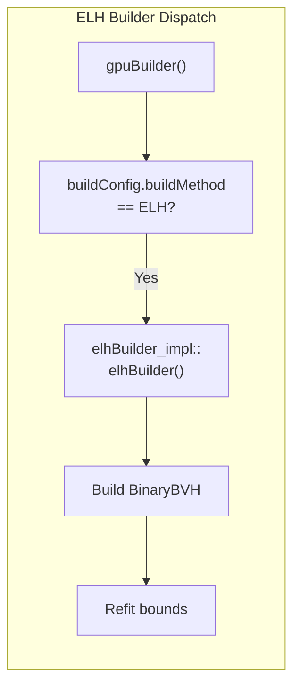
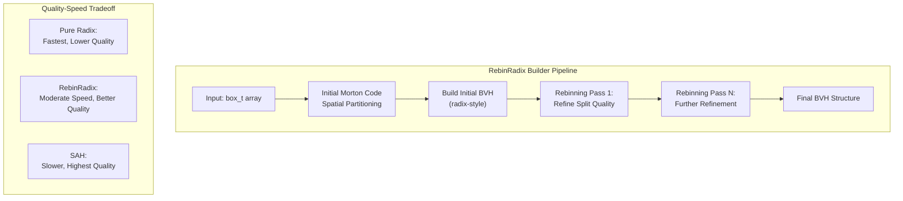
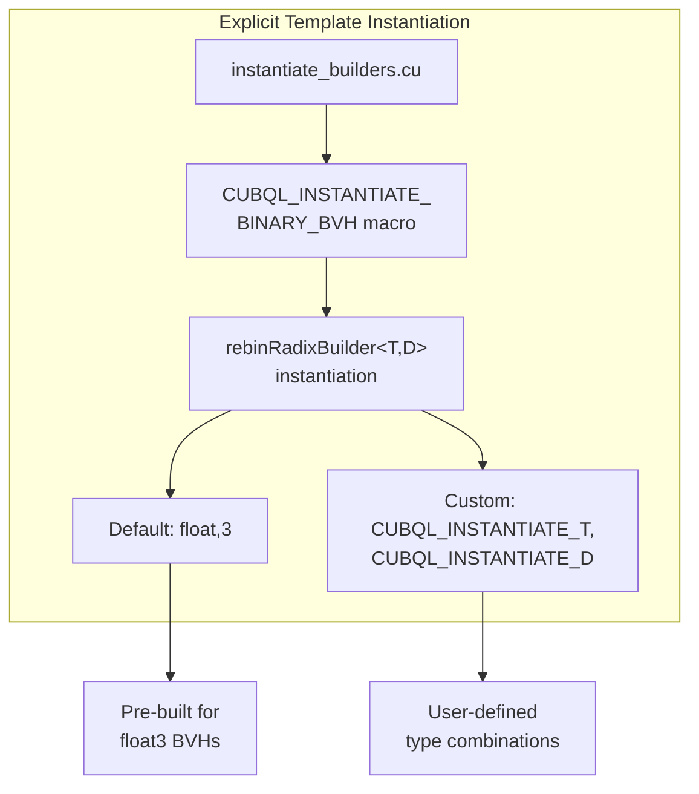
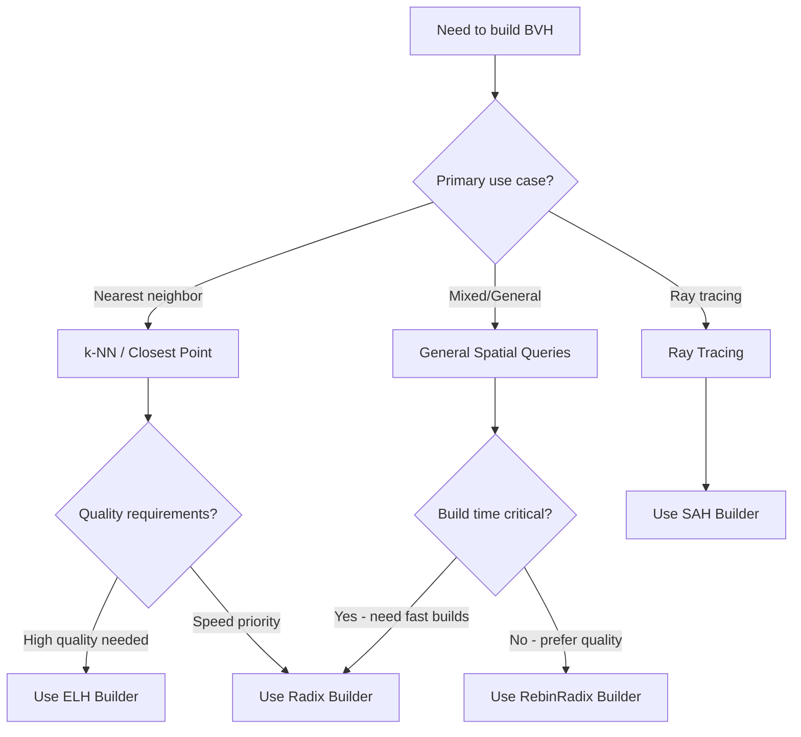
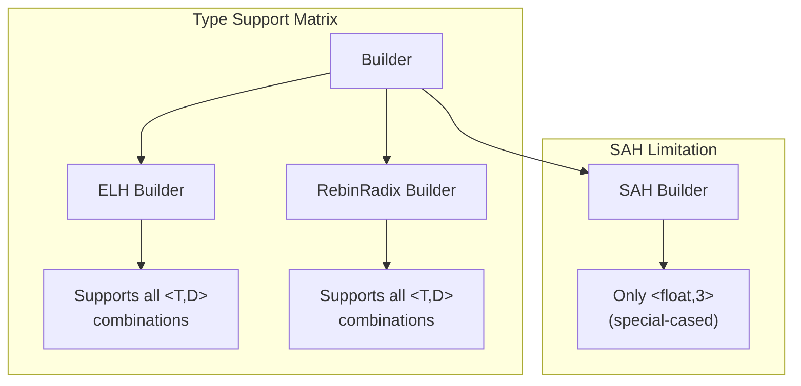
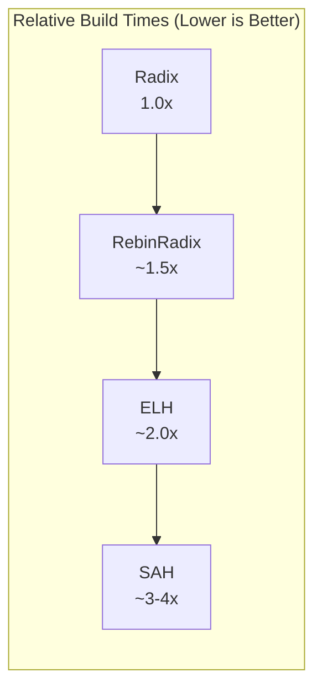
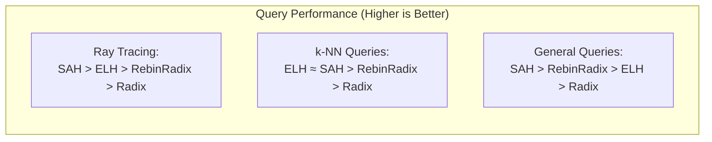

<!-- source: DeepWiki mcp.deepwiki.com · repo NVIDIA/cuBQL · extra page Advanced Builders · fetched 2026-10-26 -->

# Advanced Builders

<details>
<summary>Relevant source files</summary>

The following files were used as context for generating this wiki page:

- [cuBQL/builder/cuda/gpu_builder.h](cuBQL/builder/cuda/gpu_builder.h)
- [cuBQL/builder/cuda/instantiate_builders.cu](cuBQL/builder/cuda/instantiate_builders.cu)

</details>


## Purpose and Scope

This page documents specialized BVH construction algorithms that provide alternative quality/performance tradeoffs beyond the basic radix and SAH builders. The advanced builders covered here are:

- **ELH Builder**: Edge-Length Heuristic builder optimized for nearest neighbor queries
- **RebinRadix Builder**: Enhanced radix builder with rebinning for improved quality

For basic spatial median construction, see [Radix Builder](#6.2.1). For high-quality ray tracing BVHs, see [SAH Builder](#6.2.2). For general builder interface and workflow, see [GPU Builder Interface](#6.1).

---

## ELH Builder (Edge-Length Heuristic)

### Overview

The **ELH builder** (`elhBuilder`) uses an edge-length heuristic for split selection, computing splits based on the sum of edge lengths of bounding boxes rather than surface area. This heuristic provides better performance for k-NN and closest-point queries compared to spatial median, while offering faster construction than full SAH.

**Sources**: [cuBQL/builder/cuda/gpu_builder.h:43-48]()

### Activation

The ELH builder is activated by setting `BuildConfig::buildMethod` to `BuildConfig::ELH`:

```cpp
BuildConfig config;
config.buildMethod = BuildConfig::ELH;
cuBQL::gpuBuilder(bvh, boxes, numBoxes, config, stream, memResource);
```

The dispatcher in `gpuBuilder` routes to `elhBuilder_impl::elhBuilder` when this method is selected.

**Sources**: [cuBQL/builder/cuda/gpu_builder.h:43-48]()

### Algorithm Characteristics

| Property | Description |
|----------|-------------|
| **Split Heuristic** | Sum of bounding box edge lengths |
| **Quality vs. Speed** | Intermediate: better than spatial median, faster than SAH |
| **Optimal Use Cases** | k-NN queries, closest point searches, radius queries |
| **Build Time** | Moderate (between radix and SAH) |
| **Traversal Performance** | Good for spatial proximity queries |

The comment in the code states: *"not as good as sah for tracing rays, but often somewhat better than spatial median for kNN style queries"* [cuBQL/builder/cuda/gpu_builder.h:45-47]()

### Implementation



The ELH builder is implemented in the `elhBuilder_impl` namespace and invoked via `elhBuilder_impl::elhBuilder(bvh, boxes, numBoxes, buildConfig, s, memResource)`.

**Sources**: [cuBQL/builder/cuda/gpu_builder.h:48]()

### Configuration Parameters

The ELH builder respects the following `BuildConfig` parameters:

| Parameter | Effect | Default Behavior |
|-----------|--------|------------------|
| `makeLeafThreshold` | Maximum primitives per leaf node | Inherits default from builder implementation |
| `maxPrimsPerLeaf` | Hard limit on leaf size | Used for splitting decisions |

Unlike SAH, the ELH builder does not require binning parameters since it uses edge-length computation rather than spatial binning.

**Sources**: [cuBQL/builder/cuda/gpu_builder.h:43-48]()

---

## RebinRadix Builder

### Overview

The **rebinRadix builder** (`rebinRadixBuilder`) combines the speed of morton code spatial partitioning with iterative rebinning passes to improve BVH quality. This hybrid approach provides better traversal performance than pure radix builders while maintaining faster construction than SAH.

**Sources**: [cuBQL/builder/cuda/instantiate_builders.cu:39-44]()

### Instantiation and Usage

The `rebinRadixBuilder` is explicitly instantiated for supported types:

```cpp
namespace cuBQL {
namespace cuda {
  template
  void rebinRadixBuilder<T,D>(BinaryBVH<T,D>    &bvh,
                              const box_t<T,D>  *boxes,
                              uint32_t           numBoxes,
                              BuildConfig        buildConfig,
                              cudaStream_t       s,
                              GpuMemoryResource &mem_resource);
}
}
```

**Sources**: [cuBQL/builder/cuda/instantiate_builders.cu:38-44]()

### Implementation Location

The rebinRadix builder is defined in a separate header file:

- **Header**: `cuBQL/builder/cuda/rebinMortonBuilder.h`
- **Namespace**: `cuBQL::cuda`
- **Function**: `rebinRadixBuilder<T,D>()`

**Sources**: [cuBQL/builder/cuda/instantiate_builders.cu:9]()

### Algorithm Concept



The rebinning process iteratively improves split decisions made by the initial morton code partitioning, resulting in tighter bounding volumes and more efficient traversal.

**Sources**: [cuBQL/builder/cuda/instantiate_builders.cu:9,39-44]()

### Instantiation Strategy

The `rebinRadixBuilder` follows the same explicit instantiation pattern as other builders:



**Sources**: [cuBQL/builder/cuda/instantiate_builders.cu:13-90]()

---

## Builder Comparison and Selection Guide

### Complete Builder Comparison

| Builder | Speed | Quality | Best Use Case | Implementation |
|---------|-------|---------|---------------|----------------|
| **Radix** | Fastest | Basic | Initial prototyping, uniform distributions | `gpuBuilder_impl::build` |
| **RebinRadix** | Fast | Good | Balanced quality/speed, moderate scenes | `cuda::rebinRadixBuilder` |
| **ELH** | Moderate | Good | k-NN, closest point, radius queries | `elhBuilder_impl::elhBuilder` |
| **SAH** | Slowest | Highest | Ray tracing, complex geometry | `sahBuilder_impl::sahBuilder` |

**Sources**: [cuBQL/builder/cuda/gpu_builder.h:31-55](), [cuBQL/builder/cuda/instantiate_builders.cu:38-44]()

### Selection Decision Flow



**Sources**: [cuBQL/builder/cuda/gpu_builder.h:31-56]()

### Configuration Matrix

```mermaid
graph LR
    subgraph "BuildConfig::buildMethod Values"
        A["BuildConfig::SAH"]
        B["BuildConfig::ELH"]
        C["BuildConfig::DEFAULT"]
        D["(or any other value)"]
    end
    
    subgraph "Dispatched Builder"
        E["sahBuilder_impl::<br/>sahBuilder()"]
        F["elhBuilder_impl::<br/>elhBuilder()"]
        G["gpuBuilder_impl::<br/>build()"]
    end
    
    subgraph "Alternative Direct Call"
        H["cuda::rebinRadixBuilder()"]
    end
    
    A --> E
    B --> F
    C --> G
    D --> G
    
    H -."|Manual invocation<br/>bypasses gpuBuilder"| G
```

**Sources**: [cuBQL/builder/cuda/gpu_builder.h:31-55](), [cuBQL/builder/cuda/instantiate_builders.cu:39-44]()

---

## Implementation Details

### Code Organization

The advanced builders are organized across several files:

| File | Purpose |
|------|---------|
| `cuBQL/builder/cuda/elh_builder.h` | ELH builder implementation |
| `cuBQL/builder/cuda/rebinMortonBuilder.h` | RebinRadix builder implementation |
| `cuBQL/builder/cuda/gpu_builder.h` | Main dispatcher routing to all builders |
| `cuBQL/builder/cuda/instantiate_builders.cu` | Explicit template instantiations |

**Sources**: [cuBQL/builder/cuda/gpu_builder.h:9](), [cuBQL/builder/cuda/instantiate_builders.cu:9]()

### Dispatcher Logic

The `gpuBuilder` function routes to builders based on `BuildConfig::buildMethod`:

```cpp
// From gpu_builder.h:31-55
if (buildConfig.buildMethod == BuildConfig::SAH) {
  // Route to SAH builder (float,3 only)
  sahBuilder_impl::sahBuilder(...);
} else if (buildConfig.buildMethod == BuildConfig::ELH) {
  // Route to ELH builder (all types)
  elhBuilder_impl::elhBuilder(...);
} else {
  // Default: route to radix/spatial median builder
  gpuBuilder_impl::build(...);
}
```

The `rebinRadixBuilder` is not directly accessible via `gpuBuilder` and must be called explicitly from the `cuBQL::cuda` namespace.

**Sources**: [cuBQL/builder/cuda/gpu_builder.h:31-55]()

### Type Support

Both advanced builders support generic template parameterization:



Unlike SAH which is restricted to `float,3`, both ELH and rebinRadix builders support arbitrary coordinate types and dimensionalities through template parameterization.

**Sources**: [cuBQL/builder/cuda/gpu_builder.h:36-42](), [cuBQL/builder/cuda/instantiate_builders.cu:13-90]()

### Explicit Instantiation Macros

The instantiation file uses macros to generate builder instantiations:

```cpp
// From instantiate_builders.cu:13-57
#define CUBQL_INSTANTIATE_BINARY_BVH(T,D)                    \
  namespace cuBQL {                                           \
    // radixBuilder instantiation                            \
    // rebinRadixBuilder instantiation                       \
    // sahBuilder instantiation                              \
    // gpuBuilder instantiation                              \
  }
```

Default instantiations cover `float,3` with BVH widths of 4, 8, and 16. Custom types can be instantiated by defining `CUBQL_INSTANTIATE_T` and `CUBQL_INSTANTIATE_D` preprocessor symbols.

**Sources**: [cuBQL/builder/cuda/instantiate_builders.cu:13-89]()

---

## Performance Characteristics

### Build Time Comparison



The exact performance multipliers depend on scene complexity, primitive distribution, and GPU architecture.

### Traversal Quality Comparison



Performance depends heavily on the query pattern and scene characteristics.

**Sources**: [cuBQL/builder/cuda/gpu_builder.h:44-47]()

---

## Usage Examples

### Using ELH Builder

```cpp
BinaryBVH<float,3> bvh;
box_t<float,3>* boxes = /* ... */;
uint32_t numBoxes = /* ... */;

BuildConfig config;
config.buildMethod = BuildConfig::ELH;
config.makeLeafThreshold = 1;

cudaStream_t stream;
GpuMemoryResource memResource;

cuBQL::gpuBuilder(bvh, boxes, numBoxes, config, stream, memResource);
```

### Using RebinRadix Builder (Direct Call)

```cpp
BinaryBVH<float,3> bvh;
box_t<float,3>* boxes = /* ... */;
uint32_t numBoxes = /* ... */;

BuildConfig config;
config.makeLeafThreshold = 1;

cudaStream_t stream;
GpuMemoryResource memResource;

cuBQL::cuda::rebinRadixBuilder(bvh, boxes, numBoxes, config, stream, memResource);
```

**Sources**: [cuBQL/builder/cuda/gpu_builder.h:19-57](), [cuBQL/builder/cuda/instantiate_builders.cu:39-44]()

---

