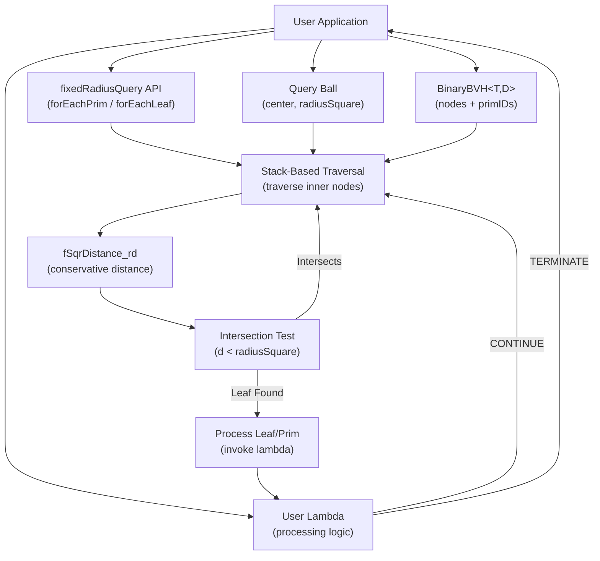
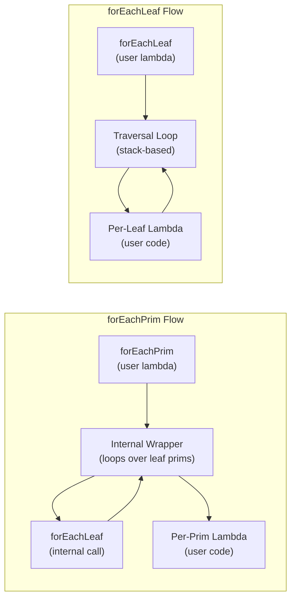
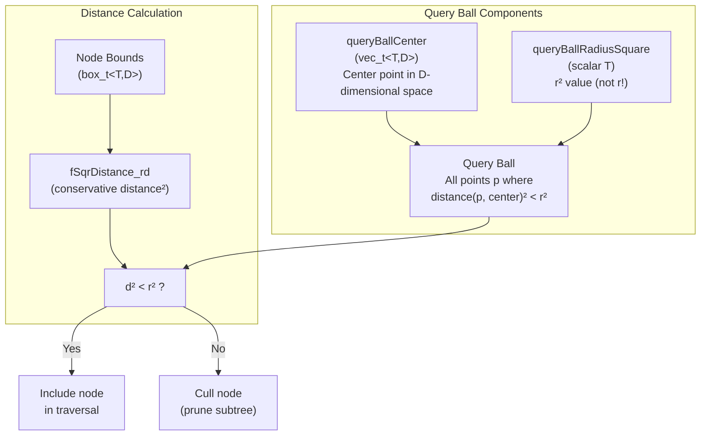
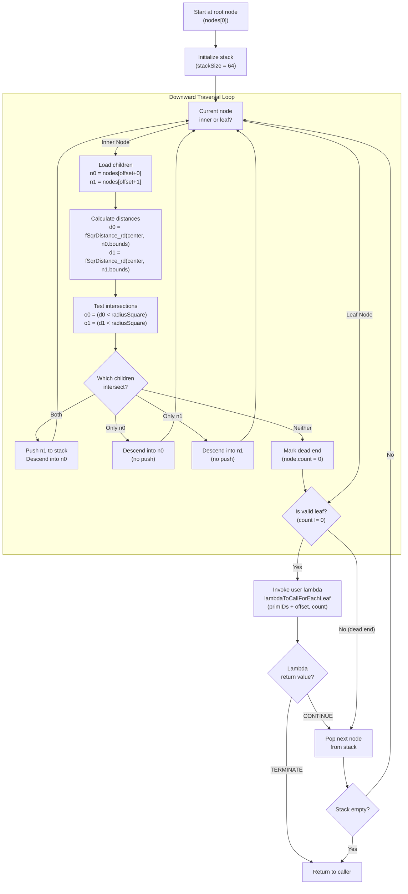
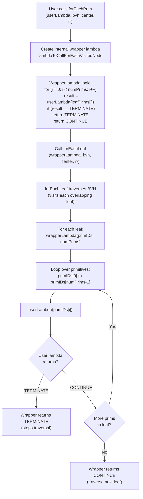
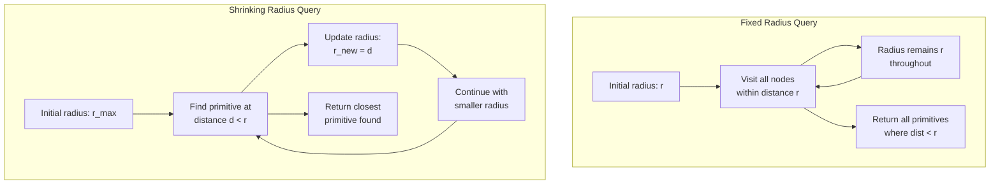

<!-- source: DeepWiki mcp.deepwiki.com · repo NVIDIA/cuBQL · extra page Fixed Radius Query · fetched 2026-10-26 -->

# Fixed Radius Query

<details>
<summary>Relevant source files</summary>

The following files were used as context for generating this wiki page:

- [cuBQL/traversal/fixedRadiusQuery.h](cuBQL/traversal/fixedRadiusQuery.h)

</details>


## Purpose and Scope

This page documents the **fixed radius query** traversal template, which enables spatial searches within a constant-radius sphere around a query point. Fixed radius queries find all BVH leaves or primitives that potentially intersect with a ball defined by a center point and radius that **does not change** during traversal. This is distinct from shrinking radius queries, where the search radius can be dynamically reduced based on found candidates (see [Shrinking Radius Query](#7.2.2) for that variant).

Fixed radius queries are ideal for:
- Finding all primitives within a fixed distance threshold
- Range searches where all results within a radius are needed
- Spatial filtering operations where the search area is predetermined

For ray-based queries instead of ball-shaped queries, see [Ray Queries](#7.1).

**Sources**: cuBQL/traversal/fixedRadiusQuery.h:1-11

---

## Overview

The fixed radius query system is implemented in the `cuBQL::fixedRadiusQuery` namespace and provides two primary traversal functions that operate on `BinaryBVH` structures. The query ball is specified by its center point (`vec_t<T,D>`) and the **square** of its radius (stored as scalar type `T`). Using squared radius avoids expensive square root operations during traversal.

The traversal performs stack-based descent through the BVH hierarchy, testing each node's bounding box against the query ball using conservative distance calculations. User-provided lambda functions process either individual primitives or entire leaves, with the ability to terminate traversal early by returning `CUBQL_TERMINATE_TRAVERSAL`.



**Diagram**: Fixed radius query system architecture showing data flow from user inputs through traversal to lambda invocation.

**Sources**: cuBQL/traversal/fixedRadiusQuery.h:18-119

---

## API Functions

The fixed radius query interface provides two template functions in the `cuBQL::fixedRadiusQuery` namespace:

### forEachPrim

Finds all **primitives** within the query ball and invokes the user lambda for each one.

**Signature**:
```cpp
template<typename T, int D, typename PerPrimLambda>
inline __cubql_both
void forEachPrim(
    PerPrimLambda lambdaToCallForEachPrimInSphere,
    bvh_t<T,D> bvh,
    vec_t<T,D> queryBallCenter,
    T queryBallRadiusSquare,
    bool dbg = false
);
```

**Parameters**:

| Parameter | Type | Description |
|-----------|------|-------------|
| `lambdaToCallForEachPrimInSphere` | Lambda | User function called for each primitive, signature: `[](int primID)->int` |
| `bvh` | `bvh_t<T,D>` | BVH structure to query |
| `queryBallCenter` | `vec_t<T,D>` | Center point of the query sphere |
| `queryBallRadiusSquare` | `T` | **Square** of the query radius (use `CUBQL_INF` for unrestricted) |
| `dbg` | `bool` | Debug flag (optional, default: false) |

**Lambda Signature**: `[](int primID)->int`
- **Input**: `primID` - Index of the primitive to process
- **Return**: Either `CUBQL_TERMINATE_TRAVERSAL` or `CUBQL_CONTINUE_TRAVERSAL`

### forEachLeaf

Finds all **BVH leaves** that overlap the query ball and invokes the user lambda for each one. This is more efficient when processing multiple primitives per leaf.

**Signature**:
```cpp
template<typename T, int D, typename PerLeafLambda>
inline __cubql_both
void forEachLeaf(
    PerLeafLambda lambdaToCallForEachLeaf,
    bvh_t<T,D> bvh,
    vec_t<T,D> queryBallCenter,
    T queryBallRadiusSquare,
    bool dbg = false
);
```

**Parameters**:

| Parameter | Type | Description |
|-----------|------|-------------|
| `lambdaToCallForEachLeaf` | Lambda | User function called for each leaf, signature: `[](const uint32_t *primIDs, size_t numPrims)->int` |
| `bvh` | `bvh_t<T,D>` | BVH structure to query |
| `queryBallCenter` | `vec_t<T,D>` | Center point of the query sphere |
| `queryBallRadiusSquare` | `T` | **Square** of the query radius |
| `dbg` | `bool` | Debug flag (optional, default: false) |

**Lambda Signature**: `[](const uint32_t *primIDs, size_t numPrims)->int`
- **Input**: `primIDs` - Array of primitive indices in the leaf, `numPrims` - Count of primitives
- **Return**: Either `CUBQL_TERMINATE_TRAVERSAL` or `CUBQL_CONTINUE_TRAVERSAL`



**Diagram**: API function relationships - `forEachPrim` internally wraps `forEachLeaf` with a lambda that iterates over primitives.

**Sources**: cuBQL/traversal/fixedRadiusQuery.h:41-86, cuBQL/traversal/fixedRadiusQuery.h:205-234

---

## Query Ball Definition

The query ball is defined by two parameters:

1. **Center Point** (`vec_t<T,D> queryBallCenter`): The spatial location at the center of the search sphere
2. **Radius Squared** (`T queryBallRadiusSquare`): The **square** of the search radius

### Why Squared Radius?

The API uses squared radius to avoid expensive square root computations during traversal. Conservative distance calculations return squared distances, which are directly compared to `queryBallRadiusSquare`:

```
if (fSqrDistance_rd(queryBallCenter, nodeBounds) < queryBallRadiusSquare) {
    // Node potentially intersects query ball
}
```

### Unrestricted Searches

To perform an unrestricted search (finding all primitives/leaves in the BVH), pass `CUBQL_INF` as the `queryBallRadiusSquare` parameter. This effectively disables distance culling.



**Diagram**: Query ball definition and distance testing mechanism.

**Sources**: cuBQL/traversal/fixedRadiusQuery.h:44-55, cuBQL/traversal/fixedRadiusQuery.h:143-146

---

## Lambda Return Values

User-provided lambdas must return one of two values to control traversal behavior:

| Constant | Value | Behavior |
|----------|-------|----------|
| `CUBQL_CONTINUE_TRAVERSAL` | Implementation-defined | Continue traversing the BVH, processing additional leaves/primitives |
| `CUBQL_TERMINATE_TRAVERSAL` | Implementation-defined | Immediately stop traversal and return to caller |

### Termination Semantics

When a lambda returns `CUBQL_TERMINATE_TRAVERSAL`:
1. The current leaf/primitive processing completes
2. No further leaves/primitives are visited
3. The `forEachPrim` or `forEachLeaf` function returns immediately
4. Any remaining unvisited nodes on the traversal stack are discarded

This enables **early exit optimization** for queries that only need to find a specific result (e.g., "check if any primitive exists within radius" rather than "find all primitives within radius").

**Sources**: cuBQL/traversal/fixedRadiusQuery.h:10-11, cuBQL/traversal/fixedRadiusQuery.h:177-178, cuBQL/traversal/fixedRadiusQuery.h:228-229

---

## Traversal Algorithm

The fixed radius query implements a **stack-based iterative descent** algorithm that avoids recursion for GPU compatibility. The algorithm is defined in [cuBQL/traversal/fixedRadiusQuery.h:105-188]().

### Algorithm Structure



**Diagram**: Fixed radius query traversal algorithm flow showing stack-based descent and intersection testing.

### Key Implementation Details

**Stack Management**:
- Fixed-size stack of 64 elements: `typename bvh_t<T, D>::node_t::Admin traversalStack[stackSize]` [cuBQL/traversal/fixedRadiusQuery.h:120-121]()
- Stack pointer tracks current position: `*stackPtr = traversalStack`
- Nodes pushed when both children intersect, right child stored for later: `*stackPtr++ = n1.admin` [cuBQL/traversal/fixedRadiusQuery.h:157]()
- Pop operation: `node = *--stackPtr` [cuBQL/traversal/fixedRadiusQuery.h:186]()

**Distance Calculation**:
- Uses `fSqrDistance_rd` for conservative squared distance from point to box [cuBQL/traversal/fixedRadiusQuery.h:143-144]()
- "rd" suffix indicates "round down" - returns underestimate for conservative culling
- Comparison directly against squared radius: `bool o0 = (d0 < queryBallRadiusSquare)` [cuBQL/traversal/fixedRadiusQuery.h:145]()

**Node Identification**:
- Inner nodes: `node.count == 0` [cuBQL/traversal/fixedRadiusQuery.h:134]()
- Leaf nodes: `node.count != 0` [cuBQL/traversal/fixedRadiusQuery.h:172]()
- Child indices: `n0Idx = (uint32_t)node.offset+0` and `n1Idx = (uint32_t)node.offset+1` [cuBQL/traversal/fixedRadiusQuery.h:139-140]()

**Sources**: cuBQL/traversal/fixedRadiusQuery.h:120-188

---

## forEachPrim Implementation

The `forEachPrim` function is implemented as a thin wrapper around `forEachLeaf`. It creates an internal lambda that iterates over all primitives in each visited leaf [cuBQL/traversal/fixedRadiusQuery.h:218-234]():



**Diagram**: forEachPrim implementation showing how it wraps forEachLeaf with a primitive-iteration lambda.

The wrapper lambda signature matches `forEachLeaf` requirements: `[](const uint32_t *leafPrims, size_t numPrims)->float` [cuBQL/traversal/fixedRadiusQuery.h:224-225](). It loops over all primitives in the leaf array [cuBQL/traversal/fixedRadiusQuery.h:227-230]() and returns `CUBQL_TERMINATE_TRAVERSAL` if any per-primitive lambda requests termination, otherwise returns `CUBQL_CONTINUE_TRAVERSAL`.

**Sources**: cuBQL/traversal/fixedRadiusQuery.h:205-234

---

## Comparison: Fixed vs. Shrinking Radius

Fixed radius queries differ fundamentally from shrinking radius queries in their search strategy:

| Aspect | Fixed Radius Query | Shrinking Radius Query ([7.2.2](#7.2.2)) |
|--------|-------------------|--------------------------|
| **Search Radius** | Constant throughout traversal | Dynamically reduced as better candidates are found |
| **Lambda Return** | `TERMINATE` or `CONTINUE` | Returns updated (smaller) radius value |
| **Use Case** | Find **all** primitives within distance | Find **closest** primitive or **k-nearest** neighbors |
| **Traversal Order** | Unordered (whichever child is visited first) | Implicitly prioritizes closer nodes due to shrinking |
| **Efficiency** | May visit more nodes if radius too large | Prunes more aggressively as radius shrinks |
| **Result Guarantee** | All primitives within initial radius | Optimal result (closest point or k-NN) |



**Diagram**: Comparison of fixed vs. shrinking radius query behavior - fixed maintains constant search area, shrinking progressively narrows.

Fixed radius queries are implemented in [cuBQL/traversal/fixedRadiusQuery.h](), while shrinking radius queries use a different template defined elsewhere in the traversal subsystem.

**Sources**: cuBQL/traversal/fixedRadiusQuery.h:1-11

---

## Usage Patterns

### Pattern 1: Count All Primitives Within Radius

```cpp
// Count primitives within 10 units of queryPoint
vec3f queryPoint = {100.0f, 200.0f, 50.0f};
float radius = 10.0f;
int count = 0;

cuBQL::fixedRadiusQuery::forEachPrim(
    [&count](int primID) {
        count++;
        return CUBQL_CONTINUE_TRAVERSAL;
    },
    bvh,
    queryPoint,
    radius * radius  // Note: squared radius
);
```

### Pattern 2: Check Existence (Early Termination)

```cpp
// Check if ANY primitive exists within radius
bool found = false;

cuBQL::fixedRadiusQuery::forEachPrim(
    [&found](int primID) {
        found = true;
        return CUBQL_TERMINATE_TRAVERSAL;  // Stop after first hit
    },
    bvh,
    queryPoint,
    radiusSquared
);
```

### Pattern 3: Process Leaves Efficiently

```cpp
// Accumulate primitive IDs by leaf for batch processing
std::vector<std::vector<uint32_t>> leafBatches;

cuBQL::fixedRadiusQuery::forEachLeaf(
    [&leafBatches](const uint32_t *primIDs, size_t numPrims) {
        std::vector<uint32_t> batch(primIDs, primIDs + numPrims);
        leafBatches.push_back(batch);
        return CUBQL_CONTINUE_TRAVERSAL;
    },
    bvh,
    queryCenter,
    radiusSquared
);
```

### Pattern 4: Unrestricted Search

```cpp
// Find all primitives in entire BVH
cuBQL::fixedRadiusQuery::forEachPrim(
    processPrimitive,
    bvh,
    queryPoint,
    CUBQL_INF  // Infinite radius
);
```

**Sources**: cuBQL/traversal/fixedRadiusQuery.h:26-40, cuBQL/traversal/fixedRadiusQuery.h:44-56

---

## Device/Host Execution

All fixed radius query functions are decorated with `__cubql_both` [cuBQL/traversal/fixedRadiusQuery.h:43, 73, 106, 207](), enabling execution on both CPU (host) and GPU (device). This allows:

1. **CPU Execution**: Call from host code for debugging or single-threaded queries
2. **GPU Execution**: Call from within CUDA kernels for massively parallel queries

**Typical GPU Usage Pattern**:
```cpp
__global__ void queryKernel(
    BinaryBVH<float, 3> bvh,
    vec3f *queryPoints,
    int numQueries
) {
    int idx = blockIdx.x * blockDim.x + threadIdx.x;
    if (idx >= numQueries) return;
    
    // Each thread performs independent fixed radius query
    cuBQL::fixedRadiusQuery::forEachPrim(
        [](int primID) { 
            // Process primitive
            return CUBQL_CONTINUE_TRAVERSAL;
        },
        bvh,
        queryPoints[idx],
        radiusSquared
    );
}
```

For information about CUDA integration patterns, see [CUDA Integration](#3.3).

**Sources**: cuBQL/traversal/fixedRadiusQuery.h:43, 73, 106, 207

---

## Performance Considerations

### Stack Size Limit

The traversal stack is fixed at 64 elements [cuBQL/traversal/fixedRadiusQuery.h:120](). For very deep or unbalanced BVHs, this may be insufficient, though 64 is adequate for most practical scenes (a perfect binary tree of depth 64 contains 2^64 nodes).

### Squared Radius Efficiency

Using squared radius eliminates square root calculations in the inner loop. Conservative distance function `fSqrDistance_rd` returns squared distance directly, enabling simple comparison:

```
// Efficient (squared comparison)
if (fSqrDistance_rd(center, bounds) < radiusSquare) { ... }

// Avoided (would require sqrt)
// if (distance(center, bounds) < radius) { ... }
```

### Early Termination Benefits

Returning `CUBQL_TERMINATE_TRAVERSAL` can significantly reduce traversal cost for existence checks or first-hit queries, avoiding unnecessary node visits.

### Leaf vs. Primitive Iteration

- **Use `forEachLeaf`** when processing requires leaf-level context or batch operations
- **Use `forEachPrim`** for simpler per-primitive logic; internally wraps `forEachLeaf` with minimal overhead [cuBQL/traversal/fixedRadiusQuery.h:218-234]()

### Conservative Distance Calculation

The `fSqrDistance_rd` function provides conservative (underestimate) distance, ensuring no valid candidates are missed but potentially including some false positives that user lambdas must filter.

**Sources**: cuBQL/traversal/fixedRadiusQuery.h:120, cuBQL/traversal/fixedRadiusQuery.h:143-146, cuBQL/traversal/fixedRadiusQuery.h:218-234

---

