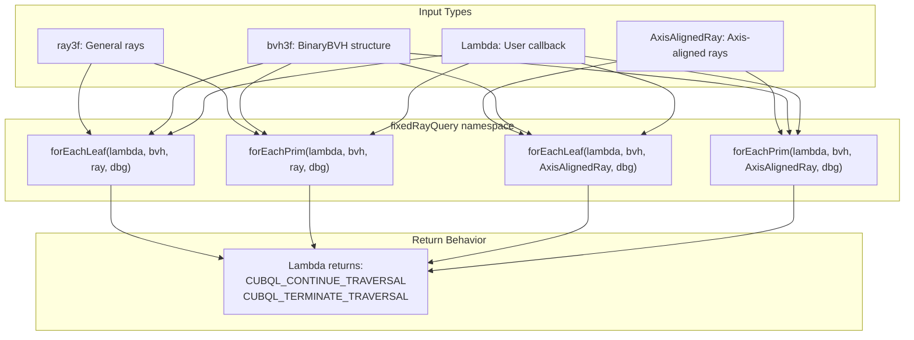
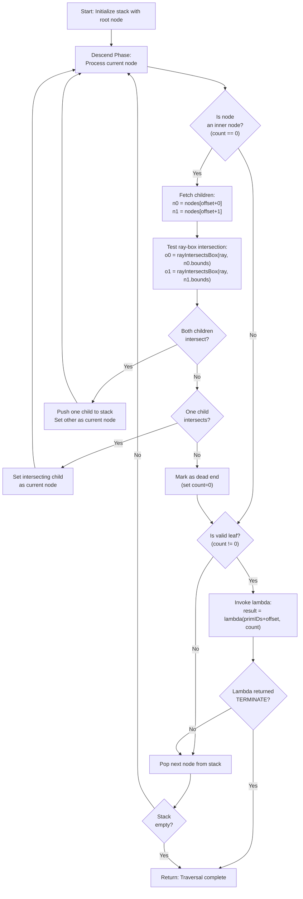
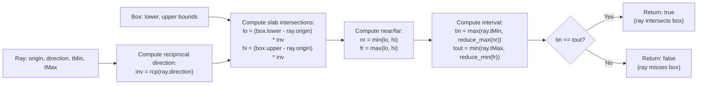
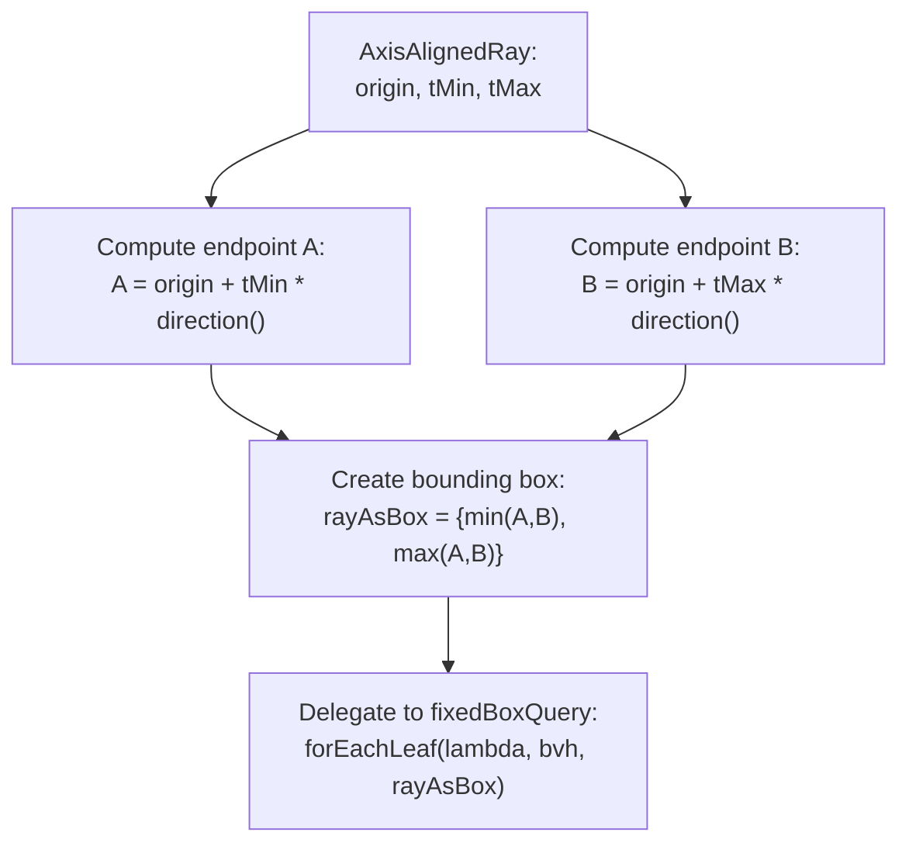
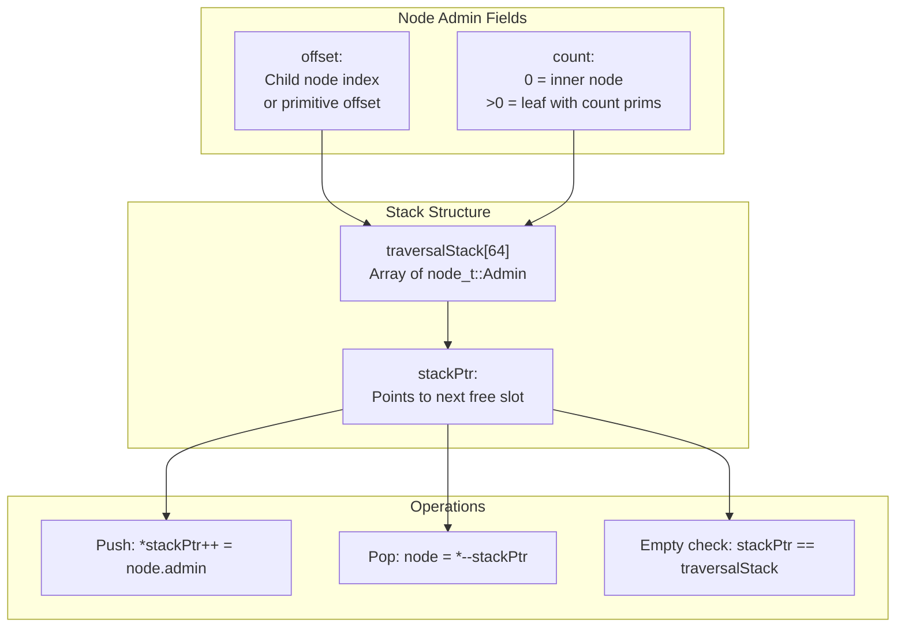
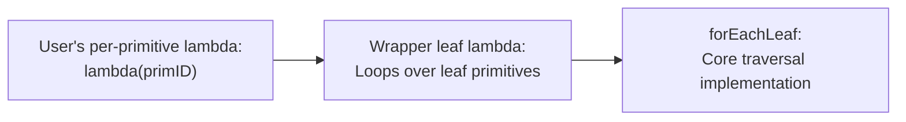

<!-- source: DeepWiki mcp.deepwiki.com · repo NVIDIA/cuBQL · extra page Fixed Ray Query · fetched 2026-10-26 -->

# Fixed Ray Query

<details>
<summary>Relevant source files</summary>

The following files were used as context for generating this wiki page:

- [cuBQL/traversal/rayQueries.h](cuBQL/traversal/rayQueries.h)

</details>


## Purpose and Scope

This document describes the **fixed ray query** traversal template in cuBQL, which performs ray-BVH intersection queries where the ray's parametric interval `[tMin, tMax]` remains constant throughout traversal. Fixed ray queries are suitable for any-hit detection, shadow rays, and queries where the order of hits does not matter.

For ray queries where the parametric interval can shrink during traversal to find closest hits, see [Shrinking Ray Query](#7.1.2). For spatial ball queries using fixed or shrinking radii, see [Radius Queries](#7.2).

**Sources:** [cuBQL/traversal/rayQueries.h:18-69]()

---

## Overview

The `fixedRayQuery` namespace provides traversal templates that cast rays through a BVH without reordering child node traversal or shrinking the ray's parametric range. This design enables:

- **Unordered traversal**: Child nodes are visited in arbitrary order since hit distance does not affect which subtrees to explore
- **Constant ray interval**: `ray.tMin` and `ray.tMax` never change during traversal
- **Early termination**: User lambdas can signal to stop traversal immediately upon finding a satisfactory result
- **Any-hit semantics**: Useful for occlusion queries and shadow rays where any intersection suffices

The key distinction from shrinking ray queries is that fixed ray queries cannot prune subtrees based on previously found hits, as the search interval remains constant.

**Sources:** [cuBQL/traversal/rayQueries.h:18-22]()

---

## API Functions

### Fixed Ray Query Interface



**Diagram: Fixed Ray Query API surface showing function overloads for general and axis-aligned rays**

The API provides four primary functions:

| Function | Ray Type | Invocation Target | Description |
|----------|----------|-------------------|-------------|
| `forEachLeaf` | `ray3f` | Leaf nodes | Invokes lambda once per leaf with array of primitive IDs |
| `forEachPrim` | `ray3f` | Individual primitives | Invokes lambda once per primitive ID within intersecting leaves |
| `forEachLeaf` | `AxisAlignedRay<axis,sign>` | Leaf nodes | Optimized traversal for axis-aligned rays |
| `forEachPrim` | `AxisAlignedRay<axis,sign>` | Individual primitives | Optimized primitive-level traversal for axis-aligned rays |

**Sources:** [cuBQL/traversal/rayQueries.h:24-68]()

---

## Function Signatures

### General Ray Traversal

```cpp
// Leaf-level callback
template<typename Lambda>
inline __cubql_both
void forEachLeaf(const Lambda &lambdaToExecuteForEachCandidate,
                 cuBQL::bvh3f bvh,
                 cuBQL::ray3f ray,
                 bool dbg=false);

// Primitive-level callback
template<typename Lambda>
inline __cubql_both
void forEachPrim(const Lambda &lambdaToExecuteForEachCandidate,
                 cuBQL::bvh3f bvh,
                 cuBQL::ray3f ray,
                 bool dbg=false);
```

### Axis-Aligned Ray Traversal

```cpp
// Leaf-level callback for axis-aligned rays
template<int axis, int sign, typename Lambda>
inline __cubql_both
void forEachLeaf(const Lambda &lambdaToExecuteForEachCandidate,
                 cuBQL::bvh3f bvh,
                 AxisAlignedRay<axis,sign> ray,
                 bool dbg=false);

// Primitive-level callback for axis-aligned rays
template<int axis, int sign, typename Lambda>
inline __cubql_both
void forEachPrim(const Lambda &lambdaToExecuteForEachCandidate,
                 cuBQL::bvh3f bvh,
                 AxisAlignedRay<axis,sign> ray,
                 bool dbg=false);
```

**Parameters:**
- `lambdaToExecuteForEachCandidate`: User-provided callback (see Lambda Interface below)
- `bvh`: BinaryBVH structure to traverse
- `ray`: Ray definition with origin, direction, tMin, and tMax
- `dbg`: Debug flag for diagnostic output (default: false)

**Sources:** [cuBQL/traversal/rayQueries.h:24-68]()

---

## Traversal Algorithm

### General Ray Traversal Flow



**Diagram: Fixed ray query traversal algorithm showing stack-based iterative descent with ray-box intersection testing**

### Key Algorithm Characteristics

| Characteristic | Behavior |
|----------------|----------|
| **Traversal Order** | Unordered (children visited in arbitrary order) |
| **Stack Management** | 64-entry stack for node admin data |
| **Intersection Test** | `rayIntersectsBox(ray, box)` using slab method |
| **Ray Modification** | Ray parameters remain constant (no tMax shrinking) |
| **Termination** | Early exit when lambda returns `CUBQL_TERMINATE_TRAVERSAL` |
| **Dead Ends** | Nodes where both children fail intersection test |

**Sources:** [cuBQL/traversal/rayQueries.h:248-315]()

---

## Ray-Box Intersection

The core intersection test determines whether a ray intersects an axis-aligned bounding box:



**Diagram: Slab-based ray-box intersection algorithm using interval arithmetic**

The intersection test implementation uses the slab method, computing entry and exit distances for each axis and checking interval overlap:

**Sources:** [cuBQL/traversal/rayQueries.h:156-169]()

---

## Axis-Aligned Ray Optimization

For axis-aligned rays (rays parallel to a coordinate axis), fixed ray queries convert the ray to an axis-aligned bounding box and delegate to `fixedBoxQuery`:



**Diagram: Axis-aligned ray traversal optimization that converts rays to boxes**

This optimization avoids the reciprocal direction computation and simplifies intersection tests to box-box overlaps.

**Sources:** [cuBQL/traversal/rayQueries.h:203-217]()

---

## Lambda Interface

### Lambda Signatures

Fixed ray queries support two callback patterns:

#### Leaf-Level Lambda

Invoked once per leaf node that intersects the ray:

```cpp
// Lambda signature for forEachLeaf
auto lambda = [](const uint32_t *leafPrims, size_t numPrims) -> int {
    // Process primitives in leaf
    // Return CUBQL_CONTINUE_TRAVERSAL or CUBQL_TERMINATE_TRAVERSAL
};
```

**Parameters:**
- `leafPrims`: Pointer to array of primitive IDs in the leaf (points to `bvh.primIDs + node.offset`)
- `numPrims`: Number of primitives in this leaf (value of `node.count`)

**Return Value:**
- `CUBQL_CONTINUE_TRAVERSAL`: Continue traversing remaining nodes
- `CUBQL_TERMINATE_TRAVERSAL`: Stop traversal immediately

#### Primitive-Level Lambda

Invoked once per primitive in leaves that intersect the ray:

```cpp
// Lambda signature for forEachPrim
auto lambda = [](uint32_t primID) -> int {
    // Process individual primitive
    // Return CUBQL_CONTINUE_TRAVERSAL or CUBQL_TERMINATE_TRAVERSAL
};
```

**Parameters:**
- `primID`: Single primitive ID from the leaf

**Return Value:**
- `CUBQL_CONTINUE_TRAVERSAL`: Continue processing remaining primitives and nodes
- `CUBQL_TERMINATE_TRAVERSAL`: Stop traversal immediately

**Sources:** [cuBQL/traversal/rayQueries.h:299-306](), [cuBQL/traversal/rayQueries.h:326-341]()

---

## Implementation Details

### Stack-Based Traversal



**Diagram: Stack management for iterative BVH traversal using node administrative data**

The implementation uses a fixed-size stack of 64 entries to track nodes pending traversal. Each entry stores the `node_t::Admin` structure containing:
- `offset`: For inner nodes, index to first child; for leaves, offset into `primIDs` array
- `count`: Zero for inner nodes, primitive count for leaves

**Sources:** [cuBQL/traversal/rayQueries.h:255-259]()

---

### Child Node Processing

When both children of an inner node intersect the ray, the traversal:
1. Pushes one child's admin data to the stack
2. Sets the other child as the current node for immediate descent
3. No ordering is performed (arbitrary choice of which child to visit first)

```cpp
// From the implementation
bool o0 = rayIntersectsBox(ray,n0.bounds);
bool o1 = rayIntersectsBox(ray,n1.bounds);
if (o0) {
  if (o1) {
    *stackPtr++ = n1.admin;  // Push one child
  }
  node = n0.admin;  // Visit other child next
} else {
  if (o1) {
    node = n1.admin;
  } else {
    node.count = 0;  // Dead end
  }
}
```

**Sources:** [cuBQL/traversal/rayQueries.h:276-296]()

---

### Primitive-Level Wrapper

The `forEachPrim` functions wrap `forEachLeaf` with an intermediate lambda that iterates over primitives:



**Diagram: Primitive-level traversal implementation as wrapper around leaf-level traversal**

The wrapper lambda:
1. Receives a leaf's primitive array and count
2. Iterates over each primitive ID
3. Invokes the user lambda on each primitive
4. Returns `CUBQL_TERMINATE_TRAVERSAL` if any primitive lambda requests termination

**Sources:** [cuBQL/traversal/rayQueries.h:319-342]()

---

## Use Cases

### Shadow Ray Queries

Fixed ray queries are ideal for shadow rays where any intersection between a shading point and light source causes occlusion:

```cpp
bool isShadowed = false;
auto shadowLambda = [&](uint32_t primID) {
    if (rayIntersectsPrimitive(ray, primID)) {
        isShadowed = true;
        return CUBQL_TERMINATE_TRAVERSAL;
    }
    return CUBQL_CONTINUE_TRAVERSAL;
};
fixedRayQuery::forEachPrim(shadowLambda, bvh, shadowRay);
```

### Any-Hit Detection

Applications that need to detect whether a ray hits anything without caring about the closest hit:

```cpp
bool hasHit = false;
auto anyHitLambda = [&](const uint32_t *prims, size_t count) {
    hasHit = true;
    return CUBQL_TERMINATE_TRAVERSAL;
};
fixedRayQuery::forEachLeaf(anyHitLambda, bvh, ray);
```

### Batch Processing

When processing multiple rays where each ray's result is independent and order doesn't matter, fixed ray queries provide efficient unordered traversal without the overhead of maintaining sorted subtree access.

**Sources:** [cuBQL/traversal/rayQueries.h:18-22](), [cuBQL/traversal/rayQueries.h:38-45]()

---

## Comparison with Shrinking Ray Query

| Feature | Fixed Ray Query | Shrinking Ray Query |
|---------|----------------|---------------------|
| **Ray Interval** | Constant `[tMin, tMax]` | Shrinking `tMax` based on hits |
| **Traversal Order** | Unordered (arbitrary) | Front-to-back (ordered by hit distance) |
| **Use Case** | Any-hit, shadow rays, occlusion | Closest-hit, primary rays |
| **Pruning** | No dynamic pruning | Prunes subtrees beyond current hit |
| **Performance** | Lower overhead for any-hit | Better for closest-hit with distant hits |
| **Lambda Return** | Continue or terminate | Returns new `tMax` value |

For applications requiring closest-hit semantics or ray tracing where hits update the ray's valid interval, use [Shrinking Ray Query](#7.1.2) instead.

**Sources:** [cuBQL/traversal/rayQueries.h:18-22](), [cuBQL/traversal/rayQueries.h:71-75]()

---

## Performance Characteristics

### Computational Complexity

- **Stack depth**: Maximum 64 nodes (configurable)
- **Ray-box tests**: One test per inner node visited
- **Memory access pattern**: Sequential node array access with stack-based backtracking
- **Lambda invocations**: Once per intersecting leaf (or primitive for `forEachPrim`)

### Optimization Considerations

1. **Axis-aligned rays**: Automatically converted to box queries for efficiency
2. **Early termination**: Lambda-based termination avoids unnecessary traversal
3. **No sorting overhead**: Unordered traversal eliminates child node sorting costs
4. **Fixed stack**: No dynamic allocation during traversal

**Sources:** [cuBQL/traversal/rayQueries.h:255-259](), [cuBQL/traversal/rayQueries.h:203-217]()

---

