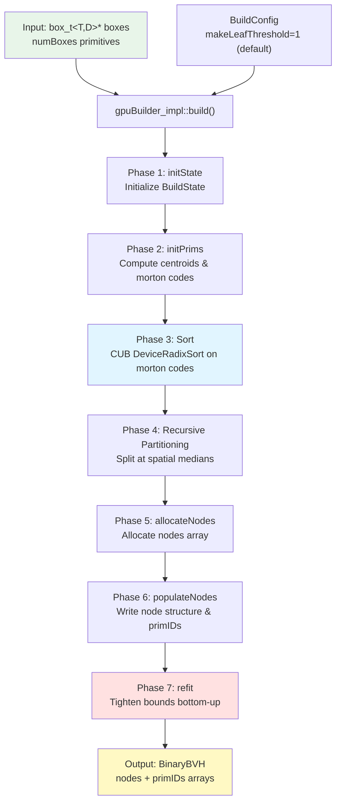
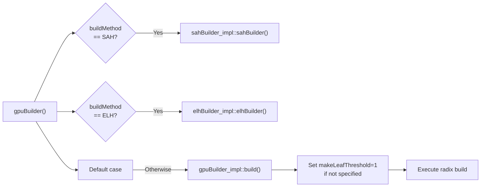
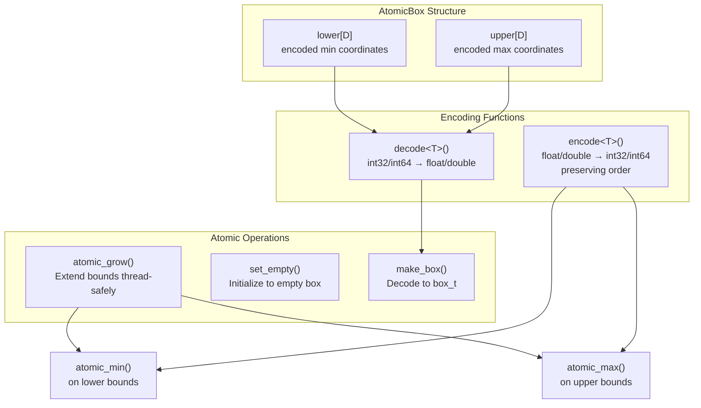
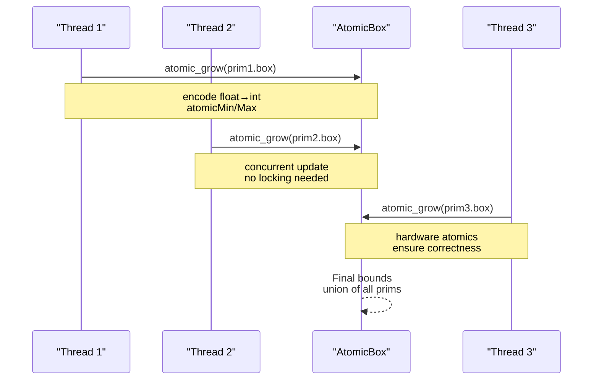
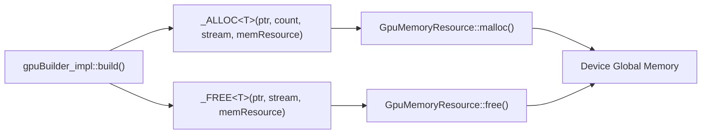
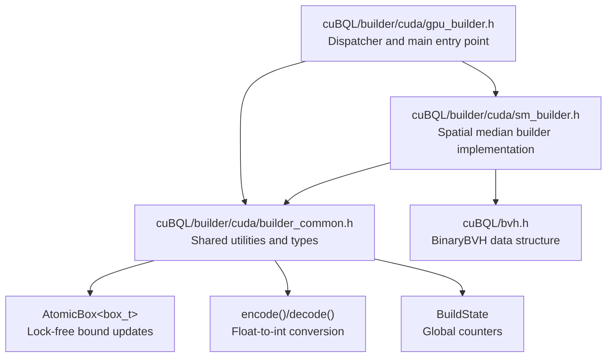
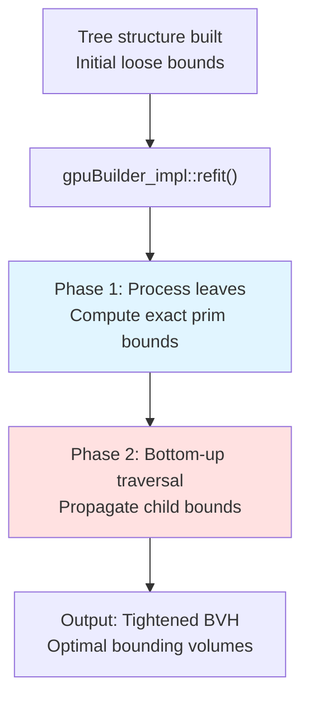

<!-- source: DeepWiki mcp.deepwiki.com · repo NVIDIA/cuBQL · extra page Radix Builder (Spatial Median) · fetched 2026-10-26 -->

# Radix Builder (Spatial Median)

<details>
<summary>Relevant source files</summary>

The following files were used as context for generating this wiki page:

- [cuBQL/builder/cuda/builder_common.h](cuBQL/builder/cuda/builder_common.h)
- [cuBQL/builder/cuda/gpu_builder.h](cuBQL/builder/cuda/gpu_builder.h)

</details>


## Purpose and Scope

The radix builder is cuBQL's default BVH construction algorithm, optimized for fast GPU-accelerated build times using spatial median splits and morton code-based partitioning. It constructs binary BVH hierarchies by recursively subdividing space at the median of primitive centroids along alternating dimensions.

This builder prioritizes construction speed over traversal quality, making it suitable for dynamic scenes requiring frequent BVH rebuilds or scenarios where build time is more critical than query performance. For applications requiring higher-quality BVHs (e.g., ray tracing), see the SAH Builder ([#6.2.2](#6.2.2)). For a balanced approach, see the ELH and rebin builders ([#6.2.3](#6.2.3)).

**Sources**: [cuBQL/builder/cuda/gpu_builder.h:49-55](), [cuBQL/builder/cuda/sm_builder.h:7]()

---

## Algorithm Overview

The radix builder implements a top-down construction strategy that partitions primitives based on their centroid positions in space. Unlike the SAH builder which evaluates costs to find optimal split planes, the radix builder uses deterministic spatial median splits, significantly reducing computation at the expense of traversal efficiency.

### Key Algorithmic Properties

| Property | Description |
|----------|-------------|
| **Split Strategy** | Spatial median along longest axis or round-robin dimensions |
| **Partitioning** | Morton code sorting for cache-coherent primitive ordering |
| **Parallelism** | Fully GPU-parallelized using CUDA kernels and CUB primitives |
| **Quality** | Lower than SAH but adequate for many spatial queries |
| **Build Speed** | Fastest among cuBQL builders (~13ms for 10M primitives) |
| **Memory Overhead** | Moderate temporary allocations for sorting and bin data |

The spatial median approach guarantees balanced tree depth (O(log N)) regardless of primitive distribution, preventing degenerate trees that can occur with naive splitting strategies.

**Sources**: [cuBQL/builder/cuda/gpu_builder.h:49-55](), README.md context from diagrams

---

## Construction Pipeline

The radix builder executes through a sequence of GPU kernel launches, each performing a specific phase of the construction process:



**Diagram: Radix Builder Construction Pipeline**

### Phase Descriptions

1. **initState**: Initializes the `BuildState` structure tracking global construction counters like `numNodes`
2. **initPrims**: Computes primitive centroid positions and calculates morton codes for spatial ordering
3. **Sort**: Uses CUB's `DeviceRadixSort` to reorder primitives by morton codes, improving memory coherence
4. **Recursive Partitioning**: Traverses the primitive list, splitting at median positions to form tree structure
5. **allocateNodes**: Allocates GPU memory for the final `nodes` array based on computed node count
6. **populateNodes**: Writes node data (bounding boxes, child pointers, primitive ranges) and reordered `primIDs`
7. **refit**: Post-processing pass that tightens bounding boxes from leaves to root

**Sources**: [cuBQL/builder/cuda/gpu_builder.h:54](), [cuBQL/builder/cuda/builder_common.h:296-298]()

---

## Entry Points and Configuration

### Dispatcher Integration

The radix builder is invoked automatically when `BuildConfig.buildMethod` is not explicitly set to `SAH` or `ELH`:



**Diagram: Builder Selection Logic in gpuBuilder**

**Sources**: [cuBQL/builder/cuda/gpu_builder.h:31-54]()

### Configuration Parameters

| Parameter | Type | Default | Effect |
|-----------|------|---------|--------|
| `buildMethod` | `BuildConfig::BuildMethod` | (default) | Implicitly selects radix when not SAH/ELH |
| `makeLeafThreshold` | `uint32_t` | 1 | Maximum primitives per leaf node |

The radix builder sets `makeLeafThreshold` to 1 if not explicitly configured, creating leaves with single primitives for optimal spatial partitioning.

**Sources**: [cuBQL/builder/cuda/gpu_builder.h:50-53]()

### Example Usage

```cpp
// Radix builder is used by default
cuBQL::BinaryBVH<float, 3> bvh;
cuBQL::BuildConfig config;
// config.buildMethod implicitly uses radix (default)
config.makeLeafThreshold = 1; // optional, already default for radix

cuBQL::gpuBuilder(bvh, boxes, numBoxes, config, stream, memResource);
```

To explicitly ensure radix is NOT used:
```cpp
config.buildMethod = cuBQL::BuildConfig::SAH; // Use SAH instead
// or
config.buildMethod = cuBQL::BuildConfig::ELH; // Use ELH instead
```

**Sources**: [cuBQL/builder/cuda/gpu_builder.h:19-56]()

---

## Atomic Operations and Concurrency

The radix builder relies heavily on atomic operations to enable lock-free parallel updates during construction. This is critical for GPU performance where thousands of threads operate concurrently.

### AtomicBox Structure

The `AtomicBox<box_t>` type provides thread-safe bounding box updates using integer-encoded floating-point values:



**Diagram: AtomicBox and Encoding System**

### Encoding Rationale

CUDA atomic operations natively support integer types but not floating-point min/max. The radix builder uses a bit-manipulation encoding scheme that maps floating-point values to integers while preserving numerical ordering:

| Type | Encoded As | Encoding Function |
|------|------------|-------------------|
| `float` | `int32_t` | [builder_common.h:88-94]() |
| `double` | `int64_t` | [builder_common.h:96-102]() |
| `int32_t` | `int32_t` | Identity (pass-through) |
| `int64_t` | `int64_t` | Identity (pass-through) |

The encoding handles sign bits specially to ensure negative values encode to smaller integers than positive values, maintaining correct ordering for atomic min/max operations.

**Sources**: [cuBQL/builder/cuda/builder_common.h:146-294]()

### Parallel Bound Updates

During node construction, multiple threads may simultaneously update the same node's bounding box as they process child primitives:



**Diagram: Concurrent Atomic Bound Updates**

This lock-free approach eliminates serialization bottlenecks that would severely limit GPU parallelism.

**Sources**: [cuBQL/builder/cuda/builder_common.h:248-294]()

---

## Memory Management

The radix builder allocates temporary and permanent GPU memory through the `GpuMemoryResource` abstraction:

### Memory Allocation Pattern

| Allocation | Type | Size | Lifetime |
|------------|------|------|----------|
| **nodes** | Permanent | `numNodes * sizeof(BVHNode<T,D>)` | Until BVH freed |
| **primIDs** | Permanent | `numBoxes * sizeof(uint32_t)` | Until BVH freed |
| **Morton codes** | Temporary | `numBoxes * sizeof(uint64_t)` | Build phase only |
| **Sorted indices** | Temporary | `numBoxes * sizeof(uint32_t)` | Build phase only |
| **BuildState** | Temporary | `sizeof(BuildState)` | Build phase only |
| **CUB temp storage** | Temporary | Variable (sort/scan) | Per-kernel |

### Allocation API

The builder uses helper functions that wrap the `GpuMemoryResource` interface:



**Diagram: Memory Allocation Through GpuMemoryResource**

All allocations are stream-ordered, enabling asynchronous execution and proper synchronization with kernel launches.

**Sources**: [cuBQL/builder/cuda/builder_common.h:38-45](), [cuBQL/builder/cuda/gpu_builder.h:24]()

---

## Performance Characteristics

### Speed vs. Quality Tradeoffs

The radix builder occupies a specific position in the builder performance spectrum:

| Builder | Build Speed | Traversal Quality | Use Case |
|---------|-------------|-------------------|----------|
| **Radix** | **Fastest** | Lower | Dynamic scenes, spatial queries |
| ELH | Medium | Medium | Balanced performance |
| SAH | Slowest | **Highest** | Static scenes, ray tracing |

### Typical Performance

Based on the architecture documentation:
- **Build time**: ~13ms for 10M primitives (hardware-dependent)
- **Tree depth**: O(log N) guaranteed balanced
- **Memory**: O(N) with low constant factors
- **Traversal**: 1.5-2x slower than SAH-built trees for ray queries

### When to Use Radix Builder

**Recommended scenarios:**
- Rebuilding BVHs every frame (e.g., deformable meshes)
- Large primitive counts where build time dominates
- k-NN and spatial queries where traversal quality is less critical
- Prototyping and initial development

**Avoid when:**
- Build time is amortized over many queries
- Ray tracing with high sample counts
- Maximum traversal performance is required

**Sources**: Context from README.md and diagram annotations

---

## Implementation Files

The radix builder implementation is distributed across multiple files in the codebase:



**Diagram: File Organization for Radix Builder**

| File | Lines | Key Contents |
|------|-------|--------------|
| [gpu_builder.h]() | 19-56 | Main `gpuBuilder()` function, builder dispatch logic |
| [sm_builder.h]() | (included) | Radix builder kernel implementations |
| [builder_common.h]() | 1-303 | `AtomicBox`, encoding, atomic operations, `BuildState` |

**Sources**: [cuBQL/builder/cuda/gpu_builder.h](), [cuBQL/builder/cuda/builder_common.h]()

---

## Refitting Pass

After the initial tree construction, the radix builder performs a refitting pass to tighten bounding boxes:



**Diagram: Refitting Process**

The refitting pass is shared across all builders (radix, SAH, ELH) and is invoked at line 56 of `gpu_builder.h`. It ensures that internal node bounds are minimal unions of their children, improving traversal efficiency without altering tree topology.

**Sources**: [cuBQL/builder/cuda/gpu_builder.h:56]()

---

## Related Components

The radix builder integrates with several other cuBQL subsystems:

- **BinaryBVH Data Structure** ([#5.1](#5.1)): Output format for constructed trees
- **BuildConfig** ([#5.3](#5.3)): Configuration interface for builder selection
- **GpuMemoryResource** ([#9.1](#9.1)): Memory management abstraction
- **SAH Builder** ([#6.2.2](#6.2.2)): Alternative high-quality builder
- **Advanced Builders** ([#6.2.3](#6.2.3)): ELH and rebinning variants

**Sources**: Context from table of contents structure

---

