<!-- source: DeepWiki mcp.deepwiki.com · repo NVIDIA/cuBQL · extra page SAH Builder · fetched 2026-10-26 -->

# SAH Builder

<details>
<summary>Relevant source files</summary>

The following files were used as context for generating this wiki page:

- [cuBQL/builder/cuda/gpu_builder.h](cuBQL/builder/cuda/gpu_builder.h)
- [cuBQL/builder/cuda/sah_builder.h](cuBQL/builder/cuda/sah_builder.h)

</details>


## Purpose and Scope

The SAH Builder constructs high-quality BVHs optimized for ray tracing applications using the Surface Area Heuristic (SAH). This builder evaluates multiple split candidates across each axis and selects splits that minimize the expected ray traversal cost. It produces trees with better spatial partitioning than simpler builders like the radix builder, at the cost of longer construction time.

This document covers the SAH builder implementation, algorithm phases, data structures, and integration with the dispatcher. For general BVH construction concepts, see [Builder Algorithms](#6.2). For the fast spatial median builder, see [Radix Builder](#6.2.1). For configuration options, see [BuildConfig](#5.3).

**Sources**: [cuBQL/builder/cuda/sah_builder.h:1-581](), [cuBQL/builder/cuda/gpu_builder.h:31-42]()

---

## Overview

The SAH builder is selected by setting `BuildConfig::buildMethod = BuildConfig::SAH` and is currently restricted to 3-dimensional data with `float` or `double` coordinate types. The dispatcher in `gpuBuilder` performs type checking and routing to the SAH implementation.

### When to Use SAH Builder

| Use Case | SAH Builder | Radix Builder |
|----------|-------------|---------------|
| Ray tracing applications | ✓ Optimal | Limited quality |
| Real-time construction | Limited (slower) | ✓ Fast |
| k-NN spatial queries | Good | ✓ Better |
| High-quality offline builds | ✓ Optimal | Acceptable |
| Non-3D or non-float data | ✗ Not supported | ✓ Supported |

The SAH builder typically produces BVHs with 20-40% better ray tracing performance compared to spatial median builders, but requires approximately 2-5× longer construction time.

**Sources**: [cuBQL/builder/cuda/gpu_builder.h:31-42](), [cuBQL/builder/cuda/sah_builder.h:393-399]()

---

## Builder Dispatch and Type Restrictions

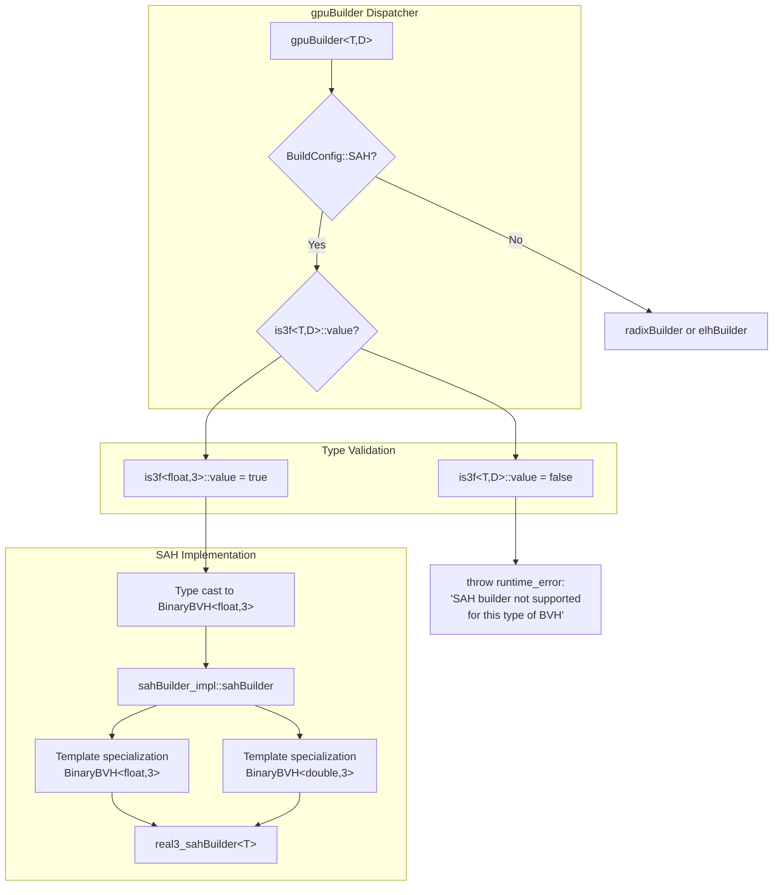

The dispatcher uses the `is3f<T,D>` template trait to validate types at compile time. Only `float` and `double` types with dimension `D=3` pass validation. The implementation casts the BVH reference to the appropriate specialized type before invoking the builder.

**Sources**: [cuBQL/builder/cuda/gpu_builder.h:13-42](), [cuBQL/builder/cuda/sah_builder.h:393-399](), [cuBQL/builder/cuda/sah_builder.h:548-564]()

---

## Key Data Structures

### TempNode Structure

The `TempNode<box_t>` union represents intermediate node states during construction. It uses a discriminated union to minimize memory footprint while storing different information for each node state.

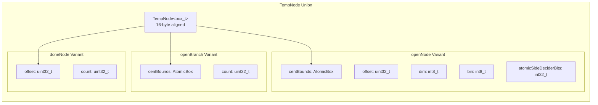

| Variant | Purpose | Fields |
|---------|---------|--------|
| `openBranch` | Active node collecting primitives | `centBounds`, `count` |
| `openNode` | Node ready to split | `centBounds`, `offset`, `dim`, `bin`, `atomicSideDeciderBits` |
| `doneNode` | Finalized leaf node | `offset`, `count` |

The `centBounds` field stores the bounding box of primitive centroids (not the primitives themselves) for computing split positions.

**Sources**: [cuBQL/builder/cuda/sah_builder.h:20-46]()

### SAHBins Structure

The `SAHBins<box_t>` structure maintains binning information for split evaluation across all three spatial dimensions.

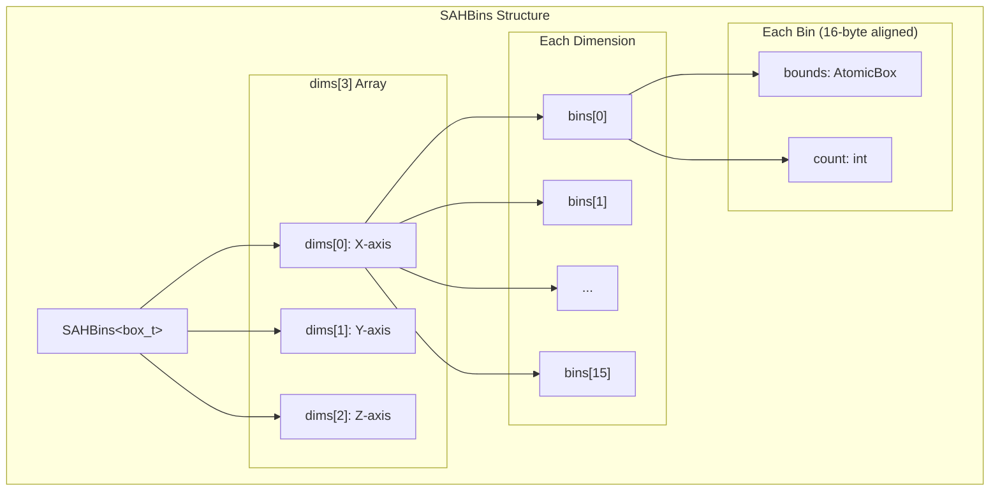

The structure uses 16 bins per dimension (constant `numBins = 16`), resulting in 48 total bins per node. Each bin accumulates:
- `bounds`: Spatial extent of primitives whose centroids fall in this bin
- `count`: Number of primitives in this bin

**Sources**: [cuBQL/builder/cuda/sah_builder.h:48-57]()

---

## Algorithm Phases

The SAH builder executes a multi-phase algorithm with iterative refinement. Each phase launches GPU kernels that operate on temporary data structures.

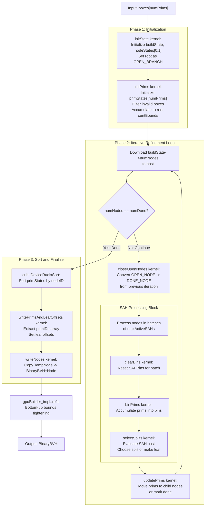

**Sources**: [cuBQL/builder/cuda/sah_builder.h:401-546]()

---

## Phase 1: Initialization

### initState Kernel

The `initState` kernel initializes the build state with a root node and a dummy node:

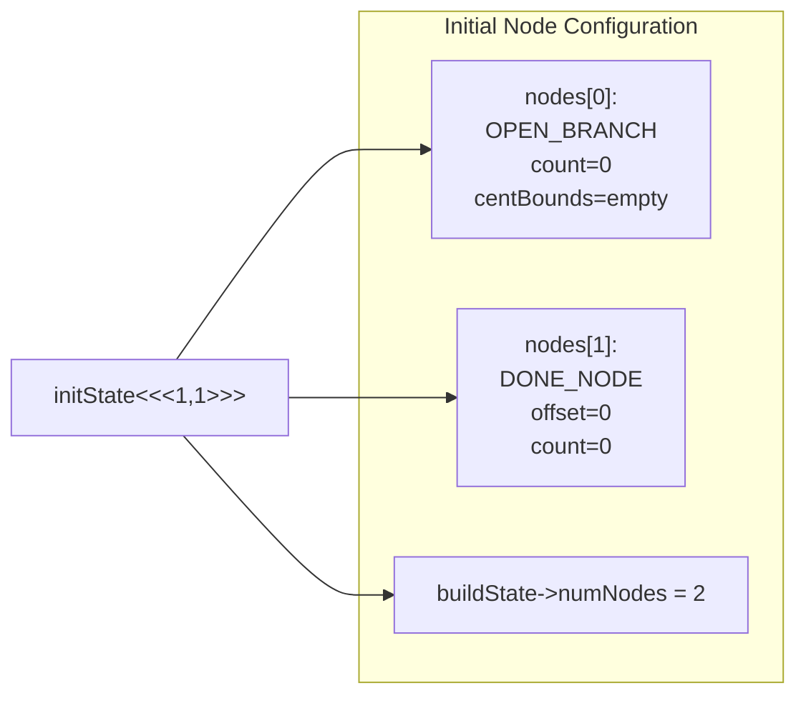

Node 0 serves as the root, while node 1 is a placeholder that remains unused.

**Sources**: [cuBQL/builder/cuda/sah_builder.h:104-120](), [cuBQL/builder/cuda/sah_builder.h:426-429]()

### initPrims Kernel

The `initPrims` kernel processes each primitive in parallel:

| Operation | Description |
|-----------|-------------|
| Validity check | If `box.lower <= box.upper`, primitive is valid |
| Valid primitives | Assigned `nodeID=0`, `done=false`, added to root via `atomicAdd` and `atomic_grow` |
| Invalid primitives | Assigned `nodeID=(uint32_t)-1`, `done=true`, excluded from tree |

The kernel accumulates the centroid bounds of all valid primitives into `nodes[0].openBranch.centBounds` using atomic operations.

**Sources**: [cuBQL/builder/cuda/sah_builder.h:122-146](), [cuBQL/builder/cuda/sah_builder.h:430-433]()

---

## Phase 2: Iterative Refinement Loop

The main construction loop continues until all nodes are finalized. Each iteration processes active nodes in batches constrained by `maxActiveSAHs`, the maximum number of concurrent SAH evaluations.

### Batch Size Calculation

```cpp
int maxActiveSAHs = 4 + numPrims / (8 * SAHBins<box_t<T,D>>::numBins);
```

This formula limits memory usage for SAH bins. Typical values:
- 1M primitives: ~8,200 nodes per batch
- 10M primitives: ~78,000 nodes per batch

**Sources**: [cuBQL/builder/cuda/sah_builder.h:419](), [cuBQL/builder/cuda/sah_builder.h:458-461]()

### closeOpenNodes Kernel

Before processing a new wave of nodes, `closeOpenNodes` converts `OPEN_NODE` states from the previous iteration to `DONE_NODE`. This occurs when a node was marked for splitting but never received primitives (degenerate case).

**Sources**: [cuBQL/builder/cuda/sah_builder.h:203-228](), [cuBQL/builder/cuda/sah_builder.h:446-448]()

### clearBins Kernel

For each batch of nodes, `clearBins` resets the SAH bin arrays:

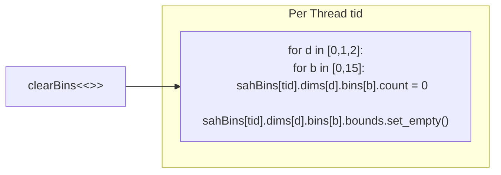

**Sources**: [cuBQL/builder/cuda/sah_builder.h:362-375](), [cuBQL/builder/cuda/sah_builder.h:463-464]()

### binPrims Kernel

The `binPrims` kernel distributes primitives into SAH bins across all three dimensions:

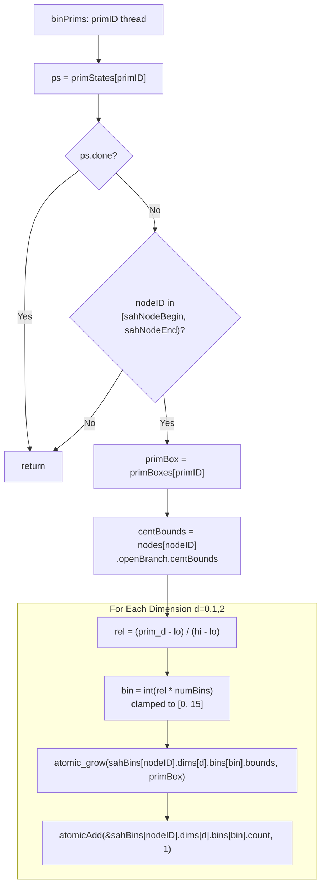

The binning formula computes the relative position of each primitive's centroid within the node's centroid bounds and maps it to a bin index. The use of `1e-20f` in the denominator prevents division by zero for degenerate cases.

**Sources**: [cuBQL/builder/cuda/sah_builder.h:148-201](), [cuBQL/builder/cuda/sah_builder.h:469-472]()

---

## SAH Cost Evaluation

The `evaluateSAH` device function computes the optimal split plane by evaluating all possible split positions across three dimensions.

### Cost Formula

For each candidate split at bin `b` in dimension `d`, the cost is:

```
cost = surfaceArea(leftBox) * leftCount + surfaceArea(rightBox) * rightCount
```

The function also considers making a leaf node with cost:

```
leafCost = surfaceArea(nodeBounds) * totalCount
```

A leaf is created if:
1. `leafCost < bestCost`, AND
2. `totalCount <= maxAllowedLeafSize`

### Evaluation Algorithm

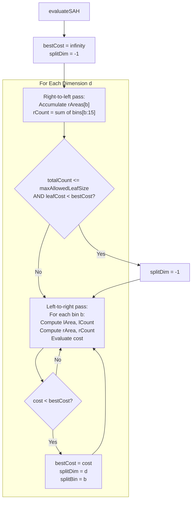

The two-pass approach (right-to-left precomputation followed by left-to-right evaluation) allows constant-time cost computation for each split candidate. Surface area is computed via the `surfaceArea` function on `box_t<T,D>` types.

**Sources**: [cuBQL/builder/cuda/sah_builder.h:59-102]()

---

## selectSplits Kernel

The `selectSplits` kernel processes each active node to determine its fate: become a leaf or split into children.

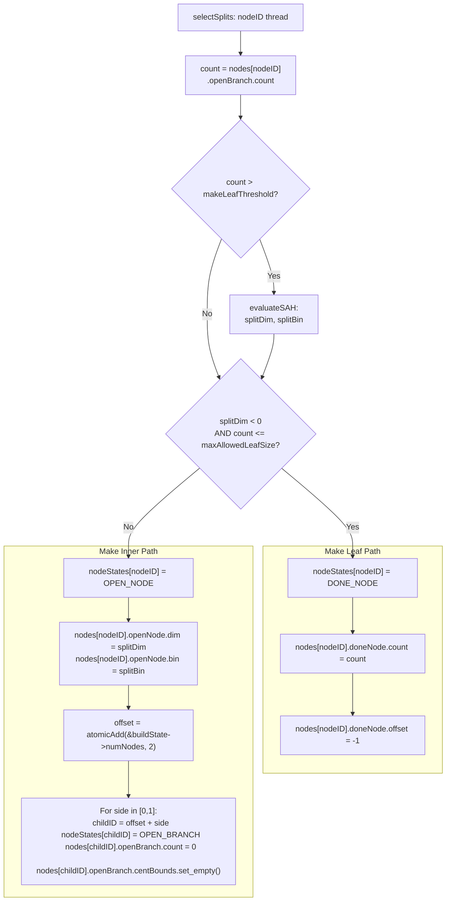

**Key Fields**:
- `openNode.dim`: Split dimension (0, 1, 2, or -1 for degenerate case)
- `openNode.bin`: Split bin index [0, 15]
- `openNode.offset`: Index of first child in `nodes` array
- `doneNode.offset`: Set to `(uint32_t)-1` initially; later atomically minimized by primitives

**Sources**: [cuBQL/builder/cuda/sah_builder.h:230-285](), [cuBQL/builder/cuda/sah_builder.h:477-481]()

---

## updatePrims Kernel

The `updatePrims` kernel reassigns each active primitive to its appropriate child node or marks it as done.

### Side Selection Logic

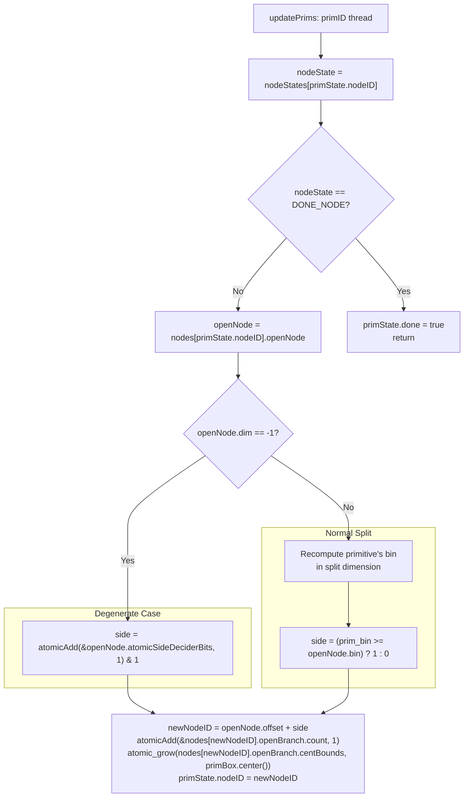

**Degenerate Case Handling**: When `dim == -1`, all primitives have identical centroids along every axis. The kernel distributes them evenly between children using an atomic counter to alternate assignments.

**Sources**: [cuBQL/builder/cuda/sah_builder.h:287-335](), [cuBQL/builder/cuda/sah_builder.h:494-496]()

---

## Phase 3: Sort and Finalize

### Radix Sort by Node ID

After all primitives are assigned to leaf nodes, the `PrimState` array is sorted by `nodeID` using CUB's `DeviceRadixSort`. The `PrimState` structure is 64 bits:

```
PrimState:
  [63:32] = nodeID (sort key)
  [31:0]  = primID (value)
```

The sort operates on bits 32-63 to group primitives by their leaf node.

**Sources**: [cuBQL/builder/cuda/sah_builder.h:501-519]()

### writePrimsAndLeafOffsets Kernel

This kernel performs two operations in a single pass:

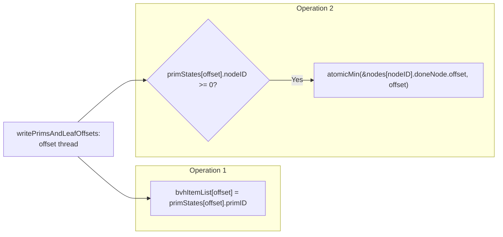

**Operation 1**: Extracts primitive IDs into the final `bvh.primIDs` array in sorted order.

**Operation 2**: Uses `atomicMin` to set each leaf node's offset to the first occurrence of its node ID in the sorted array. This works because the array is sorted by node ID, so the minimum offset corresponds to the first primitive in each leaf.

**Sources**: [cuBQL/builder/cuda/sah_builder.h:337-360](), [cuBQL/builder/cuda/sah_builder.h:525-528]()

### writeNodes Kernel

The `writeNodes` kernel copies administrative data from temporary nodes to the final `BinaryBVH::Node` structure:

```cpp
finalNodes[nodeID].admin.offset = tempNodes[nodeID].doneNode.offset;
finalNodes[nodeID].admin.count  = tempNodes[nodeID].doneNode.count;
```

Bounding box data is **not** written here; it will be computed in the subsequent refit phase.

**Sources**: [cuBQL/builder/cuda/sah_builder.h:377-390](), [cuBQL/builder/cuda/sah_builder.h:534-536]()

---

## Memory Allocation and Cleanup

The SAH builder allocates several temporary arrays on the GPU:

| Array | Size | Purpose |
|-------|------|---------|
| `tempNodes` | `2 * numPrims` | Temporary node states during construction |
| `nodeStates` | `2 * numPrims` | Node state flags (OPEN_BRANCH, OPEN_NODE, DONE_NODE) |
| `primStates` | `numPrims` | Per-primitive state (nodeID, primID, done flag) |
| `buildState` | `1` | Global build state (node counter) |
| `sahBins` | `maxActiveSAHs` | SAH binning information for active nodes |
| `sortedPrimStates` | `numPrims` | Sorted copy for radix sort output |
| `d_temp_storage` | Variable | CUB temporary storage for radix sort |

All allocations use the provided `GpuMemoryResource` and are freed before the function returns. The `_ALLOC` and `_FREE` macros handle allocation/deallocation with proper error checking.

**Sources**: [cuBQL/builder/cuda/sah_builder.h:413-424](), [cuBQL/builder/cuda/sah_builder.h:537-543]()

---

## Integration with gpuBuilder

The SAH builder integrates into the main dispatch pipeline through type specialization:

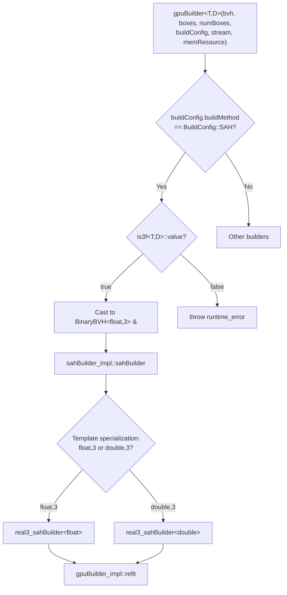

The dispatcher also sets default configuration values if not explicitly specified:

```cpp
if (buildConfig.makeLeafThreshold == 0)
    buildConfig.makeLeafThreshold = 1;
```

**Sources**: [cuBQL/builder/cuda/gpu_builder.h:31-42](), [cuBQL/builder/cuda/sah_builder.h:393-399](), [cuBQL/builder/cuda/sah_builder.h:548-564]()

---

## Configuration Parameters

The SAH builder respects the following `BuildConfig` fields:

| Parameter | Type | Default | Description |
|-----------|------|---------|-------------|
| `buildMethod` | `enum` | N/A | Must be `BuildConfig::SAH` |
| `makeLeafThreshold` | `int` | `1` | Minimum primitives to attempt splitting |
| `maxAllowedLeafSize` | `int` | `MAX_INT` | Maximum primitives per leaf node |

**makeLeafThreshold**: Nodes with count ≤ this value skip SAH evaluation and become leaves immediately (unless they exceed `maxAllowedLeafSize`).

**maxAllowedLeafSize**: Hard limit on leaf size. Even if the SAH cost favors a leaf, nodes exceeding this count must split.

**Sources**: [cuBQL/builder/cuda/gpu_builder.h:32-35](), [cuBQL/builder/cuda/sah_builder.h:250-256]()

---

## Performance Characteristics

### Complexity Analysis

| Metric | Complexity |
|--------|-----------|
| Time | O(N log N) expected, O(N²) worst case |
| Space | O(N) temporary storage |
| GPU Memory | ~16N bytes (temporary arrays) |
| Kernel Launches | O(log N) iterations × 5-10 kernels per iteration |

The iterative refinement typically requires 15-30 iterations for balanced scenes, depending on primitive distribution.

### Comparison with Radix Builder

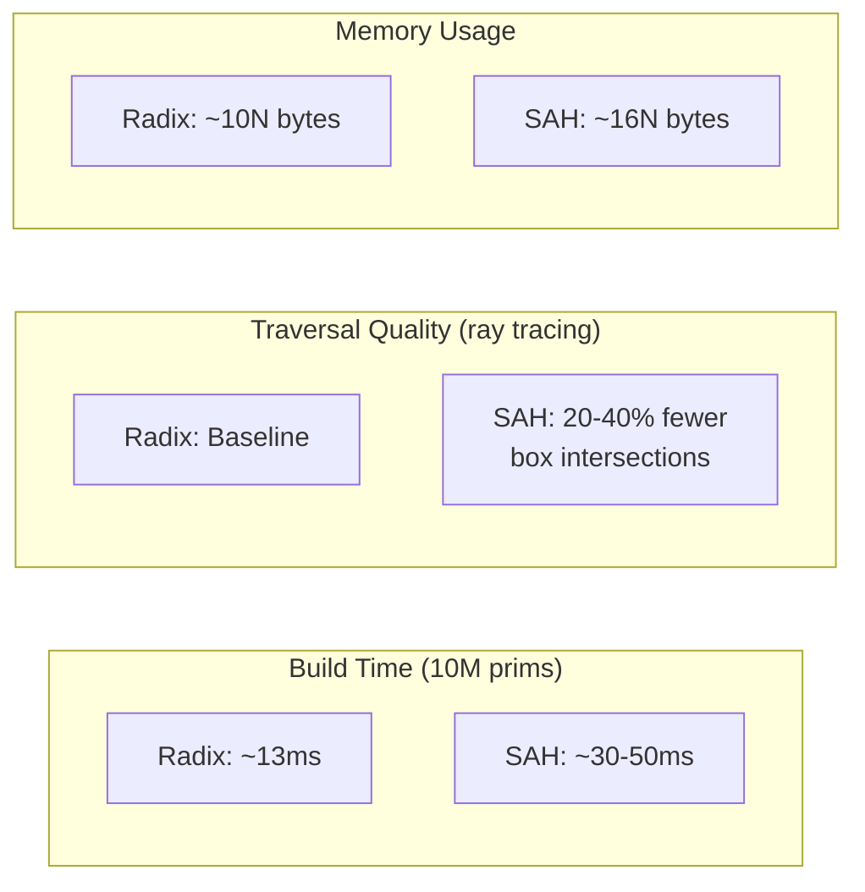

The SAH builder is recommended when:
- Ray tracing performance is critical
- Build time is not a bottleneck (offline or infrequent construction)
- Scene geometry is 3D with float or double precision

**Sources**: [cuBQL/builder/cuda/gpu_builder.h:43-48](), [cuBQL/builder/cuda/sah_builder.h:1-581]()

---

## Limitations and Future Work

### Current Limitations

1. **Type Restriction**: Only supports `float` and `double` with `D=3`
2. **Binning Resolution**: Fixed at 16 bins per dimension; may be suboptimal for highly non-uniform distributions
3. **Batch Processing**: Memory-constrained batching may increase iteration count for very large datasets
4. **No Spatial Splits**: Pure object partitioning; does not support splitting primitives across multiple leaves

### Extension Points

The SAH builder could be extended to:
- Support arbitrary dimension `D` by generalizing the binning loop
- Support integer coordinate types with appropriate bin calculation
- Adjust bin count based on primitive distribution
- Implement spatial splits for overlapping geometry

**Sources**: [cuBQL/builder/cuda/sah_builder.h:393-399](), [cuBQL/builder/cuda/sah_builder.h:48-57]()

---

